<div align="center">
  
  <h1>Codex Overleaf Link</h1>
  <p><strong>Empower Overleaf with Codex.</strong></p>
  <p>
    
    
    
    <a href="https://github.com/Ghqqqq/codex-overleaf-link/actions/workflows/test.yml"></a>
    
    
  </p>
  <p>English | <a href="README.zh-CN.md">简体中文</a></p>
</div>

Codex Overleaf Link adds a Codex panel next to the Overleaf editor. Ask about your project, or let Codex edit it: changes go back through the editor, as tracked changes if you want, and every run can be undone. Codex runs on your machine through the Codex CLI.

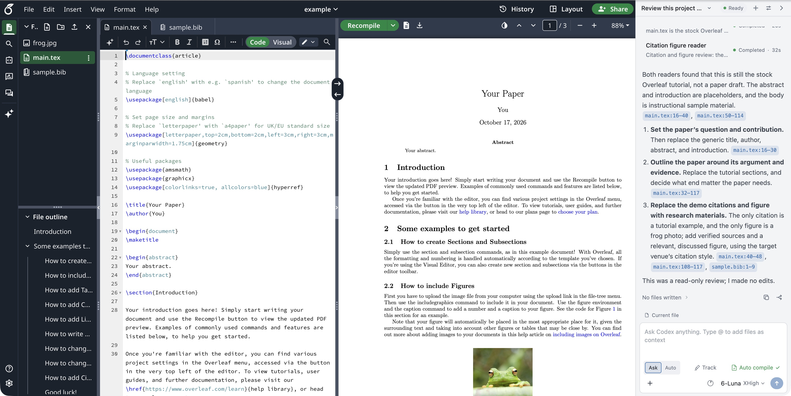

[Features](#features) · [Install](#install) · [How it works](#how-it-works) · [Configuration](#configuration) · [Troubleshooting](#troubleshooting)

## Features

### Ask, Auto and Track

| Mode | Codex can | Changes go to |
|---|---|---|
| **Ask** | read the project | nowhere; Overleaf is not touched |
| **Auto** | read and edit | Overleaf, in Editing mode |
| **Auto + Track** | read and edit | Overleaf, as tracked changes |

With Track on, each rewritten sentence becomes one tracked change and small fixes stay word-level, so the Review panel reads like edits made by hand. **Accept changes** accepts the run's own tracked changes. **Undo changes** restores the files the run wrote and removes the files it created, also after a page reload.

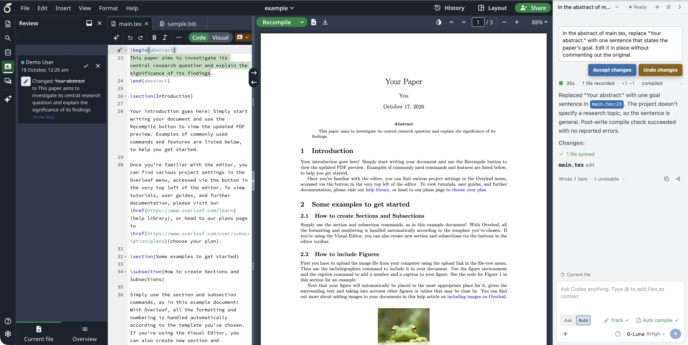

- Auto doesn't ask before each edit, but deleting files and adding or replacing images and PDFs always ask first.
- If a file is edited again after the run, Undo stops at that file instead of overwriting it.
- **Cancel** stops a run. Files already written stay and can still be undone.
- Track Changes depends on the project owner's Overleaf plan. When it isn't available, the panel asks before the run whether to write without tracking.

### Context

Attach project files with `@` or **＋**, add `@compile-log` for a compile problem, or select lines in the editor and choose **Add to Chat** to reference them as a range such as `main.tex:22-24`. **Edit Selection** limits the edit to the selected text. PDFs and images can be attached for Codex to read; they are never added to the project. The line above the composer shows what Codex will read next: the current file, the selected files, or the whole project.

Up to five project files stay attached across turns. Attachments are limited to 8 per turn, 12 MiB each and 32 MiB in total.

<p align="center">
  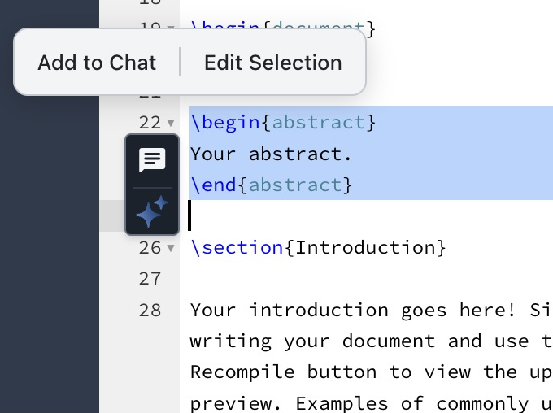
  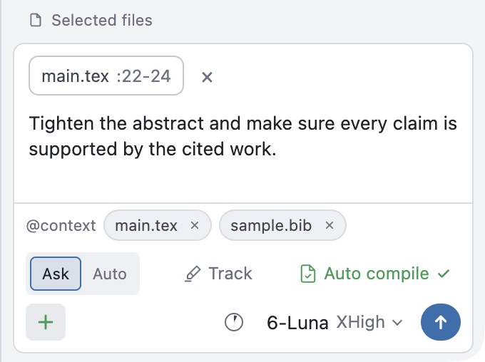
</p>

### Run timeline and subagents

Each run keeps its steps and its answer together. Expand the timeline to see what Codex read, ran and changed. With **Parallel Subagents** on *(experimental)*, the main agent can hand work to readers and workers that run alongside it. Open one to read its conversation, then go back to the main task.

<p align="center">
  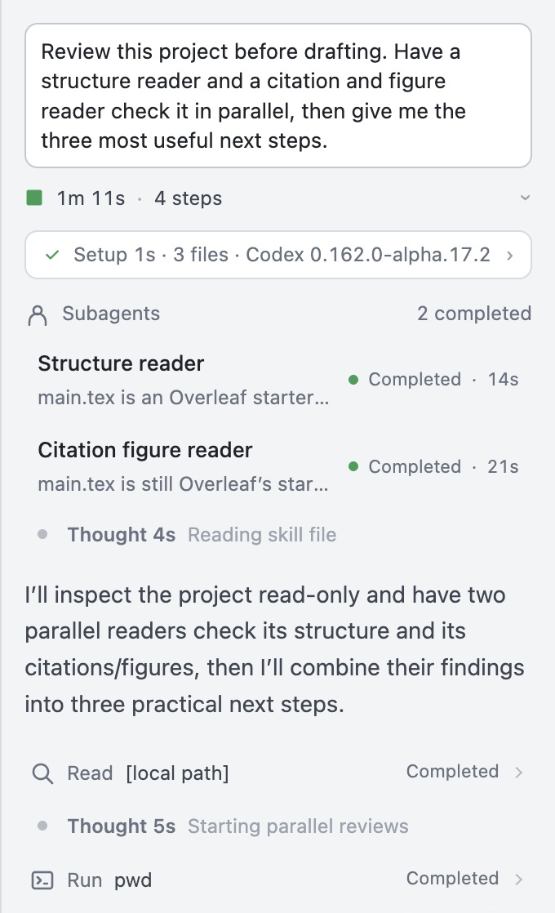
  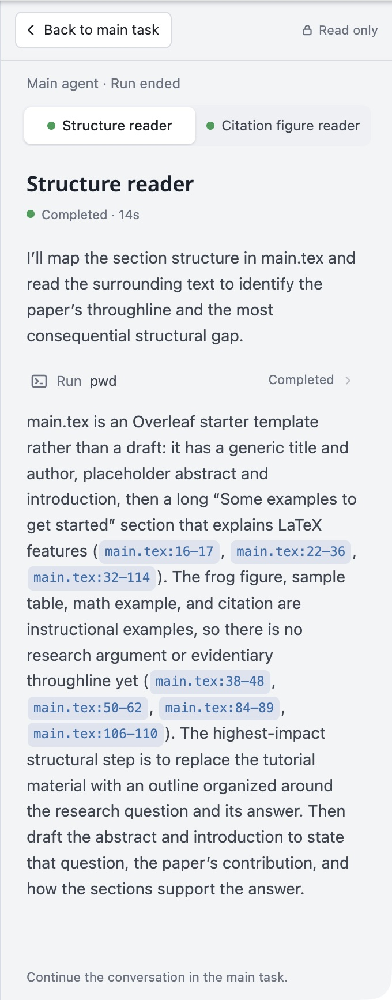
</p>

### Context window

The ring beside the model shows how full the conversation's context window is. Open it to see the latest input, cached input and output, or to compact the conversation; `/compact` does the same.

<p align="center">
  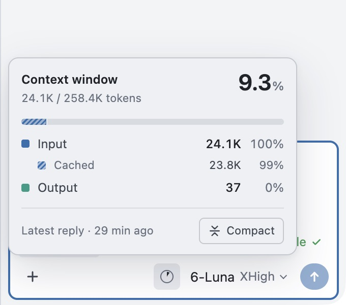
  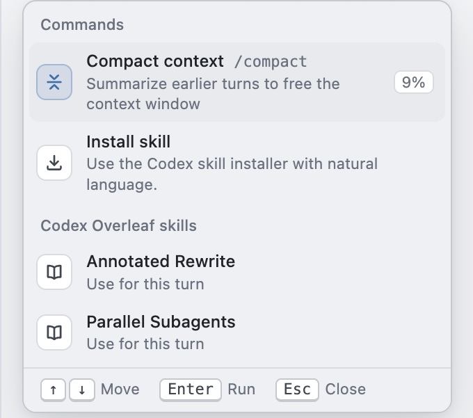
</p>

### Results and compile check

Every run ends with a short result. If a run doesn't go as planned, its card names the cause, what it means for the document, and a next step: **Didn't finish**, **Partly written**, **Not written**, or **Check Overleaf** when a write couldn't be confirmed.

- If you or a collaborator edit a file while Codex works, Codex's patch is moved around your edit, and Undo keeps it. If both change the same text, the file is left as it is and reported as **Not written**. **Retry sync** writes only the files that are still pending.
- With **Auto compile** on, Overleaf recompiles after the write. Errors are read from that compile's log and listed on the card. The fix button drafts a request with `@compile-log` in the composer, for you to send.

<p align="center">
  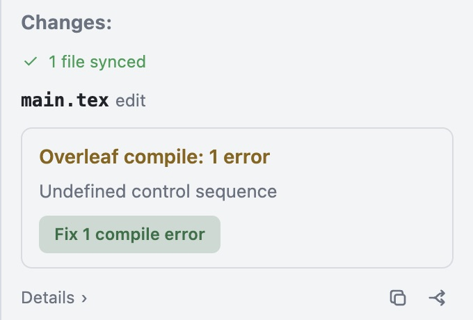
  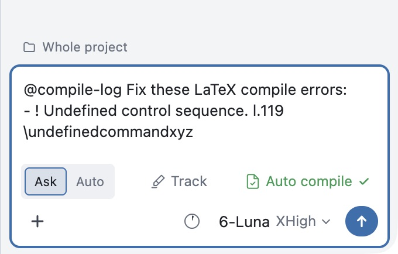
</p>

### Write in My Style *(experimental)*

Builds a writing-style skill from Overleaf projects and PDFs you choose.

1. Open **Settings → This project → Writing**.
2. Under **Write in My Style**, pick reference projects or add text-based PDFs.
3. Generate the style and turn it on for the project. After you change the references, **Update style** refreshes it.

The style guides phrasing, rhythm, structure and tone; facts, results and citations still come from your project. The same page holds the project's **Personalization** notes for terminology and LaTeX conventions.

<p align="center">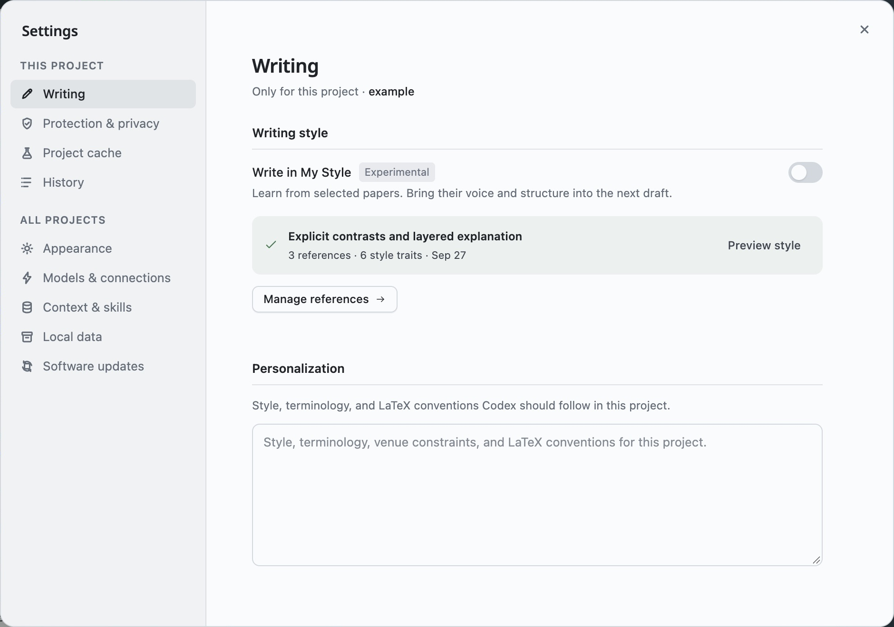</p>

### Models and providers

The panel uses the local Codex CLI's models by default; choose the model and reasoning level in the composer. To use another endpoint *(experimental)*, add a provider under **Settings → All projects → Models & connections**. Shortcuts fill in the defaults for OpenAI-compatible and Anthropic-compatible APIs, Kimi, GLM and DeepSeek; you add the API key and model IDs.

<p align="center">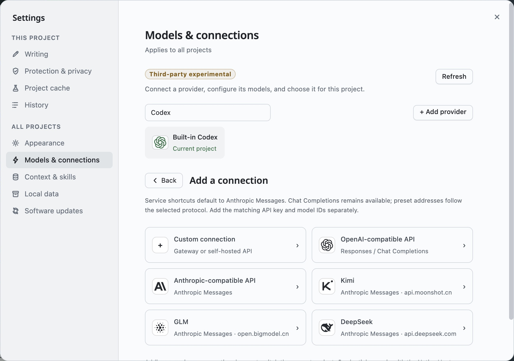</p>

## Install

You need Google Chrome on macOS, Windows or Linux (or Chromium on Linux), Node.js 20+, and the [Codex CLI](https://github.com/openai/codex), installed and signed in. The extension works on `overleaf.com`, `www.overleaf.com` and `cn.overleaf.com`; self-hosted Overleaf is not supported.

### Let Codex install it (recommended)

If you already use Codex in a terminal on the computer where Chrome runs, give it this prompt:

```text
Install Codex Overleaf Link on this computer. Follow the install steps in https://github.com/Ghqqqq/codex-overleaf-link, then tell me what I still need to do in Chrome.
```

### Install with npm

```bash
npm exec --yes codex-overleaf-link@2.6.0 -- install-managed
```

The installer sets up the native host and a managed copy of the extension, then prints the extension's folder.

### Finish in Chrome

In `chrome://extensions`, turn on **Developer mode**, click **Load unpacked** and pick the extension folder. Open an Overleaf project and the panel appears on the right.

<details>
<summary>Other ways to install</summary>

```bash
# macOS / Linux
CODEX_OVERLEAF_REF=v2.6.0 bash -c "$(curl -fsSL https://raw.githubusercontent.com/Ghqqqq/codex-overleaf-link/v2.6.0/install.sh)"
```

```powershell
# Windows
iwr https://raw.githubusercontent.com/Ghqqqq/codex-overleaf-link/v2.6.0/install.ps1 -OutFile install.ps1
$env:CODEX_OVERLEAF_REF='v2.6.0'
powershell -ExecutionPolicy Bypass -File install.ps1
```

```bash
# From source. Unmanaged: rebuild and reload the extension yourself after changes.
git clone https://github.com/Ghqqqq/codex-overleaf-link.git && cd codex-overleaf-link
npm ci && npm run build:content && npm run install:native
# then load extension/ as an unpacked extension
```

The official build always has the extension ID `illdpneeeopfffmiepaejglgmhpmdhdc`. If a custom build gets a different ID, pass `--extension-id <id>` to the installer. For Chromium on Linux, add `--browser chromium`.

</details>

## How it works

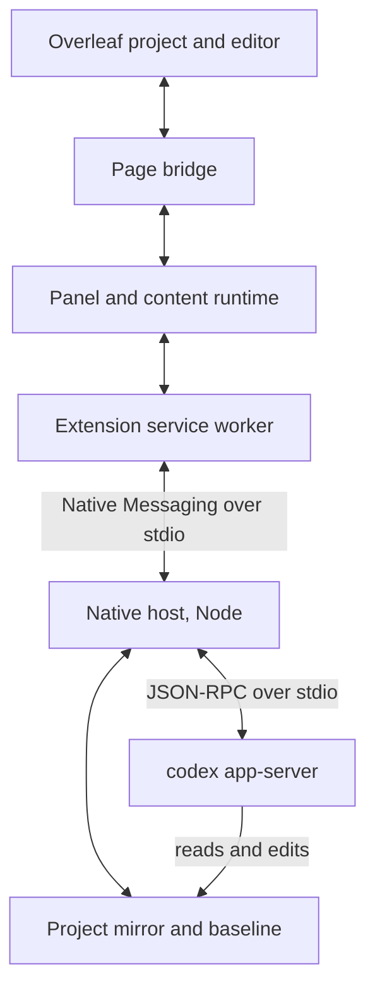

1. When you send a task, the extension saves the run's settings and syncs the project into a local mirror, or reuses the mirror if it is still current.
2. The native host starts `codex app-server` on the mirror, with a Codex home of its own.
3. When Codex is done, the host compares the mirror with its baseline and turns the differences into text patches and file transfers. An Ask run ends here.
4. In Auto, the extension writes each patch through the Overleaf editor. Before writing it checks the project, path rules, edit mode and expected text, and shifts the patch past edits made elsewhere in the file since the run started.
5. It then records the undo point, confirms the save, refreshes the mirror and, if Auto compile is on, recompiles.

Contributor notes on the architecture are in [docs/architecture](docs/architecture/README.md).

## Configuration

**Providers.** In **Settings → All projects → Models & connections → Add provider**, enter the base URL (HTTPS, except for localhost), the API key and the model IDs your endpoint accepts, and pick the protocol: Auto, Responses, Chat Completions or Anthropic Messages. **Test connection** sends one real request. The choice applies to the current project; other projects keep theirs. Keys are stored by the native host, and task context goes to the endpoint you chose.

**Skills.** The plugin's Codex home copies your Codex login and config, but not `~/.codex/AGENTS.md`, `personality`, `rules` or `memories`. **Load local Codex skills** adds `~/.codex/skills` and your local plugins; **Load Codex Overleaf skills** adds `~/.codex-overleaf/skills`. Both are on by default.

**Data.** There is no hosted backend and no telemetry. Task context goes to Codex or to the provider you configured, after a check for tokens and keys. Path rules decide what Codex may write; they don't hide files from it.

<details>
<summary>Where things are stored</summary>

| What | macOS / Linux | Windows |
|---|---|---|
| Sessions and history | IndexedDB `codex-overleaf` on the Overleaf site | same |
| Preferences | the extension's `chrome.storage.local` | same |
| Managed extension and native host | `~/.codex-overleaf/managed/` | `%LOCALAPPDATA%\CodexOverleaf\managed\` |
| Installer checkout | `~/.codex-overleaf/source` | `%LOCALAPPDATA%\CodexOverleaf\source` |
| Project mirrors | `~/.codex-overleaf/projects` | `%USERPROFILE%\.codex-overleaf\projects` |
| Plugin Codex home | `~/.codex-overleaf/codex-home` | `%USERPROFILE%\.codex-overleaf\codex-home` |
| Skills | `~/.codex-overleaf/skills` | `%USERPROFILE%\.codex-overleaf\skills` |
| Providers and keys | `~/.codex-overleaf/providers.json`, `provider-secrets.json` | `%USERPROFILE%\.codex-overleaf\` |
| Logs | `~/.codex-overleaf/native-host.log` | `%LOCALAPPDATA%\CodexOverleaf\native-host.log` |
| Native Messaging manifest | Chrome: `~/Library/Application Support/Google/Chrome/NativeMessagingHosts/com.codex.overleaf.json` (macOS), `~/.config/google-chrome/NativeMessagingHosts/` (Linux); Chromium: `~/.config/chromium/NativeMessagingHosts/` | `HKCU\Software\Google\Chrome\NativeMessagingHosts\com.codex.overleaf` |

The history database belongs to the Overleaf site, so removing the extension doesn't delete it.

</details>

## Updating

Managed installs check GitHub Releases for signed stable versions. **Update now**, in the update notice or under **Settings → All projects → Software updates**, waits until Overleaf is saved and idle, replaces the extension and native host together, and rolls back if the new version fails its health check. **Restore previous version** takes you back. The updater follows HTTP(S) proxy variables and the macOS/Windows system proxy.

- From 2.5.1 or later, updates happen in place.
- From 2.5.0, update to 2.5.1 first.
- From anything older, rerun the installer. It moves the install to Bootstrap protocol 3, which the `cn.overleaf.com` permission needs. Then reload the extension. Sessions, settings and keys are kept.

Source checkouts and release-zip installs are unmanaged; update them by hand. Each GitHub release carries the extension zip, the native host runtime, the update bundle, the npm package, installers pinned to that release, and signed checksums.

## Commands

| Task | Command |
|---|---|
| Install, repair or migrate | `npm exec --yes codex-overleaf-link@2.6.0 -- install-managed` |
| Diagnose | `npm exec --yes codex-overleaf-link@2.6.0 -- doctor` |
| Uninstall | `npm exec --yes codex-overleaf-link@2.6.0 -- uninstall-managed` |
| Native host only, for an unmanaged extension | `npm exec --yes codex-overleaf-link@2.6.0 -- install-native` / `uninstall-native` |

`uninstall-managed` removes the native host registration, the bridge, the managed extension and its runtimes. Your history, settings, mirrors, keys and skills stay. To remove everything, clear the history under **Settings → All projects → Local data → Clear local history…**, uninstall, remove the extension in `chrome://extensions`, and delete `~/.codex-overleaf` and the `~/Codex Overleaf Link Extension` shortcut (on Windows, `%USERPROFILE%\.codex-overleaf` and `%LOCALAPPDATA%\CodexOverleaf`).

<a name="faq-and-troubleshooting"></a>

## Troubleshooting

- **The native host is missing or needs an update.** Rerun `install-managed`, reload the extension and refresh Overleaf.
- **Codex CLI not found.** Make sure `codex --version` works in a new terminal, then rerun the installer so it picks up your `PATH`.
- **Extension ID mismatch.** Copy the ID from `chrome://extensions` and reinstall with `--extension-id <id>`.
- **A file was skipped.** Its target text changed during the run, the editor couldn't open it, or a path rule makes it read-only. The details under the answer say which.
- **A write was blocked by a path rule or the sensitive-content check.** Path rules can make files read-only; the check looks for tokens and keys before context leaves your machine. Change the rule in the project settings, or remove what the check found.
- **The compile result is unconfirmed.** The panel only reports a compile whose log it could read. Check the log in Overleaf.
- **Undo changes or Accept changes is missing.** Both depend on what the run wrote. If files were written but the button is gone, check the changes in Overleaf and attach **Export Diagnostics** to an issue.
- **A queued message or a fork won't run.** Queued messages keep the settings they were sent with; if that provider was changed or deleted, send the message again. Forking needs a recorded Codex turn.
- **Reporting a bug.** Attach **Export Diagnostics** from the panel. By default it leaves out project text, prompts, compile logs, diffs and secrets.

## Development

```bash
npm ci
npm test                      # core suite
npm run test:platform         # installation and process contracts
npm run build:content         # bundle the content script
npm run install:managed       # put a local build into the managed install
```

The content script is bundled from [content-entry.mjs](extension/entries/content-entry.mjs). There are no npm runtime dependencies: development uses a pinned esbuild, and the Markdown and math libraries are vendored. `npm run bridge` runs the native host on stdio.

| Area | Entry points |
|---|---|
| Panel and runs | `extension/src/content/contentRuntime.js`, `runController.js` |
| Snapshots and writeback | `extension/src/pageBridge.js`, `extension/src/page/snapshotRouter.js`, `writebackRouter.js` |
| Transport | `extension/src/background.js`, `native-host/src/index.js` |
| Codex and the mirror | `native-host/src/taskRunnerRuntime.js`, `codexSessionRunner.js`, `mirrorWorkspace.js` |
| Patches | `native-host/src/textPatch.js` |
| Updates and packaging | `extension/bootstrap/`, `native-host/src/updateManager.js`, `scripts/` |

To run standalone panel, Native, project-read and diagnostics probes against a real project:

```bash
npm run smoke:extension -- --url 'https://www.overleaf.com/project/<id>' --probe panel,native,project,diagnostics --json .local/smoke.json
```

For local Managed installation acceptance, follow the [development SOP](docs/architecture/change-workflow.md#4-implement-and-validate-obtain-evidence-proportional-to-risk), including extension Reload, loaded build identity, Ask with zero writes, reversible two-file write/Undo, editor cleanup and refreshed history. Apply the SOP's Luna selection, model/run-ID recording, and unavailable-model blocker rules to real-model runs.

Pull requests are welcome. For larger changes, please open an issue first, and keep both READMEs in step.

## License

[MIT](LICENSE)
