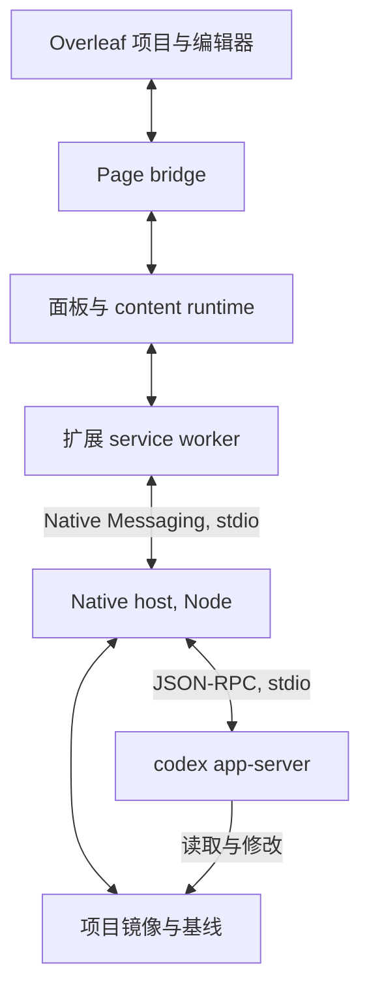

<div align="center">
  
  <h1>Codex Overleaf Link</h1>
  <p><strong>Empower Overleaf with Codex.</strong></p>
  <p>
    
    
    
    <a href="https://github.com/Ghqqqq/codex-overleaf-link/actions/workflows/test.yml"></a>
    
    
  </p>
  <p><a href="README.md">English</a> | 简体中文</p>
</div>

Codex Overleaf Link 在 Overleaf 编辑器旁边加了一个 Codex 面板。你可以就项目提问，也可以让 Codex 直接动手修改：改动通过编辑器写回，可以选择以留痕形式写入，接受改动之前每一轮都能撤销。Codex 通过 Codex CLI 在你的电脑上运行。


[功能](#功能) · [安装](#安装) · [工作原理](#工作原理) · [配置](#配置) · [常见问题](#常见问题)

## 功能

### Ask、Auto 和 Track

| 模式 | Codex 可以 | 改动写到哪里 |
|---|---|---|
| **Ask** | 阅读项目 | 不写入，不改动 Overleaf |
| **Auto** | 阅读和修改 | Overleaf（编辑模式） |
| **Auto + Track** | 阅读和修改 | Overleaf（留痕） |

开启 Track 后，改写的一句对应一条留痕，小改动保持在词级，审阅面板里看到的就像人工修改留下的痕迹。**接受改动**会接受本轮自己的留痕；**撤销改动**把本轮写过的文件恢复原样，并删除本轮新建的文件，刷新页面后也能撤销。


- Auto 不会逐处征求同意，但删除文件、新增或替换图片和 PDF 一定会先问你。
- 如果某个文件在这一轮之后又被改过，撤销会在这个文件上停下，不会覆盖。
- **取消**会停止运行，已经写入的内容保留，之后仍然可以撤销。
- 能否使用 Track Changes 取决于项目所有者的 Overleaf 套餐。不能用的时候，面板会在运行前问你要不要直接写入。

### 上下文

可以用 `@` 或 **＋** 添加项目文件，用 `@compile-log` 附上编译问题；也可以在编辑器里选中几行，点**加入对话**，以 `main.tex:22-24` 这样的行范围引用。点**仅编辑此处**，则把这次修改限定在选中的文字里。PDF 和图片可以作为附件给 Codex 阅读，不会加入项目。输入框上方会显示 Codex 下一条消息会读什么：当前文件、你选的文件，或者整个项目。

添加的项目文件最多 5 个，会在后续对话中一直保留；附件每轮最多 8 个，单个不超过 12 MiB，合计不超过 32 MiB。

<p align="center">
  
  
</p>

### 运行过程与子代理

每一轮的执行步骤和回答放在一起。展开时间线，可以看到 Codex 读了什么、运行了什么命令、改了什么。开启并行子代理（实验）后，主 agent 可以把任务分给并行运行的子代理，自己继续工作；点开任意一个子代理就能看到它的对话，看完再回到主任务。

<p align="center">
  
  
</p>

### 上下文窗口

模型旁边的小圆环显示当前对话的上下文窗口用了多少。点开可以看到最近一次的输入、缓存输入和输出，也可以在这里压缩对话；输入 `/compact` 效果一样。

<p align="center">
  
  
</p>

### 运行结果与编译检查

每一轮结束都会给出一个简短的结果。没有按预期完成时，卡片会写明原因、对文档的影响和下一步该做什么，分为**未完成**、**部分写入**、**未写入**，以及写入结果无法确认时的**请检查 Overleaf**。

- Codex 工作期间，如果你或合作者改了同一个文件，Codex 的补丁会避开你的修改写入，撤销时也会保留你的修改；如果双方改的是同一段文字，这个文件不会写入，卡片会标为**未写入**。**重试同步**只补写还没写完的文件。
- 开着**自动编译**时，写入后 Overleaf 会重新编译。错误取自这次编译的日志，列在卡片上；点修复按钮，会在输入框里起草一条带 `@compile-log` 的修复请求，由你确认后发送。

<p align="center">
  
  
</p>

### 沿用写作风格（实验）

从你选定的 Overleaf 项目和 PDF 里提炼写作习惯，生成一个可复用的写作风格 skill。

1. 打开**设置 → 当前项目 → 写作**。
2. 在**沿用写作风格**里选择参考项目，或者添加能提取文字的 PDF。
3. 生成风格后为当前项目启用。参考资料有变化时，点**更新风格**重新生成。

写作风格影响措辞、节奏、结构和语气；论文的事实、结果和引用仍然以项目内容为准。同一页还有本项目的**个性化配置**，可以写下术语和 LaTeX 习惯。

<p align="center"></p>

### 模型与连接

默认使用本机 Codex CLI 的模型，在输入框里选择模型和推理强度。要接入其他服务（实验），在**设置 → 所有项目 → 模型与连接**里添加模型服务。快捷入口会填好 OpenAI 兼容接口、Anthropic 兼容接口以及 Kimi、GLM、DeepSeek 的默认配置，API 密钥和模型 ID 需要自己填写。

<p align="center"></p>

## 安装

需要 macOS、Windows 或 Linux 上的 Google Chrome（Linux 上也可以用 Chromium）、Node.js 20 及以上版本，以及已安装并登录的 [Codex CLI](https://github.com/openai/codex)。支持 `overleaf.com`、`www.overleaf.com` 和 `cn.overleaf.com`，暂不支持自建的 Overleaf。

### 让 Codex 帮你安装（推荐）

如果你已经在 Chrome 所在的电脑上用终端里的 Codex，把下面这段话发给它：

```text
在这台电脑上安装 Codex Overleaf Link：按照 https://github.com/Ghqqqq/codex-overleaf-link 里的安装步骤操作，最后告诉我还需要在 Chrome 里做什么。
```

### 用 npm 安装

```bash
npm exec --yes codex-overleaf-link@2.6.0 -- install-managed
```

安装器会装好 native host 和一份托管的扩展，最后输出扩展所在的文件夹。

### 在 Chrome 里完成

打开 `chrome://extensions`，开启**开发者模式**，点**加载已解压的扩展程序**，选择扩展所在的文件夹。之后打开任意 Overleaf 项目，面板会出现在右侧。

<details>
<summary>其他安装方式</summary>

```bash
# macOS / Linux
CODEX_OVERLEAF_REF=v2.6.0 bash -c "$(curl -fsSL https://raw.githubusercontent.com/Ghqqqq/codex-overleaf-link/v2.6.0/install.sh)"
```

```powershell
# Windows
iwr https://raw.githubusercontent.com/Ghqqqq/codex-overleaf-link/v2.6.0/install.ps1 -OutFile install.ps1
$env:CODEX_OVERLEAF_REF='v2.6.0'
powershell -ExecutionPolicy Bypass -File install.ps1
```

```bash
# 从源码安装。这种方式不受托管，改动后要自己重新构建、重新加载扩展。
git clone https://github.com/Ghqqqq/codex-overleaf-link.git && cd codex-overleaf-link
npm ci && npm run build:content && npm run install:native
# 然后把 extension/ 作为已解压的扩展程序加载
```

官方构建的扩展 ID 固定为 `illdpneeeopfffmiepaejglgmhpmdhdc`。自己构建的扩展 ID 不同时，安装时加上 `--extension-id <id>`。Linux 上使用 Chromium 时，加上 `--browser chromium`。

</details>

## 工作原理



1. 发送任务时，扩展先记下本轮的设置，把项目同步到本地镜像；镜像还是最新的就直接复用。
2. native host 在镜像上启动 `codex app-server`，使用一个独立的 Codex home。
3. Codex 完成后，host 对比镜像和基线，把差异整理成文本补丁和文件传输。Ask 模式到这里就结束了。
4. Auto 模式下，扩展通过 Overleaf 编辑器逐个写入补丁。写入前会核对项目、路径规则、编辑模式和预期文字；如果运行期间文件别处被改过，补丁会相应调整位置。
5. 最后记录撤销点、确认已保存、刷新镜像；开着自动编译时再重新编译一次。

面向贡献者的架构说明见 [docs/architecture](docs/architecture/README.md)。

## 配置

**模型服务。** 在**设置 → 所有项目 → 模型与连接 → 添加模型服务**中，填写基础 URL（除 localhost 外需要 HTTPS）、API 密钥和服务端接受的模型 ID，再选择协议：自动、Responses、Chat Completions 或 Anthropic Messages。**测试连接**会发送一次真实请求。选择只对当前项目生效，其他项目保留各自的设置。密钥由 native host 保存，任务上下文会发给你选择的服务。

**技能。** 插件使用独立的 Codex home，会复制你的 Codex 登录信息和配置，但不包括 `~/.codex/AGENTS.md`、`personality`、`rules` 和 `memories`。**加载 Codex 本地技能**会加入 `~/.codex/skills` 和本地插件，**加载 Codex Overleaf 专属技能**会加入 `~/.codex-overleaf/skills`，两项默认都开启。

**数据。** 没有云端服务，也没有遥测。任务上下文会先检查是否含有 token 和密钥，再发给 Codex 或你配置的模型服务。路径规则只决定 Codex 能写哪些文件，不会对它隐藏文件。

<details>
<summary>数据存放位置</summary>

| 内容 | macOS / Linux | Windows |
|---|---|---|
| 会话与历史 | Overleaf 站点下的 IndexedDB `codex-overleaf` | 同左 |
| 偏好设置 | 扩展的 `chrome.storage.local` | 同左 |
| 托管的扩展与 native host | `~/.codex-overleaf/managed/` | `%LOCALAPPDATA%\CodexOverleaf\managed\` |
| 安装器源码 | `~/.codex-overleaf/source` | `%LOCALAPPDATA%\CodexOverleaf\source` |
| 项目镜像 | `~/.codex-overleaf/projects` | `%USERPROFILE%\.codex-overleaf\projects` |
| 插件的 Codex home | `~/.codex-overleaf/codex-home` | `%USERPROFILE%\.codex-overleaf\codex-home` |
| 技能 | `~/.codex-overleaf/skills` | `%USERPROFILE%\.codex-overleaf\skills` |
| 模型服务与密钥 | `~/.codex-overleaf/providers.json`、`provider-secrets.json` | `%USERPROFILE%\.codex-overleaf\` |
| 日志 | `~/.codex-overleaf/native-host.log` | `%LOCALAPPDATA%\CodexOverleaf\native-host.log` |
| Native Messaging 清单 | Chrome：`~/Library/Application Support/Google/Chrome/NativeMessagingHosts/com.codex.overleaf.json`（macOS）、`~/.config/google-chrome/NativeMessagingHosts/`（Linux）；Chromium：`~/.config/chromium/NativeMessagingHosts/` | `HKCU\Software\Google\Chrome\NativeMessagingHosts\com.codex.overleaf` |

历史数据库属于 Overleaf 站点，删除扩展并不会删除它。

</details>

## 更新

托管安装会在 GitHub Release 上检查已签名的正式版。在更新提示里或**设置 → 所有项目 → 软件更新**中点**立即更新**，更新会等 Overleaf 保存好、处于空闲时再开始，扩展和 native host 一起替换；新版本健康检查不通过会自动回滚。**恢复到上一版本**可以回到原来的版本。更新器会使用 HTTP(S) 代理环境变量以及 macOS/Windows 的系统代理。

- 2.5.1 及以上：直接原地更新。
- 2.5.0：先更新到 2.5.1。
- 更早的版本：重新运行安装器，把安装迁移到 Bootstrap 协议 3（`cn.overleaf.com` 权限需要它），然后重新加载扩展。会话、设置和密钥都会保留。

源码安装和 release zip 安装不受托管，需要手动更新。每个 GitHub Release 都包含扩展压缩包、native host 运行时、更新包、npm 包、固定版本的安装脚本，以及签名的校验文件。

## 命令

| 用途 | 命令 |
|---|---|
| 安装、修复或迁移 | `npm exec --yes codex-overleaf-link@2.6.0 -- install-managed` |
| 诊断 | `npm exec --yes codex-overleaf-link@2.6.0 -- doctor` |
| 卸载 | `npm exec --yes codex-overleaf-link@2.6.0 -- uninstall-managed` |
| 只装 native host（扩展自行管理时） | `npm exec --yes codex-overleaf-link@2.6.0 -- install-native` / `uninstall-native` |

`uninstall-managed` 会删除 native host 注册、bridge、托管的扩展和运行时，历史、设置、镜像、密钥和技能都会保留。要彻底清理：先在**设置 → 所有项目 → 本地数据 → 清理本地历史…**中清掉历史，再卸载，然后在 `chrome://extensions` 里移除扩展，最后删除 `~/.codex-overleaf` 和 `~/Codex Overleaf Link Extension` 快捷方式（Windows 上是 `%USERPROFILE%\.codex-overleaf` 和 `%LOCALAPPDATA%\CodexOverleaf`）。

<a name="faq-and-troubleshooting"></a>

## 常见问题

- **找不到 native host，或提示需要更新。** 重新运行 `install-managed`，重新加载扩展，再刷新 Overleaf。
- **找不到 Codex CLI。** 在新开的终端里确认 `codex --version` 能运行，再重新运行安装器，让它拿到最新的 `PATH`。
- **扩展 ID 不匹配。** 从 `chrome://extensions` 复制扩展 ID，用 `--extension-id <id>` 重新安装。
- **有文件被跳过。** 可能是运行期间目标文字被改过、编辑器没能打开这个文件，或者路径规则把它设成了只读。回答下方的详情会写明是哪一种。
- **写入被路径规则或敏感信息检查拦下。** 路径规则可以把文件设为只读；敏感信息检查会在上下文离开本机前查找 token 和密钥。可以在项目设置里调整规则，或者删掉检查发现的内容。
- **编译结果显示待确认。** 面板只报告能读到日志的那次编译，可以在 Overleaf 里查看日志确认。
- **撤销改动或接受改动按钮不见了。** 这两个按钮取决于这一轮实际写入了什么。如果确实写入了文件但按钮不见了，请先在 Overleaf 里检查改动，再附上**导出诊断信息**提交 issue。
- **排队的消息或分叉没有运行。** 排队的消息会沿用发送时的设置；如果对应的模型服务被修改或删除了，请重新发送。分叉需要有一轮已记录的 Codex 对话。
- **反馈 bug。** 附上面板里的**导出诊断信息**。默认不包含项目正文、提示词、编译日志、diff 和密钥。

## 开发

```bash
npm ci
npm test                      # 核心测试
npm run test:platform         # 安装和进程相关的测试
npm run build:content         # 打包 content script
npm run install:managed       # 把本地构建装进托管安装
```

content script 从 [content-entry.mjs](extension/entries/content-entry.mjs) 打包。项目没有 npm 运行时依赖：开发时使用固定版本的 esbuild，Markdown 和数学公式库直接随仓库提供。`npm run bridge` 会在 stdio 上运行 native host。

| 模块 | 入口 |
|---|---|
| 面板与运行 | `extension/src/content/contentRuntime.js`、`runController.js` |
| 快照与写回 | `extension/src/pageBridge.js`、`extension/src/page/snapshotRouter.js`、`writebackRouter.js` |
| 通信 | `extension/src/background.js`、`native-host/src/index.js` |
| Codex 与镜像 | `native-host/src/taskRunnerRuntime.js`、`codexSessionRunner.js`、`mirrorWorkspace.js` |
| 补丁 | `native-host/src/textPatch.js` |
| 更新与打包 | `extension/bootstrap/`、`native-host/src/updateManager.js`、`scripts/` |

在真实项目上做冒烟测试：

```bash
npm run smoke:extension -- --url 'https://www.overleaf.com/project/<id>' --probe panel,native,project,diagnostics --json .local/smoke.json
```

欢迎提交 PR。较大的改动请先开 issue 讨论，并保持中英文 README 同步。

## 许可证

[MIT](LICENSE)
