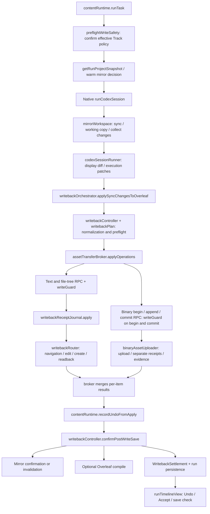

# Auto Edits, Writeback, Save Confirmation, and Undo

This page maps the source path from an Auto text edit through writeback, save confirmation, Undo, and recovery after refresh.
It supports investigation of questions such as where changes were written, what proves they were saved, why Undo skipped an item, and why buttons disappeared after refresh.

Initial reference source baseline: `main@2073ae74747431aab8d529803d4e9f8197262388`; initial reference package version: `2.5.0`. Current behavior is maintained against this repository's implementation.
See the [architecture index](README.md) for the main entry point and the [feature map](feature-map.md) for other features.

## 1. Distinguish Four Content Representations and Two Identities First

**Current behavior.** The editor, server ZIP, local working copy, and run baseline have separate responsibilities.

| Concept | Meaning and authoritative source | Source and symbols to read first |
|---|---|---|
| Editor content $C$ | Live content of the document open on the current page; it may be unsaved | `readActiveEditorText` in [pageBridge](../../extension/src/pageBridge.js); [overleafEditor](../../extension/src/page/overleafEditor.js) |
| Project snapshot | A project file set produced by one read, with metadata for source, completeness, skipped items, and so on | `buildProjectSnapshot` and `buildZipOnlyProjectSnapshot` in [snapshotRouter](../../extension/src/page/snapshotRouter.js) |
| Local mirror $W$ | A disk working copy managed by the Native Host, where the agent makes changes | `getProjectMirror` and `syncOverleafToMirror` in [mirrorWorkspace](../../native-host/src/mirrorWorkspace.js) |
| Baseline $B$ | Original file content and hashes used to compute this run's changes and check concurrent edits | `buildBaselineFile` and `collectMirrorChangesDetailed` in the same file |
| Execution configuration snapshot | Mode, Track, model, Provider, context, and other settings fixed at submission | [runExecutionSnapshot](../../extension/src/shared/runExecutionSnapshot.js); the run uses `executionSnapshot` |
| Run ownership | The original project, session, and run record, which bind late results and recovery actions | `currentRunView` and `getRunProjectIdForWriteback` in [contentRuntime](../../extension/src/content/contentRuntime.js) |

The content snapshot answers what the run saw; the execution configuration snapshot answers which settings it used.
Together with the local mirror, these resemble a reference draft, an instruction sheet, and a workbench: new content on the workbench does not automatically become saved project state.

Run ownership can be written as $I=(projectId,sessionId,runId)$; persisted recovery records also carry `accountScopeId`.
Initial execution uses the submitted configuration. Later Undo remains bound to the original project and determines Track semantics from the original run record.
Check recovery entry points field by field: explicit Retry sync takes Track and auto-compile from the original execution snapshot when it holds a valid boolean. Otherwise Track uses the recovery intent's normalized value (a missing value reads as `false`), while auto-compile falls back to the current panel setting; see Section 7.
See [run state and recovery](run-state-and-recovery.md) for the detailed session and persistence path.

**Current implementation boundary.** `METHODS` in [pageRpcContract](../../extension/src/shared/pageRpcContract.js) declares each RPC's identity policy.
`applyOperations`, Accept, Reject, and compile triggering require project identity; `ensureReviewing` and `ensureEditing` are `optional`.
`dispatch` in [pageBridge](../../extension/src/pageBridge.js) executes `writeGuard.runWriteGuard` according to this catalog.
When checking a new call, inspect the catalog policy, caller arguments, and actual handler together. Crossing Page RPC does not establish that every method rejects missing identity.
Mode switching with optional project identity still retains the Page Bridge capability-token check; see [protocols and trust boundaries](protocols-and-trust.md) for the token's trust assumptions about MAIN scripts in the same document.

## 2. End-to-End Call Graph

**Current behavior.** Content is the isolated world that hosts the sidebar; Page is the MAIN world that can read Overleaf editor objects; Native is the local process.
This graph shows the main chain. Mode, permission, and failure branches are detailed below.



The source entry points are `runTask` in [contentRuntime](../../extension/src/content/contentRuntime.js) and
`runCodexSession` in [codexSessionRunner](../../native-host/src/codexSessionRunner.js).
The latter calls `syncOverleafToMirror` to prepare local content, calls `collectMirrorChangesDetailed` after execution, and ultimately returns `syncChanges`.
Within that result, `diff` is generated by `computeLineDiff` in [diffEngine](../../native-host/src/diffEngine.js) for display;
`patches` are generated by `computeTextPatches` in [textPatch](../../native-host/src/textPatch.js) for subsequent writes.
Content consumes these changes in `applySyncChangesToOverleaf`; a model's natural-language summary is not evidence of file changes.

## 3. Key Branches When a Snapshot Enters the Mirror

**Current behavior.** `contentRuntime.runTask` first calls [otWarmMirror.resolveWarmRunStart](../../extension/src/content/otWarmMirror.js), trying an ordinary mirror or OT focused-file warm start and reading the current editor overlay.
When no warm start is selected, `contentRuntime.getRunProjectSnapshot` first requests a full ZIP, including binaries, and forbids editor navigation for reading. If a complete result is unavailable, it tries a page-state read without navigation.
After obtaining a snapshot, `contentRuntime.resolveWarmMirrorReuse` also considers snapshot completeness, focused-file overlays, and mirror health to decide whether reuse is possible.
[snapshotRouter](../../extension/src/page/snapshotRouter.js) determines how the ZIP, active editor overlay, and page file records merge.
[overleafProjectSnapshot](../../extension/src/page/overleafProjectSnapshot.js) composes the snapshot bridge and cache-related dependencies.

- Full snapshot: `mirrorWorkspace.syncOverleafToMirror` enters the full-replacement branch according to `fullProjectSnapshot`. It removes mirror files absent from both the normalized input and the known unread-path set, updates baselines for successfully read files, and retains old baselines for unread assets. An absent path can represent a file deleted from the project only when the path set is complete and file identity remains consistent; see the ZIP path-identity boundary below.
- Partial snapshot: overwrites only read paths and merges old baselines. A file not read this time cannot be inferred to have been deleted from the server.
- Warm mirror: ordinary warm start checks overall mirror health and the current overlay. OT warm start also checks focused-file freshness through [otWarmMirrorController.canUseOtWarmStart](../../extension/src/content/otWarmMirrorController.js). Observed events reach Native `mirror.patchFiles` through the `otWarmMirror` queue; a partial update alone does not prove that the whole project is synchronized.
- Save check: `serverOnly: true` explicitly requires a server source. An editor overlay cannot prove server persistence.

<a id="zip-path-identity"></a>

**Current behavior: literal ZIP filenames and path identity.** ZIP entry names, project metadata, and structured operation paths are literal project-relative paths. [projectFiles.normalizeSafeProjectPath](../../extension/src/shared/projectFiles.js) validates and returns the original value without URI decoding: `chapter%20one.tex`, `chapter one.tex`, `100%.tex`, and names containing a literal `%2F` retain their distinct identities. Validation rejects absolute paths, drive letters, backslashes, control characters, empty or dot segments, leading or trailing whitespace, and input longer than `MAX_SAFE_PROJECT_PATH_LENGTH`. Explicit URL-encoded boundaries instead use `normalizeUrlEncodedProjectPath`, which returns one decoding pass and checks nested encoded separators and traversal risks; for example, `chapter%2520one.tex` becomes the literal `chapter%20one.tex`. Project IDs, doc IDs, and other URL parameters continue to follow their own encoding rules.

`snapshotRouter.extractFilesFromZip` decodes names strictly as UTF-8. Invalid or indeterminate paths and duplicate entries enter `skipped` and set `pathIdentityComplete:false`. The previously retained first entry of a duplicate name is also removed from the trusted file set; neither an editor overlay nor page fallback can reintroduce that ambiguous path. Ordinary directory entries remain allowed. This flag propagates to ZIP snapshots, exact file listings, and combined snapshots, preventing the result from being marked `fullProjectSnapshot:true`. `contentRuntime.sanitizeRunProjectSnapshot` independently checks structured files for validity and uniqueness. `getRunProjectSnapshot` preserves negative evidence of known path errors so that a page fallback cannot overwrite it with a complete-snapshot claim. Ordinary ZIP unavailability still uses the original page fallback.

Native full-snapshot admission therefore cannot interpret these omissions as remote deletions. When an ambiguous file is focused, neither Content nor Native focused-partial checks can obtain evidence for it; other known trusted files may continue within the focused scope. [referenceProjects.readProject](../../extension/src/page/referenceProjects.js) returns `reference_project_incomplete` for incomplete path identity and does not claim `referenceTextComplete`. `fullProjectSnapshot` and `contentComplete` separately express complete path coverage and fully readable content; known unread paths caused by binary quotas are handled as described below.

Literal identity also has a local-filesystem boundary. Before `mirrorWorkspace.syncOverleafToMirror` creates directories, cleans up old files, writes content, or advances baselines, [projectPathPlatform](../../native-host/src/projectPathPlatform.js) preflights Windows names using the actual `process.platform`. It explicitly rejects colons and alternate-data-stream syntax, reserved device names, trailing dots or spaces, reserved characters, overlong components, and detected case-alias collisions, preserving the old mirror and baselines. Request fields cannot override platform detection. Colon-containing names that are valid on POSIX remain usable there.

Focus arrays from file chips (selected-file labels) declare literal semantics with `focusFilesAreLiteral:true`; structured files, changes, and OT overlays always match by literal identity. For new-format requests with focus or write-scope restrictions, the background requires Native's optional `literalProjectPaths` capability. When an older Host lacks it, the UI asks for an update and reload instead of continuing to interpret paths with the old prompt-text rules; see [protocols and trust boundaries](protocols-and-trust.md) for entry points and compatibility with older callers.

Changes to literal-path handling call for representative Overleaf filenames and the affected local platform; a simulated Windows predicate cannot establish acceptance on a Windows filesystem.

**Quota skips and content completeness.** When a request includes binaries and reads content, `extractFilesFromZip` adds assets exceeding the per-file or project binary budget to `capabilities.skipped` and omits their content. For a full ZIP, `fullProjectSnapshot` describes path-read coverage; `contentComplete` separately describes whether all content was read. Listing-only `includeContent:false` does not apply content-budget trimming.
[mirrorWorkspace.resolveUnreadSnapshotFiles](../../native-host/src/mirrorWorkspace.js) merges binary-budget skips from ZIP handling and the Native normalizer, includes their paths in the existence set, preserves existing local files and old baselines, and records `unreadFiles`. Unread assets acquire no new freshness: the mirror stays dirty, `lastFullSyncAt` does not advance, and warm reuse, in-place post-writeback confirmation, and OT patching each check unread state independently. Partial refreshes retain that state. A later full read of the file can clear it; only a complete listing confirming remote deletion removes the old copy.
[collectMirrorChangesDetailed](../../native-host/src/mirrorWorkspace.js) returns `snapshot_content_unavailable` for local creation, modification, or deletion of an unread path and produces no writeback operation. An overlay cannot promote its old content to a current baseline either. [codexPromptAssembly](../../native-host/src/codexPromptAssembly.js) lists unread paths and explains that preserved copies may be stale; ordinary readable files may still be processed. This mechanism protects those paths without tracing content provenance for copies across paths.
Native admission still independently checks the actual total binary payload in the snapshot; see [nativeQuotas.validateNativeRequestQuotas](../../native-host/src/nativeQuotas.js). Its total limit is lower than the ZIP project budget, so ordinary total-budget-skip scenarios are rejected before mirror writes and preserve the old mirror. The payload remaining after a per-file skip may be admitted and processed under the unread-file rules above.
[contentRuntime.getProjectSnapshotWarnings](../../extension/src/content/contentRuntime.js) continues to display these skips as non-blocking warnings. After successful text writeback, an asynchronous refresh may invalidate a mirror that still has unread assets, and `mirrored` does not claim completion. Evidence that this text was applied/saved is assessed separately from overall mirror completeness.
When snapshot completeness or quota handling changes, verify that an unread asset remains intact and that a later complete snapshot can distinguish a real deletion.

**Overlay evidence for OT warm start.** `resolveWarmRunStart` supplies current `fileOverlays` covering exactly the focused files for OT warm start; the ordinary warm path retains its existing overlay behavior. [mirrorWorkspace.buildOtStatusFields](../../native-host/src/mirrorWorkspace.js) publishes SHA-256 only for trusted text entries that remain OT-fresh. Native `validateOtFocusedWarmMirrorReuse` requires overlays with no duplicate, extra, or missing focused paths and actual content hashes matching the trusted OT entries. These overlays serve only as equality evidence: they are not written into the mirror again, and their self-reported hashes are not accepted.

Health, freshness, dirty-state, unread-asset, and focus-scope checks remain in force. When the browser lacks a current overlay or other prerequisites, it skips warm start and reads a snapshot directly. If warm start is selected but Native revalidation finds inconsistency, staleness, or missing evidence, it returns `mirror_stale` and rechecks and dispatches through the actual `runTask → getRunProjectSnapshot → prepareMirrorStaleRetry → SensitivePreflight` path. Internal Native requests without overlays retain their original admission scope; older Native versions may reject the new warm start and trigger snapshot fallback.

**Target contract.** Missing content, a known empty string `""`, and known nonempty content must remain distinguishable.
Snapshot overlay rules should allow successfully read empty editor content to overwrite stale ZIP content.

**Current read rules.** [snapshotRouter.readActiveEditorOverlay](../../extension/src/page/snapshotRouter.js) accepts a successfully read empty or whitespace-only string. Because the old reader also returns an empty string when the editor is absent, a blank overlay additionally requires [pageBridge.getActiveEditorIdentity](../../extension/src/pageBridge.js) to provide a readable CodeMirror doc, textarea, or contenteditable whose text matches the read result. A blank read with a missing or unready source does not override the ZIP; read errors and Loading placeholders do not constitute overlay evidence either. Nonempty text retains the compatibility path that requires no identity.
Path, text, and evidence for a blank read are captured together before waiting for the ZIP; `mergeSnapshotFiles` preserves successfully read empty content. When the ZIP is unavailable, the corresponding partial editor snapshot is returned. `serverOnly` never accepts editor overlays, so unsaved empty content cannot prove server persistence.
Empty-content semantics for creation, save checking, and Undo still require validation along their respective paths.

## 4. Auto Writeback: Obtain Per-Item Results Before Recording Recovery Evidence

**Current behavior.** `applySyncChangesToOverleaf` in [writebackOrchestrator](../../extension/src/content/writebackOrchestrator.js) is Content's main orchestration entry point.
The run passes the submitted `mode`, effective `requireReviewing`, and other settings; the Ask guard ignores local changes.

1. `buildSyncApplyOperations` in [writebackController](../../extension/src/content/writebackController.js) converts changes into edit/create/delete and other operations, retaining existing patches.
2. [writebackPlan](../../extension/src/content/writebackPlan.js) checks paths and governance rules; deletion and binary operations use the existing product confirmation flow.
3. `ensureReviewingBeforeWrite` and the Page write path confirm Reviewing or Editing; Auto remains subject to these prerequisites.
   Before model dispatch, `preflightWriteSafety → Reviewing.resolveWritePolicy` handles a known Track limitation with the existing plugin dialog: continue without tracking for this run, turn off Track in the active project session, or cancel. Only an explicit affirmative choice changes the effective run snapshot to `requireReviewing:false`; Editing is then verified. Cancel/dismiss/timeout uses the task-not-started report, with no model dispatch or writes. Queued promotions use this same preflight. A limitation discovered later during writeback remains blocked, without an automatic downgrade.
   When `contentRuntime.persistPanelInputs` receives a trusted user `change` event with the composer Track checkbox checked and the remembered failure still fresh, it calls `ProjectSettingsCoordinator.observeReviewingAvailability('unknown', 'user_retry')` to replace the project observation and schedule persistence. The next Auto run with Track checked uses normal Reviewing detection again: confirmed Reviewing records `available`; another upgrade modal records `unavailable` and opens the same choice dialog. Unchecking Track and the three preflight choices retain the capability memory. Programmatic rendering, hydration and session switches do not request a retry.
   With Track off, `Reviewing.resolveWritePolicy` calls `ensureMode(false)`; Content sends `ensureEditing`, which reaches `textFileCreator.ensureWriteMode(false)` and Page `ensureEditing`. Both directions, and `setReviewingEnabled` for review recovery, share `pageBridge.toggleReviewingMode → Reviewing.toggleMode`. `findReviewingModeControls` first selects the visible current-document toolbar switch through `findReviewingToolbarControl`; its option finder uses `findReviewingToolbarMenu` to follow `aria-controls`, the expanded switcher's local menu, or a menu explicitly labelled by that switch. `isReviewingToolbarModeOption` matches values, accessible labels, mode classes or separate option labels, so the toggle's icon-only text at narrow widths is not required. Only when the known switch is absent do the broad finders run. `isReviewingModeNodeAvailable` excludes hidden/disconnected nodes, the Codex panel and Overleaf's review sidebar/panel; activation/menu finders also exclude menu options, and the Editing path excludes standalone Reviewing activation commands.
   `Reviewing.toggleMode` consumes an already-visible target option before clicking a control, never clicks an expanded toggle, and polls for a mounting menu within `menuWaitMs` before selecting its option. Target-mode confirmation retains its separate existing wait. A click or open menu is not success: `readCurrentEditorMode` and `isReviewingTargetStateConfirmed` still require Overleaf's target-mode evidence; conflicting or unknown strict toolbar evidence cannot authorize a write. Failure codes and write/save evidence remain unchanged.
   `textFileCreator.ensureWriteMode` checks an already-open upgrade modal before attempting editor/file preparation behind it. `findUpgradeModal` in [Reviewing](../../extension/src/shared/reviewing.js) centralizes nonlocalized modal/body/close selectors, checks before clicks, during each poll and before failure, stops activation immediately, and closes only the matching modal through its header close control or Escape targeted at that modal. `reviewing_unavailable` carries `{upgradeModal:true,dismissed}` and a nonretryable reviewing-stage failure with `changedDocument:false`; Content and Page blocked builders retain its code, evidence and failure. Unknown states retain `reviewing_state_unknown/reviewing_enable_failed` semantics. The captured project ID and write-cancellation sequence are rechecked during the click/dismiss sequence.
   Explicit untracked decisions update the current view and persisted run execution snapshot, submitted execution variable, retry/pending-write policy, audit and `recordUndoFromApply` checkpoint selection before model dispatch. The original Track request and choice remain in the run event; ordinary byte-recovery Undo applies to the resulting untracked writes. See [execution snapshots and memory](run-state-and-recovery.md#31-execution-snapshots).
   **Known gap / verification scope:** retained `documentIntegrity` contracts exercise the production mode controller, confirmation/policy controller, scoped preferences, Page write router and ordinary Undo with simulated external DOM/editor/storage. Live Overleaf mode-menu relations, option labels, modal visibility, close controls and animation behavior still require browser acceptance; controlled ordering checks do not establish real-editor acceptance.
4. `stageWritebackRecovery` saves recoverable creation requests; `applyOperations` in [assetTransferBroker](../../extension/src/content/assetTransferBroker.js) schedules text batches and binary transfers in their original order.
5. Text and file-tree batches execute item by item through `applyOperationsCore` in [writebackRouter](../../extension/src/page/writebackRouter.js), producing `applied`, `skipped`, and tracked-change capture evidence. Binaries use a separate uploader; the broker merges the results at the end.
6. Immediately after return, call `appendApplyResult` and await `recordUndoFromApply`. Then await save checking for written paths, start mirror confirmation or invalidation as `pendingMirrorRefresh`, and await `autoRecompileAfterWriteback` when applicable. The mirror task does not block the completion report.

This order matters: after the broker has returned per-item results, Undo checkpoints for known written items can be recorded before waiting for save confirmation.
After cancellation, the broker continues read-only receipt queries for dispatched operations and retains confirmable earlier-batch results; Section 7 explains the boundaries of unconfirmed results and recovery material.
`recordUndoFromApply` lives in the larger contentRuntime; reading only the orchestrator misses how the recovery ledger is built.

### 4.1 Editing Existing Text

**Current behavior.** `writebackRouter.applyEditOperation` handles target-editor readiness, stale checks, application, and readback.
Navigation must confirm both the target path and the actual editor document; a selected file-tree label alone does not prove that CodeMirror has switched documents.
File-switch confirmation is independent of baseline matching: it uses the target path with a changed editor identity, a settled same-file reopen, or settled content movement from the previous document when identity observation is unreliable. Equal baseline bytes alone cannot prove a switch; an opened file with concurrent edits proceeds to the separate freshness guard.
Native `textPatch.computeTextPatches` generates patches: it divides the input into windows using line anchors, then aligns the sentences inside each window. A window containing a standalone `% [original]` or `% [revised]` marker line skips sentence alignment and becomes one word-aligned replacement. Unchanged sentences are skipped, old and new sentences are paired by similarity, and each pair is patched on its own: when at least half of the sentence changed (`SENTENCE_REWRITE_RATIO`), or three or more separate edits together change at least a quarter of it (`SENTENCE_REWRITE_MIN_SITES`, `SENTENCE_REWRITE_SCATTERED_RATIO`), the pair becomes one word-aligned replacement covering its changed span (unchanged leading and trailing words stay outside it); otherwise word-level patches are kept. `MAX_SENTENCE_ALIGN_PRODUCT` and `MAX_SENTENCE_PAIRING_PRODUCT` bound the sentence LCS and the similarity pairing; a window or run beyond either budget is patched as one sentence pair. Sentences without a partner are inserted or deleted whole; a split or merged sentence is absorbed into its neighbour when the result still reads as one sentence. Patch boundaries never fall inside a word. Neighbouring patches merge into a single tracked change when the text between them is at most 40 characters of whitespace, punctuation or symbols with no line break, and no longer than the smaller of the two edits; across a sentence boundary they merge only when both trimmed edits exceed `SMALL_EDIT_CHARS`, so two small edits on either side of a sentence boundary stay separate. `isValidNaturalPatchSet` validates the natural patch set, falling back to replacements within each line window when necessary.
The display output of `diffEngine.computeLineDiff` has its own size limit; truncation of the display does not imply truncation of execution patches.
Content's `writebackController.getSyncChangePatches` prefers Native patches and attempts a single-range pre-image/post-image diff only when no usable patches exist.
Page first converts source patches into editor coordinates through [staleGuard.prepareOperationPatches](../../extension/src/shared/staleGuard.js). `applyTextPatches` then validates `expected` and applies patches in descending start-offset order, preventing earlier writes from shifting later coordinates. Coordinates use JavaScript string indices, measured in UTF-16 code units.
[overleafEditor](../../extension/src/page/overleafEditor.js) adapts actual editor writes; stale checks depend on [staleGuard](../../extension/src/shared/staleGuard.js).

Freshness compares content after line-ending normalization $L$, which converts CRLF (`\r\n`) to LF (`\n`). The baseline Map retains raw strings for interpreting Native patch coordinates. Whole-file `replaceAll` and `find/replace` require $L(B)=L(C)$. Range patches may rebase across a changed envelope: in normalized baseline and current text, `changedEnvelope` finds the longest common prefix of length $p$ and a common suffix of length $s$ that does not overlap that prefix in either string. The baseline envelope is $[p,|B|-s)$, and the offset change is $\delta=|C|-|B|$ in these logical coordinates.

- A range with `to ≤ p` keeps its offsets; a range with `from ≥ |B|−s` shifts both offsets by $\delta$.
- An insertion exactly at either envelope boundary overlaps and is refused. Insertions strictly within the common prefix or suffix may map.
- Other ranges overlap and are refused. The source range must match its `expected` text, and the mapped current slice must match it too. Repeated text or an empty `expected` alone cannot authorize an old offset.

`prepareOperationPatches` maps every patch in an edit entry against the same captured $B\rightarrow C$ envelope before dispatch. One overlap or failed expected-text check blocks that entire entry with the existing `stale_source_changed` failure (the guard's `stale_snapshot` is mapped by the router), without partially applying its patches. Separate edit entries retain sequential semantics: each observes current editor text and the baseline advanced by the preceding verified entry. A later blocked entry does not roll back earlier successful entries. Other files remain independent; the existing receipts, settlement and report project Not written or Partly written when appropriate. Changes on both sides of a target conservatively block it when their envelope spans the target.

**Line-ending representations and coordinate conversion.** `prepareOperationPatches` maps source raw offsets to LF logical offsets and then to editor raw offsets. At complete line-ending boundaries, source offset $p$ has logical position $p-N_B(p)$, where $N_B(p)$ counts the `\r` characters omitted by CRLF normalization before that position; the target side then converts back to editor UTF-16 offsets.
Operations that split CRLF or form a new CRLF at an edit boundary first expand the necessary boundaries and then convert; adjacent unedited line endings remain unchanged. Conversion handles `from/to/expected/insert` together, leaves Native's raw diff unchanged, and does not avoid coordinate differences by forbidding valid mixed-line-ending edits. Combinations such as equal starting offsets must still pass `expected` validation step by step.
`writebackRouter.applyEditOperation` uses the same mapped editor patches for actual dispatch, expected readback, and Track capture. Its post-image is computed from captured current content $C$ plus these patches, including collaborator text. Immediately before dispatch it synchronously rechecks the active path and exact captured editor text, including after navigation, freshness polling, or Undo mode/project waits. Line-ending-only conversion separately advances `sourceContent` in Native coordinates; a genuinely rebased entry advances to the verified editor post-image. `verified:true` requires exact readback of the admitted post-image. Unexpected changed readback remains `write_observed_mismatch`; observing the unchanged pre-image in the target file yields `write_operation_failed`. Neither mismatch is successful application. Server persistence and later collaborator edits still require separate evidence.
Successful receipts carry `appliedPatches` in actual editor coordinates alongside `verifiedContent`. `WritebackSettlement.attachVerifiedContentToOperation` attaches that evidence for checkpoint construction; Undo inverts the mapped ranges, preserving collaborator content. The separate `prepareStoredInversePatches` compatibility converter interprets historical inverse evidence without authorizing new forward writes. Historical shifted-write recovery remains usable when its stored post-image and inverse checks pass. Changes to mapping should compare exact final text and restored bytes in the affected LF/CRLF representation.

**Blank baselines.** `staleGuard.checkOperationFreshness` treats empty and whitespace-only strings as valid content in the same comparison. A changed empty baseline blocks both `replaceAll` and patches; an empty `expected` slice cannot authorize insertion into newly added collaborator content. Valid insertions into still-empty files remain supported. If a baseline Map exists but the target path is absent, the result is missing_base_file; if the entire Map is absent, existing internal operations without baselines remain supported.
[writebackController.buildSyncApplyOperations](../../extension/src/content/writebackController.js) supplies a whole-document fallback when no usable patches can be obtained. Current Native text changes carry previousContent and generate patches; both paths require maintenance.
Page router and snapshot closures are reinjected through the shared [pageRpcContract.REVISION](../../extension/src/shared/pageRpcContract.js). Actual Chrome reloads, save races, and remote effects still require separate acceptance.

### 4.2 Creating Text and Binary Files

**Current behavior.** `beginCreateBatch` and `finishCreateBatch` in [textFileCreator](../../extension/src/page/textFileCreator.js) consolidate server preflight and final reads for unique creation paths.
Repeated operations on the same path retain sequential validation semantics.
`createTextFileWithDom` supports root files and nested paths. Before upload, it creates missing parent directories level by level and selects the exact directory. A failure before any mutation reports `source_zip_unavailable` only when the server ZIP read failed; any other pre-upload error (file-tree controls, dialogs, the upload input) reports `file_tree_controls_unavailable`, both carrying the original error as `technicalMessage`. Binary DOM upload reuses this directory preparation through the `createMissing: true` branch of `prepareUploadParent`.
[undoOperations.buildCreatedFileUndoCheckpoint](../../extension/src/shared/undoOperations.js) builds file-deletion checkpoints and copies existing `createdDirectories` observations. `textFileCreator.createFolderWithDom` initializes each directory proof before submitting creation, with `ownershipConfirmed:false`; subsequent observations fill `nativeFolderId` and `observedAfterCreate` without establishing creation ownership. `WritebackSettlement.attachVerifiedContentToOperation` retains those observations with `ownershipConfirmed:false`. `textFileCreator.createTextFileWithDom` records `fileUploadAttempted` separately from directory preparation. A directory-only change cannot be reported as a file upload, and a same-content file appearing later does not prove successful creation.
[DirectoryCleanupRecovery](../../extension/src/content/directoryCleanupRecovery.js) collects directory observations from successful, failed, and cancelled results before recording Undo, including zero-applied branches and historical move recovery. `pendingDirectoryCleanup`, carrying account/project/session/run identity, is saved with the existing primary storage record. [DirectoryCleanupProof](../../extension/src/shared/directoryCleanupProof.js) limits it to 100 directories and 64 KiB; overflow preserves older observations and records omissions in the existing technical details. Directory observations have no independent mandatory save/readback gate. Original file-recovery material continues to be saved through the core writer's identity and durability checks. Directory observations claim no creation ownership and authorize no automatic deletion.
Existing completion details may show directories observed when the operation ended; they cannot establish that those directories still exist. The extension has no separate directory-check or cleanup entry point. The platform has no integrated atomic, nonrecursive conditional deletion of empty directories, so successful file Undo does not establish directory removal. `textFileCreator.readServerSnapshot` still refuses to prove absence for invalid, duplicate, or identity-incomplete paths; known asset-quota skips do not erase path-existence facts.

Auto's explicit Retry sync passes `retryCreates: true` into Page RPC through `contentRuntime.retryRunWriteback → writebackOrchestrator.applySyncChangesToOverleaf → assetTransferBroker.applyOperations`.
`apply` in [writebackReceiptJournal](../../extension/src/page/writebackReceiptJournal.js) preserves this field as a strict boolean. The `applyOperations` wrapper in [pageBridge](../../extension/src/pageBridge.js) forwards the option to the router, which uses it to set the creator's `allowExistingMatches` for creation batches.
When batch server preflight reads exactly matching text, including an empty string, the creator returns a verified result with `idempotent: true` and `changedDocument: false` without uploading again. Idempotence means repeated confirmation produces the same result without another file mutation. Missing targets still take the normal creation path; existing targets with different content are still protected from overwrite.
This allows an uploaded file whose initial readback was unconfirmed to be confirmed by explicit retry once server reads recover. If reading remains unavailable, path existence alone cannot establish success.
Receipt queries for the original `requestId` and repeated dispatch of that same request have a separate mechanism for retrieving the original result. Explicit Retry sync uses a new dispatch to perform the content check above.
`recordUndoFromApply` filters out `idempotent: true` entries, preserving existing Undo evidence without adding a merely confirmed file to the set of newly created files that this run may delete. An actual successful creation still records the new file's Undo evidence.

Binaries execute begin/append/commit through the broker's `applyBinaryOperation`; large assets can be read in chunks using a Native asset token.
The collaborating owners are [nativeAssetTransfer](../../native-host/src/nativeAssetTransfer.js) and [binaryAssetUploader](../../extension/src/page/binaryAssetUploader.js).
The `binaryUploadBegin/Append/Commit/Status/Abort` handlers in `pageBridge` call the uploader directly. Upload does not pass through the text `writebackReceiptJournal` or `writebackRouter.applyOperationsCore`.
The uploader validates declared size, chunk order, and SHA-256. It tries DOM, multipart, and legacy manager in sequence, stops switching transports as soon as submission may have occurred, and verifies the path and remote-content evidence for the original attempt.
When the commit result is uncertain, the broker queries `binaryUploadStatus`. If it remains uncertain, it retains `changedDocument` and `receiptUnconfirmed` and blocks subsequent operations.
After a successful begin, a failure requests abort if commit has not actually been dispatched; the same applies when begin was dispatched and its wait was cancelled. Once commit has been dispatched, abort does not undo a submitted upload. The operation's `finally` requests release of the Native asset token; status queries do not upload again.
Both new text and new binary files may acquire creation-Undo evidence, but overwriting an existing binary does not permit deleting it as though it were a newly created file.

**Baseline protection before binary overwrite.** Native changes carry `previousSha256`, and the Controller and Broker forward the old baseline to the uploader. When the browser has an original binary snapshot, its hash is cross-checked; conflicts or missing evidence reject overwrite. Immediately before submission, the uploader reads remote bytes for the entity at the exact path in the original project, requires the old-content hash to match, and rechecks project, entity, parent directory, and input or replacement-dialog identity. Reading is bounded by 8 seconds and the asset-size limit; basename matching cannot replace full-path ownership.
Payload validation requires $H(N)=h_N$, and the pre-overwrite check requires $H(C_{before})=H(B)$, where $N$ is the new byte sequence and $B$ is the original baseline. The new hash is still checked after upload. The platform has no integrated atomic conditional overwrite; a concurrency window remains between checking and submission, so the client check must not be described as server-side atomic compare-and-swap.
Network and actual platform timing still require separate acceptance. Directory changes for new files and actual file-upload attempts are accounted for separately; creating a directory or observing a same-content file later cannot manufacture creation ownership.

### 4.3 Supported Auto File Operations and Asset Types

**Current behavior.** Auto operation types are first generated by [mirrorWorkspace.collectMirrorChangesDetailed](../../native-host/src/mirrorWorkspace.js), then converted by `writebackController.buildSyncApplyOperations`. Native compares files by path; it does not automatically pair a creation and deletion with identical content into a metadata move.

| Local change | Handling in the main Auto chain | Boundary and maintenance entry point |
|---|---|---|
| Supported new text file | `write` becomes `create` | New paths are classified by `isTextMirrorPath`; existing text baselines retain their original branch |
| Text rename or move | Destination creation and source deletion are processed separately | Existing deletion confirmation decides only the deletion item. Content may migrate, but preservation of the original entity, comments, and tracked-change identity is not guaranteed. Rejecting deletion may leave two files |
| Creation or replacement of supported binaries | `binary-create` or `overwrite-binary`, using existing asset confirmation | PDF, PNG, JPG/JPEG, and SVG are accepted, subject also to size limits and generated-artifact filtering |
| Deletion of an existing binary | Added to `unsupportedChanges` with reason `binary_delete_unsupported` | No ordinary delete operation is generated; a new file with creation evidence may still be deleted through Undo |
| Binary rename or move | A supported destination is handled as a new asset; source deletion remains unsupported | Approving upload may create a copy; it does not automatically move the original entity |
| New unsupported assets such as GIF or WebP | Added to `unsupportedChanges` with reason `unsupported_non_text_file` | The image category does not imply upload support for every format |
| PDF recognized as a build artifact | Added to `unsupportedChanges` with reason `generated_artifact` | Filters root PDFs corresponding to a same-name baseline `.tex`, as well as root `main.pdf` and `output.pdf`; other paths continue through existing rules |

Creation, deletion, and asset upload use their existing flows, with no additional whole-batch file-plan confirmation. When an older Native version or an in-flight message still carries `syncChanges.type=move`, Content explicitly rejects and reports it; it must not become an empty-content creation or be ignored while reporting success.

**Existing structural operations and historical recovery compatibility.** Page's existing structured rename/move operations without `moveProof` continue through the compatibility entry point in `fileTreeManager`, retaining original-project, content-baseline, and post-operation checks. They safely reject when usable controls are missing. A historical metadata move already performed with proof of the original entity and hash can still use the original Undo path with `reviewingPolicy: 'no-trace-undo'`; `writebackRouter.applyFileTreeOperation` calls [FileMover.moveFile](../../extension/src/page/fileMover.js) with `noTraceUndo: true` for reverse recovery. It checks the original project, source/destination entities, content, paths, and deadline. Uncertain side effects still stop remaining items without blind replay. This compatibility does not reopen forward Auto metadata moves or make old records without evidence undoable.

## 5. Two Receipt Categories and the Roles of Saving, Compilation, and Mirrors

**Current behavior.** A receipt acknowledges an event, but different receipts prove different events. This section distinguishes execution receipts from server-content receipts; text and binary execution receipts also have separate owners.

| Evidence | Producer and consumer | Supported conclusion |
|---|---|---|
| Text and file-tree execution receipt | `apply/get` in [writebackReceiptJournal](../../extension/src/page/writebackReceiptJournal.js); the broker's `recoverTextReceipt` | The original batch is still running or has finished, with per-item results already available |
| Binary execution receipt | `binaryAssetUploader.commit/status`; the broker's `applyBinaryOperation` | The original transfer's execution state, result, and evidence of possible mutation; independent of text receipts |
| Server-content receipt | `textFileCreator.makeSaveReceipt`; `writebackController.receiptsConfirmExpectedFiles` | The specified content hash at a path in a project was observed in the server ZIP |
| Editor readback | `writebackRouter.verifyActiveEditorText` | Current editor readback matches the expected content |
| Save state | `writebackController.confirmPostWriteSave`; [saveState](../../extension/src/page/saveState.js) | A positive UI save signal or corresponding server-content evidence was obtained |
| Compile result | [compileBridge](../../extension/src/page/compileBridge.js) and [compileAdapter](../../extension/src/shared/compileAdapter.js) | Independent evidence of compile triggering, confirmed success, failure, or an unconfirmed result |
| Mirror confirmation | The orchestrator and `mirrorWorkspace.confirmWritebackFiles` | The local baseline may advance, or it needs invalidation and rereading |

Text and file-tree execution receipts use `requestId` and the original `runProjectId`, stored in a Page-memory Map.
After a new request passes identity, deadline, and active-write checks, `apply` prunes completed entries using a default capacity of 16 and an age threshold of 10 minutes after completion. Cleanup runs on demand. Neither `get` nor repeated `apply` hitting an existing requestId calls `prune`, so old receipts on an idle page may remain readable beyond 10 minutes. Active operations are separately constrained by serialized execution.
After an RPC timeout, the broker queries the original request. An unconfirmed text batch blocks subsequent text or binary dispatch.
Recovery after page reload cannot rely on this memory Map surviving indefinitely.

Binaries have separate Page-memory `transfers` and `receipts` Maps owned by the uploader, queried by `transferId` and project ownership.
`begin` checks the capacity of each Map, currently 32. Completed receipts have a retention period of 10 minutes; `pruneReceipts` triggers cleanup on begin/status.
A repeated commit for the same transfer returns the existing Promise. Post-commit status queries by the broker set a polling deadline 30 seconds after queries begin; individual RPC waits still take their own time. Page reload also loses these receipts. Text-journal request IDs, capacity, and query entry points do not apply to them.

A server-content receipt binds path, project, UTF-8 content SHA-256, source, and observation time.
It proves that this version reached the server at some point; later writes to the same path require new evidence.

**Current behavior.** `confirmPostWriteSave` gathers evidence in this order:

1. Try to cover the expected content using server receipts already returned.
2. Read a positive UI save signal.
3. When allowed and expected content is computable, read a `serverOnly` ZIP and compare each item, using a shared 90-second budget, at most 30 seconds per ZIP, and at most three attempts.
4. Probe the UI again if necessary. If unconfirmed, retain `unknown_timeout` or `unavailable`; when offline, do not continue gathering evidence through the normal online path.

**Current behavior.** Mirror refresh requires `verified_saved`; otherwise, invalidation is invoked.
When the requirement is met, `mirror.confirmWriteback` can update text baselines in place, or a full read can be followed by `mirror.sync`.
`tryConfirmMirrorWriteback` attempts in-place confirmation only when every applied entry is an edit. If `confirmation.snapshot` already exists for this writeback, `refreshProjectMirrorAfterWriteback` skips in-place confirmation and reuses that snapshot. Before `mirror.sync`, both the current project and snapshot identity must match `target.runProjectId`, the snapshot must have nonempty `files`, `capabilities.fullProjectSnapshot` must not be `false`, and `capabilities.skipped` must be empty or absent; failure invokes `invalidateWritebackMirror`.
[WritebackController.buildMirrorWritebackConfirmation](../../extension/src/content/writebackController.js) generates UTF-8 SHA-256 evidence from successful edits' `verifiedContent`. It requires `ok`, `verified`, and string content; an empty string is valid. When multiple edits target one path, it uses the last verified readback.
`tryConfirmMirrorWriteback` calls Native with `expectedFiles: [{path, sha256}]` and checks the returned per-path hashes. `mirrorWorkspace.confirmWritebackFiles` retains baseline, unread-asset, dirty-state, path, and type guards and updates baselines only after all local bytes match Page evidence. Any mismatch returns `postimage_mismatch` without partial advancement. If the project is unchanged, missing evidence, an unsupported method, or an inconsistent response takes the existing full-snapshot synchronization fallback. If the project changed, the original project's mirror is invalidated and no synchronization is performed against the new project. Tree operations and binaries continue to use full synchronization.
This evidence ensures that bytes admitted to the baseline equal the Page-verified content; it does not provide filesystem exclusion. Later mirror-integrity checks detect additional local writes after verification.

The background `pendingMirrorRefresh` prevents the next run or Undo from interleaving with a late mirror update.

Compilation has separate conditions: Auto Compile is enabled, the mode is not Ask, and a compilable file was actually written.
After `confirmPostWriteSave` returns, the orchestrator starts `pendingMirrorRefresh` without awaiting its completion, then calls `autoRecompileAfterWriteback`. Page `triggerCompile` awaits `waitForCompileSaveState` before triggering compilation. Server-proven saving uses `waitForSaveMs:0`; otherwise the Page save wait runs, but an unverified earlier save result sets `requireVerifiedSave:false`, so compilation may still proceed without a successful save signal.
Compile triggering, server persistence, and mirror updates must therefore be represented separately.

**Current behavior.** `CompileBridge` records a source-edit stamp when each compile request starts and completion time when its response arrives. `recentCompileCaptures` retains up to `MAX_RECENT_COMPILE_CAPTURES` records by `captureId`; late older responses cannot replace the newest capture. `triggerCompile` can reuse an Auto Compile request already in flight, provided its request stamp covers the source stamp at trigger time. Requests preceding the write cannot satisfy that wait. Source-edit stamps advance even for edits within the same clock tick.

`findOverleafCompileButton` selects Overleaf's main `.compile-button` before considering exact normalized English/Chinese Recompile or Compile labels. Codex UI roots (including the panel and dialogs), dropdown toggles, menu items and Stop compile are excluded. A disabled or Compiling main button blocks clicking other controls. Pending fetches tracked by `inFlightCompileRequests` also block clicks and the captured-template POST fallback, even before the button shows busy. The waiter first accepts an eligible completed capture; otherwise, after the pending request finishes and the main button is idle, it clicks that button at most once. If no capture qualifies before the same capture timeout, the outcome stays triggered. Fetch completion or failure releases its busy token in `finally`; reinjection preserves pending tokens without sharing capture counters or completed results with detached wrappers.

`WritebackOrchestrator.autoRecompileAfterWriteback` passes the selected `captureId` to `getCompileLog`. Freshness compares that capture's request-time source stamp with the latest known source edit and its completion age with `maxAgeMs` (default `COMPILE_LOG_MAX_AGE_MS`), before and after fetching. A later compile of unchanged source does not invalidate the selected capture. `CompileAdapter.parseCompileResponse` prefers `output.log` and retains log `build`, validated HTTPS `pdfDownloadDomain` and `clsiServerId`. When build/domain exist, the first URL is `pdfDownloadDomain + logUrl`; the domain already contains `outputUrlPrefix`. The origin candidate appends `clsiserverid` when present, and HTTP/network failure falls back to the other candidate. Both use `cache: 'no-store'`; cross-origin fetches omit credentials.

**Target contract.** `CompileAdapter.buildPostWriteCompileSummary` requires the captured successful response and a fresh, matching, nonempty log with no parsed errors before reporting success. A response marked `fromCache` cannot establish post-write success. Missing, stale, mismatched, or otherwise unknown result evidence is unconfirmed; a trigger without a captured result stays triggered. Explicit compiler failure or parsed LaTeX errors produces failed compile evidence unless freshness checks invalidate the capture, independently of successful writing or saving. The existing compile activity output retains short technical failure reasons without changing outcome labels. The report retains `conclusionSource.compileStatus`, its bounded errors/counts, and the event's `compileErrors`; capture provenance and routing metadata remain transient decision inputs and are not consumed after hydration.

`CompileBridge` records `wrapperRevision` using `FETCH_WRAPPER_REVISION`. Reinjection replaces its own older top-level fetch wrapper over the preserved original fetch. If another script wraps it, the new observer retains that entire chain and isolates the old wrapper's state, so nested observers and late old responses cannot advance or overwrite the current capture. Changes to this page-world implementation require the shared `pageRpcContract.REVISION` to change so an already-loaded page reinitializes the bridge.

**Known gap.** Compile capture identity proves request/log correlation, not server persistence of document bytes. The bounded log parser is not Overleaf's full parsed-log implementation; actual Overleaf format and rendering still require browser acceptance.

**Result projections and entry guards.** Settlement, the completion report, and `run.status` each have their own final projections. Before reaching them, ordinary Auto text writeback passes through [AssetTransferBroker.normalizeTextResult](../../extension/src/content/assetTransferBroker.js), which fills missing planned items as skipped and sets `receiptUnconfirmed`. Missing items therefore cannot count as full success solely on the raw applied count. `writebackOperationEvidence` still supplies the `write_result_missing` settlement fallback. When investigating disagreement between settlement and run labels, first establish that the actual entry point bypassed this normalization or that the current guards are insufficient; inspecting only the final condition does not prove false success in ordinary Auto. See [failure, settlement, and actions](ui-and-loading.md#failure-settlement-actions) for the actual consumers of primary failure reasons, recovery buttons, and header activity summaries. Changes to success semantics must check these projections together.

## 6. Undo Entry Points, Branches, and Protection for Later Edits

**Current behavior.** Buttons in [runTimelineView](../../extension/src/content/runTimelineView.js) call `contentRuntime.undoRun`.
`contentRuntime.undoRun` forwards to `RunReviewController.undoRun`. Under the controller’s review locks, `executeUndo` uses `UndoOperations.prepareRunUndo` to fill in evidence-backed restoration operations, waits for any pending mirror refresh, then selects `executeTrackedUndo` or the no-trace inverse-operation path according to the saved recovery material.
The current panel Track toggle cannot replace the original run's `executionSnapshot.requireReviewing`.
When an Undo or tracked Undo performed by this page moves the run to `undoStatus` applied/partial or `trackedChangeStatus` rejected, `RunReviewController` asks Page `triggerCompile` (`preferUiClick`, the explicit-log save wait) if the panel's current Auto compile switch is on and the run's project is open, so the PDF follows the restored source. A page that only adopts another page's finished Undo from shared storage does not compile. The result is not reported on the card and does not change Undo settlement.

```text
contentRuntime.undoRun(runId) → RunReviewController.undoRun → executeUndo
  ├─ Tracked refs / usable pre-images and post-images / specified creation-recovery state exist
  │    └─ executeTrackedUndo
  │         ├─ rejectTrackedChanges RPC: restore existing text
  │         ├─ applyOperations RPC: delete proven new files / recreate deleted old files with original text
  │         └─ Verify and advance the ledger; finally register mirror invalidation from known Page results
  └─ Other available inverse operations
       └─ buildNoTraceUndoRestore → applyOperations(no-trace-undo)
No-trace inverse operations obtain results → revalidate ownership/checkpoints → isUndoResultEffectivelyApplied → register mirror invalidation → applyLegacyUndoSettlement advances or retains the recovery ledger and awaits durable persistence
```

### 6.1 Ordinary Text and Track Text Share Part of the Transport Path

**Current behavior.** The controller’s `executeTrackedUndo` and RPC `rejectTrackedChanges` also handle some ordinary text recovery.
Track-off records with pre-images and post-images can enter
`restoreExpectedFilesWithNoTraceUndo` in [trackedChangesLifecycle](../../extension/src/page/trackedChangesLifecycle.js) with `untrackedUndo: true`.
It first checks native change ownership and checkpoints, then restores from saved content. This branch does not borrow global editor Undo belonging to another run.
`prepareSnapshotUndoCheckpoints/buildSnapshotUndoResult` in [trackedChangeReplay](../../extension/src/page/trackedChangeReplay.js) handle pre-image/post-image mapping and receipt conversion; Lifecycle retains file navigation, native identity checks, and write orchestration.

Ordinary Undo requires a ready native ledger with no pending tracked changes. When `prepareUntrackedUndo` detects tracked changes, it returns `native_untracked_undo_pending_changes`. In the branch where no mutation has started, the existing reason message explicitly states that unaccepted or unrejected revisions remain and directs the user to handle them in the Overleaf review panel before retrying. `FailureReasons` generates Chinese and English display text from this exact machine code, and `RunReviewController` preserves it through the existing safe failure summary. [settlementFacts.normalizeFailures](../../extension/src/shared/settlementFacts.js) retains the allowlisted `originalCode` for this code only when there is no evidence of actual or possible mutation, allowing the top Notice and refreshed details to display the correct reason. This does not change the canonical classification, retry authority, or checkpoints. An unready ledger, uncertain identity, or a generic failure in an old record without the machine code cannot be inferred to mean tracked changes exist.

**Partial completion with a lost receipt.** When retrying ordinary Track-off text Undo, some files in the complete checkpoint may already equal their pre-images (the original text before this run's write), while others still equal their post-images. `restoreExpectedFilesWithNoTraceUndo` recognizes this state only after the native-ledger checks for `untrackedUndo` pass. Already restored files must equal their complete pre-images character for character; an empty string is valid. The current path and the `nativeDocId` captured for this retry must remain stable, and the native ledger must contain no pending tracked changes. Such an item returns only `verifiedContent`, `idempotent:true`, and `changedDocument:false`, without rewriting the text or invoking global editor Undo. Remaining items continue through the original post-image/rebase guards.

Already restored items are rechecked after other preflight waits and after the remaining writes finish. Successful `TreeOperations.openFileByPath` guarantees only a matching active path; CodeMirror text and the native ledger may become ready later. `verifyAlreadyRestored` reuses the bounded wait in `waitForNativeReview`, requiring the path, the fixed `nativeDocId` for this retry, a native ledger without pending tracked changes, and the exact pre-image to match together. Waiting continues to consume ReviewContext's overall deadline and cancellation constraints; persistent mismatch still rejects. Page save and content verification must still pass before final settlement. A preflight conflict prevents remaining dispatch. If an already restored item changes after later items are written, partial results and that item's checkpoint are retained. If every file is already restored, the original checkpoint can be settled through read-only checks. Ordinary text's persistent recovery material does not bind the `nativeDocId` from the first write; this check guarantees entity stability only during the current retry. Content equality grants no authority for Track-on review, file creation/deletion, or moves.

Track-on recovery uses captured refs, native ownership, and pre-images/post-images.
`rejectTrackedChanges` may try editor Undo guarded by pre-images/post-images, snapshot restoration, or change-node operations.
For native editor Undo, after the file text is ready, a temporarily absent or disabled control is retried for at most 1.5 seconds, querying available controls every 60 milliseconds. This wait continues to consume ReviewContext's original overall deadline and cancellation state. Each wait binds to the file path, complete text, native document ID, and complete tracked-change refs from before that click. Any drift immediately stops the entire review request and retains earlier successful results, without entering snapshot or DOM fallback. If a click produces no text progress, the existing logic stops; the added wait does not cause another click. Permanently missing controls may still cause partial failure. This bounded wait grants no additional recovery authority after native history is lost.
When the existing Review DOM fallback identifies Reject controls, it also reads separate text labels in `.visually-hidden` elements within the current candidate control. Overleaf icon text and accessibility labels may concatenate as `closeReject change` in `innerText/textContent`, so word-boundary matching only against the entire string can miss a real button. Chinese labels such as “拒绝/接受” (Reject/Accept) are matched independently of English word boundaries. Reading the additional label does not expand the node-search scope; disabled, aria-disabled, ambiguous controls containing both Accept and Reject, and native-ownership guards remain effective.

When a path has both inline tracked-change nodes and Review cards, the sweep prefers a candidate with an actually usable Reject control, without relying on the last node in traversal order. Native nodes must also pass [trackedChangeOwnership.reviewNodeMatches](../../extension/src/page/trackedChangeOwnership.js): a real change ID or `data-pos`, insertion/deletion type, and the full single-paragraph card-text fingerprint must match native refs for the current document. fallbackPath alone does not establish node ownership. Before navigation, [trackedChangeCapture.rememberTrackedChangeNodeContext](../../extension/src/page/trackedChangeCapture.js) records the matched card's document ID and signature in an in-memory weak-reference table. The same old node with an unchanged signature cannot be claimed for another document. Missing position/real ID, complete text, or ready-native-ledger evidence stops the operation. Multiparagraph or truncated cards do not receive this matching guarantee; only legacy calls with no native adapter at all retain the original DOM rules. When only tracked-change nodes without controls are observed, candidates are rediscovered every 60 milliseconds for at most 1.5 seconds. This reuses `createReviewScopeGuard`: within the document and owned-refs scope fixed by this preflight, it waits a bounded time for ledger readiness, then binds this click's path, text, document, and complete current refs. New refs, a replaced document, deadline/cancellation, or drift after binding stops the request. Controls are queried again before clicking; detached or invalid nodes are not reused. Missing cards or controls produce no success receipt.

Once a DOM rejection has occurred in the file and the text reaches the complete pre-image, the sweep prefers read-only verification to finish, preventing a slowly disappearing card from triggering a second Reject. A slightly delayed ledger update does not block this exact-readback proof for an action already performed. With refs but no pre-image, an empty native scope grants no authority to click an old card again. A per-file sweep adds `verified/verifiedContent` to that file's existing DOM receipt only after actual DOM rejection, a matching active target path, and successful complete-pre-image readback. It preserves the original node key and DOM method. [writebackSettlement.isVerifiedUndoEntryForPath](../../extension/src/shared/writebackSettlement.js) strictly checks the DOM method, node-key type, path, and exact pre-image before allowing settlement and consumption of that file's checkpoint. Unverified results, wrong content, or receipts for another file continue to retain recovery material.

Ownership reads and capture involve [trackedChangeOwnership](../../extension/src/page/trackedChangeOwnership.js),
[trackedChangeCapture](../../extension/src/page/trackedChangeCapture.js), and [trackedChangeCaptureController](../../extension/src/content/trackedChangeCaptureController.js).

Records without these text-recovery prerequisites use inverse patches or snapshot-restoration operations in [undoOperations](../../extension/src/shared/undoOperations.js).
The direct inverse-operation path supports selecting a subset of files; a partial selection retains `partial`, and unprocessed files remain undoable.

`recordUndoFromApply` first attaches Page `verifiedContent` and verified `appliedPatches` through `WritebackSettlement.attachVerifiedContentToOperation`, then builds the checkpoint. [UndoOperations.buildUndoOperations](../../extension/src/shared/undoOperations.js) inverts actual dispatched editor ranges and verifies them against their post-images. When multiple entries for one file succeeded, it composes inverses in reverse order using the same envelope rule against each entry's own verified post-image. This preserves collaborator changes made between entries. Historical records without mapped patch evidence keep their source/editor coordinate compatibility path.
If an inverse overlaps the changed envelope or cannot be verified, that file's automatic checkpoint is withheld. `buildUndoCheckpoint` attaches only a path and reason code in `appliedOperations[].undoUnavailable`; `recordUndoFromApply` persists it and removes unsafe inverse/pre-image authority. `withAvailableUndo` filters affected files before recovery dispatch, and settlement does not mark the whole run undone after only safe siblings finish. Safe files retain their existing partial-Undo path. The existing Undo control and recovery details reuse `failureReason_snapshot_undo_unavailable_user` / `failureReason_snapshot_undo_unavailable_next`; no new recovery action is added. `SessionState` fallback compaction retains bounded marker-only operations, while `StorageRunActions` retains the marker even when no usable checkpoint remains. Original applied evidence remains available within the normal recovery-storage budget; the marker itself contains no document text. Current-content, document-identity, and original-run ownership guards still run at Undo time.
Track's `selectExpectedFilesForTrackedUndo` retains the public `WritebackSettlement` entry point and delegates internally to `UndoOperations`. For records with nonempty patches and string `verifiedContent`, it rebuilds the expected pre-image in editor representation through the same checkpoint. Mapped evidence replaces an older pre-image so that intervening collaborator text is retained; withheld paths acquire no pre-image authority. Legacy records retain `previousExpectedFiles` precedence and project-snapshot fallback. Validation must cover attachment of forward results and checkpoint consumption; building inverse patches in isolation before writeback does not cover this chain.

`contentRuntime.callPageBridge` specially wraps `applyOperations` calls with `reviewingPolicy: 'no-trace-undo'` in an `AssetTransferBroker`, allowing deletion of created files and direct inverse operations to query the original text-batch receipt too.
`executeUndo` and `executeTrackedUndo` obtain `deadlineAt` through `prepareUndoDispatch` after confirmation; text-restoration requests and later structural file-operation requests in mixed Undo share the same deadline.
For the no-trace apply path, the client tightens RPC waiting to the remaining time, the broker forwards the deadline to receipt queries, the journal checks before and after preparation, and the router checks at operation boundaries and forwards it into created-file deletion verification.
`PageBridgeClient.send` injects the same effective deadline for Accept/Reject, determined by the RPC contract's default 120-second lifecycle budget; a shorter explicit deadline remains effective. [reviewContext.js](../../extension/src/page/reviewContext.js) isolates context per request. Preparation, navigation waits, mode switching, recovery, and internal apply share the deadline and cancellation state, reserving up to 250 milliseconds to return partial results. The router checks guards before new operations and actual edits, and save confirmation rejects snapshots after the deadline.
Deadline or cancellation prevents later text writes that have not started; confirmed portions continue to form recovery progress. Navigation or HTTP requests already dispatched underneath may finish late. Guards cannot undo side effects that have already occurred, and late navigation may change the active file.
[RunReviewController](../../extension/src/content/runReviewController.js) and `WritebackSettlement.isUndoResultEffectivelyApplied` check actual success evidence. A transport failure with `ok:false` and no skipped items remains partial; an empty skipped list alone cannot display Undone. `advanceUndoCheckpoint` consumes recovery material for verified text and structural operations; after persistence, retries process only remaining items. Ordinary Undo also waits for durable confirmation and retains the Undoing state while the operation lock remains held.

Track Undo's per-file reject sweep preserves the known target path in `result.file` and `skipped.trackedChange.path` even when no DOM tracked-change node is found. Therefore, when another file has an exact-pre-image readback receipt, `advanceUndoCheckpoint` can remove that successful item; a retry after persistence carries only unfinished files. Global failures without paths and successful items without independent verification still retain recovery material. The path comes from the sweep target currently being processed; failures that cannot be assigned to a file remain global.

**Known gap.** If an older Track-on persisted record is already in the state where a file's text has returned to its pre-image and original tracked refs have disappeared, but the file remains in the recovery ledger, native review preflight still stops with `native_review_scope_changed`. The per-item result propagation above lets newly verified, successfully restored files leave the recovery ledger even when another file fails. It does not manufacture recovery proof for older states lacking a receipt from that successful action. Exact pre-image equality alone does not bypass Track-on native-ownership matching.

**Target contract and implementation guards.** Later edits must be preserved; safety decisions rely on actual evidence.
Native editor Undo requires current content to match the original run's post-image; undoing creation requires text content or the binary hash still to match.
`waitForActiveEditorCheckpoint` supports limited rebasing for provable prefix/suffix changes. Conflicts or uncertain ownership should cause a skip while retaining recovery information.
It does not provide a general three-way merge guarantee for arbitrary collaborative edits.

### 6.2 File Creation, Deletion, and Mixed Undo

**Current behavior.** `buildCreatedFileUndoCheckpoint` generates `undoCreatedFile` evidence for paths created by the run, retaining a text post-image or binary SHA-256.
`executeTrackedUndo` first restores existing text files that remain present, then handles structural file operations: undoing creation or recreating originally deleted files. Lifecycle records that require staged persistence first save confirmed text progress.
If text remains unresolved or progress cannot be saved, later structural file operations are not dispatched. New and deleted files remain in their current phase state, with recovery material retained for a later attempt.
If the intermediate `applyTrackedChangeSettlement` save fails, [scopedPersistencePanelState](../../extension/src/content/scopedPersistencePanelState.js) restores recovery material, marks `needs_review`, and rethrows. `executeTrackedUndo` keeps obtained Page results outside the try block and calls `invalidateMirrorAfterUndo` in finally, before releasing the review-operation lock. Normal completion and persistence failure share this exit path.
Invalidation still depends on Page-returned applied operations or `changedDocument`; a request that throws without a result does not fabricate Undo evidence. If the file phase has returned, merged results are used. If intermediate saving fails, only known text results are handled, and undispatched file operations remain. The invalidation task is registered in `pendingMirrorRefresh`; the next run waits for it before reevaluating mirror usability. Native invalidation failures and missing Page results still need separate handling. Execution of finally alone does not establish that the mirror is unusable.

This lifecycle classification is determined by `isTrackedChangeLifecycleRun` in [runTimelineView.js](../../extension/src/content/runTimelineView.js), based on `trackedChangeStatus` or refs.
Ordinary Track-off or mixed records without refs may use `RunReviewController.applyLegacyUndoSettlement`, which now also waits for strict persistence through `applyReviewTransition({legacyUndo:true})`. Tracked review and ordinary Undo each check their corresponding terminal state; partial also checks remaining checkpoints. When text refs have been consumed but files remain to be recovered, the pending lifecycle is still saved. Empty refs cannot prematurely remove file-phase state.
When investigating immediate refresh after Undo, check both persistence paths separately; see [run state and recovery](run-state-and-recovery.md).

Deletion of a newly created file enters `writebackRouter.applyCreatedFileUndo`, which rechecks the original project, cancellation sequence, content/hash, and server deletion result.
If a user modifies the file after writeback, deletion evidence becomes invalid and the file cannot be deleted directly.
`UndoOperations.advanceUndoCheckpoint` shrinks the remaining recovery ledger as progress is verified, avoiding repetition of completed work. Sufficient server evidence of file deletion completes that file's Undo. Directory observations are retained separately; a remaining directory is not a condition for file-Undo failure or an extra retry.

**Restoring deleted original text files.** [UndoOperations.getFileUndoOperations](../../extension/src/shared/undoOperations.js) treats recreation of old files and Undo of new-file creation as file operations. Existing `create` inverse operations are preserved. Reconstructing a missing inverse operation requires an original string in undoExpectedFiles, a successful deletion in appliedOperations, and a derived post-image that no longer contains the path; empty original text is valid. Absence from the post-image alone does not imply that a file should be recreated, and a temporary file created and then deleted is not resurrected.
Track-on records also preserve these `create` inverse operations. If a historical Track-on record lacks inverse operations but retains the evidence above, `prepareRunUndo` can reconstruct them. Historical records whose original text or deletion evidence was trimmed have no such recovery guarantee.

| Run composition | Current recovery path |
|---|---|
| Only deletion of original text, either Track state | Evidence-backed `create` inverse operations enter `applyOperations(no-trace-undo)`, retaining original-project, path-existence, creation, and server-readback checks |
| Editing plus deletion of original text, either Track state | `textUndoRun` excludes paths awaiting recreation from native text-review pre-images and refs. File-structure operations are dispatched after successful text recovery, avoiding a requirement to open a deleted file first |
| Editing plus creation plus deletion of original text | After the text phase, deletion of new files and recreation of old files are handled together, using the same deadline and original-project identity. The file phase may retain failure material per item |
| The user recreates the path after deletion | Existing Page creation guards reject overwrite, retaining the recovery operation for later handling |

`mergeFileUndoResult` requires file operations to have the corresponding type, path, and verified server receipt; missing items enter the failure result. `advanceUndoCheckpoint` also checks recreated content for equality. Only independently verified successful items consume recovery material, and their pre-images are removed together. Once progress is durably saved, reload does not derive the same recreation operation again. Failed sibling items remain, and the needs_review text and action projection include old files awaiting recreation.
Actual browsers, server writes, and storage quotas still require separate acceptance.

### 6.3 Shared Settlement for Accept and Undo

**Current behavior.** `contentRuntime.acceptRun` forwards to `RunReviewController.acceptRun`. The controller’s `executeAcceptRun` calls Page `acceptTrackedChanges` with the original run's refs, pre-images/post-images, and applied operations.
When shared sessions are enabled, Undo and Accept obtain a shared review port for the same account/project/run through `RunReviewController.withSharedReviewOwnership`. Undo acquires it before its confirmation dialog, which reserves ownership only and does not consume the execution deadline; Accept's inline confirmation in `RunTimelineView` runs before `acceptRun` acquires ownership. After confirmation, each action first receives the ACK for a durable dispatch lease, then sends the token and deadline to Page. Losing the port cancels only the review context for that token; an old token does not affect later tasks. Normal finalization removes only its own lease; see [in-flight recovery](run-state-and-recovery.md#6-undo-persistence-and-reload-projection) for isolation after refresh and handling of older records.
`RunReviewController.undoOwner/reviewOwner` bind the action to the original account, project, active and owning session, route generation, and run provenance. Normal draft or context updates can rebuild the panel state and normalize its run objects. [SessionState.sameRunIdentity](../../extension/src/shared/sessionState.js) recognizes those in-memory copies; each awaited action step resolves the current copy before consuming evidence or settling results. Its WeakMap identity is local to this page and is never serialized or inherited by a newly constructed same-ID record. Reloaded records acquire ownership again through the existing shared-review protocol.

`checkpointGuard` additionally checks the action's recovery material and status around confirmation, dispatch reservation, owner-marker persistence, and Page results. Changing a turn, replacing the run or checkpoints, switching scope, or losing the shared lease stops the original action. An unrelated draft edit or file-context change leaves those inputs intact. The action updates its expected checkpoint only after its own running/progress transitions. A failure while the original ownership and action checkpoints remain valid restores retryable partial state on the current Undo record; stale actions cannot write into a different run or scope.

Accept requires attributable tracked-change records; `untrackedUndo` grants no authority to accept other tracked changes.
Accepting a mixed run preserves newly created files and closes the corresponding recovery state along the verified lifecycle.

Actual Page routing occurs in `trackedChangesLifecycle.prepareNativeReview` and `acceptTrackedChanges`.
Production `pageBridge` injects `getCodeMirrorEditorView`, so native guards run even when the native ledger is not yet ready, preserving a failure result when the ledger cannot be confirmed. Only calls lacking that adapter and having no refs with the `native:` prefix enter the legacy recovery path.

| Branch | Write and verification behavior | Failure, mode, and related entry points |
|---|---|---|
| Native ID Accept | `acceptNativeReview` submits `change_ids` to `/changes/accept` for the original project and document, then confirms that target refs disappeared, unrelated refs remain, and text is unchanged | Does not change editor mode. Uncertain requests or checks retain partial results and recovery material. When the current ledger has `acceptByIdSupported: false`, returns `native_accept_protocol_unsupported` without fallback to DOM Accept or legacy text replay |
| Original-run insertion merged with older tracked changes | `trackedChangeOwnership.prepareMergedInsertionReview` checks range evidence; `reviewMergedInsertion` replaces the proven inserted range with identical text in stable Editing mode, removing tracked changes for that portion | Does not submit the merged parent ID for whole-item Accept. Checks text and refs that should remain. After an attempted write, stays in Editing so pending saves do not recreate tracked changes. The same range proof also supports the corresponding Undo |
| Legacy adapter | Tries editor Undo or checkpoint restoration, then generates no-trace replay with `buildAcceptReplayOperations`, reconfirming Editing for each item | Midway failure may already have changed content. Stays in Editing after successful replay. Involves [trackedChangeReplay](../../extension/src/page/trackedChangeReplay.js); this branch does not describe production Native Accept |

**Automatic Accept support limits.** [trackedChangeCapture.readNativeSnapshot](../../extension/src/page/trackedChangeCapture.js) computes `acceptByIdSupported` from the current ledger's actual representation. If any change has `snapshotRange`, or an ID matches `change-(insert|delete)-<digits>`, accepting by ID is disallowed and returns an explicit failure while retaining existing recovery material; the user can use Overleaf's native Review. The editor name or a previously observed History-OT representation alone does not prove that the current attempt will fail. Native Accept can succeed when the current ledger supports the ID protocol and ownership and result verification pass. The extension has no additional workflow for manually accepting changes and then verifying them as accepted. Old `manualReviewProof` grants no current Accept/Undo authority; storage normalization discards this retired field while retaining actual existing refs, text checkpoints, and terminal states separately.

`settleTrackedChangeLifecycle`, `attachAcceptNotVerifiedFailure`, and `attachUndoNotVerifiedFailure` in [writebackSettlement](../../extension/src/shared/writebackSettlement.js) determine terminal state.
`contentRuntime.applyTrackedChangeSettlement` saves transitions through [scopedPersistenceCoordinator](../../extension/src/content/scopedPersistenceCoordinator.js).
`needs_review` means insufficient evidence. Completion of a button click alone cannot clear refs, checkpoints, or creation evidence.

## 7. Cancellation, Partial Failure, and Recovery After Refresh

**Current behavior.** The Page cancellation sequence advances on `cancelActiveWrite`; the router checks it at operation boundaries.
The router can return per-item results for mutations that have already occurred and skip unstarted items. Content settles and records checkpoints after receiving these results.
[pageRpcContract](../../extension/src/shared/pageRpcContract.js) defines `getWritebackReceipt` and `binaryUploadStatus` as read-only queries that require project identity and may continue waiting after cancellation; individual RPC timeouts remain effective. Text receipts have a polling deadline, and an explicit `deadlineAt` further tightens query waits. Without an explicit deadline, the final RPC may still extend past the polling deadline. Binary status uses its own 30-second polling deadline plus individual RPC waits and is not wired to the text `deadlineAt`. Queries retrieve only the original request or transfer's results; they do not replay writes.
[pageBridgeClient](../../extension/src/content/pageBridgeClient.js) checks cancellable requests before dispatch. If already cancelled, it rejects directly and marks `requestDispatched:false/changedDocument:false`. When `cancelActiveRequests` rejects an already dispatched `applyOperations`, it includes the original requestId so the broker can retrieve partial results for mutations that occurred. The Page path of the user's `cancelActiveRun` still advances the cancellation sequence; this interface capability does not establish that every Cancel click immediately rejects all client waits.
[assetTransferBroker](../../extension/src/content/assetTransferBroker.js) runs `recoverTextReceipt` after a text timeout or cancellation carrying original-request identity. Cancellation of a later batch preserves earlier `applied` results and Track refs, then stops dispatching remaining text and binary items. An uncertain binary commit result is queried using the original transferId. After a successful begin, failure cleans up staging with the same transferId if commit has not actually been dispatched; this also applies when begin was dispatched and its wait was cancelled. An explicitly rejected duplicate begin does not delete an existing stage. When commit returns a success receipt, applied results are retained; an in-flight cancellation still prevents remaining dispatch. Cancellation before dispatch creates no new Page stage.
Successfully obtained per-item results enter `recordUndoFromApply` in [contentRuntime](../../extension/src/content/contentRuntime.js); the orchestrator awaits this injected callback before cancellable save checking. Receipt timeout, Page reload, or inability to confirm the original operation retains unconfirmed semantics and blocks remaining items; it does not establish that every write acquired durable Undo. Page receipts, Content checkpoints, and actual storage each have their own lifetimes. Real Chrome cross-world timing, server persistence, and storage reload still require separate acceptance.

**Current behavior.** `contentRuntime.stageWritebackRecovery` saves the existing `retryWriteback` intent for text creation. Ordinary edits do not add a separate write-check summary. `settleWritebackRecovery` maintains `retryWriteback/saveCheck` according to actual writeback and save results. Besides remaining creations, it keeps for Retry sync the edits whose failure carries `changedDocument: false` and either the navigation stage or `write_operation_failed`, and deletions with the same no-mutation evidence and `source_zip_unavailable`; when the combined intent exceeds the recovery limits it keeps the creations alone. Pre-write staging (`stageWritebackRecovery`) checks the captured view, route generation, project, account, session and run before and after persistence. Post-write settlement finds the run by record and session and requires the run's project to be current with an account available. **Known gap.** Settlement takes the account from the current runtime state and does not recheck the run's original account or ownership after its awaits.
[writebackIntent](../../extension/src/shared/writebackIntent.js) caps request records at 100 operations and 300 KiB; [sessionState](../../extension/src/shared/sessionState.js) filters recovery fields.
A read-only save check stores a summary and identity, then rereads the server through `confirmSaveCheck` without uploading files again.
Retrying writes enters the writeback chain through `retryRunWriteback`; the guide and UI must preserve this semantic distinction.
Queries for the original request's receipt may retrieve the original result, while explicit Retry sync creates a new dispatch. Creation retries use the exact server-content check in Section 4.2 to confirm existing files or create missing ones. Idempotent confirmation of existing identical content neither uploads again nor adds Undo deletion evidence; different content remains rejected, and project/run ownership checks still apply.

**Configuration source for Retry.** Both initial execution and explicit `retryRunWriteback` use `autoRecompile` from the original execution snapshot. Retry captures this boolean before its first await. For older records without a valid boolean, compatibility falls back to the current setting. Track prefers the snapshot the same way: `retryRunWriteback` uses a boolean `executionSnapshot.requireReviewing` over `retryWriteback.requireReviewing`, so intents saved with a lost value still write tracked. Without a snapshot boolean, Track comes from the intent, which `WritebackIntent.normalize` stores as `requireReviewing === true`; it never falls back to the current panel setting. When writing the intent, `settleWritebackRecovery` receives the run's mode from `writebackOrchestrator` and falls back to the snapshot; the in-memory `retryRequireReviewing` does not survive run-record renormalization during writeback and is used only when present. Retry sync does not restart the model; it retries only remaining writeback. Read-only content verification performs neither writeback nor compilation.

**Recovery boundary.** Page execution receipts have finite lifetimes, with no guarantee of survival across page refresh. Recovery relies on actually retained Undo checkpoints, existing Retry sync, and `saveCheck`. Missing evidence retains the unconfirmed state; equality of current content cannot manufacture execution ownership, creation authority, or Undo. The extension has no separate Check writeback content entry point. Old `writebackCheck` is a retired field, no longer produced and no longer authorizing actions; storage normalization discards it.

`content/writebackRecovery.js` separately defines a generic prepare/reconcile module; it is not part of the main Auto call chain above.
Locate current behavior through the actual calls above and [run-state-and-recovery](run-state-and-recovery.md), rather than inferring the default recovery flow from a module filename.

`writebackOrchestrator.invalidateMirrorAfterUndo` calls `mirror.invalidate` for the original project based on known Page mutation results and clears the snapshot cache if still in that project.
Mixed Undo invokes it through a shared finally path, including intermediate persistence failures. Exceptions without Page results still lack evidence of mutation.
The invalidation task enters `pendingMirrorRefresh`; the next run waits at this barrier before reevaluating the mirror.
Invalidation failures log a warning; completion of editor Undo does not automatically establish completion of local-baseline handling.

**Validation boundary.** Recovery across combinations of page reload, browser storage limits, Native disconnection, navigation, and cancellation requires separate acceptance.
Existing bounded records and in-memory receipts do not provide unlimited history or an end-to-end exactly-once guarantee.

## 8. Change Routes and Validation Boundaries

The permanent checks cover a small set of document-integrity and recovery contracts. Select additional checks only when the changed path requires them; the examples below are change routes, not a release checklist for every version.

| Change or symptom | Primary modification points | Retained check or change-driven verification |
| --- | --- | --- |
| Text operation conversion, empty content, wrong editor, readback or save evidence | `writebackController.buildSyncApplyOperations`, snapshotRouter, projectFiles, staleGuard, Page Router and editor | [documentIntegrity](../../test/documentIntegrity.test.js) covers a concurrent edit before and after the target (correct placement and exact Undo), overlapping/boundary/spanning edits that block the whole file, stale whole-file replacement, mapped multi-entry Undo or visible withholding, empty baselines, LF/CRLF exact write and Undo bytes, historical inverse recovery, wrong-document/project rejection and mismatched readback with an uncertain outcome. Snapshot cache and ZIP extraction are outside that fixture. |
| Display hunks, execution patches, line endings or focus paths | Both codexSessionRunner outputs, diffEngine, textPatch raw offsets, `staleGuard.prepareOperationPatches`, settlement `verifiedContent` and UndoOperations dual images | For an affected algorithm, compare final bytes and restored bytes using a representative changed input. Display-hunk shape alone does not establish execution correctness. |
| ZIP collisions, asset quotas, full/partial snapshots or OT warm start | `extractFilesFromZip`, `normalizeSafeProjectPath`, `mergeSnapshotFiles`, snapshot flags, mirrorWorkspace full cleanup, `resolveWarmRunStart`, `runController.buildCodexRunParams`, Native `validateOtFocusedWarmMirrorReuse` and `mirror_stale` fallback | When these paths change, verify preservation of old content on incomplete input, literal path identity, and full fallback after invalidation. The permanent core does not cover this full chain. |
| Missing final response or cancellation during writing | Broker receipt queries, client/journal/router/creator, `contentRuntime.callPageBridge`, cancellation sequence and checkpoint timing | [writebackReceiptRecovery](../../test/writebackReceiptRecovery.test.js) covers receipt recovery without duplicate mutation, expired recovery with confirmed partial results, and missing/wrong-project receipts. [writebackCancellationFlow](../../test/writebackCancellationFlow.test.js) covers cancellation before mutation and after a confirmed first file. |
| Retry sync, nested creation, new/deleted-file Undo, historical moves or mixed recovery | Runtime recovery intents, `recordUndoFromApply`, UndoOperations, orchestrator/broker/journal, textFileCreator, DirectoryCleanupRecovery, `mirrorWorkspace.collectMirrorChangesDetailed`, FileMover and existing deletion/asset confirmation | When affected, reproduce the changed operation with a temporary file, check exact restoration and retained unresolved items, then refresh before retry. Directory removal still uses Overleaf's native UI; standalone binary deletion and unsupported formats retain the limitations above. |
| Binary upload or Undo | Broker, binaryAssetUploader, textFileCreator and Native asset chunking; old-hash and remote-baseline checks | [binaryUploadUndoRoundTrip](../../test/binaryUploadUndoRoundTrip.test.js) covers exact bytes/paths, server-save evidence, repeated deletion Undo, misplaced uploads and interference before deletion. Changes to binary overwrite admission require an additional changed-baseline check. |
| Undo/Accept identity or durable completion | RunReviewController, SessionState, scopedPersistencePanelState, SessionPersistence and shared background storage | [reviewOwnership](../../test/reviewOwnership.test.js) covers same-run draft updates, ownership conflicts, failed saves and durable decisions preventing repeats. [sessionDurability](../../test/sessionDurability.test.js) covers saved text/recovery, withheld-Undo markers through normalization, fallback compaction, StorageDb and JSON reload, account/deletion protection and bounded atomic transfers. |
| Native Track Accept, rejection controls or legacy review replay | Page native adapter, trackedChangesLifecycle, trackedChangeReplay, ownership and settlement | `documentIntegrity` covers native-ID Accept preserving document text and unrelated revisions. Changes to Reject labels, delayed controls, partial tracked Undo or legacy replay need a targeted real-editor check; these branches are not covered by that Accept case. |
| Mirror freshness after Undo or compile-state projection | Orchestrator mirror barrier, mirrorWorkspace and run entry; compileBridge and compileAdapter | When these paths change, confirm the next run sees restored text, or that compilation reports captured and fresh log evidence separately from save confirmation. The core does not exercise a real compiler or Native mirror invalidation. |

The retained compile contract in [reportConclusionLocale](../../test/reportConclusionLocale.test.js) checks TeX-error projection from a successful compile response, success from a captured non-cached successful response with a fresh matching error-free log, and rejection of missing, stale, mismatched or cached success evidence. [sessionDurability](../../test/sessionDurability.test.js) covers bounded repair payloads through storage and hydration. Log routing, capture timing, Auto Compile and Recompile-button targeting depend on Overleaf's current markup and request behaviour, so they are verified by real Overleaf acceptance rather than permanent tests; these checks do not execute Chrome or a real compiler.

**Test boundaries.** `documentIntegrity` composes production writeback, editor, guard, capture and Undo modules with controlled editor/navigation/server I/O. `binaryUploadUndoRoundTrip` exercises broker, uploader, Native chunking and ZIP code with controlled Page/server I/O; its direct deletion Undo does not prove the whole run-card lifecycle. Receipt and cancellation tests control transport and mutation timing. `reviewOwnership` and `sessionDurability` use production state/persistence/bridge/background modules with an in-memory IndexedDB substitute. These checks do not establish actual Chrome delivery, remote server timing or browser quota recovery.

A focused command is:

```sh
node --test test/documentIntegrity.test.js test/reviewOwnership.test.js
```

For a release or a change spanning browser integration, the short Chrome check is a read, a reversible two-file write/Undo, and refresh/history verification. Use a temporary nested file only when needed and clean it up. Add a partial Undo, later collaborator edit, delayed save, lost reply or cancellation only when the change touches that behavior. Distinguish observed browser results from controlled-module checks.

**Target contract.** Every change must explain how original-run identity is retained, which evidence is added or invalidated, when the recovery ledger advances, and whether related callers are updated together. Adding Page RPCs or Page modules also requires checking [pageBridgeClient](../../extension/src/content/pageBridgeClient.js) injection order, the protocol catalog, handlers, and extension registration.
