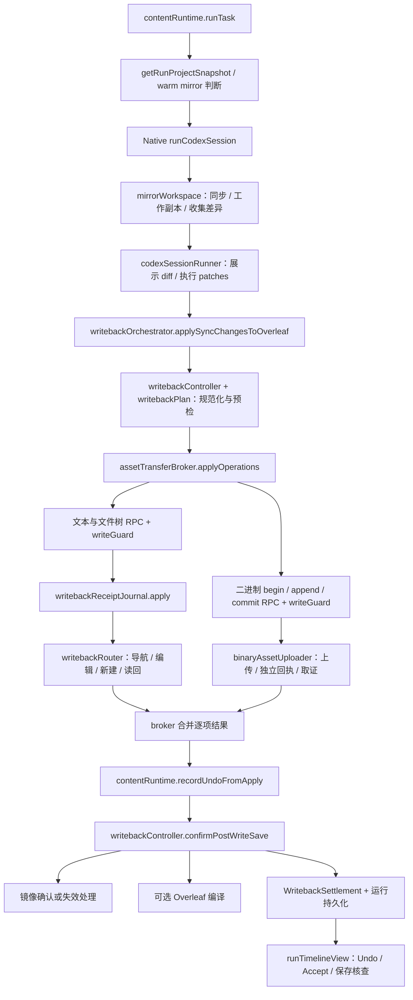

# Auto 修改、写回、保存与 Undo

本页提供从一次 Auto 文本修改到写回、保存确认、撤销及刷新恢复的源码路线。
适用于定位“改动写到了哪里”“保存依据是什么”“撤销为何跳过”“刷新后为何丢失按钮”等问题。

初始参考源码基线：`main@2073ae74747431aab8d529803d4e9f8197262388`；初始参考包版本 `2.5.0`。当前行为随本仓库实现维护。
总入口见 [架构目录](README.md)，其他功能见 [功能定位图](feature-map.md)。

## 1. 首先分清四份内容与两种身份

**当前实现。** 编辑器、服务器 ZIP、本地工作副本和运行基线分别承担不同职责。

| 概念 | 含义与权威来源 | 首读源码与符号 |
|---|---|---|
| 编辑器内容 $C$ | 当前页面已打开文档的实时内容，可能尚未保存 | [pageBridge](../../extension/src/pageBridge.js) 的 `readActiveEditorText`；[overleafEditor](../../extension/src/page/overleafEditor.js) |
| 项目快照 | 一次读取产生的项目文件集合，带来源、完整性、跳过项等元数据 | [snapshotRouter](../../extension/src/page/snapshotRouter.js) 的 `buildProjectSnapshot`、`buildZipOnlyProjectSnapshot` |
| 本地镜像 $W$ | Native Host 管理的磁盘工作副本，agent 在此产生修改 | [mirrorWorkspace](../../native-host/src/mirrorWorkspace.js) 的 `getProjectMirror`、`syncOverleafToMirror` |
| 基线 $B$ | 用于计算该运行差异及检查并发修改的原始文件内容与哈希 | 同文件的 `buildBaselineFile`、`collectMirrorChangesDetailed` |
| 执行配置快照 | 提交时固定的模式、Track、模型、Provider、上下文等 | [runExecutionSnapshot](../../extension/src/shared/runExecutionSnapshot.js)；运行使用 `executionSnapshot` |
| 运行归属 | 原项目、会话、运行记录，绑定晚到结果和恢复操作 | [contentRuntime](../../extension/src/content/contentRuntime.js) 的 `currentRunView`、`getRunProjectIdForWriteback` |

内容快照回答“该运行看到了什么”，执行配置快照回答“该运行按什么配置执行”。
两者与本地镜像类似“底稿、操作单、工作台”的关系；工作台上的新内容不自动成为已保存的项目事实。

运行归属可记为 $I=(projectId,sessionId,runId)$；持久化恢复记录还带 `accountScopeId`。
首次执行按提交配置运行；后续 Undo 仍绑定原项目，并从原运行记录决定 Track 语义。
恢复入口需逐字段核对：显式 Retry sync 保留恢复意图中的 Track，但自动编译当前会回退面板设置，具体例外见第 7 节。
详细会话与持久化路线见 [运行状态与恢复](run-state-and-recovery.md)。

**当前实现的边界。** [pageRpcContract](../../extension/src/shared/pageRpcContract.js) 的 `METHODS` 声明每个 RPC 的身份策略。
`applyOperations`、Accept、Reject、编译触发要求项目身份；`ensureReviewing`、`ensureEditing` 为 `optional`。
[pageBridge](../../extension/src/pageBridge.js) 的 `dispatch` 按目录执行 `writeGuard.runWriteGuard`。
因此核查新调用时，应同时检查目录策略、调用方参数、实际 handler；不能从“跨过 Page RPC”推导所有方法都拒绝缺失身份。
模式切换的可选项目身份仍保留 Page Bridge 的 capability token 检查；token 对同文档 MAIN 脚本的信任前提见[协议与信任边界](protocols-and-trust.md)。相关定义见 [pageRpcContract.test.js](../../test/pageRpcContract.test.js) 和 [pageBridgeStaleGuard.test.js](../../test/pageBridgeStaleGuard.test.js)，后者包含空参数切换模式用例。

## 2. 端到端调用图

**当前实现。** content 是侧边栏所在隔离世界；page 是可读取 Overleaf 编辑器对象的 MAIN 世界；native 是本机进程。
此图保留主链，模式、权限和失败分支在后文展开。



源码入口为 [contentRuntime](../../extension/src/content/contentRuntime.js) 的 `runTask`，以及
[codexSessionRunner](../../native-host/src/codexSessionRunner.js) 的 `runCodexSession`。
后者调用 `syncOverleafToMirror` 准备本地内容，执行后调用 `collectMirrorChangesDetailed`，最终返回 `syncChanges`。
其中 `diff` 由 [diffEngine](../../native-host/src/diffEngine.js) 的 `computeLineDiff` 生成，供界面展示；
`patches` 由 [textPatch](../../native-host/src/textPatch.js) 的 `computeTextPatches` 生成，供后续写入。
content 在 `applySyncChangesToOverleaf` 消费这些差异；模型自然语言总结不充当文件变更依据。

## 3. 快照进入镜像时的关键分岔

**当前实现。** `contentRuntime.runTask` 先调用 [otWarmMirror.resolveWarmRunStart](../../extension/src/content/otWarmMirror.js)，尝试普通镜像或 OT 聚焦文件快启，并读取当前编辑器覆盖层（overlay）。
快启未选中时，`contentRuntime.getRunProjectSnapshot` 优先请求完整 ZIP，包含二进制，禁止为读取而导航编辑器；无法得到完整结果时，再尝试不导航的页面状态读取。
取得快照后，`contentRuntime.resolveWarmMirrorReuse` 还会根据快照完整性、聚焦文件覆盖和镜像健康状态判断能否复用。
[snapshotRouter](../../extension/src/page/snapshotRouter.js) 决定 ZIP、活动编辑器覆盖层和页面文件记录如何合并。
[overleafProjectSnapshot](../../extension/src/page/overleafProjectSnapshot.js) 承担快照桥及缓存相关装配。

- 完整快照：`mirrorWorkspace.syncOverleafToMirror` 根据 `fullProjectSnapshot` 进入全量替换分支，删除规范化输入及已知未读路径集合中没有的镜像文件，更新成功读取文件的基线并保留未读资产的旧基线。只有路径集合完整且文件身份保持一致时，缺失路径才能代表项目中已删除的文件；ZIP 路径身份边界见下文。
- 部分快照：只覆盖已读取路径，合并旧基线；不能用“本次未读到”推导服务器文件已删除。
- Warm mirror：普通快启检查整体镜像健康与当前 overlay；OT 快启另由 [otWarmMirrorController.canUseOtWarmStart](../../extension/src/content/otWarmMirrorController.js) 检查聚焦文件的新鲜度。观察事件经 `otWarmMirror` 的队列送入 Native `mirror.patchFiles`；局部更新不能单独证明完整项目已同步。
- 保存核查：`serverOnly: true` 明确要求服务器来源；编辑器覆盖层不能用于证明服务器已保存。

<a id="zip-path-identity"></a>

**当前实现：ZIP 字面文件名与路径身份。** ZIP 条目名、项目元数据与结构化操作路径都是字面项目相对路径。[projectFiles.normalizeSafeProjectPath](../../extension/src/shared/projectFiles.js) 校验后返回原值，不执行 URI 解码：`chapter%20one.tex`、`chapter one.tex`、`100%.tex` 与含字面 `%2F` 的名字各自保留身份。校验拒绝绝对路径、盘符、反斜线、控制字符、空或点段、首尾空白，以及超过 `MAX_SAFE_PROJECT_PATH_LENGTH` 的输入。显式 URL 编码边界另用 `normalizeUrlEncodedProjectPath`，返回一次解码结果并检查嵌套编码的分隔符与穿越风险；例如 `chapter%2520one.tex` 只还原成字面 `chapter%20one.tex`。项目 ID、doc ID 等 URL 参数继续遵守各自的编码规则。

`snapshotRouter.extractFilesFromZip` 严格按 UTF-8 解码名字；非法或无法确定的路径、重复条目加入 `skipped`，并设 `pathIdentityComplete:false`。重复名字的已保留首项也从可信文件集合移除，编辑器覆盖层和页面回退不能重新加入这个歧义路径；普通目录条目继续允许。该标志传播到 ZIP 快照、精确文件清单及组合快照，阻止结果被标成 `fullProjectSnapshot:true`。`contentRuntime.sanitizeRunProjectSnapshot` 还独立检查结构化文件的合法性与唯一性；`getRunProjectSnapshot` 保留已知路径错误的负证据，避免一次页面回退将它改写成完整快照。普通 ZIP 不可用仍走原页面回退。

Native 的完整快照准入因而不能把这些遗漏解释为远端删除。聚焦到歧义文件时，Content 和 Native 的 focused-partial 检查均无法取得该文件证据；其他已知可信文件仍可按聚焦范围继续。[referenceProjects.readProject](../../extension/src/page/referenceProjects.js) 对路径身份不完整返回 `reference_project_incomplete`，不宣称 `referenceTextComplete`。路径范围完整与内容全部可读分别由 `fullProjectSnapshot` 和 `contentComplete` 表达；二进制配额导致的已知路径未读按下一段处理。

字面身份也有本机文件系统边界。[projectPathPlatform](../../native-host/src/projectPathPlatform.js) 在 `mirrorWorkspace.syncOverleafToMirror` 创建目录、清理旧文件、写入内容或推进基线之前，按实际 `process.platform` 预检 Windows 名称：冒号与备用数据流（stream）语法、保留设备名、尾随点或空格、保留字符、过长组件及已检测的大小写别名冲突会明确拒绝，并保留旧镜像和基线。请求字段不能覆盖平台判定；POSIX 上原本合法的冒号名称仍可使用。

来自文件 chip（已选文件标签）的 focus 数组以 `focusFilesAreLiteral:true` 声明字面语义，结构化文件、变更与 OT 覆盖层始终按字面身份匹配。后台要求有 focus 或写入范围限制的新格式请求取得 Native 的可选 `literalProjectPaths` 能力，旧 Host 缺少该能力时提示更新并重载，不继续用旧提示语规则解释路径；具体入口及旧调用者兼容见[协议与信任边界](protocols-and-trust.md)。

[zipLiteralIdentity.test.js](../../test/zipLiteralIdentity.test.js) 串联 ZIP、快照回退、参考项目、Native 准入与镜像、写回和 Undo 前像；[literalFocusIdentity.test.js](../../test/literalFocusIdentity.test.js) 检查 chip 到 Native 的身份传递；[projectPathPlatform.test.js](../../test/projectPathPlatform.test.js) 检查平台谓词及拒绝前保留旧数据。ZIP、页面与模型 I/O 使用替身，Windows 拒绝分支使用注入的平台值；这些证据不能替代真实 Overleaf 文件名接纳、Chrome 写回及 Windows 实机验收。

**配额跳过与内容完整性。** 请求包含二进制且读取内容时，`extractFilesFromZip` 对超过单文件或项目二进制预算的资产加入 `capabilities.skipped`，省略对应内容。完整 ZIP 的 `fullProjectSnapshot` 表达路径读取范围，`contentComplete` 单独表达内容是否全部读取；仅列清单的 `includeContent:false` 路径不执行内容预算裁剪。
[mirrorWorkspace.resolveUnreadSnapshotFiles](../../native-host/src/mirrorWorkspace.js) 合并 ZIP 和 Native 规范化器的二进制预算跳过项，将其路径纳入存在集合，保留已有本地文件及旧基线，并写入 `unreadFiles`。未读资产不获得新的新鲜度：镜像保持 dirty，不推进 `lastFullSyncAt`，warm reuse、写回后就地确认及 OT patch 都有独立的未读检查。部分刷新保留该状态；后续完整读取该文件可解除，完整清单确认远端已删除时才移除旧副本。
[collectMirrorChangesDetailed](../../native-host/src/mirrorWorkspace.js) 对未读路径的本地新建、修改或删除返回 `snapshot_content_unavailable`，不产生可写回操作；overlay 也不能把其旧内容更新为当前基线。[codexPromptAssembly](../../native-host/src/codexPromptAssembly.js) 列出未读路径并说明保留副本可能过时，普通可读文件仍可继续处理。该机制保护这些路径，不提供跨路径复制的内容来源追踪。
Native 准入仍独立检查快照实际携带的二进制总量，见 [nativeQuotas.validateNativeRequestQuotas](../../native-host/src/nativeQuotas.js)。其总量限额低于 ZIP 的项目预算，普通总预算跳过场景会在镜像写入前被拒绝，旧镜像保持；单文件跳过后的其余载荷可准入并按上述未读规则处理。
[contentRuntime.getProjectSnapshotWarnings](../../extension/src/content/contentRuntime.js) 继续将这些跳过项呈现为非阻断警告。文本写回成功后，若镜像仍有未读资产，异步刷新可转为失效状态，`mirrored` 不宣称完成；本次文本的 applied/saved 证据与整体镜像完整性分别判断。
[snapshotSkippedAssets.test.js](../../test/snapshotSkippedAssets.test.js) 串联真实 ZIP、Native 准入、临时镜像及 Content 结算，覆盖边界、原资源保留、后续完整读取/真实删除、部分刷新、非法路径及确认/OT/overlay 防线。Page 写入、保存和外部 I/O 使用替身，真实浏览器与远端后果仍需单独验收。

**OT 快启的覆盖层证明。** `resolveWarmRunStart` 为 OT 快启提供恰好覆盖聚焦文件的当前 `fileOverlays`；普通 warm 路径保留原覆盖层行为。[mirrorWorkspace.buildOtStatusFields](../../native-host/src/mirrorWorkspace.js) 只为可信且仍 OT-fresh 的文本项发布 SHA-256。Native `validateOtFocusedWarmMirrorReuse` 要求 overlays 无重复、无额外或缺失聚焦路径，实际内容哈希与可信 OT 项一致；这些 overlays 只作为相等证明，不再次写入镜像，也不采纳其自报 hash。

健康、freshness、dirty、未读资产及聚焦范围检查继续有效。浏览器缺少当前覆盖层等条件时不选择快启，直接读取快照；已选择快启但 Native 复核发现不一致、过期或缺少证据时返回 `mirror_stale`，沿实际 `runTask → getRunProjectSnapshot → prepareMirrorStaleRetry → SensitivePreflight` 重新检查并派发。Native 内部无 overlay 请求保留原接纳范围；旧 Native 可拒绝新快启并触发快照回退。[otWarmMirrorContract.test.js](../../test/otWarmMirrorContract.test.js) 覆盖浏览器 producer、RunController、Native 与外层回退组合；模型、页面与存储 I/O 使用替身。

**目标契约。** 缺失内容、已知空字符串 `""`、已知非空内容应保持可区分。
快照覆盖规则理应让成功读取的空编辑器内容覆盖旧 ZIP 内容。

**当前读取规则。** [snapshotRouter.readActiveEditorOverlay](../../extension/src/page/snapshotRouter.js) 接受已成功读取的空串或纯空白；由于旧 reader 在编辑器缺失时也会返回空串，空白覆盖还要求 [pageBridge.getActiveEditorIdentity](../../extension/src/pageBridge.js) 提供可读的 CodeMirror doc、textarea 或 contenteditable，且其文本与读取结果一致。空白读取缺少或未就绪的来源不会覆盖 ZIP；读取异常及 Loading 占位也不构成覆盖证据。非空文本沿用无需 identity 的兼容路径。
路径、文本与空白读取证据在等待 ZIP 前一并捕获；`mergeSnapshotFiles` 保留成功读取的空内容。ZIP 不可用时返回相应编辑器部分快照；`serverOnly` 始终不采纳编辑器覆盖层，不能用未保存空内容证明服务器已保存。
[pageBridgeSnapshotCache.test.js](../../test/pageBridgeSnapshotCache.test.js) 装配完整 Page 入口；[snapshotEmptyContent.test.js](../../test/snapshotEmptyContent.test.js) 使用当前模块与显式网络替身检查不同读取来源和等待时序。创建、保存核查、Undo 的空内容语义仍需沿各自链路验证。

## 4. Auto 写回：先得到逐项结果，再记录恢复凭据

**当前实现。** [writebackOrchestrator](../../extension/src/content/writebackOrchestrator.js) 的 `applySyncChangesToOverleaf` 是 content 主调度入口。
运行传入提交时的 `mode`、`requireReviewing` 等配置；Ask 的防护分支会忽略本地变更。

1. [writebackController](../../extension/src/content/writebackController.js) 的 `buildSyncApplyOperations` 把差异转成 edit/create/delete 等操作，保留已有补丁。
2. [writebackPlan](../../extension/src/content/writebackPlan.js) 检查路径与治理规则；删除和二进制操作经过现有产品确认流程。
3. `ensureReviewingBeforeWrite` 与 page 写入路径确认 Reviewing 或 Editing；Auto 仍受这些前置条件约束。
4. `stageWritebackRecovery` 保存可恢复的新建请求；[assetTransferBroker](../../extension/src/content/assetTransferBroker.js) 的 `applyOperations` 按原顺序调度文本批次与二进制传输。
5. 文本与文件树批次通过 [writebackRouter](../../extension/src/page/writebackRouter.js) 的 `applyOperationsCore` 逐项执行，形成 `applied`、`skipped` 与留痕捕获证据；二进制通过独立 uploader，最后由 broker 合并结果。
6. 返回后立即 `appendApplyResult`、`recordUndoFromApply`；随后才等待保存核查、镜像和编译。

该顺序有实际意义：broker 已返回逐项结果后，进入保存等待前可记录已知写入部分的 Undo checkpoint。
broker 对已派发操作在取消后继续查询只读回执，保留可确认的前批结果；未确认结果及恢复材料的边界见第 7 节。
`recordUndoFromApply` 位于较大的 contentRuntime 中；只阅读 orchestrator 会漏掉恢复账本如何建立。

### 4.1 编辑已有文本

**当前实现。** `writebackRouter.applyEditOperation` 负责目标编辑器就绪、陈旧检查、应用和读回。
导航需确认目标路径与实际编辑器文档，文件树选中标签不能单独证明 CodeMirror 已切换文档。
补丁生成在 Native 的 `textPatch.computeTextPatches`：按行锚点划分窗口，再按词、句、段落等变化选择补丁；自然补丁集合通过 `isValidNaturalPatchSet` 校验，必要时回退到各行窗口内的替换。
`diffEngine.computeLineDiff` 的展示结果有独立规模上限，展示截断不能推导执行补丁也被截断。
content 的 `writebackController.getSyncChangePatches` 优先保留 Native 补丁，缺少可用补丁时才尝试前后像的单区间差异。
Page 先通过 [staleGuard.prepareOperationPatches](../../extension/src/shared/staleGuard.js) 将源补丁转换到编辑器坐标；`applyTextPatches` 再校验 `expected` 并按起点降序应用，以免前面的写入移动后面的坐标。坐标使用 JavaScript 字符串索引，即 UTF-16 代码单元。
实际编辑器写入由 [overleafEditor](../../extension/src/page/overleafEditor.js) 适配，陈旧检查依赖 [staleGuard](../../extension/src/shared/staleGuard.js)。

整文件新鲜度按换行归一化函数 $L$ 判断 $L(B)=L(C)$，其中 $L$ 将 CRLF（`\r\n`）转换为 LF（`\n`）；基线 Map 保留原始字符串，用于解释 Native 补丁坐标。归一化后内容不同的情况，再对转换后的编辑器区间和 `expected` 作范围核验，保留未冲突的其他编辑。范围证明只覆盖参与比较的位置，不能推广为整份文件完全一致。

**换行表示与坐标转换。** `prepareOperationPatches` 使用“源原始偏移 → LF 逻辑偏移 → 编辑器原始偏移”的映射。对完整换行边界，源偏移 $p$ 的逻辑位置为 $p-N_B(p)$，其中 $N_B(p)$ 是该位置之前 CRLF 中被归一化省略的 `\r` 数量；目标侧再还原为编辑器的 UTF-16 偏移。
涉及拆开 CRLF 或在编辑边缘新组成 CRLF 的操作，先补齐必要边界再转换；未编辑的相邻换行保留原样。转换同时处理 `from/to/expected/insert`，不改写 Native 的原始 diff，也不通过禁止合法混合换行编辑来规避坐标差异。同起点等组合仍需逐步通过 `expected` 校验。
`writebackRouter.applyEditOperation` 将同一套编辑器补丁用于实际派发、读回预期和 Track 捕获；批内另用 `sourceContent` 推进源坐标基线，避免第二个同文件操作误用编辑器表示。`verified:true` 表明读回符合本次基于当前内容构造的目标，服务器保存和其他并发边界仍分别取证。
[textPatchLineEndings.test.js](../../test/textPatchLineEndings.test.js) 覆盖四种 LF/CRLF 组合、插入/替换、多补丁、相邻换行、UTF-16 代理对和协作者范围；[pageBridgeStaleGuard.test.js](../../test/pageBridgeStaleGuard.test.js) 串联真实模块的写回、Track、连续操作及回执后的 Undo。编辑器 I/O 采用替身，真实 Overleaf 的 ZIP、编辑器与保存行为仍需浏览器验收。

**空白基线。** `staleGuard.checkOperationFreshness` 将空串和纯空白作为有效内容参与相同比较。基线与当前内容不一致时，整文 `replaceAll` 兜底被拒绝；有补丁时仍可经过范围及 expected 检查保留未冲突的后来编辑。空文件的合法插入继续可用，已有基线 Map 但目标路径缺失时返回 missing_base_file；整个 Map 缺失时仍保留既有内部无基线操作。
[writebackController.buildSyncApplyOperations](../../extension/src/content/writebackController.js) 在无法取得可用补丁时提供整文兜底；当前 Native 文本差异携带 previousContent 并生成 patches，两条路径均需维护。[emptyContentWriteback.test.js](../../test/emptyContentWriteback.test.js) 覆盖 Controller → StaleGuard → Page 写回，分别验证拒绝、允许及当前内容保持。
Page router 与 snapshot 闭包通过共享 [pageRpcContract.REVISION](../../extension/src/shared/pageRpcContract.js) 重新注入；[pageBridgeStaleGuard.test.js](../../test/pageBridgeStaleGuard.test.js) 的重注入用例同时检查旧版本替换、换行补丁和空基线保护。实际 Chrome 重载、保存竞速与远端后果仍需独立验收。

### 4.2 新增文本与二进制

**当前实现。** [textFileCreator](../../extension/src/page/textFileCreator.js) 的 `beginCreateBatch`、`finishCreateBatch` 合并唯一新建路径的服务器预检与最终读取。
同一路径重复操作保留顺序验证语义。
`createTextFileWithDom` 支持根文件和嵌套路径，上传前逐级创建缺失父目录并选择准确目录；二进制 DOM 上传通过 `prepareUploadParent` 的 `createMissing: true` 分支复用这套目录准备能力。
[undoOperations.buildCreatedFileUndoCheckpoint](../../extension/src/shared/undoOperations.js) 保存文件删除证明及 `createdDirectories` 观测。目录路径与 nativeFolderId 是创建尝试后的观察，`ownershipConfirmed:false` 明确不将同名出现当作创建所有权。目录准备、文件提交分别由对应状态及 `fileUploadAttempted` 记账；仅目录变化不能被报告为文件已上传，也不能因后来出现同内容文件就推导创建成功。
[DirectoryCleanupRecovery](../../extension/src/content/directoryCleanupRecovery.js) 在记录 Undo 前收集成功、失败和取消结果中的目录观测，包括零 applied 分支及移动两端的严格父目录。带账号/项目/会话/运行身份的 `pendingDirectoryCleanup` 经主存储提交、读回后保留；[DirectoryCleanupProof](../../extension/src/shared/directoryCleanupProof.js) 限定100个目录、64 KiB，溢出明确失败并保留已有记录。该只读收尾独立于文本 Undo/Accept 终态，分叉不继承。
“检查剩余目录”通过 `checkCreatedDirectories` 调用 [OwnedDirectoryCleanup](../../extension/src/page/ownedDirectoryCleanup.js)，按组件展开原生目录树并比较实体身份和完整服务器路径证据。`textFileCreator.readServerSnapshot` 拒绝路径身份不完整、未知路径及 ZIP 非法或重复名称的清单，不能用其证明目录不存在；已知路径的资产配额跳过仍参与存在性判断。目录仍存在、非空或身份未知时保留提示；只有证明目录已不在原生树及服务器路径中时才清除记录。该检查不调用目录 Delete；平台未接入原子、非递归的空目录条件删除，用户需在原生界面确认并清理。文件撤销成功不能代表目录已回收。
相关行为见 [createdDirectoryCleanup.test.js](../../test/createdDirectoryCleanup.test.js)、[directoryCleanupRecovery.test.js](../../test/directoryCleanupRecovery.test.js) 与 [textFileCreator.test.js](../../test/textFileCreator.test.js)。
Auto 的显式 Retry sync 经 `contentRuntime.retryRunWriteback → writebackOrchestrator.applySyncChangesToOverleaf → assetTransferBroker.applyOperations` 将 `retryCreates: true` 送入 Page RPC。
[writebackReceiptJournal](../../extension/src/page/writebackReceiptJournal.js) 的 `apply` 按严格布尔值保留该字段，[pageBridge](../../extension/src/pageBridge.js) 的 `applyOperations` wrapper 将选项交给 router；router 在新建批次中据此设置 creator 的 `allowExistingMatches`。
批次服务器预检读到完全相同的文本（包括空字符串）时，creator 返回 `idempotent: true`、`changedDocument: false` 的已验证结果，不再次上传。幂等表示重复确认得到相同结果且不新增文件修改；目标缺失时仍进入正常创建，不同内容的已有目标仍拒绝覆盖。
这使“已上传、首次读回未确认”的新建文件可在服务器读取恢复后通过显式重试确认；读取仍不可用时不能凭路径已存在认定成功。
原 `requestId` 的 receipt 查询及同一请求重复派发取回原结果有独立机制；显式 Retry sync 使用新的派发执行上述内容检查。
`recordUndoFromApply` 过滤 `idempotent: true` 的条目，保留已有 Undo 证据，并避免把此次仅确认的文件新增为该运行可删除的新建文件；实际创建成功仍记录新建文件的 Undo 凭据。

二进制经 broker 的 `applyBinaryOperation` 执行 begin/append/commit；大资源可通过 Native asset token 分块读取。
联动 owner 为 [nativeAssetTransfer](../../native-host/src/nativeAssetTransfer.js) 与 [binaryAssetUploader](../../extension/src/page/binaryAssetUploader.js)。
`pageBridge` 的 `binaryUploadBegin/Append/Commit/Status/Abort` handler 直接调用 uploader，上传过程不经过文本 `writebackReceiptJournal` 或 `writebackRouter.applyOperationsCore`。
uploader 按声明大小、分块顺序和 SHA-256 检查载荷；依次尝试 DOM、multipart、legacy manager，可能已提交后即停止切换运输方式，并核对原尝试的路径与远端内容证据。
broker 在 commit 结果不确定时查询 `binaryUploadStatus`；仍不确定则保留 `changedDocument` 与 `receiptUnconfirmed`，阻断后续操作。
begin 成功后的失败，或 begin 已派发且等待被取消，在 commit 尚未实际派发时会请求 abort；commit 已派发后 abort 不撤销已提交上传。Native asset token 在该操作的 `finally` 中请求释放，状态查询本身不重新上传。
文本新建和二进制新建均可能获得创建撤销证明，但已有二进制覆盖不能直接按“撤销新建”删除。

**二进制覆盖前的基线保护。** Native 差异携带 `previousSha256`，Controller 和 Broker 将旧基线传到 uploader；浏览器已有原始二进制快照时会交叉核验其哈希，冲突或缺失时拒绝覆盖。uploader 在实际提交前读取原项目、精确路径对应实体的远端字节，要求旧内容哈希一致，并重新核对项目、实体、父目录及输入框或替换对话框身份。读取受8秒和资产大小上限约束，不能用 basename 匹配代替完整路径归属。
载荷校验要求 $H(N)=h_N$，覆盖前检查要求 $H(C_{before})=H(B)$；其中 $N$ 是新字节，$B$ 是原基线。上传后仍核对新哈希。平台没有接入原子条件覆盖，检查与提交之间仍有并发窗口，不能将客户端检查称为服务器原子比较交换。
[binaryOverwriteBaseline.test.js](../../test/binaryOverwriteBaseline.test.js) 串联 Native 旧基线、assetRef 分块、Content 与 Page，覆盖旧版本变化、身份/目录漂移及正常上传；网络和真实平台时序仍需单独验收。新建文件的目录变化与实际文件上传尝试分别记账，不能因创建了目录、后来出现同内容文件就补造创建所有权。

### 4.3 Auto 文件操作与资产类型的支持范围

**当前实现。** Auto 的操作类型先由 [mirrorWorkspace.collectMirrorChangesDetailed](../../native-host/src/mirrorWorkspace.js) 生成，再由 `writebackController.buildSyncApplyOperations` 转换。
`combineVerifiedFileMoves` 将唯一、同类型且 SHA-256 相同的旧路径删除与新路径创建配为一个 `move`；内容同时改变或对应关系有歧义时保留独立变化。前后路径分别经过聚焦范围、治理及子代理归属检查。

| 本地变化 | Auto 主链的处理 | 边界与维护入口 |
|---|---|---|
| 支持的新建文本 | `write` 转为 `create` | 新路径按 `isTextMirrorPath` 判断；已有文本基线另走现有文件分支，不能把新路径扩展名规则套到全部已有文件 |
| 可证明配对的文本重命名或移动 | 生成带原内容哈希的单一 `move` | 整份文件计划一起确认；原生 rename/move 保留同一 entityId，跨目录改名可能包含多步，不能承诺原子事务 |
| 新建或替换受支持二进制 | `binary-create` 或 `overwrite-binary` | `isSupportedBinaryAssetPath` 接受 PDF、PNG、JPG/JPEG、SVG，另受 `MAX_BINARY_FILE_BYTES` 和生成产物过滤约束 |
| 删除已有二进制 | 放入 `unsupportedChanges`，原因 `binary_delete_unsupported` | 不生成普通删除操作；不影响有创建证明的新建文件 Undo 删除路线 |
| 可证明配对的二进制重命名或移动 | 生成 `move`，通过原生文件元数据接口移动同一实体 | 要求原哈希、源实体及类型一致，目标/中间路径没有冲突；无法配对的独立二进制删除仍不支持 |
| 新建 GIF、WebP 等未支持资产 | 放入 `unsupportedChanges`，原因 `unsupported_non_text_file` | 无法仅凭“图片”这一类别推定可写回；核对文本与二进制两套路径规则 |
| 被识别为构建产物的 PDF | 放入 `unsupportedChanges`，原因 `generated_artifact` | `isGeneratedArtifactPath` 过滤根目录中与基线同名 `.tex` 对应的 PDF，以及根 `main.pdf`、`output.pdf`；未命中其他生成产物规则的嵌套 PDF 与其他根 PDF 继续按资产规则判断 |

包含 move，或同时包含创建与删除的原计划，由 [FileMoveApproval](../../extension/src/content/fileMoveApproval.js) 展示完整计划及被治理阻止的项，一起批准或取消；取消后不先创建新副本。纯创建保持原流程。该确认不把原本不支持的操作变成可执行项。 整计划取消经 `file_plan_confirmation_rejected` 记录为 `preflight/blocked`，不允许自动重试；零写入的 run 和报告保留 failed，正文明确整份计划已取消。报告携带同一 failure，持久结算保留 unchanged，不创建 Retry sync 或 Undo 材料；批准后发生的部分写入仍保留其实际结果及恢复证明。
[FileMover](../../extension/src/page/fileMover.js) 在原项目中读取完整服务器路径与源哈希，绑定 entityId/type、父目录及 CSRF 后，调用 Overleaf 原生实体 `/rename`、`/move` 接口。每步检查原身份、路径、目标占用和总期限；成功后核对同一实体已在新路径且内容未变。明确失败且可证明回退安全时补偿；超时或 HTTP 5xx/408 后先重新核对服务器后像；同一实体与内容已确认时可以继续。仍无法核验、身份变化或其他不确定结果会保留已知位置与恢复提示并停止后续项，不盲目补偿或重放。成功 move 的 Undo 交换前后路径并复用同一哈希、实体和路径守卫。
[fileMovePipeline.test.js](../../test/fileMovePipeline.test.js)、[fileMover.test.js](../../test/fileMover.test.js) 及 [fileMoveApproval.test.js](../../test/fileMoveApproval.test.js) 覆盖正式调用链、身份保持、确认和逆向恢复；平台 API、DOM 与 ZIP I/O 使用替身，真实服务器行为仍需验收。

## 5. 两类 receipt 与保存、编译、镜像的分工

**当前实现。** receipt 可类比“回执”，但不同回执证明的事件不同。这里区分执行回执与服务器内容回执；文本和二进制的执行回执另有各自的 owner。

| 证据 | 生成与消费位置 | 能支持的结论 |
|---|---|---|
| 文本与文件树执行 receipt | [writebackReceiptJournal](../../extension/src/page/writebackReceiptJournal.js) 的 `apply/get`；broker 的 `recoverTextReceipt` | 原批次仍在执行或已结束，且已有逐项结果 |
| 二进制执行 receipt | `binaryAssetUploader.commit/status`；broker 的 `applyBinaryOperation` | 原 transfer 的执行状态、结果及可能已修改的证据；与文本回执独立 |
| 服务器内容 receipt | `textFileCreator.makeSaveReceipt`；`writebackController.receiptsConfirmExpectedFiles` | 某项目某路径的指定内容哈希曾在服务器 ZIP 中观察到 |
| editor readback | `writebackRouter.verifyActiveEditorText` | 当前编辑器读回内容符合预期 |
| 保存状态 | `writebackController.confirmPostWriteSave`；[saveState](../../extension/src/page/saveState.js) | 得到正向 UI 保存信号或对应服务器内容证据 |
| 编译结果 | [compileBridge](../../extension/src/page/compileBridge.js) 与 [compileAdapter](../../extension/src/shared/compileAdapter.js) | 编译触发、成功或失败的独立证据 |
| 镜像确认 | orchestrator 与 `mirrorWorkspace.confirmWritebackFiles` | 本地基线可前进或需要失效重读 |

文本与文件树执行 receipt 使用 `requestId` 和原 `runProjectId`，存于 page 内存 Map。
新请求通过身份、期限及活动写入检查后，在 `apply` 中按默认 16 份容量与完成后 10 分钟阈值裁剪完成项。该清理按需触发；`get` 及命中已有 requestId 的重复 `apply` 不执行 `prune`，所以空闲页面中的旧回执可保留并可读取超过 10 分钟。活动操作另受执行串行约束。
收到 RPC timeout 后，broker 查询原请求；未确认的文本批次会阻止后续文本或二进制派发。
页面重新加载后的恢复不能依赖这份内存 Map 永久存在。

二进制另有 uploader 拥有的 `transfers` 与 `receipts` 两个 page 内存 Map，以 `transferId` 和项目归属查询。
`begin` 检查每个 Map 的容量，当前阈值为 32；完成回执的保留期为 10 分钟，清理由 `pruneReceipts` 在 begin/status 时触发。
相同 transfer 的重复 commit 返回已有 Promise；broker 的 commit 后状态查询将轮询截止点设为开始查询后的 30 秒，单次 RPC 等待仍有自身耗时。页面重载也会丢失这组回执，不能套用文本 journal 的请求 ID、容量或查询入口。

服务器内容 receipt 绑定路径、项目、UTF-8 内容 SHA-256、来源及观察时间。
它相当于“这一版本曾送达”的证明；后续同路径写入需要更新证据。

**当前实现。** `confirmPostWriteSave` 的取证顺序为：

1. 尝试用已返回的服务器 receipt 覆盖本次预期内容。
2. 读取正向保存 UI 信号。
3. 在允许且预期内容可计算时，读取 `serverOnly` ZIP 并逐项比较；共享 90 秒预算，每次 ZIP 上限 30 秒，最多三次。
4. 必要时再探测 UI；未确认时保留 `unknown_timeout` 或 `unavailable`，离线时不按正常在线路径继续取证。

**当前实现。** 镜像刷新以 `verified_saved` 为门槛；不满足时调用失效处理。
满足时可通过 `mirror.confirmWriteback` 就地更新文本基线，也可完整读取后 `mirror.sync`。
`tryConfirmMirrorWriteback` 仅对全部为 edit 的已应用条目尝试就地确认，且本次已有确认用快照时直接走同步路线。
[WritebackController.buildMirrorWritebackConfirmation](../../extension/src/content/writebackController.js) 从成功 edit 的 `verifiedContent` 生成 UTF-8 SHA-256 证明；要求 `ok`、`verified` 及字符串内容，空字符串也可参与。多个 edit 命中同一路径时使用最后一次已验证读回。
`tryConfirmMirrorWriteback` 携带 `expectedFiles: [{path, sha256}]` 调用 Native，并核对返回的逐路径哈希。`mirrorWorkspace.confirmWritebackFiles` 保留基线、未读资产、dirty、路径和类型守卫，在全部本地字节匹配页面证明后才更新基线；任一项不符返回 `postimage_mismatch`，不部分推进。项目仍相同时，缺证明、不支持方法或不一致响应走原完整快照同步回退；项目已变则失效原项目镜像，不向新项目执行同步。树操作与二进制继续走完整同步。
该证明确保纳入基线的字节与页面已验证内容相同，不提供文件系统排他。核对之后的额外本地写入由后续镜像完整性检查识别。[mirrorWritebackProof.test.js](../../test/mirrorWritebackProof.test.js) 串联实际 Content/Native 链，覆盖空内容、晚写、缺证明及回退；页面与模型 I/O 为替身。

后台 `pendingMirrorRefresh` 防止下一轮或 Undo 与晚到镜像更新交错。

编译另有条件：启用 Auto Compile、非 Ask、实际写入可编译文件。
`autoRecompileAfterWriteback` 在保存尚未确认时仍可触发 Overleaf Recompile，并请求页面等待保存。
因此“编译触发了”“服务器保存了”“镜像已更新”应分别呈现。

**结果投影与入口守卫。** settlement、完成报告和 `run.status` 有各自的收尾投影；普通 Auto 文本写回在此之前经过 [AssetTransferBroker.normalizeTextResult](../../extension/src/content/assetTransferBroker.js)，按计划补齐缺项为 skipped，并设置 `receiptUnconfirmed`，使缺项不能仅以原始 applied 数量被当作完整成功。`writebackOperationEvidence` 仍提供 `write_result_missing` 结算兜底。排查结算与运行标签分歧时，应先证明实际入口没有经过上述归一化，或证明现有守卫不足；只看末端条件不能认定普通 Auto 已出现假成功。失败主因、恢复按钮和页眉活动摘要的实际消费者见[失败、结算与动作](ui-and-loading.md#failure-settlement-actions)，修改成功语义时仍需同时核对这些投影。

## 6. Undo 的入口、分支与后来修改保护

**当前实现。** [runTimelineView](../../extension/src/content/runTimelineView.js) 的按钮调用 `contentRuntime.undoRun`。
该入口先通过 `UndoOperations.prepareRunUndo` 补齐有证据的旧文件恢复，再等待 `pendingMirrorRefresh`，按保存的 refs、前后像及文件恢复操作路由。
当前面板 Track 开关不能替代原运行的 `executionSnapshot.requireReviewing`。

```text
undoRun(runId)
  ├─ 存在 tracked refs / 可用前后像 / 指定创建恢复状态
  │    └─ undoRunTrackedChanges
  │         ├─ rejectTrackedChanges RPC：恢复已有文本
  │         ├─ applyOperations RPC：删除有证明的新建文件／重建有原文的已删旧文件
  │         └─ 验证与推进账本；finally 按已知 Page 结果登记镜像失效
  └─ 其余可用逆操作
       └─ buildNoTraceUndoRestore → applyOperations(no-trace-undo)
无留痕逆操作取得结果 → 镜像失效处理 → 验证证据 → 推进或保留恢复账本
```

### 6.1 普通文本与 Track 文本共用部分运输路线

**当前实现。** 函数名 `undoRunTrackedChanges` 和 RPC 名 `rejectTrackedChanges` 同时承担部分普通文本恢复。
Track-off 且有前后像的记录，可通过 `untrackedUndo: true` 进入
[trackedChangesLifecycle](../../extension/src/page/trackedChangesLifecycle.js) 的 `restoreExpectedFilesWithNoTraceUndo`。
它先检查原生变更归属和 checkpoint，按已保存内容恢复；这一分支不会借用不属于原运行的全局 editor Undo。
[trackedChangeReplay](../../extension/src/page/trackedChangeReplay.js) 的 `prepareSnapshotUndoCheckpoints/buildSnapshotUndoResult` 负责前后像映射和回执转换；Lifecycle 保留文件导航、原生身份检查及写入编排。

**部分完成但回执丢失。** 普通 Track-off 文本 Undo 重试时，完整检查点中的部分文件可能已经等于前像（本轮写入前原文），其余仍等于后像。`restoreExpectedFilesWithNoTraceUndo` 只在 `untrackedUndo` 的原生账本检查通过后识别这种状态：已恢复文件必须逐字等于完整前像，空字符串有效；当前文件路径和本次重试捕获的 `nativeDocId` 必须稳定，原生账本不得含待处理留痕。该项只回传 `verifiedContent`、`idempotent:true` 和 `changedDocument:false`，不再次改写正文，也不调用全局 editor Undo；剩余项继续沿原后像/重基守卫恢复。

已恢复项在其他前检等待后、剩余写入完成后再次核验，完成结算前仍需通过 Page 的保存与内容验证。前检冲突阻止尾项派发；尾项写入后发现已恢复项变化时保留部分结果和该项检查点。全部文件已恢复时可只读完成原检查点结算。普通文本持久材料不绑定首次写入的 `nativeDocId`，这里只保证本次重试期间的实体稳定；内容相等不授予 Track-on 审阅、文件创建/删除或移动权限。链路回归见 [partialUndoReceiptRecovery.test.js](../../test/partialUndoReceiptRecovery.test.js)。

Track-on 的恢复使用捕获的 refs、原生 ownership 和前后像。
`rejectTrackedChanges` 可尝试受前后像保护的 editor Undo、快照恢复或变更节点操作。
归属读取和捕获联动 [trackedChangeOwnership](../../extension/src/page/trackedChangeOwnership.js)、
[trackedChangeCapture](../../extension/src/page/trackedChangeCapture.js)、[trackedChangeCaptureController](../../extension/src/content/trackedChangeCaptureController.js)。

没有这类文本恢复条件的记录，走 [undoOperations](../../extension/src/shared/undoOperations.js) 的逆补丁或快照恢复操作。
直接逆操作路径支持多文件子集选择；部分选择保留 `partial`，未处理文件仍可撤销。

`recordUndoFromApply` 先经 `WritebackSettlement.attachVerifiedContentToOperation` 附加页面 `verifiedContent`，再建立 checkpoint。[UndoOperations.buildUndoOperations](../../extension/src/shared/undoOperations.js) 分别推进源映像与已验证编辑器映像，把源 post-image 上的逆补丁转换到实际 `verifiedContent` 坐标，确保逆补丁与 `undoBaseFiles` 使用同一表示。
Track 的 `selectExpectedFilesForTrackedUndo` 保留 `WritebackSettlement` 对外入口，内部委派 `UndoOperations`。对含非空补丁和字符串 `verifiedContent` 的记录，通过相同 checkpoint 重建编辑器表示的预期前像；已有 `previousExpectedFiles` 优先保留，其余情况沿用项目快照回退。验证必须经过正向结果附加及 checkpoint 消费，写回前单独构建逆补丁不足以覆盖该链路。

`contentRuntime.callPageBridge` 对 `applyOperations` 且 `reviewingPolicy: 'no-trace-undo'` 的调用专门包装一层 `AssetTransferBroker`，因此创建删除与直接逆操作也可查询原文本批次回执。
`undoRun`、`undoRunTrackedChanges` 在确认后生成 `deadlineAt`；混合 Undo 的文本恢复请求与后续创建删除请求携带同一截止时间。
对 no-trace apply 路线，client 按剩余时间收紧 RPC 等待，broker 将期限继续传给回执查询，journal 在准备前后检查，router 在操作边界检查并将其传入创建删除验证。
`PageBridgeClient.send` 为 Accept/Reject 注入同一个有效期限，默认由 RPC contract 的120秒生命周期预算决定，较短的显式期限继续有效。[reviewContext.js](../../extension/src/page/reviewContext.js) 为每个请求隔离上下文，准备、导航等待、模式切换、恢复及内部 apply 共同消费期限和取消状态，并预留最多250毫秒回传部分结果。Router 在新操作及实际编辑前检查守卫，保存确认不采纳截止后的快照。
期限或取消阻止后续未开始的正文写入，已确认部分继续形成恢复进度。底层已经发出的导航或 HTTP 请求可能迟到完成；守卫不能撤回已发生的副作用，迟到导航也可能改变活动文件。
[RunReviewController](../../extension/src/content/runReviewController.js) 与 `WritebackSettlement.isUndoResultEffectivelyApplied` 核对真实成功证据；`ok:false` 且没有 skipped 的运输失败保持 partial，不能仅凭空 skipped 显示 Undone。已验证的纯文本及结构操作由 `advanceUndoCheckpoint` 消耗恢复材料，持久化后重试只处理剩余项。普通 Undo 同样等待持久确认，操作锁存续时保持“正在撤销”。[reviewDeadline.test.js](../../test/reviewDeadline.test.js)、[ordinaryUndoDeadlineConsumer.test.js](../../test/ordinaryUndoDeadlineConsumer.test.js) 和 [ordinaryUndoDurability.test.js](../../test/ordinaryUndoDurability.test.js) 覆盖实际生产调用链与受控 I/O；真实平台延迟另需验收。

**目标契约与实现守卫。** 后来修改应保留；安全性依靠实际证据判断。
原生 editor Undo 要求当前内容符合原运行 post-image；创建撤销要求文本内容或二进制哈希仍匹配。
`waitForActiveEditorCheckpoint` 对能证明的前后缀变化支持受限重基，冲突或归属不明时应跳过并保留恢复信息。
它不提供任意协作编辑的通用三方合并保证。

### 6.2 文件创建、删除与混合 Undo

**当前实现。** `buildCreatedFileUndoCheckpoint` 为该运行新建路径生成 `undoCreatedFile` 证明，保留文本 post-image 或二进制 SHA-256。
`undoRunTrackedChanges` 先恢复仍存在的已有文本，再处理文件结构操作：撤销新建或重建原有删除。需要分段持久化的生命周期记录会先保存已确认的文本进度。
文本仍未解决或进度无法保存时，后续文件结构操作不派发；新建文件和已删除文件保持该阶段的状态，恢复材料留给后续尝试。
中间 `applyTrackedChangeSettlement` 保存失败时，[scopedPersistencePanelState](../../extension/src/content/scopedPersistencePanelState.js) 恢复材料、标记 `needs_review` 并继续抛错。`undoRunTrackedChanges` 将已取得的 Page 结果保留在 try 外，在 finally、释放 review 操作锁之前调用 `invalidateMirrorAfterUndo`；正常完成和持久化失败共用这一出口。
失效依据仍是 Page 返回的已应用操作或 `changedDocument`；请求直接抛错且没有结果时不虚构撤销证据。文件阶段已返回时采用合并结果；中间保存失败则只处理已知文本结果，并保留未派发的文件操作。失效任务登记到 `pendingMirrorRefresh`，下一次运行等待该任务后重新判断镜像可用性。Native 失效失败和页面结果缺失仍需单独处理，不能由 finally 已执行推定镜像一定不可复用。

这里的生命周期分类由 [runTimelineView.js](../../extension/src/content/runTimelineView.js) 的 `isTrackedChangeLifecycleRun` 判断 `trackedChangeStatus` 或 refs。
普通 Track-off 或无 refs 的混合记录可走 `RunReviewController.applyLegacyUndoSettlement`，现在同样经 `applyReviewTransition({legacyUndo:true})` 等待严格保存。tracked review 与普通 Undo 各自核对对应终态；partial 还核对剩余检查点。文本 refs 已消耗但仍有待恢复文件时，pending 生命周期继续保存，不能因 refs 为空提前移去文件阶段状态。
排查 Undo 后立即刷新时，两条保存路线须分别检查，详见[运行状态与恢复](run-state-and-recovery.md)。

新建删除进入 `writebackRouter.applyCreatedFileUndo`，重新核验原项目、取消序号、内容/哈希和服务器删除结果。
文件在写入后被用户改动时，删除证明失效，不能直接删除。
`UndoOperations.advanceUndoCheckpoint` 随已验证进度收缩剩余恢复账本，避免下次重做已完成部分。

**删除原有文本的恢复。** [UndoOperations.getFileUndoOperations](../../extension/src/shared/undoOperations.js) 将旧文件重建与新建文件撤销统一为文件操作。已有 `create` 逆操作继续保留；补齐缺失的逆操作时，要求原文字符串保留在 undoExpectedFiles、appliedOperations 有成功删除，且推导后像不再包含该路径，空原文有效。只有后像缺项不足以推断应重建文件，先新建再删除的临时文件也不会因此复活。
Track-on 记录同样保留这些 `create` 逆操作；历史 Track-on 记录缺少逆操作但仍保留上述证据时，`prepareRunUndo` 可补齐。已裁掉原文或删除证据的历史记录不具备该恢复保证。

| 运行组合 | 当前恢复路线 |
|---|---|
| 仅删除原有文本，Track 两态 | 有证据的 `create` 逆操作进入 `applyOperations(no-trace-undo)`；保留原项目、路径存在性、创建和服务器读回检查 |
| 编辑＋删除原有文本，Track 两态 | `textUndoRun` 从原生文本 review 的前像和 refs 中排除待重建路径；文本恢复成功后派发文件结构操作，避免要求先打开已删除文件 |
| 编辑＋新建＋删除原有文本 | 文本阶段后统一处理新建删除与旧文件重建，仍使用同一 deadline 和原项目身份；文件阶段可以逐项保留失败材料 |
| 删除后该路径被用户重新创建 | 原有 Page 创建守卫拒绝覆盖，恢复操作保留供后续处理 |

`mergeFileUndoResult` 要求文件操作具备对应类型、路径及已验证的服务器回执，缺项进入失败结果。`advanceUndoCheckpoint` 还核对重建内容匹配，只有独立验证成功的项才消耗恢复材料；成功项的前像一并移除，进度成功持久化后，重载不会再次推导同一重建操作。失败兄弟项保留，needs_review 的文案和操作投影包含待重建旧文件。
[deletedFileUndo.test.js](../../test/deletedFileUndo.test.js) 覆盖真实 runtime 函数、生产 Undo/Router/guard、历史记录及保存投影；文件树和服务器 I/O 使用替身。既有 [createdFileUndo.test.js](../../test/createdFileUndo.test.js) 与 [mixedUndoReceipt.test.js](../../test/mixedUndoReceipt.test.js) 继续约束新建撤销及回执，共用夹具为 test/_helpers/undoRuntimeHarness.js。真实浏览器、服务器写入及存储配额仍需独立验收。

### 6.3 Accept 与 Undo 的共同结算

**当前实现。** `contentRuntime.acceptRun` 调用 page 的 `acceptTrackedChanges`，消费原运行 refs、前后像及已应用操作。
Undo、Accept 及人工审阅核验由 `RunReviewController.withSharedReviewOwnership` 取得同账号/项目/run 的共享 review port。确认框阶段只预留 owner，不消耗执行期限；确认后先取得耐久派发租约的 ACK，再把 token 与截止时间送入 Page。失去 port 时只取消该 token 的 review context，旧 token 不影响后来的任务。正常收尾仅删除自己的租约；刷新后的隔离和旧版记录处理见[执行中恢复](run-state-and-recovery.md#6-undo-的持久化与重载投影)。
Accept 需要可归属的留痕记录；`untrackedUndo` 不能赋予接受其他留痕的权限。
混合运行接受后保留新建文件，并随已验证的生命周期关闭相应恢复状态。

page 的实际分流在 `trackedChangesLifecycle.prepareNativeReview` 与 `acceptTrackedChanges`。
生产 `pageBridge` 注入 `getCodeMirrorEditorView`，即使原生账本尚未就绪，也会进入原生守卫，并在无法确认账本时保留失败结果；缺少该适配器且 refs 均无 `native:` 前缀的调用才进入 legacy 恢复路线。

| 分支 | 写入与验证行为 | 失败、模式与联动入口 |
|---|---|---|
| 原生 ID Accept | `acceptNativeReview` 向原项目及文档的 `/changes/accept` 提交 `change_ids`；随后确认目标 refs 消失、无关 refs 保留、文本未变 | 不改编辑器模式；请求或核验不确定时保留部分结果与恢复材料。History-OT 等 `acceptByIdSupported: false` 的表示返回 `native_accept_protocol_unsupported`，不回退文本 replay |
| 与旧留痕合并的原运行插入 | `trackedChangeOwnership.prepareMergedInsertionReview` 核对范围证明；`reviewMergedInsertion` 在稳定 Editing 下同文替换获证的插入区间，消除该部分留痕 | 不把合并父 ID 送入整项 Accept；核对文本和应保留 refs。已尝试写入后保持 Editing，避免待保存操作重新产生留痕；该范围证明也用于对应 Undo |
| legacy adapter | 尝试 editor Undo 或 checkpoint 恢复，再由 `buildAcceptReplayOperations` 生成无留痕 replay；逐项重确认 Editing | 中途失败可能已经改变内容；成功 replay 后保持 Editing。联动 [trackedChangeReplay](../../extension/src/page/trackedChangeReplay.js)，不能用该分支概括生产 Native Accept |

**无法自动按 ID 接受时的收尾。** Page [manualReviewRecovery](../../extension/src/page/manualReviewRecovery.js) 在安全拒绝自动操作时生成严格 `manualReviewProof`，Content 保存原始后像及证明并读回确认。卡片提供打开原文件及重新核验入口，用户先在 Overleaf 原生 Review 中仅接受本轮变更。`RunReviewController.verifyManualReview` 使用已有 `acceptTrackedChanges` 的 `verifyManualReview:true` 分支，仅导航、读取和核验，不调用 Accept API 或修改正文/编辑模式。
核验须同时满足原账号、项目、nativeDocId、原 post-image、目标 refs 全部消失、无关 refs 精确保留，以及证明未被并发替换；满足后才持久提交 accepted。缺正文、缺证明、身份或其他留痕变化均保留恢复状态。该入口提供人工操作后的可验证完成路径，未扩展未知 History-OT 接口的自动接受能力。[manualReviewWorkflow.test.js](../../test/manualReviewWorkflow.test.js) 串联实际 producer、持久化、重载与只读 verifier。

[writebackSettlement](../../extension/src/shared/writebackSettlement.js) 的 `settleTrackedChangeLifecycle`、`attachAcceptNotVerifiedFailure`、`attachUndoNotVerifiedFailure` 判断终态。
`contentRuntime.applyTrackedChangeSettlement` 通过 [scopedPersistenceCoordinator](../../extension/src/content/scopedPersistenceCoordinator.js) 保存迁移。
`needs_review` 表示证据不足，不能仅因按钮点击完成就清空 refs、checkpoint 或创建证明。

## 7. 取消、部分失败与刷新后的定位

**当前实现。** page cancellation sequence 在 `cancelActiveWrite` 时递增，router 在操作边界检查。
router 可以返回已发生修改的逐项结果并跳过未开始项；content 获得这些结果后再结算与记录 checkpoint。
[pageRpcContract](../../extension/src/shared/pageRpcContract.js) 将 `getWritebackReceipt` 与 `binaryUploadStatus` 定义为需要项目身份、取消后仍可等待的只读查询；单次 RPC 超时继续生效。文本回执有轮询截止点，显式 `deadlineAt` 还会收紧查询等待；未给显式期限时，最后一次 RPC 仍可能超过轮询截止点。二进制状态沿独立的 30 秒轮询截止点加单次 RPC 等待，未接入文本的 `deadlineAt`。查询只取回原请求或 transfer 的结果，不重放写入。
[pageBridgeClient](../../extension/src/content/pageBridgeClient.js) 在派发前检查可取消请求；已取消时直接拒绝并标记 `requestDispatched:false/changedDocument:false`。已发出的 `applyOperations` 被 `cancelActiveRequests` 拒绝时附带原 requestId，broker 可据此取回已发生的部分结果；用户 `cancelActiveRun` 的 Page 路径仍是推进取消序号，该接口能力不能推定为每次点击取消都会立即拒绝所有客户端等待。
[assetTransferBroker](../../extension/src/content/assetTransferBroker.js) 在文本超时或带原请求身份的取消后执行 `recoverTextReceipt`；后批取消保留前批 `applied` 与 Track refs，并停止派发余下文本和二进制项。二进制 commit 结果不确定时通过原 transferId 查询状态；begin 成功后的失败，或 begin 已派发且等待被取消，在 commit 尚未实际派发时使用同一 transferId 清理暂存；明确拒绝的重复 begin 不删除既有 stage。commit 收到成功回执时保留已应用结果，在途取消信号仍阻止尾部派发；派发前取消不会创建新的 Page stage。
成功取得的逐项结果进入 orchestrator 原有 `recordUndoFromApply`，随后才进行可取消的保存核查。回执超时、Page 重载或无法确认原操作时仍保留未确认语义及尾部阻断，不能宣称全部写入都形成了持久 Undo。Page 回执、Content checkpoint 与实际存储各有寿命；真实 Chrome 跨 world 时序、服务器保存和存储重载仍需独立验收。

**当前实现。** `contentRuntime.stageWritebackRecovery` 是 `WritebackVerificationController.stage` 的薄入口；runtime 的 `settleWritebackRecovery` 根据实际写回及保存结果维护 `retryWriteback/saveCheck`，写前摘要和只读检查由独立 controller 管理。
[writebackIntent](../../extension/src/shared/writebackIntent.js) 对请求记录设置 100 操作、300 KiB 上限；[sessionState](../../extension/src/shared/sessionState.js) 执行恢复字段筛选。
只读保存核查保存摘要与身份，通过 `confirmSaveCheck` 重新读取服务器，不重新上传文件。
重试写入则由 `retryRunWriteback` 进入写回链，两者应在指南和 UI 中保持语义区分。
原请求 receipt 查询可以取回原结果，显式 Retry sync 则创建新的派发；新建重试按第 4.2 节的服务器精确内容检查确认已有文件或创建缺失文件。已存在同内容的幂等确认不重复上传，也不新增 Undo 删除凭据；不同内容保持拒绝，项目和运行归属检查仍适用。

**Retry 的配置来源。** 首次运行与显式 `retryRunWriteback` 都采用原执行快照中的 `autoRecompile`；重试在首次等待前捕获该布尔值。旧记录没有有效布尔值时沿用当前设置兼容。Retry sync 不重新启动模型，只重试剩余写回；只读内容核验不执行写回或编译。[writebackOutcomeConsistency.test.js](../../test/writebackOutcomeConsistency.test.js) 覆盖设置双向切换、旧记录和正常保存分支。

**回执丢失后的只读恢复。** [WritebackVerificationController](../../extension/src/content/writebackVerificationController.js) 拥有写前 `stage` 和 `checkRunWriteback` 的执行逻辑，runtime 保留薄入口。`buildPlannedWritebackCheck` 计算计划后像的哈希、类型或缺失状态；`writebackCheck` 只保存项目、账号、会话、运行与这些摘要。写前须经主存储提交并按同作用域读回，失败则停止派发。
页面重载或执行回执缺失后，“核查写入内容”只读取服务器并记录 `matches/differs/unavailable`。内容相等仅表明当前文档与计划相符，不证明执行归属，也不修改 applied/saved 或补造 Undo、创建所有权和 Track refs。此入口与 `retryWriteback/saveCheck` 分开；有效范围、身份或证明变化时保留未确认状态。[writebackPlannedCheck.test.js](../../test/writebackPlannedCheck.test.js) 与控制器/运行链专项覆盖哈希计划、强保存读回和只读核验。

`content/writebackRecovery.js` 另定义通用 prepare/reconcile 模块；该模块未纳入上述 Auto 主调用链。
定位当前行为应从上述实际调用及 [run-state-and-recovery](run-state-and-recovery.md) 出发，不能凭模块文件名推定默认恢复流程。

`writebackOrchestrator.invalidateMirrorAfterUndo` 按已知 Page 修改结果调用原项目的 `mirror.invalidate`，并在仍处同项目时清快照缓存。
混合 Undo 由 finally 统一调用，覆盖中间持久化失败；无 Page 结果的异常仍缺少已修改证据。
失效任务挂入 `pendingMirrorRefresh`，下一轮等待屏障后重新评估镜像。
失效失败会记录警告；“编辑器撤销完成”不自动证明本地基线已处理完成。

**验证边界。** 页面重载、浏览器存储限额、Native 断线、导航和取消组合下的恢复需分别验收。
现有有界记录与内存回执不构成无限历史或全链路恰好一次保证。

## 8. 修改路线与最窄验证入口

下表列出与各层行为对应的测试入口；测试通过后仍需为 DOM、编辑器和服务器行为选择对应浏览器验收。
命令从仓库根目录执行，按实际改动选择一行，不要求每次运行整组。

| 改动或症状 | 主改位置与联动检查 | 最窄测试命令 |
|---|---|---|
| 展示 diff 截断或执行补丁粒度错误 | codexSessionRunner 的两类输出、diffEngine、textPatch；展示 hunks 与执行 patches 分别核对 | `node --test test/diffEngine.test.js test/textPatch.test.js` |
| 文本差异转操作错误 | `writebackController.buildSyncApplyOperations`；patch 输入与基线 | `node --test test/writebackController.test.js` |
| Auto 重命名、二进制删除或资产类型被过滤 | `mirrorWorkspace.combineVerifiedFileMoves`、FileMoveApproval、FileMover 与逆向 Undo | `node --test test/fileMoveNativeDiff.test.js test/fileMoveApproval.test.js test/fileMovePipeline.test.js test/fileMover.test.js`；独立二进制删除及未支持格式仍属边界 |
| 活动文件/ZIP/空内容不一致 | snapshotRouter、projectFiles、快照缓存、mirrorWorkspace | `node --test test/pageBridgeSnapshotCache.test.js test/staleGuard.test.js` |
| ZIP 路径碰撞、丢弃或资产配额影响完整性 | `extractFilesFromZip`、`normalizeSafeProjectPath`、`mergeSnapshotFiles`、快照标志及 Native 全量清理 | [projectFiles](../../test/projectFiles.test.js)、[pageBridgeSnapshotCache](../../test/pageBridgeSnapshotCache.test.js)、[mirrorWorkspace](../../test/mirrorWorkspace.test.js)、[snapshotSkippedAssets](../../test/snapshotSkippedAssets.test.js)；字面文件名及完整链路见 [zipLiteralIdentity](../../test/zipLiteralIdentity.test.js) |
| CRLF/LF 坐标转换及撤销 | textPatch 原始偏移、staleGuard.prepareOperationPatches、router 实际补丁、settlement verifiedContent、UndoOperations 双映像 | [textPatchLineEndings](../../test/textPatchLineEndings.test.js)、[undoOperations](../../test/undoOperations.test.js)、[pageBridgeStaleGuard](../../test/pageBridgeStaleGuard.test.js)；比较最终文本、保留内容与实际回执后的撤销结果 |
| OT 快启进入快照重读回退 | `resolveWarmRunStart`、`runController.buildCodexRunParams`、Native `validateOtFocusedWarmMirrorReuse`、runtime 的 mirror_stale 回退 | `node --test test/otWarmMirrorContract.test.js test/otWarmMirrorIntegration.test.js test/taskRunner.test.js`；检查正常快启与失效后的完整回退 |
| 原请求超时但文件已变化 | broker 查询原执行 receipt、逐项结果与尾部阻断 | `node --test test/writebackReceiptRecovery.test.js` |
| 显式 Retry sync 确认已有文件或创建缺失文件 | runtime 恢复意图、orchestrator/broker/journal 参数、router/creator 精确内容检查及 Undo 所有权 | `node --test test/retryCreatedFile.test.js test/textFileCreator.test.js test/writebackEditRetry.test.js`；模块组合覆盖新建未确认后恢复、同内容/空内容幂等、异内容拒绝、原请求去重及归属检查，DOM 与外部 I/O 使用替身 |
| 嵌套路径创建与父目录保留 | textFileCreator 的目录观测、DirectoryCleanupRecovery 的耐久记录与 Page 只读核验 | `node --test test/createdDirectoryCleanup.test.js test/directoryCleanupRecovery.test.js test/textFileSnapshotIdentity.test.js`；目录回收需用户原生操作 |
| 保存待确认或刷新后核查 | writebackController、writebackIntent、sessionState | `node --test test/writebackSaveCheck.test.js` |
| 普通 Undo 错撤用户历史 | contentRuntime 路由、提交 Track、trackedChangesLifecycle、ownership | `node --test test/ordinaryUndoRouting.test.js` |
| 新建文件撤销或混合进度 | undoOperations、contentRuntime、router、textFileCreator、持久化 | `node --test test/createdFileUndo.test.js test/mixedUndoReceipt.test.js` |
| 已有文本删除后的 Undo 或编辑＋删除混合恢复 | `recordUndoFromApply`、`UndoOperations.prepareRunUndo/textUndoRun/advanceUndoCheckpoint`、`undoRun`、Page guard；分别核对文本与文件恢复 | `node --test test/deletedFileUndo.test.js test/undoOperations.test.js test/ordinaryUndoRouting.test.js test/createdFileUndo.test.js`；两种 Track、冲突、历史材料、部分恢复及重载 |
| Undo 超时、尾部未确认或重复删除 | contentRuntime.callPageBridge 的 broker 包装、deadlineAt、client/journal/router/creator | `node --test test/undoDeadlineRouting.test.js test/undoReceiptDeadline.test.js` |
| 撤销后下一轮恢复旧内容 | orchestrator 镜像屏障、mirrorWorkspace、运行入口 | `node --test test/undoMirrorInvalidation.test.js test/undoPersistenceFailure.test.js` |
| 取消后丢失部分结果 | cancellation sequence、router、broker、Page RPC、checkpoint 时序 | `node --test test/writebackCancellationRecovery.test.js test/assetTransferCancellation.test.js test/writebackReceiptRecovery.test.js`；检查原请求回执、前批结果、尾部停止与 checkpoint |
| 二进制位置/回执/撤销或覆盖前基线检查 | broker、binaryAssetUploader 独立回执、textFileCreator、Native asset；Native旧哈希、Broker基线交叉检查及Page覆盖前远端核验 | `node --test test/binaryOverwriteBaseline.test.js test/binaryAssetUploader.test.js test/binaryUploadUndoRoundTrip.test.js`；实际平台并发时序仍需另验 |
| 生产 Native Accept 归属或验证失败 | pageBridge 原生适配器、trackedChangesLifecycle、ownership、settlement | `node --test test/pageBridgeStaleGuard.test.js test/writebackSettlementContract.test.js` |
| legacy Accept replay、模式切换或恢复 | trackedChangesLifecycle、trackedChangeReplay；勿推广为生产原生路径 | `node --test test/writebackRouterAccept.test.js` |
| 编译状态投影异常 | orchestrator、compileBridge、compileAdapter | `node --test test/compileAdapter.test.js` |

**测试装配边界。** `diffEngine`、`textPatch` 测试直接调用算法；`writebackRouterAccept` 的主要 harness 缺少原生 editor getter，并注入允许身份检查的 guard，覆盖 legacy 路线。
`pageBridgeStaleGuard` 含 Native ID Accept 与保留后来文本的场景，但 fetch、编辑器与留痕账本为模拟对象。
`binaryUploadUndoRoundTrip` 组合真实 broker、uploader、Native 分块和 ZIP 模块；其 Page RPC 直接路由 uploader 方法，Undo 直接调用 creator 删除，不能据此推定运行账本与刷新按钮全链覆盖。
`undoDeadlineRouting` 覆盖生产 wrapper 的提取函数及各层期限传递，`undoReceiptDeadline` 使用真实 client/broker/journal 和虚拟时钟，页面 mutation 为注入函数。
`writebackReceiptRecovery` 检查模式参数、原请求回执恢复和去重；[retryCreatedFile](../../test/retryCreatedFile.test.js) 通过公开 [retryCreateHarness](../../test/_helpers/retryCreateHarness.js) 串联真实 runtime Retry/recovery/Undo 函数、orchestrator、broker、journal、Page wrapper、router 和 creator，覆盖 `retryCreates` 完整传递、同内容与空内容确认、异内容拒绝及 Undo 证据保留。其合成 DOM、上传与 ZIP 夹具和 [textFileCreator](../../test/textFileCreator.test.js) 共用；UI、Native 与持久化 I/O 使用替身，不能由此推定真实 Chrome 传输、服务器上传或 IndexedDB 落盘已验收。
`undoMirrorInvalidation` 的相关 harness 将 settlement 替换为成功 stub；`undoPersistenceFailure` 串联 runtime、Page Undo、review transition 与 orchestrator，在保存回调注入异常，检查失效登记、下一次 Undo 等待屏障，以及冲突/抛错不虚构结果。编辑器、保存与 Native I/O 使用替身。
`writebackCancellationRecovery` 串联 client、journal、Page router/editor、orchestrator、Undo 和 StorageDb 投影；`assetTransferCancellation` 检查混合批次、二进制状态、项目拒绝和 Page stage 清理。网络、真实编辑器及 IndexedDB 重载仍在替换边界之外。
`mirrorWorkspace` 覆盖独立二进制删除上报、支持资产及生成 PDF 过滤；`fileMovePipeline` 串联真实 Native 差异、整份计划确认、Broker、Page 元数据移动和逆向 Undo，外部文件树与 API 为替身。
`deletedFileUndo` 从正向记录进入删除恢复与重载重试；`ordinaryUndoRouting` 和 `createdFileUndo` 继续覆盖普通文本与新建组合。这些模块组合验证不能替代真实 Overleaf 文件树、服务器保存与浏览器重载验收。
这些范围各自提供定位依据；真实服务端协议、DOM、取消与立即刷新仍需相应执行证据。

进一步缩小单个场景，可使用已经存在的测试名称，例如：

```sh
node --test --test-name-pattern='ordinary Undo after reload' test/ordinaryUndoRouting.test.js
node --test --test-name-pattern='lost final reply' test/writebackReceiptRecovery.test.js
```

`ordinary Undo after reload` 覆盖先重载记录再执行 Undo；它不能独自证明“混合 Undo 完成后立即刷新”的结果。
后者还涉及 Track 条件、延迟保存/确认保存、共享记录和按钮投影，需要完整的真实浏览器场景验证。

**目标契约。** 每次修改须说明：原运行身份如何保留、哪项证据新增或失效、恢复账本何时推进，以及相关调用方是否同步更新。
新增 Page RPC 或 page 模块还需检查 [pageBridgeClient](../../extension/src/content/pageBridgeClient.js) 的注入顺序、协议目录、handler 和扩展注册。
最小浏览器验收样例为：根文件和嵌套文件编辑、一个新建文本、用户后续修改、一次部分 Undo、刷新后重试剩余部分。
涉及网络或取消逻辑时，再补慢 ZIP、丢失最终响应和写到一半取消；结果分别记录，避免把静态阅读当作运行验收。
