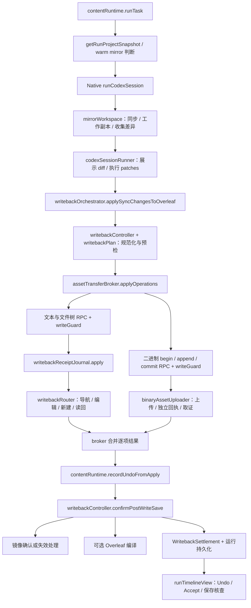

# Auto 修改、写回、保存与 Undo

本页提供从一次 Auto 文本修改到写回、保存确认、撤销及刷新恢复的源码路线。
适用于定位“改动写到了哪里”“保存依据是什么”“撤销为何跳过”“刷新后为何丢失按钮”等问题。

初始源码基线：`main@2073ae74747431aab8d529803d4e9f8197262388`；初始参考包版本 `2.5.0`。当前行为随本仓库实现维护。
总入口见 [架构目录](README.md)，其他功能见 [功能定位图](feature-map.md)。

## 1. 首先分清四份内容与两种身份

**当前实现。** 编辑器、服务器 ZIP、本地工作副本和运行基线分别承担不同职责。

| 概念 | 含义与权威来源 | 首读源码与符号 |
|---|---|---|
| 编辑器内容 $C$ | 当前页面已打开文档的实时内容，可能尚未保存 | [pageBridge](../../extension/src/pageBridge.js) 的 `readActiveEditorText`；[overleafEditor](../../extension/src/page/overleafEditor.js) |
| 项目快照 | 一次读取产生的项目文件集合，带来源、完整性、跳过项等元数据 | [snapshotRouter](../../extension/src/page/snapshotRouter.js) 的 `buildProjectSnapshot`、`buildZipOnlyProjectSnapshot` |
| 本地镜像 $W$ | Native Host 管理的磁盘工作副本，agent 在此产生修改 | [mirrorWorkspace](../../native-host/src/mirrorWorkspace.js) 的 `getProjectMirror`、`syncOverleafToMirror` |
| 基线 $B$ | 用于计算该运行差异及检查并发修改的原始文件内容与哈希 | 同文件的 `buildBaselineFile`、`collectMirrorChangesDetailed` |
| 执行配置快照 | 提交时固定的模式、Track、模型、Provider、上下文等 | [runExecutionSnapshot](../../extension/src/shared/runExecutionSnapshot.js)；运行使用 `executionSnapshot` |
| 运行归属 | 原项目、会话、运行记录，绑定晚到结果和恢复操作 | [contentRuntime](../../extension/src/content/contentRuntime.js) 的 `currentRunView`、`getRunProjectIdForWriteback` |

内容快照回答“该运行看到了什么”，执行配置快照回答“该运行按什么配置执行”。
两者与本地镜像类似“底稿、操作单、工作台”的关系；工作台上的新内容不自动成为已保存的项目事实。

运行归属可记为 $I=(projectId,sessionId,runId)$；持久化恢复记录还带 `accountScopeId`。
首次执行按提交配置运行；后续 Undo 仍绑定原项目，并从原运行记录决定 Track 语义。
恢复入口需逐字段核对：显式 Retry sync 保留恢复意图中的 Track，但自动编译当前会回退面板设置，具体例外见第 7 节。
详细会话与持久化路线见 [运行状态与恢复](run-state-and-recovery.md)。

**当前实现的边界。** [pageRpcContract](../../extension/src/shared/pageRpcContract.js) 的 `METHODS` 声明每个 RPC 的身份策略。
`applyOperations`、Accept、Reject、编译触发要求项目身份；`ensureReviewing`、`ensureEditing` 为 `optional`。
[pageBridge](../../extension/src/pageBridge.js) 的 `dispatch` 按目录执行 `writeGuard.runWriteGuard`。
因此核查新调用时，应同时检查目录策略、调用方参数、实际 handler；不能从“跨过 Page RPC”推导所有方法都拒绝缺失身份。
模式切换的可选项目身份仍保留 Page Bridge 的 capability token 检查；token 对同文档 MAIN 脚本的信任前提见[协议与信任边界](protocols-and-trust.md)。相关定义见 [pageRpcContract.test.js](../../test/pageRpcContract.test.js) 和 [pageBridgeStaleGuard.test.js](../../test/pageBridgeStaleGuard.test.js)，后者包含空参数切换模式用例。

## 2. 端到端调用图

**当前实现。** content 是侧边栏所在隔离世界；page 是可读取 Overleaf 编辑器对象的 MAIN 世界；native 是本机进程。
此图保留主链，模式、权限和失败分支在后文展开。



源码入口为 [contentRuntime](../../extension/src/content/contentRuntime.js) 的 `runTask`，以及
[codexSessionRunner](../../native-host/src/codexSessionRunner.js) 的 `runCodexSession`。
后者调用 `syncOverleafToMirror` 准备本地内容，执行后调用 `collectMirrorChangesDetailed`，最终返回 `syncChanges`。
其中 `diff` 由 [diffEngine](../../native-host/src/diffEngine.js) 的 `computeLineDiff` 生成，供界面展示；
`patches` 由 [textPatch](../../native-host/src/textPatch.js) 的 `computeTextPatches` 生成，供后续写入。
content 在 `applySyncChangesToOverleaf` 消费这些差异；模型自然语言总结不充当文件变更依据。

## 3. 快照进入镜像时的关键分岔

**当前实现。** `contentRuntime.runTask` 先调用 [otWarmMirror.resolveWarmRunStart](../../extension/src/content/otWarmMirror.js)，尝试普通镜像或 OT 聚焦文件快启，并读取当前编辑器覆盖层（overlay）。
快启未选中时，`contentRuntime.getRunProjectSnapshot` 优先请求完整 ZIP，包含二进制，禁止为读取而导航编辑器；无法得到完整结果时，再尝试不导航的页面状态读取。
取得快照后，`contentRuntime.resolveWarmMirrorReuse` 还会根据快照完整性、聚焦文件覆盖和镜像健康状态判断能否复用。
[snapshotRouter](../../extension/src/page/snapshotRouter.js) 决定 ZIP、活动编辑器覆盖层和页面文件记录如何合并。
[overleafProjectSnapshot](../../extension/src/page/overleafProjectSnapshot.js) 承担快照桥及缓存相关装配。

- 完整快照：`mirrorWorkspace.syncOverleafToMirror` 根据 `fullProjectSnapshot` 进入全量替换分支，删除规范化输入中没有的镜像文件，并重建基线。只有输入路径集合完整且文件身份保持一致时，缺失路径才能代表项目中已删除的文件；当前 ZIP 路径处理与二进制配额存在下述例外。
- 部分快照：只覆盖已读取路径，合并旧基线；不能用“本次未读到”推导服务器文件已删除。
- Warm mirror：普通快启检查整体镜像健康与当前 overlay；OT 快启另由 [otWarmMirrorController.canUseOtWarmStart](../../extension/src/content/otWarmMirrorController.js) 检查聚焦文件的新鲜度。观察事件经 `otWarmMirror` 的队列送入 Native `mirror.patchFiles`；局部更新不能单独证明完整项目已同步。
- 保存核查：`serverOnly: true` 明确要求服务器来源；编辑器覆盖层不能用于证明服务器已保存。

<a id="zip-path-identity"></a>

**已知限制：ZIP 字面文件名与路径身份。** `snapshotRouter.extractFilesFromZip` 将 ZIP 名称按 UTF-8 解码后，交给 [projectFiles.normalizeSafeProjectPath](../../extension/src/shared/projectFiles.js)；后者还会执行最多三轮 `decodeURIComponent`。
因此字面文件名 `chapter%20one.tex` 与 `chapter one.tex` 可归到同一路径；`mergeSnapshotFiles` 按路径建 Map，后项覆盖前项。`100%.tex` 这类含不完整百分号转义的名称会返回空路径，提取器直接忽略，未加入 `skipped`。
只要至少一项 ZIP 文件被保留，未限制请求路径的快照仍可返回 `fullProjectSnapshot: true`，该标志没有反映上述碰撞或丢弃。
这些结果限定于本地合成 ZIP 与当前模块调用链；真实 Overleaf 对这些文件名的接纳条件、页面寻址及远端写回后果需另行验证。
维护时需区分 ZIP 字面名称与 URL 编码路径，并保持不同文件身份不可合并的目标契约；路径校验通过不能单独证明规范化前后仍指向同一文件。
相关入口为 [projectFiles.test.js](../../test/projectFiles.test.js) 与 [pageBridgeSnapshotCache.test.js](../../test/pageBridgeSnapshotCache.test.js)；验证需串联原始名称、提取、合并及完整性标记，不能只检查单个路径 helper。

**已知限制：配额跳过与全量镜像清理。** 请求包含二进制且读取内容时（`includeBinaryFiles` 且 `includeContent !== false`），`extractFilesFromZip` 对超过单文件或项目二进制预算的资产加入 `skipped`，并从 `files` 中省略该路径；限额由该模块的 `MAX_BINARY_FILE_BYTES/MAX_BINARY_TOTAL_BYTES` 决定，`buildProjectSnapshot/buildZipOnlyProjectSnapshot` 仍可返回完整标志。仅列文件清单的 `includeContent:false` 路径不执行这一预算裁剪。
[contentRuntime.getProjectSnapshotWarnings](../../extension/src/content/contentRuntime.js) 将这些 skipped 项归为非阻断警告。[mirrorWorkspace.syncOverleafToMirror](../../native-host/src/mirrorWorkspace.js) 的全量分支只根据规范化后的文件集合清理，没有按快照 `skipped` 保留旧路径；随后重建基线、更新 `lastFullSyncAt` 并清除 `dirty`。
因此本地合成链中，原先已同步的小资产在下一份 ZIP 因体积增长而超限时，其旧镜像文件和基线记录会被移除，尽管 ZIP 中仍有该资产。此结论涉及本地内容及基线，不提供远端删除或实际编译后果的证据。
完整文件清单、完整内容读取与允许删除缺失路径应分别判断；新鲜度时间戳也不能单独证明所有资产已读取。[mirrorWorkspace.test.js](../../test/mirrorWorkspace.test.js) 的超限资产用例覆盖输入过滤，维护时还需与 ZIP 提取串联，检查已有资产、总预算跳过和全量清理后的基线。

**已知限制：OT 快启参数冲突。** `resolveWarmRunStart` 要求非空 `fileOverlays` 才返回成功；[runController.buildCodexRunParams](../../extension/src/content/runController.js) 同时保留这些 overlays 和 `otWarmStart` 标记。
[taskRunnerRuntime.validateOtFocusedWarmMirrorReuse](../../native-host/src/taskRunnerRuntime.js) 明确拒绝携带非空 overlays 的 OT 复用请求，调用方将该拒绝映射为 `mirror_stale`。
因此当前这条 OT 快启链会进入 `contentRuntime.runTask` 的快照重读与 `prepareMirrorStaleRetry` 回退，后者可继续使用完整快照或合格的聚焦部分快照；该冲突不表示所有运行均失败，也不取消普通镜像复用或 OT 观察事件同步能力。
[otWarmMirrorIntegration.test.js](../../test/otWarmMirrorIntegration.test.js) 验证快启返回当前 overlays，[taskRunner.test.js](../../test/taskRunner.test.js) 分别验证 Native 拒绝新鲜或陈旧 OT 镜像上的 overlays；这些局部测试没有共同证明浏览器快启到 Native 接纳的完整链路。

**目标契约。** 缺失内容、已知空字符串 `""`、已知非空内容应保持可区分。
快照覆盖规则理应让成功读取的空编辑器内容覆盖旧 ZIP 内容。

**已知限制。** 当前 [projectFiles](../../extension/src/shared/projectFiles.js) 的 `isUsableProjectFileContent` 会拒绝空白文本，
`snapshotRouter.buildActiveEditorOverlay` 与 `mergeSnapshotFiles` 使用该判断。
此例外限定于相应覆盖层路径；创建、保存核查、Undo 的空内容处理另有独立逻辑。
空串、纯空白以及编辑器清空与旧 ZIP 冲突的组合，需要单独验证覆盖层和并发比较的结果。

## 4. Auto 写回：先得到逐项结果，再记录恢复凭据

**当前实现。** [writebackOrchestrator](../../extension/src/content/writebackOrchestrator.js) 的 `applySyncChangesToOverleaf` 是 content 主调度入口。
运行传入提交时的 `mode`、`requireReviewing` 等配置；Ask 的防护分支会忽略本地变更。

1. [writebackController](../../extension/src/content/writebackController.js) 的 `buildSyncApplyOperations` 把差异转成 edit/create/delete 等操作，保留已有补丁。
2. [writebackPlan](../../extension/src/content/writebackPlan.js) 检查路径与治理规则；删除和二进制操作经过现有产品确认流程。
3. `ensureReviewingBeforeWrite` 与 page 写入路径确认 Reviewing 或 Editing；Auto 仍受这些前置条件约束。
4. `stageWritebackRecovery` 保存可恢复的新建请求；[assetTransferBroker](../../extension/src/content/assetTransferBroker.js) 的 `applyOperations` 按原顺序调度文本批次与二进制传输。
5. 文本与文件树批次通过 [writebackRouter](../../extension/src/page/writebackRouter.js) 的 `applyOperationsCore` 逐项执行，形成 `applied`、`skipped` 与留痕捕获证据；二进制通过独立 uploader，最后由 broker 合并结果。
6. 返回后立即 `appendApplyResult`、`recordUndoFromApply`；随后才等待保存核查、镜像和编译。

该顺序有实际意义：broker 已返回逐项结果后，进入保存等待前可记录已知写入部分的 Undo checkpoint。
它不能保证 broker 返回前的取消也已捕获页面实际修改；回执查询取消导致抛出的边界见第 7 节。
`recordUndoFromApply` 位于较大的 contentRuntime 中；只阅读 orchestrator 会漏掉恢复账本如何建立。

### 4.1 编辑已有文本

**当前实现。** `writebackRouter.applyEditOperation` 负责目标编辑器就绪、陈旧检查、应用和读回。
导航需确认目标路径与实际编辑器文档，文件树选中标签不能单独证明 CodeMirror 已切换文档。
补丁生成在 Native 的 `textPatch.computeTextPatches`：按行锚点划分窗口，再按词、句、段落等变化选择补丁；自然补丁集合通过 `isValidNaturalPatchSet` 校验，必要时回退到各行窗口内的替换。
`diffEngine.computeLineDiff` 的展示结果有独立规模上限，展示截断不能推导执行补丁也被截断。
content 的 `writebackController.getSyncChangePatches` 优先保留 Native 补丁，缺少可用补丁时才尝试前后像的单区间差异。
Page 先通过 [staleGuard.prepareOperationPatches](../../extension/src/shared/staleGuard.js) 将源补丁转换到编辑器坐标；`applyTextPatches` 再校验 `expected` 并按起点降序应用，以免前面的写入移动后面的坐标。坐标使用 JavaScript 字符串索引，即 UTF-16 代码单元。
实际编辑器写入由 [overleafEditor](../../extension/src/page/overleafEditor.js) 适配，陈旧检查依赖 [staleGuard](../../extension/src/shared/staleGuard.js)。

整文件新鲜度按换行归一化函数 $L$ 判断 $L(B)=L(C)$，其中 $L$ 将 CRLF（`\r\n`）转换为 LF（`\n`）；基线 Map 保留原始字符串，用于解释 Native 补丁坐标。归一化后内容不同的情况，再对转换后的编辑器区间和 `expected` 作范围核验，保留未冲突的其他编辑。范围证明只覆盖参与比较的位置，不能推广为整份文件完全一致。

**换行表示与坐标转换。** `prepareOperationPatches` 使用“源原始偏移 → LF 逻辑偏移 → 编辑器原始偏移”的映射。对完整换行边界，源偏移 $p$ 的逻辑位置为 $p-N_B(p)$，其中 $N_B(p)$ 是该位置之前 CRLF 中被归一化省略的 `\r` 数量；目标侧再还原为编辑器的 UTF-16 偏移。
涉及拆开 CRLF 或在编辑边缘新组成 CRLF 的操作，先补齐必要边界再转换；未编辑的相邻换行保留原样。转换同时处理 `from/to/expected/insert`，不改写 Native 的原始 diff，也不通过禁止合法混合换行编辑来规避坐标差异。同起点等组合仍需逐步通过 `expected` 校验。
`writebackRouter.applyEditOperation` 将同一套编辑器补丁用于实际派发、读回预期和 Track 捕获；批内另用 `sourceContent` 推进源坐标基线，避免第二个同文件操作误用编辑器表示。`verified:true` 表明读回符合本次基于当前内容构造的目标，服务器保存和其他并发边界仍分别取证。
[textPatchLineEndings.test.js](../../test/textPatchLineEndings.test.js) 覆盖四种 LF/CRLF 组合、插入/替换、多补丁、相邻换行、UTF-16 代理对和协作者范围；[pageBridgeStaleGuard.test.js](../../test/pageBridgeStaleGuard.test.js) 串联真实模块的写回、Track、连续操作及回执后的 Undo。编辑器 I/O 采用替身，真实 Overleaf 的 ZIP、编辑器与保存行为仍需浏览器验收。

**已知限制。** `staleGuard.checkOperationFreshness` 遇到空白基线时直接通过检查。
该结论限定为此函数分支；实际写入还经过身份、编辑器和操作验证。
此处保留“所有有效空基线应参与并发比较”的目标契约，浏览器中的最终影响仍待验证。

### 4.2 新增文本与二进制

**当前实现。** [textFileCreator](../../extension/src/page/textFileCreator.js) 的 `beginCreateBatch`、`finishCreateBatch` 合并唯一新建路径的服务器预检与最终读取。
同一路径重复操作保留顺序验证语义。
`createTextFileWithDom` 支持根文件和嵌套路径，上传前逐级创建缺失父目录并选择准确目录；二进制 DOM 上传通过 `prepareUploadParent` 的 `createMissing: true` 分支复用这套目录准备能力。
[undoOperations.buildCreatedFileUndoCheckpoint](../../extension/src/shared/undoOperations.js) 只保存新建文件的删除证明，没有为这些父目录生成目录 Undo 凭据。因此上传失败或新建文件撤销后，已创建的父目录可能保留。
相关目录选择与创建行为见 [textFileCreator.test.js](../../test/textFileCreator.test.js)；文件撤销成功不能用来推定父目录也被回收。
底层 creator 在显式传入 `allowExistingMatches` 时，可把服务器已有相同内容识别为幂等结果；不同内容不能通过 create 重试覆盖。
当前 Auto 的显式 Retry sync 经 `contentRuntime.retryRunWriteback → writebackOrchestrator.applySyncChangesToOverleaf → assetTransferBroker.applyOperations` 将 `retryCreates: true` 送入 Page RPC。
[writebackReceiptJournal](../../extension/src/page/writebackReceiptJournal.js) 的 `apply` 重建 router 参数时遗漏该字段，[pageBridge](../../extension/src/pageBridge.js) 注入的 `applyOperations` wrapper 也未补入；下游 router 依赖该字段设置 `allowExistingMatches`。
因此底层能力尚不能作为真实 Retry sync 已贯通的保证；已有路径守卫仍可能拒绝创建，不能据此推断已发生重复创建。
原 `requestId` 的 receipt 查询和重复派发取回原结果有独立机制；显式重试的参数缺口不表示该机制失效。
`recordUndoFromApply` 过滤 `idempotent: true` 的条目，避免把预先存在的文件误记成该运行可删除的新建文件。

二进制经 broker 的 `applyBinaryOperation` 执行 begin/append/commit；大资源可通过 Native asset token 分块读取。
联动 owner 为 [nativeAssetTransfer](../../native-host/src/nativeAssetTransfer.js) 与 [binaryAssetUploader](../../extension/src/page/binaryAssetUploader.js)。
`pageBridge` 的 `binaryUploadBegin/Append/Commit/Status/Abort` handler 直接调用 uploader，上传过程不经过文本 `writebackReceiptJournal` 或 `writebackRouter.applyOperationsCore`。
uploader 按声明大小、分块顺序和 SHA-256 检查载荷；依次尝试 DOM、multipart、legacy manager，可能已提交后即停止切换运输方式，并核对原尝试的路径与远端内容证据。
broker 在 commit 结果不确定时查询 `binaryUploadStatus`；仍不确定则保留 `changedDocument` 与 `receiptUnconfirmed`，阻断后续操作。
已 begin、尚未尝试 commit 的失败会请求 abort；commit 开始后 abort 不撤销已提交上传。Native asset token 在该操作的 `finally` 中请求释放，状态查询本身不重新上传。
文本新建和二进制新建均可能获得创建撤销证明，但已有二进制覆盖不能直接按“撤销新建”删除。

**已知限制：二进制覆盖前的基线保护。** `assetTransferBroker.applyBinaryOperation` 向 uploader 传递待上传内容的 SHA-256、大小、路径及 `overwrite` 标记，没有传入旧二进制内容或旧哈希。
`writebackRouter.checkBinaryAssetFreshness` 虽然包含远端旧内容与运行基线的比较，但上述生产上传主链不经过该函数；uploader 的载荷与上传后取证也未补做覆盖前的基线比较。
载荷哈希检查证明 $H(N)=h_N$，其中 $N$ 是待上传字节；保护后来修改还需要覆盖前的条件 $H(C_{before})=H(B)$，其中 $B$ 是原运行基线。当前主链没有后一项证据，不能把新载荷完整性或上传后确认当作旧文件未被他人改动的证明。
[binaryAssetUploader.test.js](../../test/binaryAssetUploader.test.js) 的远端字节、路径身份及项目切换用例检查上传后取证；并发修改旧二进制后再覆盖的生产链仍需专项验证，不能据静态缺口直接声称已发生真实远端误覆盖。

### 4.3 Auto 文件操作与资产类型的支持范围

**当前实现。** Auto 的操作类型先由 [mirrorWorkspace.collectMirrorChangesDetailed](../../native-host/src/mirrorWorkspace.js) 生成，再由 `writebackController.buildSyncApplyOperations` 转换。
下游 router 支持 `rename/move` 接口，不能据此推定镜像差异会生成同类操作。

| 本地变化 | Auto 主链的处理 | 边界与维护入口 |
|---|---|---|
| 支持的新建文本 | `write` 转为 `create` | 新路径按 `isTextMirrorPath` 判断；已有文本基线另走现有文件分支，不能把新路径扩展名规则套到全部已有文件 |
| 支持的文本重命名或移动 | 新路径生成 `create`，旧路径生成 `delete` | 两项分别执行和结算，删除有独立确认；`applySyncChangesToOverleaf` 中拒绝删除只移除 `delete`，新路径仍可创建；没有整次重命名的原子保证 |
| 新建或替换受支持二进制 | `binary-create` 或 `overwrite-binary` | `isSupportedBinaryAssetPath` 接受 PDF、PNG、JPG/JPEG、SVG，另受 `MAX_BINARY_FILE_BYTES` 和生成产物过滤约束 |
| 删除已有二进制 | 放入 `unsupportedChanges`，原因 `binary_delete_unsupported` | 不生成普通删除操作；不影响有创建证明的新建文件 Undo 删除路线 |
| 二进制重命名或移动 | 支持的新路径可生成 `binary-create`，旧路径报告 `binary_delete_unsupported` | 新路径上传仍需确认；该请求不删除远端旧文件 |
| 新建 GIF、WebP 等未支持资产 | 放入 `unsupportedChanges`，原因 `unsupported_non_text_file` | 无法仅凭“图片”这一类别推定可写回；核对文本与二进制两套路径规则 |
| 被识别为构建产物的 PDF | 放入 `unsupportedChanges`，原因 `generated_artifact` | `isGeneratedArtifactPath` 过滤根目录中与基线同名 `.tex` 对应的 PDF，以及根 `main.pdf`、`output.pdf`；未命中其他生成产物规则的嵌套 PDF 与其他根 PDF 继续按资产规则判断 |

这些分类发生在 Page RPC 之前；broker、router 和保存核查只处理进入写回计划的操作，不能补回已被列为不支持的旧路径删除。
重命名排查需分别查看源路径与目标路径结果，以及实际产生的创建、删除恢复凭据。

## 5. 两类 receipt 与保存、编译、镜像的分工

**当前实现。** receipt 可类比“回执”，但不同回执证明的事件不同。这里区分执行回执与服务器内容回执；文本和二进制的执行回执另有各自的 owner。

| 证据 | 生成与消费位置 | 能支持的结论 |
|---|---|---|
| 文本与文件树执行 receipt | [writebackReceiptJournal](../../extension/src/page/writebackReceiptJournal.js) 的 `apply/get`；broker 的 `recoverTextReceipt` | 原批次仍在执行或已结束，且已有逐项结果 |
| 二进制执行 receipt | `binaryAssetUploader.commit/status`；broker 的 `applyBinaryOperation` | 原 transfer 的执行状态、结果及可能已修改的证据；与文本回执独立 |
| 服务器内容 receipt | `textFileCreator.makeSaveReceipt`；`writebackController.receiptsConfirmExpectedFiles` | 某项目某路径的指定内容哈希曾在服务器 ZIP 中观察到 |
| editor readback | `writebackRouter.verifyActiveEditorText` | 当前编辑器读回内容符合预期 |
| 保存状态 | `writebackController.confirmPostWriteSave`；[saveState](../../extension/src/page/saveState.js) | 得到正向 UI 保存信号或对应服务器内容证据 |
| 编译结果 | [compileBridge](../../extension/src/page/compileBridge.js) 与 [compileAdapter](../../extension/src/shared/compileAdapter.js) | 编译触发、成功或失败的独立证据 |
| 镜像确认 | orchestrator 与 `mirrorWorkspace.confirmWritebackFiles` | 本地基线可前进或需要失效重读 |

文本与文件树执行 receipt 使用 `requestId` 和原 `runProjectId`，存于 page 内存 Map。
新请求通过身份、期限及活动写入检查后，在 `apply` 中按默认 16 份容量与完成后 10 分钟阈值裁剪完成项。该清理按需触发；`get` 及命中已有 requestId 的重复 `apply` 不执行 `prune`，所以空闲页面中的旧回执可保留并可读取超过 10 分钟。活动操作另受执行串行约束。
收到 RPC timeout 后，broker 查询原请求；未确认的文本批次会阻止后续文本或二进制派发。
页面重新加载后的恢复不能依赖这份内存 Map 永久存在。

二进制另有 uploader 拥有的 `transfers` 与 `receipts` 两个 page 内存 Map，以 `transferId` 和项目归属查询。
`begin` 检查每个 Map 的容量，当前阈值为 32；完成回执的保留期为 10 分钟，清理由 `pruneReceipts` 在 begin/status 时触发。
相同 transfer 的重复 commit 返回已有 Promise；broker 的 commit 后状态查询将轮询截止点设为开始查询后的 30 秒，单次 RPC 等待仍有自身耗时。页面重载也会丢失这组回执，不能套用文本 journal 的请求 ID、容量或查询入口。

服务器内容 receipt 绑定路径、项目、UTF-8 内容 SHA-256、来源及观察时间。
它相当于“这一版本曾送达”的证明；后续同路径写入需要更新证据。

**当前实现。** `confirmPostWriteSave` 的取证顺序为：

1. 尝试用已返回的服务器 receipt 覆盖本次预期内容。
2. 读取正向保存 UI 信号。
3. 在允许且预期内容可计算时，读取 `serverOnly` ZIP 并逐项比较；共享 90 秒预算，每次 ZIP 上限 30 秒，最多三次。
4. 必要时再探测 UI；未确认时保留 `unknown_timeout` 或 `unavailable`，离线时不按正常在线路径继续取证。

**当前实现。** 镜像刷新以 `verified_saved` 为门槛；不满足时调用失效处理。
满足时可通过 `mirror.confirmWriteback` 就地更新文本基线，也可完整读取后 `mirror.sync`。
`tryConfirmMirrorWriteback` 仅对全部为 edit 的已应用条目尝试就地确认，且本次已有确认用快照时直接走同步路线。
`mirrorWorkspace.confirmWritebackFiles` 检查基线、dirty 标志、路径与文本类型后，重新读取并哈希当前磁盘文件；入参只有项目和路径，没有页面 post-image 或预期哈希。
这条优化依赖“当前镜像仍保存刚刚成功写回的版本”这一前提，其返回值不能独立证明本地内容与页面读回内容相等。排查晚到磁盘修改或基线漂移时，应同时核对该前提、保存证据与同步 fallback。
后台 `pendingMirrorRefresh` 防止下一轮或 Undo 与晚到镜像更新交错。

编译另有条件：启用 Auto Compile、非 Ask、实际写入可编译文件。
`autoRecompileAfterWriteback` 在保存尚未确认时仍可触发 Overleaf Recompile，并请求页面等待保存。
因此“编译触发了”“服务器保存了”“镜像已更新”应分别呈现。

**结果投影的已知限制。** settlement 会为计划内缺失回执的操作补充 `write_result_missing`，完成报告仍按原始 applied/skipped 集合计数，`run.status` 也有独立收尾路径。因此需要检查的结算可能同时带有 completed 运行标签。失败主因、恢复按钮和页眉活动摘要的实际消费者见[失败、结算与动作](ui-and-loading.md#failure-settlement-actions)；修改成功语义时需同时核对这些投影。

## 6. Undo 的入口、分支与后来修改保护

**当前实现。** [runTimelineView](../../extension/src/content/runTimelineView.js) 的按钮调用 `contentRuntime.undoRun`。
该入口等待 `pendingMirrorRefresh`，随后根据保存的 refs、前后像及创建证明路由。
当前面板 Track 开关不能替代原运行的 `executionSnapshot.requireReviewing`。

```text
undoRun(runId)
  ├─ 存在 tracked refs / 可用前后像 / 指定创建恢复状态
  │    └─ undoRunTrackedChanges
  │         ├─ rejectTrackedChanges RPC：恢复已有文本
  │         └─ applyOperations RPC：删除有证明的新建文件
  └─ 其余可用逆操作
       └─ buildNoTraceUndoRestore → applyOperations(no-trace-undo)
抵达正常结果处理分支 → 镜像失效处理 → 验证证据 → 推进或保留恢复账本
```

### 6.1 普通文本与 Track 文本共用部分运输路线

**当前实现。** 函数名 `undoRunTrackedChanges` 和 RPC 名 `rejectTrackedChanges` 同时承担部分普通文本恢复。
Track-off 且有前后像的记录，可通过 `untrackedUndo: true` 进入
[trackedChangesLifecycle](../../extension/src/page/trackedChangesLifecycle.js) 的 `restoreExpectedFilesWithNoTraceUndo`。
它先检查原生变更归属和 checkpoint，按已保存内容恢复；这一分支不会借用不属于原运行的全局 editor Undo。

Track-on 的恢复使用捕获的 refs、原生 ownership 和前后像。
`rejectTrackedChanges` 可尝试受前后像保护的 editor Undo、快照恢复或变更节点操作。
归属读取和捕获联动 [trackedChangeOwnership](../../extension/src/page/trackedChangeOwnership.js)、
[trackedChangeCapture](../../extension/src/page/trackedChangeCapture.js)、[trackedChangeCaptureController](../../extension/src/content/trackedChangeCaptureController.js)。

没有这类文本恢复条件的记录，走 [undoOperations](../../extension/src/shared/undoOperations.js) 的逆补丁或快照恢复操作。
直接逆操作路径支持多文件子集选择；部分选择保留 `partial`，未处理文件仍可撤销。

`recordUndoFromApply` 先经 `WritebackSettlement.attachVerifiedContentToOperation` 附加页面 `verifiedContent`，再建立 checkpoint。[UndoOperations.buildUndoOperations](../../extension/src/shared/undoOperations.js) 分别推进源映像与已验证编辑器映像，把源 post-image 上的逆补丁转换到实际 `verifiedContent` 坐标，确保逆补丁与 `undoBaseFiles` 使用同一表示。
Track 的 `selectExpectedFilesForTrackedUndo` 保留 `WritebackSettlement` 对外入口，内部委派 `UndoOperations`。对含非空补丁和字符串 `verifiedContent` 的记录，通过相同 checkpoint 重建编辑器表示的预期前像；已有 `previousExpectedFiles` 优先保留，其余情况沿用项目快照回退。验证必须经过正向结果附加及 checkpoint 消费，写回前单独构建逆补丁不足以覆盖该链路。

`contentRuntime.callPageBridge` 对 `applyOperations` 且 `reviewingPolicy: 'no-trace-undo'` 的调用专门包装一层 `AssetTransferBroker`，因此创建删除与直接逆操作也可查询原文本批次回执。
`undoRun`、`undoRunTrackedChanges` 在确认后生成 `deadlineAt`；混合 Undo 的文本恢复请求与后续创建删除请求携带同一截止时间。
对 no-trace apply 路线，client 按剩余时间收紧 RPC 等待，broker 将期限继续传给回执查询，journal 在准备前后检查，router 在操作边界检查并将其传入创建删除验证。
期限到达后，已知部分结果与未确认尾部仍需分别结算；这些检查点不能直接推广为 `rejectTrackedChanges` 内部所有等待均受同一期限约束。

**目标契约与实现守卫。** 后来修改应保留；安全性依靠实际证据判断。
原生 editor Undo 要求当前内容符合原运行 post-image；创建撤销要求文本内容或二进制哈希仍匹配。
`waitForActiveEditorCheckpoint` 对能证明的前后缀变化支持受限重基，冲突或归属不明时应跳过并保留恢复信息。
它不提供任意协作编辑的通用三方合并保证。

### 6.2 文件创建、删除与混合 Undo

**当前实现。** `buildCreatedFileUndoCheckpoint` 为该运行新建路径生成 `undoCreatedFile` 证明，保留文本 post-image 或二进制 SHA-256。
`undoRunTrackedChanges` 先恢复已有文本；需要分段持久化的生命周期记录会先保存已确认的文本进度。
文本仍未解决或进度无法保存时，新建文件保持原状，后续尝试继续处理未完成部分。
中间 `applyTrackedChangeSettlement` 保存失败可直接抛出；该点早于 `invalidateMirrorAfterUndo`，会绕过后续镜像失效调用。
[scopedPersistencePanelState](../../extension/src/content/scopedPersistencePanelState.js) 在该保存失败时恢复材料、标记 `needs_review` 并继续抛错，控制流可直接进入 finally。
因此“文件保留、恢复材料保留”不能同时证明镜像已失效；该控制流风险不等同于已复现下一次运行复用旧镜像。

这里的生命周期分类由 [runTimelineView.js](../../extension/src/content/runTimelineView.js) 的 `isTrackedChangeLifecycleRun` 判断 `trackedChangeStatus` 或 refs。
普通 Track-off、无该状态或 refs 的混合记录，即使调用 `undoRunTrackedChanges`，完成后仍可走 `applyLegacyUndoSettlement → saveStateSoon`。
只有满足生命周期分类的路径才进入 `applyTrackedChangeSettlement → applyReviewTransition` 的持久化确认；函数名不决定保存强度。
排查 Undo 后立即刷新时，两条保存路线须分别检查，详见[运行状态与恢复](run-state-and-recovery.md)。

新建删除进入 `writebackRouter.applyCreatedFileUndo`，重新核验原项目、取消序号、内容/哈希和服务器删除结果。
文件在写入后被用户改动时，删除证明失效，不能直接删除。
`UndoOperations.advanceUndoCheckpoint` 随已验证进度收缩剩余恢复账本，避免下次重做已完成部分。

**已知限制：删除原有文本。** `buildUndoOperations` 能用已保存的原始文本为 `delete` 生成 `create` 逆操作；该能力仍取决于 `recordUndoFromApply` 是否保留凭据，以及 `undoRun` 的实际路由。

| 运行组合 | 当前恢复路线与边界 |
|---|---|
| Track-off，仅删除已有文本，原文已进入 checkpoint，且没有文本恢复分支条件 | 保留 `create` 逆操作，可进入 `applyOperations(no-trace-undo)`；仍需通过项目身份、路径存在性、创建和读回验证 |
| Track-on，仅删除已有文本，没有其他 refs 或恢复材料 | `recordUndoFromApply` 仅把 `buildCreatedFileUndoCheckpoint` 的结果写入 `undoOperations`；原有文件删除不属于该创建证明，前后像推导也没有删除后的路径，因此无可用 Undo checkpoint，`getRunUndoCount` 为 0 |
| 编辑已有文本＋删除另一原有文本，Track-off | 虽有删除对应的 `create` 逆操作，`hasTrackedEditorUndo` 仍使 `undoRun` 进入 `undoRunTrackedChanges`；该分支只另行派发带 `undoCreatedFile` 的操作，不派发这个 `create`。传给页面的前像包含被删路径、后像缺少该路径，原生守卫返回 `native_untracked_undo_checkpoint_unavailable` |
| 编辑已有文本＋删除另一原有文本，Track-on 且有可归属 refs | 文本恢复分支会检查前后像涉及的路径；被删文件无法打开时返回 `native_review_file_unavailable`，该分支也没有重建被删文件的派发步骤 |

前后像分别表示运行前与运行后的内容，像两张带路径标签的对照照片；文件删除后缺少对应后像，与已读到空字符串的文件具有不同含义。
这里应联查 [trackedChangeCaptureController.buildPostFiles](../../extension/src/content/trackedChangeCaptureController.js)、[writebackSettlement.selectExpectedFilesForTrackedUndo](../../extension/src/shared/writebackSettlement.js) 与 `trackedChangesLifecycle.prepareNativeReview`。
上述混合删除限制不能由“编辑＋新增文件”的恢复验证推导为已解决；Track-off 的直接逆操作路线仍需单独保留与验证。

### 6.3 Accept 与 Undo 的共同结算

**当前实现。** `contentRuntime.acceptRun` 调用 page 的 `acceptTrackedChanges`，消费原运行 refs、前后像及已应用操作。
Accept 需要可归属的留痕记录；`untrackedUndo` 不能赋予接受其他留痕的权限。
混合运行接受后保留新建文件，并随已验证的生命周期关闭相应恢复状态。

page 的实际分流在 `trackedChangesLifecycle.prepareNativeReview` 与 `acceptTrackedChanges`。
生产 `pageBridge` 注入 `getCodeMirrorEditorView`，即使原生账本尚未就绪，也会进入原生守卫，并在无法确认账本时保留失败结果；缺少该适配器且 refs 均无 `native:` 前缀的调用才进入 legacy 恢复路线。

| 分支 | 写入与验证行为 | 失败、模式与联动入口 |
|---|---|---|
| 原生 ID Accept | `acceptNativeReview` 向原项目及文档的 `/changes/accept` 提交 `change_ids`；随后确认目标 refs 消失、无关 refs 保留、文本未变 | 不改编辑器模式；请求或核验不确定时保留部分结果与恢复材料。History-OT 等 `acceptByIdSupported: false` 的表示返回 `native_accept_protocol_unsupported`，不回退文本 replay |
| 与旧留痕合并的原运行插入 | `trackedChangeOwnership.prepareMergedInsertionReview` 核对范围证明；`reviewMergedInsertion` 在稳定 Editing 下同文替换获证的插入区间，消除该部分留痕 | 不把合并父 ID 送入整项 Accept；核对文本和应保留 refs。已尝试写入后保持 Editing，避免待保存操作重新产生留痕；该范围证明也用于对应 Undo |
| legacy adapter | 尝试 editor Undo 或 checkpoint 恢复，再由 `buildAcceptReplayOperations` 生成无留痕 replay；逐项重确认 Editing | 中途失败可能已经改变内容；成功 replay 后保持 Editing。联动 [trackedChangeReplay](../../extension/src/page/trackedChangeReplay.js)，不能用该分支概括生产 Native Accept |

[writebackSettlement](../../extension/src/shared/writebackSettlement.js) 的 `settleTrackedChangeLifecycle`、`attachAcceptNotVerifiedFailure`、`attachUndoNotVerifiedFailure` 判断终态。
`contentRuntime.applyTrackedChangeSettlement` 通过 [scopedPersistenceCoordinator](../../extension/src/content/scopedPersistenceCoordinator.js) 保存迁移。
`needs_review` 表示证据不足，不能仅因按钮点击完成就清空 refs、checkpoint 或创建证明。

## 7. 取消、部分失败与刷新后的定位

**当前实现。** page cancellation sequence 在 `cancelActiveWrite` 时递增，router 在操作边界检查。
router 可以返回已发生修改的逐项结果并跳过未开始项；content 获得这些结果后再结算与记录 checkpoint。
当前 `assetTransferBroker.recoverTextReceipt` 遇 `codex_cancelled` 直接抛出；取消标志已置位时，[pageBridgeClient](../../extension/src/content/pageBridgeClient.js) 会使新发起的可取消回执查询进入拒绝路径。[pageRpcContract](../../extension/src/shared/pageRpcContract.js) 将 apply 与 receipt 读取均标为可取消。
client 另提供 `cancelActiveRequests` 拒绝活动请求，但该基线的 `cancelActiveRun` 未调用该入口，不能把接口能力当作用户取消时必然发生的步骤。
因此 apply 已发生、响应超时、随后取消的组合，可能在结果到达 orchestrator 之前中断，不能声称所有已写入部分都已形成持久 Undo。
跨文本与二进制批次还需检查前批结果是否随异常保留。这是调用链上的恢复边界，真实 Page RPC 取消、broker 返回与 content checkpoint 的组合仍需验证。

**当前实现。** `contentRuntime.stageWritebackRecovery`、`settleWritebackRecovery` 管理 `retryWriteback` 与 `saveCheck`。
[writebackIntent](../../extension/src/shared/writebackIntent.js) 对请求记录设置 100 操作、300 KiB 上限；[sessionState](../../extension/src/shared/sessionState.js) 执行恢复字段筛选。
只读保存核查保存摘要与身份，通过 `confirmSaveCheck` 重新读取服务器，不重新上传文件。
重试写入则由 `retryRunWriteback` 进入写回链，两者应在指南和 UI 中保持语义区分。
原请求 receipt 查询可以取回原结果，显式 Retry sync 则创建新的派发；后者的创建幂等参数目前有上述跨层传递缺口。

**已确认的配置例外。** 首次 `runTask` 写回显式传入 `executionSnapshot.autoRecompile`，而 `retryRunWriteback` 只传 `mode: 'auto'`、恢复意图的 `requireReviewing` 等字段，遗漏自动编译设置。
因此 `autoRecompileAfterWriteback` 在重试中回退到当前 `state.autoRecompile`。例如原运行关闭自动编译、随后面板开启，重试成功写入可编译文件后可进入自动编译分支；相反切换也可阻止编译。
此例外限定于显式 Retry sync 的该字段；只读保存核查不执行该写回或编译流程。现有 `writebackEditRetry` 的重试入口检查主要为源码断言，尚不能证明此字段遵守提交快照；后续需单独验证设置切换与重试的组合。

`content/writebackRecovery.js` 另定义通用 prepare/reconcile 模块；该模块未纳入上述 Auto 主调用链。
定位当前行为应从上述实际调用及 [run-state-and-recovery](run-state-and-recovery.md) 出发，不能凭模块文件名推定默认恢复流程。

Undo 抵达正常结果处理分支后，`writebackOrchestrator.invalidateMirrorAfterUndo` 调用原项目的 `mirror.invalidate`，并在仍处同项目时清快照缓存。
前述混合 Undo 中间持久化抛错可能尚未抵达该调用，不能概括为所有异常都会使镜像失效。
失效任务挂入 `pendingMirrorRefresh`，下一轮等待屏障后重新评估镜像。
失效失败会记录警告；“编辑器撤销完成”不自动证明本地基线已处理完成。

**验证边界。** 页面重载、浏览器存储限额、Native 断线、导航和取消组合下的恢复需分别验收。
现有有界记录与内存回执不构成无限历史或全链路恰好一次保证。

## 8. 修改路线与最窄验证入口

下表列出与各层行为对应的测试入口；测试通过后仍需为 DOM、编辑器和服务器行为选择对应浏览器验收。
命令从仓库根目录执行，按实际改动选择一行，不要求每次运行整组。

| 改动或症状 | 主改位置与联动检查 | 最窄测试命令 |
|---|---|---|
| 展示 diff 截断或执行补丁粒度错误 | codexSessionRunner 的两类输出、diffEngine、textPatch；展示 hunks 与执行 patches 分别核对 | `node --test test/diffEngine.test.js test/textPatch.test.js` |
| 文本差异转操作错误 | `writebackController.buildSyncApplyOperations`；patch 输入与基线 | `node --test test/writebackController.test.js` |
| Auto 重命名、二进制删除或资产类型被过滤 | `mirrorWorkspace.collectMirrorChangesDetailed`、路径类型规则、controller 转换及 orchestrator 独立删除确认 | `node --test test/mirrorWorkspace.test.js test/writebackController.test.js`；另验文本重命名拒绝删除、二进制重命名及 GIF/WebP |
| 活动文件/ZIP/空内容不一致 | snapshotRouter、projectFiles、快照缓存、mirrorWorkspace | `node --test test/pageBridgeSnapshotCache.test.js test/staleGuard.test.js` |
| ZIP 路径碰撞、丢弃或资产配额影响完整性 | `extractFilesFromZip`、`normalizeSafeProjectPath`、`mergeSnapshotFiles`、快照标志及 Native 全量清理 | [projectFiles](../../test/projectFiles.test.js)、[pageBridgeSnapshotCache](../../test/pageBridgeSnapshotCache.test.js)、[mirrorWorkspace](../../test/mirrorWorkspace.test.js)；需串联百分号字面名称、超限已有资产与基线更新 |
| CRLF/LF 坐标转换及撤销 | textPatch 原始偏移、staleGuard.prepareOperationPatches、router 实际补丁、settlement verifiedContent、UndoOperations 双映像 | [textPatchLineEndings](../../test/textPatchLineEndings.test.js)、[undoOperations](../../test/undoOperations.test.js)、[pageBridgeStaleGuard](../../test/pageBridgeStaleGuard.test.js)；比较最终文本、保留内容与实际回执后的撤销结果 |
| OT 快启进入快照重读回退 | `resolveWarmRunStart`、`runController.buildCodexRunParams`、Native `validateOtFocusedWarmMirrorReuse`、runtime 的 mirror_stale 回退 | `node --test test/otWarmMirrorIntegration.test.js test/taskRunner.test.js`；需另补快启结果经参数构造进入 Native 校验的组合场景 |
| 原请求超时但文件已变化 | broker 查询原执行 receipt、逐项结果与尾部阻断 | `node --test test/writebackReceiptRecovery.test.js` |
| 显式 Retry sync 创建已有文件 | creator 局部幂等、retryCreates 跨 journal 传递；现有测试缺少生产链专项用例 | `node --test test/textFileCreator.test.js test/writebackEditRetry.test.js`，仅覆盖局部能力与恢复意图 |
| 嵌套路径创建与父目录保留 | textFileCreator 的目录准备、上传、文件创建证明；当前没有目录 Undo 凭据 | `node --test test/textFileCreator.test.js test/createdFileUndo.test.js`；目录回收不能由文件删除验证推定 |
| 保存待确认或刷新后核查 | writebackController、writebackIntent、sessionState | `node --test test/writebackSaveCheck.test.js` |
| 普通 Undo 错撤用户历史 | contentRuntime 路由、提交 Track、trackedChangesLifecycle、ownership | `node --test test/ordinaryUndoRouting.test.js` |
| 新建文件撤销或混合进度 | undoOperations、contentRuntime、router、textFileCreator、持久化 | `node --test test/createdFileUndo.test.js test/mixedUndoReceipt.test.js` |
| 已有文本删除后的 Undo 或编辑＋删除混合恢复 | `recordUndoFromApply`、`undoRun`、`buildPostFiles`、`prepareNativeReview`；分别核对 Track 与前后像路径集合 | `node --test test/undoOperations.test.js test/ordinaryUndoRouting.test.js test/createdFileUndo.test.js`，仅作局部入口；删除组合需单独验证 |
| Undo 超时、尾部未确认或重复删除 | contentRuntime.callPageBridge 的 broker 包装、deadlineAt、client/journal/router/creator | `node --test test/undoDeadlineRouting.test.js test/undoReceiptDeadline.test.js` |
| 撤销后下一轮恢复旧内容 | orchestrator 镜像屏障、mirrorWorkspace、运行入口 | `node --test test/undoMirrorInvalidation.test.js` |
| 取消后丢失部分结果 | cancellation sequence、router、broker、Page RPC、checkpoint 时序 | `node --test test/writebackCancellationFlow.test.js test/writebackReceiptRecovery.test.js`；router 局部测试不能替代真实 Page RPC 取消到 content checkpoint 的整链场景 |
| 二进制位置/回执/撤销或覆盖前基线检查 | broker、binaryAssetUploader 独立回执、textFileCreator、Native asset；router 的旧内容比较不在生产上传主链 | `node --test test/binaryAssetUploader.test.js test/binaryUploadUndoRoundTrip.test.js`；另验旧二进制并发修改后的覆盖保护 |
| 生产 Native Accept 归属或验证失败 | pageBridge 原生适配器、trackedChangesLifecycle、ownership、settlement | `node --test test/pageBridgeStaleGuard.test.js test/writebackSettlementContract.test.js` |
| legacy Accept replay、模式切换或恢复 | trackedChangesLifecycle、trackedChangeReplay；勿推广为生产原生路径 | `node --test test/writebackRouterAccept.test.js` |
| 编译状态投影异常 | orchestrator、compileBridge、compileAdapter | `node --test test/compileAdapter.test.js` |

**测试装配边界。** `diffEngine`、`textPatch` 测试直接调用算法；`writebackRouterAccept` 的主要 harness 缺少原生 editor getter，并注入允许身份检查的 guard，覆盖 legacy 路线。
`pageBridgeStaleGuard` 含 Native ID Accept 与保留后来文本的场景，但 fetch、编辑器与留痕账本为模拟对象。
`binaryUploadUndoRoundTrip` 组合真实 broker、uploader、Native 分块和 ZIP 模块；其 Page RPC 直接路由 uploader 方法，Undo 直接调用 creator 删除，不能据此推定运行账本与刷新按钮全链覆盖。
`undoDeadlineRouting` 覆盖生产 wrapper 的提取函数及各层期限传递，`undoReceiptDeadline` 使用真实 client/broker/journal 和虚拟时钟，页面 mutation 为注入函数。
`writebackReceiptRecovery` 检查部分模式参数转发，未覆盖 `retryCreates` 穿过真实 journal 的专项场景；创建重试还需核对同内容与异内容的完整传递链。
`undoMirrorInvalidation` 的相关 harness 将 settlement 替换为成功 stub，无法证明混合 Undo 的中间持久化失败仍会使镜像失效。
`mirrorWorkspace` 覆盖已有二进制删除上报、支持资产及生成 PDF 过滤；不能据此推定 Auto 重命名与拒绝删除的完整交互已经覆盖。
`undoOperations` 验证删除对应的 `create` 逆操作生成；`ordinaryUndoRouting` 与 `createdFileUndo` 的文本或新建混合场景不能替代 Track-on 仅删除、Track-off 编辑＋删除和 Track-on 编辑＋删除的运行记录到页面恢复链验证。
这些范围各自提供定位依据；真实服务端协议、DOM、取消与立即刷新仍需相应执行证据。

进一步缩小单个场景，可使用已经存在的测试名称，例如：

```sh
node --test --test-name-pattern='ordinary Undo after reload' test/ordinaryUndoRouting.test.js
node --test --test-name-pattern='lost final reply' test/writebackReceiptRecovery.test.js
```

`ordinary Undo after reload` 覆盖先重载记录再执行 Undo；它不能独自证明“混合 Undo 完成后立即刷新”的结果。
后者还涉及 Track 条件、延迟保存/确认保存、共享记录和按钮投影，需要完整的真实浏览器场景验证。

**目标契约。** 每次修改须说明：原运行身份如何保留、哪项证据新增或失效、恢复账本何时推进，以及相关调用方是否同步更新。
新增 Page RPC 或 page 模块还需检查 [pageBridgeClient](../../extension/src/content/pageBridgeClient.js) 的注入顺序、协议目录、handler 和扩展注册。
最小浏览器验收样例为：根文件和嵌套文件编辑、一个新建文本、用户后续修改、一次部分 Undo、刷新后重试剩余部分。
涉及网络或取消逻辑时，再补慢 ZIP、丢失最终响应和写到一半取消；结果分别记录，避免把静态阅读当作运行验收。
