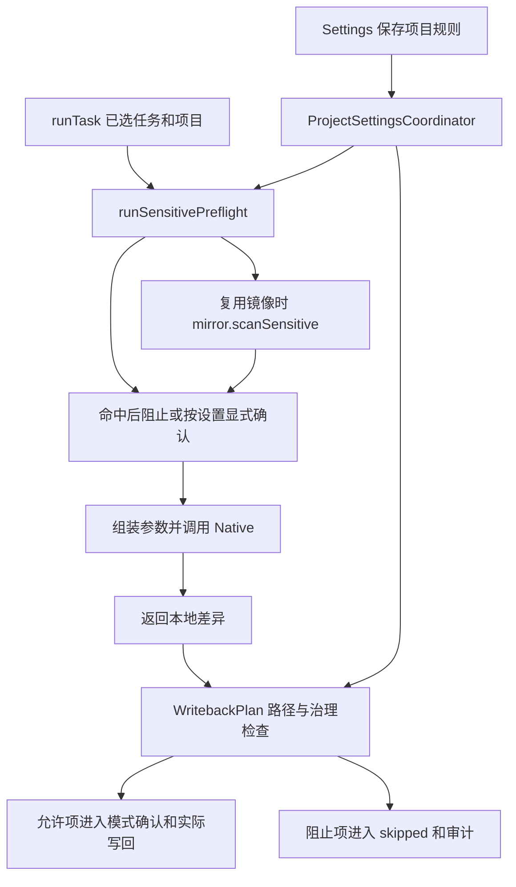

# 上下文扫描与写入治理

本页说明哪些任务材料进入敏感扫描、项目路径规则何时生效，以及扫描与写回权限如何分工。适用产品版本为 `2.5.0`，源码基线为 `2073ae74747431aab8d529803d4e9f8197262388`。

## 1. 三种机制各自约束什么

| 机制 | 权威定义及入口 | 范围 |
| --- | --- | --- |
| 敏感内容检测 | [SensitiveScan.scanSensitiveInputs](../../extension/src/shared/sensitiveScan.js)、runtime 的 `runSensitivePreflight` | 发现特定凭据形态，决定本次入口是否继续发送上下文 |
| 项目写入治理 | [GovernanceRules.evaluateGovernedOperations](../../extension/src/shared/governanceRules.js)、[WritebackPlan](../../extension/src/content/writebackPlan.js) | 按项目相对路径允许或阻止待写回操作 |
| 执行权限和身份 | Native 的 sandbox/工作目录、Page RPC 的项目与 capability 检查 | 各自约束本地执行及页面操作，不能由路径规则或扫描结果替代 |

扫描像材料进入执行流程前的筛查，治理规则像写回路径的许可清单。只读规则阻止的是匹配的 Overleaf 写回操作；它不自动禁止模型读取该文件，也不把本地镜像变为只读文件系统。
局部选区写入另由 [selectionScope](../../native-host/src/selectionScope.js) 等机制约束，见[界面与加载](ui-and-loading.md)；任务配置的捕获范围见[运行状态与恢复](run-state-and-recovery.md)。

## 2. 设置与实际执行位置

[ProjectSettingsCoordinator](../../extension/src/content/projectSettingsCoordinator.js) 的 `normalizeGovernanceRulesByProject/getGovernanceRulesForCurrentProject/setGovernanceRulesForCurrentProject` 按项目组织配置。
当前字段为 `readonlyPatterns`、`writablePatterns`、`sensitiveCheckEnabled`、`sensitiveConfirmAllowed`；默认启用扫描、默认不允许命中后继续确认。可写列表为空时不额外收窄可写范围，仍需经过路径与其他守卫。

普通项目任务在 `runTask` 的首次 `sendTrackedCodexRun` 前调用 `runSensitivePreflight`；实际写回在 [writebackOrchestrator.applySyncChangesToOverleaf](../../extension/src/content/writebackOrchestrator.js) 内调用治理检查。
两个位置都读取当前项目规则。规则不在 `RunExecutionSnapshot` 的字段白名单内，因此已排队任务不能据执行快照推定整套规则也已冻结；修改规则作用域或时序时需联动两个入口。
显式 `skill-installer` 调用更早进入 `runSkillInstallerTask`，随后经 `sendNative` 发送 `codex.run`，未经过上述预检。项目扫描与敏感确认设置不能据此推定覆盖安装任务的 task/customInstructions。安装模式不向项目回写，工作目录、沙箱及附件限制见[写作风格与技能](writing-style-and-skills.md#普通技能安装继承与作用域)。

## 3. 扫描实际覆盖的材料

`SensitiveScan` 的 helper 可扫描 `task`、`prompt` 和文本 files；当前 runtime 调用只传 `task` 与通过 `isTextSnapshotFile` 的项目文件，没有传完整组装后的 prompt。
检测器采用正则匹配私钥头、Bearer、若干 token 格式及 secret-like 赋值。它不判断研究内容是否机密，也不具备任意秘密或个人信息识别保证。
结果包含检测类型、来源、路径和已处理的短预览；具体预览处理与检测器维护在同一模块。

| 材料或分支 | 当前扫描入口 | 需要保留的限定 |
| --- | --- | --- |
| 普通运行的输入任务文本 | `runTask → runSensitivePreflight → scanSensitiveInputs({task,...})` | 只覆盖该入口和检测器能够识别的文字形态 |
| 运行中即时指导 | `RunQueueScheduler.createCoordinator().guide → codex.steer → turn/steer` | 不经过普通运行预检；Native 检查绑定、轮次、非空和长度，没有补调用 SensitiveScan |
| 显式 skill-installer 任务 | `runTask → runSkillInstallerTask → codex.run` 的早分支 | task/customInstructions 未经过普通项目敏感预检；该模式的文件操作与沙箱约束独立 |
| 项目文本快照 | `scanSensitiveProjectFiles` | 只扫描本次传入且满足文本判断的文件 |
| 已有本地镜像 | [scanMirrorSensitiveFiles](../../native-host/src/mirrorSensitiveScan.js) 经 `mirror.scanSensitive` | 扩展名白名单、单文件大小和返回数量限制 |
| 自定义指令、技能、编译日志 | 后续由 [codexPromptAssembly](../../native-host/src/codexPromptAssembly.js) 组装 | 未作为完整 prompt 进入本次预检；某些材料有独立处理，不能合并推定为已扫描 |
| 普通附件与图片 | [turnAttachments](../../native-host/src/turnAttachments.js) 等专用路径 | 不因项目文本扫描成功获得同等保证；图片像素无该正则扫描 |
| 写作风格参考及资产 | 独立 build/forRun 路径 | 见[写作风格与技能](writing-style-and-skills.md)的数据边界 |

### 镜像扫描与未扫描内容

Native 扫描普通目录和文件；文本扩展名由 `isSensitiveScanTextPath` 定义，另支持 `.latexmkrc`。单文件大于 512 KiB 记入 `skippedFiles`，结果最多保留 100 项发现。
浏览器 `scanNativeMirrorSensitiveFindings` 当前只消费 `result.findings`，未将 `skippedFiles` 转成阻断或完整性警告。因此零发现不能证明全部镜像均已扫描；例如超限文本或白名单外文件仍需单独判断。
Native 扫描请求失败会生成 `mirror-sensitive-scan-unavailable` 发现，按命中规则处理；扫描主动关闭则直接继续。扫描模块缺失且未复用镜像的兼容分支也会返回未阻止，不能把该路径描述成统一 fail-closed。

即时指导的派发入口在 [runQueueScheduler.js](../../extension/src/content/runQueueScheduler.js) 的 `guide`；[taskRunnerRuntime.handleCodexSteer](../../native-host/src/taskRunnerRuntime.js) 验证活动请求及预期 thread/turn 后，把文本交给 runner 的 `control.steer`。
这条身份检查不能代替内容扫描。修改扫描策略时，应分别检查首次运行、队列提升和即时指导，不能只修改 `runSensitivePreflight` 就宣称全部模型输入已覆盖。

### 命中后的行为与重试边界

敏感检查开启且 `sensitiveConfirmAllowed=false` 时，发现命中后在首次 Native 运行前停止；开启该字段后展示确认，结果决定是否继续。允许继续保留发现记录，不自动删除原始上下文中的匹配内容。
`mirror_stale` 的业务恢复会重新读取快照，经 [prepareMirrorStaleRetry](../../extension/src/content/otWarmMirror.js) 的完整或聚焦部分可用性判定后再次派发；合格的部分快照会限制到 focus files。当前 `runTask` 分支未再次调用 `runSensitivePreflight`。敏感检查开启时，若首次预检通过后，新快照包含检测器可识别的内容，首次阻止/确认策略不会自动再次执行，新内容仍可进入第二次 Native 请求参数。聚焦范围和快照可用性检查不代替内容检查；原扫描结果不能作为新快照已扫描的证明。实际 Provider/模型接收及其后果仍需独立验收。

## 4. 路径治理如何判断

治理入口先归一化写操作及目标路径，edit/create/delete/rename/move/binary-create/overwrite-binary 均在写类型集合内。
rename/move 同时检查来源与目标。对有效写操作，判定顺序为：

1. 路径无效则阻止。
2. 任一路径命中 readonly，则阻止。
3. writable 列表非空且存在未命中路径，则阻止。
4. 其他通过项交后续模式、身份和实际编辑守卫。

可概括为 $allow=valid\land\neg readonly\land(writableListEmpty\lor allPathsMatch)$；只读匹配优先于可写匹配。
`matchesGovernancePattern/globToRegex` 中 `*` 不跨 `/`，`**` 可跨目录。应使用该模块的真实语义，不能直接套用 shell glob 的所有规则。

`WritebackPlan.evaluateGovernedOperations` 调用项目规则并把阻止项转成 `governance_blocked`；主 Auto orchestrator 保留 skipped 和审计摘要。
治理检查位于这条主写回链，直接页面 RPC、Undo 或其他恢复入口是否经过同一检查须分别跟踪，不能由 helper 支持的类型推导所有调用都已经受它约束。

## 5. 审计和诊断消费

runtime 的 `createAuditDraftForRun/updateAuditSensitiveFindings/finalizeAuditRecord` 及 [AuditRecords](../../extension/src/shared/auditRecords.js) 构建摘要并写入 `auditLogs`。
审计包含选择、发现、允许/阻止/跳过项及保存证据的投影；当前传入的摘要来源是 task，`promptSummary` 保存处理后的长度与哈希标记，不代表完整模型输入的摘要。实际诊断导出还沿 [DiagnosticsExport](../../extension/src/content/diagnosticsExport.js) 及 UI 入口检查身份和字段。
不同模块的脱敏规则有不同输入范围，不能把一份审计摘要视作所有网络、日志或资产都不会包含敏感值的证明；Provider 凭据存储另见[Provider 与协议](providers-and-protocols.md)。

**辅助存储的账号边界。** [StorageDb.buildAuditLogRecord](../../extension/src/shared/storageDb.js) 保存 project/session/turn，未写入账号字段。`DiagnosticsExport.exportDiagnosticsBundle` 按 projectId 取最近12条 audit；[ChangeHistoryModel.project](../../extension/src/shared/changeHistoryModel.js) 另外要求关联当前可见会话。诊断采集后的 projectId 复核不能提供账号过滤，因此同站点同项目切换账号后，摘要仍可能包含先前账号的审计元数据。该路径不直接导出完整 prompt 或文件正文；具体字段仍由 `AuditRecords` 裁剪。

历史列表限额与诊断条数均属于输出范围，底层仍先读取该项目全部 audit；这些限额无法作为读取量、自动删除或保留期限的保证。单会话删除也未级联清理 audit。数据库、账号作用域、清空历史和保留规则见[数据生命周期](run-state-and-recovery.md#storage-lifecycle)。

## 6. 修改路由与验证入口

| 改动 | 必须联动 | 最近已有定义与范围 |
| --- | --- | --- |
| 新增检测器、预览或去重 | shared SensitiveScan、Native 镜像复用、审计预览 | [sensitiveScan.test.js](../../test/sensitiveScan.test.js) 直接测试正则及预览，不覆盖全部出站材料 |
| 改镜像白名单、大小或失败处理 | mirrorSensitiveScan、Native dispatcher、runtime 消费者 | [taskRunner.test.js](../../test/taskRunner.test.js) 含镜像扫描请求；浏览器完整性提示另需接入验证 |
| 命中确认与数据流 | runSensitivePreflight、首次/恢复派发、prompt 组装 | [p0ProductExperience.test.js](../../test/p0ProductExperience.test.js) 含片段及源码断言，不能自动证明新快照重试重新扫描 |
| 只读与可写路径规则 | GovernanceRules、WritebackPlan、orchestrator、错误展示和审计 | [governanceRules.test.js](../../test/governanceRules.test.js) 的路径和优先级行为；[writebackOrchestratorInitialization.test.js](../../test/writebackOrchestratorInitialization.test.js) 的装配 |
| 新增诊断或历史字段 | auditRecords、storageDb、diagnosticsExport、历史视图 | [auditRecords.test.js](../../test/auditRecords.test.js) 的摘要与处理规则；真实导出另行验证 |

最窄命令示例为 `node scripts/run-tests.mjs test/sensitiveScan.test.js test/governanceRules.test.js`。
高价值后续场景包括：超限文件返回零发现、mirror_stale 获得新内容、入队后修改规则、rename 跨只读路径、模型修改本地只读路径后是否被正确阻止写回。
每个场景须分别记录检测覆盖、派发数据与实际写回，不用单一“扫描通过”状态代替这些事实。
