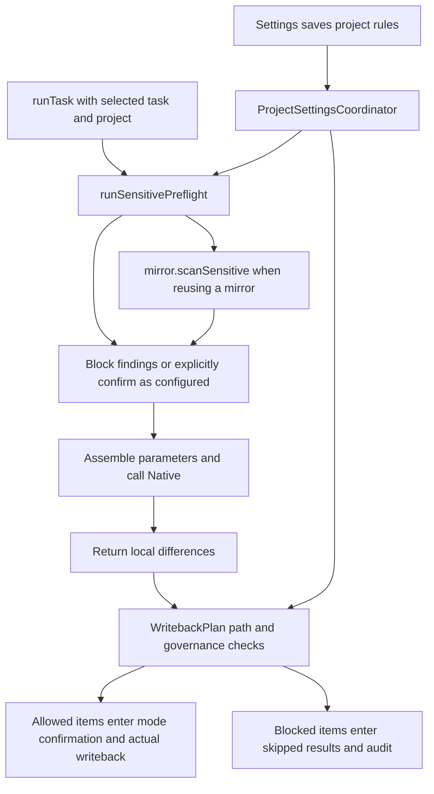

# Context Scanning and Write Governance

This page explains which task materials enter sensitive-content scanning, when project path rules take effect, and how scanning and writeback permissions divide responsibilities. The initial reference product version is `2.5.0`, and the initial reference source baseline is `2073ae74747431aab8d529803d4e9f8197262388`; the body is maintained against the current repository.

## 1. What Each of the Three Mechanisms Constrains

| Mechanism | Authoritative definition and entry point | Scope |
| --- | --- | --- |
| Sensitive-content detection | [SensitiveScan.scanSensitiveInputs](../../extension/src/shared/sensitiveScan.js), [SensitivePreflight.create().run](../../extension/src/content/sensitivePreflight.js), and the runtime's `runSensitivePreflight` | Detects specific credential patterns and determines whether the current entry point may continue sending context |
| Project write governance | [GovernanceRules.evaluateGovernedOperations](../../extension/src/shared/governanceRules.js), [WritebackPlan](../../extension/src/content/writebackPlan.js) | Allows or blocks pending writeback operations by project-relative path |
| Execution permissions and identity | The Native sandbox/working directory, and Page RPC project and capability checks | Constrain local execution and page operations respectively; path rules and scan results cannot replace them |

Scanning acts as screening before materials enter execution; governance rules act as a permission list for writeback paths. Read-only rules block matching Overleaf writeback operations. They do not automatically prohibit the model from reading those files or turn the local mirror into a read-only filesystem.
Selection-scoped writes are additionally constrained by mechanisms such as [selectionScope](../../native-host/src/selectionScope.js); see [UI and Loading](ui-and-loading.md). For the capture scope of task configuration, see [Run State and Recovery](run-state-and-recovery.md).

## 2. Settings and Actual Execution Points

[ProjectSettingsCoordinator](../../extension/src/content/projectSettingsCoordinator.js), through `normalizeGovernanceRulesByProject/getGovernanceRulesForCurrentProject/setGovernanceRulesForCurrentProject`, organizes configuration by project.
The current fields are `readonlyPatterns`, `writablePatterns`, `sensitiveCheckEnabled`, and `sensitiveConfirmAllowed`. Scanning is enabled by default; confirmation to continue after a finding is disallowed by default. An empty writable list imposes no additional restriction on writable scope, but paths and other guards must still pass.

Ordinary project tasks call `runSensitivePreflight` before the first `sendTrackedCodexRun` in `runTask`, and before resending after a `mirror_stale` snapshot reread. This runtime wrapper delegates to [SensitivePreflight](../../extension/src/content/sensitivePreflight.js), through `create(dependencies).run(options)`: the composition root explicitly injects dependencies, and the module handles scanning, mirror queries, deduplication, confirmation, and finding presentation together. `options` includes task, project, rules, and useExistingMirror. The content entry imports this Content module, and legacyGlobalRegistry exposes it; it adds no Page RPC. Actual writeback invokes governance checks inside [writebackOrchestrator.applySyncChangesToOverleaf](../../extension/src/content/writebackOrchestrator.js).
Both locations read the current project's rules. Rules are outside the `RunExecutionSnapshot` field allowlist, so a queued task's execution snapshot does not imply that its entire rule set is frozen. Changes to rule scope or timing must coordinate both entry points.
An explicit `skill-installer` invocation branches earlier into `runSkillInstallerTask`, then sends `codex.run` through `sendTrackedCodexRun`, bypassing the preflight above. Project scanning and sensitive-confirmation settings therefore do not establish coverage of installation tasks' task/customInstructions. Installer mode does not write back to the project; its working directory, sandbox, and attachment restrictions are described in [Writing Style and Skills](writing-style-and-skills.md#ordinary-skill-installation-inheritance-and-scope).

## 3. Materials Actually Covered by Scanning

The `SensitiveScan` helper can scan `task`, `prompt`, and text files. The current runtime caller passes only `task` and project files accepted by `isTextSnapshotFile`; it does not pass the fully assembled prompt.
The detector uses regular expressions to match private-key headers, Bearer values, several token formats, and secret-like assignments. It does not determine whether research content is confidential and provides no guarantee of recognizing arbitrary secrets or personal information.
Results include detection type, source, path, and a processed short preview. The specific preview processing is maintained in the same module as the detector.

| Material or branch | Current scanning entry point | Qualification to preserve |
| --- | --- | --- |
| Input task text for an ordinary run | `runTask → runSensitivePreflight → scanSensitiveInputs({task,...})` | Covers only this entry point and textual patterns recognized by the detector |
| Immediate guidance during a run | `RunQueueScheduler.createCoordinator().guide → runSensitivePreflight({guidance:true}) → SensitivePreflight.create().run → codex.steer → turn/steer` | Checks only the current `item.text`; reuses current project scanning and confirmation settings without rescanning project files, the mirror, or the full conversation |
| Explicit skill-installer task | Early branch through `runTask → runSkillInstallerTask → codex.run` | task/customInstructions bypass ordinary project sensitive preflight; this mode's file operations and sandbox constraints are independent |
| Project text snapshot | `scanSensitiveProjectFiles` | Scans only files passed in this call that satisfy the text predicate |
| Existing local mirror | [scanMirrorSensitiveFiles](../../native-host/src/mirrorSensitiveScan.js) through `mirror.scanSensitive` | Subject to an extension allowlist, a per-file size limit, and a result-count limit |
| Custom instructions, skills, compilation logs | Subsequently assembled by [codexPromptAssembly](../../native-host/src/codexPromptAssembly.js) | Do not enter this preflight as a complete prompt; some materials have independent processing, which does not establish combined scanning coverage |
| Ordinary attachments and images | Dedicated paths such as [turnAttachments](../../native-host/src/turnAttachments.js) | Successful project text scanning provides no equivalent guarantee for these materials; image pixels do not undergo this regex scan |
| Selected project reference text for writing style | `WritingStyleSettings.generate → preflightProjectReferences → SensitivePreflight`, checked before `startBuild` | Reuses target-project rules, the text predicate, and the existing confirmation policy; cancellation and account/project ownership are rechecked after waiting for confirmation |
| Writing-style PDFs, saved corpora, and version assets | Independent build/forRun paths | Preflight of selected project text provides no equivalent scanning guarantee; see the data boundaries in [Writing Style and Skills](writing-style-and-skills.md) |

### Stable Instructions and Per-Turn Materials

[codexPromptAssembly.buildCodexDeveloperInstructions](../../native-host/src/codexPromptAssembly.js) owns stable parent-thread guidance: the Overleaf academic-author role, latest-request language with `locale` (`en` by default, or `zh`) as fallback, concise narrow-panel answers, workspace rules, project-relative citations, math formatting, academic integrity, editing discipline, mode meanings, and `readProgressGuard.buildReadProgressRules`. The rules are independent of the active Ask/Auto mode. Explicit skill installation omits the Overleaf mirror rules. Native sends these rules on `thread/start` and `thread/resume`; a rejected-field compatibility retry puts the same rules before the turn text. See [thread handling](native-execution.md#4-threads-turns-steer-and-activity-events).

`buildCodexTurnPrompt` retains `{systemPrompt, userPrompt}` as its return shape; `systemPrompt` now contains only dynamic context. It includes the active mode and a request-judgment write expectation, workspace snapshot facts and unread-asset restrictions, and one nonempty focus list. Compile logs (with existing redaction), custom instructions, project local skills, selected/ignored/missing skills, and attachments appear only when present. UI history appears only without a `threadId`, including a fresh-thread recovery after failed resume; resumed threads already carry their history. There is no keyword-based forced-edit or abstract-target rule. Skill-installer guidance keeps its separate write expectation and does not claim that its workspace was just synchronized. `userPrompt` remains `Current user request:` followed by the task. The runner appends writing-style context, then the captured selection block, unchanged. Workers, writing-style builds, and manual compaction use their existing paths.

The prompt-size check includes developer instructions and the completed turn text. These assembly boundaries do not expand sensitive-preflight coverage: the current scanner still receives the inputs listed above, not the assembled instructions and turn.

### Mirror Scanning and Unscanned Content

Native scans ordinary directories and files. `isSensitiveScanTextPath` defines the text extensions, with additional support for `.latexmkrc`. Files larger than 512 KiB are recorded in `skippedFiles`; results retain at most 100 findings.
The browser's `scanNativeMirrorSensitiveFindings` inside `SensitivePreflight` currently consumes only `result.findings`; it does not turn `skippedFiles` into blocking conditions or completeness warnings. Zero findings therefore do not prove that the entire mirror was scanned. Oversized text files and files outside the allowlist, for example, still require separate assessment.
A failed Native scan request produces a `mirror-sensitive-scan-unavailable` finding, handled under the finding policy; explicitly disabling scanning allows continuation immediately. The compatibility branch for a missing scanning module without mirror reuse also returns an unblocked result, so this path cannot be described as uniformly fail-closed.

The dispatch entry for immediate guidance is `guide` in [runQueueScheduler.js](../../extension/src/content/runQueueScheduler.js). The runtime-injected `preflightGuide` uses the existing sensitive-content detector to scan this attempt's `item.text` and reads the current project rules. When scanning is disabled, it continues under the existing policy. If a finding cannot be confirmed, or the user rejects the existing confirmation dialog, no guidance is sent and the queue item still owned by this attempt returns to queued. Blocking guidance does not terminate the task already running. Presentation uses only the existing redacted findings and does not write raw matched text.

After waits for confirmation, pre-send saving, and compatibility ping, Guide validates the captured account, project, route epoch, session, run handle, request and thread/turn, queue-item text, and cancellation state. `sendSteer` passes optional `assertCurrent` through to `NativeCompatibilityController` for another check immediately before actual business dispatch. A rejection known to precede dispatch reuses the existing queue compensation; old callbacks do not overwrite items from another scope or items modified later. A sent request with an unknown result continues to use the existing pause policy. [taskRunnerRuntime.handleCodexSteer](../../native-host/src/taskRunnerRuntime.js) still checks the active request, expected thread/turn, nonempty text, and length before handing off to `control.steer`. This protection covers only the current Guide text and does not establish uniform scanning of all model input.

### Behavior After a Finding and Retry Boundaries

With sensitive checking enabled and `sensitiveConfirmAllowed=false`, findings block the corresponding Native dispatch. Enabling this field presents confirmation, whose result determines whether execution continues. Permission to continue retains the findings and does not automatically remove matching content from the original context.
Business recovery from `mirror_stale` rereads the snapshot. After [prepareMirrorStaleRetry](../../extension/src/content/otWarmMirror.js) determines full availability or usable focused partial availability, the original task and new project input undergo preflight again with `useExistingMirror:false`; acceptable partial snapshots remain restricted to focus files. New findings block or require fresh confirmation under current rules. Rejection ends the run; approved new findings are merged into the audit. With no findings, or with scanning explicitly disabled, execution continues to construct the second Native parameter set. Snapshot scope, content detection, and the pre-dispatch account/project recheck run separately; the first preflight result cannot replace checking the new snapshot. Actual receipt by the Provider/model and its consequences still require independent acceptance testing.

## 4. How Path Governance Decides

The governance entry first normalizes write operations and target paths. The write-type set includes edit/create/delete/rename/move/binary-create/overwrite-binary.
rename/move check both source and destination. For a valid write operation, the decision order is:

1. Block an invalid path.
2. Block if any path matches readonly.
3. Block if the writable list is nonempty and any path fails to match it.
4. Pass all other allowed items to subsequent mode, identity, and actual-edit guards.

This can be summarized as $allow=valid\land\neg readonly\land(writableListEmpty\lor allPathsMatch)$; a read-only match takes precedence over a writable match.
In `matchesGovernancePattern/globToRegex`, `*` does not cross `/`, while `**` can cross directories. Use the module's actual semantics; the full set of shell glob rules cannot be assumed.

`WritebackPlan.evaluateGovernedOperations` applies project rules and turns blocked items into `governance_blocked`; the main Auto orchestrator retains skipped results and audit summaries.
The known classification in [FailureReasons](../../extension/src/shared/failureReasons.js) handles this error, preserving the governance phase and actual reason. The current UI language determines the explanation and next-step text. Read-only matches and writable-allowlist mismatches receive separate explanations; display mapping does not change which paths may be written.
Governance checks sit on this main writeback chain. Whether direct page RPC, Undo, or other recovery entry points pass through the same check must be traced individually. The types supported by a helper do not prove that all callers are constrained by it.

## 5. Audit and Diagnostics Consumers

The runtime's `createAuditDraftForRun/updateAuditSensitiveFindings/finalizeAuditRecord` and [AuditRecords](../../extension/src/shared/auditRecords.js) build summaries and write them to `auditLogs`.
Audits contain projections of selections, findings, allowed/blocked/skipped items, and save evidence. The summary source currently passed in is task; `promptSummary` stores processed length and hash markers and does not represent a summary of complete model input. Actual diagnostics export also checks identity and fields through [DiagnosticsExport](../../extension/src/content/diagnosticsExport.js) and its UI entry point.
Different modules' redaction rules have different input scopes. One audit summary cannot prove that all network traffic, logs, and assets exclude sensitive values. For Provider credential storage, see [Providers and Protocols](providers-and-protocols.md).

**Chat bodies and diagnostic summaries.** User tasks, model answers, session history, and background-journal recovery bodies are not automatically replaced based on `token:`, `password=`, or key-like patterns. Ordinary example text can survive input capture, session saving, and recovery. Main conversations remain subject to existing capacity and retention budgets, and local-path display rules still apply. Pre-send `SensitivePreflight` consumes the captured original task and decides whether to dispatch under current settings, without silently rewriting the body as a substitute for checking. `AuditRecords` and explicit diagnostics export continue to construct processed summaries and do not write complete chat bodies into the export package. Replacement markers already saved in old records contain no original text, so a new display projection cannot automatically restore it.

**Account boundaries in auxiliary storage.** The runtime builds audits from the captured run account/project; `AuditRecords` and [StorageDb.buildAuditLogRecord](../../extension/src/shared/storageDb.js) preserve `accountScopeId`, and subsequent audit updates cannot change that ownership. `DiagnosticsExport` captures the current account and project, filters audits by both, and rechecks identity after asynchronous collection; it refuses export when the account is missing. Legacy audits without an account remain in storage, but the next exporter does not claim ownership and they do not enter diagnostic summaries.
[ChangeHistoryModel.project](../../extension/src/shared/changeHistoryModel.js) still requires association with a currently visible session and excludes audits explicitly owned by another account. Legacy records without an account can still be projected into the history view through an associated session; their compatibility rule differs from diagnostics export. Run summaries in diagnostics also exclude records with known owner mismatches. Legacy normalized runs without an independent account field still depend on the identity boundary of view loading, so strict audit account filtering does not establish the same proof for every diagnostic source.
Diagnostics still use `AuditRecords` to construct summary fields and do not directly export complete prompts or file bodies.

History-list limits and diagnostic entry counts constrain output scope; the underlying operation still first reads all audits for the project. These limits provide no guarantee about read volume, automatic deletion, or retention duration. Deleting an individual session also does not cascade to audit cleanup. For the database, account scope, history clearing, and retention rules, see [Data Lifecycle](run-state-and-recovery.md#storage-lifecycle).

## 6. Change Routes and Verification Boundaries

The permanent suite checks a representative conversation/recovery roundtrip in [sessionDurability](../../test/sessionDurability.test.js), including ordinary example text that resembles credentials. It does not establish detector coverage, full-prompt scanning, governance admission or diagnostics export behavior. Those checks are selected when their owning path changes.

| Change | Required coordination | Smallest useful check when affected |
| --- | --- | --- |
| Guide text checking and dispatch identity | `guide`, SensitivePreflight, runtime injection, NativeCompatibilityController and handleCodexSteer | Use synthetic credential-like text to verify the configured block/confirm outcome and that rejected input is retained without ending the active run. For an ownership change, verify no old-scope guidance is sent. |
| Detector, preview or deduplication | Shared SensitiveScan, Native mirror reuse and audit preview | Compare a matching synthetic input and ordinary text, checking findings and the processed preview. This cannot demonstrate coverage of materials absent from the caller. |
| Mirror allowlist, sizes or failure handling | mirrorSensitiveScan, Native dispatcher and runtime consumers | Use the changed file kind or size boundary and inspect both findings and skipped content; zero findings cannot establish complete scanning. |
| Finding confirmation and retry data flow | SensitivePreflight, initial/recovery runtime dispatch, prompt assembly and audit | When the retry path changes, introduce a finding in the reread snapshot and verify the second dispatch follows current block/approve/reject/disable policy. |
| Project-reference checking during style generation | WritingStyleSettings, composition-root `preflightProjectReferences`, SensitivePreflight and Native build | Check the selected text reference with current rules; add cancellation or scope change when that wait is affected. PDF/OCR and other outbound materials remain outside this preflight. |
| Read-only and writable path rules | GovernanceRules, WritebackPlan, orchestrator, error presentation and audit | Use a protected path and an allowed path; for a move/rename rule change, check both ends. Confirm the blocked operation leaves Overleaf unchanged and the reason follows the selected language. |
| Chat-body saving and recovery | SessionState, SessionManager, StorageDb, background journal and Native subagentTelemetry | `sessionDurability` checks saved draft, run text, report text and recovery material through a new shared-storage reader. When changing queues, forks, instructions or journals, inspect their own changed input/output path; that core test does not cover all body consumers. |
| Diagnostics or history fields | auditRecords, storageDb, diagnosticsExport and history view | Export synthetic records for the current account, a different account and legacy unknown ownership when filtering changes; inspect the actual exported fields and history projection separately. |

Use synthetic examples for scanning checks and temporary project files for write-governance checks. Record detection coverage, dispatched data and actual writeback as separate results. A single “scan passed” status cannot replace these facts. The [maintenance workflow](change-workflow.md) defines the small permanent gate and change-driven validation policy.
