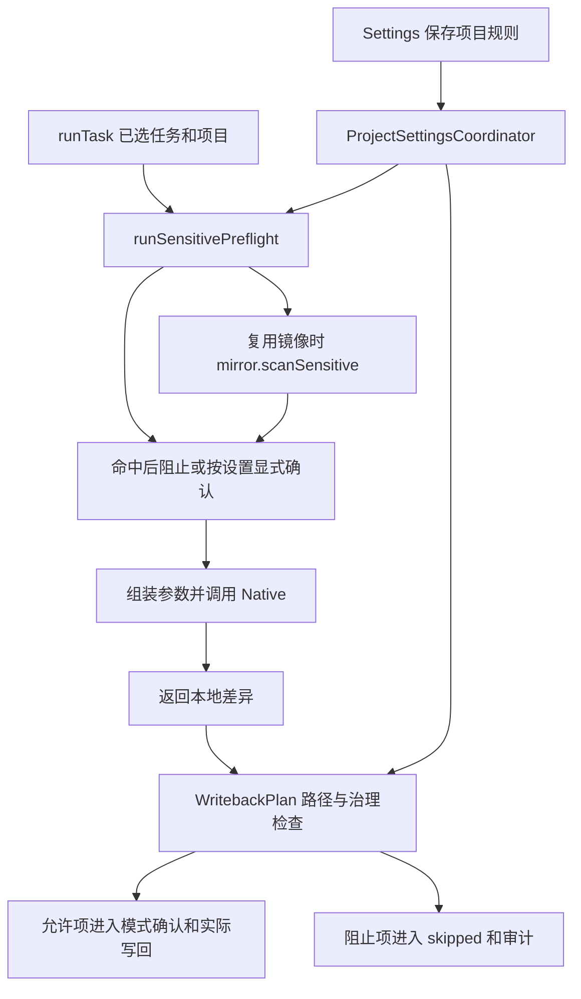

# 上下文扫描与写入治理

本页说明哪些任务材料进入敏感扫描、项目路径规则何时生效，以及扫描与写回权限如何分工。初始参考产品版本为 `2.5.0`，初始参考源码基线为 `2073ae74747431aab8d529803d4e9f8197262388`；正文随当前仓库维护。

## 1. 三种机制各自约束什么

| 机制 | 权威定义及入口 | 范围 |
| --- | --- | --- |
| 敏感内容检测 | [SensitiveScan.scanSensitiveInputs](../../extension/src/shared/sensitiveScan.js)、[SensitivePreflight.create().run](../../extension/src/content/sensitivePreflight.js)、runtime 的 `runSensitivePreflight` | 发现特定凭据形态，决定本次入口是否继续发送上下文 |
| 项目写入治理 | [GovernanceRules.evaluateGovernedOperations](../../extension/src/shared/governanceRules.js)、[WritebackPlan](../../extension/src/content/writebackPlan.js) | 按项目相对路径允许或阻止待写回操作 |
| 执行权限和身份 | Native 的 sandbox/工作目录、Page RPC 的项目与 capability 检查 | 各自约束本地执行及页面操作，不能由路径规则或扫描结果替代 |

扫描像材料进入执行流程前的筛查，治理规则像写回路径的许可清单。只读规则阻止的是匹配的 Overleaf 写回操作；它不自动禁止模型读取该文件，也不把本地镜像变为只读文件系统。
局部选区写入另由 [selectionScope](../../native-host/src/selectionScope.js) 等机制约束，见[界面与加载](ui-and-loading.md)；任务配置的捕获范围见[运行状态与恢复](run-state-and-recovery.md)。

## 2. 设置与实际执行位置

[ProjectSettingsCoordinator](../../extension/src/content/projectSettingsCoordinator.js) 的 `normalizeGovernanceRulesByProject/getGovernanceRulesForCurrentProject/setGovernanceRulesForCurrentProject` 按项目组织配置。
当前字段为 `readonlyPatterns`、`writablePatterns`、`sensitiveCheckEnabled`、`sensitiveConfirmAllowed`；默认启用扫描、默认不允许命中后继续确认。可写列表为空时不额外收窄可写范围，仍需经过路径与其他守卫。

普通项目任务在 `runTask` 的首次 `sendTrackedCodexRun` 前及 `mirror_stale` 重读快照后的重发前调用 `runSensitivePreflight`。该 runtime wrapper 委派 [SensitivePreflight](../../extension/src/content/sensitivePreflight.js) 的 `create(dependencies).run(options)`：依赖由组合根显式注入，模块统一处理扫描、镜像查询、去重、确认与发现展示；`options` 包含 task、project、rules、useExistingMirror。该 Content 模块由 content-entry import 和 legacyGlobalRegistry 暴露，不增加 Page RPC。实际写回在 [writebackOrchestrator.applySyncChangesToOverleaf](../../extension/src/content/writebackOrchestrator.js) 内调用治理检查。
两个位置都读取当前项目规则。规则不在 `RunExecutionSnapshot` 的字段白名单内，因此已排队任务不能据执行快照推定整套规则也已冻结；修改规则作用域或时序时需联动两个入口。
显式 `skill-installer` 调用更早进入 `runSkillInstallerTask`，随后经 `sendTrackedCodexRun` 发送 `codex.run`，未经过上述预检。项目扫描与敏感确认设置不能据此推定覆盖安装任务的 task/customInstructions。安装模式不向项目回写，工作目录、沙箱及附件限制见[写作风格与技能](writing-style-and-skills.md#普通技能安装继承与作用域)。

## 3. 扫描实际覆盖的材料

`SensitiveScan` 的 helper 可扫描 `task`、`prompt` 和文本 files；当前 runtime 调用只传 `task` 与通过 `isTextSnapshotFile` 的项目文件，没有传完整组装后的 prompt。
检测器采用正则匹配私钥头、Bearer、若干 token 格式及 secret-like 赋值。它不判断研究内容是否机密，也不具备任意秘密或个人信息识别保证。
结果包含检测类型、来源、路径和已处理的短预览；具体预览处理与检测器维护在同一模块。

| 材料或分支 | 当前扫描入口 | 需要保留的限定 |
| --- | --- | --- |
| 普通运行的输入任务文本 | `runTask → runSensitivePreflight → scanSensitiveInputs({task,...})` | 只覆盖该入口和检测器能够识别的文字形态 |
| 运行中即时指导 | `RunQueueScheduler.createCoordinator().guide → runSensitivePreflight({guidance:true}) → SensitivePreflight.create().run → codex.steer → turn/steer` | 只检查本次 `item.text`；复用当前项目扫描与确认设置，不重扫项目文件、镜像或完整会话 |
| 显式 skill-installer 任务 | `runTask → runSkillInstallerTask → codex.run` 的早分支 | task/customInstructions 未经过普通项目敏感预检；该模式的文件操作与沙箱约束独立 |
| 项目文本快照 | `scanSensitiveProjectFiles` | 只扫描本次传入且满足文本判断的文件 |
| 已有本地镜像 | [scanMirrorSensitiveFiles](../../native-host/src/mirrorSensitiveScan.js) 经 `mirror.scanSensitive` | 扩展名白名单、单文件大小和返回数量限制 |
| 自定义指令、技能、编译日志 | 后续由 [codexPromptAssembly](../../native-host/src/codexPromptAssembly.js) 组装 | 未作为完整 prompt 进入本次预检；某些材料有独立处理，不能合并推定为已扫描 |
| 普通附件与图片 | [turnAttachments](../../native-host/src/turnAttachments.js) 等专用路径 | 不因项目文本扫描成功获得同等保证；图片像素无该正则扫描 |
| 写作风格的选定项目参考文本 | `WritingStyleSettings.generate → preflightProjectReferences → SensitivePreflight`，在 `startBuild` 前检查 | 复用目标项目规则、文本判断和原确认政策；确认等待后再次核对取消及账号/项目归属 |
| 写作风格的 PDF、saved 语料及版本资产 | 独立 build/forRun 路径 | 不因选定项目文本预检获得同等扫描保证，见[写作风格与技能](writing-style-and-skills.md)的数据边界 |

### 镜像扫描与未扫描内容

Native 扫描普通目录和文件；文本扩展名由 `isSensitiveScanTextPath` 定义，另支持 `.latexmkrc`。单文件大于 512 KiB 记入 `skippedFiles`，结果最多保留 100 项发现。
浏览器 `SensitivePreflight` 内部的 `scanNativeMirrorSensitiveFindings` 当前只消费 `result.findings`，未将 `skippedFiles` 转成阻断或完整性警告。因此零发现不能证明全部镜像均已扫描；例如超限文本或白名单外文件仍需单独判断。
Native 扫描请求失败会生成 `mirror-sensitive-scan-unavailable` 发现，按命中规则处理；扫描主动关闭则直接继续。扫描模块缺失且未复用镜像的兼容分支也会返回未阻止，不能把该路径描述成统一 fail-closed。

即时指导的派发入口在 [runQueueScheduler.js](../../extension/src/content/runQueueScheduler.js) 的 `guide`。runtime 注入的 `preflightGuide` 使用原敏感检查器扫描本次 `item.text`，读取当前项目规则；扫描关闭时沿原政策继续。命中且不允许确认，或使用者拒绝原确认窗口时，不发送指导，仍属于本次尝试的队列项回到 queued；不会用阻止指导的结果结束正在运行的任务。显示只使用原脱敏发现，不写入原始匹配文本。

确认、发送前保存及兼容性 ping 等待后，Guide 校验捕获的账号、项目、路由代次、会话、运行句柄、请求与 thread/turn、队列项文字和取消状态。`sendSteer` 将可选 `assertCurrent` 贯通到 `NativeCompatibilityController`，在实际业务派发前再检查。已知尚未派发的拒绝复用原队列补偿；跨scope或后来修改的条目不被旧回调覆盖。已经发送但结果不明仍沿原暂停策略处理。[taskRunnerRuntime.handleCodexSteer](../../native-host/src/taskRunnerRuntime.js) 继续检查活动请求、预期thread/turn、非空和长度，再交给 `control.steer`。该保护仅覆盖Guide的本次文字，不构成所有模型输入统一扫描。

### 命中后的行为与重试边界

敏感检查开启且 `sensitiveConfirmAllowed=false` 时，发现命中后阻止对应 Native 派发；开启该字段后展示确认，结果决定是否继续。允许继续保留发现记录，不自动删除原始上下文中的匹配内容。
`mirror_stale` 的业务恢复重新读取快照，经 [prepareMirrorStaleRetry](../../extension/src/content/otWarmMirror.js) 的完整或聚焦部分可用性判定后，先对原 task 与新 project 输入再次调用预检，`useExistingMirror:false`；合格的部分快照仍限制到 focus files。新检查命中时按当前规则阻止或再次确认，拒绝后结束该运行，批准后的新发现并入审计；没有命中或主动关闭扫描时继续构造第二次 Native 参数。快照范围、内容检测及派发前账号/项目复核分别执行，首次预检结论不会代替新快照检查。实际 Provider/模型接收及其后果仍需独立验收。

## 4. 路径治理如何判断

治理入口先归一化写操作及目标路径，edit/create/delete/rename/move/binary-create/overwrite-binary 均在写类型集合内。
rename/move 同时检查来源与目标。对有效写操作，判定顺序为：

1. 路径无效则阻止。
2. 任一路径命中 readonly，则阻止。
3. writable 列表非空且存在未命中路径，则阻止。
4. 其他通过项交后续模式、身份和实际编辑守卫。

可概括为 $allow=valid\land\neg readonly\land(writableListEmpty\lor allPathsMatch)$；只读匹配优先于可写匹配。
`matchesGovernancePattern/globToRegex` 中 `*` 不跨 `/`，`**` 可跨目录。应使用该模块的真实语义，不能直接套用 shell glob 的所有规则。

`WritebackPlan.evaluateGovernedOperations` 调用项目规则并把阻止项转成 `governance_blocked`；主 Auto orchestrator 保留 skipped 和审计摘要。
该错误由 [FailureReasons](../../extension/src/shared/failureReasons.js) 的已知分类承接，保留治理阶段与实际原因；当前界面语言决定说明和下一步文案。只读命中与可写清单不匹配分别解释，显示映射不改变允许写入的路径。
治理检查位于这条主写回链，直接页面 RPC、Undo 或其他恢复入口是否经过同一检查须分别跟踪，不能由 helper 支持的类型推导所有调用都已经受它约束。

## 5. 审计和诊断消费

runtime 的 `createAuditDraftForRun/updateAuditSensitiveFindings/finalizeAuditRecord` 及 [AuditRecords](../../extension/src/shared/auditRecords.js) 构建摘要并写入 `auditLogs`。
审计包含选择、发现、允许/阻止/跳过项及保存证据的投影；当前传入的摘要来源是 task，`promptSummary` 保存处理后的长度与哈希标记，不代表完整模型输入的摘要。实际诊断导出还沿 [DiagnosticsExport](../../extension/src/content/diagnosticsExport.js) 及 UI 入口检查身份和字段。
不同模块的脱敏规则有不同输入范围，不能把一份审计摘要视作所有网络、日志或资产都不会包含敏感值的证明；Provider 凭据存储另见[Provider 与协议](providers-and-protocols.md)。

**聊天正文与诊断摘要。** 用户任务、模型回答、会话历史和后台 journal 恢复正文不按 `token:`、`password=` 或密钥样式自动替换。普通示例文字可在输入捕获、会话保存及恢复后保留；主会话仍受原有容量与保留预算约束，本地路径显示规则也继续适用。发送前的 `SensitivePreflight` 消费捕获后的任务原文并按当前设置决定是否派发，不以静默改写正文代替检查。`AuditRecords` 和显式诊断导出继续构造处理后的摘要，不将完整聊天正文写入导出包。旧记录中已经保存的替换标记没有原文，不能通过新版显示投影自动还原。

**辅助存储的账号边界。** runtime 从已捕获的运行账号/项目建立审计，`AuditRecords` 和 [StorageDb.buildAuditLogRecord](../../extension/src/shared/storageDb.js) 保留 `accountScopeId`，后续审计更新不能改写该归属。`DiagnosticsExport` 捕获当前账号与项目，按两者过滤 audit，并在异步采集后再次核对身份；缺少账号时拒绝导出。旧无账号 audit 保留在存储中，但不由下一位导出者认领，也不进入诊断摘要。
[ChangeHistoryModel.project](../../extension/src/shared/changeHistoryModel.js) 继续要求关联当前可见会话，并排除明确属于其他账号的审计；旧无账号记录仍可按关联会话投影到历史视图，其兼容规则与诊断导出不同。诊断中的运行摘要也排除已知 owner 不匹配项；旧归一化运行缺少独立账号字段时仍依赖视图加载的身份边界，不能将 audit 的严格账号过滤推广为所有诊断来源均有相同证明。
[auditAccountIsolation.test.js](../../test/auditAccountIsolation.test.js) 串联真实审计 writer、存储和导出，覆盖旧记录、账号变化及历史投影；存储和 Blob 下载 I/O 使用替身。诊断仍由 `AuditRecords` 构造摘要字段，不直接导出完整 prompt 或文件正文。

历史列表限额与诊断条数均属于输出范围，底层仍先读取该项目全部 audit；这些限额无法作为读取量、自动删除或保留期限的保证。单会话删除也未级联清理 audit。数据库、账号作用域、清空历史和保留规则见[数据生命周期](run-state-and-recovery.md#storage-lifecycle)。

## 6. 修改路由与验证入口

| 改动 | 必须联动 | 最近已有定义与范围 |
| --- | --- | --- |
| Guide文字检查与发送身份 | `guide`、SensitivePreflight、runtime注入、NativeCompatibilityController、handleCodexSteer | [guideSensitivePreflight.test.js](../../test/guideSensitivePreflight.test.js) 串联生产初始化、队列、预检及兼容等待到Native控制入口；模型control和外部I/O使用替身 |
| 新增检测器、预览或去重 | shared SensitiveScan、Native 镜像复用、审计预览 | [sensitiveScan.test.js](../../test/sensitiveScan.test.js) 直接测试正则及预览，不覆盖全部出站材料 |
| 改镜像白名单、大小或失败处理 | mirrorSensitiveScan、Native dispatcher、runtime 消费者 | [taskRunner.test.js](../../test/taskRunner.test.js) 含镜像扫描请求；浏览器完整性提示另需接入验证 |
| 命中确认与数据流 | SensitivePreflight、runtime 首次/恢复派发、prompt 组装、审计 | [runRetrySensitivePreflight.test.js](../../test/runRetrySensitivePreflight.test.js) 串联 runtime、真实检测器、warm-mirror guard 和审计投影，检查阻止/批准/拒绝/关闭及第二次派发参数；Page、Native 和持久化 I/O 使用替身 |
| 风格生成的项目参考检查 | WritingStyleSettings、组合根 `preflightProjectReferences`、SensitivePreflight、Native build | [writingStylePreflight.test.js](../../test/writingStylePreflight.test.js) 检查现有政策、取消和作用域变化；PDF/OCR 与通用出站检测不在该入口范围 |
| 只读与可写路径规则 | GovernanceRules、WritebackPlan、orchestrator、错误展示和审计 | [governanceRules.test.js](../../test/governanceRules.test.js) 的路径和优先级行为；[writebackOrchestratorInitialization.test.js](../../test/writebackOrchestratorInitialization.test.js) 的装配；[governanceFailureDisplay.test.js](../../test/governanceFailureDisplay.test.js) 的已知分类与新旧报告双语投影 |
| 聊天正文保存与恢复 | SessionState、SessionManager、StorageDb、后台 journal、Native subagentTelemetry | [conversationTextPreservation.test.js](../../test/conversationTextPreservation.test.js) 检查输入、回答、指令、排队、分叉及重载不按秘密样式替换；敏感预检与诊断摘要分别断言 |
| 新增诊断或历史字段 | auditRecords、storageDb、diagnosticsExport、历史视图 | [auditRecords.test.js](../../test/auditRecords.test.js) 的摘要与处理规则；真实导出另行验证 |

最窄命令示例为 `node scripts/run-tests.mjs test/sensitiveScan.test.js test/governanceRules.test.js`。
高价值后续场景包括：超限文件返回零发现、mirror_stale 获得新内容、入队后修改规则、rename 跨只读路径、模型修改本地只读路径后是否被正确阻止写回。
每个场景须分别记录检测覆盖、派发数据与实际写回，不用单一“扫描通过”状态代替这些事实。
