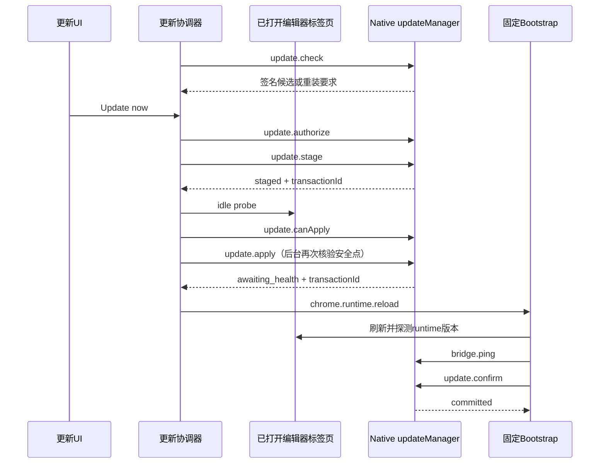

# 安装、托管更新与发布

本页帮助维护者定位安装目录、加载版本、更新事务和发布产物，解释修改其中一层时需要检查的其他层。
初始源码基线为 `2073ae74747431aab8d529803d4e9f8197262388`，当前行为随本仓库实现维护。
源码约束、测试覆盖、已安装运行状态和公开发布产物分别取证；各层验证范围在相应流程中说明。
入口见[功能索引](feature-map.md)，运行取消与进程寿命见[运行状态与恢复](run-state-and-recovery.md)。

## 1. 先确定正在观察哪一层

五层身份像设计图、预制件、安装现场、运行中的设备与交付包；某一层更新后，其余层需要各自取证。

| 层 | 实际身份与证据 | 主要 owner |
| --- | --- | --- |
| 开发源码 | Git 提交、工作树差异、包版本 | [package.json](../../package.json)、开发仓库 |
| 生成产物 | content bundle、输入和输出摘要 | [build-content-bundle.mjs](../../scripts/build-content-bundle.mjs) 的 `buildContentBundle()` |
| 磁盘安装 | 管理标记、扩展 Manifest、Native 版本指针 | [managedInstall.js](../../native-host/src/managedInstall.js) |
| 已加载代码 | 扩展版本、页面 runtime 应答、Native ping | [updateRuntimeIdentity.js](../../extension/src/shared/updateRuntimeIdentity.js) 的 `inspectInstalledRuntime()` |
| 发布产物 | tag、发布 manifest、压缩包、签名及公开 registry 字节 | [build-release.mjs](../../scripts/build-release.mjs)、发布验证脚本 |

`sourceDigest`覆盖 content 构建输入、构建选项和 esbuild 版本；它不覆盖全部 page-world 文件与 Native 运行状态。
构建器在 DOM 写入的摘要用于诊断当前执行代码，源码明确限定它不能充当信任或授权依据。

`inspectInstalledRuntime()`在证据齐全时比较四个版本：

\[
V_{installed}=V_{native}=V_{extension}=V_{runtime}.
\]

先检查活动事务和安装一致性，再区分 `aligned`、`reload_required`、`repair_required`；字段缺失返回 `unknown`。
活动更新也包括`authorized`或`bound`授权；四个版本相等且Native报告`installedAligned: true`时，残留授权仍会使该投影返回`transaction_active`，版本对齐不能证明授权已结算。
版本相等只能证明该检查所用的身份一致，无法证明所有功能都正常；同版本不同内容还需摘要或具体行为证据。

## 2. Direct 与 Managed 的加载入口

| 路径 | 浏览器入口 | Native 接入 | 适用判断 |
| --- | --- | --- | --- |
| Direct 源码加载 | [extension/manifest.json](../../extension/manifest.json) 的声明式 content scripts | 独立 Native 安装/注册 | 开发 checkout 需具备已生成 bundle |
| Managed 托管安装 | [manifest.template.json](../../extension/bootstrap/manifest.template.json) 声明固定 Bootstrap | 固定 launcher 读取 Native 版本指针 | 可在兼容边界内协调替换扩展与 Native runtime |

两条 content 路径使用相同生成 bundle；源码纳入由 [content-entry.mjs](../../extension/entries/content-entry.mjs) 决定。
Managed 的 `registerManagedRuntime()`读取 [runtime-manifest.json](../../extension/runtime-manifest.json)，动态注册 JS/CSS，见 [bootstrap/background.js](../../extension/bootstrap/background.js)。
Managed Popup 的 [popupFallback.js](../../extension/bootstrap/popupFallback.js) 属于 Bootstrap，独立读取既有语言偏好，为 runtime 失载时的原有提示选择语言；正常 runtime 接管后不再改动其界面。该资产随 `buildManagedExtensionTree()` 复制；单纯替换 runtime 目录不会更新它。当前另有明确限定为 `2.5.0 → 2.5.1` 的签名 Bootstrap revision 迁移，见第5节，其他固定层改动仍须满足独立迁移合同或完整安装条件。
页面主世界资源仍由 `PAGE_WORLD_SCRIPTS`及资源公开清单决定，新增 page 能力不能仅修改 content bundle。
runtime manifest 可扩展 Overleaf 站点范围，但实际注册受已授予 host permission 约束；可选权限的申请另由 UI 发起。
当前 manifest 仅列 `overleaf.com`、`www.overleaf.com` 和 `cn.overleaf.com`。增加其他 Overleaf 子域时，[Popup.offerNewSites](../../extension/src/popup.js) 可申请新增 host 权限，Bootstrap 可扩大动态注入范围；完整能力还需同步后台 Native sender、[SharedSessionBridge.enabled](../../extension/src/shared/sharedSessionBridge.js)、后台共享历史准入、更新协调器及安全点枚举的固定主机集合。授权和注入成功不能单独证明新站点可以运行、共享历史或参与更新保护。

当前 npm CLI 的 `install-managed`分派到 [scripts/install-managed.mjs](../../scripts/install-managed.mjs) 的 `installManaged()`，再调用 `installManagedDistribution()`。
CLI 命令解析位于 [bin/codex-overleaf-link.mjs](../../bin/codex-overleaf-link.mjs)；`doctor`输出预期注册位置、可选运行根参数、bridge ping与工具发现信息，其注册验证范围见下一节。
[install.sh](../../install.sh)、[install.ps1](../../install.ps1)还存在源码安装路径，可能准备开发依赖和构建 bundle；其信任与副作用应按脚本单独判断。
已发布 npm 包携带预构建产物，终端用户的包安装路径不依赖 esbuild 现场构建；新增依赖时须分别检查这些入口。

## 3. 安装目录、注册和失败恢复

`getDefaultManagedRoot()`位于 [nativeHostPlatform.js](../../native-host/src/nativeHostPlatform.js)，默认目录为：

```text
macOS / Linux: ~/.codex-overleaf/managed/
Windows:       %LOCALAPPDATA%/CodexOverleaf/managed/
  extension/
    manifest.json
    bootstrap/                  固定加载器和恢复入口
    runtime/                    当前扩展运行内容
    slots/previous/runtime/     原位更新保存的旧内容
  native/
    bootstrap/launcher.js
    versions/<version>/
    active-version
    previous-version
    updates/                    候选、授权、事务、锁及暂存内容
      bootstrap-migrations/
        <transactionId>/        Bootstrap源文件备份、进度与监护心跳
```

环境及安装参数可改变根目录，排障应读取实际安装输出与 Doctor，不能只按默认路径猜测。
`installManagedDistribution()`校验版本、扩展 ID、根目录和管理标记；拒绝替换未标记为本产品管理的现有扩展根。
`buildManagedExtensionTree()`创建新扩展暂存树，复制 Bootstrap、runtime 及资产，调整托管路径并核验引用文件。
安装器把旧扩展目录改名为 rollback 目录，再把新树移入；Native 安装和注册成功后清理扩展 rollback。
`installManagedNativeVersion()`写入版本目录，复制内部固定 launcher，并更新 `active-version`和必要的`previous-version`。
`installManagedNativeRegistration()`写外层 bridge 和 Native Host manifest；Windows 还写注册表，其他平台使用浏览器规定的文件位置。
扩展 ID 进入 `allowed_origins`，注册错误会使 Chrome 拒绝 Native Messaging，即使本机 Node 命令可以运行。

Native 固定启动链有两层，安装器分别生成或复制它们：

| 层 | 安装写入者 | Chrome 连接后的消费者 |
| --- | --- | --- |
| 外层 bridge | `installManagedNativeRegistration()`调用 [launcher.js](../../native-host/src/launcher.js) 的`buildLauncher()`，生成用户级 shell 脚本；Windows生成`.cmd` | Native Host manifest的`path`指向bridge；bridge用安装时的Node路径启动内部launcher |
| 内部 launcher | `installManagedNativeVersion()`将 [managedLauncherRuntime.js](../../native-host/src/managedLauncherRuntime.js) 复制到`native/bootstrap/launcher.js` | 读取active/previous版本指针、注入托管环境，再启动版本目录中的`native-host/src/index.js` |

常规runtime更新替换扩展runtime和Native版本目录，并更新指针、manifest版本及管理标记；上述两层Native启动文件仍由完整安装路径维护。`2.5.0 → 2.5.1` 的兼容迁移额外替换扩展的封闭Bootstrap资产清单，不修改这两层Native启动文件、注册或Chrome权限。修改启动命令、PATH或Windows引号处理时，需要核对最终生成的bridge与内部launcher；仅确认新版runtime目录包含源码不足以证明启动行为已改变。

自定义 `managedRoot`只改变安装内容的位置，不隔离用户级注册资源。[nativeHostPlatform.js](../../native-host/src/nativeHostPlatform.js)的 `getDefaultBridgePath()`对不同管理根、Chrome和Chromium返回同一个用户级bridge路径。
[manifest.js](../../native-host/src/manifest.js)的 `getNativeHostManifestPath()`在macOS/Linux按浏览器区分manifest；Windows共用manifest文件，`getWindowsRegistryMetadata()`再按浏览器区分HKCU注册表键。`auto`按Chrome处理。
Windows的manifest实际位于`%LOCALAPPDATA%/codex-overleaf/native-messaging-hosts/com.codex.overleaf.json`，与`%LOCALAPPDATA%/CodexOverleaf/`下的bridge和runtime分开；Direct安装、Managed安装及Doctor均通过同一注册路径helper定位它。
因此多个管理根，或Direct与Managed安装共用默认入口时，后一次安装会改写已有bridge及相应注册；注册副作用超出管理根目录。

连接故障修复命令按实际加载类型生成。[managedInstall.buildManagedExtensionTree](../../native-host/src/managedInstall.js)在完整Managed安装的扩展marker写入`installIdentity:{managedRoot,browser,extensionId,platform}`；该身份描述实际安装参数，runtime-only的marker版本更新通过原字段展开保留它。
[background.readExtensionInstallIdentity](../../extension/src/background.js)读取扩展自身marker并核对扩展ID，在既有`bridge.ping`成功或错误应答上附带`extensionInstallIdentity`；[compatibility.evaluateNativeCompatibility](../../extension/src/shared/compatibility.js)保留该身份。[popup.js](../../extension/src/popup.js)也读取自身marker；[NativeCompatibilityController](../../extension/src/content/nativeCompatibilityController.js)将身份用于原面板setup指引；[DiagnosticsController](../../extension/src/content/diagnosticsController.js)是独立的Compatibility消费者，经同一background ping应答取得身份并生成诊断中的修复命令。
`Compatibility.buildInstallCommand(version,platform,extensionId,options)`保留Direct的三参`install-native`格式。Managed身份完整时生成固定目标版本的`install-managed`，显式保留原`--managed-root`、`--browser`和非默认扩展ID，根路径按POSIX sh或Windows PowerShell规则引用；现有Windows说明明确命令应在PowerShell执行。Managed修复继续指向固定launcher，无需改成独立Native入口。
旧marker缺少安装身份或身份不匹配时，Managed命令为空；原setup区提示沿用原安装参数，复制动作禁用，不猜测默认管理根，也不回退为Direct命令。此边界保留旧安装的已有数据与副本位置，需要实际安装参数后才能生成具体修复命令。
[managedRepairGuidance.test.js](../../test/managedRepairGuidance.test.js)串联background、面板setup与诊断消费者，并核对临时安装的实际bridge；[installReleaseSafety.test.js](../../test/installReleaseSafety.test.js)、[compatibility.test.js](../../test/compatibility.test.js)、[popupInstallGuidance.test.js](../../test/popupInstallGuidance.test.js)及[NativeCompatibilityController测试](../../test/nativeCompatibilityController.test.js)分别保留身份、命令选择及已有消费者验证；合成安装与传输不能替代真实Chrome读取marker、复制命令和恢复连接的验收。

[nativeDoctor.js](../../native-host/src/nativeDoctor.js)的`runDoctor()`分别采集浏览器注册发现和bridge直接执行证据。Windows通过[nativeHostRegistration.queryWindowsNativeHostRegistration](../../native-host/src/nativeHostRegistration.js)查询所选浏览器HKCU默认`REG_SZ`值，要求它为唯一可解析绝对路径并指向预期manifest；路径按Windows规则归一化及忽略大小写比较。查询失败、缺失、无法解析或错指向均不产生注册已验证结论。
Doctor继续读取manifest并直接启动bridge完成ping，因此注册异常时仍能提供独立执行诊断；直接ping兼容而注册未验证时，聚合结果为`registration_unverified`及退出码2。文本输出分别显示注册发现和执行状态，观察到的manifest路径仍按原隐私选项隐藏或展示。
[installReleaseSafety.test.js](../../test/installReleaseSafety.test.js)使用注册表与进程替身，覆盖有效、缺失和错误指向在相同健康bridge下的不同结果；[nativeInstallScripts.test.js](../../test/nativeInstallScripts.test.js)保留平台命令及直接桥接测试。真实Windows Chrome发现注册及连接仍需实机验收。

`installManagedDistribution()`在替换已有树前，由 [managedInstallRecovery.js](../../native-host/src/managedInstallRecovery.js) 的`createInstallRestorePoint()`取得Native更新共用的`updates/mutation.lock`，首次安装也遵守此顺序。持锁后才读取旧文件和目标槽，保存本次会改写的active/previous指针、Native管理标记、内部launcher、外层bridge、注册manifest、安装标记、更新journal及authorization的字节和权限，并保留同名Native目标槽。注册或事务结算抛错时，连同扩展rollback恢复这些内容；原先不存在的文件恢复为不存在，同版本覆盖也保留旧字节。
首次安装补偿在文件和注册恢复完成前一直持锁，按自身token释放后仅尝试删除空目录，避免清理后继安装的新锁或内容。安装器与updater共用锁格式和回收规则：存活PID即使期限已过仍不可抢锁，确认已退出的PID可回收；无有效owner时等待文件mtime超出既有stale期限，以保护建锁与写owner之间的窗口。
这属于有限的进程内补偿，未提供任意断电或跨管理根、文件与注册表的全局原子事务。补偿不完整返回`managed_install_restore_failed`；Windows旧注册值无法核实且已尝试改写时也明确报告恢复未完成。成功提交后的备份清理失败仅报告warning，不再次使用已消耗的恢复材料。失败后仍需按返回结果核对两端内容及注册状态；真实Chrome发现注册与bridge执行分别取证。
`selectRunnableVersion()`位于 [managedLauncherRuntime.js](../../native-host/src/managedLauncherRuntime.js)，优先选择 active，缺少入口文件时尝试 previous。
该 fallback 检查入口文件存在性；它不执行完整健康诊断，也不保证扩展 runtime 与 fallback Native 版本自动匹配。
卸载入口为 `uninstallManagedDistribution()`；其删除范围是管理根和注册，项目镜像、浏览器历史等数据拥有其他生命周期。
删除共享入口前，`isBridgeForManagedRoot()`核对现存launcher的精确目标参数及agent赋值仍指向被卸载Native根；允许Node可执行文件位置变化。manifest还须具有预期host名称并指向该bridge；Windows所选注册键还须查询验证其默认值确实指向该manifest。归属未知、内容无法识别或已指向其他副本时保留对应共享入口，仍按原路径保护删除指定管理根。
[installReleaseSafety.test.js](../../test/installReleaseSafety.test.js)覆盖临时A→B安装后卸载A保留B入口、卸载当前B正常清理以及注册键改指其他manifest的保留；[managedInstall.test.js](../../test/managedInstall.test.js)和[nativeInstallScripts.test.js](../../test/nativeInstallScripts.test.js)保留原目录/平台注册验证。文件和注册步骤仍独立执行，没有跨进程原子卸载承诺；不能把这些合成场景描述成所有平台实机验收。

## 4. 更新状态分别由谁负责

| 事实 | owner 与持久化 | 消费者/限制 |
| --- | --- | --- |
| 用户意图、目标授权、延后 | [backgroundUpdateCoordinator.js](../../extension/src/backgroundUpdateCoordinator.js)、`chrome.storage.local` | 操作 generation 和事务/授权快照约束迟到恢复写入；superseded 两个入口共用协调器写队列 |
| 授权撤销意图 | [updateRevocationIntent.js](../../extension/src/shared/updateRevocationIntent.js) | 持久化后再发送 cancel/revoke，重启继续清理 |
| 已验证候选 | [updateManager.js](../../native-host/src/updateManager.js) 的 `candidate.json` | 保存签名 manifest、签名及 bundle 地址 |
| 手动重装提示缓存 | 同模块的`manual-candidate.json` | 保存原始manifest与签名；304要求同ETag和来源版本，重验签后派生目标及说明，边界见第9节 |
| 可执行授权 | 同模块的 `authorization.json` | 绑定 source/target version、authorization ID及 transaction ID |
| 安装事务 | 同模块的 `transaction.json`及磁盘指针 | 决定 staged、activation_pending、applying、bootstrap_pending、awaiting_health、committed等事实；迁移回滚另有bootstrap_rolling_back及sourceActivationPending |
| Bootstrap迁移合同与协调 | [bootstrapMigrationContract.js](../../native-host/src/bootstrapMigrationContract.js)、[bootstrapUpdate.js](../../native-host/src/bootstrapUpdate.js) | 限定来源版本/源摘要/目标摘要，绑定签名、授权、事务、运行Native版本与已加载revision |
| Bootstrap文件与进度 | [bootstrapMigration.js](../../native-host/src/bootstrapMigration.js)，`bootstrap-migrations/<transactionId>/state.json`及`files/` | 准备、应用、恢复、摘要读回；不自行授予更新资格，备份不随staging清理 |
| 浏览器迁移接续 | [backgroundBootstrapMigration.js](../../extension/src/backgroundBootstrapMigration.js) | 使用现有更新屏障和重载入口，内存锁保持到匹配健康确认完成 |
| 重载后的安全探测与页面刷新清单 | [backgroundUpdateSafety.js](../../extension/src/backgroundUpdateSafety.js)，`codex-overleaf-managed-update-guarded-tabs-v1` | 定向恢复只读接收端，按事务与文档身份保存待刷新清单；磁盘恢复与允许刷新页面分别核对 |
| 独立迁移恢复监护 | [bootstrapUpdateWatchdog.js](../../native-host/src/bootstrapUpdateWatchdog.js) | 事务/token/PID握手与心跳，期限到达经同一mutation lock调用恢复；原Popup还可唤醒Native检查 |
| 阶段规范与恢复解释 | [managedUpdateProjection.js](../../extension/src/shared/managedUpdateProjection.js) | 归一别名、阶段、期限、进度和迁移；不执行文件替换 |
| UI 展示策略 | [updateConsent.js](../../extension/src/shared/updateConsent.js)、[updateNotice.js](../../extension/src/content/updateNotice.js) | 仍有专用 view model与兼容映射，不能视为 Native journal 的原样副本 |
| 新代码加载/健康确认 | [bootstrap/background.js](../../extension/bootstrap/background.js) | 固定加载器承担恢复入口，不能靠可替换 runtime 自证全部加载成功 |

浏览器状态提供意图与展示；Native journal、指针和管理标记提供安装事实。协调器恢复时重新读取 Native 状态再更新投影。
`projectUpdateState()`优先使用 projection 的 `transitionCommand()`或观察迁移，保留兼容 fallback；新增状态须同步检查 UI消费者。

## 5. 从发现到确认的正常链



`checkForUpdate()`通过 GitHub `releases/latest`的公开跳转确定 stable tag，再读取签名 manifest；避免依赖 GitHub API配额。
只发现更新不创建安装授权；`installUpdate()`会重新检查过期候选，再持久化授权意图并调用 `update.authorize`。
`authorizeUpdate()`验证当前 active-version、签名目标与请求一致，创建`authorized`授权并设置两小时后的`expiresAt`；其他目标不能复用它。
`stageCandidate()`下载并验证 bundle，解包后检查扩展/Native版本配对，创建 journal并将授权绑定事务。
`requireAuthorization()`只对`authorized`状态检查期限；`bindAuthorization()`将状态改为`bound`后，复用staged、apply及confirm仍校验版本、授权和事务身份，但不因`expiresAt`已过而拒绝。
可复用 staged事务也需重验内容和授权；内容失效、身份不匹配或已有激活事务会中断相应路径。静态反例是stage完成后等待空闲超过两小时，绑定授权仍可继续安装，不能把两小时解释为整次更新的总期限。
[updateAuthorizedCandidate.test.js](../../test/updateAuthorizedCandidate.test.js)的过期测试覆盖`authorized`候选；[updateManager.test.js](../../test/updateManager.test.js)使用`bound`事务fixture，测试范围应按实际授权状态区分。
`tryActivateStagedUpdateCore()`收集标签页、Native及后台未完成执行请求的 blockers，存在阻断时保持`waiting_for_idle`。
后台 `requestManagedInternal()`在 `update.apply`之前再次调用`verifyManagedUpdateSafety()`，通过后阻止新的`no_silent_retry`类执行请求；`update.*`和`codex.cancel`保留通行。
Native `applyStagedUpdate()`再次检查本地 gate、管理布局、事务及授权，重验归档并从归档重新解包待应用内容。
它保存旧 runtime、移动配套 Native版本、写 active/previous指针、更新 Manifest版本和管理标记，最后写`awaiting_health`。
`update.activate`另有延迟激活路径：先写`activation_pending`再定时执行 apply；当前主协调路径调用`update.apply`。
收到匹配事务的`awaiting_health`后才重载扩展，随后由 Bootstrap继续确认。

### 2.5.0 → 2.5.1 的兼容 Bootstrap 迁移

这条路径保留已发布`2.5.0`的首次下载、签名检查、授权和runtime安装，再由实际启动的`2.5.1` Native与新版runtime继续处理固定层。产品版本`2.5.1`、Bootstrap协议`3`、Bootstrap revision `3.1`分别表示产品发布、旧客户端可理解的安装/消息边界，以及这次固定层实现身份；revision变化没有扩大扩展权限或改写用户级bridge。

1. [runtimeInstaller.js](../../native-host/src/runtimeInstaller.js)把目标Bootstrap资产放入Native版本包的`native-host/bootstrap-payload/bootstrap/`，附带仅供校验的`manifest.template.json`。该位置属于旧归档器已允许的Native子树。[build-release.mjs](../../scripts/build-release.mjs)将`bootstrapMigration`描述纳入待签名release manifest：源版本、已知源文件SHA-256、目标文件SHA-256及封闭文件列表。清单中的扩展manifest仅核验形状，不由文件迁移模块替换；原apply继续维护其版本字段。
2. 新Native的`bindBootstrapMigration()`识别确切版本对，重验签名原件与journal保存的manifest/bundle摘要、大小及bound授权，把事务置为`bootstrap_pending`。缺证据仍保持迁移待处理，不能退化成普通更新成功。`update.status`的投影和`confirmUpdate()`共同阻止旧Service Worker提前confirm或清理恢复材料。
3. 新后台的`CodexOverleafBootstrapMigration.init()`在原Bootstrap继续健康初始化前接续迁移，先保护原待刷新页面清单，再重新核对空闲/保存条件。扩展重载可能使旧页面接收端失效；仅在迁移事务与执行锁仍匹配、原probe返回`tab_probe_unavailable`时，定向建立第6节的只读安全接收端。安全点成立后才调用内部`update.bootstrap`。Native在已有跨进程mutation lock内检查本地任务屏障、实际运行Native版本、目标JS语法、归档字节、manifest形状及源文件摘要。
4. `prepareBootstrapMigration()`先保存旧文件字节/权限与进度。进度记录采用WAL（预写日志）：先记下将要替换的文件，再原子替换并读回；中断后可由磁盘记录判断继续或恢复。新依赖先落盘，引用它的HTML随后更新，后台入口最后替换，入口始终保留一个文件。文件写入先flush临时文件、再rename、再flush父目录；Windows目录flush能力有限，不能据此宣称任意断电均可恢复。
5. 独立watchdog握手成功后才进入文件替换。旧worker获得`reload_required`，沿`chrome.runtime.reload()`重载；新固定入口提供revision `3.1`，再次经过迁移安全检查后，Native核对目标磁盘摘要，将迁移phase置为`loaded`并返回`awaiting_health`。后台重新核对原待刷新文档身份，放回页面清单，才继续原页面、Native和版本健康检查；`update.confirm`同时要求事务身份、已加载revision与目标Bootstrap摘要相符。允许的重载次数及健康期限由[bootstrapUpdate.js](../../native-host/src/bootstrapUpdate.js)定义，避免跨worker无限重载。

主事务、授权、候选与版本指针由[updateManager.atomicWriteText()](../../native-host/src/updateManager.js)原子写入：以独占可写句柄创建临时文件，在同一句柄上写入并`fsync`，关闭后再rename。Windows的文件flush需要可写句柄，不能关闭后以只读句柄重开。普通文件的权限或I/O错误继续使请求失败，未flush的临时文件不会替换目标；父目录flush单独沿既有Windows不支持错误集合处理，不能把该兼容规则用于普通文件。[updatePersistence.test.js](../../test/updatePersistence.test.js)通过签名更新请求链与文件故障注入核对该边界，实际Windows行为另由三平台CI验证。

迁移期间仍使用原有更新状态界面，没有增加操作按钮或独立授权步骤。[managedUpdateProjection.js](../../extension/src/shared/managedUpdateProjection.js)将`bootstrap_pending`映射为既有`awaiting_health`，浏览器恢复分支继续使用`rolling_back/failed`；后台执行锁与Native的`assertBootstrapBusinessAvailable()`阻止业务穿过未完成的迁移，更新、ping与取消保留各自通道。

文件进度的`prepared/applying/applied/restoring/restored`与主事务的`bootstrap_pending/awaiting_health/committed`分别属于文件替换和整体安装，不能互换。磁盘达到`applied`仍需重载证明实际执行的固定层；只有产品版本相等也不足以结算这条迁移。

## 6. 安全点的实际范围

`buildIdleProbe()`位于 [content/updateIdle.js](../../extension/src/content/updateIdle.js)，检查业务 busy状态、近期编辑活动和保存信号稳定期。
[contentRuntime.js](../../extension/src/content/contentRuntime.js)的 `UpdateIdle.create()`提供 run、cancelling、storage、reviewAction、dialog状态；保存探针允许 quiet editor fallback。
当前 idle探针接受`verified_saved`或`verified_quiet`，要求30秒无相关编辑活动、保存判断稳定3秒；quiet证据弱于服务器内容核验。
“所有标签页”在实现中指匹配支持站点、可用且未被discard/unload的编辑器标签页；项目列表、丢弃页与未授权站点有不同处理。
应答失败、超时或保存未知会产生 blocker；不能把 tab探针不可达直接解释为空闲。
**整体枚举失败的处理。** 后台 `verifyManagedUpdateSafety` 将 `tabs.query` 拒绝或非数组结果记为 `tab_inventory_unavailable` blocker，不把未知清单等同合法空数组。该 blocker 与单页探针、Native gate 及后台 pending 检查共同决定是否允许 apply；合法空清单仍可在其他条件满足时放行。
二次检查受阻经 `update_not_idle` 回到 `waiting_for_idle`，保留暂存事务和授权，并沿现有定时器重试；UI 仍采用已有 busy 投影。首次协调器枚举错误保留原失败/撤销处理。[managedUpdateSafetyGate.test.js](../../test/managedUpdateSafetyGate.test.js) 从实际安装消息入口装配完整后台与协调器，验证枚举恢复后只 apply 一次；Chrome/Native I/O 使用内存替身，真实浏览器异常仍需验收。

### 扩展重载后恢复安全探测

扩展worker重载与Overleaf页面刷新属于两个生命周期。旧面板DOM可以仍在页面里，旧content receiver却已无法接收新worker的消息；面板可见、旧bundle摘要存在均不能证明安全probe可用。[background.verifyManagedUpdateSafety(migrationOwner)](../../extension/src/background.js)只有在原probe明确不可达且带迁移owner时，才调用[backgroundUpdateSafety.probe](../../extension/src/backgroundUpdateSafety.js)。普通安装前的未知保存/超时/忙碌继续按原规则阻断；恢复接收端也不把消息缺失折算为空闲。

`backgroundUpdateSafety`使用Chrome提供的顶层`documentId`与URL固定探测对象，并要求后台执行锁、Native事务ID、source/target版本和`expectedState`仍相符。恢复注入分为两侧：

- 隔离世界的[updateSafetyReceiver.js](../../extension/src/content/updateSafetyReceiver.js)复用`UpdateIdle`，只监听专用迁移probe。相同文档/事务的重复注入保留计时；每次探测使用新nonce并保持single-flight。恢复实例把旧面板交互也记入活动，观察可见对话框、面板运行/取消/接受状态，以及按[pageRpcContract](../../extension/src/shared/pageRpcContract.js)分类的在途页面修改消息。它不初始化完整content runtime、不创建第二个面板、不承担业务请求或runtime健康应答。
- MAIN world的[updateSafetyProbe.js](../../extension/src/page/updateSafetyProbe.js)复用[saveState.js](../../extension/src/page/saveState.js)做只读保存观察。探测前后复核URL、文件身份、编辑器view与文档对象；只有取得完整CodeMirror文档时才允许quiet fallback，DOM可见行不能替代全文。没有完整文档时仍需明确的正向保存信号及可核对文件身份。返回的文件/文档identity让`UpdateIdle`在切换文件或文档变化时重新积累保存稳定时间。

专用消息的token、nonce、事务、目标版本和文档身份在往返各层核对；MAIN读取前后及最终接收应答前再次检查Native事务。保存成功仍须满足原30秒无相关活动和3秒保存稳定条件，之后继续检查Native任务/退出屏障、后台pending请求，以及Native等待前后标签页集合是否变化；`revalidate()`再对已建立恢复接收端的文档发起一次新probe，避免沿用Native等待前的旧应答。恢复实例没有重新获得旧runtime的全部私有闭包，不能把它的DOM观察单独当成完整运行状态；原安装前安全点、当前Native屏障和专用接收端各自提供不同证据。

### 迁移期间的页面刷新保护

`protectReloadTabs()`在迁移开始时将原`codex-overleaf-managed-update-tabs-v1`清单及其文档身份放入`codex-overleaf-managed-update-guarded-tabs-v1`，同一存储写入清空旧清单并读回。读回按完整对象结构比较，保留字段、类型、值和数组顺序要求；Chrome存储返回对象的键排列不参与相等判断。这个清单由旧Bootstrap的健康/回滚路径消费，必须先保护，避免在迁移等待期间出现新的未保存编辑后仍按旧许可刷新页面。

目标revision已加载且Native返回`awaiting_health`后，`releaseReloadTabs()`前后核对Native事务及预期状态、guard归属、仍打开的原文档ID/URL及存储内容，再放回清单进入既有健康刷新。回滚路径先核对磁盘源版本和三层恢复摘要，随后继续等待页面安全点，才放回清单并重载旧版本；磁盘已经恢复不等于页面可以立即刷新。若确认同一tab已经换成新文档，回滚控制器保留guard及空的旧清单，只重载扩展以结束旧等待，不自动刷新新文档；使用者可能仍需再次刷新项目页以重新连接。worker在等待期间消失时，受保护清单不进入旧Bootstrap的自动刷新入口，原页面保留到自然刷新或后续可验证的恢复处理。未知、改变或失配文档不能复用此前的刷新许可。

其他事务留下的guard只在全部捕获文档已关闭或Chrome `documentId`已改变后才可被新事务替代；仍是原文档或身份无法读取时继续保留。该规则清理过时保护，不会把旧清单里的tab ID直接当成新事务许可。[updateSafetyRecovery.test.js](../../test/updateSafetyRecovery.test.js)定位只读接收端重试、文档/文件身份、未保存与对话框、旧页面修改消息、刷新清单及异常存储的局部契约；真实扩展reload与实际Overleaf保存信号仍须单独验收。

Native `getApplyGate()`检查`projectLocks`、`runControllers`和`processStopBarriers`；生产入口将`runtimeEnv`传入 [taskRunnerRuntime.js](../../native-host/src/taskRunnerRuntime.js) 的`getActiveNativeWorkState(env)`，读取当前镜像根的既有退出屏障。`update.canApply`、实际`update.apply`和延迟`update.activate`均使用该gate；未确认退出沿原等待状态及双语文案呈现，当前锁和controller计数为零也不能跳过屏障。
[processStopBarrier.js](../../native-host/src/processStopBarrier.js) 的`getBlockedProjectCount(rootDir, { env })`检查当前mirror-root内已有项目隔离文件，以及本Host尚未成功持久化的既有记录，按原进程身份复核退出。未知、损坏或不可读的屏障证据继续阻断；该读取不改写记录，也不扫描任意操作系统进程。
UI idle、当前Native计数为零、所有历史子进程已退出，仍属于不同证据。现有安全点覆盖被记录的任务和退出屏障，不提供任意OS任务的全局互锁；活动工作、保存信号和异常生命周期继续分别核查。

## 7. 健康、取消、超时与恢复

`confirmPendingUpdate()`先调用`verifyPendingRuntimeHealth()`，刷新保存的开放标签页，在20秒预算内要求页面返回目标版本。
没有可用待验证标签页时健康探测返回失败；关闭标签页、页面加载迟缓等场景需要作为浏览器验收条件记录。
随后检查 Native ping版本、协议字段和必要capabilities，再请求`update.confirm`；Native核对事务、授权、指针及扩展Manifest版本。含Bootstrap迁移的事务还要求`phase: loaded`、固定入口携带的`bootstrapRevision`与目标一致，以及磁盘Bootstrap摘要仍匹配。
成功后 journal进入`committed`并保存`committedEvidence`，包含目标两端runtime的实际文件树证据；`settleAuthorization()`先写授权`consumed`状态再删除`authorization.json`，因此该文件不长期保留消费记录。随后保留目标及来源Native版本并清理staging。若在提交落盘与清理之间重启，`recoverAndReadStatus()`须先核对目标安装对齐、当前runtime摘要与`committedEvidence`相同；迁移事务还重查loaded revision及Bootstrap目标摘要，再结算ID、transaction、source和target全部匹配的bound授权，或清理同身份的consumed残留，并清理该事务staging。不同授权或已变化字节不沿此路径收尾。
该健康检查没有自动执行 Ask、写回、保存、Undo等业务流程；功能正确性仍依赖专项测试与交互验收。

| 场景 | 代码行为 | 证据含义 |
| --- | --- | --- |
| 下载/等待阶段选择 Later或取消 | `cancelUpdateCore()`先写撤销意图，再`update.cancel`及`update.revoke` | 请求停止、授权清理分别等待应答 |
| cancel应答尚未确认 | 保留`cancelRequested`与恢复意图 | 不能显示已经完成安装回滚 |
| 已进入安装/健康确认 | 前端或Native返回`update_revoke_too_late` | 撤销授权与回滚安装采用不同协议 |
| 安装结果未知或阶段过期 | `reconcileExpiredPhase()`读取 Native事务、校验身份和磁盘一致性 | 可能确认提交、确认回滚或保持`recoveryPending` |
| Native重启见`activation_pending` | `recoverAndReadStatus()`恢复为staged | 重新等待协调，不擅自继续旧定时激活 |
| Native重启见`applying` | `rollbackFiles()`先核对实际source文件，恢复后比对两端文件树摘要，再登记带`rollbackEvidence`的rolled_back | 恢复槽缺失时仅允许当前槽仍是实际source的早期中断；必要来源缺失或读回不同则拒绝成功 |
| 协调器处理阶段超时 | `reconcileExpiredPhase()`携带事务身份调用`update.rollback`，核对来源版本并回读`update.status` | 检查安装对齐后才报告恢复完成 |
| Bootstrap 健康失败 | `rollbackBrokenRuntime()`携带捕获的transactionId与expectedState，核对rollback应答后再读`update.status` | 同事务、source、active指针、布局及实际`restoredPair`相符才写rolled_back并重载；变化或恢复失败保留失败状态 |
| Bootstrap迁移中断或健康超时 | 独立watchdog、后续Native状态恢复或原Popup的`bootstrapRecovery`请求进入同锁恢复 | 先恢复Bootstrap与runtime、manifest/marker并读回，再保存终态，最后切回source Native指针；失败保留恢复材料 |
| 磁盘已回滚、页面仍有未保存改动 | 浏览器迁移控制器继续安全probe，guarded刷新清单保持隔离 | 等待安全点及原文档身份核对后才刷新；回滚成功不能代替页面刷新许可 |

[managedRuntimeEvidence.js](../../native-host/src/managedRuntimeEvidence.js) 的`readManagedRuntimeEvidence()`读取实际扩展compatibility版本、runtime manifest及必需资产，并检查Native版本目录package与入口，再对两棵文件树取SHA-256。文件按固定UTF-16代码单元顺序遍历，使摘要与进程LANG/locale无关。摘要像文件树的指纹，用于比较恢复前后字节，不能证明这些字节已通过业务健康检查。
带`rollbackEvidence`的journal只有在当前实际字节仍与保存证据一致时，`update.status`才提供`restoredPair`；旧journal没有历史摘要时保留兼容读取，只证明本次观察到的source配对。marker和manifest对齐拥有独立含义，不能替代文件树证据。Bootstrap消费上述回读；协调器`reconcileExpiredPhase()`继续核对事务、来源及`installedAligned`，其当前收尾条件不单独比较`restoredPair`。
恢复检查针对磁盘上launcher下一次将加载的Native来源；仍存活的Native进程可能属于刚失败的target，不能以该进程ping替代磁盘来源证据。

Bootstrap迁移回滚由`restoreBootstrap()`读取独立文件进度，倒序恢复源文件和权限，删除原先不存在的文件；未知第三方改动、备份损坏或身份不匹配均停止覆盖。即使首次`update.status`尚未发生，`rollbackUpdate()`也先为确切版本对绑定迁移，避免遗漏固定层证明。仍处于pending且尚无文件WAL时，只有全部已知源摘要一致、原本缺失文件仍不存在，才能作为未改动来源恢复；结果将`sourceUnchanged`持久化，后续状态读取继续核对源字节。

整体事务先写`bootstrap_rolling_back`，恢复并核对Bootstrap及两端runtime，再写带`rollbackEvidence`和`sourceActivationPending`的`rolled_back`；结算本事务授权后才切换`active-version`并清除待激活标记。这个顺序避免旧Native过早接管尚未读懂的迁移进度。若终态已落盘而指针切回中断，`finishSourceActivation()`在再次核对runtime和Bootstrap源证明后完成授权及指针收尾，watchdog遇到`rolled_back + sourceActivationPending`也继续该步骤。迁移一旦开始，缺事务身份的旧rollback请求会被拒绝；尚未改动文件的pending阶段保留受限旧入口兼容。

独立watchdog不依赖被替换的Service Worker继续存活；其事务token、PID和心跳用于核验监护归属。原[popupFallback.js](../../extension/bootstrap/popupFallback.js)在启动壳仍存在时可直接发送`update.status({bootstrapRecovery:true})`唤醒Native，由Native检查期限或失去监护后的恢复条件；Popup不自行猜测事务或发送无身份rollback。源备份在committed后仍保留，供已有回滚路径使用。该恢复要求目标Native或其恢复程序仍可启动；当前固定launcher仅检查入口存在性，无法泛化为Native入口自身完全损坏时自动自救。真实Chrome重载、跨平台文件系统及物理断电分别需要独立证据。

[updateNetworkControl.js](../../native-host/src/updateNetworkControl.js) 的 `cancel()`写operation取消标记，中止本进程控制器并等待对应mutation锁释放。
标记也用于拒绝其他Host中迟到的同operation网络工作；该取消针对更新网络操作，不承担agent子进程的停止职责。
Native `revokeUpdate()`可删除staged和授权；`rollbackUpdate()`支持已apply的事务，恢复来源文件并对失败目标设置24小时cooldown。
冷却期会影响“检查更新”和“重试”的实际含义：`checkForUpdate()`进入非304的新版本分支后，对仍在冷却的目标返回`available: false`、`reason: cooldown`、目标版本及`cooldownUntil`。更早的授权候选与304缓存分支有独立提前返回，不能把冷却判断推广到所有检查路径。
[backgroundUpdateCoordinator.js](../../extension/src/backgroundUpdateCoordinator.js)的`checkOnly()`将 cooldown 结果保留为不可安装的`idle`，同时写入`code:update_cooldown`及`cooldownUntil`；[updateConsent.js](../../extension/src/shared/updateConsent.js)归一化该时间，不为该状态提供安装动作。
当前可达更新 UI 位于 Overleaf 面板：[contentRuntime](../../extension/src/content/contentRuntime.js) 装配 [UpdateNotice.mount](../../extension/src/content/updateNotice.js)，提示条与设置页的检查、更新、取消及重载按钮调用 `consent-update` 消息。idle 时提示条按 `view.showPanel` 隐藏，设置页保留当前版本、自动检查说明及“检查更新”入口。
[popup.js](../../extension/src/popup.js) 启动时的 `scheduleConsentUpdateUi` 移除旧更新区；`getUpdateCopy/renderUpdateSection` 和旧 `openUpdateCenter` 不在当前已装配操作链。[bootstrap/update.html](../../extension/bootstrap/update.html) 及其 `presentationFor` 属于保留资产，不能作为现行面板文案的证据。
设置页的现有状态文字按当前语言说明失败目标暂缓及可再次检查的时间，继续使用原“检查更新”按钮。后续正常检查清掉旧冷却原因和期限；`idle`本身仍不证明当前安装已达到最新目标版本。
[updateStateReasonRecovery.test.js](../../test/updateStateReasonRecovery.test.js)串联真实 Native rollback/check、协调器及现有设置消费者，覆盖冷却中的原因/期限保留、双语文字和到期后重新发现更新；文件、网络及浏览器 I/O 为隔离替身。[updateCenter.test.js](../../test/updateCenter.test.js)与[updateConsent.test.js](../../test/updateConsent.test.js)分别保留原恢复装配和视图规则验证。

`supersedeObsoleteJournal()`保留原严格更高版本规则：安装对齐且active同时高于journal的source和target时淘汰旧journal。完整安装另在扩展、Native和浏览器注册全部成功后调用`settleReinstalledUpdate()`，仅结算安装开始时锁内捕获、当前仍匹配的旧journal。实际安装版本须高于source并达到target；写入`superseded/update_reinstalled`及实际文件树`reinstalledPair`，使同target完整重装也能退役旧事务。
该结算处于安装补偿范围；失败重装恢复旧journal，普通apply不调用此入口，普通中断恢复保持原语义。`update.status`重新检查重装字节与保存的`reinstalledPair`，变化后不再返回该证明；只有版本标签相等不足以证明完整重装成立。

旧事务授权只在状态为`bound`，且authorization ID、transaction ID、source和target均与旧journal一致时结算；`settleReinstalledUpdate()`与严格更高版本的`supersedeObsoleteJournal()`均遵守此身份约束。不同身份、来源或目标的授权，以及尚未绑定的新`authorized`授权均保留；已经`superseded`的旧journal也按匹配条件补清遗留授权。两小时authorized期限和bound绑定规则保持不变。

浏览器保留两个恢复入口，但`superseded`共用一个落盘owner：[background.reconcileManagedUpdateTransaction](../../extension/src/background.js)在等待`update.status`前调用协调器的`captureRecoveryOwner()`，把结果交给`settleSupersededTransaction()`；[backgroundUpdateCoordinator.reconcileExpiredPhase](../../extension/src/backgroundUpdateCoordinator.js)直接使用同一结算函数。后台不再独立清除授权并写idle。
`captureRecoveryOwner()`固定操作generation、当时的状态/transaction/operation及授权身份。结算进入协调器既有写队列后，复核这些身份、Native安装对齐及`supersededByVersion`；版本通常须严格高于target，仅明确`update_reinstalled`且Native返回新鲜`reinstalledPair`时允许等于target，仍须高于source。新的Native授权或不匹配浏览器授权继续保留恢复状态。匹配时同一批存储写入idle、空旧授权及空待刷新列表，并推进generation，使旧等待结果失效。普通协调器恢复在Native等待返回和最终存储读取后也复核owner；committed、rolled_back及未安装收尾均不能覆盖新事务或新授权。
这项收敛针对现有两个superseded入口及协调器恢复写入，没有提供所有浏览器写入者共同参与的原子“值未变才写入”保证。Native授权与浏览器状态仍由各自owner收尾，不能用其中一端的清理替代另一端。
[updateManager.test.js](../../test/updateManager.test.js)覆盖严格更高版本和保留旧回滚；[updateStateReasonRecovery.test.js](../../test/updateStateReasonRecovery.test.js)覆盖精确bound授权结算、新owner保留、已superseded遗留、无重装证明时同target拒绝及两个浏览器入口迟到顺序。[updateRollbackEvidence.test.js](../../test/updateRollbackEvidence.test.js)和[managedInstallRecovery.test.js](../../test/managedInstallRecovery.test.js)补充来源缺失、实际字节恢复及完整重装结算；[managedRuntimeEvidence.test.js](../../test/managedRuntimeEvidence.test.js)检查摘要顺序。临时磁盘与模拟Chrome存储提供对应调用链证据，完整service worker启动调度仍需实机验收。
阶段期限在`PHASE_TIMEOUTS`统一声明，具体网络/页面探测还有更短预算；超时值不能混用为同一个总耗时保证。

## 8. 信任链与网络重试

| 边界 | 实现 | 能证明的内容 |
| --- | --- | --- |
| 发布者身份 | [updateTrust.js](../../native-host/src/updateTrust.js) 的`verifySignedReleaseManifest()` | 固定可信公钥对原始manifest字节的Ed25519签名有效 |
| 目标身份 | `validateReleaseManifest()` | repository、channel、tag、schema、Bootstrap协议和声明字段符合要求 |
| 下载字节 | `stageCandidate()`及`verifyStagedArchive()` | 大小、SHA-256与签名manifest中的bundle声明一致 |
| 解包边界 | [updateArchive.js](../../native-host/src/updateArchive.js) 的`extractVerifiedUpdateBundle()` | 路径allowlist、安全目标、tar校验、文件类型、大小和必需入口 |
| 安装配对 | `verifyStagedPair()` | extension runtime与Native的版本和必要入口匹配 |
| Bootstrap兼容迁移 | `bootstrapUpdate.verifiedDescriptor()`、`bootstrapMigrationContract`、`bootstrapMigration` | 原签名manifest与原事务一致，已知源摘要与封闭目标文件清单匹配；权限形状保持，未知源内容不覆盖 |

签名证明签发身份，哈希证明对应字节完整性，归档校验证明受检查的结构约束；它们不证明压缩包内逻辑没有缺陷。
当前签名manifest锚定整个bundle的SHA-256；tar header checksum属于归档格式校验，不能写成每个文件独立的签名认证。
归档默认限制为压缩32 MiB、解压96 MiB、单文件16 MiB、600项；符号链接及其他未支持类型被拒绝。

[releaseTransport.js](../../native-host/src/releaseTransport.js) 的`requestRelease()`对网络读取实施共享deadline、单请求/无数据期限和有界重试。
默认最多3次，配置上限5次；408、429、500、502、503、504可重试，404、证书失败、大小越界、显式取消停止重试。
重试属于下载层；授权、apply、confirm、rollback各有事务约束，不能把下载重试规则推广成任意RPC的自动重放。
最终重定向目标需满足HTTPS与host allowlist；[releaseProxy.js](../../native-host/src/releaseProxy.js)的`resolveReleaseProxy()`优先读取环境HTTP(S)代理并处理NO_PROXY，无环境代理时仅macOS/Windows读取系统代理，Linux使用环境配置或直接连接。SOCKS/PAC需另行提供HTTP代理端点。
网络验证需覆盖真实代理、DNS故障和下载中断，并分别检查重试次数、共享deadline及取消传播。

## 9. 手动升级与 Bootstrap 边界

`BOOTSTRAP_PROTOCOL=3`定义于`updateTrust.js`；Native runtime协议为2，两者描述不同边界。
固定Bootstrap、扩展权限/资源公开形状，以及第3节的外层bridge和内部Native launcher，均无法通过runtime-only包任意替换。
本机源码修复默认通过完整Managed安装更新固定文件，再分别核验磁盘摘要、扩展重载及页面加载；单纯替换runtime无法交付这部分修复。公开分发可采用第5节明确限定的兼容revision迁移；其他Bootstrap变更继续按受保护路径与协议迁移门禁判断，不能把这次封闭清单推广成任意固定文件自动更新。
`checkForUpdate()`首次下载并验证签名manifest后，若Bootstrap协议不同，会返回`manual_install_required`及其中的说明；staging/apply仍拒绝该候选。

普通`candidate.json`与手动提示`manual-candidate.json`都保存原始manifest和签名。304表示服务端所观察资源相对本次ETag未变，ETag类似该资源版本的校验标签，本身不授予安装资格。两类缓存均须具有与本次请求相同的非空ETag、相同来源`currentVersion`，并通过`verifySignedReleaseManifest()`重验签；`readManualCandidate()`从签名原件重新派生目标、协议和说明，继续要求目标高于当前版本且Bootstrap协议不同。错ETag、错来源、无效签名及旧版仅含派生字段的缓存按miss处理；`checkedAt`不构成TTL，当前未新增缓存时间政策。
有效200 latest响应先使上一份ordinary/manual发现候选失效，即使latest已回到当前版本或仍在cooldown也不保留旧候选。由此，先发现较新手动目标A、随后latest撤回并产生ETag B、再收到304(B)时，旧提示与固定版本复制命令不会复活。已授权候选的独立复用路径保持原授权约束。
[backgroundUpdateCoordinator.js](../../extension/src/backgroundUpdateCoordinator.js) 的`checkOnly()`只依据Native返回的`available`提供自动安装资格；Native的`not_modified`且无验证候选时，浏览器收敛`idle`，清除旧目标投影、说明和ETag，不增加即时请求。下一次正常检查携空ETag重新获取发现结果；取消、恢复或已授权状态仍可按既有规则提前停止检查。协调器保留operation代次守卫，取消后的迟到结果不能写回新状态。
有效手动结果继续把目标和`manualInstall.reason`写入浏览器状态；当前面板由 [updateNotice.js](../../extension/src/content/updateNotice.js) 的`manualUpdateCommand/manualReasonText`生成原固定版本重装命令及说明。手动提示不提供自动安装资格，`stageCandidate()`仍独立执行签名、协议及下载字节校验。
[updateManualInstall.test.js](../../test/updateManualInstall.test.js)覆盖自然ETag撤回、签名原件/来源/错ETag/旧缓存，以及完整隔离重装后的Native miss→协调器清除动作→下一次显式Check链路。该证据不代表发布网络、剪贴板或Chrome均已实机验收，也不形成抵御同用户任意磁盘篡改的新安全边界。

`checkForUpdate()`另有RC晋升例外：已安装标记为`prerelease`且最新stable具有相同数字版本时，返回`prerelease_promotion_requires_manual_update`、`available: false`，需要手动重装，不能按数字版本相等认定stable内容已经加载。
`backgroundUpdateCoordinator.checkOnly()`将该专用原因映射到已有`manual_install_required`状态并保留code；`updateConsent.deriveViewModel()`仅在这个原因下允许目标与运行版本相同的重装提示，其他手动候选仍要求目标版本更高。
[UpdateNotice](../../extension/src/content/updateNotice.js)按当前语言解释候选版与稳定版同数字的情况，沿用原固定目标`install-managed`命令、复制和Later操作；不会提供自动安装资格。重新检查确认已安装稳定版后恢复idle。[updateStateReasonRecovery.test.js](../../test/updateStateReasonRecovery.test.js)覆盖Native marker、专用原因、协调器、双语指引、Later及稳定安装后的对照；实际完成重装和加载仍需独立核验。
Bootstrap协议3从2.5.0引入，旧安装的迁移说明见根 [README](../../README.md#quick-start)；后续版本号变化不代表已公开发布，完成磁盘重装后仍需核验扩展重载与页面刷新。

[verify-update-boundary.mjs](../../scripts/verify-update-boundary.mjs)核对受保护路径的已提交、暂存、未暂存和未跟踪变化。
`protectedPaths`同时包含内部launcher源码`managedLauncherRuntime.js`和生成外层bridge的`launcher.js`。后者变更也进入现有Bootstrap协议迁移门禁；runtime-only的`applyStagedUpdate()`仍不重新生成用户级bridge，此类启动行为变更需要完整重装。验证应分别核对受保护变更选择、生成器与已安装启动文件，不能以新版runtime含有源码推定旧bridge字节已更新。
同协议的兼容revision迁移由`coveredBootstrapMigrationPaths()`及相邻检查精确核对`2.5.0 → 2.5.1`、协议3、真实旧源摘要、当前目标摘要、实现入口与不变的manifest权限形状；仅清单覆盖的Bootstrap差异可通过。安装器的warning输出另按精确展示差异校验，不因此豁免执行逻辑或其他受保护路径。
`assertBootstrapProtocolTransition()`要求协议保持不变或恰增一；真正改变Bootstrap协议的迁移仍必须进入新major/minor且patch为零。revision `3.1`不等于把协议号提高到4。
runtime-only updater不安装`node_modules`；runtime依赖集合变化也受到边界检查。
该校验描述当前发布规则；单独提高协议号不会自动实现旧安装的迁移功能。

## 10. 构建、分发和发布顺序

[buildRelease()](../../scripts/build-release.mjs)从package版本推导产物；stable tag为`vX.Y.Z`，RC为`vX.Y.Z-rc.N`。
构建生成托管扩展ZIP、Native tar、协调update bundle、npm tgz、安装辅助文件、manifest、notes和SHA256SUMS；签名步骤另行增加sig。
兼容迁移release还从目标源码构造Bootstrap payload与签名描述。`verify-release-artifacts`分别核对托管扩展、Native payload和update bundle里的目标字节、manifest形状及描述一致性；文件进入Native允许路径，仍受旧版归档边界约束。
`package.json.files`控制npm范围；[verify-npm-package.mjs](../../scripts/verify-npm-package.mjs)核对精确内容及禁止路径，指南与私有材料不能因复制目录而进入包。
构建器检查应跟踪输入与dirty来源，生成bundle按构建结果纳入；产物目录需通过安全路径检查。

[verify-release-artifacts.mjs](../../scripts/verify-release-artifacts.mjs)在`--require-signature`或签名文件存在时，先验证manifest签名，再把签名中的发布版本、`updateBundle.name`、大小及SHA-256绑定到当前待发布的实际bundle。归档结构检查和独立`SHA256SUMS`检查继续执行；只重压缩bundle并重写checksum清单，不能绕过已签名摘要的一致性要求。
签名证明声明来源，摘要和大小证明对应资产字节：$Verify(pk,manifest,signature)\land H(bundle)=manifest.updateBundle.sha256\land |bundle|=manifest.updateBundle.size$。这些检查不证明发布逻辑没有缺陷，也不代表真实公开资产已经核验。
[installReleaseSafety.test.js](../../test/installReleaseSafety.test.js)使用临时签名及有效归档，覆盖正确资产、大小不符和摘要不符；[releaseScripts.test.js](../../test/releaseScripts.test.js)保留构建时产物与manifest的一致性验证。运行时`stageCandidate()`继续独立检查实际下载字节，发布检查不替代客户端信任边界。

当前 [.github/workflows/release.yml](../../.github/workflows/release.yml)顺序如下：

1. macOS、Ubuntu、Windows矩阵执行测试、架构预算、更新边界和大型项目benchmark。
2. 核对版本/tag/日期，检查目标GitHub release尚未正式发布。
3. 构建产物、签名；stable执行旧稳定版update-hop，再以`--require-signature`验证产物。
4. 创建/更新GitHub draft并上传资产；stable发布或匹配既有npm版本，RC跳过npm。
5. stable验证公开npm元数据与实际下载包，最后解除GitHub draft标记；RC跳过npm检查。

已正式发布的GitHub release会被前置检查拒绝覆盖；draft上传配置仍允许覆盖文件，故重跑工作流不能直接视为安全的恢复动作。
stable的公开可见性检查由[waitForNpmPublication()](../../scripts/wait-for-npm-publication.mjs)执行：元数据、tarball下载及响应体读取共享默认十分钟总期限，单次请求最多三十秒且受剩余总期限限制；重试间隔从五秒逐步增加，最多三十秒，workflow另设十二分钟外层限制。临时HTTP状态（404/408/425/429/5xx）、连接或响应体超时、截断JSON和缺少dist字段的元数据会继续等待；其他HTTP错误直接失败。
该检查使用固定公开registry，不携带发布token，也不跟随重定向。成功须同时满足包名/版本正确、tarball URL精确匹配、元数据声明的SHA-512及实际下载内容SHA-512均与已验证的本地tgz一致。身份、URL或摘要不符立即失败；总期限耗尽时保留GitHub draft，helper不会自动再次发布npm包。失败后应先检查公开包及原资产，不能把完整workflow重跑视为保持draft字节不变的恢复操作。
`verify:update-hop`默认选择前一稳定版，下载真实旧资产并在隔离目录准备安装。同Bootstrap协议先调用旧updater完成授权、stage与apply，再由[update-hop-runtime.mjs](../../scripts/update-hop-runtime.mjs)启动原旧launcher和实际目标Native进程，通过Native Messaging帧验证版本与事务。普通runtime更新继续要求Bootstrap字节不变；带显式revision迁移的分支在旧apply后核对源摘要，随后由新Native执行`update.bootstrap`并核对目标摘要。
[update-hop-bootstrap-harness.mjs](../../scripts/update-hop-bootstrap-harness.mjs)将安装后的真实Bootstrap及其runtime依赖载入VM，让这些脚本向实际Native进程完成revision与健康确认；Chrome存储、标签页、重载和页面health应答由harness提供，因此该分支证明真实旧updater→旧launcher→新Native及实际固定脚本的接续，不构成真实Chrome验收。不同Bootstrap协议仍测试旧updater拒绝并要求重装。
`--local-test-key`只向隔离进程注入临时信任材料，目标Native包及待发布manifest/签名/bundle原件保持摘要不变；它验证更新流程，不能证明正式发布密钥和公开资产正确。
“覆盖最旧支持版本”需额外明确base ref及证据；默认前一稳定版演练不能自动提供该结论。

## 11. 修改联动与验证入口

| 改动 | 必须联动阅读 | 相关测试 |
| --- | --- | --- |
| 目录/扩展ID/系统注册 | managedInstall、managedInstallRecovery、nativeHostPlatform、manifest、CLI；检查同锁快照与有限补偿 | [managedInstall.test.js](../../test/managedInstall.test.js)、[managedInstallRecovery.test.js](../../test/managedInstallRecovery.test.js)、[nativeInstallScripts.test.js](../../test/nativeInstallScripts.test.js) |
| 固定Native启动链 | launcher、managedLauncherRuntime、managedInstall、updateManager、protected paths；核对外层bridge与内部launcher | [launcher.test.js](../../test/launcher.test.js)、[managedInstall.test.js](../../test/managedInstall.test.js)、[nativeInstallScripts.test.js](../../test/nativeInstallScripts.test.js) |
| 更新按钮/延后/撤销 | coordinator、consent、revocation、UI | [updateConsent.test.js](../../test/updateConsent.test.js)、[updateRevocationIntent.test.js](../../test/updateRevocationIntent.test.js) |
| 安全点/安装/恢复 | background、updateIdle、updateManager、taskRunnerRuntime、processStopBarrier、managedRuntimeEvidence、Bootstrap、runtime identity | [updateManager.test.js](../../test/updateManager.test.js)、[updateStopBarrier.test.js](../../test/updateStopBarrier.test.js)、[updateRollbackEvidence.test.js](../../test/updateRollbackEvidence.test.js)、[managedRuntimeEvidence.test.js](../../test/managedRuntimeEvidence.test.js)、[updateRuntimeRecovery.test.js](../../test/updateRuntimeRecovery.test.js)、[updateRuntimeIdentity.test.js](../../test/updateRuntimeIdentity.test.js)、[updateStateReasonRecovery.test.js](../../test/updateStateReasonRecovery.test.js)、[updateCenter.test.js](../../test/updateCenter.test.js)、[autoUpdateBootstrap.test.js](../../test/autoUpdateBootstrap.test.js) |
| 候选/签名/缓存/归档/网络 | updateManager、updateTrust、updateArchive、releaseTransport、releaseProxy；手动提示联动coordinator与UI | [updateAuthorizedCandidate.test.js](../../test/updateAuthorizedCandidate.test.js)、[updateManualInstall.test.js](../../test/updateManualInstall.test.js)、[updateTrust.test.js](../../test/updateTrust.test.js)、[updateArchive.test.js](../../test/updateArchive.test.js)、[releaseTransport.test.js](../../test/releaseTransport.test.js) |
| Bootstrap形状/协议迁移 | 两份manifest、protected paths、manual note、update-hop | [updateManualInstall.test.js](../../test/updateManualInstall.test.js)、[updateBoundaryWorkingTree.test.js](../../test/updateBoundaryWorkingTree.test.js) |
| 同协议Bootstrap revision迁移 | bootstrapMigrationContract、bootstrapUpdate、bootstrapMigration、bootstrapUpdateWatchdog、backgroundBootstrapMigration、原Bootstrap/Popup与updateManager | [bootstrapMigrationFiles.test.js](../../test/bootstrapMigrationFiles.test.js)、[bootstrapMigrationUpdate.test.js](../../test/bootstrapMigrationUpdate.test.js)、[bootstrapMigrationBuild.test.js](../../test/bootstrapMigrationBuild.test.js)、[bootstrapMigrationBrowser.test.js](../../test/bootstrapMigrationBrowser.test.js)；文件故障注入、Native事务恢复、产物校验和浏览器VM各有范围，不能代替真实旧版到新版的Chrome验收 |
| 重载后的安全probe与刷新保护 | backgroundUpdateSafety、updateSafetyReceiver、updateSafetyProbe、UpdateIdle/saveState、backgroundBootstrapMigration、guarded刷新清单 | [updateSafetyRecovery.test.js](../../test/updateSafetyRecovery.test.js)、[managedUpdateSafetyGate.test.js](../../test/managedUpdateSafetyGate.test.js)、[bootstrapMigrationBrowser.test.js](../../test/bootstrapMigrationBrowser.test.js)；局部替身与真实浏览器接收端寿命分别验证 |
| 发布包/工作流 | build-release、npm范围、签名与产物验证、wait-for-npm-publication、workflow | [releaseScripts.test.js](../../test/releaseScripts.test.js)、[waitForNpmPublication.test.js](../../test/waitForNpmPublication.test.js)、[updateHopRehearsalWiring.test.js](../../test/updateHopRehearsalWiring.test.js)；公开npm可见性需实际发布环境取证 |

以下命令提供验证入口；第一条列出测试，第二条执行所选测试：

```sh
node scripts/run-tests.mjs --list test/updateManager.test.js test/updateRevocationIntent.test.js
node scripts/run-tests.mjs test/updateManager.test.js test/updateRevocationIntent.test.js
```

包边界验证使用`npm run verify:update-boundary`；产物验证使用`npm run verify:release-artifacts -- --require-signature`，后者要求已有签名产物。
产物验证的签名与实际bundle绑定检查见上一节；[autoUpdateBootstrap.test.js](../../test/autoUpdateBootstrap.test.js)主要使用源码字符串及manifest断言，也不能替代真实Bootstrap重载与恢复验收。
`npm run build:release`会生成内容和发布目录；`npm run verify:update-hop`会访问旧资产并操作临时安装。执行前按任务范围选择这些有副作用的工具。
源码测试、已安装浏览器检查、三平台CI、正式签名及公开下载核验分别记录，不能相互替代。

## 12. 边界场景与验证要点

1. 磁盘版本已升级、页面仍旧：应检查`reload_required`与当前加载摘要，不能宣布全部runtime已切换。
2. UI空闲、Native锁/controller计数归零、仍有退出未确认记录：当前mirror-root的既有屏障仍会阻止canApply/apply/activate；证据未知时保持阻断，不推广为所有OS进程的退出证明。
3. 点击取消、下载请求已abort、Native锁尚未释放：只能报告取消待确认；安装已开始时还可能返回too-late并转恢复。
4. 页面和Native版本相等、capabilities齐全、写回仍失败：健康检查已完成其加载职责，业务回归仍需单独验证。
5. 安装注册阶段失败：安装器在同一mutation lock内恢复扩展、指针、目标槽及已捕获注册内容；补偿不完整会明确报错，仍应核查实际结果，不能推定任意断电也具备同等恢复能力。
6. update-hop需区分分支：不同协议分支通过证明旧版拒绝不兼容包；同协议revision迁移分支串联真实旧updater、旧launcher、新Native与VM中的已安装Bootstrap，Chrome APIs和页面健康仍为harness，不能描述成真实浏览器已经完成升级。
7. staged等待超过授权创建时的两小时期限：`bound`不再按`expiresAt`拒绝，需按实际授权状态判断。
8. 旧`applying`或`awaiting_health`事务下完整重装同target：仅在实际配对和注册全部成功后退役匹配旧journal，并以新鲜`reinstalledPair`允许浏览器收尾；失败重装和无完整重装证明的普通中断保留原恢复路径。
9. 多个管理根中卸载旧副本：分别核对当前bridge、manifest及所选注册键归属；无法识别或已属于其他副本时应保留，管理目录存在不足以证明Native入口可用。
10. 手动提示后改变安装来源版本再收到304：Native拒绝来源失配缓存，协调器清除旧动作和ETag；下一次原Check重新检查最新发布，不把旧浏览器latest提升为可安装事实。
11. Bootstrap健康失败后收到rollback成功：仍需同事务、来源及`update.status.restoredPair`回读匹配后才能重载；旧journal缺少历史摘要时，只能声明本次source观察和实际恢复验证的范围。

这些场景需要通过故障注入和Chrome验收检查实际调用路径；验证结果应分别记录安装事实、加载身份、事务恢复和业务功能，避免以单一成功信号替代整条链路的保证。
