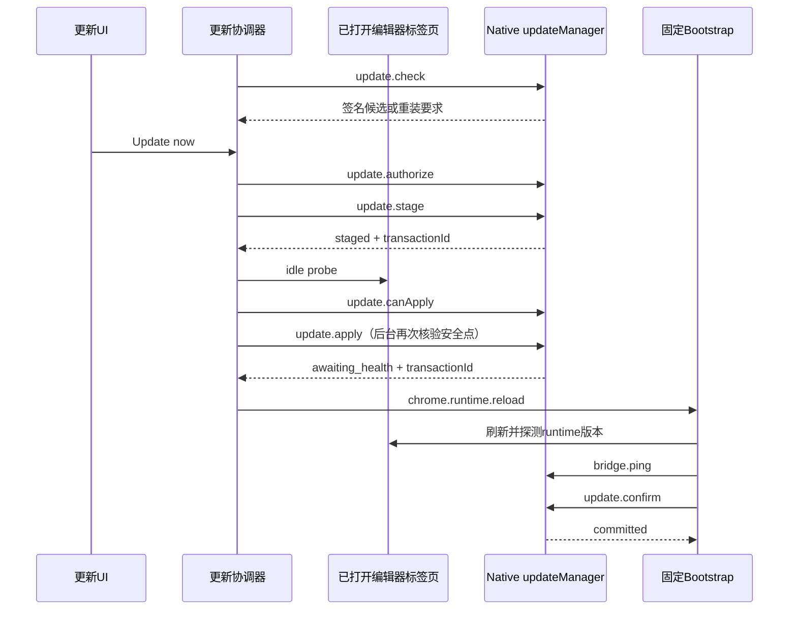

# 安装、托管更新与发布

本页帮助维护者定位安装目录、加载版本、更新事务和发布产物，解释修改其中一层时需要检查的其他层。
产品源码基线为 `2073ae74747431aab8d529803d4e9f8197262388`。
源码约束、测试覆盖、已安装运行状态和公开发布产物分别取证；各层验证范围在相应流程中说明。
入口见[功能索引](feature-map.md)，运行取消与进程寿命见[运行状态与恢复](run-state-and-recovery.md)。

## 1. 先确定正在观察哪一层

五层身份像设计图、预制件、安装现场、运行中的设备与交付包；某一层更新后，其余层需要各自取证。

| 层 | 实际身份与证据 | 主要 owner |
| --- | --- | --- |
| 开发源码 | Git 提交、工作树差异、包版本 | [package.json](../../package.json)、开发仓库 |
| 生成产物 | content bundle、输入和输出摘要 | [build-content-bundle.mjs](../../scripts/build-content-bundle.mjs) 的 `buildContentBundle()` |
| 磁盘安装 | 管理标记、扩展 Manifest、Native 版本指针 | [managedInstall.js](../../native-host/src/managedInstall.js) |
| 已加载代码 | 扩展版本、页面 runtime 应答、Native ping | [updateRuntimeIdentity.js](../../extension/src/shared/updateRuntimeIdentity.js) 的 `inspectInstalledRuntime()` |
| 发布产物 | tag、发布 manifest、压缩包、签名及公开 registry 字节 | [build-release.mjs](../../scripts/build-release.mjs)、发布验证脚本 |

`sourceDigest`覆盖 content 构建输入、构建选项和 esbuild 版本；它不覆盖全部 page-world 文件与 Native 运行状态。
构建器在 DOM 写入的摘要用于诊断当前执行代码，源码明确限定它不能充当信任或授权依据。

`inspectInstalledRuntime()`在证据齐全时比较四个版本：

\[
V_{installed}=V_{native}=V_{extension}=V_{runtime}.
\]

先检查活动事务和安装一致性，再区分 `aligned`、`reload_required`、`repair_required`；字段缺失返回 `unknown`。
活动更新也包括`authorized`或`bound`授权；四个版本相等且Native报告`installedAligned: true`时，残留授权仍会使该投影返回`transaction_active`，版本对齐不能证明授权已结算。
版本相等只能证明该检查所用的身份一致，无法证明所有功能都正常；同版本不同内容还需摘要或具体行为证据。

## 2. Direct 与 Managed 的加载入口

| 路径 | 浏览器入口 | Native 接入 | 适用判断 |
| --- | --- | --- | --- |
| Direct 源码加载 | [extension/manifest.json](../../extension/manifest.json) 的声明式 content scripts | 独立 Native 安装/注册 | 开发 checkout 需具备已生成 bundle |
| Managed 托管安装 | [manifest.template.json](../../extension/bootstrap/manifest.template.json) 声明固定 Bootstrap | 固定 launcher 读取 Native 版本指针 | 可在兼容边界内协调替换扩展与 Native runtime |

两条 content 路径使用相同生成 bundle；源码纳入由 [content-entry.mjs](../../extension/entries/content-entry.mjs) 决定。
Managed 的 `registerManagedRuntime()`读取 [runtime-manifest.json](../../extension/runtime-manifest.json)，动态注册 JS/CSS，见 [bootstrap/background.js](../../extension/bootstrap/background.js)。
页面主世界资源仍由 `PAGE_WORLD_SCRIPTS`及资源公开清单决定，新增 page 能力不能仅修改 content bundle。
runtime manifest 可扩展 Overleaf 站点范围，但实际注册受已授予 host permission 约束；可选权限的申请另由 UI 发起。
当前 manifest 仅列 `overleaf.com`、`www.overleaf.com` 和 `cn.overleaf.com`。增加其他 Overleaf 子域时，[Popup.offerNewSites](../../extension/src/popup.js) 可申请新增 host 权限，Bootstrap 可扩大动态注入范围；完整能力还需同步后台 Native sender、[SharedSessionBridge.enabled](../../extension/src/shared/sharedSessionBridge.js)、后台共享历史准入、更新协调器及安全点枚举的固定主机集合。授权和注入成功不能单独证明新站点可以运行、共享历史或参与更新保护。

当前 npm CLI 的 `install-managed`分派到 [scripts/install-managed.mjs](../../scripts/install-managed.mjs) 的 `installManaged()`，再调用 `installManagedDistribution()`。
CLI 命令解析位于 [bin/codex-overleaf-link.mjs](../../bin/codex-overleaf-link.mjs)；`doctor`输出预期注册位置、可选运行根参数、bridge ping与工具发现信息，其注册验证范围见下一节。
[install.sh](../../install.sh)、[install.ps1](../../install.ps1)还存在源码安装路径，可能准备开发依赖和构建 bundle；其信任与副作用应按脚本单独判断。
已发布 npm 包携带预构建产物，终端用户的包安装路径不依赖 esbuild 现场构建；新增依赖时须分别检查这些入口。

## 3. 安装目录、注册和失败恢复

`getDefaultManagedRoot()`位于 [nativeHostPlatform.js](../../native-host/src/nativeHostPlatform.js)，默认目录为：

```text
macOS / Linux: ~/.codex-overleaf/managed/
Windows:       %LOCALAPPDATA%/CodexOverleaf/managed/
  extension/
    manifest.json
    bootstrap/                  固定加载器和恢复入口
    runtime/                    当前扩展运行内容
    slots/previous/runtime/     原位更新保存的旧内容
  native/
    bootstrap/launcher.js
    versions/<version>/
    active-version
    previous-version
    updates/                    候选、授权、事务、锁及暂存内容
```

环境及安装参数可改变根目录，排障应读取实际安装输出与 Doctor，不能只按默认路径猜测。
`installManagedDistribution()`校验版本、扩展 ID、根目录和管理标记；拒绝替换未标记为本产品管理的现有扩展根。
`buildManagedExtensionTree()`创建新扩展暂存树，复制 Bootstrap、runtime 及资产，调整托管路径并核验引用文件。
安装器把旧扩展目录改名为 rollback 目录，再把新树移入；Native 安装和注册成功后清理扩展 rollback。
`installManagedNativeVersion()`写入版本目录，复制内部固定 launcher，并更新 `active-version`和必要的`previous-version`。
`installManagedNativeRegistration()`写外层 bridge 和 Native Host manifest；Windows 还写注册表，其他平台使用浏览器规定的文件位置。
扩展 ID 进入 `allowed_origins`，注册错误会使 Chrome 拒绝 Native Messaging，即使本机 Node 命令可以运行。

Native 固定启动链有两层，安装器分别生成或复制它们：

| 层 | 安装写入者 | Chrome 连接后的消费者 |
| --- | --- | --- |
| 外层 bridge | `installManagedNativeRegistration()`调用 [launcher.js](../../native-host/src/launcher.js) 的`buildLauncher()`，生成用户级 shell 脚本；Windows生成`.cmd` | Native Host manifest的`path`指向bridge；bridge用安装时的Node路径启动内部launcher |
| 内部 launcher | `installManagedNativeVersion()`将 [managedLauncherRuntime.js](../../native-host/src/managedLauncherRuntime.js) 复制到`native/bootstrap/launcher.js` | 读取active/previous版本指针、注入托管环境，再启动版本目录中的`native-host/src/index.js` |

runtime-only更新只替换扩展runtime和Native版本目录，并更新指针、manifest版本及管理标记；上述两层启动文件都由完整安装路径维护。修改启动命令、PATH或Windows引号处理时，需要核对最终生成的bridge与内部launcher；仅确认新版runtime目录包含源码不足以证明启动行为已改变。

自定义 `managedRoot`只改变安装内容的位置，不隔离用户级注册资源。[nativeHostPlatform.js](../../native-host/src/nativeHostPlatform.js)的 `getDefaultBridgePath()`对不同管理根、Chrome和Chromium返回同一个用户级bridge路径。
[manifest.js](../../native-host/src/manifest.js)的 `getNativeHostManifestPath()`在macOS/Linux按浏览器区分manifest；Windows共用manifest文件，`getWindowsRegistryMetadata()`再按浏览器区分HKCU注册表键。`auto`按Chrome处理。
Windows的manifest实际位于`%LOCALAPPDATA%/codex-overleaf/native-messaging-hosts/com.codex.overleaf.json`，与`%LOCALAPPDATA%/CodexOverleaf/`下的bridge和runtime分开；Direct安装、Managed安装及Doctor均通过同一注册路径helper定位它。
因此多个管理根，或Direct与Managed安装共用默认入口时，后一次安装会改写已有bridge及相应注册；注册副作用超出管理根目录。

连接故障指引目前未区分这两种加载类型。[compatibility.js](../../extension/src/shared/compatibility.js)的`buildInstallCommand()`固定生成`install-native`命令；[popup.js](../../extension/src/popup.js)的`getCompatibilityUpdateCommand()`和[contentRuntime.js](../../extension/src/content/contentRuntime.js)的`INSTALL_COMMAND`均使用该helper。
若Managed安装的默认bridge原本指向固定launcher，按该指引安装独立Native时，[install-native-host.mjs](../../scripts/install-native-host.mjs)的`installNativeHost()`会把bridge改指独立runtime的`index.js`。该启动路径不经过`managedLauncherRuntime.js`注入托管环境；[updateManager.js](../../native-host/src/updateManager.js)的`getManagedContext()`不满足托管条件时，`update.*`请求返回`update_not_managed`，即使托管目录仍保留在磁盘上。
`Target contract`：修复命令应按实际加载类型选择，Managed修复保持配套托管入口，Direct修复保持独立Native入口，并核对实际浏览器、安装根和扩展ID。不能将当前UI生成的命令视为所有安装类型的通用修复步骤。
[compatibility.test.js](../../test/compatibility.test.js)断言当前`install-native`命令格式；[popupInstallGuidance.test.js](../../test/popupInstallGuidance.test.js)验证弹窗展示与复制该helper结果，这些测试未证明Managed修复后仍使用托管launcher。验证场景应覆盖两种加载类型的连接故障，分别核对展示命令、bridge目标、新Native的托管身份及`update.status`结果。

[nativeDoctor.js](../../native-host/src/nativeDoctor.js)的`runDoctor()`按`getNativeHostRegistrationTarget()`计算预期manifest位置，读取该文件并直接执行其中的bridge完成ping。Windows路径输出HKCU（当前用户注册表）的预期键名，但没有查询该键是否存在或其默认值是否指向该manifest。
因此预期manifest与bridge有效、ping兼容时，Doctor可返回`status: ok`和退出码0，即使Chrome所需的HKCU入口缺失或指向其他位置；该结果只证明直接启动链可用，不能证明Chrome已发现注册。[nativeInstallScripts.test.js](../../test/nativeInstallScripts.test.js)包含Doctor模拟bridge、兼容性结果及Windows命令启动方式的检查，不能替代浏览器注册发现验证。
维护验证应分别构造正确注册、注册缺失和注册指向其他manifest的场景，比较Doctor结果与Chrome Native Messaging连接结果；`Target contract`应将注册发现与直接bridge执行分别取证。

失败恢复的范围需要准确限定：Native 安装/注册抛错时，外层 catch 恢复扩展目录；代码未提供跨所有 Native 指针和系统注册写入的统一回滚事务。
因此安装失败后需核查两端标记、指针和注册结果，不能宣称每个失败点都使磁盘自动恢复成原样。
`selectRunnableVersion()`位于 [managedLauncherRuntime.js](../../native-host/src/managedLauncherRuntime.js)，优先选择 active，缺少入口文件时尝试 previous。
该 fallback 检查入口文件存在性；它不执行完整健康诊断，也不保证扩展 runtime 与 fallback Native 版本自动匹配。
卸载入口为 `uninstallManagedDistribution()`；其删除范围是管理根和注册，项目镜像、浏览器历史等数据拥有其他生命周期。
该入口按参数重算注册路径并删除bridge、manifest及所选Windows注册表键，未检查当前入口是否仍指向被卸载副本。静态反例是依次安装A、B两个管理根，再卸载A：B仍在磁盘上，却可能失去共用入口。
现有 [managedInstall.test.js](../../test/managedInstall.test.js)覆盖扩展树、缺失引用文件与路径安全；[nativeInstallScripts.test.js](../../test/nativeInstallScripts.test.js)提供平台注册和独立Native安装测试定义，不能据此宣称上述多副本卸载链已验收。

## 4. 更新状态分别由谁负责

| 事实 | owner 与持久化 | 消费者/限制 |
| --- | --- | --- |
| 用户意图、目标授权、延后 | [backgroundUpdateCoordinator.js](../../extension/src/backgroundUpdateCoordinator.js)、`chrome.storage.local` | 操作 generation 阻止旧异步结果覆盖新意图 |
| 授权撤销意图 | [updateRevocationIntent.js](../../extension/src/shared/updateRevocationIntent.js) | 持久化后再发送 cancel/revoke，重启继续清理 |
| 已验证候选 | [updateManager.js](../../native-host/src/updateManager.js) 的 `candidate.json` | 保存签名 manifest、签名及 bundle 地址 |
| 手动重装提示缓存 | 同模块的`manual-candidate.json` | 只保存目标、协议、说明及检查元数据；304恢复不重新验签，边界见第9节 |
| 可执行授权 | 同模块的 `authorization.json` | 绑定 source/target version、authorization ID及 transaction ID |
| 安装事务 | 同模块的 `transaction.json`及磁盘指针 | 决定 staged、activation_pending、applying、awaiting_health、committed等事实 |
| 阶段规范与恢复解释 | [managedUpdateProjection.js](../../extension/src/shared/managedUpdateProjection.js) | 归一别名、阶段、期限、进度和迁移；不执行文件替换 |
| UI 展示策略 | [updateConsent.js](../../extension/src/shared/updateConsent.js)、[updateNotice.js](../../extension/src/content/updateNotice.js) | 仍有专用 view model与兼容映射，不能视为 Native journal 的原样副本 |
| 新代码加载/健康确认 | [bootstrap/background.js](../../extension/bootstrap/background.js) | 固定加载器承担恢复入口，不能靠可替换 runtime 自证全部加载成功 |

浏览器状态提供意图与展示；Native journal、指针和管理标记提供安装事实。协调器恢复时重新读取 Native 状态再更新投影。
`projectUpdateState()`优先使用 projection 的 `transitionCommand()`或观察迁移，保留兼容 fallback；新增状态须同步检查 UI消费者。

## 5. 从发现到确认的正常链



`checkForUpdate()`通过 GitHub `releases/latest`的公开跳转确定 stable tag，再读取签名 manifest；避免依赖 GitHub API配额。
只发现更新不创建安装授权；`installUpdate()`会重新检查过期候选，再持久化授权意图并调用 `update.authorize`。
`authorizeUpdate()`验证当前 active-version、签名目标与请求一致，创建`authorized`授权并设置两小时后的`expiresAt`；其他目标不能复用它。
`stageCandidate()`下载并验证 bundle，解包后检查扩展/Native版本配对，创建 journal并将授权绑定事务。
`requireAuthorization()`只对`authorized`状态检查期限；`bindAuthorization()`将状态改为`bound`后，复用staged、apply及confirm仍校验版本、授权和事务身份，但不因`expiresAt`已过而拒绝。
可复用 staged事务也需重验内容和授权；内容失效、身份不匹配或已有激活事务会中断相应路径。静态反例是stage完成后等待空闲超过两小时，绑定授权仍可继续安装，不能把两小时解释为整次更新的总期限。
[updateAuthorizedCandidate.test.js](../../test/updateAuthorizedCandidate.test.js)的过期测试覆盖`authorized`候选；[updateManager.test.js](../../test/updateManager.test.js)使用`bound`事务fixture，测试范围应按实际授权状态区分。
`tryActivateStagedUpdateCore()`收集标签页、Native及后台未完成执行请求的 blockers，存在阻断时保持`waiting_for_idle`。
后台 `requestManagedInternal()`在 `update.apply`之前再次调用`verifyManagedUpdateSafety()`，通过后阻止新的`no_silent_retry`类执行请求；`update.*`和`codex.cancel`保留通行。
Native `applyStagedUpdate()`再次检查本地 gate、管理布局、事务及授权，重验归档并从归档重新解包待应用内容。
它保存旧 runtime、移动配套 Native版本、写 active/previous指针、更新 Manifest版本和管理标记，最后写`awaiting_health`。
`update.activate`另有延迟激活路径：先写`activation_pending`再定时执行 apply；当前主协调路径调用`update.apply`。
收到匹配事务的`awaiting_health`后才重载扩展，随后由 Bootstrap继续确认。

## 6. 安全点的实际范围

`buildIdleProbe()`位于 [content/updateIdle.js](../../extension/src/content/updateIdle.js)，检查业务 busy状态、近期编辑活动和保存信号稳定期。
[contentRuntime.js](../../extension/src/content/contentRuntime.js)的 `UpdateIdle.create()`提供 run、cancelling、storage、reviewAction、dialog状态；保存探针允许 quiet editor fallback。
当前 idle探针接受`verified_saved`或`verified_quiet`，要求30秒无相关编辑活动、保存判断稳定3秒；quiet证据弱于服务器内容核验。
“所有标签页”在实现中指匹配支持站点、可用且未被discard/unload的编辑器标签页；项目列表、丢弃页与未授权站点有不同处理。
应答失败、超时或保存未知会产生 blocker；不能把 tab探针不可达直接解释为空闲。
**整体枚举失败的例外。** 后台 `verifyManagedUpdateSafety` 将 `tabs.query` 的拒绝回退为空列表；Native 空闲且后台没有 pending 执行时，该分支可返回 `ok:true`，实际尚未取得编辑器标签页清单。主协调器首次枚举错误会失败，但后台二次核验采用另一条路径；维护安全点时应分别覆盖单页探针失败、整体枚举失败及两次核验之间的状态变化。

Native `getApplyGate()`只检查 `projectLocks`和`runControllers`；生产入口从 [taskRunnerRuntime.js](../../native-host/src/taskRunnerRuntime.js) 的`getActiveNativeWorkState()`提供这两个计数。
它没有扫描所有操作系统进程，也没有在该 gate 中直接枚举持久化`processStopBarrier`记录。
因此 UI idle、当前 Native计数为零、所有历史子进程已退出，分别属于不同证据，不能相互推定。
`Target contract`：更新不能破坏活动任务与保存工作；更强的跨进程退出保证需要单独追踪屏障、锁寿命和异常终止证据。

## 7. 健康、取消、超时与恢复

`confirmPendingUpdate()`先调用`verifyPendingRuntimeHealth()`，刷新保存的开放标签页，在20秒预算内要求页面返回目标版本。
没有可用待验证标签页时健康探测返回失败；关闭标签页、页面加载迟缓等场景需要作为浏览器验收条件记录。
随后检查 Native ping版本、协议字段和必要capabilities，再请求`update.confirm`；Native核对事务、授权、指针及扩展Manifest版本。
成功后 journal进入`committed`；`settleAuthorization()`先写授权`consumed`状态再删除`authorization.json`，因此该文件不长期保留消费记录。随后保留目标及来源Native版本并清理staging。
该健康检查没有自动执行 Ask、写回、保存、Undo等业务流程；功能正确性仍依赖专项测试与交互验收。

| 场景 | 代码行为 | 证据含义 |
| --- | --- | --- |
| 下载/等待阶段选择 Later或取消 | `cancelUpdateCore()`先写撤销意图，再`update.cancel`及`update.revoke` | 请求停止、授权清理分别等待应答 |
| cancel应答尚未确认 | 保留`cancelRequested`与恢复意图 | 不能显示已经完成安装回滚 |
| 已进入安装/健康确认 | 前端或Native返回`update_revoke_too_late` | 撤销授权与回滚安装采用不同协议 |
| 安装结果未知或阶段过期 | `reconcileExpiredPhase()`读取 Native事务、校验身份和磁盘一致性 | 可能确认提交、确认回滚或保持`recoveryPending` |
| Native重启见`activation_pending` | `recoverAndReadStatus()`恢复为staged | 重新等待协调，不擅自继续旧定时激活 |
| Native重启见`applying` | 按journal调用`rollbackFiles()`后登记rolled_back | 依赖磁盘恢复成功；异常不能被描述成已回滚 |
| 协调器处理阶段超时 | `reconcileExpiredPhase()`携带事务身份调用`update.rollback`，核对来源版本并回读`update.status` | 检查安装对齐后才报告恢复完成 |
| Bootstrap 健康失败 | `rollbackBrokenRuntime()`仅传 reasonCode，收到 Native ok 即写 rolled_back 并重载 | 当前未执行与协调器相同的事务、来源版本及回读核验；Native仅在请求提供相应字段时检查身份 |

[updateNetworkControl.js](../../native-host/src/updateNetworkControl.js) 的 `cancel()`写operation取消标记，中止本进程控制器并等待对应mutation锁释放。
标记也用于拒绝其他Host中迟到的同operation网络工作；该取消针对更新网络操作，不承担agent子进程的停止职责。
Native `revokeUpdate()`可删除staged和授权；`rollbackUpdate()`支持已apply的事务，恢复来源文件并对失败目标设置24小时cooldown。
冷却期会影响“检查更新”和“重试”的实际含义：`checkForUpdate()`进入非304的新版本分支后，对仍在冷却的目标返回`available: false`、`reason: cooldown`及目标版本。更早的授权候选与304缓存分支有独立提前返回，不能把冷却判断推广到所有检查路径。
[backgroundUpdateCoordinator.js](../../extension/src/backgroundUpdateCoordinator.js)的`checkOnly()`将 cooldown 结果转为`idle`并清空`code`、`message`，未保留冷却原因；[updateConsent.js](../../extension/src/shared/updateConsent.js)也不会为该状态提供安装动作。
当前可达更新 UI 位于 Overleaf 面板：[contentRuntime](../../extension/src/content/contentRuntime.js) 装配 [UpdateNotice.mount](../../extension/src/content/updateNotice.js)，提示条与设置页的检查、更新、取消及重载按钮调用 `consent-update` 消息。idle 时提示条按 `view.showPanel` 隐藏，设置页保留当前版本、自动检查说明及“检查更新”入口。
[popup.js](../../extension/src/popup.js) 启动时的 `scheduleConsentUpdateUi` 移除旧更新区；`getUpdateCopy/renderUpdateSection` 和旧 `openUpdateCenter` 不在当前已装配操作链。[bootstrap/update.html](../../extension/bootstrap/update.html) 及其 `presentationFor` 属于保留资产，不能作为现行面板文案的证据。
该路径的实际限制是冷却原因丢失、没有对应安装动作；idle 不能单独证明当前安装已达到最新目标版本。
`Target contract`：无新版本与失败目标暂缓重试应保留各自原因；冷却提示应说明目标及可重试条件。[updateCenter.test.js](../../test/updateCenter.test.js)覆盖恢复终态与当前页操作装配，[updateConsent.test.js](../../test/updateConsent.test.js)覆盖视图规则，仍需验证“回滚→冷却期内手动检查→冷却到期后检查”完整路径中的 Native 原因、协调器状态、面板文案与按钮。

`supersedeObsoleteJournal()`仅在安装对齐且active版本同时严格高于journal的source和target版本时淘汰旧journal；同target版本重装不满足该条件。
`installManagedNativeVersion()`保留`native/updates`，完整扩展重装则建立新树。静态恢复反例是旧journal停在`applying`后重装同target：后续`update.status`仍可进入`recoverAndReadStatus()`的`rollbackFiles()`分支，重写source指针及旧manifest，而新扩展树可能已无旧runtime槽。
该静态恢复路径的实际结果需要故障演练确认；重装不能直接作为账本已清理的证据，应核对journal、指针、manifest与实际runtime内容。

严格更高版本重装也有授权和恢复边界：`supersedeObsoleteJournal()`只将旧journal写为`superseded`并清理staging，未调用`settleAuthorization()`；`recoverAndReadStatus()`随后跳过原`applying`分支的授权结算，`currentStatus()`仍返回残留授权。
旧`bound`授权会使`inspectInstalledRuntime()`保持`transaction_active`；后续`checkForUpdate()`优先进入`readAuthorizedCandidate()`，旧候选即使签名有效，也会因授权source与当前版本不符或target版本不再高于当前版本而返回`update_consent_mismatch`。
浏览器存在两条恢复写入路径：[backgroundUpdateCoordinator.reconcileExpiredPhase](../../extension/src/backgroundUpdateCoordinator.js) 未将 `superseded` 归为恢复完成，单独执行时可保留 `failed/recoveryPending`；托管 [background.reconcileManagedUpdateTransaction](../../extension/src/background.js) 在启动后定时执行，遇到 `superseded` 会删除浏览器授权与待刷新标签记录，并写入 idle。
两条路径异步更新同一状态，没有共同的事务结算或代次屏障；后台清理后，迟到的协调器仍可能写回恢复待定。实际 Chrome 启动顺序需组合验证，不能由其中一条路径推定最终 UI。浏览器清理也不删除 Native `authorization.json`，前述 bound 授权残留及运行身份投影仍需独立处理。
[updateManager.test.js](../../test/updateManager.test.js)的supersede用例覆盖严格更高版本和保留旧回滚，未断言授权结算及协调器恢复完成。验证应分别覆盖同target重装，以及严格更高版本重装后journal、Native授权、四版本投影和浏览器恢复意图的组合。
阶段期限在`PHASE_TIMEOUTS`统一声明，具体网络/页面探测还有更短预算；超时值不能混用为同一个总耗时保证。

## 8. 信任链与网络重试

| 边界 | 实现 | 能证明的内容 |
| --- | --- | --- |
| 发布者身份 | [updateTrust.js](../../native-host/src/updateTrust.js) 的`verifySignedReleaseManifest()` | 固定可信公钥对原始manifest字节的Ed25519签名有效 |
| 目标身份 | `validateReleaseManifest()` | repository、channel、tag、schema、Bootstrap协议和声明字段符合要求 |
| 下载字节 | `stageCandidate()`及`verifyStagedArchive()` | 大小、SHA-256与签名manifest中的bundle声明一致 |
| 解包边界 | [updateArchive.js](../../native-host/src/updateArchive.js) 的`extractVerifiedUpdateBundle()` | 路径allowlist、安全目标、tar校验、文件类型、大小和必需入口 |
| 安装配对 | `verifyStagedPair()` | extension runtime与Native的版本和必要入口匹配 |

签名证明签发身份，哈希证明对应字节完整性，归档校验证明受检查的结构约束；它们不证明压缩包内逻辑没有缺陷。
当前签名manifest锚定整个bundle的SHA-256；tar header checksum属于归档格式校验，不能写成每个文件独立的签名认证。
归档默认限制为压缩32 MiB、解压96 MiB、单文件16 MiB、600项；符号链接及其他未支持类型被拒绝。

[releaseTransport.js](../../native-host/src/releaseTransport.js) 的`requestRelease()`对网络读取实施共享deadline、单请求/无数据期限和有界重试。
默认最多3次，配置上限5次；408、429、500、502、503、504可重试，404、证书失败、大小越界、显式取消停止重试。
重试属于下载层；授权、apply、confirm、rollback各有事务约束，不能把下载重试规则推广成任意RPC的自动重放。
最终重定向目标需满足HTTPS与host allowlist；[releaseProxy.js](../../native-host/src/releaseProxy.js)的`resolveReleaseProxy()`优先读取环境HTTP(S)代理并处理NO_PROXY，无环境代理时仅macOS/Windows读取系统代理，Linux使用环境配置或直接连接。SOCKS/PAC需另行提供HTTP代理端点。
网络验证需覆盖真实代理、DNS故障和下载中断，并分别检查重试次数、共享deadline及取消传播。

## 9. 手动升级与 Bootstrap 边界

`BOOTSTRAP_PROTOCOL=3`定义于`updateTrust.js`；Native runtime协议为2，两者描述不同边界。
固定Bootstrap、扩展权限/资源公开形状，以及第3节的外层bridge和内部Native launcher，均无法通过runtime-only包任意替换。
`checkForUpdate()`首次下载并验证签名manifest后，若Bootstrap协议不同，会返回`manual_install_required`及其中的说明；staging/apply仍拒绝该候选。

普通`candidate.json`保存原始manifest与签名，304分支会调用`verifySignedReleaseManifest()`重新验证。手动提示的`manual-candidate.json`只保存派生字段；304分支的`readManualCandidate()`检查重装原因、目标版本高于当前版本及所需协议不同，未保存或重新验证签名，也未将缓存ETag与本次请求匹配，`checkedAt`不参与有效期判断。
因此缓存恢复的说明依赖本地派生数据，首次联网验签的保证不能推广到每次304恢复。[backgroundUpdateCoordinator.js](../../extension/src/backgroundUpdateCoordinator.js) 的 `checkOnly()` 将目标和 `manualInstall.reason` 写入浏览器更新状态；当前面板由 [updateNotice.js](../../extension/src/content/updateNotice.js) 的 `manualUpdateCommand/manualReasonText` 生成重装命令和原因说明。
该缓存用于手动操作提示；`stageCandidate()`仍从`candidate.json`读取原始manifest与签名，执行验签、协议及下载字节校验。手动提示缓存的验证缺口不能作为staging签名校验被绕过的证据。
[updateManualInstall.test.js](../../test/updateManualInstall.test.js)覆盖首次签名候选、后续304保留提示及重装后的版本判断；缓存内容损坏、ETag不匹配、检查时间过旧与UI目标命令的组合需另行覆盖。

`checkForUpdate()`另有RC晋升例外：已安装标记为`prerelease`且最新stable具有相同数字版本时，返回`prerelease_promotion_requires_manual_update`、`available: false`，需要手动重装，不能按数字版本相等认定stable内容已经加载。
该Native识别结果尚未映射到当前重装UI：`backgroundUpdateCoordinator.checkOnly()`只将`manual_install_required`且目标版本严格更高的结果转入重装状态，RC同数字版本原因落入`idle`分支并清空`code`；`updateConsent.deriveViewModel()`也要求目标版本高于运行版本才显示重装提示及复制安装命令入口。
因此RC晋升的验证需分别检查Native返回原因与协调器、面板的实际呈现；当前同数字版本分支不会提供对应重装提示，不能将Native识别成功视为用户已收到操作指引。
当前2.5.0迁移说明见根 [README](../../README.md#quick-start)；完成磁盘重装后仍需核验扩展重载与页面刷新。

[verify-update-boundary.mjs](../../scripts/verify-update-boundary.mjs)核对受保护路径的已提交、暂存、未暂存和未跟踪变化。
当前`protectedPaths`包含内部launcher源码`managedLauncherRuntime.js`，遗漏生成外层bridge的`launcher.js`。修改后者不会因该文件变化单独触发边界阻断；即使新版Native runtime携带了更新后的生成器，`applyStagedUpdate()`也不重新调用它。此类改动需要完整重装才能更新现有bridge，验证应分别核对生成器、安装后的启动文件和runtime-only升级后保留的旧启动文件，不能仅依赖边界脚本通过。
`assertBootstrapProtocolTransition()`要求协议保持不变或恰增一；迁移必须进入新major/minor且patch为零。
runtime-only updater不安装`node_modules`；runtime依赖集合变化也受到边界检查。
该校验描述当前发布规则；单独提高协议号不会自动实现旧安装的迁移功能。

## 10. 构建、分发和发布顺序

[buildRelease()](../../scripts/build-release.mjs)从package版本推导产物；stable tag为`vX.Y.Z`，RC为`vX.Y.Z-rc.N`。
构建生成托管扩展ZIP、Native tar、协调update bundle、npm tgz、安装辅助文件、manifest、notes和SHA256SUMS；签名步骤另行增加sig。
`package.json.files`控制npm范围；[verify-npm-package.mjs](../../scripts/verify-npm-package.mjs)核对精确内容及禁止路径，指南与私有材料不能因复制目录而进入包。
构建器检查应跟踪输入与dirty来源，生成bundle按构建结果纳入；产物目录需通过安全路径检查。

[verify-release-artifacts.mjs](../../scripts/verify-release-artifacts.mjs)的`--require-signature`分别执行manifest签名、归档内容和`SHA256SUMS`校验。`verifyReleaseSignature()`验证签名字节，`verifyChecksums()`比较实际文件与checksum清单；当前没有将实际bundle大小及SHA-256再与已签manifest的`updateBundle`声明比较。
静态反例是重压缩仍符合结构约束的bundle、同步更新`SHA256SUMS`并保留原签名manifest：这些检查可分别成立，运行时`stageCandidate()`仍会因签名声明与下载字节不符而拒绝。
该静态边界需以重压缩后的签名产物验证；它本身不证明已发布资产存在损坏。[releaseScripts.test.js](../../test/releaseScripts.test.js)检查构建时产物与manifest摘要一致，不能替代签名后实际产物的绑定核验。

源码基线中的 [.github/workflows/release.yml](../../.github/workflows/release.yml)顺序如下：

1. macOS、Ubuntu、Windows矩阵执行测试、架构预算、更新边界和大型项目benchmark。
2. 核对版本/tag/日期，检查目标GitHub release尚未正式发布。
3. 构建产物、签名；stable执行旧稳定版update-hop，再以`--require-signature`验证产物。
4. 创建/更新GitHub draft并上传资产；stable发布或匹配既有npm版本，RC跳过npm。
5. 验证npm可见性与integrity，最后解除GitHub draft标记。

已正式发布的GitHub release会被前置检查拒绝覆盖；draft上传配置仍允许覆盖文件，故重跑工作流不能直接视为安全的恢复动作。
该基线的npm等待逻辑为十二次、每次五秒轮询后比较metadata integrity。
`verify:update-hop`默认选择前一稳定版；同Bootstrap协议测试实际升级，不同协议测试旧updater拒绝并要求重装。
它会准备临时安装并下载旧资产；`--local-test-key`使用临时签名验证流程，不能证明正式发布密钥和公开资产正确。
“覆盖最旧支持版本”需额外明确base ref及证据；默认前一稳定版演练不能自动提供该结论。

## 11. 修改联动与验证入口

| 改动 | 必须联动阅读 | 相关测试 |
| --- | --- | --- |
| 目录/扩展ID/系统注册 | managedInstall、nativeHostPlatform、manifest、CLI | [managedInstall.test.js](../../test/managedInstall.test.js)、[nativeInstallScripts.test.js](../../test/nativeInstallScripts.test.js) |
| 固定Native启动链 | launcher、managedLauncherRuntime、managedInstall、updateManager、protected paths；核对外层bridge与内部launcher | [launcher.test.js](../../test/launcher.test.js)、[managedInstall.test.js](../../test/managedInstall.test.js)、[nativeInstallScripts.test.js](../../test/nativeInstallScripts.test.js) |
| 更新按钮/延后/撤销 | coordinator、consent、revocation、UI | [updateConsent.test.js](../../test/updateConsent.test.js)、[updateRevocationIntent.test.js](../../test/updateRevocationIntent.test.js) |
| 安全点/安装/恢复 | background、updateIdle、updateManager、Bootstrap、runtime identity | [updateManager.test.js](../../test/updateManager.test.js)、[updateRuntimeRecovery.test.js](../../test/updateRuntimeRecovery.test.js)、[updateRuntimeIdentity.test.js](../../test/updateRuntimeIdentity.test.js)、[updateCenter.test.js](../../test/updateCenter.test.js)、[autoUpdateBootstrap.test.js](../../test/autoUpdateBootstrap.test.js) |
| 候选/签名/缓存/归档/网络 | updateManager、updateTrust、updateArchive、releaseTransport、releaseProxy；手动提示联动coordinator与UI | [updateAuthorizedCandidate.test.js](../../test/updateAuthorizedCandidate.test.js)、[updateManualInstall.test.js](../../test/updateManualInstall.test.js)、[updateTrust.test.js](../../test/updateTrust.test.js)、[updateArchive.test.js](../../test/updateArchive.test.js)、[releaseTransport.test.js](../../test/releaseTransport.test.js) |
| Bootstrap形状/协议迁移 | 两份manifest、protected paths、manual note、update-hop | [updateManualInstall.test.js](../../test/updateManualInstall.test.js)、[updateBoundaryWorkingTree.test.js](../../test/updateBoundaryWorkingTree.test.js) |
| 发布包/工作流 | build-release、npm范围、签名与产物验证、workflow | [releaseScripts.test.js](../../test/releaseScripts.test.js)、[updateHopRehearsalWiring.test.js](../../test/updateHopRehearsalWiring.test.js) |

以下命令提供验证入口；第一条列出测试，第二条执行所选测试：

```sh
node scripts/run-tests.mjs --list test/updateManager.test.js test/updateRevocationIntent.test.js
node scripts/run-tests.mjs test/updateManager.test.js test/updateRevocationIntent.test.js
```

包边界验证使用`npm run verify:update-boundary`；产物验证使用`npm run verify:release-artifacts -- --require-signature`，后者要求已有签名产物。
产物验证的签名与实际bundle绑定限制见上一节；[autoUpdateBootstrap.test.js](../../test/autoUpdateBootstrap.test.js)主要使用源码字符串及manifest断言，也不能替代真实Bootstrap重载与恢复验收。
`npm run build:release`会生成内容和发布目录；`npm run verify:update-hop`会访问旧资产并操作临时安装。执行前按任务范围选择这些有副作用的工具。
源码测试、已安装浏览器检查、三平台CI、正式签名及公开下载核验分别记录，不能相互替代。

## 12. 边界场景与验证要点

1. 磁盘版本已升级、页面仍旧：应检查`reload_required`与当前加载摘要，不能宣布全部runtime已切换。
2. UI空闲、Native计数归零、仍有退出未确认记录：更新gate未提供全进程退出证明，需单独检查屏障与异常生命周期。
3. 点击取消、下载请求已abort、Native锁尚未释放：只能报告取消待确认；安装已开始时还可能返回too-late并转恢复。
4. 页面和Native版本相等、capabilities齐全、写回仍失败：健康检查已完成其加载职责，业务回归仍需单独验证。
5. 安装注册阶段失败：扩展目录恢复不足以证明Native指针及系统注册全部回退，应检查实际磁盘与注册状态。
6. update-hop迁移分支通过：证据是旧版拒绝不兼容包，不能描述成旧版已经自动升级成功。
7. staged等待超过授权创建时的两小时期限：`bound`不再按`expiresAt`拒绝，需按实际授权状态判断。
8. 旧`applying`事务下手动重装同target：安装器保留journal，严格版本条件不会将它supersede；需核验后续恢复对指针、manifest和runtime的影响。
9. 多个管理根中卸载旧副本：共用bridge和注册可能影响仍保留的副本，管理目录存在不足以证明Native入口可用。

这些场景需要通过故障注入和Chrome验收检查实际调用路径；验证结果应分别记录安装事实、加载身份、事务恢复和业务功能，避免以单一成功信号替代整条链路的保证。
