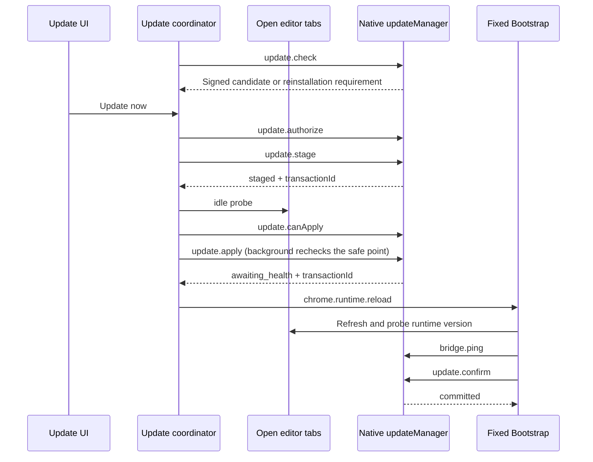

# Installation, Managed Updates, and Releases

This page helps maintainers locate installation directories, loaded versions, update transactions, and release artifacts, and explains which other layers need checking when one layer changes.
The initial source baseline is `2073ae74747431aab8d529803d4e9f8197262388`; current behavior is maintained against this repository's implementation.
Source constraints, test coverage, installed runtime state, and public release artifacts require separate evidence; each workflow explains its verification scope.
Start with the [feature map](feature-map.md); see [Run State and Recovery](run-state-and-recovery.md) for run cancellation and process lifetimes.

## 1. Identify the Layer Being Observed

The five identity layers resemble a blueprint, prefabricated parts, an installation site, operating equipment, and a delivery package. Updating one layer requires separate evidence for the others.

| Layer | Actual identity and evidence | Main owner |
| --- | --- | --- |
| Development source | Git commit, working-tree differences, package version | [package.json](../../package.json), development repository |
| Generated artifacts | Content bundle, input and output digests | `buildContentBundle()` in [build-content-bundle.mjs](../../scripts/build-content-bundle.mjs) |
| On-disk installation | Managed marker, extension Manifest, Native version pointers | [managedInstall.js](../../native-host/src/managedInstall.js) |
| Loaded code | Extension version, page runtime response, Native ping | `inspectInstalledRuntime()` in [updateRuntimeIdentity.js](../../extension/src/shared/updateRuntimeIdentity.js) |
| Release artifacts | Tag, release manifest, archives, signatures, and public registry bytes | [build-release.mjs](../../scripts/build-release.mjs), release verification scripts |

`sourceDigest` covers content build inputs, build options, and the esbuild version; it does not cover all page-world files or Native runtime state.
The digest written into the DOM by the builder diagnoses the code currently executing. The source explicitly states that it cannot serve as evidence of trust or authorization.

When all evidence is available, `inspectInstalledRuntime()` compares four versions:

\[
V_{installed}=V_{native}=V_{extension}=V_{runtime}.
\]

It checks active transactions and installation consistency first, then distinguishes `aligned`, `reload_required`, and `repair_required`; missing fields yield `unknown`.
Active updates also include `authorized` or `bound` authorization. Even when all four versions match and Native reports `installedAligned: true`, residual authorization still makes this projection return `transaction_active`; version alignment does not prove that authorization has been settled.
Equal versions establish only the identity consistency used by this check, not that every feature works. Different content under the same version also requires digests or evidence of specific behavior.

## 2. Direct and Managed Loading Entry Points

| Path | Browser entry point | Native connection | Applicability |
| --- | --- | --- | --- |
| Direct source loading | Declarative content scripts in [extension/manifest.json](../../extension/manifest.json) | Separate Native installation/registration | A development checkout must contain the generated bundle |
| Managed installation | Fixed Bootstrap declared by [manifest.template.json](../../extension/bootstrap/manifest.template.json) | Fixed launcher reads the Native version pointer | Can coordinate replacement of extension and Native runtimes within compatibility boundaries |

Both content paths use the same generated bundle; [content-entry.mjs](../../extension/entries/content-entry.mjs) determines source inclusion.
Managed `registerManagedRuntime()` reads [runtime-manifest.json](../../extension/runtime-manifest.json) and dynamically registers JS/CSS; see [bootstrap/background.js](../../extension/bootstrap/background.js).
The Managed Popup's [popupFallback.js](../../extension/bootstrap/popupFallback.js) belongs to Bootstrap. It independently reads the existing language preference to select the language of existing messages when the runtime fails to load, and stops modifying the UI once the normal runtime takes over. `buildManagedExtensionTree()` copies this asset; replacing only the runtime directory does not update it. There is also a signed Bootstrap revision migration explicitly limited to `2.5.0 → 2.5.1`, described in section 5. Other changes to the fixed layer still require an independent migration contract or a full installation.
Page main-world resources remain governed by `PAGE_WORLD_SCRIPTS` and the web-accessible resource list; adding a page capability requires more than changing the content bundle.
The runtime manifest can expand the Overleaf site scope, but actual registration is constrained by granted host permissions; the UI separately initiates optional permission requests.
The current manifests list only `overleaf.com`, `www.overleaf.com`, and `cn.overleaf.com`. When adding other Overleaf subdomains, [Popup.offerNewSites](../../extension/src/popup.js) can request additional host permissions, and Bootstrap can expand dynamic injection. Full functionality also requires synchronizing the fixed host sets used by the background Native sender, [SharedSessionBridge.enabled](../../extension/src/shared/sharedSessionBridge.js), background shared-history admission, the update coordinator, and safe-point enumeration. Successful permission grants and injection alone do not prove that a new site can run, share history, or participate in update protection.

The current npm CLI dispatches `install-managed` to `installManaged()` in [scripts/install-managed.mjs](../../scripts/install-managed.mjs), which then calls `installManagedDistribution()`.
CLI command parsing resides in [bin/codex-overleaf-link.mjs](../../bin/codex-overleaf-link.mjs). `doctor` reports the expected registration location, optional runtime-root arguments, bridge ping, and tool discovery; the scope of its registration verification is described in the next section.
[install.sh](../../install.sh) and [install.ps1](../../install.ps1) also provide source-installation paths that may prepare development dependencies and build the bundle; their trust assumptions and side effects must be assessed per script.
Published npm packages contain prebuilt artifacts. End-user package installation does not depend on building with esbuild locally; adding dependencies requires checking these entry points separately.

## 3. Installation Directories, Registration, and Failure Recovery

`getDefaultManagedRoot()` resides in [nativeHostPlatform.js](../../native-host/src/nativeHostPlatform.js). The default directory layout is:

```text
macOS / Linux: ~/.codex-overleaf/managed/
Windows:       %LOCALAPPDATA%/CodexOverleaf/managed/
  extension/
    manifest.json
    bootstrap/                  Fixed loader and recovery entry points
    runtime/                    Current extension runtime content
    slots/previous/runtime/     Previous content saved by in-place updates
  native/
    bootstrap/launcher.js
    versions/<version>/
    active-version
    previous-version
    updates/                    Candidates, authorization, transactions, locks, and staging
      bootstrap-migrations/
        <transactionId>/        Bootstrap source-file backups, progress, and watchdog heartbeat
```

Environment and installation parameters can change the root directory. Troubleshooting must inspect actual installation output and Doctor rather than infer it from defaults alone.
`installManagedDistribution()` validates the version, extension ID, root directory, and managed marker; it refuses to replace an existing extension root not marked as managed by this product.
`buildManagedExtensionTree()` creates a new extension staging tree, copies Bootstrap, runtime, and assets, adjusts managed paths, and verifies referenced files.
The installer renames the old extension directory to a rollback directory, then moves the new tree into place. It removes the extension rollback directory after Native installation and registration succeed.
`installManagedNativeVersion()` writes the version directory, copies the internal fixed launcher, and updates `active-version` and, when needed, `previous-version`.
`installManagedNativeRegistration()` writes the outer bridge and Native Host manifest. Windows also writes the registry; other platforms use browser-defined file locations.
The extension ID enters `allowed_origins`. Incorrect registration makes Chrome reject Native Messaging even when local Node commands work.

The fixed Native launch chain has two layers, which the installer generates or copies separately:

| Layer | Installation writer | Consumer after Chrome connects |
| --- | --- | --- |
| Outer bridge | `installManagedNativeRegistration()` calls `buildLauncher()` in [launcher.js](../../native-host/src/launcher.js) to generate a user-level shell script; Windows generates a `.cmd` file | The Native Host manifest's `path` points to the bridge; the bridge launches the internal launcher using the Node path captured at installation |
| Internal launcher | `installManagedNativeVersion()` copies [managedLauncherRuntime.js](../../native-host/src/managedLauncherRuntime.js) to `native/bootstrap/launcher.js` | Reads the active/previous version pointers, injects the managed environment, and starts `native-host/src/index.js` in the version directory |

Regular runtime updates replace the extension runtime and Native version directory and update pointers, the manifest version, and managed markers. The two Native launch files above remain maintained by the full-installation path. The `2.5.0 → 2.5.1` compatibility migration additionally replaces a closed list of extension Bootstrap assets; it does not change these two Native launch files, registration, or Chrome permissions. Changes to launch commands, PATH, or Windows quoting require checking the final generated bridge and internal launcher; merely finding source in the new runtime directory does not prove that launch behavior changed.

A custom `managedRoot` changes only the installation content location; it does not isolate user-level registration resources. `getDefaultBridgePath()` in [nativeHostPlatform.js](../../native-host/src/nativeHostPlatform.js) returns the same user-level bridge path for different managed roots, Chrome, and Chromium.
`getNativeHostManifestPath()` in [manifest.js](../../native-host/src/manifest.js) distinguishes manifests by browser on macOS/Linux. Windows shares the manifest file, while `getWindowsRegistryMetadata()` distinguishes HKCU registry keys by browser. `auto` is treated as Chrome.
The Windows manifest is actually located at `%LOCALAPPDATA%/codex-overleaf/native-messaging-hosts/com.codex.overleaf.json`, separate from the bridge and runtime under `%LOCALAPPDATA%/CodexOverleaf/`. Direct installation, Managed installation, and Doctor locate it through the same registration-path helper.
Therefore, when multiple managed roots, or Direct and Managed installations, share default entry points, a later installation rewrites the existing bridge and corresponding registration; registration side effects extend beyond the managed root directory.

Connection-repair commands are generated for the actual loading type. During a full Managed installation, [managedInstall.buildManagedExtensionTree](../../native-host/src/managedInstall.js) writes `installIdentity:{managedRoot,browser,extensionId,platform}` into the extension marker. This identity describes the actual installation parameters; runtime-only marker version updates preserve it by spreading the existing fields.
[background.readExtensionInstallIdentity](../../extension/src/background.js) reads the extension's own marker and checks its extension ID, then attaches `extensionInstallIdentity` to existing successful or error `bridge.ping` responses. [compatibility.evaluateNativeCompatibility](../../extension/src/shared/compatibility.js) preserves that identity. [popup.js](../../extension/src/popup.js) also reads its own marker; [NativeCompatibilityController](../../extension/src/content/nativeCompatibilityController.js) uses the identity in existing panel setup guidance. [DiagnosticsController](../../extension/src/content/diagnosticsController.js) is a separate Compatibility consumer: it obtains the identity from the same background ping response and generates the repair command in diagnostics.
`Compatibility.buildInstallCommand(version,platform,extensionId,options)` preserves Direct's three-argument `install-native` format. With a complete Managed identity, it generates `install-managed` for a fixed target version, explicitly retaining the original `--managed-root`, `--browser`, and nondefault extension ID, and quoting the root path according to POSIX sh or Windows PowerShell rules. Existing Windows guidance explicitly requires PowerShell. Managed repair continues to use the fixed launcher, without switching to a standalone Native entry point.
When an old marker lacks installation identity or the identity does not match, the Managed command is empty. The existing setup area instructs the user to retain the original installation parameters, and copying is disabled; it does not guess a default managed root or fall back to a Direct command. This boundary preserves existing data and copy locations in older installations; the actual installation parameters are needed before a concrete repair command can be generated.
When connection guidance changes, check real Chrome reading the marker, retaining the original installation parameters, copying the command and restoring the connection. Temporary installation checks do not establish that UI flow.

`runDoctor()` in [nativeDoctor.js](../../native-host/src/nativeDoctor.js) separately collects evidence of browser registration discovery and direct bridge execution. On Windows, it uses [nativeHostRegistration.queryWindowsNativeHostRegistration](../../native-host/src/nativeHostRegistration.js) to query the selected browser's HKCU default `REG_SZ` value, requiring a unique, parseable absolute path that points to the expected manifest. Paths are normalized under Windows rules and compared case-insensitively. Query failure, absence, unparseable output, or an incorrect target never establishes verified registration.
The query follows the same command configuration as the Direct install/uninstall scripts: `CODEX_OVERLEAF_REG_EXE` selects the executable, and `CODEX_OVERLEAF_REG_EXE_ARGS_JSON` provides a JSON string-array prefix, followed by the fixed `query <current browser key> /ve` arguments. The query does not additionally enable a shell and retains its three-second and 64 KiB limits. An invalid prefix returns an unverified result without starting an alternative command. Command configuration does not waive checks for registration-value uniqueness, an absolute path, or target ownership.
Doctor still reads the manifest and directly launches the bridge for ping, so registration problems can coexist with independent execution diagnostics. When direct ping is compatible but registration is unverified, the aggregate result is `registration_unverified` with exit code 2. Text output separates registration discovery from execution status; the observed manifest path remains hidden or visible according to the original privacy option.
The platform installation contract substitutes registry storage on every OS. Real Windows Chrome registration discovery and connection require a change-driven check on Windows.

Before replacing an existing tree, `installManagedDistribution()` uses `createInstallRestorePoint()` in [managedInstallRecovery.js](../../native-host/src/managedInstallRecovery.js) to acquire `updates/mutation.lock`, shared with Native updates. First installation follows the same order. Only after acquiring the lock does it read old files and the target slot, saving the bytes and permissions of active/previous pointers, Native managed markers, the internal launcher, outer bridge, registration manifest, installation markers, update journal, and authorization that this installation will overwrite, while retaining the Native target slot of the same name. If registration or transaction settlement throws, it restores this content together with the extension rollback tree. Files that did not previously exist are restored to absence; same-version replacement also preserves previous bytes.
First-installation compensation keeps the lock until file and registration restoration finishes. After releasing it using its own token, it attempts to remove only empty directories, avoiding cleanup of a later installation's new lock or content. The installer and updater share lock format and reclamation rules: a live PID cannot lose its lock even after expiry; a PID confirmed to have exited permits reclamation. Without a valid owner, reclamation waits until the file mtime exceeds the existing stale interval, protecting the window between lock creation and owner writing.
This is limited in-process compensation. It does not provide a global atomic transaction across arbitrary power loss, managed roots, files, and registry entries. Incomplete compensation returns `managed_install_restore_failed`. On Windows, it also explicitly reports incomplete recovery when the old registry value could not be verified and a write was attempted. Failure to remove backups after a successful commit produces only a warning and does not reuse consumed recovery material. After failure, both sides' content and registration state still need checking against the returned result; actual Chrome registration discovery and bridge execution require separate evidence.
`selectRunnableVersion()` in [managedLauncherRuntime.js](../../native-host/src/managedLauncherRuntime.js) prefers active and tries previous when the entry file is missing.
This fallback checks entry-file existence; it neither performs a full health diagnosis nor guarantees automatic matching between the extension runtime and the fallback Native version.
The uninstall entry point is `uninstallManagedDistribution()`. Its deletion scope is the managed root and registration; project mirrors, browser history, and other data have separate lifecycles.
Before removing shared entry points, `isBridgeForManagedRoot()` verifies that the existing launcher's exact target argument and agent assignment still point to the Native root being uninstalled; changes in the Node executable location are allowed. The manifest must also have the expected host name and point to that bridge. On Windows, querying the selected registry key must additionally confirm that its default value actually points to that manifest. When ownership is unknown, content is unrecognized, or the entry already points to another copy, the corresponding shared entry is preserved; the managed extension and Native subtrees are still deleted under the existing path protections, and the managed root itself is removed only when the installation marker is its last remaining entry.
File and registry operations still run separately, with no cross-process atomic-uninstall guarantee. When uninstall ownership changes, verify A → B installation followed by uninstalling A preserves B, using isolated roots and the affected platform registration mechanism.

## 4. Ownership of Update State

| Fact | Owner and persistence | Consumers/limitations |
| --- | --- | --- |
| User intent, target authorization, deferral | [backgroundUpdateCoordinator.js](../../extension/src/backgroundUpdateCoordinator.js), `chrome.storage.local` | Operation generation and transaction/authorization snapshots constrain late recovery writes; both superseded entry points share the coordinator's write queue |
| Authorization-revocation intent | [updateRevocationIntent.js](../../extension/src/shared/updateRevocationIntent.js) | Persist before sending cancel/revoke; resume cleanup after restart |
| Verified candidate | `candidate.json` in [updateManager.js](../../native-host/src/updateManager.js) | Stores the signed manifest, signature, and bundle URL |
| Manual-reinstallation hint cache | `manual-candidate.json` in the same module | Stores the original manifest and signature; 304 requires matching ETag and source version, then derives the target and explanation after reverifying the signature; see section 9 for boundaries |
| Executable authorization | `authorization.json` in the same module | Binds source/target version, authorization ID, and transaction ID |
| Installation transaction | `transaction.json` in the same module and on-disk pointers | Determines facts such as staged, activation_pending, applying, bootstrap_pending, awaiting_health, and committed; migration rollback additionally uses bootstrap_rolling_back and sourceActivationPending |
| Bootstrap migration contract and coordination | [bootstrapMigrationContract.js](../../native-host/src/bootstrapMigrationContract.js), [bootstrapUpdate.js](../../native-host/src/bootstrapUpdate.js) | Constrains source version/source digests/target digests; binds signature, authorization, transaction, running Native version, and loaded revision |
| Bootstrap files and progress | [bootstrapMigration.js](../../native-host/src/bootstrapMigration.js), `bootstrap-migrations/<transactionId>/state.json` and `files/` | Preparation, application, restoration, and digest readback; does not independently grant update eligibility, and backups are not removed with staging |
| Browser migration continuation | [backgroundBootstrapMigration.js](../../extension/src/backgroundBootstrapMigration.js) | Uses existing update barriers and reload entry points; keeps the in-memory lock until matching health confirmation completes |
| Safety probing after reload and page-refresh list | [backgroundUpdateSafety.js](../../extension/src/backgroundUpdateSafety.js), `codex-overleaf-managed-update-guarded-tabs-v1` | Recovers a targeted read-only receiver; stores the refresh list by transaction and document identity; verifies disk recovery separately from permission to refresh pages |
| Independent migration-recovery watchdog | [bootstrapUpdateWatchdog.js](../../native-host/src/bootstrapUpdateWatchdog.js) | Transaction/token/PID handshake and heartbeat; invokes recovery through the same mutation lock at the deadline; the original Popup can also wake Native to check |
| Phase normalization and recovery interpretation | [managedUpdateProjection.js](../../extension/src/shared/managedUpdateProjection.js) | Normalizes aliases, phases, deadlines, progress, and transitions; does not replace files |
| UI presentation policy | [updateConsent.js](../../extension/src/shared/updateConsent.js), [updateNotice.js](../../extension/src/content/updateNotice.js) | Retains a dedicated view model and compatibility mapping; cannot be treated as a verbatim copy of the Native journal |
| New-code loading/health confirmation | [bootstrap/background.js](../../extension/bootstrap/background.js) | The fixed loader provides recovery entry points; the replaceable runtime cannot attest by itself that all loading succeeded |

Browser state provides intent and presentation; the Native journal, pointers, and managed markers provide installation facts. During recovery, the coordinator rereads Native state before updating its projection.
`projectUpdateState()` prefers the projection's `transitionCommand()` or observation transitions and retains a compatibility fallback; adding states requires checking UI consumers as well.

## 5. Normal Flow from Discovery to Confirmation



`checkForUpdate()` determines the stable tag through GitHub's public `releases/latest` redirect, then reads the signed manifest, avoiding dependence on GitHub API quotas.
Discovering an update alone does not create installation authorization. `installUpdate()` rechecks expired candidates, persists authorization intent, and calls `update.authorize`.
`authorizeUpdate()` verifies that the current active-version and signed target match the request, creates `authorized` authorization, and sets `expiresAt` two hours ahead. Other targets cannot reuse it.
`stageCandidate()` downloads and verifies the bundle, checks extension/Native version pairing after extraction, creates the journal, and binds authorization to the transaction.
`requireAuthorization()` checks expiry only in the `authorized` state. After `bindAuthorization()` changes the state to `bound`, staged reuse, apply, and confirm still verify version, authorization, and transaction identity but do not reject merely because `expiresAt` has passed.
Reusable staged transactions also require content and authorization reverification. Invalid content, identity mismatch, or an existing activation transaction stops the corresponding path. A static counterexample is waiting more than two hours for idle after staging: bound authorization can still continue installation, so two hours must not be interpreted as the total update deadline.
When changing authorization expiry, distinguish an `authorized` candidate from an already `bound` transaction.
`tryActivateStagedUpdateCore()` collects blockers from tabs, Native, and unfinished background execution requests, remaining in `waiting_for_idle` while blockers exist.
Background `requestManagedInternal()` calls `verifyManagedUpdateSafety()` again before `update.apply`. After it passes, new execution requests in the `no_silent_retry` class are blocked; `update.*` and `codex.cancel` remain allowed.
Native `applyStagedUpdate()` checks the local gate, managed layout, transaction, and authorization again, reverifies the archive, and re-extracts the content to apply from that archive.
It saves the old runtime, moves the paired Native version, writes active/previous pointers, updates the Manifest version and managed markers, and finally writes `awaiting_health`.
`update.activate` has a separate deferred-activation path: it writes `activation_pending`, then schedules apply. The current main coordinator path calls `update.apply`.
The extension reloads only after receiving `awaiting_health` for the matching transaction, after which Bootstrap continues confirmation.

### Compatible Bootstrap Migration from 2.5.0 to 2.5.1

This path preserves the initial download, signature verification, authorization, and runtime installation performed by the published `2.5.0`, then lets the actually launched `2.5.1` Native and new runtime continue updating the fixed layer. Product version `2.5.1`, Bootstrap protocol `3`, and Bootstrap revision `3.1` respectively identify the product release, the installation/message boundary understood by the old client, and this fixed-layer implementation. The revision change neither expands extension permissions nor rewrites the user-level bridge.

1. [runtimeInstaller.js](../../native-host/src/runtimeInstaller.js) places target Bootstrap assets in `native-host/bootstrap-payload/bootstrap/` inside the Native version package, accompanied by `manifest.template.json` for verification only. This location lies within the Native subtree already allowed by the old archive reader. [build-release.mjs](../../scripts/build-release.mjs) includes a `bootstrapMigration` descriptor in the release manifest to be signed: source version, known source-file SHA-256 digests, target-file SHA-256 digests, and a closed file list. The extension manifest is not in that file list: Native checks the installed `manifest.json` and the payload's `manifest.template.json` separately for shape and target version, and the file-migration module does not replace the manifest. The original apply path continues maintaining its version field.
2. The new Native's `bindBootstrapMigration()` recognizes the exact version pair, reverifies the original signed material against the manifest/bundle digests and sizes saved in the journal and the bound authorization, and places the transaction in `bootstrap_pending`. Missing evidence leaves the migration pending; it cannot fall back to ordinary update success. The `update.status` projection and `confirmUpdate()` jointly prevent the old Service Worker from confirming prematurely or deleting recovery material.
3. The new background's `CodexOverleafBootstrapMigration.init()` continues the migration before the original Bootstrap resumes health initialization. It first protects the original list of pages awaiting refresh, then rechecks idle/save conditions. Extension reload may invalidate the old page receiver. Only when the migration transaction and execution lock still match and the original probe returns `tab_probe_unavailable` does it establish the targeted read-only safety receiver described in section 6. It calls internal `update.bootstrap` only after reaching the safe point. Within the existing cross-process mutation lock, Native checks local task barriers, the actually running Native version, target JS syntax, archive bytes, manifest shape, and source-file digests.
4. `prepareBootstrapMigration()` first saves old file bytes/permissions and progress. The progress record uses WAL (write-ahead logging): record the file about to be replaced, then replace it atomically and read it back. After interruption, the disk record supports a decision to continue or restore. New dependencies reach disk first, the HTML referencing them is updated afterward, and the background entry point is replaced last; an entry file always remains present. File writes flush the temporary file, rename it, then flush the parent directory. Windows directory-flush support is limited, so this cannot establish recovery from arbitrary power loss.
5. File replacement starts only after the independent watchdog handshake succeeds. The old worker receives `reload_required` and reloads through `chrome.runtime.reload()`. The new fixed entry point provides revision `3.1`; after another migration safety check, Native verifies the target on-disk digests, changes the migration phase to `loaded`, and returns `awaiting_health`. The background rechecks the original documents awaiting refresh and restores the page list before continuing the original page, Native, and version health checks. `update.confirm` additionally requires matching transaction identity, loaded revision, and target Bootstrap digests. [bootstrapUpdate.js](../../native-host/src/bootstrapUpdate.js) defines the permitted reload count and health deadline to avoid unlimited reloads across workers.

[updateManager.atomicWriteText()](../../native-host/src/updateManager.js) writes the main transaction, authorization, candidate, and version pointers atomically: it creates a temporary file with an exclusive writable handle, writes and calls `fsync` on that same handle, then closes it before renaming. Windows file flushing requires a writable handle; it must not close and reopen the file read-only. Permission or I/O errors on regular files still fail the request, and an unflushed temporary file never replaces the target. Parent-directory flushing separately follows the existing set of unsupported Windows errors; this compatibility rule must not be extended to regular files. The platform contract runs signed stage/apply/confirmation through actual host filesystem operations. It covers the ordinary installed-runtime path and a restoration error, not every flush-failure permutation.

The migration continues using the existing update-state UI and adds no step to the update path itself. [managedUpdateProjection.js](../../extension/src/shared/managedUpdateProjection.js) maps `bootstrap_pending` to the existing `awaiting_health`, while browser recovery continues using `rolling_back/failed`. The background execution lock and Native `assertBootstrapBusinessAvailable()` prevent business operations from crossing an unfinished migration; updates, ping, and cancellation retain their respective channels. `READ_ONLY_DURING_UPDATE` in [updateManager.js](../../native-host/src/updateManager.js) also lets `codex.providers.list` past the Native barrier, because it reads only the user's provider store. **Known gap.** The background execution lock classifies that method as `no_silent_retry` and rejects it with `update_applying` while the lock is held, so the Native exemption takes effect only while the browser lock is not set. Provider writes, tests, and runs remain blocked.

**Source preflight.** The descriptor names the exact source bytes it can replace. `BootstrapUpdate.assertMigrationSource()` compares each listed file with the installed Bootstrap whenever the source version is in `sourceVersions`. `checkForUpdate()` runs it after signature verification and before writing `candidate.json`; a mismatch returns `manual_install_required` with `code: update_bootstrap_source_mismatch` and caches the signed original in `manual-candidate.json`, whose 304 path rederives the same hint. `authorizeUpdate()` and `stageCandidate()` run it again, so bytes that change after discovery stop before download, and an unbound authorization is revoked. Same-version installations with different Bootstrap bytes (for example an installed release candidate or a local build) therefore receive the existing reinstall notice instead of a runtime installation whose migration can never complete. The coordinator preserves this code, and `UpdateNotice.manualReasonText()` explains it in the current language.

File-progress states `prepared/applying/applied/restoring/restored` describe file replacement; main-transaction states `bootstrap_pending/awaiting_health/committed` describe the overall installation. They are not interchangeable. Disk state reaching `applied` still requires reload evidence for the fixed layer actually executing; equal product versions alone cannot settle this migration.

## 6. Actual Scope of Safe Points

`buildIdleProbe()` in [content/updateIdle.js](../../extension/src/content/updateIdle.js) checks business busy states, recent editing activity, and the save-signal stability interval.
`UpdateIdle.create()` in [contentRuntime.js](../../extension/src/content/contentRuntime.js) supplies run, cancelling, storage, reviewAction, and dialog states; the save probe permits a quiet-editor fallback.
The current idle probe accepts `verified_saved` or `verified_quiet`, requiring 30 seconds without relevant editing activity and a save determination stable for 3 seconds. Quiet evidence is weaker than verifying server content.
In the implementation, “all tabs” means editor tabs matching supported sites that are available and have not been discarded/unloaded. Project lists, discarded pages, and unauthorized sites receive different handling.
Response failures, timeouts, or unknown save state create blockers; an unreachable tab probe cannot be interpreted directly as idle.
**Handling failure of the overall enumeration.** Background `verifyManagedUpdateSafety` records a rejected `tabs.query` or a non-array result as a `tab_inventory_unavailable` blocker; it does not equate an unknown inventory with a valid empty array. This blocker, individual page probes, the Native gate, and background pending checks jointly determine whether apply is allowed. A valid empty inventory can still pass when other conditions are met.
A blocked second check returns through `update_not_idle` to `waiting_for_idle`, retaining the staged transaction and authorization and retrying through existing timers; the UI retains its existing busy projection. Errors in the coordinator's first enumeration retain the original failure/revocation handling. When this gate changes, simulate the affected enumeration failure and verify a single apply after recovery, then check real-browser save/idle evidence.

### Recovering Safety Probing after Extension Reload

Extension worker reload and Overleaf page refresh are separate lifecycles. The old panel DOM may remain on the page while the old content receiver can no longer receive messages from the new worker. A visible panel and an old bundle digest cannot prove that safety probes work. [background.verifyManagedUpdateSafety(migrationOwner)](../../extension/src/background.js) calls [backgroundUpdateSafety.probe](../../extension/src/backgroundUpdateSafety.js) only when the original probe is explicitly unreachable and a migration owner is present. Unknown save state, timeout, and busy conditions before ordinary installation continue to block under existing rules; recovering a receiver does not convert missing messages into idle evidence.

`backgroundUpdateSafety` pins the probe target using Chrome's top-level `documentId` and URL, and requires the background execution lock, Native transaction ID, source/target versions, and `expectedState` to remain consistent. Recovery injection has two sides:

- Isolated-world [updateSafetyReceiver.js](../../extension/src/content/updateSafetyReceiver.js) reuses `UpdateIdle` and listens only for the dedicated migration probe. Repeated injection for the same document/transaction preserves timing; each probe uses a new nonce and remains single-flight. The recovered instance counts interactions with the old panel as activity, observes visible dialogs, panel run/cancel/accept states, and in-flight page-modification messages classified by [pageRpcContract](../../extension/src/shared/pageRpcContract.js). It does not initialize the full content runtime, create a second panel, handle business requests, or answer runtime health checks.
- MAIN-world [updateSafetyProbe.js](../../extension/src/page/updateSafetyProbe.js) reuses [saveState.js](../../extension/src/page/saveState.js) for read-only save observation. It rechecks the URL, file identity, editor view, and document object before and after probing. Quiet fallback is allowed only when the complete CodeMirror document is available; visible DOM lines cannot substitute for the full text. Without a complete document, an explicit positive save signal and verifiable file identity are still required. The returned file/document identity makes `UpdateIdle` accumulate save-stability time anew when the file switches or the document changes.

The dedicated message's token, nonce, transaction, target version, and document identity are checked across every round-trip layer. The Native transaction is checked again before and after the MAIN-world read and before the final response is accepted. A successful save observation must still satisfy the original 30-second inactivity and 3-second save-stability conditions. Checks then continue for Native task/exit barriers, background pending requests, and changes to the tab set across the Native wait. `revalidate()` issues a fresh probe to documents with recovered receivers, avoiding reuse of responses from before the Native wait. The recovered instance does not regain every private closure of the old runtime, so its DOM observations alone cannot represent complete run state. The original pre-installation safe point, current Native barriers, and dedicated receiver each supply distinct evidence.

### Protecting Page Refresh during Migration

At migration start, `protectReloadTabs()` moves the original `codex-overleaf-managed-update-tabs-v1` list and its document identities into `codex-overleaf-managed-update-guarded-tabs-v1`, clears the old list in the same storage write, and reads the result back. Readback compares the complete object structure, preserving requirements for fields, types, values, and array order; the order of object keys returned by Chrome storage does not affect equality. The old Bootstrap health/rollback path consumes this list, so it must be protected first to prevent refreshing a page under old permission after new unsaved edits appear during the migration wait.

After the target revision loads and Native returns `awaiting_health`, `releaseReloadTabs()` checks the Native transaction and expected state, guard ownership, still-open original document IDs/URLs, and the stored guard and list (read again just before the write) before restoring the list for the existing health refresh; it awaits that write but does not read the list back afterwards. The rollback path first checks the on-disk source version and restoration digests across all three layers, then continues waiting for page safe points before returning the list and reloading the old version; restored disk state does not imply immediate permission to refresh pages. If the same tab is confirmed to contain a new document, the rollback controller keeps the guard and empty old list and reloads only the extension to end the old wait, without automatically refreshing the new document. The user may still need to refresh the project page again to reconnect. If the worker disappears during the wait, the guarded list does not enter the old Bootstrap's automatic refresh path; the original page remains until a natural refresh or later verifiable recovery. Unknown, changed, or mismatched documents cannot reuse prior refresh permission.

A guard left by another transaction can be replaced by a new transaction only after every captured document has closed or its Chrome `documentId` has changed. It remains when the original document is still present or identity cannot be read. This rule clears stale protection without treating tab IDs in an old list as permission for a new transaction. Receiver lifetime, document identity and actual Overleaf save signals require a targeted browser check when these guards change.

Native `getApplyGate()` checks `projectLocks`, `runControllers`, and `processStopBarriers`. The production entry point passes `runtimeEnv` to `getActiveNativeWorkState(env)` in [taskRunnerRuntime.js](../../native-host/src/taskRunnerRuntime.js), which reads existing exit barriers for the current mirror root. `update.canApply`, actual `update.apply`, and deferred `update.activate` all use this gate. Unconfirmed exits appear through the existing waiting state and bilingual copy; zero current locks and controllers do not bypass the barrier.
`getBlockedProjectCount(rootDir, { env })` in [processStopBarrier.js](../../native-host/src/processStopBarrier.js) checks existing project-quarantine files within the current mirror root, along with existing records that this Host has not yet persisted successfully, and rechecks exit using the original process identity. Unknown, corrupt, or unreadable barrier evidence continues to block. This read neither rewrites records nor scans arbitrary operating-system processes.
UI idle, zero current Native counts, and the exit of all historical subprocesses remain distinct evidence. Existing safe points cover recorded tasks and exit barriers; they provide no global interlock for arbitrary OS tasks. Active work, save signals, and abnormal lifecycles continue to require separate checks.

## 7. Health, Cancellation, Timeouts, and Recovery

`confirmPendingUpdate()` first calls `verifyPendingRuntimeHealth()`, refreshes the saved open tabs, and requires pages to return the target version: after the reload calls settle it polls with a 20-second deadline checked before each round, each probe timing out after 2.5 seconds, so a round started before the deadline can still succeed after it.
When no eligible tab is available for verification, the health probe fails. Closed tabs, slow page loading, and similar scenarios must be recorded as browser-acceptance conditions.
It then checks the Native ping version, protocol fields, and required capabilities before requesting `update.confirm`. Native verifies the transaction, authorization, pointers, and extension Manifest version. A transaction with a Bootstrap migration also requires `phase: loaded`, a `bootstrapRevision` supplied by the fixed entry point that matches the target, and still-matching on-disk Bootstrap digests.
After success, the journal enters `committed` and stores `committedEvidence`, including actual file-tree evidence for both target runtimes. `settleAuthorization()` writes the authorization state as `consumed` before deleting `authorization.json`, so that file does not retain a long-term consumption record. Cleanup then preserves the target and source Native versions and removes staging. If a restart occurs between persisting the commit and cleanup, `recoverAndReadStatus()` must first verify target-installation alignment and that current runtime digests match `committedEvidence`. A migration transaction additionally rechecks the loaded revision and target Bootstrap digests, then settles bound authorization whose ID, transaction, source, and target all match, or removes consumed remnants with the same identity, and cleans up that transaction's staging. Different authorization or changed bytes do not settle through this path.
This health check does not automatically run business workflows such as Ask, writeback, save, or Undo; functional correctness still depends on focused tests and interactive acceptance.

| Scenario | Code behavior | Meaning of the evidence |
| --- | --- | --- |
| Later or cancellation during download/waiting | `cancelUpdateCore()` persists revocation intent before `update.cancel` and `update.revoke` | Stopping requests and cleaning authorization each await their own response |
| Cancellation response not yet confirmed | Retains `cancelRequested` and recovery intent | Must not display installation rollback as complete |
| Installation/health confirmation already started | Frontend or Native returns `update_revoke_too_late` | Authorization revocation and installation rollback use different protocols |
| Installation result unknown or installation/health recovery phase expired | `reconcileExpiredPhase()` reads Native status and checks transaction ownership and installed-version alignment | May confirm commit, confirm rollback, or retain `recoveryPending` |
| Native restarts with `activation_pending` | `recoverAndReadStatus()` restores staged | Waits for coordination again without independently resuming old timed activation |
| Native restarts with `applying` | `rollbackFiles()` first checks actual source files, compares both file-tree digests after restoration, then records rolled_back with `rollbackEvidence` | A missing recovery slot permits only an early interruption where the current slot is still the actual source; missing required source content or mismatched readback prevents success |
| Coordinator handles a phase timeout | `reconcileExpiredPhase()` sends checking/downloading states through `postponeUpdate()` and cancellation/revocation. Installation/recovery states first request `update.status`; only a returned `awaiting_health` transaction triggers `update.rollback`, followed by status readback | Successful cancellation records `update_phase_timeout`; installation recovery checks terminal state and installed-version alignment, retaining `recoveryPending` when unresolved |
| Bootstrap health fails | `rollbackBrokenRuntime()` carries the captured transactionId and expectedState, checks the rollback response, then reads `update.status` | Writes rolled_back and reloads only when the same transaction, source, active pointer, layout, and actual `restoredPair` match; changes or restoration failure retain failure state |
| Bootstrap migration interrupted or health deadline exceeded | Independent watchdog, later Native status recovery, or the original Popup's `bootstrapRecovery` request enters recovery under the same lock | Restores Bootstrap, runtimes, manifest/markers and reads them back before saving the terminal state, then switches back to the source Native pointer; failures preserve recovery material |
| Disk rolled back while pages still have unsaved edits | Browser migration controller continues safety probes; guarded refresh list remains isolated | Refresh waits for a safe point and original-document identity verification; successful rollback does not grant page-refresh permission |

`readManagedRuntimeEvidence()` in [managedRuntimeEvidence.js](../../native-host/src/managedRuntimeEvidence.js) reads the actual extension compatibility version, runtime manifest, and required assets, checks the package and entry point in the Native version directory, then computes SHA-256 for both file trees. Files are traversed in fixed UTF-16 code-unit order, making digests independent of process LANG/locale. A digest resembles a file-tree fingerprint: it compares bytes before and after restoration, but does not prove that those bytes passed business health checks.
For journals with `rollbackEvidence`, `update.status` supplies `restoredPair` only when the current actual bytes still match the saved evidence. Old journals without historical digests retain a compatibility read that proves only the source pairing observed now. Marker and manifest alignment have distinct meanings and cannot replace file-tree evidence. Bootstrap consumes the readback above. Coordinator `reconcileExpiredPhase()` requires `verifiedRollback()` evidence for user-requested restoration and for a prior `update_rollback_unconfirmed` failure. Its legacy automatic health-recovery path retains transaction, source, and `installedAligned` checks for older Native versions that do not return `restoredPair`.
Recovery checks target the on-disk Native source that the launcher will load next. A still-running Native process may belong to the target that just failed; its ping cannot replace evidence of the on-disk source.

During Bootstrap migration rollback, `restoreBootstrap()` reads the independent file progress, restores source files and permissions in reverse order, and removes files that did not originally exist. Unknown third-party changes, corrupt backups, or identity mismatch stop overwrites. Even before the first `update.status`, `rollbackUpdate()` first binds migration for the exact version pair to avoid omitting proof about the fixed layer. While still pending and without file WAL, this transaction never wrote Bootstrap, so rollback leaves those files in place and restores only the runtimes, manifest, markers, and pointers. `untouchedBootstrap()` records a digest of the bytes actually observed: published source bytes keep the baseline digest, and other bytes (for example from an earlier release candidate) are recorded with `knownSource: false` rather than blocking recovery. The result persists `sourceUnchanged` and `rollbackEvidence.bootstrapSha256`. Later status reads recompute that digest before returning `restoredPair`; `finishSourceActivation()` separately requires the observed digest to match the durable recovery digest before switching the source pointer. A missing digest, changed file, or newly missing file blocks pending source activation, including the no-file-WAL path. Unchanged local-build bytes remain recoverable. Once a file WAL exists, a missing or mismatched record still stops rollback as before.

The overall transaction first writes `bootstrap_rolling_back`, restores and verifies Bootstrap and both runtimes, then writes `rolled_back` with `rollbackEvidence` and `sourceActivationPending`. When restoration throws, the state stays `bootstrap_rolling_back` and `rollbackFailure` records the error code and attempt count; `update.status` exposes it as `transaction.rollbackFailureCode`. `bootstrapExpired()` stops automatic retries from status, the watchdog, and the Popup after `MAX_AUTOMATIC_ROLLBACK_ATTEMPTS`, and `recoverAndReadStatus()` keeps answering status after a failed automatic attempt instead of turning every status request into an error. An explicit `update.rollback` with the transaction identity still runs and increments the count. These states retain the business barrier above; a full reinstallation settles them through `settleReinstalledUpdate()`, which marks the journal `superseded` with `reinstalledPair`, clears `sourceActivationPending` because the installer has already activated its own version, and revokes this transaction's bound authorization. Rollback itself switches `active-version` and clears the pending-activation marker only after settling this transaction's authorization. This ordering prevents the old Native from taking over before migration progress has been fully interpreted. If the terminal state is persisted but switching the pointer back is interrupted, `finishSourceActivation()` rechecks runtime and Bootstrap source evidence before completing authorization and pointer cleanup. The watchdog also continues this step for `rolled_back + sourceActivationPending`. Once migration starts, old rollback requests without transaction identity are rejected; the pending phase before file changes retains limited compatibility with the old entry point.

The independent watchdog does not require the replaced Service Worker to remain alive. Its transaction token, PID, and heartbeat verify watchdog ownership. While the startup shell still exists, the original [popupFallback.js](../../extension/bootstrap/popupFallback.js) can directly send `update.status({bootstrapRecovery:true})` to wake Native, which checks the deadline or recovery conditions following loss of the watchdog. The Popup neither guesses a transaction nor sends rollback without identity. Source backups remain after committed for use by existing rollback paths. This recovery requires the target Native or its recovery program to remain launchable. The current fixed launcher checks entry-file existence only, so this cannot be generalized into automatic self-repair when the Native entry point itself is completely damaged. Real Chrome reload, cross-platform filesystems, and physical power loss each require separate evidence.

`cancel()` in [updateNetworkControl.js](../../native-host/src/updateNetworkControl.js) writes the operation cancellation marker, aborts this process's controllers, and waits for the corresponding mutation lock to be released.
The marker also rejects late network work for the same operation in other Hosts. This cancellation targets update-network operations; it does not stop agent subprocesses.
Native `revokeUpdate()` can remove staged content and authorization. `rollbackUpdate()` supports already-applied transactions, restores source files, and places a target rolled back after an update or health failure in a 24-hour cooldown. A user-requested rollback clears that target's Native cooldown; the browser defers automatic prompts as described below.
Cooldown affects the actual meaning of “check for updates” and “retry.” After entering the new-version branch of a non-304 response, `checkForUpdate()` returns `available: false`, `reason: cooldown`, the target version, and `cooldownUntil` for a target still cooling down. Earlier authorized-candidate and 304-cache branches have independent early returns; the cooldown check cannot be generalized to every check path.
`checkOnly()` in [backgroundUpdateCoordinator.js](../../extension/src/backgroundUpdateCoordinator.js) retains a cooldown result as non-installable `idle`, while writing `code:update_cooldown` and `cooldownUntil`. [updateConsent.js](../../extension/src/shared/updateConsent.js) normalizes the timestamp and offers no install action in this state.
The currently reachable update UI is in the Overleaf panel: [contentRuntime](../../extension/src/content/contentRuntime.js) assembles [UpdateNotice.mount](../../extension/src/content/updateNotice.js), and the banner and settings-page check, update, cancel, reload, and restore-previous buttons call `consent-update` messages. At idle, the banner hides according to `view.showPanel`; settings retain the current version, automatic-check explanation, and “Check for updates” entry point.
At [popup.js](../../extension/src/popup.js) startup, `scheduleConsentUpdateUi` removes the old update area; `getUpdateCopy/renderUpdateSection` and the old `openUpdateCenter` are outside the currently assembled action chain. [bootstrap/update.html](../../extension/bootstrap/update.html) and its script [bootstrap/update.js](../../extension/bootstrap/update.js), which defines `presentationFor()`, are retained assets and cannot serve as evidence of current panel copy.
Existing settings status text follows the current language to explain deferral of the failed target and the time when checking can resume, retaining the original “Check for updates” button. A later normal check clears the old cooldown reason and deadline; `idle` itself still does not prove that the current installation has reached the latest target version. After a completed check (`lastCheckedAt` set, no code) whose `latestVersion` is not newer than the current version by its numeric x.y.z core, `UpdateNotice.renderSettings` states that this is the latest stable version with the check time; it reads only that view state and starts no request.

### Restoring the Previous Version on Request

Users can return to the source version from the existing panel banner and the settings update card. `restorePreviousVersion()` in [backgroundUpdateCoordinator.js](../../extension/src/backgroundUpdateCoordinator.js) handles the `codex-overleaf/consent-update-rollback` message; [UpdateNotice](../../extension/src/content/updateNotice.js) asks for confirmation and labels the action with the source version when Native reports it.

For both rows, `getView()` requires `!state.cancelRequested && !activeOperation` before offering the restore action.

| Situation | Offered when | Native call |
| --- | --- | --- |
| Committed update | `update.status.rollbackAvailable` names the current committed transaction | `update.rollback` with `transactionId`, `expectedState: committed`, `reasonCode: update_user_rollback` |
| Installation or recovery unsettled | Browser state has `recoveryPending` and a transaction ID | After a fresh `update.status`, `restorePreviousVersion()` accepts `awaiting_health`, `bootstrap_pending`, or `bootstrap_rolling_back`, or a committed transaction with matching `rollbackAvailable`; it sends `update.rollback` with the observed `transactionId`, `expectedState`, and `reasonCode: update_user_rollback` |

`userRollbackAvailable()` in [updateManager.js](../../native-host/src/updateManager.js) reports a committed pair only while `active-version` still names the target, the journal keeps `previousManifest`, the previous runtime slot and source Native version declare the source version, and a migration transaction still has its Bootstrap backups. This check reads version identities only; `rollbackFiles()` still verifies both full source trees before and after restoration. The `update.rollback` dispatcher checks the Native work gate after acquiring the update mutation lock and refuses a user request if work is active (`update_native_busy`), including work that started while the request waited for the lock. `rollbackUpdate()` checks availability before writing `bootstrap_rolling_back`, so an unavailable request leaves the committed installation unchanged. Restoring a committed migration also restores the source Bootstrap from its retained backups.

The coordinator first requires the same saved, idle safe point as a manual runtime reload (`requireReloadSafePoint()`). It writes `rolling_back`, clears the fixed Bootstrap's unconditional refresh list, and stores the source version and tab IDs under the existing `codex-overleaf-manual-runtime-reload-v1` key. It accepts restoration only when the rollback response and a fresh `update.status` agree on the transaction, source/target versions, `rolled_back`, active source version, layout, both runtime identities and SHA-256 digests, and the Bootstrap digest when migration is involved. A failed rollback or readback leaves `failed` with `recoveryPending`, and `reloadInstalledRuntime()` refuses reload while recovery is pending. `reconcileExpiredPhase()` can instead settle a matching `committed` transaction when `installedAligned` is true and `activeVersion` equals its target version, clearing `recoveryPending` without requiring `restoredPair`. For a matching `rolled_back` transaction, it requires installed alignment and the active source version, and additionally requires `verifiedRollback(status)` for `reasonCode: update_user_rollback` or a prior `update_rollback_unconfirmed` failure. Recovery of a user-requested rollback preserves the manual-reload handoff and rechecks the saved/idle safe point.

After verified restoration, it writes `rolled_back` with `code: update_user_rollback` and version-bound reminder snooze, then checks saved/idle conditions again. If new work makes the page or Native busy, the disk restoration remains complete and the existing Reload entry resumes only the reload; it does not perform rollback twice. The browser execution lock also covers user rollback, and the Native work gate is checked again inside its mutation lock. Persistence failure withholds reload. [UpdateRuntimeIdentity.inspectInstalledRuntime](../../extension/src/shared/updateRuntimeIdentity.js) uses `verifiedRollback(status)` and the observed Native, extension, and runtime versions to allow a downgrade reload within the transaction's source/target pair; an unrelated lower installed version remains a repair condition.

The restored source consumes the manual-reload key through its own fresh saved/idle check. This is compatible with the 2.5.0 and 2.5.1 coordinators and avoids their fixed Bootstrap's unconditional tab refresh. That older consumer matches tab IDs and current saved/idle state, without validating the original Chrome document ID; it does not provide the migration controller's document-bound refresh guarantee. If extension reload invalidates the old page receiver, the project may require a manual refresh to reconnect. Earlier availability and initial saved/idle precondition failures reject the action before changing the installation.

A user rollback removes any existing `cooldowns.json` entry for that target, while retaining other versions' entries. The coordinator uses the existing consent fields `snoozedVersion` and `snoozedUntil` with `SNOOZE_MS` (24 hours) to defer automatic prompts for the rolled-back target. Native can immediately offer that target again, including when the restored updater predates explicit manual-check exemptions; the original settings action remains available. Snoozing affects automatic prompt visibility and does not authorize installation. A newer release is unaffected because the snooze is bound to the rolled-back version.

For compatibility with records written by earlier builds, the Native check still recognizes `reasonCode: update_user_rollback` cooldowns and bypasses them only for `manual: true`; the coordinator retains its existing skipped-target presentation and clears the cached ETag for an explicit recheck. Normal update/health-failure cooldowns remain 24 hours and continue to apply to both automatic and manual Native checks.

IndexedDB schemas determine whether a returned runtime can open existing history. `codex-overleaf` (`TARGET_SCHEMA_VERSION` in [storageDb.js](../../extension/src/shared/storageDb.js)) and `codex-overleaf-shared-sessions` in [backgroundSharedSessions.js](../../extension/src/backgroundSharedSessions.js) have kept versions 3 and 1 across these releases. A release that raises either version makes its source unable to open the upgraded database (`VersionError`), so such a release must add an explicit compatibility path before keeping this action enabled.

Changes to user rollback require a targeted restoration check covering the restored source runtime and the original UI action. Real Chrome reload, page refresh and source-extension behavior need browser evidence.

`supersedeObsoleteJournal()` retains the original strictly-higher-version rule: it supersedes the old journal when the installation is aligned and active exceeds both the journal's source and target. Full installation additionally calls `settleReinstalledUpdate()` after the extension, Native, and browser registration all succeed, settling only the old journal captured under the lock at installation start and still matching now. The actual installed version must exceed source and reach target. It writes `superseded/update_reinstalled` and the actual file-tree `reinstalledPair`, allowing a full reinstallation of the same target to retire the old transaction as well.
This settlement is within installation-compensation scope. A failed reinstallation restores the old journal; ordinary apply does not call this entry point, and ordinary interruption recovery preserves its original semantics. `update.status` rechecks reinstalled bytes against the saved `reinstalledPair` and stops returning that proof after changes. Equal version labels alone do not prove a full reinstallation.

Old transaction authorization is settled only when its state is `bound` and its authorization ID, transaction ID, source, and target all match the old journal. Both `settleReinstalledUpdate()` and the strictly-higher-version `supersedeObsoleteJournal()` follow this identity constraint. Authorization with a different identity, source, or target, and new unbound `authorized` authorization, are preserved. Already-`superseded` journals also clean up residual authorization only under matching conditions. The two-hour authorized expiry and bound-binding rules remain unchanged.

The browser retains two recovery entry points, but `superseded` has one shared persistence owner. [background.reconcileManagedUpdateTransaction](../../extension/src/background.js) calls coordinator `captureRecoveryOwner()` before awaiting `update.status`, then passes the result to `settleSupersededTransaction()`. [backgroundUpdateCoordinator.reconcileExpiredPhase](../../extension/src/backgroundUpdateCoordinator.js) uses the same settlement function directly. The background no longer independently clears authorization and writes idle.
`captureRecoveryOwner()` captures the operation generation, current state/transaction/operation, and authorization identity. After settlement enters the coordinator's existing write queue, it rechecks these identities, Native installation alignment, and `supersededByVersion`. The version normally must strictly exceed target; equality with target is allowed only with explicit `update_reinstalled` and a fresh Native `reinstalledPair`, and it must still exceed source. New Native authorization or mismatched browser authorization retains recovery state. A match writes idle, empty old authorization, and an empty refresh list in one storage batch, and advances generation to invalidate old waiting results. Ordinary coordinator recovery also rechecks the owner after the Native wait returns and after the final storage read; committed, rolled_back, and cleanup without installation must not overwrite a new transaction or authorization.
This consolidation covers the two existing superseded entry points and coordinator recovery writes. It does not provide an atomic compare-and-set guarantee shared by all browser writers. Native authorization and browser state still settle through their respective owners; cleaning one side does not replace cleaning the other.
The retained platform contract checks paired runtime activation and retryable restoration failure. Reinstallation settlement, journal replacement, cooldown ownership and late browser results need targeted checks when modified; the platform case does not establish service-worker startup scheduling.
Phase deadlines are declared centrally in `PHASE_TIMEOUTS`; individual network/page probes have shorter budgets. Timeout values cannot be interchanged as one total-duration guarantee.

## 8. Trust Chain and Network Retries

| Boundary | Implementation | What it proves |
| --- | --- | --- |
| Publisher identity | `verifySignedReleaseManifest()` in [updateTrust.js](../../native-host/src/updateTrust.js) | The Ed25519 signature over the original manifest bytes is valid under a fixed trusted public key |
| Target identity | `validateReleaseManifest()` | Repository, channel, tag, schema, Bootstrap protocol, and declared fields meet requirements |
| Downloaded bytes | `stageCandidate()` and `verifyStagedArchive()` | Size and SHA-256 match the bundle declaration in the signed manifest |
| Extraction boundary | `extractVerifiedUpdateBundle()` in [updateArchive.js](../../native-host/src/updateArchive.js) | Path allowlist, safe destinations, tar validation, file types, sizes, and required entry points |
| Installation pairing | `verifyStagedPair()` | Extension runtime and Native versions and required entry points match |
| Compatible Bootstrap migration | `bootstrapUpdate.verifiedDescriptor()`, `bootstrapMigrationContract`, `bootstrapMigration` | The original signed manifest matches the original transaction; known source digests and the closed target-file list match; the permission shape is preserved and unknown source content is not overwritten |

Signatures establish signer identity, hashes establish the integrity of corresponding bytes, and archive validation establishes the checked structural constraints. They do not prove the archive's logic is defect-free.
The current signed manifest anchors SHA-256 for the entire bundle. A tar header checksum is archive-format validation and must not be described as independent signature authentication of each file.
Default archive limits are 32 MiB compressed, 96 MiB decompressed, 16 MiB per file, and 600 entries. Symbolic links and other unsupported types are rejected.

`requestRelease()` in [releaseTransport.js](../../native-host/src/releaseTransport.js) enforces a shared deadline, per-request/no-data deadlines, and bounded retries for network reads.
The default maximum is 3 attempts, with a configurable cap of 5. Statuses 408, 429, 500, 502, 503, and 504 are retryable; 404, certificate failures, size-limit violations, and explicit cancellation stop retries.
Retries belong to the download layer. Authorization, apply, confirm, and rollback each have transaction constraints; download retry rules cannot be generalized to automatic replay of arbitrary RPCs.
The final redirect destination must satisfy HTTPS and the host allowlist. `resolveReleaseProxy()` in [releaseProxy.js](../../native-host/src/releaseProxy.js) prioritizes environment HTTP(S) proxies and handles NO_PROXY. Without an environment proxy, only macOS/Windows read system proxy settings; Linux uses environment configuration or a direct connection. SOCKS/PAC requires a separately supplied HTTP proxy endpoint.
Network verification must cover actual proxies, DNS failures, and interrupted downloads, separately checking attempt counts, the shared deadline, and cancellation propagation.

## 9. Manual Upgrades and Bootstrap Boundaries

`BOOTSTRAP_PROTOCOL=3` is defined in `updateTrust.js`; the Native runtime protocol is 2. These describe different boundaries.
The fixed Bootstrap, extension permission/web-accessible-resource shape, and the outer bridge and internal Native launcher from section 3 cannot be replaced arbitrarily by a runtime-only package.
Local source fixes update fixed files through a full Managed installation by default, followed by separate verification of disk digests, extension reload, and page loading. Replacing runtime alone cannot deliver these fixes. Public distribution may use the explicitly limited compatible revision migration in section 5. Other Bootstrap changes remain subject to protected-path and protocol-migration gates; this closed list cannot be generalized into automatic updating of arbitrary fixed files.
After initially downloading and verifying the signed manifest, `checkForUpdate()` returns `manual_install_required` with its explanation when the Bootstrap protocol differs; staging/apply still reject the candidate.

Both ordinary `candidate.json` and manual-hint `manual-candidate.json` retain the original manifest and signature. A 304 means that the resource observed by the server is unchanged relative to this request's ETag. An ETag resembles a validation label for that resource version; it does not itself grant installation eligibility. Both caches must have the same nonempty ETag as the request and the same source `currentVersion`, and must pass signature reverification through `verifySignedReleaseManifest()`. `readManualCandidate()` rederives target, protocol, and explanation from the signed original and continues requiring a target newer than the current version with either a different Bootstrap protocol or the same protocol whose installed source files still fail `assertMigrationSource()`. Wrong ETags, wrong sources, invalid signatures, and old caches containing only derived fields are treated as misses. `checkedAt` does not define a TTL; no new cache-age policy has been introduced.
A valid 200 latest response first invalidates the previous ordinary/manual discovered candidate, even if latest has returned to the current version or remains in cooldown. Thus, when a newer manual target A is discovered, latest is then withdrawn and produces ETag B, and 304(B) arrives later, the old hint and fixed-version copy command do not reappear. The independent reuse path for authorized candidates retains its original authorization constraints.
`checkOnly()` in [backgroundUpdateCoordinator.js](../../extension/src/backgroundUpdateCoordinator.js) grants automatic-installation eligibility only from Native's returned `available`. For Native `not_modified` without a verified candidate, the browser converges to `idle`, clearing the old target projection, explanation, and ETag without adding an immediate request. The next normal check uses an empty ETag to fetch fresh discovery results. Cancellation, recovery, or authorized state may still stop checks early under existing rules. The coordinator retains its operation-generation guard; late results after cancellation cannot write into new state.
A valid manual result still writes the target and `manualInstall.reason` into browser state. The current panel uses `manualUpdateCommand/manualReasonText` in [updateNotice.js](../../extension/src/content/updateNotice.js) to generate the existing fixed-version reinstallation command and explanation. Manual hints grant no automatic-installation eligibility; `stageCandidate()` still independently verifies the signature, protocol, and downloaded bytes.
A changed manual-hint path needs a targeted source-version/cache check and observation through the existing Check action. Real release networking, clipboard use and Chrome loading have separate evidence; this is not a new boundary against arbitrary disk tampering by the same user.

`checkForUpdate()` also has an RC-promotion exception: when the installed marker is `prerelease` and the latest stable has the same numeric version, it returns `prerelease_promotion_requires_manual_update` and `available: false`, requiring manual reinstallation. Equal numeric versions cannot establish that stable content is loaded.
`backgroundUpdateCoordinator.checkOnly()` maps this dedicated reason to the existing `manual_install_required` state while preserving the code. `updateConsent.deriveViewModel()` allows a same-version reinstallation hint only for this reason; other manual candidates still require a newer target version.
[UpdateNotice](../../extension/src/content/updateNotice.js) explains the equal-numbered candidate/stable case in the current language, retaining the original fixed-target `install-managed` command, Copy, and Later actions; it does not grant automatic-installation eligibility. A recheck confirming stable installation restores idle. Changes to this guidance require checking both UI languages and the comparison after stable installation; actual completion of reinstallation and loading needs independent verification.
Bootstrap protocol 3 was introduced in 2.5.0. See the root [README](../../README.md#updating) for migration guidance for older installations. Later version-number changes do not imply a public release; extension reload and page refresh still require verification after disk reinstallation.

[verify-update-boundary.mjs](../../scripts/verify-update-boundary.mjs) checks committed, staged, unstaged, and untracked changes to protected paths.
`protectedPaths` includes both internal-launcher source `managedLauncherRuntime.js` and `launcher.js`, which generates the outer bridge. Changes to the latter also enter the existing Bootstrap-protocol migration gate. Runtime-only `applyStagedUpdate()` still does not regenerate the user-level bridge; such launch-behavior changes require a full reinstallation. Verification must separately check protected-change selection, the generator, and installed launch files; source appearing in the new runtime does not prove that old bridge bytes were updated.
For a same-protocol compatible revision migration, `coveredBootstrapMigrationPaths()` and adjacent checks precisely verify `2.5.0 → 2.5.1`, protocol 3, actual old-source digests, current target digests, implementation entry points, and unchanged manifest permission shape. Only Bootstrap differences covered by the list can pass. Installer warning output is checked separately against exact presentation differences; this does not exempt execution logic or other protected paths.
`assertBootstrapProtocolTransition()` requires the protocol to stay unchanged or increase by exactly one. A migration that actually changes the Bootstrap protocol must still enter a new major/minor with patch zero. Revision `3.1` does not increase the protocol number to 4.
The runtime-only updater does not install `node_modules`; changes to the runtime dependency set are also subject to boundary checks.
This verification describes current release rules. Raising the protocol number alone does not implement migration for old installations.

## 10. Build, Distribution, and Release Order

[buildRelease()](../../scripts/build-release.mjs) derives artifacts from the package version; stable tags use `vX.Y.Z`, and RC tags use `vX.Y.Z-rc.N`.
The build generates a managed-extension ZIP, Native tar, coordinated update bundle, npm tgz, installation helpers, manifest, notes, and SHA256SUMS; signing adds sig separately.
A compatible-migration release also constructs a Bootstrap payload and signed descriptor from target source. `verify-release-artifacts` checks target bytes, manifest shape, and descriptor consistency separately across the managed extension, Native payload, and update bundle. Files enter allowed Native paths and remain constrained by the old archive boundary.
`package.json.files` controls npm scope. [verify-npm-package.mjs](../../scripts/verify-npm-package.mjs) checks exact contents and prohibited paths; guides and private material must not enter the package through directory copying.
Builder checks should track inputs and dirty-tree provenance, include generated bundles according to build output, and require artifact directories to pass safe-path checks.

When `--require-signature` is supplied or a signature file exists, [verify-release-artifacts.mjs](../../scripts/verify-release-artifacts.mjs) first verifies the manifest signature, then binds the signed release version, `updateBundle.name`, size, and SHA-256 to the actual bundle about to be released. Archive-structure and independent `SHA256SUMS` checks continue; merely recompressing the bundle and rewriting the checksum list cannot bypass consistency with the signed digest.
The signature establishes declaration provenance; the digest and size establish the corresponding asset bytes: $Verify(pk,manifest,signature)\land H(bundle)=manifest.updateBundle.sha256\land |bundle|=manifest.updateBundle.size$. These checks do not prove release logic is defect-free or that actual public assets have been verified.
Runtime `stageCandidate()` continues independently checking actual downloaded bytes; release checks do not replace the client trust boundary.

The current [.github/workflows/release.yml](../../.github/workflows/release.yml) runs in this order:

1. Reuse the [Test workflow](../../.github/workflows/test.yml): Ubuntu runs the small core contracts, source verification and update-boundary check once; macOS, Ubuntu and Windows run only the small installed-runtime/recovery/process contracts. There is no line-count or synthetic timing gate.
2. Verify version/tag/date and check that the target GitHub release has not already been formally published.
3. Build and sign artifacts; stable additionally runs an update-hop from the previous stable. Both stable and RC then verify artifacts with `--require-signature`.
4. Create/update the GitHub draft and upload assets; stable publishes or matches an existing npm version, while RC skips npm.
5. Stable verifies public npm metadata and the actual downloaded package; RC skips npm checks. Both then remove the GitHub draft flag, preserving the stable/prerelease setting.

Preflight refuses to overwrite a formally published GitHub release. Draft uploads are still configured to overwrite files, so rerunning the workflow cannot automatically be considered a safe recovery action.
Stable public-visibility checking uses [waitForNpmPublication()](../../scripts/wait-for-npm-publication.mjs). Metadata, tarball downloads, and response-body reads share a default ten-minute total deadline. Each request has at most thirty seconds, constrained by the remaining total deadline. Retry intervals increase from five seconds to at most thirty seconds, and the workflow adds a twelve-minute outer limit. Transient HTTP statuses (404/408/425/429/5xx), connection or response-body timeouts, truncated JSON, and metadata missing dist fields continue waiting; other HTTP errors fail immediately.
This check uses a fixed public registry, carries no publishing token, and does not follow redirects. Success requires the correct package name/version, an exact tarball URL match, and both metadata-declared SHA-512 and the actual downloaded content's SHA-512 to match the verified local tgz. Identity, URL, or digest mismatches fail immediately. Exhausting the total deadline preserves the GitHub draft; the helper does not automatically publish the npm package again. After failure, inspect the public package and original assets first; rerunning the complete workflow cannot be treated as recovery that preserves draft bytes.
`verify:update-hop` selects the previous stable by default, downloads actual old assets, and prepares an installation in an isolated directory. For the same Bootstrap protocol, it first invokes the old updater for authorization, stage, and apply, then [update-hop-runtime.mjs](../../scripts/update-hop-runtime.mjs) starts the original old launcher and actual target Native process, verifying version and transaction through Native Messaging frames. Ordinary runtime updates still require unchanged Bootstrap bytes. A branch with explicit revision migration checks source digests after the old apply, then has the new Native execute `update.bootstrap` and verifies target digests.
For a target manifest with `bootstrapMigration`, `confirmThroughInstalledBootstrap()` in [update-hop-bootstrap-harness.mjs](../../scripts/update-hop-bootstrap-harness.mjs) loads the actually installed Bootstrap and its runtime dependencies into a VM, where these scripts complete revision and health confirmation with the actual Native process. Chrome storage, tabs, reload, and page-health responses are supplied by the harness. Thus, this branch proves continuity from the actual old updater → old launcher → new Native and actual fixed scripts; it does not constitute real Chrome acceptance testing. Different Bootstrap protocols still test that the old updater rejects the package and requires reinstallation.
`--local-test-key` injects temporary trust material only into isolated processes, leaving the digests of the target Native package and original release manifest/signature/bundle unchanged. It verifies the update flow, not the correctness of the official release key or public assets.
“Coverage of the oldest supported version” requires an additional explicit base ref and evidence; the default rehearsal from the previous stable cannot establish that conclusion automatically.

## 11. Related Changes and Verification Entry Points

The release matrix retains [managedLifecycle.test.js](../../test/platform/managedLifecycle.test.js) and [nativeShutdown.test.js](../../test/platform/nativeShutdown.test.js). The lifecycle cases check: registration-write failure leaves the old pair runnable; a same-version failed reinstall preserves old Native bytes; a signed update activates matching versions and the installed Native confirms health; and a failed restoration remains retryable until a runnable source pair is restored; and a corrupted manifest signature or modified archive is rejected before staging can replace that pair. The shutdown case checks a real owned helper stops before Native Host exit while an acknowledged unrelated cancellation leaves it running.

These cases use temporary directories, the actual host filesystem, generated launchers and real Native processes. The registration registry is an in-memory substitute on **every** OS, including Windows; manifest files and launchers remain real. Test signing keys and release downloads are synthetic. They establish no claim about actual OS registry discovery, Chrome's Native registration, every filesystem interruption, real Codex execution or all helper types. Windows registration changes still require a check on the actual platform.

The following routes are change-driven guidance, not a mandatory expansion of every release run.

| Change | Required related reading | Verification appropriate to the change |
| --- | --- | --- |
| Directories/extension ID/system registration | managedInstall, managedInstallRecovery, nativeHostPlatform, manifest, CLI; check snapshots under the same lock and limited compensation | Run the installation contract for recovery and launcher behavior; verify actual browser/registry discovery on the affected platform when registration changes. |
| Fixed Native launch chain | launcher, managedLauncherRuntime, managedInstall, updateManager, protected paths; check the outer bridge and internal launcher | Run the installed launcher/ping contract and update boundary; preserve the actual old launcher in update-hop rehearsal. |
| Update buttons/deferral/revocation | coordinator, consent, revocation, UI | Exercise the changed action in Chrome and observe authorization, deferred state and cancellation outcome. |
| Restore previous version / deferred prompts | coordinator `restorePreviousVersion`, consent snooze, updateManager `userRollbackAvailable`/`rollbackUpdate`/cooldowns, UpdateNotice, settings card; check IndexedDB schema versions | Restore an isolated prior installation through the existing action; confirm source bytes, loaded identity, refreshed pages and cooldown behavior. |
| Safe points/installation/recovery | background, updateIdle, updateManager, taskRunnerRuntime, processStopBarrier, managedRuntimeEvidence, Bootstrap, runtime identity | Run the small lifecycle contract, then target the changed busy/recovery boundary with an isolated failure probe. |
| Candidates/signatures/cache/archives/network | updateManager, updateTrust, updateArchive, releaseTransport, releaseProxy; manual hints also involve the coordinator and UI | Validate actual signed artifacts and the supported upgrade; target altered HTTP/signature rejection behavior with synthetic keys and endpoints. |
| Bootstrap shape/protocol migration | Both manifests, protected paths, manual note, update-hop | Run update-boundary and update-hop against the actual promised baseline; an expected reinstall refusal is distinct from a successful automatic upgrade. |
| Same-protocol Bootstrap revision migration | bootstrapMigrationContract, bootstrapUpdate, bootstrapMigration, bootstrapUpdateWatchdog, backgroundBootstrapMigration, original Bootstrap/Popup, and updateManager | Run actual previous-release upgrade rehearsal and a targeted interrupted migration/recovery scenario; check Chrome separately when reload behavior changes. |
| Safety probes and refresh protection after reload | backgroundUpdateSafety, updateSafetyReceiver, updateSafetyProbe, UpdateIdle/saveState, backgroundBootstrapMigration, guarded refresh list | In Chrome, exercise the affected saved/unsaved document and receiver lifetime; confirm only captured documents refresh. |
| Release packages/workflow | build-release, npm scope, signature and artifact verification, wait-for-npm-publication, workflow | Build actual artifacts, verify their contents/signature and inspect publication metadata/integrity in the real release environment. |

```sh
npm run test:platform
npm run verify:update-boundary
npm run verify:release-artifacts -- --require-signature
```

The artifact command requires existing signed artifacts. `npm run build:release` generates content and release directories and already verifies the npm package before packing. An additional npm dry-run is unnecessary. `npm run verify:update-hop` accesses actual old assets and operates an isolated temporary installation. When the target manifest includes `bootstrapMigration`, it calls `confirmThroughInstalledBootstrap()` to run the installed Bootstrap with substituted Chrome APIs as described in Section 10. Without that descriptor, it sends `update.confirm` directly to Native and verifies that Bootstrap bytes remain unchanged; the current `2.6.0` builder produces this non-migration path.

For pushes to `main` or `codex/**` work branches and for pull requests, the Ubuntu core job builds candidate artifacts and runs one update-hop with a local signing key. These checks do not publish. During tag CI, that rehearsal is skipped and stable publication verifies the final production-signed update instead. Local release preflight is orchestrated by the release skill rather than a repository script: it runs the metadata/update-boundary checks, the core suite, this host's platform cases, and the build and artifact verification; stable releases then run `npm run verify:update-hop:local` against those artifacts with a local signing key, without rebuilding. CI executes the platform cases on each supported host, without repeating the platform-independent core suite there.

Installed-browser checks, host filesystem/process contracts, official signatures and public downloads provide different evidence. A green result in one area cannot replace evidence for another area actually changed by the candidate.

## 12. Boundary Scenarios and Verification Points

1. The on-disk version is upgraded but the page remains old: check `reload_required` and the currently loaded digest; do not claim that all runtimes have switched.
2. The UI is idle and Native lock/controller counts are zero, but unconfirmed-exit records remain: existing barriers for the current mirror root still block canApply/apply/activate. Unknown evidence remains blocking; this cannot be generalized into proof that all OS processes have exited.
3. Cancellation is clicked and the download request is aborted, but the Native lock is not yet released: report only cancellation awaiting confirmation. If installation has started, too-late may also be returned and lead into recovery.
4. Page and Native versions match and capabilities are complete, but writeback still fails: the health check has fulfilled its loading responsibility; business regression still requires independent verification.
5. Installation fails during registration: the installer restores the extension, pointers, target slot, and captured registration content under the same mutation lock. Incomplete compensation produces an explicit error; actual results still require checking, and equivalent recovery from arbitrary power loss must not be assumed.
6. Distinguish update-hop branches: the different-protocol branch proves that the old version rejects an incompatible package. The same-protocol revision-migration branch connects the actual old updater, old launcher, new Native, and installed Bootstrap inside a VM. Chrome APIs and page health remain supplied by the harness; this cannot be described as a completed real-browser upgrade.
7. Staged waiting exceeds the two-hour expiry set at authorization creation: `bound` is no longer rejected by `expiresAt`; evaluate the actual authorization state.
8. A full reinstallation of the same target occurs under an old `applying` or `awaiting_health` transaction: retire the matching old journal only after actual pairing and registration all succeed, and allow browser settlement using fresh `reinstalledPair`. Failed reinstallation and ordinary interruption without proof of full reinstallation retain their original recovery paths.
9. An old copy is uninstalled among multiple managed roots: separately verify ownership of the current bridge, manifest, and selected registry key. Preserve anything unrecognized or already belonging to another copy. The existence of the managed directory does not prove that the Native entry point is usable.
10. The installation's source version changes after a manual hint, followed by a 304: Native rejects the source-mismatched cache, and the coordinator clears old actions and ETag. The next original Check rechecks the latest release, without promoting old browser latest state into an installable fact.
11. Bootstrap health failure is followed by successful rollback: reload still requires readback matching the same transaction, source, and `update.status.restoredPair`. An old journal without historical digests can establish only the scope of this source observation and actual restoration verification.
12. The installed `2.5.0` Bootstrap is not the published `2.5.0` (for example a release candidate): the source preflight returns the reinstall notice before download. A transaction created by an older Native without the preflight still rolls back while the migration is pending, leaving those files untouched. When rollback cannot finish, status reports `rollbackFailureCode`, automatic retries stop after the bounded count, provider reads stay available, and Restore previous version or a full reinstallation remains available.
13. A user restores a committed update while the source extension is older than this change: the rollback clears the target Native cooldown, so the source updater can rediscover the same signed release through its existing check. The browser's existing 24-hour consent snooze suppresses automatic prompts for that version; it does not prevent a manual check or install. Verify the actual restored updater and consent consumers, since newer manual-check exemptions alone cannot change old code.

Select the relevant scenarios when their call paths change; they are not an exhaustive per-release gate. Use focused fault injection or Chrome acceptance for the affected boundary. Verification results must separately record installation facts, loaded identity, transaction recovery, and business functionality, avoiding substitution of a single success signal for guarantees across the whole chain.
