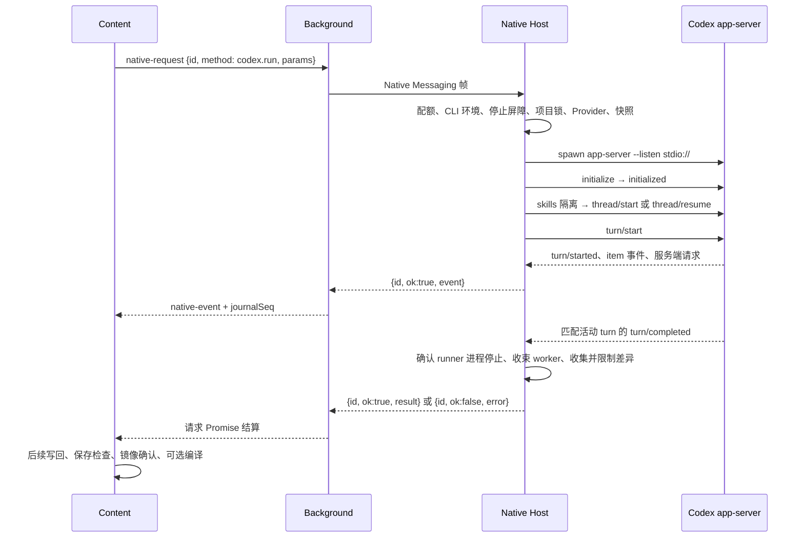

# Native 消息、执行与进程寿命

初始参考产品版本：`2.5.0`；初始参考源码基线：`2073ae74747431aab8d529803d4e9f8197262388`。当前行为随本仓库实现维护。
`Current behavior` 表示可定位的源码事实；`Target contract` 表示维护目标；`Known gap / 未验证` 表示具体限制或尚缺的运行证据。
下文未单独标注的实现描述均属于 `Current behavior`，不能由此推定全部平台已经验收。
浏览器运行状态见[运行与恢复](run-state-and-recovery.md)，页面写入见[Auto 修改与撤销](auto-edit-undo.md)，模型适配见 [Provider 与协议](providers-and-protocols.md)。
消息发送者准入、Content 与后台的版本 gate 集合及当前未覆盖方法见[协议与信任边界](protocols-and-trust.md)。Native 的业务检查与浏览器两层 gate 分别维护。

## 1. 适用范围与 owner

Native Host 是浏览器启动的本机 Node 进程，负责消息接入、镜像协调和 agent 执行；Codex app-server 是它启动的另一个进程。
两个进程之间还有独立的 RPC。RPC 可类比有编号的工单：编号关联请求与回应，工单回执、工作结束、文件保存各有自己的证据。

| 边界 | 权威入口 / 符号 | 消费者或寿命 |
| --- | --- | --- |
| Content → 扩展后台 | [nativeChannel.js](../../extension/src/content/nativeChannel.js) 的 `create/sendNativeTracked` | `contentRuntime.sendTrackedCodexRun` 绑定插件运行及 requestId |
| 后台 → Native Host | [background.js](../../extension/src/background.js) 的 `sendNativeRequest/ensurePort` | `pending` 路由回应；运行 journal 保存有限恢复投影 |
| Native 字节入口 | [index.js](../../native-host/src/index.js) 的 `handleDecodedMessage/writeResponse` | 同一 stdio 通道接受多个异步请求 |
| CLI 发现与运行环境 | [nativeEnvironment.js](../../native-host/src/nativeEnvironment.js) 的 `buildNativeRuntimeEnv/refreshCodexRuntimeEnv`；[codexRuntimeIdentity.js](../../native-host/src/codexRuntimeIdentity.js) | 启动发现及特定请求前刷新；每次请求保留自己的环境快照 |
| Codex 配置与历史目录 | [codexHome.js](../../native-host/src/codexHome.js) 的 `buildCodexHomeEnv/preparePluginCodexHome`；[codexHomeScope.js](../../native-host/src/codexHomeScope.js) | 实际 app-server 使用稳定执行 scope，canonical 保留插件历史；与项目镜像分别管理 |
| 传输信封 | [nativeTransportEnvelope.js](../../native-host/src/nativeTransportEnvelope.js) | 汇聚帧编码、方法配额、结果预算及超限兜底 |
| 方法与运行控制 | [taskRunnerRuntime.js](../../native-host/src/taskRunnerRuntime.js) 的 `handleRequest/handleCodexRun` | 锁、controller、活动 turn 控制；[taskRunner.js](../../native-host/src/taskRunner.js) 仅转发 exports |
| 工作区到 agent 结果 | [codexSessionRunner.js](../../native-host/src/codexSessionRunner.js) 的 `runCodexSession` | 快照/镜像、提示词、worker 收束、差异收集 |
| app-server RPC 与终止 | 同文件 `runCodexAppServerProcess`；[codexSessionTiming.js](../../native-host/src/codexSessionTiming.js) | `pending` 为这一子进程自己的 RPC 表，与后台表分开 |
| Transport 断连收尾 | [nativeRunLifecycle.js](../../native-host/src/nativeRunLifecycle.js) 的 `register/abortAllActiveOperations/quarantineActiveOperations` | 独立于 RPC ID 的运行完成 Promise、已启动 PID 与隔离；由 taskRunnerRuntime require，index 调用 re-export |
| 独立 helper 生命周期 | [nativeHelperLifecycle.js](../../native-host/src/nativeHelperLifecycle.js) 的 `runOwnedNativeHelper` | 将外部 task、线程分叉、Provider 连接测试及本地技能目录读取的准备、执行和清理纳入 transport 收尾；不加入普通运行取消索引 |
| 退出未确认的隔离 | [processStopBarrier.js](../../native-host/src/processStopBarrier.js) 的 `record/isBlocked/getBlockedProjectCount` | 内存记录及项目镜像旁的持久屏障；更新安全点读取既有屏障数量 |

`index` 启动时通过 `buildNativeRuntimeEnv` 合并路径并发现 CLI；`handleRequest` 在配额检查后、处理 `bridge.ping/codex.run/codex.models/codex.thread.fork` 前调用 `refreshCodexRuntimeEnv`。
刷新区分显式固定路径与按版本选择候选，返回当前请求的环境快照；后续请求重新发现 CLI 不会改写已有运行的该快照。运行时版本与路径的证据由 `buildCodexRuntimeEvent` 提供，不能只按终端中的 `codex` 路径判断实际子进程。

`runCodexAppServerProcess` 与线程分叉启动前通过 `buildCodexHomeEnv` 启用 `isolateRuntimeHome`。`codexHomeScope` 按捕获配置、技能发现参数和来源目录选择持久 scope，完整 staging 原子发布，已存在的技能目录不再重建；worker 保持原 `CODEX_OVERLEAF_CODEX_HOME` 的 canonical 身份。
scope 的会话目录链接插件 canonical 历史，SQLite 保留显式配置及已有环境选择，缺省采用 canonical；scope 持久保留以支持 rollout 绝对路径。[codexConfigPaths](../../native-host/src/codexConfigPaths.js) 保持已知配置层路径的原锚点，[codexInheritedAuth](../../native-host/src/codexInheritedAuth.js) 同步可归因的认证副本，[codexSkillIsolation](../../native-host/src/codexSkillIsolation.js) 消费单项技能开关。来源配置的摘要与发布内容使用同一份捕获字节，配置变化不会把另一份内容缓存到旧键。
显式 user home 与 plugin home 为同一路径的旧调用保留提前返回；本地技能目录发现和含显式 `enabledCodexLocalSkillIds` 的调用会派生独立 canonical home，再准备 scope，逐项 `skills/config/write` 不落入用户来源配置。插件历史与用户来源全局历史分别管理，认证旧副本的迁移边界见[Provider认证](providers-and-protocols.md#5-内建与自定义执行的共同边界)。目录、路径字段及技能开关联动见[写作风格与技能](writing-style-and-skills.md)；排查续接需同时核对 CLI 身份、scope、canonical 和有效 SQLite 路径。

## 2. 两层 RPC 的调用链



外层使用 [nativeMessaging.js](../../native-host/src/nativeMessaging.js) 的四字节小端长度前缀加 UTF-8 JSON；内层使用逐行 JSON。
外层 `requestId` 关联插件的一次 Native 调用，内层数字 `id` 关联一次 app-server RPC；`threadId/turnId` 标识模型线程与轮次。
`index.handleDecodedMessage` 把 `update.*` 交给 `updateManager`，其余交给 task runner；消息分派没有全局串行等待。
因此 `codex.run` 未结束时仍能接收 `codex.steer/cancel`，项目级互斥另由 task runner 控制。

托管Bootstrap迁移另有启动期间的业务屏障：`index`在普通业务派发前调用[updateManager.assertBootstrapBusinessAvailable](../../native-host/src/updateManager.js)。确切`2.5.0 → 2.5.1`迁移及其健康确认尚未结算，或源Native切回仍待完成时，普通业务返回`update_applying`；`update.*`、`bridge.ping`和`codex.cancel`保留各自处理路径。浏览器后台还持有自己的执行锁，两层共同防止迁移期间开启新任务，不能把其中一层等同项目任务锁。

内部`update.bootstrap`在更新mutation lock下经[bootstrapUpdate.advanceBootstrapMigration](../../native-host/src/bootstrapUpdate.js)重验原签名、bound授权、事务和目标Native身份，随后调用[bootstrapMigration](../../native-host/src/bootstrapMigration.js)的文件事务。独立[bootstrapUpdateWatchdog](../../native-host/src/bootstrapUpdateWatchdog.js)先完成事务token/PID握手，再监测健康期限；恢复调用同一`recoverBootstrapTransaction()`及同一跨进程锁，不依赖Chrome Service Worker持续存活。watchdog保留有限重试，原Popup还能通过Native状态请求唤醒恢复检查；这要求目标Native恢复代码仍能启动，固定launcher的入口存在性回退没有变成任意启动损坏的自动修复。签名payload、回滚顺序与验证边界见[安装与更新](installation-and-updates.md)。
迁移恢复已写`rolled_back`而仍有`sourceActivationPending`时，watchdog继续完成源证明核对、授权结算和指针切回；终态字符串本身不足以证明旧Native已接管。提交恢复则消费`committedEvidence`及当前runtime/Bootstrap摘要，仅结算身份完全相符的旧bound授权。[bootstrapMigrationUpdate](../../test/bootstrapMigrationUpdate.test.js)定位这些跨步骤中断与恢复契约，实际Chrome和物理断电有独立验证范围。

### 请求、流与终态

流事件形状为 `{id, ok:true, event}`；`ok:true` 在此表示一次事件传递，不表示整轮成功。
终态成功形状为 `{id, ok:true, result}`；失败形状为 `{id, ok:false, error:{code,message,...}}`。
后台按 `message.event` 区分事件和终态；事件先交给 journal 写队列，再转发；终态移除 `pending` 并结算调用方 Promise。
Native 的 `emitCodexEvent` 创建 `type/title/status/detail/timestamp`；单调恢复序号由后台 `appendRunJournalEvent` 添加。
`requestId` 提供关联能力；源码中的 `pending.set` 与 Native 运行注册不能作为重复执行去重协议。
`Target contract`：新增事件须声明所属运行、消费者、最大载荷和错误语义；“只执行一次”需要额外幂等与持久证据。

## 3. codex.run 的准入与结果收集

`handleRequest` 先调用信封的 `getRequestQuotaViolation`；超额返回 `native_request_quota_exceeded`，再进入具体方法。
`handleCodexRun` 先用共享 `NativeRequestIdentity.validate` 验证请求ID：接受有限数字（含0）或1–160字符的非空字符串；缺失、空串、非有限数字及其他类型在获取项目锁和执行前返回 `native_request_id_invalid`。随后检查Codex可发现性，派发运行时身份事件，持项目锁创建controller；所有已接纳运行均登记取消/steer的三个活动索引及 `nativeRunLifecycle` 断连收尾，再解析Provider。
Provider revision、地址披露、模型和 Auto 协议协商由 `providerRuntime.resolveRunProviderForRun` 决定，详见 [Provider 与协议](providers-and-protocols.md)。
普通非 `useExistingMirror` 请求的完整快照或聚焦部分快照须通过 `hasRunnableProjectSnapshotEvidence`；`useExistingMirror` 路径另查 freshness，OT 聚焦复用另查覆盖；有 overlays 时，必须恰好覆盖聚焦路径且内容 SHA-256 与可信 OT-fresh 文本基线一致。获准的 OT overlays 仅作相等证明，不再次写盘；不一致走 `mirror_stale` 回退。
技能安装和风格生成有独立入口例外，不能把普通项目快照前置条件套到所有运行。

`Known gap / 静态参数边界`：`handleCodexRun` 仅在 `useExistingMirror` 路径把 `skipMirrorSync` 设为 true，其余路径原样传递 params；[runCodexSession](../../native-host/src/codexSessionRunner.js) 独立按 `skipMirrorSync` 跳过同步。
因此普通 Native 请求携带 `useExistingMirror:false、skipMirrorSync:true` 及满足准入的完整快照时，可以使用原镜像，未经过上述 freshness 检查，传入快照也不会同步。后台 `sanitizeNativeRequest` 只剥离兼容性字段，未移除此参数。
常规 [contentRuntime.js](../../extension/src/content/contentRuntime.js) 在 `runSkillInstallerTask` 显式设置该字段；该限制适用于直达 Native 的参数组合，普通 UI 是否能够触发旧镜像执行需结合参数生成路径验证。快照获准与快照实际进入镜像须分别判断。

`runCodexSession` 的普通项目顺序如下：

1. 同步或取得镜像，准备选区范围、项目技能、附件与写作风格上下文。
2. 根据模式与技能类型生成 sandbox/approval 参数，按官方技能开关创建 subagent broker。
3. 执行父任务；父任务异常时停止 broker，正常返回时先 drain 剩余 worker。
4. 收集镜像差异，依次应用选区限制、focus 限制和 subagent 阻断路径。
5. 存在改动或不支持项时将镜像标 dirty；Ask 返回空 `syncChanges/unsupportedChanges`，保留被忽略数量事件。
6. Auto 准备二进制资产、文本 diff/patch，再通过 `reduceTaskResult` 限制响应预算。

普通 Ask 的 `buildCodexSettings` 为 `read-only`；Auto 为 `workspace-write`；技能安装有单独 `workspace-write` 配置。
`handleServerRequest` 处理收到的文件/命令审批请求，其他未知服务端请求默认 decline；相关 allowlist 只约束这一审批入口。
`Known gap / 未验证`：仅凭 allowlist 的存在不能证明所有工具执行都会触发该审批回调；真实 Codex sandbox 行为须另验。
运行结果仍有工作区中的本地改动，允许写回集合由过滤和预算决定；返回文本“完成”不能绕过这些集合。

| 完成节点 | 已获得的证据 | 仍可能继续的工作 |
| --- | --- | --- |
| 匹配的 `turn/completed` | app-server 发出该轮终态通知 | 子进程清理、worker 收束、镜像差异与响应预算 |
| `runCodexSession` resolve | 生产 app-server runner 已通过停止确认，本次运行结果已收集并经过返回集合过滤 | 外层编码传输；注入的执行替身及独立外部 agent 路径不能据此取得相同进程保证 |
| Native 请求 Promise 结算 | 后台收到终态响应或连接错误 | Content 写回、保存检查、镜像确认和可选编译 |
| 插件 run settlement | 页面与后处理证据已归类 | 结果可含部分失败、保存未知或后续恢复动作 |

这些节点的 owner 不同；改变“完成”文案或下一项队列启动条件时，应同时阅读 [WritebackSettlement](../../extension/src/shared/writebackSettlement.js)。

## 4. thread、turn、steer 与活动事件

每次 `runCodexAppServerSession` 准备 Provider launch，创建 app-server 进程，并在 finally 关闭本次 Provider 桥。
传入 `threadId` 时执行 `thread/resume`，失败返回 `thread_resume_failed`；该路径不自动新建线程冒充续接成功。
未传入时调用 `thread/start`，拿到线程后调用 `turn/start`；不支持 reasoning summary 的特定错误只重试该请求并移除 summary。
该兼容重试、后台断连重放及 Content 业务恢复分别拥有入口和条件；三层范围见第 6 节。

`publishActiveTurnControl` 取得 thread 与 turn 后仅发布一次冻结 control，发出 `codex.turn.bound`；其 `steer` 调用 `turn/steer`。
`handleCodexSteer` 用 requestId 优先、projectKey 兜底查找活动 entry，控制尚未就绪报 `codex_turn_not_ready`。
提供的 threadId 或 expectedTurnId 不匹配时报 `codex_turn_mismatch`；空文本及超过 12,000 字符的文本分别拒绝。
这里的预期身份字段按“传入才比较”实现，不能声称 Native 拒绝全部缺失 thread/turn 的 steer 请求。
`Target contract`：调用方应传入绑定时捕获的预期 turn，避免迟到指导进入另一轮；浏览器绑定见 [activeTurnControl.js](../../extension/src/content/activeTurnControl.js)。

`createRunEventScope` 位于 [readProgressGuard.js](../../native-host/src/readProgressGuard.js)，按 thread/turn 和 item 已知归属过滤异线程事件。
`accepts` 对无身份且无已知 owner 的兼容事件允许通过；`owns` 对进度守卫要求更强证据，两者不能混用。
`subagentTelemetry` 先观察原生协作事件，再进入父任务处理；子任务消息不会自动取得父任务终态地位。
`buildFinalAssistantMessage` 优先从完成的消息项选择最终答复，commentary 与中间片段保留在流事件中。
兼容例外：成功 turn 中没有 completed 项，且所有项都没有显式 phase 时，会选择最后一个非空 delta-only 项；带 phase 的未完成项不进入该回退。定义见同文件 `buildFinalAssistantMessage` 及 `codexSessionRunner.test.js` 的 legacy delta-only 场景。
匹配活动 turn 的 `turn/completed` 由 `getTurnCompletionError` 检查：`completed` 或兼容旧协议缺少 status，且 error 为 null/undefined 时才进入 `succeed`；`failed`、非 null/undefined 的 error 证据和未知显式状态走 `fail` 的停止与拒绝路径。`interrupted` 复用 `codex_cancelled`，原始 turn.status 仍保留在事件中。
`taskRunnerRuntime.isCancellationError` 对明确的 `codex_turn_failed/codex_turn_status_invalid` 优先维持失败分类，避免错误文字中的取消字样改写协议事实；无结构化 code 的旧错误仍沿原兜底判断。[codexTerminalStatus.test.js](../../test/codexTerminalStatus.test.js) 使用合成 app-server，分别覆盖 Native → runner 的公共结果及锁/控制器清理，以及 session → runner → broker → 镜像差异过滤；真实 Codex 版本仍需独立验收。

线程分叉走独立 [codexThreadFork.js](../../native-host/src/codexThreadFork.js) 的 `forkCodexThread`，执行 `initialize → thread/fork`。
它有自己的 30 秒计时和 pending 表，经 `runOwnedNativeHelper` 登记 Host 断连收尾；正常、失败及取消都等待 `stopCodexAppServer` 的有界停止处理后结算。外部 `task.run` 命令使用同一 helper 生命周期；两者在 POSIX 创建自有进程组，stdin 写入错误也进入停止路径。helper 没有加入普通运行的取消索引、项目锁或持久停止屏障，普通 `codex.cancel` 不取消无关 helper。

Provider 连接测试由 [codexProviderTest.js](../../native-host/src/codexProviderTest.js) 的 `runProviderConnectionTest` 在准备开始前登记 helper 生命周期。它在入口、`prepareProviderLaunch` 返回后及实际 spawn 前检查取消，已准备的 bridge/catalog 在 finally 关闭；子进程停止处理结束后清理临时测试目录。`providerRuntime.testProvider` 立即承接已取消的 externalSignal，避免 Auto 协商错过早先的 abort；准备期间获准的取消不会再派发连接测试子进程。独立测试取消和预算仍由 Provider 入口管理，详见 [Provider 与协议](providers-and-protocols.md)。

## 5. 互斥、运行登记与退出证据

| 机制 | 当前作用 | 不能推出的保证 |
| --- | --- | --- |
| `activeProjectLocks` | `acquireProjectLock/releaseProjectLock` 用 token 防止旧 finally 释放新锁 | 同一进程的 Map 不能证明跨 Native 进程互斥 |
| `activeRunControllers/activeRunEntries/activeRunByProject` | 所有已接纳的codex.run以原类型ID及projectKey登记，取消与steer可定位数值0 | 仅覆盖已接纳的codex.run，未登记全部本机子进程；finally仍按原controller/entry身份清理 |
| `nativeRunLifecycle` | 每个 codex.run 及经 nativeHelperLifecycle 包装的 helper 独立登记，断连时中止并等待完成；普通运行上报的进程身份用于持久隔离 | 与按 RPC ID 查询的 cancel/steer 索引分开；helper 未登记项目进程身份，不继承跨 Host 持久隔离 |
| `processStopBarrier` | 退出未确认或 transport 收尾期间阻止特定入口继续修改该项目 | 屏障不等于关闭操作系统中的所有相关进程 |

`resolveProjectKey` 规范化项目字符串，并有 `unknown` 兜底；它提供锁索引，不能替代账号、页面与运行身份认证。
`mirror.sync/patchFiles/confirmWriteback/invalidate` 也使用项目锁；status/scan 等查询和下述停止屏障各有独立准入范围。

`handleMirrorConfirmWriteback` 将页面已验证文本的 `expectedFiles` 哈希传入 `mirrorWorkspace.confirmWritebackFiles`。全部目标的本地字节与证明一致后才推进基线；缺证明或不匹配时拒绝，由 Content 完整快照同步回退。项目锁协调本桥的请求，无法排他阻止其他本地进程写盘；页面内容证明与锁承担不同约束，详见[镜像与保存确认](auto-edit-undo.md)。
`handleCodexRun` 在 finally 移除所属活动索引并释放 token 锁，再调用生命周期句柄 `complete()` 结束断连等待。该句柄的 `trackProcess` 由 runner 的 `onProcessStarted` 报告父任务、worker 及写作风格执行中的有效 PID 身份；无进程或无有效 PID 不创建未知屏障。异常停止时即使锁释放，持久屏障仍可独立阻止下次准入。

浏览器 [nativeChannel.js](../../extension/src/content/nativeChannel.js) 通常生成UUID，后台 `sendNativeRequest` 使用 [nativeRequestIdentity.js](../../extension/src/shared/nativeRequestIdentity.js) 的 `resolve` 补齐或校验ID；Native直达codex.run使用同模块的 `validate`，不另造请求ID。数字0在响应、活动索引及cancel/steer查找中保持数值类型，字符串ID仍保持字符串类型。该身份约束不提供重复请求去重；断连生命周期仍独立于RPC索引。

### 取消调用链与回执强度

浏览器 `contentRuntime.cancelActiveRun` 并发发送 Native `codex.cancel` 与 Page `cancelActiveWrite`，同时 abort 本地运行 controller。
Page 信号打断剩余写操作，Native 信号面向 agent；已经完成的页面写入不会由取消自动回滚。
后台对 `codex.cancel` 使用专门的 `sendNativeCancel`，`postMessage` 后立即返回 `{sent:true,id}`，未等待 Native 的取消响应。
Native `handleCodexCancel` 命中 controller 后调用 abort，并返回 `{cancelled:true}`；此时停止过程仍可继续。
由此可写为 \(sent \not\Rightarrow cancelled \not\Rightarrow exited\)：各箭头左侧证据不足以推出右侧事实。

无活动 controller 时，`force:true` 仅在项目未被 stop barrier 阻断、且内存锁存在时删除锁；它不执行额外 OS kill。
合法ID的codex.run始终有项目controller登记；对仍在执行的运行，force同样请求abort，锁保留至原finally完成，不能因数值0漏登记而提前删除活锁。使用同一项目锁的其他镜像操作有独立寿命；锁token只能防旧finally删除新锁，不能终止进行中的操作。

`forceCancelStuckTaskForCurrentProject` 的日志与 [RunRecoveryActions](../../extension/src/content/runRecoveryActions.js) 的原恢复按钮共用 `formatForceCancelOutcome`。`sent:true`只显示请求已发送、释放尚未确认；`cancelled:true`仅表示取消已接纳，仍需等待停止；只有 `lockReleased:true`可以显示已释放。明确 `cancelled:false`表示没有匹配活动任务，空成功回应保持未确认；错误仍显示失败。正常后台通道继续立即返回sent，没有新增等待Native回执的流程；该显示不能证明进程已经退出。
正常sent通道下仍需核对原运行终态、后续准入及实际进程证据，不能把请求接纳当作停止完成。

### 正常完成、失败与取消的有界停止

`runCodexAppServerProcess.fail` 标记 stopping、清理观察器和计时器、拒绝未完成 RPC，然后调用 `stopCodexAppServer`。正常 `succeed` 同样先置 stopping 并清理，随后调用该停止函数；成功终态已到达时省略 `turn/interrupt`，确认停止后才 resolve，无法确认则拒绝结果并走既有隔离路径。停止期间 close、abort 或重复终态不二次结算。
POSIX 子进程以 detached 启动，失败/取消停止时先尝试 `turn/interrupt`，再向所属进程组发 SIGTERM，必要时 SIGKILL。
当前默认等待由函数参数定义：interrupt 1,500 ms、terminate 500 ms、force 1,500 ms；各阶段预算不能直接推出 UI 取消总耗时。
POSIX 确认停止要求已观察子进程退出，且进程组探测得到 `ESRCH`；单纯 `child.killed` 或信号发送成功不满足条件。
Windows 使用 `taskkill /pid <owned-pid> /t /f`，随后检查 child 退出状态；实现没有 POSIX 同类的剩余进程组探测。
无法确认时抛出 `codex_process_stop_unconfirmed`，携带 PID、group 与运行时 `isStopped`；runner 将它传给 `onStopUnconfirmed`。

`processStopBarrier.record` 原子写入镜像旁 `.codex-stop-barrier.json`；内存保留 `isStopped` 回调，持久数据去掉函数。
重启后仅同平台、有效 PID、标记为 process group 的记录可用 `kill(-pid,0)` 探测；未知记录及 Windows 恢复记录保持隔离。
文件解析失败、顶层非数组、超额数据及 null 等非对象元素按未知记录处理；未知或缺少可核验进程身份的记录保持阻止。每次 `isBlocked/record` 重新读盘，再合并本地仍有回调或曾写盘失败的记录，已启动的另一 Host 也能看到新屏障和后续清除。
同一 Host 的 `isStopped` 回调可在确认退出后清理屏障，包含 Windows 的运行时确认；丢失该回调后的 Windows 恢复仍保守隔离。写盘失败保留本地记录并附加 `stopBarrierPersistenceError`，transport 收尾会记录失败；磁盘不可写且进程无法停止时，跨 Host 或重启后的隔离仍无法保证。
单项目屏障准入位于 `handleRequest`，覆盖 `codex.run/mirror.sync/mirror.patchFiles/mirror.confirmWriteback`。
更新另经 `getActiveNativeWorkState(env)` 提供 `processStopBarriers`：`getBlockedProjectCount()` 只观察当前 mirror-root 的既有记录及本 Host 未成功持久化的记录，未知或不可读证据保持阻断，不改写记录或发现任意操作系统进程。`update.canApply/apply` 及延迟激活将该计数与原项目锁、controller 检查共同使用；工作状态中的 `activeTurnControls` 没有作为独立 gate 条件，见[安装更新安全点](installation-and-updates.md#6-安全点的实际范围)与 [updateStopBarrier](../../test/updateStopBarrier.test.js)。
直接调用更底层 workspace 函数、其他方法、线程分叉及外部 agent 路径不能自动继承单项目持久检查；helper 的断连收尾与这项隔离分别管理。

`codexProcessSettlement` 使用真实 Native runtime、runner 与合成 app-server 检查成功结果前的退出和迟到写入；真实 Codex、平台进程树及所有独立执行入口仍需各自验收。

## 6. 断连、计时与允许重试的范围

`index.handleNativeDisconnect` 对 stdin end/close/error、预期 stdout 断连只处理一次，禁止继续写 stdout。
断连后 `handleDecodedMessage` 不再接纳新请求。`index` 先调用 `quarantineActiveOperations` 为仍登记的有效进程身份写持久屏障，再调用 `abortAllActiveOperations`，等待每个生命周期条目的完成 Promise。普通项目运行在 Provider 准备后和 spawn 前检查已取消信号，其关闭期间才上报的进程身份也立即进入隔离。
退出同时保留至少 1,500 ms 的既有宽限；最长 5,000 ms 后重试持久隔离并退出，截止重试仍有持久化失败时写诊断并使用非零退出码。正常 drain 后可经 `complete` 清除已有停止证据的临时屏障。等待集合同时包含 `codex.run` 和已登记的独立 Provider test、线程分叉、`task.run` 外部 agent；helper 仅在有界停止处理及所属资源清理结束后注销，准备期间断连也会阻止迟到的进程派发。
普通项目运行的断连保护允许“确认退出”或“仍活跃但被有效隔离”两种状态；helper 的停止未确认错误不自动创建项目持久屏障，Host 原有总退出截止仍适用。应分别核对 Host 退出、所属进程写能力及新 Host 的屏障准入。真实 Codex、完整后代进程树、Windows 与浏览器重连仍需独立验收；持久屏障写盘失败的限制见第 5 节。

app-server 的绝对 timeout 由 `CODEX_OVERLEAF_CODEX_TIMEOUT_MS` 可选开启，默认不设；idle watchdog 默认 600,000 ms。
收到 stdout 或发出 RPC 会重置 idle；broker 有活动 worker 时会继续重置，worker 自有时间预算另行约束。
重复读取守卫由 `readProgressGuard` 先 steer，再在继续无进展时触发相同 fail 停止路径；活跃输出不能自动证明任务有进展。
Provider HTTP 空闲/总预算属于另一层，见 [Provider 与协议](providers-and-protocols.md)，不能与 agent watchdog 相加后宣称统一超时。

### 三层重试及业务恢复

| 层 | 实际入口与触发 | 重新执行的范围 |
| --- | --- | --- |
| app-server RPC | `startTurnWithSummaryFallback` 收到特定 reasoning summary 不支持错误 | 同一进程和线程内移除 summary，再发一次 `turn/start` |
| 后台传输 | [background.js](../../extension/src/background.js) 的 `getNativeRetryClass/canRetryNativeRequest` | 按下表将安全请求重连重发一次；`codex.run` 禁止静默重放 |
| Content 业务恢复 | [contentRuntime.js](../../extension/src/content/contentRuntime.js) 的 `runTask/buildCodexRunParams/sendTrackedCodexRun` | 收到已知错误后重建参数，再派发新的 Native 请求 |

普通 `runTask` 收到 `mirror_stale` 且本次使用 `useExistingMirror` 时，先重新获取项目快照并调用 [otWarmMirror.js](../../extension/src/content/otWarmMirror.js) 的 `prepareMirrorStaleRetry`；准备成功后关闭镜像复用、清除 overlays 与 OT warm-start 标记，对新快照再次执行敏感预检，再以返回的聚焦限制重发。快照准备失败或敏感检查未获准会结束该路径，检测与确认范围见[上下文与治理](context-and-governance.md)。
收到 `thread_resume_failed` 时，`showThreadResumeFailedPrompt` 提供选择；选择新线程后，先清空会话内存中的 `codexThreadId`，再在持久会话记录存在时保存空值，然后携带空线程 ID 重发。其他选择记录取消并返回；持久化异常也可能阻止重发，不能从弹窗选择推定新线程已经创建。
两条路径均重新调用 `sendTrackedCodexRun`，在兼容性等待前捕获原运行句柄及 AbortSignal，并通过可选 `assertCurrent` 在 ping 返回后、兼容评估及阻止提示前复核取消、owner 和运行账号/项目；gate 返回后再次核对才消费结果并绑定新 requestId。上一运行的迟到成功或拒绝结果不能借下一运行已重置的取消标志进入派发或终态提示，详见[协议与信任边界](protocols-and-trust.md)。后台禁止断连重放与这些显式业务分支可以同时成立；修改参数捕获时须检查初次派发及两条恢复分支。
风格生成另有 [codexModelRecovery.js](../../native-host/src/codexModelRecovery.js) 的 `createRecoveringStyleRunner` 可重选较新 CLI，该策略仅供隔离的风格生成使用，见[写作风格与技能](writing-style-and-skills.md)，不能推广至普通项目任务。

后台传输层的当前分类如下；安全请求重连仅允许一次，收到终态后不再重试。

| 方法 | 分类与动作 |
| --- | --- |
| `bridge.ping/mirror.status/mirror.scanSensitive` | `safe_read_retry`，失败端口上的请求可重连一次 |
| `mirror.sync/mirror.patchFiles/mirror.confirmWriteback/mirror.invalidate` | `safe_sync_retry`，依赖各方法收敛、基线和 stale 条件 |
| `codex.cancel` | `best_effort`，走单独发送路径 |
| `codex.run/task.run/task.confirm` 与未显式列举方法 | `no_silent_retry`，断连以 `native_execution_interrupted` 结束 |

`codex.models` 和 Provider 查询也落入默认禁止重放分类；“看起来只读”不足以推断当前已经注册自动重试。
后台按 nativePort 筛选受断连影响的 pending，并过滤旧端口新进入 `onMessage` 的消息；无 ID 错误仅单 pending 时可归属，多 pending 时按连接失败处理。
已在断连前进入 journal 写入等待队列的事件，写入完成后仍可能转发，回调未再次核对端口/pending/terminal。它是否被 UI 的运行身份和终态守卫丢弃还需核对消费者，不能宣称端口过滤消除了所有迟到事件。
运行 journal 支持有限事件恢复；`ActiveTurnControl.recoverJournals` 不把 Native terminal 直接当作页面写回完成，详见[运行与恢复](run-state-and-recovery.md)。
`Target contract`：新增方法默认禁止重放，只有明确副作用、幂等条件与失败测试后再加入安全分类。

<a id="journal-lifecycle"></a>

### 后台重建与 journal 的寿命

后台 [background.js](../../extension/src/background.js) 同时管理内存 `runJournals/journalWrites` 和 `chrome.storage.session` 中的 journal；两者的寿命不同。
后台 worker 重建时，`pending/runJournals/ownerBindings` 从空 Map 开始；owner bind 或失主处理调用 `restoreRunJournal(binding)`，按 requestId 从 session 存储恢复所需 journal。该过程只恢复日志证据，不恢复 pending Native RPC，也不重新派发原任务。
`journalMatchesBinding` 检查 request/project 及绑定携带的 run/session；新 journal 还记录并核对发送者 tab/document。旧记录缺少发送者字段时保留按原 request/project 和已提供 run/session 兼容的路径，无法补造历史身份。
[ActiveTurnControl.connect](../../extension/src/content/activeTurnControl.js) 在 owner port 断连后可重新连接并发送原 binding；合法重绑读取完成后复核当前 port binding 和 journal 对象，再清除旧 `ownerLost`。失主处理保留150ms宽限，并在异步读取及写入后重查活 owner。`listRunJournals` 等待在途恢复读取及写链，排除仍有匹配活绑定的记录，避免旁观页提前结算。
读取失败或身份不匹配不会删除旧存储材料。真实 worker 回收、重连和页面关闭仍有独立时序，不能从存储记录存在推定所有中断场景均能恢复。

`queueJournalStorage` 按 requestId 串行排列写入及删除；`queueJournalWrite` 捕获快照，并在实际写入前核对内存中的 journal 对象代次。`removeRunJournal` 供 prune/ack 共用：先使旧恢复读取失效、移除内存记录，再把删除排到既有写链尾部，链登记保留至操作完成。尚未执行的旧快照因代次失效而跳过，已经执行的写入由队尾删除收束；同 ID 已新建 journal 时，旧删除不能删除新代次。
`pruneInMemoryRunJournals` 在新建及恢复失主标记时，以16项为内存保留目标，只淘汰 terminal/ownerLost 项；活动日志不会为达到数量目标被强删。`listRunJournals` 仍最多返回16条。本路径不全量回收跨重启的全部旧键，列表限额不能作为物理存储总量上限。ack 仍要求 content 已取得主库恢复保存回执，详见[运行状态与恢复](run-state-and-recovery.md#51-共享历史中的运行-owner)。

[backgroundJournalLifecycle.test.js](../../test/backgroundJournalLifecycle.test.js) 加载完整后台和 ActiveTurnControl，以保留 session 存储的独立 VM 重建检查重绑、失主、恢复消费者、ack/prune、迟到读取及同 ID 新代次；Chrome 存储、端口和计时使用替身。相邻入口为 [backgroundNativeError.test.js](../../test/backgroundNativeError.test.js)、[activeTurnControl.test.js](../../test/activeTurnControl.test.js) 与 [crossTabRuntimeRegression.test.js](../../test/crossTabRuntimeRegression.test.js)。真实 Chrome worker 生命周期及磁盘配额仍需相应验收。

## 7. 配额与超限后的降级

| 层 | 权威符号 | 当前意义 |
| --- | --- | --- |
| Node 入站帧/缓冲 | [nativeMessaging.js](../../native-host/src/nativeMessaging.js) 的 `MAX_NATIVE_INPUT_MESSAGE_BYTES/MAX_NATIVE_BUFFER_BYTES` | 128 MiB / 160 MiB；仅描述本机 decoder 限制 |
| 出站帧 | 同文件 `MAX_NATIVE_OUTPUT_MESSAGE_BYTES` | 1 MiB，按 JSON 的 UTF-8 字节计算 |
| 方法数据 | [nativeQuotas.js](../../native-host/src/nativeQuotas.js) 的 `NATIVE_REQUEST_QUOTAS/validateNativeRequestQuotas` | 项目、附件、操作、编译日志和技能分别校验；未列方法不自动获得字段级检查 |
| 成功结果 | [nativeResponseBudget.js](../../native-host/src/nativeResponseBudget.js) 的 `NATIVE_OK_RESPONSE_BUDGET_BYTES` | 给外层信封预留 64 KiB，提前缩减可写回集合 |

Base64 字节数约为 \(4\lceil n/3\rceil\)，外面还有 JSON 与 diff/patch；附件原始大小合格不代表整帧一定合格。
上述出站降级也不能证明内层 app-server 的未换行 stdout、stderr 或消息累积始终有界；`runCodexAppServerProcess` 的缓冲与 `buildFinalAssistantMessage` 输入需单独审查和测试。
`reduceTaskResult` 优先把最大内联文本改动移入 `unsupportedChanges`，再处理内联二进制，随后缩减 assistantMessage，最后可退化成整体不支持提示。
对应 reason 包括 `text_payload_exceeds_native_message_limit` 与 `native_response_payload_exceeds_native_message_limit`，不能把这些项显示为已写回。
二进制常规分块入口为 [nativeAssetTransfer.js](../../native-host/src/nativeAssetTransfer.js)；分块协议与内联兜底应分别维护。
最后 `encodeOutputFrame` 若仍超限，事件改为有界 `native_event_truncated` detail，终态改为 `native_response_too_large` 错误，并限制回传 ID 长度。
`Known gap / 未验证`：字段配额、Node decoder、浏览器平台上限、生成结果预算是不同约束；当前数值不能证明所有合法组合都可传输。

日志由 [debugLog.js](../../native-host/src/debugLog.js) 的 `sanitize` 截断字段、压缩部分 content/files；这不构成通用凭据识别器。
`index` 的摘要与运行错误路径还会记录 error message/stack；`Target contract` 禁止敏感凭据进入日志，但各新异常路径仍须单独审阅。
`debugLog.logDebug` 向选定目录的 `native-host.log` 持续追加，没有文件总字节上限、按时间淘汰或自动轮转。`sanitize` 只截断部分字符串、裁剪部分数组，整条 JSON 记录也没有统一字节上限。写入异常被捕获以免阻断 Native 消息处理；磁盘容量排查需同时核对单条载荷与累计日志的保留策略。

## 8. 修改联动与最近测试

| 改动意图 | 必查联动 | 既有测试定义 |
| --- | --- | --- |
| 新 Native 方法/请求身份 | owner、index 路由、compatibility、后台重试分类、quota、content consumer | [taskRunner.test.js](../../test/taskRunner.test.js)、[nativeRequestIdentity.test.js](../../test/nativeRequestIdentity.test.js) |
| CLI 选择与 Codex home | index 环境初始化、请求前 refresh、runtime identity、runner home、技能开关 | [nativeEnvironment.test.js](../../test/nativeEnvironment.test.js)、[codexRuntimeIdentity.test.js](../../test/codexRuntimeIdentity.test.js)、[codexHome.test.js](../../test/codexHome.test.js) |
| 流事件或结果形状 | producer、信封、background journal、content reducer/时间线 | [nativeTransportEnvelope.test.js](../../test/nativeTransportEnvelope.test.js)、[nativeTransportEnvelopeFallback.test.js](../../test/nativeTransportEnvelopeFallback.test.js)、[streamEvents.test.js](../../test/streamEvents.test.js) |
| 进程取消/无进展 | runtime controller、runner fail、timing、stop barrier、页面取消和状态投影 | [projectLock.test.js](../../test/projectLock.test.js)、[readProgressGuard.test.js](../../test/readProgressGuard.test.js)、[nativeDispatchCancellation.test.js](../../test/nativeDispatchCancellation.test.js)、[runCancellationLifecycle.test.js](../../test/runCancellationLifecycle.test.js)、[codexProcessSettlement.test.js](../../test/codexProcessSettlement.test.js) |
| 断连/重连 | background pending/port、Native disconnect、nativeRunLifecycle/nativeHelperLifecycle、停止屏障、owner/journal 恢复 | [nativeDisconnectSettlement.test.js](../../test/nativeDisconnectSettlement.test.js)、[nativeHelperShutdown.test.js](../../test/nativeHelperShutdown.test.js)、[nativeRunLifecycle.test.js](../../test/nativeRunLifecycle.test.js)、[backgroundNativeError.test.js](../../test/backgroundNativeError.test.js)、[activeTurnControl.test.js](../../test/activeTurnControl.test.js)、[crossTabRuntimeRegression.test.js](../../test/crossTabRuntimeRegression.test.js) |
| Provider 连接测试取消 | providerRuntime 的 externalSignal、codexProviderTest 的准备/派发检查、helper 登记、prepared 资源和停止处理 | [providerTestCancellation.test.js](../../test/providerTestCancellation.test.js)、[nativeHelperShutdown.test.js](../../test/nativeHelperShutdown.test.js) |
| 镜像或线程业务恢复 | runTask 两条错误分支、参数重建、重试敏感预检、线程清空持久化、新请求绑定及取消/owner 检查 | [runRetrySensitivePreflight.test.js](../../test/runRetrySensitivePreflight.test.js)、[runSubmissionOwnership.test.js](../../test/runSubmissionOwnership.test.js)、[p0ProductExperience.test.js](../../test/p0ProductExperience.test.js)、[taskRunner.test.js](../../test/taskRunner.test.js)、[nativeDispatchCancellation.test.js](../../test/nativeDispatchCancellation.test.js) |
| thread/turn/最终回答 | start/resume 参数、事件 scope、steer 绑定、assistant item 完成规则 | [codexSessionRunner.test.js](../../test/codexSessionRunner.test.js)、[readProgressGuard.test.js](../../test/readProgressGuard.test.js) |
| 配额或 diff 体积 | quota、响应预算、资产分块、不支持项呈现 | [nativeQuotas.test.js](../../test/nativeQuotas.test.js)、[codexSessionRunner.test.js](../../test/codexSessionRunner.test.js)、[nativeAssetTransfer.test.js](../../test/nativeAssetTransfer.test.js) |

### 测试的真实入口与替换边界

下表说明既有测试的入口及依赖替换范围；不同测试环境的局部结果不能合并为完整调用链的验收结论。

| 测试范围 | 实际进入的实现 | 替换依赖及未覆盖部分 |
| --- | --- | --- |
| `nativeDispatchCancellation`；`nativeRequestIdentity` 的后台顺序断言 | 读取源码并匹配检查顺序；Identity helper 另有直接调用 | 未装配 Content → Background → Native 取消链 |
| `runCancellationLifecycle` | 提取取消报告函数到 VM，直接调用 session/storage/activity 投影 | UI 依赖为 stub，未启动 Native 或页面写入 |
| `projectLock`；`taskRunner` 的 Codex 运行用例 | 调用 `handleRequest`，部分使用真实临时镜像 | 替换 runner 与 CLI 环境发现；锁释放不能证明真实进程退出。`task.run` 的外部 agent 用例另行启动夹具进程 |
| `codexSessionRunner`；`streamEvents` | 前者包含镜像/结果测试与合成 app-server 测试；后者注入 `executeCodex` 发事件 | 多数结果测试替换模型执行；合成协议进程也不能证明真实 Codex 协议兼容 |
| `readProgressGuard` | 直接调用 runner，启动合成 app-server；部分场景创建后代进程 | 绕过 Native index/runtime 登记；Windows taskkill 用注入函数更新 child 状态；未贯通停止屏障落盘与重启 |
| `codexProcessSettlement`；`nativeDisconnectSettlement` | 真实 runner/runtime；断连用例另启动 Native index、真实帧与停止屏障 | 合成 app-server、显式临时目录，断连用例替换环境发现/日志；普通对照使用真实停止，特定故障用例替换 kill 或停止函数以构造信号拒绝/停止永不结算。未使用真实 Codex、浏览器或远端服务 |
| `nativeHelperShutdown` | 真实 index、Native 帧、helper 生命周期及进程停止；检查三类 helper 的断连退出与普通 Cancel 范围 | 模型/外部命令为忽略 SIGTERM 的自有合成进程，环境发现和日志定位隔离；不证明真实模型、远端请求或所有平台进程树行为 |
| `providerTestCancellation` | 真实 Provider runtime、prepare、loopback listen 和子进程边界；覆盖准备取消、入口预取消和 Auto externalSignal | listen 完成回调时序受控，模型执行用合成 helper；正常对照检查资源关闭，未调用真实 Provider 或模型 |
| `nativeRunLifecycle` | 真实生命周期 helper 与屏障文件读写 | 注入进程身份/退出回调及文件故障，覆盖晚登记、无 PID、Windows 回调清理和已运行 reader；无法代替真实 Windows 进程树验收 |
| `backgroundNativeError`；`activeTurnControl` | 前者在同一 VM 加载真实后台及依赖；后者调用 bind/list/ack | Chrome API、Native port 为模拟，后台 VM 未提供 session journal 存储；后者未调用 `recoverJournals`，不能独自证明恢复结算或后台重建后的日志寿命 |
| `crossTabRuntimeRegression` 的 journal 恢复用例 | 直接调用 `recoverJournals`，检查 live owner 与 ownerLost 的不同投影 | 注入合成 journal 和 Chrome runtime，未经过真实后台 journal 持久化及页面重启 |
| `p0ProductExperience` 的镜像/线程重发断言 | 检查 runTask 源码是否保留快照读取及上下文参数 | 未实际执行弹窗、持久化失败与重发交互 |
| `nativeEnvironment/codexRuntimeIdentity/codexHome` | 环境发现、身份构造及临时目录准备 | 使用临时候选脚本、注入路径/平台或假配置；不代表当前安装、登录状态及真实全局目录验收 |
| `nativeTransportEnvelope/nativeQuotas/nativeAssetTransfer` | 直接调用 helper；资产测试通过临时镜像读取分块 | 未经过 Chrome Native Messaging 平台限制与页面二进制 commit |

专项测试从仓库根目录运行；`--list` 只列出选中的测试：

```sh
node scripts/run-tests.mjs --list test/readProgressGuard.test.js test/backgroundNativeError.test.js
node scripts/run-tests.mjs test/readProgressGuard.test.js test/backgroundNativeError.test.js
node scripts/run-tests.mjs test/nativeTransportEnvelope.test.js test/nativeTransportEnvelopeFallback.test.js test/nativeQuotas.test.js
```

`readProgressGuard.test.js` 覆盖用户取消、POSIX 后代进程、Windows taskkill 注入、发信号不算退出等场景，覆盖范围受上表的依赖替换限制。
`nativeDisconnectSettlement` 检查断连时、停止前建立隔离、drain 与有界退出，含独立进程读取、第二 Host 准入和数值0 requestId的断连路径；`nativeRunLifecycle` 检查屏障的进程身份与持久失败边界。真实跨重启和跨平台行为仍需集成验证。
普通运行直达 `skipMirrorSync` 仍缺少专项断言。[nativeRunControlIdentity.test.js](../../test/nativeRunControlIdentity.test.js) 覆盖数值0、其他合法ID的cancel/steer、活锁保持和无效ID执行前拒绝；[forceCancelOutcome.test.js](../../test/forceCancelOutcome.test.js) 串联实际后台sent与原runtime/按钮投影，区分取消、释放及未知结果。模型control与Chrome I/O采用替身，不代表真实进程退出已验收。`projectLock` 中题为 force-release zombie lock 的用例实际检查无锁及正常取消后的无锁状态，不能作为“有锁但无 controller”删除分支的直接覆盖。
遗留 `task.run → runExternalAgent` 在 [taskRunnerRuntime.js](../../native-host/src/taskRunnerRuntime.js) 另走 stdout 整体 JSON/stderr 事件路径，timeout 和 kill 实现独立；修改普通 runner 时须明确是否覆盖它。

## 9. 边界场景与验证要点

验证应同时追踪调用方与实际守卫，并根据第 8 节区分局部测试和完整调用链。

1. **取消后立即重跑。** 分别检查后台 sent 回执、Native cancelled 回执和 timing 退出证据，并核对 force 按钮的回执投影；取消请求送达不提供进程已经退出的证据。
2. **正常 turn 完成后的进程寿命。** 对照 `succeed` 与 `fail` 的清理路径，检查停止确认、停止期间重复事件、后代进程及结果返回后的迟到写入。
3. **持久屏障的准入与重启恢复。** 核对四个受屏障保护的 `handleRequest` 方法、底层直接调用、未知/Windows 记录和写盘失败条件。
4. **只读 RPC 重连与重复请求。** 检查显式重试分类、默认禁止重放和 requestId 关联；当前没有通用的重复请求去重协议。
5. **匹配的 turn/completed 到页面保存。** 分别检查协议通知 status、runner resolve、差异收集、页面写回、保存、镜像、编译及最终 settlement，避免将某一阶段的完成投影为全部成功。
6. **完整快照准入与镜像复用。** 沿 `useExistingMirror` 与独立 `skipMirrorSync` 两个字段检查同步和 freshness 条件，并分别验证常规 Content 生成参数与直达 Native 的参数组合。
7. **force与项目锁。** 核对合法ID的活动controller、finally锁token、镜像操作独立寿命和stop barrier；保持已接纳cancel与进程停止的证据差别。
8. **错误后重发与取消链装配。** 分别检查 app-server 兼容重试、后台传输重试和 Content 业务恢复；按第 8 节确认测试入口、替换依赖及尚缺的集成覆盖。
9. **后台重建与 journal 淘汰。** 分别检查旧存储记录能否补记 ownerLost，以及淘汰后旧写链是否重新创建记录；内存登记、持久记录和恢复列表的数量与寿命分别取证，见[后台重建与 journal 的寿命](#journal-lifecycle)。

`Target contract`：实现或保证变化时，应补充对应端到端测试，并同步维护本页及[功能索引](feature-map.md)。异常终态协议组合、断连后残留子树、屏障重启恢复、真实浏览器后处理各需独立验收。
