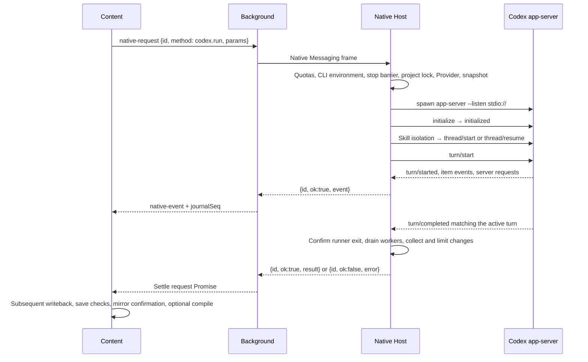

# Native Messaging, Execution, and Process Lifetime

Initial reference product version: `2.5.0`; initial reference source baseline: `2073ae74747431aab8d529803d4e9f8197262388`. Current behavior is maintained against this repository's implementation.
`Current behavior` denotes a traceable source fact; `Target contract` denotes a maintenance objective; `Known gap / Unverified` denotes a specific limitation or missing runtime evidence.
Unless labeled otherwise, implementation descriptions below are `Current behavior`; they do not imply acceptance on every platform.
For browser run state, see [Run State and Recovery](run-state-and-recovery.md); for page writes, see [Auto Editing and Undo](auto-edit-undo.md); for model adaptation, see [Providers and Protocols](providers-and-protocols.md).
Sender admission, the Content and background version-gate sets, and methods currently outside those sets are covered in [Protocols and Trust Boundaries](protocols-and-trust.md). Native business checks and the two browser gate layers are maintained separately.

## 1. Scope and Owners

The Native Host is a local Node process started by the browser. It handles incoming messages, mirror coordination, and agent execution; the Codex app-server is a separate process that it starts.
These two processes also have their own RPC channel. An RPC is comparable to a numbered work order: its number connects a request to its response, while acknowledgment, work completion, and file saving each require separate evidence.

| Boundary | Authoritative entry / symbol | Consumer or lifetime |
| --- | --- | --- |
| Content → extension background | `create/sendNativeTracked` in [nativeChannel.js](../../extension/src/content/nativeChannel.js) | `contentRuntime.sendTrackedCodexRun` binds the extension run and requestId |
| Background → Native Host | `sendNativeRequest/ensurePort` in [background.js](../../extension/src/background.js) | `pending` routes responses; the run journal stores a limited recovery projection |
| Native byte entry | `handleDecodedMessage/writeResponse` in [index.js](../../native-host/src/index.js) | The same stdio channel accepts multiple asynchronous requests |
| CLI discovery and runtime environment | `buildNativeRuntimeEnv/refreshCodexRuntimeEnv` in [nativeEnvironment.js](../../native-host/src/nativeEnvironment.js); [codexRuntimeIdentity.js](../../native-host/src/codexRuntimeIdentity.js) | Discovery at startup and refresh before specific requests; each request retains its own environment snapshot |
| Codex configuration and history directories | `buildCodexHomeEnv/preparePluginCodexHome` in [codexHome.js](../../native-host/src/codexHome.js); [codexHomeScope.js](../../native-host/src/codexHomeScope.js) | The actual app-server uses a stable execution scope; the canonical home retains extension history; both are managed separately from project mirrors |
| Transport envelope | [nativeTransportEnvelope.js](../../native-host/src/nativeTransportEnvelope.js) | Centralizes frame encoding, method quotas, result budgets, and over-limit fallbacks |
| Methods and run control | `handleRequest/handleCodexRun` in [taskRunnerRuntime.js](../../native-host/src/taskRunnerRuntime.js) | Locks, controllers, and active-turn control; [taskRunner.js](../../native-host/src/taskRunner.js) only forwards exports |
| Workspace → agent result | `runCodexSession` in [codexSessionRunner.js](../../native-host/src/codexSessionRunner.js) | Snapshots/mirrors, prompts, worker shutdown, and change collection |
| app-server RPC and termination | `runCodexAppServerProcess` in the same file; [codexSessionTiming.js](../../native-host/src/codexSessionTiming.js) | `pending` is this child process's own RPC table, separate from the background table |
| Transport-disconnect cleanup | `register/abortAllActiveOperations/quarantineActiveOperations` in [nativeRunLifecycle.js](../../native-host/src/nativeRunLifecycle.js) | Run-completion Promises independent of RPC IDs, started PIDs, and quarantine; required by taskRunnerRuntime and called through its re-export by index |
| Independent helper lifecycle | `runOwnedNativeHelper` in [nativeHelperLifecycle.js](../../native-host/src/nativeHelperLifecycle.js) | Includes preparation, execution, and cleanup of external tasks, thread forks, Provider connection tests, and local skill-catalog reads in transport cleanup; helpers stay outside the ordinary run-cancellation index |
| Quarantine for unconfirmed exit | `record/isBlocked/getBlockedProjectCount` in [processStopBarrier.js](../../native-host/src/processStopBarrier.js) | In-memory records and a persistent barrier beside the project mirror; update safe-point checks read the existing barrier count |

At startup, `index` merges paths and discovers the CLI through `buildNativeRuntimeEnv`; after quota checks and before handling `bridge.ping/codex.run/codex.models/codex.thread.fork`, `handleRequest` calls `refreshCodexRuntimeEnv`.
Refresh distinguishes an explicitly pinned path from candidates selected by version and returns the current request's environment snapshot. CLI rediscovery by later requests does not overwrite an existing run's snapshot. `buildCodexRuntimeEvent` supplies evidence of the runtime version and path; the terminal's `codex` path alone cannot identify the actual child process.

Before starting, `runCodexAppServerProcess` and thread forks enable `isolateRuntimeHome` through `buildCodexHomeEnv`. `codexHomeScope` selects a persistent scope from captured configuration, skill-discovery parameters, and source directories. Complete staging is published atomically, and existing skill directories are not rebuilt; workers retain the canonical identity of the original `CODEX_OVERLEAF_CODEX_HOME`.
The scope's session directory links to the extension's canonical history. SQLite retains explicit configuration and existing environment selections, defaulting to the canonical location; scopes persist to support absolute rollout paths. [codexConfigPaths](../../native-host/src/codexConfigPaths.js) preserves the original anchors of known configuration-layer paths, [codexInheritedAuth](../../native-host/src/codexInheritedAuth.js) synchronizes attributable authentication copies, and [codexSkillIsolation](../../native-host/src/codexSkillIsolation.js) consumes per-skill switches. The source-configuration digest and published content use the same captured bytes, so a configuration change cannot cache different content under an old key.
Legacy calls whose explicit user home and plugin home are the same path retain their early return. Local skill-catalog discovery and calls with explicit `enabledCodexLocalSkillIds` derive a separate canonical home before preparing the scope, keeping per-item `skills/config/write` out of the user's source configuration. Extension history and the user's source global history are managed separately; migration boundaries for old authentication copies are covered in [Provider Authentication](providers-and-protocols.md#5-shared-boundaries-of-built-in-and-custom-execution). Directory, path-field, and skill-switch interactions are covered in [Writing Styles and Skills](writing-style-and-skills.md). Resume diagnosis must check the CLI identity, scope, canonical home, and effective SQLite path together.

## 2. The Two RPC Layers



The outer layer uses a four-byte little-endian length prefix followed by UTF-8 JSON, implemented in [nativeMessaging.js](../../native-host/src/nativeMessaging.js); the inner layer uses line-delimited JSON.
The outer `requestId` correlates one extension Native call; the inner numeric `id` correlates one app-server RPC. `threadId/turnId` identify the model thread and turn.
`index.handleDecodedMessage` sends `update.*` to `updateManager` and everything else to the task runner. Message dispatch has no global serialization wait.
Consequently, `codex.steer/cancel` can arrive while `codex.run` is still running; the task runner separately controls project-level mutual exclusion.

Managed Bootstrap migration has an additional startup business barrier: before dispatching ordinary business requests, `index` calls [updateManager.assertBootstrapBusinessAvailable](../../native-host/src/updateManager.js). Ordinary business requests return `update_applying` while the exact `2.5.0 → 2.5.1` migration and its health confirmation remain unsettled, or while switching back to the source Native remains pending. `update.*`, `bridge.ping`, and `codex.cancel` retain their own handling paths, and the read-only `codex.providers.list` in `READ_ONLY_DURING_UPDATE` also passes this Native barrier, though the browser's execution lock still rejects it while that lock is held (see [installation and updates](installation-and-updates.md#compatible-bootstrap-migration-from-250-to-251)). The browser background also holds its own execution lock. Together, these layers prevent new tasks during migration; neither layer is equivalent to the project task lock.

Under the update mutation lock, internal `update.bootstrap` revalidates the original signature, bound authorization, transaction, and target Native identity through [bootstrapUpdate.advanceBootstrapMigration](../../native-host/src/bootstrapUpdate.js), then calls the file transaction in [bootstrapMigration](../../native-host/src/bootstrapMigration.js). The independent [bootstrapUpdateWatchdog](../../native-host/src/bootstrapUpdateWatchdog.js) first completes the transaction token/PID handshake, then monitors the health deadline. Recovery uses the same `recoverBootstrapTransaction()` and cross-process lock, without relying on the Chrome Service Worker remaining alive. The watchdog retries within a finite budget; the original Popup can also wake recovery checks through Native status requests. This requires the target Native recovery code to remain startable. The fixed launcher's entry-existence fallback does not provide automatic repair for arbitrary startup corruption. Signed payloads, rollback order, and verification boundaries are covered in [Installation and Updates](installation-and-updates.md).
If migration recovery has written `rolled_back` but `sourceActivationPending` remains, the watchdog continues source-proof verification, authorization settlement, and pointer restoration. The terminal-state string alone cannot prove that the old Native has taken over. For an ordinary `rolled_back` journal, status recovery first verifies the restored source pair, then revokes only a `bound` or `consumed` authorization whose ID, transaction, source and target all match, and cleans that transaction's staging. An early `applying` interruption can use the current source pair if the previous slot fails verification; both actual runtimes must verify before recovery proceeds. Commit recovery checks `committedEvidence` against the current runtime digests (a migration also rechecks the loaded revision and Bootstrap digests), then settles only an old `bound` authorization, or removes a `consumed` remnant, whose ID, transaction, source and target all match. Changes to these transitions require targeted interruption/recovery checks; real Chrome and physical power loss have separate verification scopes.

### Requests, Streams, and Terminal Results

A stream event has the shape `{id, ok:true, event}`; here, `ok:true` means that an event was delivered, without implying success of the entire turn.
A successful terminal result has the shape `{id, ok:true, result}`; failure has the shape `{id, ok:false, error:{code,message,...}}`.
The background distinguishes events from terminal results using `message.event`. Events enter the journal-write queue before forwarding; terminal results remove `pending` and settle the caller's Promise.
Native `emitCodexEvent` creates `type/title/status/detail/timestamp`; background `appendRunJournalEvent` adds the monotonic recovery sequence number.
`requestId` provides correlation. Source-level `pending.set` and Native run registration do not form a duplicate-execution deduplication protocol.
`Target contract`: a new event must declare its owning run, consumer, maximum payload, and error semantics. “Execute only once” requires additional idempotency and durable evidence.

## 3. codex.run Admission and Result Collection

`handleRequest` first calls the envelope's `getRequestQuotaViolation`, returning `native_request_quota_exceeded` when over quota, before entering a specific method.
`handleCodexRun` first validates the request ID through shared `NativeRequestIdentity.validate`: it accepts finite numbers, including 0, or nonempty strings of 1–160 characters. Missing IDs, empty strings, nonfinite numbers, and other types return `native_request_id_invalid` before project-lock acquisition or execution. It then checks Codex discoverability, emits the runtime-identity event, and creates a controller while holding the project lock. All admitted runs register in the three active cancellation/steer indexes and with `nativeRunLifecycle` for disconnect cleanup before Provider resolution.
`providerRuntime.resolveRunProviderForRun` determines Provider revision, address disclosure, model, and Auto protocol negotiation; see [Providers and Protocols](providers-and-protocols.md).
For ordinary requests without `useExistingMirror`, a full snapshot or focused partial snapshot must pass `hasRunnableProjectSnapshotEvidence`. The `useExistingMirror` path checks freshness separately; focused OT reuse also checks coverage. When overlays are present, they must cover exactly the focused paths, and their content SHA-256 must match the trusted OT-fresh text baseline. Admitted OT overlays serve only as equality evidence and are not written to disk again; a mismatch takes the `mirror_stale` fallback.
Skill installation and style generation have separate entry-point exceptions. Ordinary project-snapshot prerequisites do not apply to every run.

`Known gap / Static parameter boundary`: `handleCodexRun` sets `skipMirrorSync` to true only in the `useExistingMirror` path and otherwise passes params through unchanged. [runCodexSession](../../native-host/src/codexSessionRunner.js) independently skips synchronization based on `skipMirrorSync`.
Thus, an ordinary Native request with `useExistingMirror:false`, `skipMirrorSync:true`, and a full snapshot satisfying admission can use the old mirror without the freshness checks above; the supplied snapshot is not synchronized. Background `sanitizeNativeRequest` strips only compatibility fields and does not remove this parameter.
Ordinary [contentRuntime.js](../../extension/src/content/contentRuntime.js) explicitly sets this field in `runSkillInstallerTask`. This limitation applies to parameter combinations sent directly to Native; whether the ordinary UI can trigger execution against an old mirror requires verification of its parameter-generation path. Snapshot admission and actual snapshot synchronization into the mirror must be assessed separately.

The ordinary project flow in `runCodexSession` is:

1. Synchronize or obtain the mirror; prepare selection boundaries, project skills, attachments, and writing-style context.
2. Generate sandbox/approval parameters from the mode and skill type; create the subagent broker according to the official-skill switch.
3. Build parent `developerInstructions` with `codexPromptAssembly.buildCodexDeveloperInstructions({params})`, and dynamic turn text with `buildCodexTurnPrompt`; append writing-style context and the captured selection in that order. `validatePromptSize` counts the rules and complete turn text, including the fallback separator. Execute the parent task; stop the broker on parent failure, or drain remaining workers after a normal return.
4. Collect mirror changes, then apply selection restrictions, focus restrictions, and subagent blocked paths in that order.
5. Mark the mirror dirty when changes or unsupported items exist. Ask returns empty `syncChanges/unsupportedChanges` and retains an event with the ignored count.
6. Auto prepares binary assets and text diffs/patches, then limits the response budget through `reduceTaskResult`.

For ordinary Ask, `buildCodexSettings` uses `read-only`; Auto uses `workspace-write`; skill installation has a separate `workspace-write` configuration.
`handleServerRequest` handles incoming file/command approval requests and declines other unknown server requests by default. Its allowlist constrains only this approval entry point.
`Known gap / Unverified`: the existence of an allowlist alone cannot prove that every tool execution triggers this approval callback. Real Codex sandbox behavior needs separate verification.
Run results may still include local workspace changes. Filtering and budgets determine the set eligible for writeback; a textual “done” response cannot bypass those sets.

| Completion milestone | Evidence obtained | Work that may still follow |
| --- | --- | --- |
| Matching `turn/completed` | The app-server has emitted the turn's terminal notification | Child-process cleanup, worker shutdown, mirror changes, and response budgeting |
| `runCodexSession` resolves | The production app-server runner has passed stop confirmation; this run's results have been collected and filtered into the return sets | Outer-layer encoding and transport; injected execution substitutes and independent external-agent paths cannot inherit the same process guarantee |
| Native request Promise settles | The background has received a terminal response or connection error | Content writeback, save checks, mirror confirmation, and optional compilation |
| Extension run settlement | Page and postprocessing evidence has been classified | The result may contain partial failures, unknown save status, or later recovery actions |

These milestones have different owners. Changes to “completed” wording or the conditions for starting the next queue item must also consult [WritebackSettlement](../../extension/src/shared/writebackSettlement.js).

## 4. Threads, Turns, Steer, and Activity Events

Each `runCodexAppServerSession` prepares a Provider launch, creates an app-server process, and closes that run's Provider bridge in finally.
With a supplied `threadId`, it calls `thread/resume` and returns `thread_resume_failed` on failure; this path does not silently create a new thread and report a successful resume.
Without one, it calls `thread/start`, then `turn/start` after obtaining the thread. Parent project and skill-installer runs pass stable `developerInstructions` through `buildThreadStartParams/buildThreadResumeParams`; resuming refreshes the rules and UI-language fallback. Broker workers keep their own `buildWorkerPrompt`, while writing-style builds and `/compact` keep their separate input paths without these parent instructions.

`requestThreadWithInstructionsFallback` retries a rejected `thread/start` or `thread/resume` once without `developerInstructions` when `isUnsupportedDeveloperInstructionsError` recognizes a field rejection or a bare JSON-RPC invalid-params response. After that retry succeeds, it prepends the identical rules to the turn text; it does not discard them or create a new thread after a failed resume. Other errors propagate. `startTurnWithSummaryFallback` independently retries `turn/start` for a specific unsupported-reasoning-summary error with summary removed, preserving any prepended rules.
This compatibility retry, background disconnect replay, and Content business recovery have separate entry points and conditions; Section 6 defines the three scopes.

After obtaining the thread and turn, `publishActiveTurnControl` publishes a frozen control only once and emits `codex.turn.bound`; its `steer` calls `turn/steer`.
`handleCodexSteer` finds the active entry by requestId first, falling back to projectKey, and reports `codex_turn_not_ready` if control is not ready.
A supplied threadId or expectedTurnId mismatch returns `codex_turn_mismatch`; empty text and text exceeding 12,000 characters are each rejected.
These expected-identity fields are compared only when supplied. Native therefore cannot be described as rejecting every steer request missing a thread/turn identity.
`Target contract`: callers should pass the expected turn captured at binding time to keep late guidance out of another turn; see browser binding in [activeTurnControl.js](../../extension/src/content/activeTurnControl.js).

`createRunEventScope` in [readProgressGuard.js](../../native-host/src/readProgressGuard.js) filters events from other threads using thread/turn identity and known item ownership.
`accepts` permits compatible events with no identity and no known owner; `owns` requires stronger evidence for the progress guard. These predicates are not interchangeable.
`subagentTelemetry` observes native collaboration events before parent-task processing; subtask messages do not automatically become parent terminal results.
`buildFinalAssistantMessage` preferentially selects the final answer from completed message items, leaving commentary and intermediate fragments in stream events.
Compatibility exception: in a successful turn with no completed items and no explicit phase on any item, it selects the last nonempty delta-only item. Incomplete items with a phase cannot enter this fallback. The implementation is `buildFinalAssistantMessage` in [codexSessionRunner.js](../../native-host/src/codexSessionRunner.js).
`getTurnCompletionError` checks `turn/completed` matching the active turn: only `completed`, or a legacy-compatible missing status, with null/undefined error enters `succeed`. `failed`, non-null/undefined error evidence, and unknown explicit statuses take the `fail` stop-and-reject path. `interrupted` reuses `codex_cancelled`, while the original turn.status remains in the event.
`taskRunnerRuntime.isCancellationError` prioritizes the failure classification for explicit `codex_turn_failed/codex_turn_status_invalid/codex_context_limit`, preventing cancellation words in error text from overwriting protocol facts. Legacy errors without structured code retain the existing fallback. Real Codex terminal frames and cleanup need targeted acceptance when this classification changes.

Context overflow in an accepted `error` or failed `turn/completed` notification uses `isContextLimitError` in [providerContextError.js](../../native-host/src/providerContextError.js). It recognizes the structured Codex/Provider error identity and narrowly matched legacy diagnostics. `runCodexAppServerProcess/getTurnCompletionError` preserves this as `codex_context_limit`; [taskRunnerRuntime.handleCodexRun](../../native-host/src/taskRunnerRuntime.js) passes that code through to Content instead of collapsing it into `codex_run_failed`. Interrupted turns and invalid terminal statuses retain their existing priority. Content uses the stable code for the existing localized failure report and recovery action; this classification does not establish writeback success or authorize replay.

Thread forks use `forkCodexThread` in the independent [codexThreadFork.js](../../native-host/src/codexThreadFork.js), executing `initialize → thread/fork`. The fork request carries only the source thread/turn identities, not a captured locale or skill invocation, so forks inherit the source thread instructions. The next parent run refreshes them through `thread/resume`; the fork helper does not assemble a turn prompt.
This path has its own 30-second timer and pending table, and registers Host-disconnect cleanup through `runOwnedNativeHelper`. Success, failure, and cancellation all wait for bounded `stopCodexAppServer` handling before settling. External `task.run` commands use the same helper lifecycle. Both create their own process groups on POSIX, and stdin write errors also enter the stop path. Helpers do not join the ordinary run-cancellation index, project locks, or persistent stop barriers; ordinary `codex.cancel` does not cancel unrelated helpers.

Provider connection tests register their helper lifecycle through `runProviderConnectionTest` in [codexProviderTest.js](../../native-host/src/codexProviderTest.js) before preparation begins. Cancellation is checked at entry, after `prepareProviderLaunch` returns, and before actual spawn. Prepared bridge/catalog resources close in finally, and the temporary test directory is removed after child-process stop handling finishes. `providerRuntime.testProvider` immediately adopts an already-aborted externalSignal so Auto negotiation cannot miss an earlier abort. Cancellation accepted during preparation prevents later dispatch of the connection-test child process. The Provider entry point still manages independent test cancellation and budgets; see [Providers and Protocols](providers-and-protocols.md).

### Context Telemetry and Compression Events

`runCodexAppServerProcess` forwards accepted app-server notifications in `codex.session.event.detail` with their method and params. The existing background journal/forwarding path retains `thread/tokenUsage/updated`, including the latest response usage and reported model window. Content consumes this report before filtering invisible activity; cumulative `tokenUsage.total` is not the current context estimate. Missing telemetry remains an unsupported observation rather than a synthesized statistic.

Modern compression uses `item/started` and `item/completed` with `params.item.type=contextCompaction`. `inferNotificationStatus` also marks the legacy `thread/compacted` notification completed. The shared `RunActivityModel.contextCompactionState` parser handles both forms for the transcript and UI projection; see [context usage and compact presentation](ui-and-loading.md#context-usage-beside-the-model).

Automatic compaction is owned by Codex, using its effective configuration and history estimates. The catalog's `effective_context_window_percent` controls reported usable capacity; it is not the automatic-compaction threshold, and the panel's display percentages do not configure that threshold. A last-reported usage sample does not measure the next request after new tool output. The runner maps a recognized context-window error to `codex_context_limit` and fails the current ordinary turn. With Codex `0.162.0-alpha.17.2` the CLI also marked usage full and could compact before a later turn; that CLI behavior is version-specific and needs acceptance with the installed CLI. The Chat bridge must emit the recognized Responses failure protocol for this recovery, as described under [protocol conversion](providers-and-protocols.md#61-streaming-buffered-responses-and-tool-calls). This is not a guarantee of immediate retry, successful compression with every Provider, or identical behavior across CLI versions.

Manual `/compact` reuses `codex.run` with `operation: compact`, a nonempty project ID and an existing thread ID. `bridge.ping` advertises optional `capabilities.threadCompact`; content checks this before dispatch so an older Host cannot silently treat the request as an ordinary run. [taskRunnerRuntime.handleCodexRun](../../native-host/src/taskRunnerRuntime.js) retains Provider resolution, project locks, cancellation, background journaling and process-stop barriers. [runCodexSession](../../native-host/src/codexSessionRunner.js) takes an early branch that bypasses document snapshots, mirror synchronization, attachments, ordinary prompt construction and writeback collection.

`runCodexAppServerProcess` reads the thread, verifies its ID and workspace against the captured project mirror, rejects subagent threads and active turns, and resumes that same thread. It then requests `thread/compact/start`. The empty RPC reply is only an acknowledgement; an owned `turn/started` binds identity even when it arrives first, and the matching `turn/completed` passes the usual terminal-error checks before success. `thread/start` is never a compaction fallback. The result identifies `operation: compact`, completed status, original thread and turn, and empty change lists. The control can interrupt but Native rejects steer. CLI versions or Provider configurations that reject compaction remain explicit failures; local protocol probes do not establish real-model support for every Provider.

## 5. Mutual Exclusion, Run Registration, and Exit Evidence

| Mechanism | Current role | Guarantees it cannot establish |
| --- | --- | --- |
| `activeProjectLocks` | `acquireProjectLock/releaseProjectLock` use tokens to prevent an old finally from releasing a new lock | An in-process Map cannot prove mutual exclusion across Native processes |
| `activeRunControllers/activeRunEntries/activeRunByProject` | Every admitted codex.run registers its original typed ID and projectKey, allowing cancel and steer to find numeric 0 | Covers admitted codex.run calls, without registering every local child process; finally still cleans up by the original controller/entry identity |
| `nativeRunLifecycle` | Registers each codex.run and each helper wrapped by nativeHelperLifecycle independently; aborts and awaits completion on disconnect; reported process identities from ordinary runs support persistent quarantine | Separate from the cancel/steer indexes queried by RPC ID; helpers do not register project process identities and do not inherit persistent quarantine across Hosts |
| `processStopBarrier` | Prevents specific entry points from continuing to modify the project while exit is unconfirmed or transport cleanup is in progress | A barrier does not establish that all related operating-system processes have stopped |

`resolveProjectKey` normalizes the project string and falls back to `unknown`. It supplies a lock index and cannot replace account, page, and run identity authentication.
`mirror.sync/patchFiles/confirmWriteback/invalidate` also use the project lock. Queries such as status/scan and the stop barrier below each have their own admission scope.

`handleMirrorConfirmWriteback` passes `expectedFiles` hashes for page-verified text to `mirrorWorkspace.confirmWritebackFiles`. The baseline advances only after the local bytes of every target match the evidence. Missing or mismatching evidence causes rejection and a fallback to a full Content snapshot sync. The project lock coordinates requests in this bridge and cannot exclusively prevent other local processes from writing to disk. Page-content evidence and the lock impose different constraints; see [Mirrors and Save Confirmation](auto-edit-undo.md).
In finally, `handleCodexRun` removes its active indexes and releases its token lock, then calls the lifecycle handle's `complete()` to end the disconnect wait. The handle's `trackProcess` receives valid PID identities for parent tasks, workers, and writing-style execution through the runner's `onProcessStarted`. No process, or no valid PID, creates no unknown barrier. After an abnormal stop, a persistent barrier can independently block the next admission even if the lock has been released.

Browser [nativeChannel.js](../../extension/src/content/nativeChannel.js) usually generates a UUID. Background `sendNativeRequest` uses `resolve` in [nativeRequestIdentity.js](../../extension/src/shared/nativeRequestIdentity.js) to supply or validate the ID; codex.run sent directly to Native uses the same module's `validate` without inventing another request ID. Numeric 0 remains numeric in responses, active indexes, and cancel/steer lookup; string IDs remain strings. This identity constraint does not deduplicate repeated requests; the disconnect lifecycle remains independent of RPC indexes.

### Cancellation Call Chain and Acknowledgment Strength

Browser `contentRuntime.cancelActiveRun` aborts the local run controller and sends Page `cancelActiveWrite`; it concurrently sends Native `codex.cancel` only with the owning run's Native request ID. Before Native dispatch, Stop relies on the local signal. `sendTrackedCodexRun` checks that signal and ownership after its compatibility wait, then sends and records the request ID without another asynchronous gap. [nativeChannel.sendNativeTracked](../../extension/src/content/nativeChannel.js) also records its active request ID before calling the browser transport.
The Page signal interrupts remaining writes; the Native signal targets the agent. Cancellation does not automatically roll back page writes that already completed.
The background uses a dedicated `sendNativeCancel` for `codex.cancel`. It returns `{sent:true,id}` immediately after `postMessage`, without waiting for the Native cancellation response.
When Native `handleCodexCancel` finds a controller, it calls abort and returns `{cancelled:true}`; stopping may still be in progress.
An explicitly supplied request ID that is no longer active returns `{cancelled:false, reason: 'request_not_active'}` without falling back to another run in that project, unless `force:true` explicitly authorizes project recovery. ID-less project cancellation remains a legacy/recovery capability in Native; ordinary Content Stop does not use it. [activeTurnControl](../../test/activeTurnControl.test.js) exercises stale and empty request IDs and the forced recovery exception through the Native dispatcher with controlled process dependencies.
This can be written as \(sent \not\Rightarrow cancelled \not\Rightarrow exited\): evidence on the left of each arrow is insufficient to establish the fact on its right.

Without an active controller, `force:true` removes the in-memory lock only if the project is not blocked by a stop barrier and such a lock exists; it performs no extra OS kill.
A codex.run with a valid ID always registers a project controller. For a still-executing run, force also requests abort, and the lock remains until the original finally finishes. Numeric 0 cannot cause a missing registration that prematurely removes a live lock. Other mirror operations sharing the project lock have independent lifetimes; a lock token prevents an old finally from deleting a new lock but cannot terminate an ongoing operation.

Logs from `forceCancelStuckTaskForCurrentProject` and the existing recovery button in [RunRecoveryActions](../../extension/src/content/runRecoveryActions.js) share `formatForceCancelOutcome`. `sent:true` displays only that the request was sent and release remains unconfirmed. `cancelled:true` means cancellation was accepted and stopping still requires a wait. Only `lockReleased:true` can display that the lock was released. Explicit `cancelled:false` means no matching active task exists; an empty successful response remains unconfirmed; errors still display failure. The normal background channel continues to return sent immediately, with no added flow waiting for a Native acknowledgment. This display cannot prove that a process has exited.
The ordinary sent path still requires checking the original run's terminal result, subsequent admission, and actual process evidence; request acceptance cannot be treated as completed stopping.
For queue continuation, Content retains the outstanding Native response promise independently of local abort. After displaying cancellation, `waitForCancelledNativeRun` waits up to `CANCELLED_NATIVE_SETTLEMENT_TIMEOUT_MS` for that promise to resolve or reject; expiry pauses queued work with the existing Resume action. This waits for the run result, not the immediate cancel-send acknowledgment. Native releases the run's token lock in `handleCodexRun`'s finally before returning the result; unconfirmed process stopping can still leave a separate stop barrier. See [queue continuation](run-state-and-recovery.md#33-cancellation-and-continuation-conditions).

### Bounded Stopping on Success, Failure, and Cancellation

`runCodexAppServerProcess.fail` marks stopping, cleans up observers and timers, rejects unfinished RPCs, and calls `stopCodexAppServer`. Normal `succeed` also marks stopping and cleans up before calling that stop function. When a successful terminal result has arrived, it omits `turn/interrupt`, resolving only after stop confirmation. Unconfirmed stopping rejects the result and follows the existing quarantine path. During stopping, close, abort, or duplicate terminal events cannot settle the run twice.
POSIX children start detached. Failure/cancellation first attempts `turn/interrupt`, then sends SIGTERM to the owned process group and SIGKILL if needed.
Current default waits are defined by function parameters: interrupt 1,500 ms, terminate 500 ms, and force 1,500 ms. These phase budgets cannot directly establish total UI cancellation latency.
POSIX stop confirmation requires observed child exit and a process-group probe returning `ESRCH`. `child.killed` alone or successful signal delivery is insufficient.
Windows uses `taskkill /pid <owned-pid> /t /f`, then checks child exit state. `defaultTaskkill` selects the first nonempty value in `SystemRoot/SYSTEMROOT/windir/WINDIR` order. When it passes the Windows absolute-path check, `System32/taskkill.exe` is appended so Native's reduced PATH cannot omit the system tool; otherwise command lookup remains in use. Path classification does not pre-prove directory or tool existence; launch failure follows the existing stop-error path. Child-exit evidence still determines stop confirmation, and successful command return alone cannot settle it. The implementation lacks a remaining-process-group probe equivalent to POSIX. The retained [shutdown contract](../../test/platform/nativeShutdown.test.js) starts a real Native Host and synthetic external task, checking confirmed stop before Host exit. It exercises one helper entry; Provider tests, forks and arbitrary descendant trees are outside that case.
Unconfirmed stopping throws `codex_process_stop_unconfirmed` with PID, group, and runtime `isStopped`; the runner forwards it to `onStopUnconfirmed`.

`processStopBarrier.record` atomically writes `.codex-stop-barrier.json` beside the mirror. Memory retains the `isStopped` callback; durable data omits functions.
After restart, only same-platform records with a valid PID and a process-group marker can be probed using `kill(-pid,0)`. Unknown records and Windows recovery records remain quarantined.
Parse failure, a non-array top level, oversized data, and non-object elements such as null are treated as unknown records. Unknown records and records without verifiable process identity remain blocking. Every `isBlocked/record` rereads disk, then merges local records that still have callbacks or whose writes previously failed. Another already-running Host can therefore observe new barriers and later removals.
The same Host's `isStopped` callback can clear the barrier after confirmed exit, including runtime confirmation on Windows. Windows recovery remains conservatively quarantined after that callback is lost. Write failure retains the local record and adds `stopBarrierPersistenceError`; transport cleanup records the failure. If disk is unwritable and the process cannot stop, isolation across Hosts or restarts still cannot be guaranteed.
Per-project barrier admission is in `handleRequest`, covering `codex.run/mirror.sync/mirror.patchFiles/mirror.confirmWriteback`.
Updates additionally receive `processStopBarriers` through `getActiveNativeWorkState(env)`. `getBlockedProjectCount()` only observes existing records under the current mirror root and this Host's unsuccessfully persisted records. Unknown or unreadable evidence stays blocking; the function neither rewrites records nor discovers arbitrary OS processes. `update.canApply/apply` and deferred activation use this count alongside existing project-lock and controller checks. The work-state field `activeTurnControls` is not an independent gate condition; see [Update Safe-Point Scope](installation-and-updates.md#6-actual-scope-of-safe-points).
Direct calls to lower-level workspace functions, other methods, thread forks, and external-agent paths do not automatically inherit the per-project persistent check. Helper disconnect cleanup and this quarantine are managed separately.

The retained [nativeShutdown](../../test/platform/nativeShutdown.test.js) platform contract checks that a Host disconnect stops an external helper without cancelling unrelated work; ordinary app-server success settlement and late-write prevention have no dedicated retained contract and need change-specific verification. Real Codex, platform process trees, and all independent execution entry points still require their own acceptance.

## 6. Disconnects, Timing, and Retry Scope

`index.handleNativeDisconnect` handles stdin end/close/error and expected stdout disconnection only once, then prohibits further stdout writes.
After disconnect, `handleDecodedMessage` stops admitting new requests. `index` first calls `quarantineActiveOperations` to write persistent barriers for still-registered valid process identities, then calls `abortAllActiveOperations` and awaits each lifecycle entry's completion Promise. Ordinary project runs check the cancelled signal after Provider preparation and before spawn; process identities reported during shutdown are also quarantined immediately.
Exit retains the existing minimum grace of 1,500 ms. After at most 5,000 ms, persistent quarantine is retried before exit; if persistence still fails at the deadline retry, diagnostics are written and the exit code is nonzero. After normal drain, `complete` can clear temporary barriers supported by stop evidence. The wait set includes `codex.run` and registered independent Provider tests, thread forks, and `task.run` external agents. Helpers unregister only after bounded stop handling and owned-resource cleanup finish. Disconnect during preparation also prevents late process dispatch.
Disconnect protection for ordinary project runs allows either confirmed exit or continued activity under effective quarantine. A helper's unconfirmed-stop error does not automatically create a persistent project barrier, and the Host's existing overall exit deadline still applies. Host exit, the owned process's ability to write, and new-Host barrier admission must be checked separately. Real Codex, complete descendant process trees, Windows, and browser reconnection need independent acceptance; Section 5 describes the limits of failed persistent-barrier writes.

Fatal `uncaughtException` and `unhandledRejection` enter `index.handleFatalError`: admission and stdout stop, `quarantineActiveOperations` publishes project protection before `abortAllActiveOperations` starts owned-process shutdown, and exit is always nonzero. Cleanup is bounded by `FATAL_SHUTDOWN_TIMEOUT_MS`; at its deadline quarantine is retried before exit. A second fatal error during cleanup exits immediately. Expected transport-disconnect exceptions retain the ordinary disconnect path, and a fatal error during that path cannot later exit successfully through its original grace callback. Confirmed stopping still permits lifecycle completion to clear temporary barriers; a fatal event does not permanently block a project after its process is proven gone. Abrupt OS termination and a synchronous event-loop stall cannot run or enforce these handlers.

The app-server absolute timeout can optionally be enabled with `CODEX_OVERLEAF_CODEX_TIMEOUT_MS` and is unset by default; the idle watchdog defaults to 600,000 ms.
Receiving stdout or sending an RPC resets idle time; active broker workers continue resetting it, while workers remain constrained by their own time budgets.
The repeated-read guard in `readProgressGuard` first steers, then triggers the same fail-stop path if lack of progress continues. Active output does not automatically prove task progress.
Provider HTTP idle/total budgets belong to another layer; see [Providers and Protocols](providers-and-protocols.md). They cannot be added to the agent watchdog and described as a unified timeout.

### Three Retry Layers and Business Recovery

| Layer | Actual entry and trigger | Scope of re-execution |
| --- | --- | --- |
| app-server RPC | `requestThreadWithInstructionsFallback` recognizes unsupported developer instructions; `startTurnWithSummaryFallback` recognizes unsupported reasoning summaries | Retry the rejected start/resume once without the field and prepend its rules to the turn; independently retry `turn/start` once without summary. Neither retry replays an accepted turn |
| Background transport | `getNativeRetryClass/canRetryNativeRequest` in [background.js](../../extension/src/background.js) | Reconnect and resend safe requests once according to the table below; silent replay of `codex.run` is prohibited |
| Content business recovery | `runTask/buildCodexRunParams/sendTrackedCodexRun` in [contentRuntime.js](../../extension/src/content/contentRuntime.js) | Rebuild parameters after a known error, then dispatch a new Native request |

When ordinary `runTask` receives `mirror_stale` or `document_identity_mismatch` while using `useExistingMirror`, it reacquires the project snapshot and calls `prepareMirrorStaleRetry` in [otWarmMirror.js](../../extension/src/content/otWarmMirror.js). After successful preparation, it disables mirror reuse, clears overlays and OT warm-start markers, reruns sensitive-data preflight against the new snapshot, and resends using the returned focus restrictions. Snapshot preparation failure or unapproved sensitive-data checks end this path; detection and confirmation scope are covered in [Context and Governance](context-and-governance.md). Native provenance rejection and the separate OT patch error path are described in [snapshot admission](auto-edit-undo.md#3-key-branches-when-a-snapshot-enters-the-mirror).
On `thread_resume_failed`, `showThreadResumeFailedPrompt` presents a choice. Choosing a new thread first clears `codexThreadId` in session memory, saves the empty value if a persistent session record exists, and then resends with an empty thread ID. Other choices record cancellation and return. Persistence errors can also prevent resending; choosing the dialog option does not prove that a new thread has already been created.
Both paths call `sendTrackedCodexRun` again. Before compatibility waiting, it captures the original run handle and AbortSignal. Optional `assertCurrent` rechecks cancellation, ownership, and run account/project after ping returns and before compatibility evaluation or blocking prompts. After the gate returns, another check precedes result consumption and binding of the new requestId. A late success or rejection from the previous run cannot use the next run's reset cancellation flag to reach dispatch or terminal prompts; see [Protocols and Trust Boundaries](protocols-and-trust.md). Background replay prohibition on disconnect and these explicit business branches coexist. Parameter-capture changes must inspect both initial dispatch and both recovery branches.
Style generation separately uses `createRecoveringStyleRunner` in [codexModelRecovery.js](../../native-host/src/codexModelRecovery.js) to select a newer CLI. This policy is limited to isolated style generation, as described in [Writing Styles and Skills](writing-style-and-skills.md), and cannot be generalized to ordinary project tasks.

Current background transport classifications follow. Safe requests permit only one reconnection and cannot retry after a terminal response.

| Method | Classification and action |
| --- | --- |
| `bridge.ping/mirror.status/mirror.scanSensitive` | `safe_read_retry`; requests on a failed port may reconnect once |
| `mirror.sync/mirror.patchFiles/mirror.confirmWriteback/mirror.invalidate` | `safe_sync_retry`; depends on each method's convergence, baseline, and stale conditions |
| `codex.cancel` | `best_effort`; uses a separate send path |
| `codex.run/task.run/task.confirm` and methods not explicitly listed | `no_silent_retry`; disconnect ends with `native_execution_interrupted` |

`codex.models` and Provider queries also fall into the default no-replay classification. An apparently read-only method cannot be assumed to have registered automatic retry.
Background `getNativeRequestTimeoutMs` separately bounds UI-facing waiting: `bridge.ping` uses `NATIVE_PING_TIMEOUT_MS`; only the explicitly listed `mirror.status`, `codex.models`, `skills.list`, `codex.providers.list/upsert/activate/clear-secret/delete`, `writing-style.get/set`, `asset.readChunk` and `update.status/check/canApply` use `NATIVE_REQUEST_TIMEOUT_MS`. The deadline spans the existing safe reconnect attempt rather than restarting on retry. Mirror synchronization, patching, writeback confirmation, invalidation and sensitive scanning receive no background deadline, even when their transport retry class is safe. Execution, steer, cancellation, Provider-test, fork and unlisted methods also receive no background deadline. Timeout classification does not grant replay permission.
`expireNativeRequest` removes the pending request and returns `{ok:false, error:{code: 'native_request_timeout'}}`; [FailureReasons](../../extension/src/shared/failureReasons.js) and [AgentTranscript](../../extension/src/shared/agentTranscript.js) provide localized local-connection guidance. A timed-out ping leaves its port and other requests untouched when that port still carries execution-class work or a mirror write (`safe_sync_retry`). Execution-class work here means `no_silent_retry` requests without a UI deadline, retaining conservative protection for unlisted methods. Only when neither kind of work is pending does ping expiry retire and disconnect its port, reject the other pending requests on that port without replay, and reconnect on a later request. Non-ping timeouts leave the port available. Normal responses, unmatched single-request errors, and disconnection settlement clear their timers. A deadline ends browser waiting, not the Native operation itself; a timed-out configuration mutation may still have completed. The [nativeMessaging contract](../../test/nativeMessaging.test.js) covers UI request settlement, no execution or mirror-preparation/writeback deadline, active-run/mirror-write preservation on ping timeout, idle-port retirement/reconnection and guarded fatal-cleanup ordering with substituted timers/process APIs; actual process exit and Chrome diagnostics require separate evidence.
`Known gap`: `rejectInterruptedNativeRequest` replaces the connection error for every `no_silent_retry` request with the fixed English text "Native host disconnected while an execution request was running…". When Native is not installed at all, read-style callers such as the Software updates check in settings therefore show that text instead of a missing-host message, and it is not localized.
The background selects affected pending requests by nativePort and filters messages newly entering `onMessage` from old ports. An error without an ID can be attributed only when one pending request exists; with multiple pending requests, it is handled as a connection failure.
An event that entered the journal-write wait queue before disconnect may still be forwarded after its write completes; that callback does not recheck port/pending/terminal state. Whether UI run-identity and terminal guards discard it requires checking consumers. Port filtering therefore cannot be described as eliminating every late event.
The run journal supports limited event recovery. `ActiveTurnControl.recoverJournals` does not equate a Native terminal result with completed page writeback; see [Run State and Recovery](run-state-and-recovery.md).
`Target contract`: new methods default to no replay and may enter a safe classification only after their side effects, idempotency conditions, and failure tests are explicit.

<a id="journal-lifecycle"></a>

### Background Reconstruction and Journal Lifetime

Background [background.js](../../extension/src/background.js) manages both in-memory `runJournals/journalWrites` and journals in `chrome.storage.session`; these have different lifetimes.
When the background worker is reconstructed, `pending/runJournals/ownerBindings` start as empty Maps. Non-browser-only owner binding calls `restoreRunJournal(binding)`; `interruptOwnerlessRun` calls it only if no matching live owner remains. The helper reuses a matching in-memory journal or restores one from session storage by requestId; it neither restores a pending Native RPC nor redispatches the original task. An accepted `browserOnly` bind records and acknowledges ownership, then returns before journal restoration or clearing an owner-cancel timer. Its disconnect removes the binding without scheduling Native owner-loss handling.
`journalMatchesBinding` checks request/project and any run/session carried by the binding. New journals also record and check the sender tab/document. Legacy records without sender fields retain the compatibility path using their original request/project and supplied run/session, without fabricating historical identity.
After owner-port disconnect, [ActiveTurnControl.connect](../../extension/src/content/activeTurnControl.js) can reconnect and send the original binding. For a non-browser-only rebind, the restore callback rechecks the current port binding and journal object, then clears the owner-cancel timer and any old `ownerLost`. Non-browser-only owner-loss handling retains a 150 ms grace and rechecks live ownership before restoration and after asynchronous reads and writes. `listRunJournals` waits for in-flight restore reads and write chains, excluding records that still have matching live bindings so observer pages cannot settle them prematurely.
Read failure or identity mismatch does not delete old stored material. Real worker reclamation, reconnection, and page close have their own timing; the existence of stored records cannot prove recovery for every interruption scenario.

`queueJournalStorage` serializes writes and deletions by requestId. `queueJournalWrite` captures a snapshot and checks the in-memory journal object's generation before the actual write. `removeRunJournal`, shared by prune/ack, first invalidates old restore reads and removes the memory record, then queues deletion at the end of the existing write chain, retaining chain registration until completion. Old snapshots not yet executed are skipped after generation invalidation; a deletion at the chain tail cleans up writes already executed. If a new journal with the same ID exists, an old deletion cannot remove the new generation.
On creation and restored owner-loss marking, `pruneInMemoryRunJournals` targets 16 retained in-memory entries and evicts only terminal/ownerLost items. Active journals are not forcibly deleted to meet the count target. `listRunJournals` still returns at most 16 entries. This path does not reclaim all old keys across restarts; the list limit cannot be treated as a total physical-storage cap. Ack still requires Content to have a recovery-save acknowledgment from the primary database; see [Run State and Recovery](run-state-and-recovery.md#51-run-ownership-in-shared-history).

The retained [ActiveTurnControl contract](../../test/activeTurnControl.test.js) checks orphan recovery, unreadable journal inventory, and a record becoming live while inventory is pending. It also runs production [background.js](../../extension/src/background.js) through `vm.runInNewContext`, checks the startup-to-Native request-ID transition, and simulates worker-restart owner loss by releasing the port binding before querying page-owner inventory. Chrome APIs and unrelated background services are substituted; it does not terminate and recreate a Chrome worker or test journal write/eviction scheduling. Real Chrome worker lifecycles and disk quotas require targeted acceptance when those paths change.

## 7. Quotas and Over-Limit Degradation

| Layer | Authoritative symbol | Current meaning |
| --- | --- | --- |
| Node inbound frame/buffer | `MAX_NATIVE_INPUT_MESSAGE_BYTES/MAX_NATIVE_BUFFER_BYTES` in [nativeMessaging.js](../../native-host/src/nativeMessaging.js) | 128 MiB / 160 MiB; describes only local decoder limits |
| Outbound frame | `MAX_NATIVE_OUTPUT_MESSAGE_BYTES` in the same file | 1 MiB, measured as JSON UTF-8 bytes |
| Method data | `NATIVE_REQUEST_QUOTAS/validateNativeRequestQuotas` in [nativeQuotas.js](../../native-host/src/nativeQuotas.js) | Validates projects, attachments, operations, compile logs, and skills separately; unlisted methods do not automatically receive field-level checks |
| Successful result | `NATIVE_OK_RESPONSE_BUDGET_BYTES` in [nativeResponseBudget.js](../../native-host/src/nativeResponseBudget.js) | Reserves 64 KiB for the outer envelope and reduces the writeback-eligible set in advance |

Base64 size is approximately \(4\lceil n/3\rceil\), with JSON and diff/patch overhead in addition. An attachment meeting its raw-size limit does not guarantee that the whole frame fits.
The outbound degradation above also cannot prove that inner app-server stdout without newlines, stderr, or accumulated messages remain bounded. Buffers in `runCodexAppServerProcess` and inputs to `buildFinalAssistantMessage` require separate review and testing.
`reduceTaskResult` first moves the largest inline text changes into `unsupportedChanges`, then handles inline binary data, then reduces assistantMessage, and can finally degrade to an entirely unsupported-result notice.
Reasons include `text_payload_exceeds_native_message_limit` and `native_response_payload_exceeds_native_message_limit`; these items must not be displayed as written back.
The ordinary binary-chunking entry is [nativeAssetTransfer.js](../../native-host/src/nativeAssetTransfer.js). Chunking protocols and inline fallbacks should be maintained separately.
If `encodeOutputFrame` is still over limit, events become bounded `native_event_truncated` details, terminal results become `native_response_too_large` errors, and returned ID length is limited.
`Known gap / Unverified`: field quotas, the Node decoder, browser-platform limits, and generated-result budgets are different constraints. Current values cannot prove that every valid combination is transportable.

`sanitize` in [debugLog.js](../../native-host/src/debugLog.js) truncates fields and compacts some content/files; it is not a general credential detector.
Summary and run-error paths in `index` also record error messages/stacks. The `Target contract` prohibits sensitive credentials in logs, but each new exception path still requires separate review.
`debugLog.logDebug` bounds `native-host.log` with `MAX_DEBUG_LOG_BYTES` (8 MiB), rotating to `native-host.log.1` before an append would cross the cap and replacing the prior rotated file. Existing oversized logs are discarded rather than retained as huge rotated copies. A single serialized record larger than the cap is dropped; after append, oversized active or rotated files caused by concurrent writers are also discarded. Retention is therefore about two caps, with possible transient concurrent-append overshoot and loss of diagnostic records. Rename races and other logging failures remain best-effort and cannot break Native message handling. This is a byte-retention limit, not a credential filter or age policy. The fixed outer launcher's separate `native-host-launcher.log` is outside this runtime rotation; a runtime update cannot replace that launcher.

## 8. Change Dependencies and Retained Verification

The release suite keeps a few observable contracts. Select additional checks only for the boundary being changed; the routes below do not imply permanent coverage of every Native method.

| Change intent | Required dependencies to inspect | Change-driven verification |
| --- | --- | --- |
| New Native method / request identity | Owner, index routing, compatibility, background retry classification, quota, Content consumer | Send a valid request through the changed dispatch path and a mismatched identity; inspect the actual consumer result. |
| CLI selection and Codex home | index environment initialization, pre-request refresh, runtime identity, runner home, skill switches | Start the installed Native with the affected environment and confirm the selected CLI/home without reading unrelated credentials. |
| Stream-event or result shape | Producer, envelope, background journal, Content reducer/timeline | Use the retained framing contract for byte transport; trace changed event fields through the journal and visible result separately. |
| Process cancellation / lack of progress | Runtime controller, runner fail, timing, stop barrier, page cancellation, state projection | Cancel an isolated active operation and verify its own process stops before permitting a rerun or collecting changes. |
| Disconnect / reconnect | Background pending/port, Native disconnect, nativeRunLifecycle/nativeHelperLifecycle, stop barriers, owner/journal recovery | The platform shutdown contract covers one real helper; refresh/rebind and background journal reconstruction require a targeted browser check. |
| Provider connection-test cancellation | providerRuntime externalSignal, codexProviderTest preparation/dispatch checks, helper registration, prepared resources, stop handling | Cancel during the affected preparation or dispatch stage and confirm no late helper or owned resource remains. |
| Mirror or thread business recovery | Both runTask error branches, parameter reconstruction, retry sensitive-data preflight, persisted thread clearing, new-request binding, cancellation/owner checks | Retry the affected error through the original UI and inspect the new request identity, captured context and saved result. |
| Thread/turn/final answer | start/resume parameters, event scope, steer binding, assistant-item completion rules | Run a short Luna turn with the affected frame or steer flow; inspect the final answer and owning turn. |
| Quotas or diff size | Quotas, response budgets, asset chunking, unsupported-item presentation | Check a representative boundary payload and actual receivable frame; use an owned temporary asset for changed chunking. |

Retained automated entries:

- [nativeMessaging.test.js](../../test/nativeMessaging.test.js) checks Unicode framing, fragmented input, malformed/oversized input, and bounded failure output with request identity. It does not call Chrome's Native Messaging implementation.
- [activeTurnControl.test.js](../../test/activeTurnControl.test.js) checks orphan recovery, unavailable inventory and late live ownership using substituted Chrome messages. It does not prove actual background-journal durability.
- [nativeShutdown.test.js](../../test/platform/nativeShutdown.test.js) starts the production Native Host and a real owned synthetic external-task process. It checks that an unrelated cancellation leaves that helper alive and that Host disconnection stops it before Host exit, with no further heartbeat writes. Discovery and log locations are isolated; the helper ignores SIGTERM. The case does not run a model, Provider or complete descendant tree.
- [managedLifecycle.test.js](../../test/platform/managedLifecycle.test.js) exercises installed Native launchers and framed ping/update confirmation. Its scope and simulated registration boundary are described in [Installation and Updates](installation-and-updates.md#11-related-changes-and-verification-entry-points).

```sh
node --test test/nativeMessaging.test.js test/activeTurnControl.test.js
npm run test:platform
```

Ordinary-run terminal frames, stop-barrier restart recovery, Provider/fork preparation cancellation, and direct `skipMirrorSync` combinations have no dedicated retained contract. Use an isolated, change-specific probe when maintaining those paths. A successful framing or helper-shutdown test cannot establish them.

Legacy `task.run → runExternalAgent` in [taskRunnerRuntime.js](../../native-host/src/taskRunnerRuntime.js) keeps its own whole-stdout JSON parsing, stderr events and timeout, but shares `runOwnedNativeHelper` for disconnect ownership and `stopCodexAppServer` for bounded process stopping. Changes to the ordinary runner must explicitly identify whether they cover this path.

## 9. Boundary Scenarios and Verification Points

Verification should trace both callers and actual guards, distinguishing local tests from complete call chains as described in Section 8.

1. **Immediate rerun after cancellation.** Check the background sent acknowledgment, Native cancelled acknowledgment, timing exit evidence, and force-button acknowledgment projection separately. Delivery of a cancellation request does not establish process exit.
2. **Process lifetime after normal turn completion.** Compare `succeed` and `fail` cleanup paths; check stop confirmation, duplicate events while stopping, descendants, and late writes after result return.
3. **Persistent-barrier admission and restart recovery.** Check the four barrier-protected `handleRequest` methods, direct lower-level calls, unknown/Windows records, and write-failure conditions.
4. **Read-only RPC reconnection and duplicate requests.** Check explicit retry classifications, default replay prohibition, and requestId correlation. There is currently no general repeated-request deduplication protocol.
5. **From matching turn/completed to page save.** Check protocol-notification status, runner resolution, change collection, page writeback, saving, mirrors, compilation, and final settlement separately, avoiding projection of one stage's completion as universal success.
6. **Full-snapshot admission and mirror reuse.** Trace synchronization and freshness conditions through both `useExistingMirror` and the independent `skipMirrorSync`; verify ordinary Content-generated parameters and parameter combinations sent directly to Native separately.
7. **Force and project locks.** Check active controllers for valid IDs, finally lock tokens, independent mirror-operation lifetimes, and stop barriers. Preserve the distinction between accepted cancellation and evidence of process stopping.
8. **Resending after errors and cancellation-chain assembly.** Check app-server compatibility retries, background transport retries, and Content business recovery separately. Use Section 8 to identify test entries, replaced dependencies, and missing integration coverage.
9. **Background reconstruction and journal eviction.** Check whether old stored records can acquire ownerLost and whether old write chains recreate records after eviction. Obtain separate evidence for counts and lifetimes of memory registrations, persistent records, and recovery lists; see [Background Reconstruction and Journal Lifetime](#journal-lifecycle).

`Target contract`: verify the affected observable behavior and update this page and the [Feature Map](feature-map.md). Extend a retained permanent contract only for a consequential risk it does not already cover; keep temporary diagnosis probes temporary. Exceptional terminal-protocol combinations, descendant processes remaining after disconnect, barrier restart recovery, and real-browser postprocessing each require independent acceptance.
