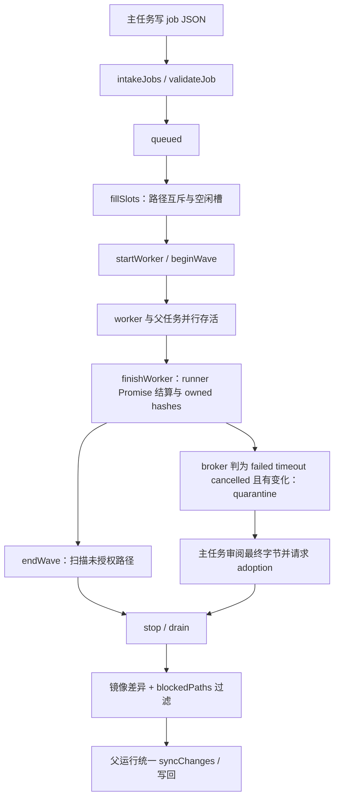

# 并行子代理：调度、文件归属与可见证据

本页解释主任务如何派发 broker worker、处理共享镜像中的文件变化，以及如何展示 Codex 原生子线程。
适用于调整并发数、同文件任务、超时、失败产物接管、子对话或刷新后的子任务状态。

- 适用产品版本：`2.5.0`；产品源码基线：`2073ae74747431aab8d529803d4e9f8197262388`。
- `当前实现` 表示源码中的调用与状态读写；`目标契约` 表示维护约束；`待验证` 表示测试覆盖或运行保证尚有缺口。
- 全局入口见 [架构目录](README.md)、[功能导航](feature-map.md)；最终同步见 [Auto 编辑与 Undo](auto-edit-undo.md)。

## 1. 两条子代理路线

**当前实现。** 项目同时处理文件 broker 派发和 Codex app-server 原生协作遥测。
两者共享子任务 UI，但执行控制、文件归属与身份来源不同。

| 路线 | 执行或观察入口 | 身份与边界 |
|---|---|---|
| 插件 broker worker | [subagentBroker](../../native-host/src/subagentBroker.js) 的 `createSubagentBroker`；runner 注入 `runWorkerTask` | 当前运行的 `job.id`、声明的 `files`、worker thread ID；具有调度、波次检查和输出隔离 |
| Codex 原生子线程 | [subagentTelemetry](../../native-host/src/subagentTelemetry.js) 的 `createNativeSubagentObserver` | 从属于当前父 thread/turn 的子 thread ID；只读观察通知与历史 |
| UI 子记录 | [subagentActivityModel](../../extension/src/shared/subagentActivityModel.js) 的 `ingest/normalize` | 存于所属 `run.subagents`；key 为 `broker:jobId` 或 `codex:threadId` |

原生 observer 不派发任务、不恢复线程、不开始新 turn，也不拥有 broker 的文件许可表。
因此 `source: codex` 子记录的出现，不能用来证明该线程受 `job.files` 调度和隔离规则管理。

## 2. 启动与共享工作空间

**当前实现。** [codexSessionRunner](../../native-host/src/codexSessionRunner.js) 的 `runCodexSession` 在以下条件同时满足时创建 broker：

1. 当前运行为普通项目任务，未进入 skill installer 分支。
2. `loadCodexOverleafSkills` 未关闭。
3. `enabledCodexOverleafSkillIds` 包含 `parallel-subagents`。

技能目录由 [localSkills](../../native-host/src/localSkills.js) 管理，面板打开时的目录预取在 `contentRuntime.primeCodexOverleafSkillsCatalog`。
运行参数与 UI 技能启用读取应同时核对，避免只修改面板列表却未影响实际 gate。

worker 通过 Native Host 创建 sibling runner；父任务和 worker 都传入同一 `mirror.workspacePath`。
worker 使用新的 thread，`session: null`、`threadId: ''`；继承当前运行的 model、reasoning、speed、mode、provider 和写作风格上下文。
`applyWorkerSkillStrip` 在 worker app-server 内禁用 fan-out 技能，限制递归派发。
父任务和 worker 各自运行，broker 定时扫描队列；worker 活跃时父任务 idle watchdog 允许合法等待。

**目标契约。** 每项任务声明完整、互不重叠的语义范围；worker 波次期间主任务只派发、读取和等待，项目文件的整合留到波次结束。
这些约定见随产品分发的 [parallel-subagents 技能](../../native-host/src/skills/parallel-subagents/SKILL.md)。

**当前实现的限制。** 每个 worker 的 `cwd` 指向共享镜像，未为每项 job 创建独立项目副本。
`buildCodexSettings` 按运行模式选择 `read-only` 或 `workspace-write`；`job.files` 通过提示词、调度互斥和事后证据管理。
技能中的文件限制不能直接解释成操作系统对每个 worker 单独设置的路径 ACL。

## 3. job 文件协议与权威状态

**当前实现。** `broker.start` 清除上一轮队列目录，创建新的控制文件和 scratch 区。
未启用 broker 的普通运行也清除陈旧队列，避免模型把旧结果误认为当前任务结果。

```text
.codex-overleaf-subagents/
  broker.json                    握手、限额、activeWorkers、adoptionToken
  jobs/<id>.json                 主任务原子提交的 job
  results/<id>.json              broker 结果与 changedFiles
  results/<id>.last-message.md   完成 worker 的完整收尾文本
  logs/<id>.log                 尽力记录的本地日志
  work/<slice>                 同文件 scatter-gather 临时切片
  adoptions/<id>.json            主任务提交的产物接管请求
  adoption-results/<id>.json     broker 接管判定
```

job 包含 `id`、`task`、非空 `files` 和可选 `title/readOnlyContext`。
`validateJob` 检查 ID、重复任务、数量、路径、路径存在性、任务文本和预算；单个 job 文件上限 32 KiB。
接纳的 job ID 满足 `JOB_ID_PATTERN`：小写字母、数字、连字符，最多 32 字符。
主任务先写临时文件再重命名为 `.json`；`intakeJobs` 忽略 `.tmp-` 和已读文件名。

**已知实现限制。** ID 校验失败后，对于非空字符串 `job.id`，[admitJobFile 与 jobIdOrFallback](../../native-host/src/subagentBroker.js#L167) 仍将原值截断后交给 [writeResult](../../native-host/src/subagentBroker.js#L247) 拼接回执路径，未再次约束为安全文件名。
例如 `id: "../../victim"` 的拒绝回执路径会解析到镜像根的 `victim.json`，可能创建或替换该文件；拒绝任务不等于拒绝回执已被限制在 `results/` 内。
这与下文声明文件的路径别名属于不同入口。[非法 ID 测试](../../test/subagentBroker.test.js#L100) 检查拒绝原因，未检查结果目录外的文件变化；实际文件影响与最终写回尚未验证。

[subagentWorkspacePath](../../native-host/src/subagentWorkspacePath.js) 的 `safeWorkspaceRelativePath` 规范化 workspace 相对路径。
`safeWorkspaceRelativePath` 拒绝直接以队列目录开头的控制路径，`work/` 下切片例外；声明路径须预先存在，通常由主任务先准备切片。
**静态例外。** helper 只移除一次开头 `./`，未消解内部 `.`。`././.codex-overleaf-subagents/broker.json` 的首段仍为 `.`，可避开该目录判断；路径存在性由 `path.join` 解析后检查。完整控制目录隔离不能只凭这个字符串守卫确认，相关 owner 为 [subagentWorkspacePath.js](../../native-host/src/subagentWorkspacePath.js) 与 broker 的 `validateJob`。
`readOnlyContext` 为提供给 worker 的上下文提示，实际读取能力仍受 runner 环境约束。

| 状态 | 权威 owner | 下游投影 |
|---|---|---|
| queued/running、并发槽、计时器 | broker 的 `jobs/queued/running` | `broker.json` 的非实时投影、结果文件、subagent events |
| 波次前像、所有权并集、违规路径 | broker 的 `waveSnapshot/violationPaths` | `getViolationPaths` 与 unsupported changes |
| worker 文件变化证据 | [subagentWorkspace](../../native-host/src/subagentWorkspace.js) 的 `hashPaths/hashWorkspace` | `changedFiles`、wave violation |
| 未完成文件与接管摘要 | broker 的 `quarantined`、`adoptionToken` | adoption result、同步过滤 |
| 原生子线程终态 | observer 的 child/turn 证据 | `source: codex` 事件 |
| 浏览器历史及显示 | `run.subagents`；session storage 归一化 | 子任务列表、只读子对话 |

队列目录每轮重建；历史子对话必须依赖运行记录，不能从下一轮的 `results/` 目录恢复。

**已知实现限制。** [writeBrokerFile](../../native-host/src/subagentBroker.js#L107) 只在 start、beginWave、endWave、close 写出 `activeWorkers`；`beginWave` 在 `running` 为空时执行，[startWorker](../../native-host/src/subagentBroker.js#L288) 的 `running.set` 后没有刷新文件。
正常活动波次中，磁盘 `activeWorkers` 因而仍可显示 0，不能单独作为空闲证据。实际调度与 `processAdoptions` 检查内存 `running`，接管还检查当前 token；此计数缺口不证明接管守卫失效。
[握手测试](../../test/subagentBroker.test.js#L54) 只核对 ready/closed 等字段，未覆盖运行期间的磁盘计数。

## 4. 生命周期、冲突与预算

**当前实现。** 正常路径如下，校验失败的 job 进入 `rejected` 回执路径；回执路径的静态限制见上一节。



`fillSlots` 使用带跳过的 FIFO：选择最早且与当前 running 文件集合无交集的 job。
两个 job 声明相同返回路径字符串时可被接纳，执行被串行化；字符串集合互不相交的其他 job 可继续并行。
当前未统一内部 `.` 别名，`sections/ch1.tex` 与 `sections/./ch1.tex` 可被集合视为不同路径，实际指向同一文件。即 $s_1\ne s_2$ 不能推出 $path(s_1)\ne path(s_2)$；现有同文件测试只使用相同字符串，物理文件互斥还需规范化与别名测试。
同文件真正并行需要主任务先拆成物理切片，worker 修改各自 `work/` 文件，结束后主任务核对边界并整合回正式文件。
[mirrorWorkspace](../../native-host/src/mirrorWorkspace.js) 的扫描排除整个队列目录，scratch 切片本身不会同步到 Overleaf。

默认常量在 `DEFAULT_SUBAGENT_LIMITS`：3 worker、每轮 8 job、worker 10 分钟、broker budget 30 分钟、500 ms 扫描、30 秒 drain grace。
Native 环境变量可调整 worker/broker 时间；范围约束在 `createSubagentBroker` 的 `boundedMs`，测试还可注入 `options.limits`。

admission 的估算为 $w=\lceil(q+r+1)/m\rceil$，检查 $now+wT\le start+B$。
其中 $q,r,m,T,B$ 分别为排队数、运行数、并发上限、worker 时间和 broker 预算。
**静态边界。** 该估算未按同文件冲突调整串行波数，budget 不能直接表述为整次父运行的绝对截止时间。
worker 自有计时器会触发 abort，持续产生输出也不会豁免该计时器。

父 turn 返回后，`stop({drain:true})` 先取消尚未启动项，给活动 worker 一个 grace 窗口，再 abort 剩余项并有界等待。
父异常使用 `drain:false`；父取消会 abort 活动 worker、取消排队项，有 worker 启动过时标记镜像 dirty。
`drained` 表示 broker 收尾路径到达该事件；真实进程停止还依赖 [codexSessionTiming](../../native-host/src/codexSessionTiming.js) 的 `stopCodexAppServer`。
runner 捕获 `codex_process_stop_unconfirmed` 后阻止正常结果继续同步；有界等待本身不证明全部 OS 进程已退出。

## 5. 波次哈希、归属与隔离输出

**当前实现。** 第一项 worker 开始时 `beginWave` 记录项目哈希；直到当前 running 清空才 `endWave`。
期间启动的 job 路径并入 `ownedUnion`；worker 各自在起止时计算声明路径哈希，形成 `changedFiles`。
项目净变化中不属于 `ownedUnion` 的路径成为 violation，嫌疑集合为该波所有 job 加 `parent`。
主任务在 worker 活跃期间修改未分配文件，也会进入这一集合。

波次比较使用 SHA-1 识别内容变化；接管证明使用 SHA-256 校验最终字节。
哈希相当于内容指纹，能够比较前后版本；此处的波次指纹不记录每次写入来自哪个进程。
**静态边界。** `ownedUnion` 内的跨 worker 或父任务越界写入无法仅靠波次末尾扫描准确归因；“先改后恢复”的中间操作也不产生净差异证据。

`finishWorker` 对 broker 判为 failed/timeout/cancelled 且实际改动过的所属文件建立 `quarantined` 记录。
隔离为同步资格标记，文件字节仍可留在共享磁盘；主任务后来修改同路径也不会自动解除隔离。
ownership violation 始终被阻止，不能通过 adoption 获得同步资格。

**已知实现限制。** [startWorker](../../native-host/src/subagentBroker.js#L340) 在 runner resolve 时先以 completed 处理；runner rejection 或成功处理回调中的异常都会进入 catch，再按错误或 abort 原因分类。
[handleMessage](../../native-host/src/codexSessionRunner.js#L976) 收到匹配的 `turn/completed` 后无条件调用 [succeed](../../native-host/src/codexSessionRunner.js#L1082)，后者 resolve，未把协议 `turn.status` 的 failed/interrupted 转为 rejection。
若 worker 已留下部分修改，仅收到这类结束帧且此前没有独立 error 或 abort，broker 可记为 completed，跳过未完成输出隔离；即 $Promise.resolve\not\Rightarrow turn.status=completed$。
[broker 失败测试](../../test/subagentBroker.test.js#L354) 直接注入 reject，[原生子线程终态测试](../../test/subagentTelemetry.test.js#L320) 覆盖 observer 路线；二者不能替代失败结束帧经真实 runner 进入 broker 的组合验证，实际同步后果尚未验证。

**当前实现。** `processAdoptions` 仅在 broker 未关闭、未取消、无活动 worker 且 token 有效时处理请求。
请求须同时具备当前 `token`、`reviewed: true`、原 `jobId`、所属 `path` 和当前最终字节 `sha256`。
`endWave` 在该波 worker runner Promise 已结算、`running` 清空后发布 token，新波次开始会清空 token；接管结果写入 `adoption-results`。
Promise 完成不证明 OS 进程已退出：runner 正常 `succeed` 发 SIGTERM 后即可 resolve。退出证据与可能的迟到写入需另外核对，见[Native 执行](native-execution.md)的成功及停止路径。
`adoptionHash` 还核对真实路径位于 workspace、普通文件及大小上限。
之后字节再次变化会让 `blockedPaths` 重新阻止该文件，须重新审阅并提交新摘要。
`reviewed: true` 是主任务的显式声明；代码不能代替审阅内容质量。

## 6. 哪些结果进入最终写回

**当前实现。** 主任务完成并 drain 后，`runCodexSession` 只做一次镜像差异收集。
选区和 focus 过滤之后，再调用 broker 的 `getViolationPaths`；该名字实际返回违规与未接管隔离路径的并集。
对应变更从 `syncChanges` 移入 `unsupportedChanges`，原因分别为 `subagent_unauthorized_edit`、`subagent_unfinished_output`。
content 的 `applySyncChangesToOverleaf` 展示阻止项；允许项仍经过同一套写回、保存及 Undo 规则。

worker `completed` 只表示 runner Promise 正常返回；受上一节终态映射限制，不能单独证明协议 turn 成功，也无法证明文件已被 Overleaf 接受或保存。
接管成功只解除对应隔离资格，之后仍受选区、focus、文件类型、治理和写回检查约束。
父取消在差异交付前检查 abort；dirty mirror 使后续运行重新评估并重建所需内容。

## 7. 原生遥测、UI 与持久化

**当前实现。** `createNativeSubagentObserver.observe` 从父任务的 `subAgentActivity` 或 `collabAgentToolCall` 注册子线程。
已知子线程通知被消费到独立事件通道，子线程的 error/completed 不结算父任务。
`snapshot` 仅在真实活动通知后请求 `thread/read`；普通读取有 2 秒节流，终态通知可触发补读。
响应核对 thread、parent、turn 和 generation，避免把 fork 继承的父历史或迟到旧 turn 当成子任务新工作。

终态证据优先级为 `history < agent < turn`。
父任务上的“派发完成”或外层 `item/completed` 不能单独证明子任务成功；历史读取不支持时保留 `historyUnavailable`。
`compactEvent` 限定字段、长度并遮盖常见 secret；原始私有 reasoning 和任意请求体不会直接进入子任务展示通道。

**已知实现限制。** [snapshot](../../native-host/src/subagentTelemetry.js#L234) 对仍属当前活动代次的历史请求 rejection 设置 `readDisabled: true`，不区分能力不支持与暂时性读取错误。
此后同一 child 在当前 observer 生命周期内不再补读；新 turn 的重置分支也未清除此值。2 秒节流不构成错误重试，后续 completed 活动通知同样无法恢复补读；实时子线程通知仍可更新记录。
[unsupported history 测试](../../test/subagentTelemetry.test.js#L267) 检查停读与保留记录，未验证暂时性错误后的恢复；真实历史缺失范围仍需集成验证。

[contentRuntime](../../extension/src/content/contentRuntime.js) 的 `appendNativeEvent` 把子事件交给 `SubagentActivityModel.ingest` 后提前返回，防止混入父答案流。
模型按 native journal 序号和子事件 sequence 去重；最多 16 子记录、每项 100 事件，并对事件序列按 48,000 字符阈值裁剪。
该字符阈值属于序列裁剪策略，不应描述成严格的 UTF-8 字节限额。
[sessionState](../../extension/src/shared/sessionState.js) 的归一化和存储裁剪保留 `run.subagents`；所属账号/项目/会话边界见 [运行状态与恢复](run-state-and-recovery.md)。

[subagentActivityView](../../extension/src/content/subagentActivityView.js) 的 `open/close` 展示只读子对话，主视图节点保留并临时 inert。
返回时恢复输入、焦点和滚动；该导航不 resume、interrupt、Accept、Undo 或写回。
`effectiveStatus/elapsedMs` 依据子终态与父运行状态展示 unknown/cancelled 和冻结时钟，不凭父完成伪造子成功。
[renderViewer](../../extension/src/content/subagentActivityView.js#L132) 捕获子对话内容渲染异常，显示局部错误提示，后续更新可重新渲染；该恢复入口不重新请求原生历史。
[子视图异常恢复测试](../../test/subagentActivityView.test.js#L159) 注入渲染失败，检查父运行结算继续、随后更新恢复显示；该测试不覆盖真实浏览器中的视图交互。

## 8. 修改路线与验证定义

专项测试从仓库根目录运行；`--list` 只列出选中的测试。

| 改动 | 主 owner 与必要联动 | 最窄命令 |
|---|---|---|
| 启动 gate、继承、禁递归 | codexSessionRunner、localSkills、技能正文、面板技能目录 | `node scripts/run-tests.mjs test/parallelSubagents.test.js` |
| 并发、同文件串行、预算、取消 | subagentBroker、runner、codexSessionTiming、镜像 dirty | `node scripts/run-tests.mjs test/subagentBroker.test.js` |
| 文件归属、quarantine、adoption | subagentWorkspace、subagentWorkspacePath、broker、最终 syncChanges 过滤 | `node scripts/run-tests.mjs test/subagentBroker.test.js test/parallelSubagents.test.js` |
| 原生发现、历史与终态 | subagentTelemetry、runner eventScope、subagentActivityModel | `node scripts/run-tests.mjs test/subagentTelemetry.test.js` |
| 子对话、刷新历史、计时 | subagentActivityView、subagentActivityModel、sessionState、runActivitySummary | `node scripts/run-tests.mjs test/subagentActivityView.test.js test/subagentTerminalClock.test.js` |

具体定义可直接阅读 [subagentBroker 测试](../../test/subagentBroker.test.js)、[parallelSubagents 测试](../../test/parallelSubagents.test.js)、
[subagentTelemetry 测试](../../test/subagentTelemetry.test.js)、[子对话测试](../../test/subagentActivityView.test.js) 和 [终态计时测试](../../test/subagentTerminalClock.test.js)。
其中部分测试检查源码装配，部分使用注入的假 worker 或 app-server；真实进程、权限及 Chrome 状态需另取运行证据。
拒绝回执目录边界、运行期间 `activeWorkers` 投影、失败结束帧经 runner 到 broker 的隔离，以及暂时性历史错误后的恢复，均不能由上述相近测试名称推定已覆盖；各自最近定义及缺口见对应章节。

## 9. 边界场景与验证要点

1. **worker 活跃期间主任务修改其他文件。** 即使 worker 各自遵守范围，波次内父任务改未分配路径也会触发 violation；把该路径放进其他 job 的 ownedUnion 又会削弱作者归因。检查真实写入者和波次边界，路径哈希无法提供逐进程写入记录。
2. **超时产物经主任务修复后同步。** 磁盘字节变化不会解除 quarantine；broker 要求 running 清空并持有当前 token、reviewed 和最终哈希，随后读取 adoption 结果。OS 退出仍需独立证据。接管后再改一个字节，资格再次失效。
3. **派发项完成后的子任务状态。** `subAgentActivity.kind=completed` 只唤醒历史补读；子 turn 的实际终态可能 failed，历史也可能不可用。检查重复通知、旧 turn 的迟到 completed 与父结束后的时钟冻结。
4. **非法 ID 的拒绝回执。** 拒绝回执仍使用该 ID 拼接路径；检查 `../../victim` 一类输入是否写出 `results/`，并分别核查文件变化与最终同步结果。
5. **磁盘 activeWorkers 为 0 时整合文件。** 该计数没有随每次 worker 启动刷新；核对内存 running、波次与 token，避免把非实时字段当成空闲证明。
6. **worker 失败终态后的部分文件隔离。** 追踪 `turn.status=failed` 结束帧是否引发 runner rejection；缺少独立 error/abort 时，当前成功返回路径仍可令 broker 标为 completed。
7. **历史临时读取失败后的恢复。** 同一 child 的 `readDisabled` 会阻止后续补读；分别检查已保存活动、实时通知与缺失历史，不能由只读视图重新打开推定原生历史重试。

**集成验证范围。** 同文件长队列与 admission 预算的实际时长、忽略 abort 的 worker 与 drain/停止确认的交接、波次内跨所有权路径写入，以及真实 app-server 版本的子线程历史字段均需集成验证。拒绝回执路径、活动计数、协议失败终态与暂时性历史错误应分别覆盖；源码中的限制与真实运行后果须保持区分。
