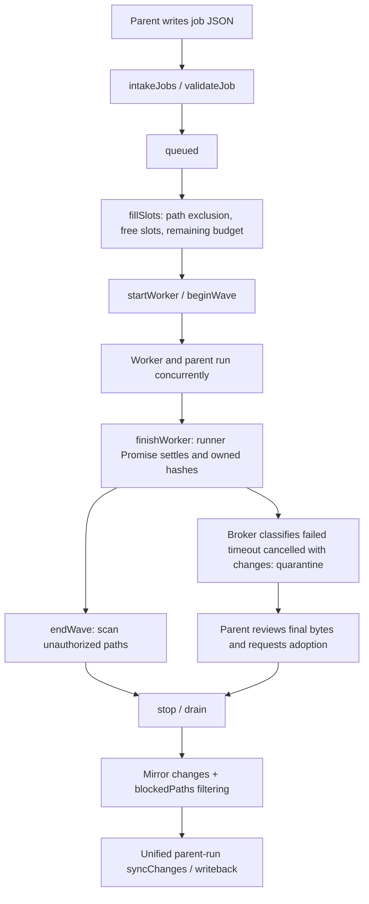

# Parallel Subagents: Scheduling, File Ownership, and Observable Evidence

This page explains how the parent task dispatches broker workers, handles file changes in the shared mirror, and displays native Codex child threads.
It applies to changes in concurrency, tasks targeting the same file, timeouts, adoption of failed-task output, child conversations, and subtask state after refresh.

- Initial reference product version: `2.5.0`; initial reference source baseline: `2073ae74747431aab8d529803d4e9f8197262388`. Current behavior is maintained against this repository's implementation.
- `Current behavior` denotes source-level calls and state reads/writes; `Target contract` denotes a maintenance constraint; `Unverified` denotes a remaining gap in test coverage or runtime guarantees.
- Global entry points are the [Architecture Guide](README.md) and [Feature Map](feature-map.md); final synchronization is covered in [Auto Editing and Undo](auto-edit-undo.md).

## 1. Two Subagent Paths

**Current behavior.** The project handles both file-broker dispatch and native collaboration telemetry from the Codex app-server.
They share the subtask UI, but differ in execution control, file ownership, and identity sources.

| Path | Execution or observation entry | Identity and boundary |
|---|---|---|
| Extension broker worker | `createSubagentBroker` in [subagentBroker](../../native-host/src/subagentBroker.js); the runner injects `runWorkerTask` | The current run's `job.id`, declared `files`, and worker thread ID; includes scheduling, wave checks, and output quarantine |
| Native Codex child thread | `createNativeSubagentObserver` in [subagentTelemetry](../../native-host/src/subagentTelemetry.js) | Child thread ID belonging to the current parent thread/turn; read-only observation of notifications and history |
| UI child record | `ingest/normalize` in [subagentActivityModel](../../extension/src/shared/subagentActivityModel.js) | Stored in the owning `run.subagents`; keyed by `broker:jobId` or `codex:threadId` |

The native observer does not dispatch tasks, resume threads, start turns, or own the broker's file-permission table.
A child record with `source: codex` therefore cannot prove that the thread is governed by `job.files` scheduling and quarantine rules.

## 2. Startup and the Shared Workspace

**Current behavior.** `runCodexSession` in [codexSessionRunner](../../native-host/src/codexSessionRunner.js) creates a broker only when all the following conditions hold:

1. The run is an ordinary project task, outside the skill-installer branch.
2. `buildCodexSettings()` selects `workspace-write`.
3. `loadCodexOverleafSkills` is not disabled.
4. `enabledCodexOverleafSkillIds` includes `parallel-subagents`.

[localSkills](../../native-host/src/localSkills.js) manages the skill catalog; `contentRuntime.primeCodexOverleafSkillsCatalog` prefetches it when the panel opens.
Run parameters and UI reads of enabled skills must be checked together, so a panel-list change also reaches the actual gate.

**Catalog preparation and submission.** [contentRuntime](../../extension/src/content/contentRuntime.js) prefetches the catalog without awaiting it when first constructing the panel. `primeCodexOverleafSkillsCatalog` shares the in-flight Promise between prefetch and submission, directly reusing an existing catalog.
When official skills are enabled for an ordinary task, `runTask` waits for the catalog and generates `enabledCodexOverleafSkillIds` from the enabled map captured at submission, then passes them to the Native gate. Later setting or draft changes during the wait do not redefine that submission; the original project, account, and session guards still check ownership after preparation.
A failed or empty catalog ends submission through the existing startup-error prompt, preserving input and allowing retry without silently dispatching empty IDs. Ordinary tasks with official skills disabled do not wait for the catalog. Queued execution still uses IDs captured at enqueue time and does not fill them from a later catalog. A catalog arriving later cannot retroactively create a broker for a started run.

Workers are sibling runners created by the Native Host; both the parent and workers receive the same `mirror.workspacePath`.
A worker uses a new thread with `session: null` and `threadId: ''`, inheriting the current run's model, reasoning, speed, mode, provider, and writing-style context.
Workers exclude fan-out skills through `disableCodexOverleafSkillIds`. Shared `codexSkillIsolation.applyCodexSkillIsolation` applies this to the actual extension source to restrict recursive dispatch; an independent local source with the same name continues to follow its own local list.
The parent and workers execute independently while the broker polls the queue. The parent's idle watchdog permits legitimate waiting while workers are active.

**Target contract.** Each task declares a complete, nonoverlapping semantic scope. During worker waves, the parent only dispatches, reads, and waits; project-file integration waits until the wave ends.
These conventions are defined in the distributed [parallel-subagents skill](../../native-host/src/skills/parallel-subagents/SKILL.md).

**Current implementation limits.** Every worker's `cwd` points to the shared mirror; there is no separate project copy for each job.
`buildCodexSettings` selects `read-only` or `workspace-write` by run mode. `job.files` is governed through prompts, scheduling mutual exclusion, and post-execution evidence.
Skill-level file restrictions cannot be interpreted as a separate operating-system path ACL for each worker.

**Ask-mode submission boundary.** `buildCodexSettings()` in [codexSessionRunner](../../native-host/src/codexSessionRunner.js) specifies `read-only` and `approvalPolicy: never` for ordinary Ask, so the file broker's writable-policy gate excludes Ask. Ask follows the existing no-broker branch to remove the old queue, preventing the executor from seeing a `ready` left by an earlier Auto run while allowing ordinary read-only execution to continue. The [parallel-subagents skill](../../native-host/src/skills/parallel-subagents/SKILL.md) already requires sequential handling when the handshake is missing or not ready; no Ask write permission or submission entry has been added.
The file queue requires job JSON creation and renaming. **Current behavior.** `buildCodexSettings().sandboxMode` passes `read-only` for ordinary Ask and `workspace-write` for Auto as the thread request's `sandbox`, with `approvalPolicy: never`. **Known gap.** The policy the CLI returns (`sandboxPolicy.type`, spelled `readOnly`/`workspaceWrite` by Codex CLI `0.160.0`) and its filesystem enforcement are version- and platform-specific; that CLI on macOS denied Ask's job-file creation with `EPERM` and allowed Auto's, but the repository does not retain that evidence, so a different CLI or platform needs its own check. Changes to this gate or queue cleanup require targeted verification; real-model feedback for a new build, other CLI/platform behavior, and Chrome presentation need corresponding environment evidence.
The native Codex collab path does not use this file queue and is outside this broker gate; its discovery and state evidence are checked separately in Section 7.

**Skill execution directories and shared history.** [codexHome.buildCodexHomeEnv](../../native-host/src/codexHome.js) enables stable scopes for actual parent tasks, workers, style generation, and forks. [codexHomeScope](../../native-host/src/codexHomeScope.js) derives persistent execution directories from skill switches, enabled/disabled IDs, roles, source directories, and captured configuration.
A new scope is published atomically after complete preparation; published skills are not rebuilt. Another task preparing different configuration cannot delete an active path. Workers inherit this run's `enabledCodexOverleafSkillIds/enabledCodexLocalSkillIds` and exclude fan-out skills. [codexSkillIsolation](../../native-host/src/codexSkillIsolation.js) then checks the actual discovered source and applies per-item selections; a missing list retains legacy inheritance, while explicit `[]` disables the corresponding items. Installers use a separate role, and skills always map to the persistent extension skill root.
Parent and workers retain the original canonical-home identity, share extension session directories, and preserve explicit SQLite configuration and environment precedence; the default data root remains canonical. Scopes persist to retain absolute rollout paths, with no whole-run home lock or new GC. Project-write mutual exclusion still belongs to `taskRunnerRuntime.acquireProjectLock()`. The shared-mirror and OS-permission boundaries for workers remain unchanged.
Skill bodies are still read through source links, so user edits and deletions of source files continue to take effect. Path preservation, configuration discovery, actual model invocation, and history recovery across scopes require separate acceptance; see [Ordinary Skill Installation, Inheritance, and Scopes](writing-style-and-skills.md#ordinary-skill-installation-inheritance-and-scope). Legacy samehome calls still return early; catalog discovery or an explicit local list creates a separate execution root so skill-configuration writes stay within the extension's scope.

## 3. Job-File Protocol and Authoritative State

**Current behavior.** `broker.start` clears the previous run's queue directory and creates fresh control files and a scratch area.
Ordinary runs without a broker also clear stale queues so the model cannot mistake old results for current-task results.

```text
.codex-overleaf-subagents/
  broker.json                    Handshake, limits, activeWorkers, adoptionToken
  jobs/<id>.json                 Job atomically submitted by the parent
  results/<id>.json              Broker result and changedFiles
  results/<id>.last-message.md   Complete final text from a finished worker
  logs/<id>.log                 Best-effort local log
  work/<slice>                 Temporary slices for same-file scatter-gather
  adoptions/<id>.json            Parent request to adopt output
  adoption-results/<id>.json     Broker adoption decision
```

A job contains `id`, `task`, nonempty `files`, and optional `title/readOnlyContext`.
`validateJob` checks ID, duplicate jobs, count, paths, path existence, task text, and budget. A single job file is limited to 32 KiB.
Accepted job IDs match `JOB_ID_PATTERN`: lowercase letters, digits, and hyphens, up to 32 characters.
The parent first writes a temporary file, then renames it to `.json`; `intakeJobs` ignores `.tmp-` and previously read filenames.

**Rejected-receipt identity rules.** [subagentBroker.jobIdOrFallback](../../native-host/src/subagentBroker.js) reuses the original ID only if it matches `JOB_ID_PATTERN`. An invalid or missing ID falls back to a valid queue filename, without truncating and continuing to use the original value. If the filename is also invalid, `idFromFileName` generates a pattern-compliant random `rejected-` identifier.
`writeResult` rechecks the same pattern before constructing a path, preventing an invalid identifier from entering a filename through rejection handling. Success, failure, cancellation, and ordinary rejection of a valid job keep the original ID; JSON receipts and events use the selected safe identifier.
This constraint governs identifier-to-filename conversion. Filesystem identity, such as symlinks in declared files, and shared-directory permissions retain separate boundaries.

`safeWorkspaceRelativePath` in [subagentWorkspacePath](../../native-host/src/subagentWorkspacePath.js) normalizes workspace-relative paths.
It first rejects absolute paths, empty segments, and `..`, then removes `.` segments. Control-directory checks, existence checks, scheduling, prompts, and hashing use the same normalized path. Thus, `././.codex-overleaf-subagents/broker.json` is still recognized as a control file that cannot be declared.
Normalized `work/` slices retain their exception. Declared paths must already exist, typically after the parent prepares slices. This string-identity rule does not establish isolation for symlinks, hard links, or per-worker OS permissions.
`readOnlyContext` is a context hint supplied to a worker; actual read capability remains constrained by the runner environment.

| State | Authoritative owner | Downstream projection |
|---|---|---|
| queued/running, concurrency slots, timers | Broker `jobs/queued/running` | `broker.json`, result files, and subagent events written after state changes |
| Pre-wave snapshot, ownership union, violation paths | Broker `waveSnapshot/violationPaths` | `getViolationPaths` and unsupported changes |
| Worker file-change evidence | `hashPaths/hashWorkspace` in [subagentWorkspace](../../native-host/src/subagentWorkspace.js) | `changedFiles`, wave violations |
| Unfinished files and adoption digests | Broker `quarantined`, `adoptionToken` | Adoption results, synchronization filtering |
| Native child-thread terminal status | Observer child/turn evidence | `source: codex` events |
| Browser history and presentation | `run.subagents`; normalization for session persistence | Subtask list, read-only child conversations |

The queue directory is rebuilt every run. Historical child conversations must rely on run records and cannot be recovered from the next run's `results/` directory.

**Active counts and adoption evidence.** [startWorker](../../native-host/src/subagentBroker.js) calls `writeBrokerFile` after `running.set`; it refreshes again after a settled worker Promise removes its registration, with the final item also publishing the token generated by `endWave`. Late settlement after close still updates the count and retains `closed` state. Write failures are reported and cleaned up through the existing broker I/O error path.
`activeWorkers` is the broker registration count and cannot alone prove that every OS process has exited. Actual scheduling and `processAdoptions` inspect in-memory `running`; adoption also requires the current nonempty token.

## 4. Lifecycle, Conflicts, and Budgets

**Current behavior.** The normal path follows. Jobs failing validation enter the `rejected` receipt path; queued items must still fit the remaining budget immediately before startup. Rejected receipts keep using the same safe-identifier rules.



`fillSlots` uses FIFO with skipping: it selects the earliest job whose files do not intersect the currently running file set.
Two jobs declaring the same normalized path can be admitted, but their execution is serialized. Other jobs with disjoint file sets can continue in parallel.
`sections/ch1.tex` and `sections/./ch1.tex` become the same identity before admission. Different path strings cannot establish distinct physical files. Current dot-segment rules normalize these literal aliases; complete filesystem-permission isolation retains the limits described in Section 2.
True parallel work on one file requires the parent to create physical slices first. Workers modify their own `work/` files, then the parent checks boundaries and integrates them into the real file after completion.
[mirrorWorkspace](../../native-host/src/mirrorWorkspace.js) excludes the entire queue directory from scanning; scratch slices themselves are never synchronized to Overleaf.

Defaults are in `DEFAULT_SUBAGENT_LIMITS`: 3 workers, 8 jobs per run, 10 minutes per worker, a 30-minute broker budget, 500 ms polling, and a 30-second drain grace.
Native environment variables can adjust worker/broker durations; `boundedMs` in `createSubagentBroker` constrains the range, and callers can additionally inject `options.limits`.

Admission calls [subagentAdmission.estimateWorkerWaves](../../native-host/src/subagentAdmission.js), using the currently running file sets, queue order, new job's file set, and concurrency limit $m$ to project waves $w$, then checking $now+wT\le start+B$.
Here, $T,B$ are the per-worker duration and broker budget, respectively. The projection uses FIFO-skip to choose nonconflicting file sets for each wave, reserving a full $T$ per wave. Same-file tasks require serial waves, while conflict-free tasks preserve parallel capacity.
A synchronous wave projection cannot be a strict worst-case total duration for arbitrary asynchronous completion order. Therefore, `fillSlots` rechecks $now+T\le start+B$ before actual dispatch. If a queued item no longer fits its original worker budget, it returns the existing `rejected/insufficient_time` receipt without starting a worker.
This budget constrains worker admission. The parent turn, drain, and OS stopping retain their own timing; the budget is not an absolute deadline for the entire parent run.
A worker's own timer triggers abort; continuous output does not exempt it from that timer.

During normal cleanup after the parent turn returns, `stop({drain:true})` first cancels items that have not started, gives active workers a grace window, then aborts remaining items and waits within a bound.
Parent failure uses `drain:false`. Parent cancellation aborts active workers, cancels queued items, and marks the mirror dirty if any worker has started.
`drained` means that the broker cleanup path reached that event; real process stopping also depends on `stopCodexAppServer` in [codexSessionTiming](../../native-host/src/codexSessionTiming.js).
When the runner catches `codex_process_stop_unconfirmed`, it prevents normal results from continuing into synchronization. A bounded wait alone cannot prove that all OS processes have exited.

**Receipt failures and cleanup.** [subagentBroker](../../native-host/src/subagentBroker.js) calls `recordFailure` for persistent receipt errors on natural worker completion, queued-cancellation receipts, and stop-cleanup errors. It stops admitting jobs, emits failure events, and retains `subagent_io_failed`. A single completion-receipt failure can still write a fallback failed receipt. Repeated failures are explicitly consumed by the Promise chain, with errors also handled in finally, rather than reaching the Native index global unhandled-rejection entry.
`stop` saves the shared cleanup Promise before side effects, so repeated calls, synchronous event reentry, and parent cancellation reuse one cleanup. A queued-receipt failure does not skip worker abort, bounded waiting, or close. After cleanup, the error continues to propagate to the caller, and later stop calls cannot turn an existing error into success. Telemetry-callback exceptions do not block cleanup; a failed dirty callback during parent cancellation is retained and reported.
[runCodexSession](../../native-host/src/codexSessionRunner.js) awaits stop on parent success and failure, so this error blocks normal writeback-result delivery. [taskRunnerRuntime](../../native-host/src/taskRunnerRuntime.js) subsequently releases run registrations and project locks. While the parent is still executing, the broker immediately stops admission and emits events but does not additionally interrupt the parent Codex. The error propagates when the parent later calls stop.
Workers still active after the bounded stop wait have their declared paths quarantined. Late resolution after abort from stop/parent cancellation is classified as cancelled; an expired worker deadline remains a timeout. Neither can regain completed-output synchronization eligibility. Worker deadlines can remain active. Bounded waiting and path quarantine do not establish OS process exit; later disk activity needs separate process evidence.
After synchronous `startWorker` launch failure, a failed fallback-receipt write in `fillSlots` still uses the existing best-effort handling; these guarantees do not establish unified cleanup for every broker I/O branch.

## 5. Wave Hashes, Ownership, and Quarantined Output

**Current behavior.** `beginWave` records project hashes when the first worker starts; `endWave` waits until current `running` is empty.
Paths for jobs started during the wave join `ownedUnion`. Each worker hashes its declared paths at start and finish to produce `changedFiles`.
Paths with net project changes outside `ownedUnion` become violations, with every job in the wave plus `parent` included as possible authors.
If the parent changes unassigned files while workers are active, it also enters this set.

Wave comparisons use SHA-1 to identify content changes; adoption evidence uses SHA-256 to verify final bytes.
A hash acts as a content fingerprint for comparing versions; these wave fingerprints do not record which process made each write.
**Static boundary.** A scan at the end of a wave cannot precisely attribute cross-worker or parent out-of-scope writes inside `ownedUnion`. Intermediate edits that are later restored also produce no net-change evidence.

`finishWorker` creates `quarantined` records for owned files that actually changed when the broker classifies the worker as failed/timeout/cancelled.
Quarantine marks synchronization eligibility; file bytes can remain on shared disk. A later parent edit to the same path does not automatically clear quarantine. Declared paths of workers still unsettled after the bounded stop wait are also quarantined directly.
Ownership violations are always blocked and cannot obtain synchronization eligibility through adoption.

**Worker terminal status and output quarantine.** [startWorker](../../native-host/src/subagentBroker.js) eventually records completed when the runner resolves without abort and completion handling succeeds; receipt errors can still change this to failed. The real runner's `getTurnCompletionError` rejects failed/interrupted turns, unknown explicit statuses, and error evidence, while preserving compatibility with old successful notifications that lack status and have no error.
The broker classifies timeout, abort or `codex_cancelled`, and ordinary failure. Changed files from failed/timeout/cancelled workers enter unfinished-output quarantine; a separate error notification is unnecessary to recognize a failed terminal state.
Receipt-error propagation timing, process-exit evidence after ordinary success, and the native observer retain their own boundaries. Correct terminal classification cannot replace these checks.

**Current behavior.** `processAdoptions` handles requests only while the broker is open, uncancelled, without active workers, and holding a valid token.
A request must contain the current `token`, `reviewed: true`, and a nonempty `files` array; each item supplies the original `jobId`, the owned `path`, and the current final bytes' `sha256`.
`endWave` publishes a token after that wave's worker runner Promises settle and `running` becomes empty, only while the broker is open, uncancelled, and still accepting jobs (`!closed && !cancelled && accepting`). Starting a new wave clears the token; adoption results are written to `adoption-results`.
Normal `succeed` in the production app-server runner resolves only after `stopCodexAppServer` confirms stopping. Unconfirmed stopping rejects the result and records a stop barrier. The broker's bounded wait, custom execution substitutes, and independent execution entries still cannot alone prove OS process exit; see the success and stop paths in [Native Execution](native-execution.md) for process evidence and platform limits.
`adoptionHash` also checks that the real path lies within the workspace, is a regular file, and meets the size limit.
Any subsequent byte change causes `blockedPaths` to block that file again, requiring a new review and digest submission.
`reviewed: true` is the parent's explicit assertion; code cannot assess the quality of the content review on its behalf.

## 6. Results Eligible for Final Writeback

**Current behavior.** After parent completion and drain, `runCodexSession` collects mirror changes only once.
After selection and focus filtering, it calls the broker's `getViolationPaths`; despite its name, this returns the union of violation paths and quarantined paths that have not been adopted.
Corresponding changes move from `syncChanges` to `unsupportedChanges`, with reasons `subagent_unauthorized_edit` and `subagent_unfinished_output`, respectively.
Content `applySyncChangesToOverleaf` displays blocked items; allowed items still pass through the same writeback, save, and Undo rules.

Worker `completed` means the runner Promise returned normally. The real runner requires completed, or a legacy missing status, with null/undefined error. Receiving an app-server `turn/completed` notification alone still cannot prove child-process exit, and worker completion does not prove that Overleaf accepted and saved the files.
Successful adoption only clears the corresponding quarantine restriction; selection, focus, file-type, governance, and writeback checks still apply afterward.
Parent cancellation checks abort before delivering changes. A dirty mirror causes later runs to reassess and rebuild the required content.

## 7. Native Telemetry, UI, and Persistence

**Current behavior.** `createNativeSubagentObserver.observe` registers child threads from the parent's `subAgentActivity` or `collabAgentToolCall`.
Known child-thread notifications are consumed through a separate event channel; child error/completed notifications do not settle the parent.
`snapshot` requests `thread/read` only after an actual activity notification. Ordinary reads are throttled to once every 2 seconds; terminal notifications can trigger an additional read.
Responses check thread, parent, turn, and generation, preventing inherited parent history from a fork or a late old turn from appearing as new child work.

Terminal-evidence priority is `history < agent < turn`.
“Dispatch completed” on the parent or an outer `item/completed` cannot alone prove child success; unsupported history reads retain `historyUnavailable`.
`compactEvent` limits fields and lengths, and `metadataText` continues to handle local paths in metadata. `publicText` does not replace child prompts, answers, or tool outputs based on secret-like patterns. Raw private reasoning and arbitrary request bodies do not directly enter the child-display channel.

**History errors and recovery.** [subagentTelemetry.snapshot](../../native-host/src/subagentTelemetry.js) sets `readDisabled` for explicit `-32601` or unsupported `thread/read` errors, retaining this degraded state within the same observer. Other errors mark history temporarily unavailable and allow later actual activity to trigger another read. Consecutive failures reaching `MAX_HISTORY_READ_FAILURES` (currently 3) pause further reads for that child's current generation. A valid successful read or a new child turn clears the consecutive-failure count; a new turn does not lift explicit unsupported disabling.
`runCodexAppServerProcess` preserves numeric/string JSON-RPC error.code classification. Only successful history reads passing thread, parent, turn, and generation checks publish `historyUnavailable: false`. A late error from an old generation does not disable the new generation. No timer polling, unlimited retry, or execution control is added; live child-thread notifications continue updating records independently.
Actual CLI transient errors and the availability of complete child history depend on the running CLI and service.

`appendNativeEvent` in [contentRuntime](../../extension/src/content/contentRuntime.js) sends child events to `SubagentActivityModel.ingest` and returns early, preventing them from entering the parent-answer stream.
The model deduplicates by native journal sequence number and child-event sequence. It retains at most 16 child records and 100 events per child, trimming event sequences at a 48,000-character threshold.
`SubagentActivityModel.ingest` updates `historyUnavailable` using an explicit boolean, allowing successful recovery to clear the warning. Legacy events missing the field leave the existing value unchanged; normalization and persistence retain the updated value.
This character threshold is a sequence-trimming policy and must not be described as a strict UTF-8 byte cap.
Normalization and storage trimming in [sessionState](../../extension/src/shared/sessionState.js) retain `run.subagents`; owning account/project/session boundaries are covered in [Run State and Recovery](run-state-and-recovery.md).
**Known gap.** Journal replay after a reload does not call `SubagentActivityModel.ingest`: `ActiveTurnControl.mapRecoveredEvent` maps child notifications into parent activity events, so child-conversation updates missing from the last saved `run.subagents` are not reconstructed, while replay still advances the run's event sequence and acknowledges the journal.

`open/close` in [subagentActivityView](../../extension/src/content/subagentActivityView.js) displays read-only child conversations, retaining main-view nodes and temporarily making them inert. The header has a Back button with a chevron and a lock-marked Read only label (PanelIcons through the `glyph` dependency from RunActivitySummary); sibling buttons form a segmented control whose `data-state` drives a status dot, the child meta line carries the same dot, and the parent line hides its active-subagent count when it is zero.
Returning restores input, focus, and scrolling. This navigation does not resume, interrupt, Accept, Undo, or write back.
`effectiveStatus/elapsedMs` uses child terminal state and parent-run state to display unknown/cancelled and freeze the clock, without inferring child success from parent completion.
[renderViewer](../../extension/src/content/subagentActivityView.js) catches child-conversation content-rendering exceptions, displays a local error notice, and allows later updates to render again. This recovery entry does not request native history again.

## 8. Change Routes and Verification Definitions

The small release suite has no dedicated broker or child-history contract. A passing core suite does not establish these behaviors. When changing this domain, choose a short scenario that exercises the affected owner and its actual consumer; the following routes are maintenance guidance, not a mandatory release checklist.

| Change | Primary owner and required dependencies | Change-driven verification |
|---|---|---|
| Startup, catalog and Ask gate | codexSessionRunner, localSkills, contentRuntime, RunController, skill body | Delay catalog preparation and inspect the dispatched skill IDs; compare ordinary Ask with Auto and a stale queue. |
| Skill scopes and inheritance | codexHome/Scope, codexSkillIsolation, runner, canonical history and installer mapping | Keep one execution active while preparing a different scope; confirm its paths and history remain available. |
| Scheduling, cancellation and receipts | subagentBroker, subagentAdmission, subagentWorkspace, timing, taskRunnerRuntime | In an isolated mirror, submit two same-file jobs and one disjoint job; observe dispatch, cancellation, receipt identity and final eligible bytes. |
| File ownership, quarantine and adoption | subagentWorkspace, subagentWorkspacePath, broker, final syncChanges filtering | Make a failed worker change a declared file; verify it remains excluded until a current-token adoption of its exact bytes. |
| Native child discovery and terminal status | subagentTelemetry, runner eventScope/getTurnCompletionError, subagentActivityModel | Inspect real child events and history belonging to one parent turn; distinguish missing history from completed work. |
| Child conversation display and persistence | subagentActivityView, subagentActivityModel, sessionState, runActivitySummary | Open and close a child view, refresh, and check that parent input and child history remain usable. |

Use Luna for real-model checks. A temporary controlled worker or failure probe can help diagnose a changed boundary, but it does not automatically become a permanent test. Shared mirror permissions, real process exit and remote writeback each need their own evidence when they are part of the change.

## 9. Boundary Scenarios and Verification Points

1. **The parent changes other files while workers are active.** Even if every worker respects its scope, parent edits to unassigned paths within the wave trigger violations. Adding that path to another job's ownedUnion weakens authorship attribution. Check actual writers and wave boundaries; path hashes cannot supply per-process write records.
2. **The parent repairs timed-out output before synchronization.** Changed disk bytes do not clear quarantine. The broker requires empty running state plus the current token, reviewed flag, and final hash; then the adoption result must be read. OS exit still requires independent evidence. Changing even one byte after adoption invalidates eligibility again.
3. **Child-task state after a dispatch item completes.** `subAgentActivity.kind=completed` only wakes an additional history read; the child turn's actual terminal state may be failed, and history may be unavailable. Check duplicate notifications, late completed notifications from old turns, and clock freezing after parent completion.
4. **Rejected receipts for invalid IDs.** Check fallback to a valid queue filename, generated identifiers for invalid filenames, and final writer validation. Errors must remain discoverable and destinations must stay in `results/`; retain lookup by original ID for every terminal state of valid jobs.
5. **Integrating files when on-disk activeWorkers is 0.** The count refreshes as registrations change, but the wave and current token still need checking. Actual adoption continues to inspect in-memory running. A nonzero count after close means workers remain unsettled; closed cannot be used as OS-exit evidence.
6. **Quarantining changed files after a worker ends in failure.** Cover failed/interrupted completion frames without separate error/abort notifications, contradictory error evidence, and unknown statuses. Check runner rejection, stop handling, broker quarantine, and change filtering while preserving legacy successful notifications without status.
7. **Recovery after temporary history-read failure.** Check retries driven by actual activity, consecutive-failure budgets, reset on success and new turns, and persistent degradation for unsupported operations. The frontend warning should clear after recovery. Reopening a read-only view does not retry native history; old-generation errors must not affect a new generation.
8. **Preparing another scope while workers are active.** Prepare scopes with different project/style switches and check that paths already discovered by the parent and workers remain readable, while concurrent installers still write to the persistent root. Concurrent first preparation with the same configuration must publish only complete directories. Also check source-configuration changes and history read/resume/fork across scopes; path evidence cannot replace actual-consumer verification.
9. **Submitting before catalog prefetch returns.** Start with an empty catalog and delay `skills.list`; check that dispatch waits and shares the same request. Change the enabled map or draft while waiting and confirm that original submission configuration remains intact. Separately cover retry through the original entry after failure, disabled skills, cached catalogs, and existing queued IDs so an unknown catalog cannot become silent disabling.
10. **Ask and an old ready state.** Start Ask with a queue left by the previous Auto run. Check pre-execution cleanup, preserved read-only/never, and continued ordinary results and native collab. Auto should continue creating ready state and dispatching. Obtain separate evidence for platform/CLI permissions and real-model feedback.
11. **Receipt errors and stop reentry.** Inject natural-completion and queued-cancellation receipt failures separately; check retained errors, abort/close, reentry counts, and outer registrations. Check output quarantine for workers ignoring abort or resolving late. A returned stop call or released lock cannot establish OS process exit.

**Integration-verification scope.** The retained release contracts do not cover broker scheduling or dispatch-budget combinations. Actual long-task durations, the handoff between abort-ignoring workers and drain/stop confirmation, cross-ownership writes during a wave, and child-thread history fields in real app-server versions still require corresponding environment verification. Rejected-receipt paths, active counts, failed protocol terminal states, and transient history errors should each be covered separately. Source-level limitations and real runtime consequences must remain distinct.
