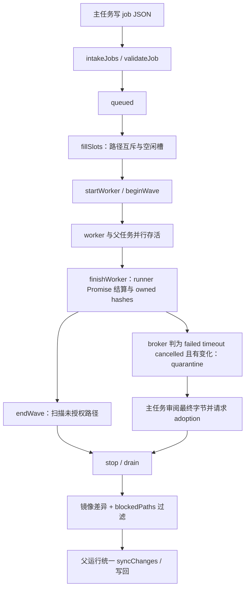

# 并行子代理：调度、文件归属与可见证据

本页解释主任务如何派发 broker worker、处理共享镜像中的文件变化，以及如何展示 Codex 原生子线程。
适用于调整并发数、同文件任务、超时、失败产物接管、子对话或刷新后的子任务状态。

- 初始参考产品版本：`2.5.0`；初始源码基线：`2073ae74747431aab8d529803d4e9f8197262388`。当前行为随本仓库实现维护。
- `当前实现` 表示源码中的调用与状态读写；`目标契约` 表示维护约束；`待验证` 表示测试覆盖或运行保证尚有缺口。
- 全局入口见 [架构目录](README.md)、[功能导航](feature-map.md)；最终同步见 [Auto 编辑与 Undo](auto-edit-undo.md)。

## 1. 两条子代理路线

**当前实现。** 项目同时处理文件 broker 派发和 Codex app-server 原生协作遥测。
两者共享子任务 UI，但执行控制、文件归属与身份来源不同。

| 路线 | 执行或观察入口 | 身份与边界 |
|---|---|---|
| 插件 broker worker | [subagentBroker](../../native-host/src/subagentBroker.js) 的 `createSubagentBroker`；runner 注入 `runWorkerTask` | 当前运行的 `job.id`、声明的 `files`、worker thread ID；具有调度、波次检查和输出隔离 |
| Codex 原生子线程 | [subagentTelemetry](../../native-host/src/subagentTelemetry.js) 的 `createNativeSubagentObserver` | 从属于当前父 thread/turn 的子 thread ID；只读观察通知与历史 |
| UI 子记录 | [subagentActivityModel](../../extension/src/shared/subagentActivityModel.js) 的 `ingest/normalize` | 存于所属 `run.subagents`；key 为 `broker:jobId` 或 `codex:threadId` |

原生 observer 不派发任务、不恢复线程、不开始新 turn，也不拥有 broker 的文件许可表。
因此 `source: codex` 子记录的出现，不能用来证明该线程受 `job.files` 调度和隔离规则管理。

## 2. 启动与共享工作空间

**当前实现。** [codexSessionRunner](../../native-host/src/codexSessionRunner.js) 的 `runCodexSession` 在以下条件同时满足时创建 broker：

1. 当前运行为普通项目任务，未进入 skill installer 分支。
2. `loadCodexOverleafSkills` 未关闭。
3. `enabledCodexOverleafSkillIds` 包含 `parallel-subagents`。

技能目录由 [localSkills](../../native-host/src/localSkills.js) 管理，面板打开时的目录预取在 `contentRuntime.primeCodexOverleafSkillsCatalog`。
运行参数与 UI 技能启用读取应同时核对，避免只修改面板列表却未影响实际 gate。

**首次目录预取的时序边界。** [contentRuntime](../../extension/src/content/contentRuntime.js) 在首次构建面板时以 fire-and-forget 方式启动预取，任务提交不等待该 Promise。
若 `state.codexOverleafSkills` 仍为空，`getEnabledCodexOverleafSkillIds()` 返回 `[]`，`buildCodexRunParams()` 将其交给 Native，使该次运行的 broker 关闭；目录随后返回不会为已启动的运行补建 broker。
预取成功填充目录后，后续提交会重新读取启用 ID；预取失败或目录仍为空时，可打开 Skills，由 [projectSettingsCoordinator.openSkillsView](../../extension/src/content/projectSettingsCoordinator.js) 调用 [localSkillsPanel.refreshLocalSkills](../../extension/src/content/localSkillsPanel.js) 刷新，待目录包含已启用的 `parallel-subagents` 后重新提交。
[目录预取测试](../../test/parallelSubagents.test.js) 中的 `panel open primes the skills catalog so the broker gate works without visiting Skills` 只检查预取函数和调用存在，未覆盖请求尚未返回时的提交及后续恢复。

worker 通过 Native Host 创建 sibling runner；父任务和 worker 都传入同一 `mirror.workspacePath`。
worker 使用新的 thread，`session: null`、`threadId: ''`；继承当前运行的 model、reasoning、speed、mode、provider 和写作风格上下文。
`applyWorkerSkillStrip` 在 worker app-server 内禁用 fan-out 技能，限制递归派发。
父任务和 worker 各自运行，broker 定时扫描队列；worker 活跃时父任务 idle watchdog 允许合法等待。

**目标契约。** 每项任务声明完整、互不重叠的语义范围；worker 波次期间主任务只派发、读取和等待，项目文件的整合留到波次结束。
这些约定见随产品分发的 [parallel-subagents 技能](../../native-host/src/skills/parallel-subagents/SKILL.md)。

**当前实现的限制。** 每个 worker 的 `cwd` 指向共享镜像，未为每项 job 创建独立项目副本。
`buildCodexSettings` 按运行模式选择 `read-only` 或 `workspace-write`；`job.files` 通过提示词、调度互斥和事后证据管理。
技能中的文件限制不能直接解释成操作系统对每个 worker 单独设置的路径 ACL。

**Ask 模式的投递边界。** broker gate 未排除 Ask，但 [codexSessionRunner](../../native-host/src/codexSessionRunner.js) 的 `buildCodexSettings()` 为普通 Ask 任务指定 `read-only` 与 `approvalPolicy: never`，`buildThreadStartParams/buildThreadResumeParams` 将沙箱设置交给 app-server；父任务与 worker 没有 job 目录的单独写入例外。
Native Host 仍可创建队列并发布 `broker.json` 的 `ready`，而 [parallel-subagents 技能](../../native-host/src/skills/parallel-subagents/SKILL.md) 要求模型写入 job JSON 后才能派发；host 就绪不能单独证明模型有权投递。
该配置与文件投递要求存在冲突，实际可用性和拒绝表现仍需结合平台及 app-server 的沙箱执行验证，不能据此推定所有实机 Ask 任务都会失败。
Codex 原生 collab 路线不通过这个文件队列，相关发现与状态证据按第 7 节单独核对。

**技能环境的共享边界。** [codexHome](../../native-host/src/codexHome.js) 的 `getPluginCodexHome()` 默认让各项目和 runner 共用插件 `CODEX_HOME`。
`runCodexAppServerProcess()` 为父任务、worker 和风格生成分别调用 `buildCodexHomeEnv()`；`composePluginSkillsDirectory()` 每次先删除 `skills`，再按本次开关重建。
继承技能开关没有产生独立目录，另一个任务的环境准备可能改变活跃任务已发现路径的可读性；关闭两类技能的风格生成也走这条共享准备链。
`taskRunnerRuntime.acquireProjectLock()` 只按项目加锁，不保护共享 home。installer 的持久目录映射被普通运行替换后，新安装内容还可能落入下次重建会删除的组合目录，详见[普通技能安装、继承与作用域](writing-style-and-skills.md#普通技能安装继承与作用域)。
路径变化、app-server 的技能缓存及后续读取行为需要分别验证，不能由每个 worker 使用新 thread 推定技能环境隔离。

## 3. job 文件协议与权威状态

**当前实现。** `broker.start` 清除上一轮队列目录，创建新的控制文件和 scratch 区。
未启用 broker 的普通运行也清除陈旧队列，避免模型把旧结果误认为当前任务结果。

```text
.codex-overleaf-subagents/
  broker.json                    握手、限额、activeWorkers、adoptionToken
  jobs/<id>.json                 主任务原子提交的 job
  results/<id>.json              broker 结果与 changedFiles
  results/<id>.last-message.md   完成 worker 的完整收尾文本
  logs/<id>.log                 尽力记录的本地日志
  work/<slice>                 同文件 scatter-gather 临时切片
  adoptions/<id>.json            主任务提交的产物接管请求
  adoption-results/<id>.json     broker 接管判定
```

job 包含 `id`、`task`、非空 `files` 和可选 `title/readOnlyContext`。
`validateJob` 检查 ID、重复任务、数量、路径、路径存在性、任务文本和预算；单个 job 文件上限 32 KiB。
接纳的 job ID 满足 `JOB_ID_PATTERN`：小写字母、数字、连字符，最多 32 字符。
主任务先写临时文件再重命名为 `.json`；`intakeJobs` 忽略 `.tmp-` 和已读文件名。

**拒绝回执的标识规则。** [subagentBroker.jobIdOrFallback](../../native-host/src/subagentBroker.js) 只复用满足 `JOB_ID_PATTERN` 的原始 ID；非法或缺失 ID 改用合法队列文件名，不截断后继续使用原值。文件名也不合法时，`idFromFileName` 生成符合模式的 `rejected-` 随机标识。
`writeResult` 在拼接文件路径前再次检查同一模式，非法标识值不能经拒绝路径进入文件名。合法 job 的成功、失败、取消以及正常拒绝仍保持原 ID，JSON 回执与事件使用选定的安全标识。
[回执身份测试](../../test/subagentReceiptIdentity.test.js) 用真实 broker/workspace 模块及内存文件系统核对目标目录、异常 ID、异常文件名和正常查找；[broker 测试](../../test/subagentBroker.test.js) 覆盖原有工作流。该约束针对标识到文件名的转换，声明文件的路径别名和共享目录权限仍有独立边界。

[subagentWorkspacePath](../../native-host/src/subagentWorkspacePath.js) 的 `safeWorkspaceRelativePath` 规范化 workspace 相对路径。
`safeWorkspaceRelativePath` 拒绝直接以队列目录开头的控制路径，`work/` 下切片例外；声明路径须预先存在，通常由主任务先准备切片。
**静态例外。** helper 只移除一次开头 `./`，未消解内部 `.`。`././.codex-overleaf-subagents/broker.json` 的首段仍为 `.`，可避开该目录判断；路径存在性由 `path.join` 解析后检查。完整控制目录隔离不能只凭这个字符串守卫确认，相关 owner 为 [subagentWorkspacePath.js](../../native-host/src/subagentWorkspacePath.js) 与 broker 的 `validateJob`。
`readOnlyContext` 为提供给 worker 的上下文提示，实际读取能力仍受 runner 环境约束。

| 状态 | 权威 owner | 下游投影 |
|---|---|---|
| queued/running、并发槽、计时器 | broker 的 `jobs/queued/running` | `broker.json` 的非实时投影、结果文件、subagent events |
| 波次前像、所有权并集、违规路径 | broker 的 `waveSnapshot/violationPaths` | `getViolationPaths` 与 unsupported changes |
| worker 文件变化证据 | [subagentWorkspace](../../native-host/src/subagentWorkspace.js) 的 `hashPaths/hashWorkspace` | `changedFiles`、wave violation |
| 未完成文件与接管摘要 | broker 的 `quarantined`、`adoptionToken` | adoption result、同步过滤 |
| 原生子线程终态 | observer 的 child/turn 证据 | `source: codex` 事件 |
| 浏览器历史及显示 | `run.subagents`；session storage 归一化 | 子任务列表、只读子对话 |

队列目录每轮重建；历史子对话必须依赖运行记录，不能从下一轮的 `results/` 目录恢复。

**已知实现限制。** [writeBrokerFile](../../native-host/src/subagentBroker.js) 只在 start、beginWave、endWave、close 写出 `activeWorkers`；`beginWave` 在 `running` 为空时执行，[startWorker](../../native-host/src/subagentBroker.js) 的 `running.set` 后没有刷新文件。
正常活动波次中，磁盘 `activeWorkers` 因而仍可显示 0，不能单独作为空闲证据。实际调度与 `processAdoptions` 检查内存 `running`，接管还检查当前 token；此计数缺口不证明接管守卫失效。
[握手测试](../../test/subagentBroker.test.js#L54) 只核对 ready/closed 等字段，未覆盖运行期间的磁盘计数。

## 4. 生命周期、冲突与预算

**当前实现。** 正常路径如下，校验失败的 job 进入 `rejected` 回执路径；回执路径的静态限制见上一节。



`fillSlots` 使用带跳过的 FIFO：选择最早且与当前 running 文件集合无交集的 job。
两个 job 声明相同返回路径字符串时可被接纳，执行被串行化；字符串集合互不相交的其他 job 可继续并行。
当前未统一内部 `.` 别名，`sections/ch1.tex` 与 `sections/./ch1.tex` 可被集合视为不同路径，实际指向同一文件。即 $s_1\ne s_2$ 不能推出 $path(s_1)\ne path(s_2)$；现有同文件测试只使用相同字符串，物理文件互斥还需规范化与别名测试。
同文件真正并行需要主任务先拆成物理切片，worker 修改各自 `work/` 文件，结束后主任务核对边界并整合回正式文件。
[mirrorWorkspace](../../native-host/src/mirrorWorkspace.js) 的扫描排除整个队列目录，scratch 切片本身不会同步到 Overleaf。

默认常量在 `DEFAULT_SUBAGENT_LIMITS`：3 worker、每轮 8 job、worker 10 分钟、broker budget 30 分钟、500 ms 扫描、30 秒 drain grace。
Native 环境变量可调整 worker/broker 时间；范围约束在 `createSubagentBroker` 的 `boundedMs`，测试还可注入 `options.limits`。

admission 的估算为 $w=\lceil(q+r+1)/m\rceil$，检查 $now+wT\le start+B$。
其中 $q,r,m,T,B$ 分别为排队数、运行数、并发上限、worker 时间和 broker 预算。
**静态边界。** 该估算未按同文件冲突调整串行波数，budget 不能直接表述为整次父运行的绝对截止时间。
worker 自有计时器会触发 abort，持续产生输出也不会豁免该计时器。

正常收尾时，父 turn 返回后，`stop({drain:true})` 先取消尚未启动项，给活动 worker 一个 grace 窗口，再 abort 剩余项并有界等待。
父异常使用 `drain:false`；父取消会 abort 活动 worker、取消排队项，有 worker 启动过时标记镜像 dirty。
`drained` 表示 broker 收尾路径到达该事件；真实进程停止还依赖 [codexSessionTiming](../../native-host/src/codexSessionTiming.js) 的 `stopCodexAppServer`。
runner 捕获 `codex_process_stop_unconfirmed` 后阻止正常结果继续同步；有界等待本身不证明全部 OS 进程已退出。

**回执失败与收尾。** [subagentBroker](../../native-host/src/subagentBroker.js) 对 worker 自然结束的持续回执错误、queued 取消回执以及 stop 清理错误调用 `recordFailure`，停止接纳新任务、发出失败事件并保留 `subagent_io_failed`。单次完成回执失败仍可写后备 failed 回执；连续失败由 Promise 链显式消费，finally 也有错误收束，不交给 Native index 的全局未处理拒绝入口。
`stop` 在副作用发生前保存共享的清理 Promise，重复调用、同步事件重入与父取消复用一次收尾。queued 回执失败不会跳过 worker abort、有界等待和 close；清理完成后错误继续向调用者传播，后续 stop 也不能把已有错误改写为成功。遥测回调异常不阻断清理，父取消的 dirty 回调失败会被保留并报告。
[runCodexSession](../../native-host/src/codexSessionRunner.js) 在父成功或失败时等待 stop，故该错误阻止正常写回结果交付；[taskRunnerRuntime](../../native-host/src/taskRunnerRuntime.js) 随后释放运行登记与项目锁。父任务尚在执行时，broker 立即停止接纳任务并发事件，但不额外中断父 Codex；错误在父任务后续调用 stop 时向上传播。
停止的有界等待后仍活跃的 worker，其声明路径进入 quarantine；stop／父取消触发 abort 后的迟到 resolve 按取消处理，自有 deadline 触发时保持 timeout，均不能重新取得 completed 同步资格。worker deadline 仍可继续存在，有界等待与路径隔离均不构成 OS 进程已经退出的证明，后续迟到磁盘活动另需进程证据。
[subagentIoFailure.test.js](../../test/subagentIoFailure.test.js) 使用临时目录、精确写入/rename 故障和隔离子 Node，覆盖真实 Native→session→broker 控制流、当前 index 全局处理器、重入及迟到 worker；模型执行采用合成 Promise。同步 `startWorker` 启动失败后，`fillSlots` 的后备回执写错仍采用既有 best-effort 处理，不能将上述保证扩展为所有 broker I/O 分支已经统一收束。

## 5. 波次哈希、归属与隔离输出

**当前实现。** 第一项 worker 开始时 `beginWave` 记录项目哈希；直到当前 running 清空才 `endWave`。
期间启动的 job 路径并入 `ownedUnion`；worker 各自在起止时计算声明路径哈希，形成 `changedFiles`。
项目净变化中不属于 `ownedUnion` 的路径成为 violation，嫌疑集合为该波所有 job 加 `parent`。
主任务在 worker 活跃期间修改未分配文件，也会进入这一集合。

波次比较使用 SHA-1 识别内容变化；接管证明使用 SHA-256 校验最终字节。
哈希相当于内容指纹，能够比较前后版本；此处的波次指纹不记录每次写入来自哪个进程。
**静态边界。** `ownedUnion` 内的跨 worker 或父任务越界写入无法仅靠波次末尾扫描准确归因；“先改后恢复”的中间操作也不产生净差异证据。

`finishWorker` 对 broker 判为 failed/timeout/cancelled 且实际改动过的所属文件建立 `quarantined` 记录。
隔离为同步资格标记，文件字节仍可留在共享磁盘；主任务后来修改同路径也不会自动解除隔离。 stop 有界等待后仍未 settle 的 worker 声明路径也会直接隔离。
ownership violation 始终被阻止，不能通过 adoption 获得同步资格。

**worker 终态与输出隔离。** [startWorker](../../native-host/src/subagentBroker.js) 对未 abort 且完成处理成功的 runner resolve 最终记录 completed，回执错误仍可转为 failed；真实 runner 的 `getTurnCompletionError` 将 failed/interrupted、未知显式状态及错误证据送入拒绝路径，兼容缺少 status 且无 error 的旧成功通知。
broker 按 timeout、abort 或 `codex_cancelled`、普通失败分类，failed/timeout/cancelled 的已改文件进入未完成输出隔离；无需等待单独 error 通知才能识别失败终态。[codexTerminalStatus.test.js](../../test/codexTerminalStatus.test.js) 覆盖通知→runner→broker→`syncChanges/unsupportedChanges` 的真实模块组合，模型进程使用合成 fixture，未验证真实模型或远端写回。
回执错误的传播时机、正常成功后的进程退出证据和原生 observer 仍有各自边界；终态正确分类不能替代这些验证。

**当前实现。** `processAdoptions` 仅在 broker 未关闭、未取消、无活动 worker 且 token 有效时处理请求。
请求须同时具备当前 `token`、`reviewed: true`、原 `jobId`、所属 `path` 和当前最终字节 `sha256`。
`endWave` 在该波 worker runner Promise 已结算、`running` 清空后发布 token，新波次开始会清空 token；接管结果写入 `adoption-results`。
Promise 完成不证明 OS 进程已退出：runner 正常 `succeed` 发 SIGTERM 后即可 resolve。退出证据与可能的迟到写入需另外核对，见[Native 执行](native-execution.md)的成功及停止路径。
`adoptionHash` 还核对真实路径位于 workspace、普通文件及大小上限。
之后字节再次变化会让 `blockedPaths` 重新阻止该文件，须重新审阅并提交新摘要。
`reviewed: true` 是主任务的显式声明；代码不能代替审阅内容质量。

## 6. 哪些结果进入最终写回

**当前实现。** 主任务完成并 drain 后，`runCodexSession` 只做一次镜像差异收集。
选区和 focus 过滤之后，再调用 broker 的 `getViolationPaths`；该名字实际返回违规与未接管隔离路径的并集。
对应变更从 `syncChanges` 移入 `unsupportedChanges`，原因分别为 `subagent_unauthorized_edit`、`subagent_unfinished_output`。
content 的 `applySyncChangesToOverleaf` 展示阻止项；允许项仍经过同一套写回、保存及 Undo 规则。

worker `completed` 表示 runner Promise 正常返回；真实 runner 要求 completed 或旧协议缺少 status，且 error 为 null/undefined。该终态仍无法单独证明子进程已经退出，或文件已被 Overleaf 接受和保存。
接管成功只解除对应隔离资格，之后仍受选区、focus、文件类型、治理和写回检查约束。
父取消在差异交付前检查 abort；dirty mirror 使后续运行重新评估并重建所需内容。

## 7. 原生遥测、UI 与持久化

**当前实现。** `createNativeSubagentObserver.observe` 从父任务的 `subAgentActivity` 或 `collabAgentToolCall` 注册子线程。
已知子线程通知被消费到独立事件通道，子线程的 error/completed 不结算父任务。
`snapshot` 仅在真实活动通知后请求 `thread/read`；普通读取有 2 秒节流，终态通知可触发补读。
响应核对 thread、parent、turn 和 generation，避免把 fork 继承的父历史或迟到旧 turn 当成子任务新工作。

终态证据优先级为 `history < agent < turn`。
父任务上的“派发完成”或外层 `item/completed` 不能单独证明子任务成功；历史读取不支持时保留 `historyUnavailable`。
`compactEvent` 限定字段、长度并遮盖常见 secret；原始私有 reasoning 和任意请求体不会直接进入子任务展示通道。

**已知实现限制。** [snapshot](../../native-host/src/subagentTelemetry.js#L234) 对仍属当前活动代次的历史请求 rejection 设置 `readDisabled: true`，不区分能力不支持与暂时性读取错误。
此后同一 child 在当前 observer 生命周期内不再补读；新 turn 的重置分支也未清除此值。2 秒节流不构成错误重试，后续 completed 活动通知同样无法恢复补读；实时子线程通知仍可更新记录。
[unsupported history 测试](../../test/subagentTelemetry.test.js#L267) 检查停读与保留记录，未验证暂时性错误后的恢复；真实历史缺失范围仍需集成验证。

[contentRuntime](../../extension/src/content/contentRuntime.js) 的 `appendNativeEvent` 把子事件交给 `SubagentActivityModel.ingest` 后提前返回，防止混入父答案流。
模型按 native journal 序号和子事件 sequence 去重；最多 16 子记录、每项 100 事件，并对事件序列按 48,000 字符阈值裁剪。
该字符阈值属于序列裁剪策略，不应描述成严格的 UTF-8 字节限额。
[sessionState](../../extension/src/shared/sessionState.js) 的归一化和存储裁剪保留 `run.subagents`；所属账号/项目/会话边界见 [运行状态与恢复](run-state-and-recovery.md)。

[subagentActivityView](../../extension/src/content/subagentActivityView.js) 的 `open/close` 展示只读子对话，主视图节点保留并临时 inert。
返回时恢复输入、焦点和滚动；该导航不 resume、interrupt、Accept、Undo 或写回。
`effectiveStatus/elapsedMs` 依据子终态与父运行状态展示 unknown/cancelled 和冻结时钟，不凭父完成伪造子成功。
[renderViewer](../../extension/src/content/subagentActivityView.js#L132) 捕获子对话内容渲染异常，显示局部错误提示，后续更新可重新渲染；该恢复入口不重新请求原生历史。
[子视图异常恢复测试](../../test/subagentActivityView.test.js#L159) 注入渲染失败，检查父运行结算继续、随后更新恢复显示；该测试不覆盖真实浏览器中的视图交互。

## 8. 修改路线与验证定义

专项测试从仓库根目录运行；`--list` 只列出选中的测试。

| 改动 | 主 owner 与必要联动 | 最窄命令 |
|---|---|---|
| 启动 gate、继承、禁递归 | codexSessionRunner、localSkills、技能正文、面板技能目录 | `node scripts/run-tests.mjs test/parallelSubagents.test.js` |
| 首次目录预取与 Ask 投递边界 | contentRuntime、projectSettingsCoordinator、localSkillsPanel；runner gate、thread 参数与文件队列 | `node scripts/run-tests.mjs test/parallelSubagents.test.js test/codexSessionRunner.test.js`；现有预取装配和线程参数测试不能替代延迟目录响应、恢复提交及真实沙箱投递验证 |
| 共享技能目录与交错准备 | codexHome、codexSessionRunner、writingStyleRuntime、项目锁；installer 映射 | `node scripts/run-tests.mjs test/codexHome.test.js test/codexSessionRunner.test.js`；还需覆盖活跃路径及安装持久性的交错准备场景 |
| 并发、同文件串行、预算、取消 | subagentBroker、subagentWorkspace 回执写入、runner、codexSessionTiming、taskRunnerRuntime 登记与锁、镜像 dirty | `node scripts/run-tests.mjs test/subagentBroker.test.js test/subagentIoFailure.test.js`；回执失败后的 abort/close、外层释放、并发 stop 与迟到完成 |
| 拒绝回执身份与目标目录 | subagentBroker 的 jobIdOrFallback/idFromFileName/writeResult、输入拒绝原因及事件 | `node scripts/run-tests.mjs test/subagentReceiptIdentity.test.js test/subagentBroker.test.js`；保留合法 ID 查找，并检查异常 ID/文件名不会选中结果目录外的目标 |
| 文件归属、quarantine、adoption | subagentWorkspace、subagentWorkspacePath、broker、最终 syncChanges 过滤 | `node scripts/run-tests.mjs test/subagentBroker.test.js test/parallelSubagents.test.js` |
| 原生发现、历史与终态 | subagentTelemetry、runner eventScope/getTurnCompletionError、broker、Native取消分类、subagentActivityModel | `node scripts/run-tests.mjs test/subagentTelemetry.test.js test/codexTerminalStatus.test.js` |
| 子对话、刷新历史、计时 | subagentActivityView、subagentActivityModel、sessionState、runActivitySummary | `node scripts/run-tests.mjs test/subagentActivityView.test.js test/subagentTerminalClock.test.js` |

具体定义可直接阅读 [subagentBroker 测试](../../test/subagentBroker.test.js)、[parallelSubagents 测试](../../test/parallelSubagents.test.js)、
[subagentTelemetry 测试](../../test/subagentTelemetry.test.js)、[子对话测试](../../test/subagentActivityView.test.js) 和 [终态计时测试](../../test/subagentTerminalClock.test.js)。
其中部分测试检查源码装配，部分使用注入的假 worker 或 app-server；真实进程、权限及 Chrome 状态需另取运行证据。
回执身份专项使用内存文件系统；失败结束帧经真实 runner 到 broker 的隔离和镜像过滤由合成 app-server 组合测试覆盖。运行期间 `activeWorkers` 投影与暂时性历史错误后的恢复仍须核对各自最近定义及边界，不能由相近测试名称推定已完整覆盖。

## 9. 边界场景与验证要点

1. **worker 活跃期间主任务修改其他文件。** 即使 worker 各自遵守范围，波次内父任务改未分配路径也会触发 violation；把该路径放进其他 job 的 ownedUnion 又会削弱作者归因。检查真实写入者和波次边界，路径哈希无法提供逐进程写入记录。
2. **超时产物经主任务修复后同步。** 磁盘字节变化不会解除 quarantine；broker 要求 running 清空并持有当前 token、reviewed 和最终哈希，随后读取 adoption 结果。OS 退出仍需独立证据。接管后再改一个字节，资格再次失效。
3. **派发项完成后的子任务状态。** `subAgentActivity.kind=completed` 只唤醒历史补读；子 turn 的实际终态可能 failed，历史也可能不可用。检查重复通知、旧 turn 的迟到 completed 与父结束后的时钟冻结。
4. **非法 ID 的拒绝回执。** 检查合法队列文件名回退、非法文件名生成标识及最终 writer 校验，确认错误仍可被发现且目标留在 `results/`；保持合法任务各终态的原 ID 查找能力。
5. **磁盘 activeWorkers 为 0 时整合文件。** 该计数没有随每次 worker 启动刷新；核对内存 running、波次与 token，避免把非实时字段当成空闲证明。
6. **worker 失败终态后的部分文件隔离。** 覆盖没有独立 error/abort 的 failed/interrupted 结束帧、矛盾 error 与未知状态；核对 runner 拒绝、停止处理、broker 隔离及差异过滤，同时保留旧无 status 成功兼容。
7. **历史临时读取失败后的恢复。** 同一 child 的 `readDisabled` 会阻止后续补读；分别检查已保存活动、实时通知与缺失历史，不能由只读视图重新打开推定原生历史重试。
8. **活跃 worker 期间重建技能目录。** 另一个项目或风格生成会按自身开关准备共享 home；核对父任务与 worker 已发现的路径能否继续读取，以及并行 installer 的目标是否仍为持久技能根。文件路径检查与 app-server 缓存行为分别取证。
9. **目录预取尚未返回时提交。** 从空技能目录开始，延迟 `skills.list` 响应，检查该次参数中的启用 ID 与 broker gate；再分别覆盖预取成功、预取失败后打开 Skills 刷新并重新提交，确认恢复作用于后续运行。
10. **Ask 中的 ready 与实际投递。** 分别核对 broker 创建、父 thread 的只读配置、模型写 job 的结果及 worker 是否启动；使用隔离项目验证实际沙箱行为，并把原生 collab 事件与文件 broker 结果分开记录。
11. **回执错误与停止重入。** 分别注入自然完成和 queued 取消回执故障，检查错误保留、abort/close、重入次数及外层登记；对忽略 abort 或迟到 resolve 的 worker 检查输出隔离，不能把 stop 返回或锁释放当作 OS 退出证据。

**集成验证范围。** 同文件长队列与 admission 预算的实际时长、忽略 abort 的 worker 与 drain/停止确认的交接、波次内跨所有权路径写入，以及真实 app-server 版本的子线程历史字段均需集成验证。拒绝回执路径、活动计数、协议失败终态与暂时性历史错误应分别覆盖；源码中的限制与真实运行后果须保持区分。
