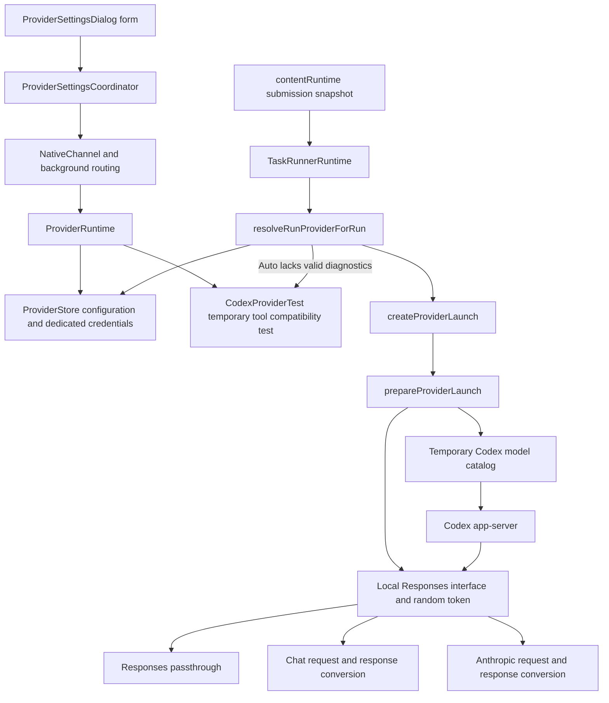

# Model Connections, Provider Configuration, and Protocol Adaptation

Initial reference product version: `2.5.0`; initial reference baseline: `2073ae74747431aab8d529803d4e9f8197262388`; the body is maintained with the current repository.
Start with the [system overview](system-overview.md) and [feature map](feature-map.md); see [run state and recovery](run-state-and-recovery.md) for run identity and queues.
[Native execution](native-execution.md) covers process startup, the app-server lifecycle, project locks, and exit barriers.

## 1. Scope and Concepts

**Current behavior** means source behavior that can be checked through the callers listed on this page; **Target contract** means a maintenance constraint; **Known gap / Unverified** means an implementation difference or condition awaiting verification, with an explicit scope.
A Provider connection configuration includes an upstream endpoint, protocol, model list, capability declarations, and credential references; a model ID identifies one model under that service.
Protocol adaptation works like a plug adapter: its outer side connects to Responses, Chat Completions, or Anthropic Messages, while its inner side presents the Responses shape to Codex.
Matching field names provide only a navigation clue; the final request construction and callers must be checked to establish whether a field actually takes effect.

| Concept | Current meaning | Conclusion that must not be inferred |
|---|---|---|
| Built-in Codex | Executes through the existing Codex configuration, authentication, and model discovery paths, with `providerLaunch=null`; configuration inheritance is covered in section 5 | The extension pins its actual network endpoint; every Custom service failure automatically switches to Built-in |
| Custom Provider | Locally saved endpoint and model configuration connected to Codex through a local bridge | The panel directly implements an independent agent engine |
| `wireApiPreference` | The configured preference `auto/responses/chat/anthropic` | Auto tries every protocol after any failure |
| `resolvedWireApi` / model diagnostics | The protocol result recorded for a tested connection fingerprint | Testing one model proves that every model under that Provider is available |
| `upstreamResponseMode` | Model-level upstream response mode; ordinary requests can select upstream SSE or complete JSON, with the client output mode adapted separately | Unlimited buffering, compatibility with every gateway, or generic interrupted-stream retries |
| Provider revision | The version identity of one configuration | The version of the entire storage directory |
| `storeRevision` | The storage version for a coordinated profiles/secrets commit | Every change invalidates the Provider revision of existing queued tasks |
| Model capability declarations | Configuration for reasoning, context, input modalities, parallel tools, and related capabilities | Capabilities individually tested and certified against the upstream service |

The state entry points are [providerProfiles.js](../../extension/src/shared/providerProfiles.js), [providerProfile.js](../../native-host/src/providerProfile.js), and [providerStore.js](../../native-host/src/providerStore.js).
The first serves browser forms and catalog projections; the latter two handle Native-side normalization, validation, and persistence. New fields require checking propagation on both sides.

## 2. Call Relationships and Owners

Configuration chain: `ProviderSettingsDialog.handleClick/readContext → ProviderSettingsCoordinator.request → codex.providers.* → ProviderRuntime.handleProviderRequest`.
Source locations: [providerSettingsDialog.js](../../extension/src/content/providerSettingsDialog.js), [providerSettingsCoordinator.js](../../extension/src/content/providerSettingsCoordinator.js), and [providerRuntime.js](../../native-host/src/providerRuntime.js).
Run chain: `TaskRunnerRuntime.handleCodexRun → resolveRunProviderForRun → createProviderLaunch → CodexSessionRunner → runCodexAppServerSession → prepareProviderLaunch`.
Source locations: [taskRunnerRuntime.js](../../native-host/src/taskRunnerRuntime.js), [codexSessionRunner.js](../../native-host/src/codexSessionRunner.js), and [codexProviderLaunch.js](../../native-host/src/codexProviderLaunch.js).
Pre-run Provider resolution begins only after the project lock is acquired. Auto negotiation also shares the run's cancellation signal; lock release is detailed in the Native execution page.

| Data | Authoritative owner | Browser-side representation |
|---|---|---|
| Custom configuration and profile revision | ProviderStore | Catalog projection without the dedicated API key |
| Connection configuration inherited by Built-in | The user's Codex `config.toml`, captured, filtered, and written to the child process's isolated home by [codexHomeScope.prepareScopedPluginCodexHome](../../native-host/src/codexHomeScope.js). This path sets `skipCopiedUserConfig`; `codexHome.copyUserCodexFile` remains part of legacy non-scoped preparation. See section 5. | Built-in identity; the inherited endpoint and configuration version are not projected |
| Dedicated API key | ProviderStore secrets | Form value during input and a short-lived request payload |
| Current project selection | ProjectProviderSelection and project state | providerId/revision, model, reasoning, speed |
| Submitted run selection | RunExecutionSnapshot | Fixed execution identity and settings, without the Provider API key |
| Local bridge token and request history | The current prepared bridge | Not returned through the model catalog |
| Connection test progress | ProviderRuntime's operationId and activeTests | Short-lived state for the corresponding dialog |

## 3. Model Configuration, Discovery, and Run Identity

### 3.1 Two Types of Model Catalog

`ModelPicker.loadModelOptions` sends `codex.models` while capturing modelLoadGeneration and the Provider selection.
On return, it validates the generation, Provider ID, and Custom Provider revision; stale results cannot replace the current selection.
Revision comparison applies only to successful responses. An error for the current request still enters the unavailable/error display path even without result/revision. Responses from a stale generation or another Provider continue to be discarded.
The entry points are [modelPicker.js](../../extension/src/content/modelPicker.js) and [modelPickerSupport.js](../../extension/src/content/modelPickerSupport.js).
For Built-in, Native's `resolveProviderModels` calls `resolveCodexModels`, reads candidate `models_cache.json` files in order, and returns the built-in fallback only when no usable cache exists.
Cache location priority is managed by `getModelsCacheCandidates` in [codexModels.js](../../native-host/src/codexModels.js); the current discovery chain does not actively fetch a live model list from the service provider.
The Custom catalog comes from saved `profile.models`, with reasoning-control capabilities, the Provider revision, and standard speed. It does not call upstream `/models` to enumerate every model.
The local bridge's `/models` response also describes only the current launch model and must not be treated as the service provider's model discovery API.
If the Custom catalog is empty, fails, or cannot be normalized, the panel shows it as unavailable. Built-in fallback has an explicit guard and cannot mask a Custom connection failure.

### 3.2 Configuration Versions and Execution Snapshots

The Provider execution selection can be expressed as \(P=(providerId,providerRevision,modelId,reasoningEffort,speedTier)\); the full submission snapshot also includes fields such as mode and Track.
Beyond browser submission and queue validation, `resolveRunProvider` rechecks that a Custom configuration exists, its revision matches, the model is configured, and endpoint disclosure remains valid. Built-in returns early; the boundary of its inherited configuration is covered in section 5.
If the Native default service is Custom but the page supplies no explicit providerSelection, it returns `provider_selection_unavailable`.
Endpoint disclosure compares both hostname and normalized baseUrl; retaining the same domain alone does not authorize a changed path.
These checks compare the identity of the submitted selection with the currently saved configuration. They do not retain arbitrary historical versions for old queues to recover; a version change can cause an old task to be rejected.
Endpoint disclosure compares configuration strings and does not pin redirect destinations or DNS resolution addresses. Network boundaries are covered in section 8.
See [run state and recovery](run-state-and-recovery.md) for project switching and immutable queue snapshots.

| Operation | profile revision | storeRevision | Effect on configuration and runs |
|---|---|---|---|
| Create/save with `upsertProvider` | Created or incremented | Incremented | Validates expectedRevision; recomputes the diagnostic fingerprint |
| Use saved Custom with `activateProvider` | Incremented | Incremented | Saves disclosure and updates Native activeProviderId |
| Use Built-in | Built-in remains 0 | Incremented | Switches the Native default |
| Clear API key | Incremented | Incremented | Clears diagnostics; falls back to Built-in if this is the Native default; project selection is covered separately in section 4 |
| Successfully record matching model diagnostics | Unchanged | Incremented | Updates the protocol, response mode, and verification time |
| Delete | Record removed | Incremented | Deletes the dedicated credential; the Native default can fall back to Built-in, while a missing project configuration takes a separate selection-fallback path |

`recordProviderDiagnostic` records a result only when the profile revision, saved model ID, and connectionFingerprint all match.
An unsaved model can pass a test, but this does not write its diagnostics into the old profile; a subsequent form Save can carry matching diagnostics.
**Target contract**: keep the two revision semantics separate. Writing diagnostics during pre-run Auto probing must not invalidate the configuration identity just captured.

### 3.3 Capability Normalization and Value Selection

Capabilities pass through normalization and launch value selection between the form and the Codex catalog. Omitted model fields may already have been filled with concrete values, so omission cannot uniformly mean inheritance from the Provider.
The authoritative entry points are `normalizeModels/normalizeProviderDraft` in [providerProfile.js](../../native-host/src/providerProfile.js), `createProviderLaunch` in [codexProviderLaunch.js](../../native-host/src/codexProviderLaunch.js), and `buildModelEntry` in [providerModelCatalog.js](../../native-host/src/providerModelCatalog.js).

| Field | Native value when the model field is omitted | Value selection in the normal profile → launch/catalog path |
|---|---|---|
| contextWindow | 262144 | The model value takes precedence over the Provider value; the normalized default masks the Provider context configuration |
| inputModalities | `['text']` | The model array takes precedence over the Provider array; the default text array masks the Provider's image declaration |
| supportsParallelToolCalls | false | Uses the model value `??` the Provider value; false is already a valid value and masks the Provider's true |
| reasoningAdapter / reasoningCapability | Empty string | A nonempty model value takes precedence; otherwise the Provider value is used; subsequent auto detection is covered in section 6.2 |
| reasoningEfforts | Empty array | `getReasoningControl` resolves the control; launch prefers an explicit model list, otherwise the effort selected for this run, if any; catalog behavior also requires checking `normalizeEfforts` |
| supportsStreamOptions | No model-level configuration | Launch reads the Provider boolean; the Chat request uses it to decide stream_options |
| maxOutputTokens | null | A valid model value takes precedence; otherwise the Provider value is used; normalization and request-budget exceptions are covered in section 6.3 |

For example, if a Provider declares contextWindow=1000000, image, and parallel tools, while a model is configured with only an ID, Native normalization still sends that model into launch with 262144, text, and false.
This resembles filling a child configuration with defaults before looking to its parent for empty slots; where defaults are generated determines whether inheritance can still occur.
When changing capability defaults, verify the complete Provider → model catalog → launch chain, especially when Provider and model values conflict.

Speed travels from `ModelPicker` through `persistPanelInputs` and the run snapshot into `params.speedTier`; the Custom catalog currently offers only standard.
During normal execution, `normalizeSpeedTier/buildCodexAppServerArgs` in [codexSessionRunner.js](../../native-host/src/codexSessionRunner.js) calls `buildCodexSpeedArgs` in [codexArgs.js](../../native-host/src/codexArgs.js): fast generates `--enable fast_mode -c service_tier="fast"`; other input is normalized to standard and generates `--disable fast_mode`.
This mapping describes the process arguments sent to Codex. Their presence does not prove that the remote service supports or actually uses that tier, or that any particular pricing rule applies.

### 3.4 Quick Presets and Protocol Switching

`PROVIDER_CONNECTIONS/PROVIDER_PRESETS` in [providerProfiles.js](../../extension/src/shared/providerProfiles.js) defines the quick entry points. `buildPresetDraft` generates an unsaved draft without directly changing the active service.
[ProviderSettingsDialog.renderDetail](../../extension/src/content/providerSettingsDialog.js) displays status according to configuration identity: a new draft without a persistent ID shows “Unsaved provider profile”, a saved configuration selected by the current project shows its in-use status, and other saved configurations show their saved status. Switching between English and Chinese preserves the form draft.
The Kimi, GLM, and DeepSeek quick entry points default to Anthropic Messages. The preset fills the endpoint, protocol, authMode, and reasoningAdapter; the API key and model ID still need separate configuration.
[ProviderSettingsDialog.syncPresetProtocol](../../extension/src/content/providerSettingsDialog.js) switches the URL only when `fullEndpoint=false`, the current URL matches a known preset, and the target protocol has a corresponding address.
authMode and reasoningAdapter follow the new protocol only while they still equal the old preset values, preserving manual overrides. Custom addresses, full endpoints, and protocols without a corresponding address do not receive this coordinated update.
When `handleInput` detects a direct baseUrl edit or a URL change from this coordinated update, it clears the endpoint disclosure checkbox and refreshes the disclosure text and action buttons.
Changing only the protocol without changing the address does not enter this disclosure-reset branch. `updatePresetConnectionHint` can indicate a preset address/protocol mismatch, but that hint does not replace Native configuration validation.

## 4. Save, Test, and Use

Save calls `codex.providers.upsert` and can save without a test. An ordinary Save does not imply switching the current project to that service.
Save & Use carries activate in the same upsert request and requires a current project and endpoint disclosure; successful projection into the project selection is still required afterward.
Use applies to a saved, activatable configuration. `prepareProviderActivation` first requires a current project, confirms the project service switch if needed, and then loads the model catalog. After preparation succeeds, it calls Native activate.
After Native succeeds, `notifyChanged/reconcileProviderSelection` updates the project, session defaults, and model controls. A failure on a requireProjection path displays failure; the UI must not announce the switch in advance.
When switching is allowed, a revision change under the same ID rebinds the current project and clears the old Codex thread binding; existing execution snapshots retain their original values.

[ProjectProviderSelection.assertSwitchAllowed](../../extension/src/content/projectProviderSelection.js) centrally restricts switching during a run. Save & Use, Use, Use Built-in, and deleting the current project's selected configuration all reuse this restriction. If a run starts during confirmation or catalog reading, subsequent model projection and the final `commit` check again.
An ordinary Save can save configuration, but it will not use the revision update to reset the project selection or thread during an active run; deleting another Provider remains allowed. When the existing `syncSessionProvider` is called later while idle, the coordinator uses `getSelectedProviderRevision` to compare the project's bound revision with the current catalog. After catalog reading completes, it commits the deferred new revision and clears the old thread. Ordinary refresh under the same ID and revision remains available. No new polling or automatic rebinding immediately at run completion is introduced. If Native has already changed the configuration before the page notices a new run, the final project commit still refuses the switch; the page guard must not be interpreted as a cross-process transaction rollback.

**Current behavior / Two selection states.** Native `activeProviderId` is the default; project `providerId/providerRevision` is the selection explicitly submitted by subsequent runs.
When `clearProviderSecretUnlocked` in [providerStore.js](../../native-host/src/providerStore.js) clears the key for the current Native default service, it changes the default to Built-in while retaining the Custom profile and incrementing its revision.
For an ordinary Save after changing the current default service's endpoint, `upsertProviderUnlocked` also clears the old disclosure and falls back to Built-in as the Native default; Save & Use separately saves the new disclosure.
[ProviderSettingsCoordinator.reconcileProviderSelection](../../extension/src/content/providerSettingsCoordinator.js) prioritizes retaining an existing project configuration and does not directly switch services because the Native default changes. After successful catalog projection, both clearing the key and the ordinary Save described above can keep the project bound to the new revision of its original Custom ID.
The `clearProviderSecret/saveProvider` status messages separately describe the Native default fallback and the retained project service selection, avoiding conflating the two states into a completed project switch. Actual submission still follows `providerSelection` from `getRunSelection`.
A Custom selection retained after an endpoint change is rejected by the next `resolveRunProvider` as `provider_disclosure_required` because the new disclosure is missing. Clearing the key does not automatically redirect that project's new tasks to Built-in.
Deleting the configuration removes the project's selected ID; the coordinator then separately loads the Built-in catalog and commits the project selection. Projection failure retains its own failure boundary. Authentication failure during a run does not trigger an automatic switch.

Test uses the current draft and secretMutation and can test an unsaved connection; the dedicated key need not first be written to the permanent secrets file.
The test entry point is `runProviderConnectionTest` in [codexProviderTest.js](../../native-host/src/codexProviderTest.js).
It prepares the protocol bridge, starts `codex exec` in a temporary Codex home and read-only workspace, and requires reading one file to obtain a second filename before reading a random verification token.
Success conditions include the exit code, verification token, and absence of leaked tool control markers. The test targets two tool-call rounds and continuity of their results.
The test shares Provider launch and bridges with normal tasks, but normal tasks use the app-server lifecycle. Test success does not establish compatibility with all editing, images, long streams, or continuation.
The test module handles directory cleanup and process termination; a complete exit guarantee still requires process evidence.

Auto negotiation is implemented by `ProviderRuntime.testProvider`: Responses → Chat → Anthropic, advancing to the next protocol only for `provider_protocol_incompatible`.
For Chat with response mode Auto, it tries streaming first. Only tool incompatibility or streaming tool parsing failure permits a subsequent buffered attempt.
Authentication, rate limiting, DNS, TLS, missing models, ordinary parameter rejection, and timeouts each have separate error categories; they must not all be classified as unsupported protocols.
A normal Auto run without valid model diagnostics performs one compatibility negotiation through `resolveRunProviderForRun`, then resolves again using the original selection.
If a concurrent edit changes the revision, diagnostics may not be recorded, and the second resolution can still reject the run. A successful test cannot bypass subsequent identity checks.
Test cancellation finds activeTests by operationId and aborts its controller; the current operationId guard separately discards results from old dialogs. [codexProviderTest](../../native-host/src/codexProviderTest.js) checks cancellation at entry, after `prepareProviderLaunch` returns, at process entry, and immediately before actual spawn. Auto negotiation also synchronously adopts an already-cancelled externalSignal.
Cancellation during preparation prevents subsequent child-process dispatch, and the prepared bridge/catalog closes in `finally`. An already-started process follows the existing bounded stop flow, checking exit before cleaning the test directory. From the start of preparation, the test registers Host-disconnect cleanup with [nativeHelperLifecycle](../../native-host/src/nativeHelperLifecycle.js); this does not broaden the scope of Cancel for an ordinary run.
Provider-test preparation, pre-cancelled entry, Auto externalSignal and resource cleanup need a targeted cancellation check when modified. The retained platform helper-shutdown case uses the external-task entry and does not establish Provider-test cancellation.

## 5. Shared Boundaries of Built-in and Custom Execution

Both service types enter Codex's agent, tool, and thread execution paths; Custom adds a model catalog and a local protocol bridge in `prepareProviderLaunch`.

**Built-in configuration sources.** [providerRuntime.resolveRunProvider](../../native-host/src/providerRuntime.js) returns `providerLaunch: null` and revision 0 for Built-in; [codexProviderLaunch.buildProviderConfigArgs](../../native-host/src/codexProviderLaunch.js) consequently returns empty arguments and does not override Codex's `model_provider`.
When filtering the user's `config.toml`, [codexHome.sanitizeCopiedCodexConfig](../../native-host/src/codexHome.js) retains `model_provider` and `[model_providers.*]`; disabling local skills does not remove these connection fields. [codexHomeScope](../../native-host/src/codexHomeScope.js) publishes the configuration bytes from the same capture to the actual scope. Its internal digest determines only the execution directory and does not become a browser Provider revision or run-snapshot field. [codexSessionRunner.runCodexAppServerProcess](../../native-host/src/codexSessionRunner.js) passes that home to the child process. The thread/start and thread/resume arguments specify only the current model, cwd, sandbox, and related settings without separately pinning the Provider.
Built-in connection configuration therefore also depends on inherited Codex configuration. The extension's Custom endpoint disclosure and profile-revision validation do not cover that source. Editing user configuration does not update the extension's Built-in revision, and the fixed execution snapshot does not record a content hash of that configuration.
The audit flows through [contentRuntime.createAuditDraftForRun](../../extension/src/content/contentRuntime.js) to [ProviderSettingsCoordinator.getProviderSnapshot](../../extension/src/content/providerSettingsCoordinator.js), reading the Built-in identity from the browser catalog with an empty endpoint. That record cannot prove the inherited configuration's actual network destination or current authentication state. File API-key inheritance is described below; other configuration and authentication routes still require checking the actual Codex version and consumer. Retaining connection fields alone does not prove that any content has been sent. See [skill inheritance and scope](writing-style-and-skills.md#ordinary-skill-installation-inheritance-and-scope) for the TOML-form limitations of configuration filtering.

**Lifecycle of authentication copies.** When the user home and extension home are separate, [codexInheritedAuth](../../native-host/src/codexInheritedAuth.js) records the source path and content SHA-256 fingerprint for an `auth.json` file it actually copies. If the source disappears, only a file with a matching source whose content remains a known copy can be cleaned up. Independently rewritten authentication, copies from another source, and legacy files without source records are retained. The legacy samehome call in base preparation continues to return early; local skill catalog discovery or an explicit local allowlist uses an [independent canonical home](writing-style-and-skills.md#ordinary-skill-installation-inheritance-and-scope), then synchronizes authentication through the separated directories. Untagged remnants whose source was already lost before upgrading are not deleted by guesswork.
The actual execution scope synchronizes the two source levels user→canonical→scope through [codexHomeScope](../../native-host/src/codexHomeScope.js). Staging does not publish authentication whose direct source is user. Subsequent preparation uses canonical as the consistent source to clean up or update the current scope; reusing a scope also synchronizes authentication. A source rotation supplies a new copy, while source removal stops the known old copy from being passed to subsequent launches.
Cleanup atomically claims its own source record and candidate file. If an independent replacement occurs after reading, nonmatching content or a later target file is retained. Recovery uses exclusive publication and retains a private copy when needed. I/O errors propagate upward and block startup; they cannot silently become unauthenticated success. Source records and copy synchronization provide limited file-inheritance consistency, not a global account transaction; `clearPluginCodexHistory()` continues to handle history only.

**File API-key consumer scope.** With `cli_auth_credentials_store="file"`, the consumer reads authentication from the prepared `CODEX_HOME`. Changes to inheritance require checks for source removal, rotation, independent/untagged copies and interleaved publication. The actual CLI's login status, account/read, and request headers require separate checks. Isolated consumers of macOS Codex CLI 0.160.0 can verify an unauthenticated state after removal of a known source and retention of independent authentication; receipt by a local synthetic endpoint does not prove that a real service accepts the key.
Local credential selection, carrying credentials in a request, and server acceptance of credentials are assessed separately. ChatGPT/OAuth refresh, `keyring/auto/ephemeral`, long-lived daemon caches, and other platforms still require corresponding verification. This mechanism does not provide server-side revocation or unified logout across applications.

**The Custom prepared launch.**
`providerModelCatalog.prepareProviderModelCatalog` writes a temporary `models.json`, defining Codex-visible capabilities such as shell_command, context window, reasoning, and input modalities.
The catalog file uses 0600, and prepared close deletes its temporary directory. A configuration value appearing in the catalog does not mean the service provider's capability has been detected.
See [providerModelCatalog.js](../../native-host/src/providerModelCatalog.js) for the implementation.
The real Custom API key stays in the upstream bridge launch's memory. The prepared launch passed to Codex substitutes a local URL, the Responses wire API, and a random bridge token.
`buildProviderConfigArgs` configures Codex with `env_key=CODEX_OVERLEAF_PROVIDER_API_KEY`; in the normal prepared chain, this environment value is the local token.
The function itself can also accept an unprepared launch. Credential boundaries therefore require checking callers along with the command builder.
The local HTTP server binds to `127.0.0.1` and requires a random bearer token. Closing it aborts active upstream requests and clears history.
`applyProviderEnvironment` adds the local address to NO_PROXY to prevent system proxies from rerouting loopback requests; it preserves the caller's other environment rules.
The existing app-server session wrapper calls prepared.close in finally; connection tests have their corresponding finally block.

## 6. How the Three Protocols Are Converted

Shared route classification is managed by `classifyResponsesRoute` in [providerBridgeRoutes.js](../../native-host/src/providerBridgeRoutes.js).
All three bridges accept the POST paths for Responses and Responses Compact. Accepting a path and providing identical native compact semantics require separate checks.
`fullEndpoint` determines whether a protocol endpoint is appended; each bridge constructs its upstream URL/headers from queryParams, authMode, and customHeaders.
Authentication supports bearer, x-api-key, api-key, custom headers, and none; the dedicated API key control supplies the value.

| Bridge | Request conversion and consumer symbols | Output and limitations |
|---|---|---|
| Responses | `prepareResponsesRequest/buildResponsesUrl` | Ordinary requests retain the Responses shape; compact checks JSON diagnostics and preserves the original bytes of normal responses within the supported scope |
| Chat | `buildChatRequest`, `appendResponsesInput`, `translateTools` | Converts messages/tool_calls to Responses items, retaining tool identities and results |
| Anthropic | `buildAnthropicRequest/buildToolContext` | Converts system, tool_use/tool_result, and thinking to Responses items |

Implementation links: [responsesPassthroughBridge.js](../../native-host/src/responsesPassthroughBridge.js), [chatCompletionsBridge.js](../../native-host/src/chatCompletionsBridge.js), and [anthropicMessagesBridge.js](../../native-host/src/anthropicMessagesBridge.js).
Conversion rule links: [chatBridgeRequest.js](../../native-host/src/chatBridgeRequest.js), [chatBridgeResponse.js](../../native-host/src/chatBridgeResponse.js), [anthropicBridgeRequest.js](../../native-host/src/anthropicBridgeRequest.js), and [anthropicBridgeResponse.js](../../native-host/src/anthropicBridgeResponse.js).
The shared HTTP entry point is [providerHttp.js](../../native-host/src/providerHttp.js): `fetchProvider` manages redirects hop by hop, while `readProviderText/readProviderJson` reports activity when reading ordinary bodies. Credential boundaries and timing consumers are covered in sections 8 and 7, respectively.

### 6.1 Streaming, Buffered Responses, and Tool Calls

Streaming forwards SSE event by event; the Responses bridge forwards each event after checking its complete diagnostics. Buffered mode first obtains complete JSON and then converts it to the SSE or JSON Codex expects. The transport mode does not change the requirement to connect a tool result back to its original call ID.
All three ordinary protocol request paths check both Codex `requestBody.stream` and `launch.upstreamResponseMode`: if the client disables streaming or the configuration selects buffered, the upstream request uses `stream: false`; Auto/streaming continue through their original protocol paths. Buffered mode can avoid some gateway parsing problems with streaming tool markers, but does not establish compatibility with every gateway.
Chat responses choose the SSE parser or JSON converter according to the actual content-type; finish_reason can signal stream termination without waiting for the socket to close.
Accumulated tool-argument deltas produce a complete call. The conversion context restores namespace and custom tool names, and leaked raw control markers cause an error.
For tool-output images, `appendResponsesInput/translateImageToolOutput` in [chatBridgeRequest.js](../../native-host/src/chatBridgeRequest.js) retain a text acknowledgement with the original `tool_call_id`, then attach the ordered text/image content in a labelled multimodal user message after the complete tool-result group. Chat tool-role messages accept text only; inserting the image message between parallel results would break their call/result ordering. Image-free outputs keep their existing string/JSON representation. `translateImagePart` preserves image URLs and supported `auto/low/high` detail values, including in ordinary image messages. Function/custom output arrays and an existing computer screenshot output object share this conversion; this does not register or implement computer tools. Unknown non-image parts retain their JSON representation, while a tool image without a usable URL raises a request error rather than being omitted or serialized as Base64 text. Responses file-ID resolution is outside this converter's scope. Upstream vision support remains required; the saved `inputModalities` declaration is not independently verified here.
Anthropic converts tool_use/tool_result, text, and signed thinking, and handles cache usage; tool declarations are omitted when no tools are selected.
Anthropic thinking in `encrypted_content` is encoded as prefixed Base64URL JSON. The field name does not prove local encryption of that content.

After the upstream returns complete JSON, Anthropic continues to serve streaming clients with `convertAnthropicResponse` and its existing SSE converter. After sanitizing native protocol diagnostics, Responses uses `writeBufferedResponseAsSse` to generate the events its client needs, retaining multiple text segments, reasoning summary, refusal, function/custom calls and call IDs, encrypted_content, usage, and completed/incomplete/failed terminal states. JSON clients continue to receive JSON.
The Responses buffered-to-SSE adapter rejects nonterminal JSON to avoid marking unfinished results as completed. Every generated event retains the `MAX_STREAM_BUFFER_BYTES` limit; an oversized event is not written before rejection. This adaptation does not validate tool schemas or business semantics; the scope of existing tool-argument checks is covered in section 7.
Chat and Anthropic overwrite controlled fields after merging bodyOverrides. Responses ordinary and compact requests also merge allowed `launch.bodyOverrides`, with caller request fields taking precedence. Controlled rules still determine stream and output budgets for ordinary requests, and `previous_response_id` comes only from the current request; configuration cannot create a separate response chain. `normalizeBodyOverrides` continues to reject core fields and sensitive keys.
The Chat/Anthropic compact aliases continue through their ordinary request converters, while Responses compact forwards to the corresponding upstream route. Identical compression mechanisms cannot be promised across all three.
After merging configuration, Responses compact retains the caller's request shape without injecting the default stream or output budget used by ordinary requests. JSON-object, capacity, and diagnostic checks on its response are covered in section 8.

**Context-limit failures.** [providerContextError.isContextLimitError](../../native-host/src/providerContextError.js) recognizes explicit context-limit codes and specific message patterns shared by Chat conversion and the Native session runner. `forwardUpstreamError/sendContextLimitError` in [chatCompletionsBridge.js](../../native-host/src/chatCompletionsBridge.js) translate matching HTTP 400/413/422 failures into a Responses `response.failed` event with `context_length_exceeded` for streaming clients. HTTP 200 JSON and SSE bodies with an explicit `error` pass through `convertChatResponse/processChatChunk/throwUpstreamError` in [chatBridgeResponse.js](../../native-host/src/chatBridgeResponse.js) to the same classification. Other authentication, transport, and output-budget failures retain their own handling; a generic payload-size error alone does not establish a model context limit.

For a streaming client, the recognized failure uses HTTP 200 SSE because the installed CLI consumes the protocol event to classify the context overflow; HTTP success here does not mean the model run succeeded. If SSE headers have already been sent, the terminal error is appended to that stream. A client with `requestBody.stream: false` receives HTTP 400 JSON with the canonical error code. Upstream buffered mode and client JSON mode are separate: a streaming Codex client can still receive the failure event after a buffered upstream request. The CLI owns automatic-compaction decisions. With the recognized event, the installed CLI marks the context full, ends the current ordinary turn as failed, and can compact before a subsequent turn; the bridge does not promise an immediate retry or successful compaction for every provider. Native and panel failure projection are covered in [Native execution](native-execution.md) and [UI and loading](ui-and-loading.md#failure-settlement-actions).

### 6.2 Reasoning Capabilities

`getReasoningControl` in [providerReasoning.js](../../native-host/src/providerReasoning.js) selects the effort, toggle, or none presentation.
Model-level configuration can override Provider configuration. Auto uses the endpoint/model to identify an adapter; if identification fails, it follows the declaration or none.
`resolveRunProvider` maps an unsupported requested effort to the model's default. The actual effort sent must be established from the resolution result and launch.
Chat's `applyReasoningControl` maps the selection to reasoning_effort, thinking, enable_thinking, reasoning, or reasoning_split.
The captured launch.reasoningEffort takes precedence over defaults in the Codex request; an explicit none also means disabling reasoning.
Anthropic's `applyAnthropicThinking` supports adaptive and budget modes. The budget is constrained by max_tokens and can be written as \(b=\min(b_{effort},\lfloor T/2\rfloor,T-1)\).
Thinking is not enabled below the minimum budget threshold. An HTTP 400 caused by a signature or budget may enter one corrective `rectifyAnthropicRequestForRetry` attempt.
Signature correction can remove invalid thinking. Budget correction retains the existing `budget_tokens: 32000` and retries only when the original `max_tokens` is at least 64000, without changing that output cap. When a smaller cap cannot support this compatibility correction, the existing `provider_upstream_error` path returns the original HTTP 400; it does not automatically select another thinking budget.
Fields such as supportsParallelToolCalls and supportsStreamOptions also have specific adapter consumer scopes. Check each protocol before treating a form change as effective.

### 6.3 Output Budget Migration, Precedence, and Caps

The output budget limits the token count of a single model response and is handled separately from the request-time budgets measured in milliseconds in section 7.
Provider-level `normalizeMaxOutputTokens` in [providerProfile.js](../../native-host/src/providerProfile.js) defaults to 65536 when the field is omitted and normalizes finite values within 256–65536. New explicit inputs of 8192 and 32768 are retained unchanged.
The current form `readContext`, `normalizeProviderDraft`, and public catalog `sanitizeProfile` use the internal marker `outputBudgetVersion: 1` for values already interpreted under the current rules. Browser [providerProfiles.js](../../extension/src/shared/providerProfiles.js) preserves that marker; repeated normalization and saving do not remigrate these explicit values. The field has no separate user control and is distinct from profile revision.
[providerStore.normalizeStoredProfile](../../native-host/src/providerStore.js) retains the legacy default migration 8192/32768→65536 only for unmarked historical records. Runtime objects remain separate from raw stored snapshots: unrelated changes such as clearing a key preserve the original old values and provenance, while explicit upsert persists the current marker. The public catalog supplies resolved values. Without historical provenance, the numeric value alone cannot recover the original user's intent.
Model-level `normalizeModelOutputTokens` retains empty values as null and requires other values to be integers in 256–65536; 8192 and 32768 can remain unchanged.

`createProviderLaunch` prefers a valid model value, then the Provider value. A normal launch always has a positive output budget. Chat, Anthropic, and ordinary Responses request construction all prefer that value, even when Codex requestBody requests a smaller budget.
The relevant consumer symbols are `buildChatRequest` in [chatBridgeRequest.js](../../native-host/src/chatBridgeRequest.js), `buildAnthropicRequest` in [anthropicBridgeRequest.js](../../native-host/src/anthropicBridgeRequest.js), and `prepareResponsesRequest/resolveMaxOutputTokens` in [responsesPassthroughBridge.js](../../native-host/src/responsesPassthroughBridge.js). Responses compact merges allowed configuration with the original body and bypasses the ordinary request's output-budget override; `forwardCompactResponse` checks its response separately.
Chat's `resolveReasoningMaxOutputTokens` in [providerReasoning.js](../../native-host/src/providerReasoning.js) preserves the captured output cap. DeepSeek xhigh/max changes only reasoning parameters and no longer raises `max_tokens`. For example, a model configured with 4096 and max still sends 4096 in an ordinary request.
For a normally normalized launch, all three ordinary protocol requests use \(T_{wire}=T_{launch}\). Anthropic's existing HTTP 400 correction likewise does not increase this value and returns an upstream error when it cannot execute within the cap. The UI's “Maximum output tokens” constrains the request budget; actual generation length, server acceptance of the budget, and billing each require separate evidence.

## 7. Continuation, Request Interruption, and Timeouts

### 7.1 Three Continuation Strategies

Responses `rememberResponse/buildReplayInput` retains bounded response lineage. An output cap or reasoning-only output can set continuationRequired.
When the next request references a locally recorded response ID marked `continuationRequired`, the bridge reconstructs input locally, removes previous_response_id, and appends continuation instructions. Reconstructing the ancestor chain rejects missing history, cycles, exceeded budgets, or repeated lack of progress.
If the directly referenced ID is absent from local history, `prepareResponsesRequest` retains `previous_response_id` for native upstream handling, without uniformly rejecting it locally. Error sources after bridge restart or record eviction must distinguish these two branches.
Chat stores messages associated with response IDs. Reasoning-only output or a partial answer without tools can establish a fallback anchor and append continuation instructions, with a bounded attempt count.
Anthropic `buildAnthropicHistoryContinuation` creates continuation material only for a partial result with max_output_tokens and no tool_use.
Signed thinking retains its structure; a bounded tail of unsigned fragments is placed in the continuation prompt. This function does not automatically continue other incomplete reasons.
These histories live only as long as the bridge. They cannot be relied on for recovery across startup after bridge close, process exit, or record eviction.

**Continuation ownership within a bridge.** `handleRequest` in [Chat](../../native-host/src/chatCompletionsBridge.js) and [Anthropic](../../native-host/src/anthropicMessagesBridge.js) first uses history matched by `previous_response_id`. History stores both that response's messages and its `continuationAttempts`. Lineage describes which earlier responses a response continues from, like predecessor identifiers in an archive.
If history does not match, the bridge-wide `anchorMessages` and attempt count may be used only when the request omits `previous_response_id` or that ID equals `continuationState.responseId`. An explicit reference to another unknown ID does not borrow the old anchor or count. Returning to the original chain still observes that chain's original continuation cap. The no-ID compatibility fallback remains; explicit-ID isolation does not imply independent lineage for every request that omits an ID.
The upper-layer `runCodexAppServerSession` in [codexSessionRunner.js](../../native-host/src/codexSessionRunner.js) prepares a bridge for each call and closes it in finally, limiting anchor lifetime.
How actual Codex generates explicit, matching and omitted continuation IDs requires acceptance checks along the corresponding call chain.

### 7.2 Interruption Does Not Imply Automatic Resending

[providerStreamLifecycle.js](../../native-host/src/providerStreamLifecycle.js) manages idle/total timing and AbortController.
Client connection closure triggers upstream abort. Idle resets only when the stream consumer calls `touch`; traffic does not extend total.
SSE consumers in all three bridges report activity chunk by chunk through their parsers. Ordinary JSON calls `touch` per chunk through [providerHttp.readProviderText/readProviderJson](../../native-host/src/providerHttp.js), incrementally decodes UTF-8, and then parses the complete body. HTTP error body reading also reports activity; Responses compact retains its independent chunked reader in `forwardCompactResponse`.
The relevant entry points are the JSON branches of `handleRequest` in [Chat](../../native-host/src/chatCompletionsBridge.js) and [Anthropic](../../native-host/src/anthropicMessagesBridge.js), and the JSON branch in [Responses](../../native-host/src/responsesPassthroughBridge.js). `Codex stream=true → launch buffered → upstream JSON` also passes through these readers, with the complete body subsequently converted to the client's required output.
The idle deadline therefore advances with the latest body activity, while the total deadline always derives from the request start time and total budget. Ordinary JSON readers retain the capacity semantics of the original `.text()`/`.json()` without adding a total byte limit. SSE frames, compact, history, and subsequent conversion retain their own limits; chunked reading does not establish an unlimited-resource guarantee.
A controlled endpoint can reproduce chunking and silence for a changed reader; scaled timer checks do not establish real long-duration network behavior.

Chat/Anthropic exception-recovery branches may generate incomplete only when recoverable text or reasoning already exists and no tool call has appeared. An abnormal stream interruption with existing tools still fails.
Tool completion also requires syntactically complete argument JSON: `completeTool/normalizeToolCalls` in [chatBridgeResponse.js](../../native-host/src/chatBridgeResponse.js) calls `assertCompleteToolArguments` before marking completed or generating final tool items. `canonicalArguments` in [anthropicBridgeResponse.js](../../native-host/src/anthropicBridgeResponse.js) throws immediately on parse failure, and `closeBlock` completes this check before marking closed/completed, covering `content_block_stop` and EOF.
Incomplete arguments return the fixed `provider_response_invalid`; error text neither echoes the argument body nor replaces parse failure with an empty object. Normal calls without arguments, custom/namespace mappings, and multiple tools follow their original paths. Compatibility completion at ordinary EOF remains for complete valid arguments, without imposing a new terminal-marker requirement.
Passing JSON syntax checks proves only that arguments are parseable; it does not prove tool-schema conformance, correct business semantics, or successful tool execution.
Responses SSE forwarding has no equivalent partial-output recovery conversion entry point; an error may end as response.failed or request failure.
Anthropic corrects and refetches at most once for specific HTTP 400 errors. Ordinary errors carry no generic automatic resend guarantee.
`getNativeRetryClass` in [background.js](../../extension/src/background.js) currently classifies codex.providers.* and codex.models as no_silent_retry. Explicit UI refresh and Auto negotiation belong to their own business flows.

| Budget | Actual owner | Current defaults/constraints and qualifications |
|---|---|---|
| Configured requestTimeoutMs | `ProviderProfile.normalizeTimeout` | 5–120 seconds, default 30 seconds |
| One connection-test child process | `runProviderConnectionTestProcess` | Uses the 5–120 second budget above |
| Total budget for one Auto/Test operation | `ProviderRuntime.testProvider` | 15–120 seconds; UI and run negotiation request 120 seconds, shared by multiple attempts |
| Normal bridge idle | `resolveProviderIdleTimeoutMs` | Minimum 120 seconds, maximum 300 seconds; normally normalized configuration is at most 120 seconds, so this chain usually uses 120 seconds |
| Normal bridge total | `resolveProviderTotalTimeoutMs` | Default 30 minutes, maximum 60 minutes, at least twice idle; totalRequestTimeoutMs is not propagated through the normal current profile/launch path |
| Local HTTP server requestTimeout | The three bridges' start functions | Total plus 5 seconds; distinct from the budget for a complete agent run |
| Codex whole-turn/no-event timeout | CodexSessionRunner timing | Independent of a single model HTTP request; detailed in the Native execution page |

**Target contract**: identify the phase measured before changing a timeout. A 30-second connection test must not be interpreted directly as a 30-second total timeout for a normal stream.

## 8. Credentials, Other Sensitive Inputs, and Storage Transactions

The dedicated API key is passed through `secretMutation=unchanged/replace/clear`; a replace value may briefly exist in form and RPC memory.
`sanitizeProfile` returns hasSecret and the update date while omitting the dedicated API key. Run snapshots and `buildProviderSnapshot` also exclude it.
The background creates a run journal only for codex.run. Provider configuration requests do not persist the full request through that path, although pending requests still briefly retain input.
These local facts must be checked together with `ProviderSettingsDialog.readContext`, background request routing, and Native persistence.

| Local file | Contents and lifecycle |
|---|---|
| providers.json | Public configuration, diagnostics, disclosure, activeProviderId, storeRevision |
| provider-secrets.json | Mapping from Provider IDs to dedicated API keys, sharing storeRevision with public configuration |
| provider-transaction.json | Pre-commit public/secrets copies; may contain old API keys and is deleted after success |
| provider-store.lock | A write lock across Native Hosts, with bounded waiting and stale-lock recovery |

`getProviderStorePaths` is authoritative for paths. They default to `.codex-overleaf` in the user's home directory and can be overridden by dedicated environment variables.
`commitProviderState` writes the recovery transaction first, then secrets/public, and finally removes the transaction. Startup reads call `recoverInterruptedTransaction` to determine completion or restore old copies.
This provides recovery of coordinated versions. It does not imply that secrets can appear in only one file or constitute encrypted storage.
Directories request 0700 and atomic-write temporary files request 0600. chmod failure is tolerated; effective permissions on Windows and particular file systems still require acceptance checks.

**Current behavior / Store capacity.** `getStoreFileMaxBytes/serializeStoreJson` in [providerStore.js](../../native-host/src/providerStore.js) enforces read/write budgets on the UTF-8 bytes of final JSON: public and secrets each use `STORE_FILE_MAX_BYTES` (1 MiB), while the compactly encoded recovery transaction uses `STORE_TRANSACTION_MAX_BYTES` (2 MiB + 1024 bytes). The transaction must hold both old snapshots and version/encoding markers; its budget is maintained separately from an individual configuration's budget.
`commitProviderState` checks new configuration, old rollback snapshots, and the transaction before the first file replacement. Exceeding a limit returns `provider_store_too_large`, preserving the original files and revision. Accumulated profiles, escaping, and multibyte characters all count toward final bytes; character counts cannot substitute for storage capacity.
Normalized runtime data and the raw parsed `stored` snapshots remain separate. `mergeStoredChanges` merges only actual changes into stored values, avoiding expansion of unrelated default fields into old data when clearing keys, deleting, or writing diagnostics. Compact encoding can be retained when the original file is compact JSON near the limit. The transaction's `compactPublic/compactSecrets` markers serve failed-commit rollback and startup recovery; recovery also checks both copies before replacement.
Old files that already exceed the read limit or are corrupt still return `provider_store_corrupt`; they are not automatically truncated or deleted. Byte-for-byte recovery is not guaranteed for arbitrary handwritten JSON whitespace and escape spellings. Recovery compatibility after downgrading to an old Native version is unverified when an unfinished transaction exceeds the old 1 MiB limit.

`normalizeBaseUrl` rejects URL usernames/passwords, queries, and fragments, and requires HTTPS or permitted loopback HTTP.
**Network destination boundaries**: the URL validation above and disclosure comparisons in `resolveRunProvider` operate on configuration values. All three bridges call [providerHttp.fetchProvider](../../native-host/src/providerHttp.js) to handle HTTP redirects manually and check each destination before issuing the next hop.
`carriesEndpointCredentials` checks the headers actually sent for dedicated authentication header names, credential-like names, or the known `launch.apiKey` value. When such credentials exist, the next hop must keep the same origin, meaning all three components \((scheme,host,port)\) match. A cross-origin hop returns `provider_upstream_error` without sending headers or a request body to that target. The check also applies to Anthropic's corrective retry; `authMode` alone cannot establish that actual headers contain no credentials.
Same-origin redirects preserve Fetch method and body semantics: 301/302 for POST and applicable 303 responses become GET and remove body/body headers; 307/308 retain the original method and body. Requests without detected endpoint credentials continue to support cross-origin redirects. This protection does not constrain the body destinations of every anonymous request.
The helper's internal limit bounds redirect count. Invalid destinations and those containing usernames/passwords are rejected. The three bridges do not pin DNS resolution addresses. Detecting secret values in arbitrary ordinary fields, DNS/IP changes, and internal forwarding after a service provider receives data remain separate boundaries.
Local HTTP probes can inspect destinations and sent headers, while public DNS and service-provider behavior require separate environment evidence.

headers/queryParams pass through a credential-like key-name guard. bodyOverrides recursively checks sensitive keys and forbids replacing core protocol fields.
The guard allows exceptions such as cache keys. `sanitizeProfile` copies allowed headers/query/body configuration; these values cannot collectively be described as redacted secrets.
**Known gap / Scope limitation**: current checks primarily recognize key names and do not globally detect sensitive values under arbitrary names, paths, or ordinary text.
For example, a token mistakenly entered into an ordinary field cannot be assumed to have been removed merely because the API key is isolated. New fields must specify their policy for secret-shaped input.

`sanitizeProviderMessage` in [providerRedaction.js](../../native-host/src/providerRedaction.js) supports exact replacement of a known API key and sanitizes some bearer/key/token patterns.
Bridge errors and test errors have call sites that pass the exact secret. Generic error wrappers may lack the complete set of secrets, so safety cannot be inferred for all text.
**Current behavior / Protocol diagnostics in HTTP success responses.** HTTP 200 indicates a successful HTTP-layer status, but the protocol body can still declare `response.failed`; the two layers are assessed separately. `sanitizeProtocolErrors` in [responsesPassthroughBridge.js](../../native-host/src/responsesPassthroughBridge.js) uses `launch.apiKey` at ordinary JSON, SSE, and compact outputs to sanitize explicit error subtrees and message/code/param/detail/details/reason/description in failure envelopes, recursively checking response wrappers. Normal model output, tool arguments, and arbitrary metadata do not undergo generic secret replacement.
`hasDuplicateJsonKeys` checks every object in valid JSON for duplicate keys, including escaped key names. When duplicates occur, it conservatively sanitizes protocol diagnostics and re-encodes them, preventing old diagnostics in the raw bytes from passing through after a later status/error overwrites an earlier value. JSON text inside tool-argument strings retains its meaning. Ordinary JSON parse failure returns a fixed safe error without the original body fragments included by a parser.
`forwardResponsesSse` incrementally decodes UTF-8 and buffers complete events before inspection. Its per-event limit is `MAX_STREAM_BUFFER_BYTES` (8 MiB, including framing). Normal events without duplicate keys or a need to rewrite diagnostics retain their original format; multiple events can be forwarded progressively before the upstream ends. Malformed, invalidly encoded, or oversized events take a safe failure path, without first forwarding the event's original diagnostics. Maintenance must cover CRLF/chunk boundaries, multiline data, and a final frame without a blank line at stream end.
`forwardCompactResponse` reads chunk by chunk and renews idle. It supports UTF-8 JSON objects with a total response no larger than `MAX_COMPACT_RESPONSE_BYTES` (32 MiB). Normal responses without duplicate keys or diagnostic rewrites preserve original bytes, HTTP status, and content-type, including encrypted_content. Diagnostic sanitization is followed by re-encoding; malformed or oversized responses return explicit errors. This object type and receive capacity define the current support boundary. Compact must not continue to be described as unrestricted passthrough of arbitrary bodies.
Downstream app-server error events in [codexSessionRunner.js](../../native-host/src/codexSessionRunner.js) and the journal in [background.js](../../extension/src/background.js) do not receive that key for global exact matching. Actual Codex error projection and final persistence require independent acceptance checks.

[debugLog.js](../../native-host/src/debugLog.js) primarily truncates fields and summarizes content/files, without generic credential sanitization; the three bridges currently select counts, statuses, and metadata for logging.
Pattern sanitization in the background journal likewise does not detect arbitrary secrets. The maintenance target is to prevent raw keys or arbitrary configuration dumps from entering logs, events, and diagnostics at the producer.

## 9. Change Routing and Verification

The small release suite has no dedicated Provider protocol, credential-store or settings contract. Generic framing, persistence and helper-shutdown checks do not establish the complete Provider chain. When one of these paths changes, choose the relevant row below and verify a representative observable result; the table is not a per-release checklist.

| Change intent | Primary changes and related modules | Change-driven observations |
|---|---|---|
| Save/Use and project binding | dialog, coordinator, ProjectProviderSelection, store | Native default versus project selection, switching during runs, same-ID revisions, catalog preloading, projection failures |
| secret/profile/schema | providerProfile, providerStore, browser Profiles and forms | field validation, dedicated credentials, revision, disclosure, final byte budgets, and legacy-data recovery |
| Responses diagnostics and passthrough | responsesPassthroughBridge, providerRedaction, stream lifecycle | JSON/SSE/compact diagnostics, duplicate keys, normal output, and receive boundaries |
| Explicit output budgets, buffered mode, and request overrides | dialog/Profiles, providerProfile/Store, launch, request and response conversion for the three protocols | new values/legacy migration, actual wire stream, SSE content and terminal states, allowed fields and core-field protection, cancellation |
| Continuation identity, credential redirects, and protocol budget correction | The three bridges, providerHttp, providerReasoning, anthropicBridgeRequest, Store/launch | explicit/omitted IDs and counts, real HTTP hop destinations and headers/bodies, no-auth compatibility, output caps, and error sanitization |
| Ordinary JSON activity and request deadlines | providerHttp, the three bridges' JSON/error branches, providerStreamLifecycle | UTF-8 chunking, both buffered output modes, idle/total, cancellation, and compact's existing reader; scaled-down timer scheduling |
| Built-in/Custom discovery | codexModels, ProviderRuntime, ModelPicker | cache priority, current errors and late results, unavailable models, and fallback |
| Built-in configuration inheritance | codexHome, ProviderRuntime, codexSessionRunner, ProviderSettingsCoordinator, and audit | checks configuration retention and argument construction separately; actual file API-key consumer scope is covered in section 5, while other authentication methods, snapshots after configuration changes, and audit projections require separate verification |
| Speed argument mapping | ModelPicker, run snapshots, codexSessionRunner, codexArgs | standard/fast exec and app-server argument construction |
| Chat conversion/reasoning | chatBridgeRequest/Response, providerReasoning, launch | tool namespaces, argument completeness, structured tool images, mixed/parallel result ordering, finish_reason, optional fields, and authentication routing |
| Chat context-limit recovery | providerContextError, chatCompletionsBridge, chatBridgeResponse, codexSessionRunner, panel failure consumers | recognized versus ordinary errors across HTTP/JSON/SSE, client stream selection, installed CLI classification and next-turn compaction; do not infer recovery from a preserved message alone |
| Anthropic conversion/continuation | anthropicBridgeRequest/Response, MessagesBridge | tool round trips, argument checks before completion, signatures, bounded continuation, and cache usage |
| Queued execution configuration | RunExecutionSnapshot, Native resolver, Provider catalog | fixed submission snapshots and revision guards at consumption |

Use isolated synthetic credentials and a controlled HTTP endpoint for request-body, redirect or interrupted-stream diagnosis. Such probes can inspect the actual production Store → prepared launch → bridge → wire path without depending on a public service. Keep them temporary unless they expose a distinct consequential risk suitable for the small permanent contract set.

For settings changes, verify Native default, project selection, the next run's captured configuration and status text together. For presets, exercise the affected protocol and one manually overridden value rather than rebuilding an exhaustive permutation suite. Real model checks use Luna; availability of a third-party endpoint or model must be reported separately when the requested behavior depends on it.

Changes to authentication inheritance need an actual consumer check: prepared files, CLI login/account evidence, carried headers and server acceptance are different facts. Changes to HTTP readers or continuation should inspect the relevant wire boundary: explicit other IDs must not inherit an old anchor/count, no-ID compatibility must remain, credential-bearing redirects must respect origin, and continuous data must observe the total deadline. Successful local bridge output alone does not prove actual Codex error projection or public-network behavior.

See [Native Execution](native-execution.md) for helper cancellation and [Run State and Recovery](run-state-and-recovery.md) for saved-session boundaries. Update these implementation descriptions when behavior changes; there is no requirement to create a new permanent test for every Provider edit.

## 10. Boundary Scenarios and Verification Points

1. **Persistence after a successful connection test.** Diagnostics are written when the model is saved and the fingerprint matches. Check the storeRevision increment, unchanged profile revision, and the branch that skips recording for an unsaved model.
2. **Response modes and bodyOverrides across protocols.** Chat, Anthropic, and Responses construct actual requests differently. Use locally simulated endpoints to cover UI→profile→launch→wire body and check whether probe diagnostics agree with actual stream parameters.
3. **Sensitive configuration beyond the dedicated API key.** Key-name checks for headers/query/body and the scope of logging callers are limited. Use synthetic markers to examine unrecognized fields, error echoes, URL paths, and transaction recovery files; verification data must not use real credentials.
4. **Continuation and tool calls after stream interruption.** Tool-argument syntax checks, in-memory history, repeat budgets, and Anthropic incomplete reasons each have qualifications. Separately verify socket reset, idle, client close, history eviction, EOF with complete arguments, and incomplete tool arguments, checking the boundaries of failure, continuation, and non-replay.
