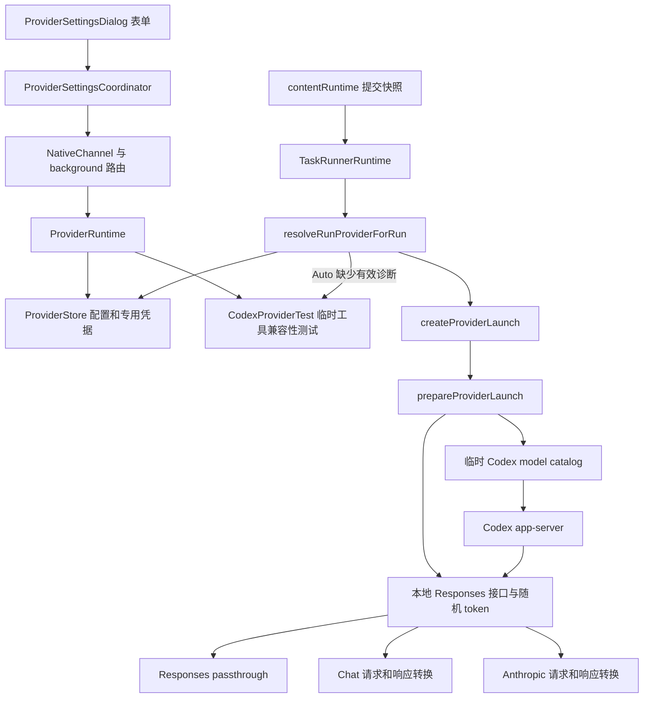

# 模型连接、Provider 配置与协议适配

适用产品版本：`2.5.0`；初始参考基线：`2073ae74747431aab8d529803d4e9f8197262388`；正文随当前仓库维护。
入口见 [系统总览](system-overview.md) 与 [功能索引](feature-map.md)；运行身份、队列见 [运行状态与恢复](run-state-and-recovery.md)。
进程启动、app-server 生命周期、项目锁和退出屏障由 [Native 执行](native-execution.md) 说明。

## 1. 范围与概念

**Current behavior** 表示能沿本页所列调用方核对的源码行为；**Target contract** 表示维护约束；**Known gap / 未验证** 表示有明确范围的实现差异或待验证条件。
Provider 连接配置包括上游端点、协议、模型清单、能力声明和凭据引用；model ID 标识该服务下的一个模型。
协议适配类似插头转换器：外侧分别连接 Responses、Chat Completions 或 Anthropic Messages，内侧向 Codex 提供 Responses 形状。
字段名称相同只提供定位线索，是否真正生效必须检查最终请求构造与调用方。

| 概念 | 当前含义 | 不应推导的结论 |
|---|---|---|
| Built-in Codex | 沿已有 Codex 配置、认证及模型发现路径执行，`providerLaunch=null`；配置继承见第 5 节 | 插件已固定其实际网络端点；任意自定义服务故障都自动改用 Built-in |
| Custom Provider | 本地保存的端点和模型配置，经本地桥接入 Codex | 直接由面板实现独立 agent 引擎 |
| `wireApiPreference` | `auto/responses/chat/anthropic` 的配置偏好 | Auto 表示任意失败都尝试全部协议 |
| `resolvedWireApi` / model diagnostics | 对已测试连接指纹记下的协议结果 | 测试过一个模型即可证明该 Provider 全部模型可用 |
| `upstreamResponseMode` | 模型级上游响应模式；普通请求可选择上游 SSE 或完整 JSON，客户端输出模式另行适配 | 无限缓冲、所有网关兼容或通用断流重试 |
| Provider revision | 单份配置的版本身份 | 等同整个存储目录的版本 |
| `storeRevision` | profiles、secrets 配套提交的存储版本 | 每次变化都会使旧排队任务的 Provider revision 失效 |
| 模型能力声明 | reasoning、上下文、输入模态、并行工具等配置 | 已经向上游逐项实测认证的能力 |

状态入口为 [providerProfiles.js](../../extension/src/shared/providerProfiles.js)、[providerProfile.js](../../native-host/src/providerProfile.js)、[providerStore.js](../../native-host/src/providerStore.js)。
前者服务浏览器表单和目录投影，后两者承担 Native 侧归一化、校验和持久化；新增字段需核对两侧传播。

## 2. 调用关系与所有者

配置链：`ProviderSettingsDialog.handleClick/readContext → ProviderSettingsCoordinator.request → codex.providers.* → ProviderRuntime.handleProviderRequest`。
源码位置：[providerSettingsDialog.js](../../extension/src/content/providerSettingsDialog.js)、[providerSettingsCoordinator.js](../../extension/src/content/providerSettingsCoordinator.js)、[providerRuntime.js](../../native-host/src/providerRuntime.js)。
运行链：`TaskRunnerRuntime.handleCodexRun → resolveRunProviderForRun → createProviderLaunch → CodexSessionRunner → runCodexAppServerSession → prepareProviderLaunch`。
源码位置：[taskRunnerRuntime.js](../../native-host/src/taskRunnerRuntime.js)、[codexSessionRunner.js](../../native-host/src/codexSessionRunner.js)、[codexProviderLaunch.js](../../native-host/src/codexProviderLaunch.js)。
项目锁取得后才进行运行前 Provider 解析；Auto 协商也共享该运行的取消 signal，具体锁释放见 Native 执行专题。

| 数据 | 权威 owner | 浏览器侧持有的内容 |
|---|---|---|
| Custom 配置及 profile revision | ProviderStore | 无专用 API key 的目录投影 |
| Built-in 继承的连接配置 | 用户 Codex `config.toml`，经 `codexHome.copyUserCodexFile` 交给子进程 | Built-in 身份；未投影继承的端点或配置版本 |
| 专用 API key | ProviderStore secrets | 输入期间的表单值与短期 request payload |
| 当前项目选择 | ProjectProviderSelection 与项目状态 | providerId/revision、model、reasoning、speed |
| 已提交运行选择 | RunExecutionSnapshot | 固定的执行身份及设置，无 Provider API key |
| 本地桥 token、请求 history | 本次 prepared bridge | 不通过模型目录返回 |
| 连接测试进度 | ProviderRuntime 的 operationId 与 activeTests | 对应弹窗的短期状态 |

## 3. 模型配置、发现与运行身份

### 3.1 两类模型目录

`ModelPicker.loadModelOptions` 发送 `codex.models`，同时捕获 modelLoadGeneration 和 Provider 选择。
返回时校验 generation、Provider ID 和自定义 Provider revision，过期结果不能替换当前选择。
revision 比较只用于成功响应；当前请求的错误响应即使没有 result/revision，仍进入不可用与错误展示。过期 generation 或另一 Provider 的响应继续被丢弃。
入口为 [modelPicker.js](../../extension/src/content/modelPicker.js) 与 [modelPickerSupport.js](../../extension/src/content/modelPickerSupport.js)。
Native 的 `resolveProviderModels` 对 Built-in 调用 `resolveCodexModels`，依次读取候选 `models_cache.json`，无可用缓存才返回内建 fallback。
缓存位置优先级由 [codexModels.js](../../native-host/src/codexModels.js) 的 `getModelsCacheCandidates` 管理；当前发现链不主动向服务商拉取实时模型列表。
Custom 目录来自已保存 `profile.models`，附 reasoning 控件能力、Provider revision 和 standard speed；未调用上游 `/models` 枚举全部模型。
本地桥的 `/models` 响应也仅描述当前 launch 模型，不能当作服务商的模型发现 API。
自定义目录为空、错误或无法归一化时，面板显示不可用；Built-in fallback 有明确 guard，不能用于掩盖自定义连接失败。

### 3.2 配置版本与执行快照

Provider 执行选择可表示为 \(P=(providerId,providerRevision,modelId,reasoningEffort,speedTier)\)，完整提交快照另含 mode、Track 等字段。
浏览器提交和队列校验之外，`resolveRunProvider` 对 Custom 再次核验配置存在、revision 相等、模型已配置及端点披露仍有效；Built-in 提前返回，其继承配置的边界见第 5 节。
若 Native 默认服务为 Custom，却缺少来自页面的明确 providerSelection，会返回 `provider_selection_unavailable`。
端点披露同时比较 hostname 与规范化 baseUrl；只保留相同域名不足以放行改变后的路径。
这些检查核验提交选择与当前保存配置的身份；它们并不保存任意历史版本供旧队列恢复，版本变化后旧任务可被拒绝。
端点披露比较配置字符串，未建立重定向目的地或 DNS 解析地址固定保证，网络边界见第 8 节。
项目切换行为及不可变队列快照见 [运行状态与恢复](run-state-and-recovery.md)。

| 操作 | profile revision | storeRevision | 配置与运行影响 |
|---|---|---|---|
| 新建/保存 `upsertProvider` | 新增或递增 | 递增 | 校验 expectedRevision；重算诊断指纹 |
| Use 已存 Custom `activateProvider` | 递增 | 递增 | 保存披露，更新 Native activeProviderId |
| Use Built-in | Built-in 保持 0 | 递增 | 切换 Native 默认项 |
| Clear API key | 递增 | 递增 | 清除诊断；若为 Native 默认项则回退 Built-in，项目选择另见第 4 节 |
| 成功记录匹配模型诊断 | 保持 | 递增 | 更新协议、响应模式与验证时间 |
| 删除 | 记录移除 | 递增 | 删除专用凭据；Native 默认项可回退 Built-in，项目配置缺失后另走选择回退 |

`recordProviderDiagnostic` 只在 profile revision、已保存 model ID、connectionFingerprint 均匹配时记录。
未保存的模型可以测试成功，但该诊断不会因此被写入旧 profile；表单随后 Save 可携带匹配诊断。
**维护目标**：两种 revision 的语义保持独立；运行前 Auto 探测不得仅因写入诊断而破坏刚捕获的配置身份。

### 3.3 能力声明的归一化与取值

能力从表单到 Codex 目录要经过归一化及 launch 取值；模型字段省略后可能已被补为具体值，不能统一解释为继承 Provider。
权威入口为 [providerProfile.js](../../native-host/src/providerProfile.js) 的 `normalizeModels/normalizeProviderDraft`、[codexProviderLaunch.js](../../native-host/src/codexProviderLaunch.js) 的 `createProviderLaunch` 和 [providerModelCatalog.js](../../native-host/src/providerModelCatalog.js) 的 `buildModelEntry`。

| 字段 | 模型字段省略后的 Native 值 | 正常 profile → launch/目录的取值 |
|---|---|---|
| contextWindow | 262144 | 模型值先于 Provider 值；归一化后的默认值会遮蔽 Provider 上下文配置 |
| inputModalities | `['text']` | 模型数组先于 Provider 数组；默认文本数组会遮蔽 Provider 的 image 声明 |
| supportsParallelToolCalls | false | 使用模型值 `??` Provider 值；false 已是有效值，会遮蔽 Provider 的 true |
| reasoningAdapter / reasoningCapability | 空字符串 | 模型非空值优先，否则采用 Provider 值；后续 auto 识别见 6.2 节 |
| reasoningEfforts | 空数组 | 控件由 `getReasoningControl` 解析；launch 优先模型显式列表，否则使用本次选定 effort（若有），目录仍须核对 `normalizeEfforts` |
| supportsStreamOptions | 无模型级配置 | launch 读取 Provider 布尔值；Chat 请求据此决定 stream_options |
| maxOutputTokens | null | 模型有效值优先，否则采用 Provider 值；归一化与请求预算例外见 6.3 节 |

例如 Provider 声明 contextWindow=1000000、image 和并行工具，模型仅配置 ID，Native 归一化后该模型仍以 262144、text、false 进入 launch。
这类似先给子配置填满默认值，再向父配置查找空位；默认值的生成位置决定继承是否还会发生。
[providerReliability.test.js](../../test/providerReliability.test.js) 有默认上下文及直接构造模型目录的断言，但这两项不能证明 Provider 与模型配置冲突时的整条传播；测试装配范围见第 9 节。

Speed 从 `ModelPicker` 经 `persistPanelInputs` 和运行快照进入 `params.speedTier`；Custom 目录当前只提供 standard。
正式执行由 [codexSessionRunner.js](../../native-host/src/codexSessionRunner.js) 的 `normalizeSpeedTier/buildCodexAppServerArgs` 调用 [codexArgs.js](../../native-host/src/codexArgs.js) 的 `buildCodexSpeedArgs`：fast 生成 `--enable fast_mode -c service_tier="fast"`，其他输入归一为 standard 并生成 `--disable fast_mode`。
该映射说明传给 Codex 的进程参数；参数存在不能证明远端支持该档位、实际采用该档位或适用某种费用规则。

### 3.4 快捷预设与协议切换

[providerProfiles.js](../../extension/src/shared/providerProfiles.js) 的 `PROVIDER_CONNECTIONS/PROVIDER_PRESETS` 定义快捷入口，`buildPresetDraft` 生成尚未保存的草稿，不直接改变活动服务。
Kimi、GLM 和 DeepSeek 快捷入口默认采用 Anthropic Messages；端点、协议、authMode 和 reasoningAdapter 按预设填写，API key 与 model ID 仍需单独配置。
[ProviderSettingsDialog.syncPresetProtocol](../../extension/src/content/providerSettingsDialog.js) 仅在 `fullEndpoint=false`、当前 URL 匹配已知预设且目标协议有对应地址时切换 URL。
authMode 与 reasoningAdapter 只有在仍等于旧预设值时才跟随新协议更新，以保留手动覆盖；自定义地址、完整端点和没有对应地址的协议不获得这一联动。
`handleInput` 检测到直接修改 baseUrl 或上述联动改变 URL 时，会取消端点披露勾选并刷新披露文字及操作按钮。
仅改变协议且地址未变时不走该披露复位分支；`updatePresetConnectionHint` 可提示预设地址与协议不匹配，但提示不代替 Native 的配置校验。

## 4. Save、Test 与 Use

Save 调用 `codex.providers.upsert`，可在未测试时保存；普通 Save 不等价于把当前项目切换到该服务。
Save & Use 同一次 upsert 请求带 activate，并要求当前项目和端点披露；后续仍需成功投影到项目选择。
Use 针对已保存且可激活的配置；`prepareProviderActivation` 先要求当前项目，必要时确认项目服务切换，再加载模型目录；准备成功后调用 Native activate。
Native 成功后 `notifyChanged/reconcileProviderSelection` 更新项目、会话默认值和模型控件；requireProjection 路径失败时显示失败，不能提前宣布 UI 已切换。
允许切换时，同 ID revision 变化会使当前项目重新绑定，并清除旧 Codex thread 绑定；已有执行快照保留原值。

运行中切换由 [ProjectProviderSelection.assertSwitchAllowed](../../extension/src/content/projectProviderSelection.js) 统一限制。Save & Use、Use、Use Built-in 和删除当前项目所选配置均复用该限制；确认或目录读取期间才开始运行，也会在后续模型投影及最终 `commit` 重新检查。
普通 Save 可以保存配置，但活动运行期间不会借 revision 更新重置项目选择或线程；删除其他 Provider 仍可进行。后续空闲时调用既有 `syncSessionProvider`，协调器通过 `getSelectedProviderRevision` 比较项目已绑定 revision 与当前目录，完成目录读取后提交延期的新 revision 并清除旧线程；同 ID、同 revision 的普通刷新继续可用，没有新增轮询或运行结束即自动重绑的流程。若 Native 已完成配置变更、页面随后才发现新运行，最终项目提交仍拒绝，不能把页面守卫解释为跨进程事务回滚。

**Current behavior / 两处选择状态。** Native `activeProviderId` 是默认项，项目 `providerId/providerRevision` 是后续运行明确提交的选择。
[providerStore.js](../../native-host/src/providerStore.js) 的 `clearProviderSecretUnlocked` 清除当前 Native 默认服务的密钥时，将默认项改为 Built-in，但保留该 Custom profile 并递增 revision。
`upsertProviderUnlocked` 在修改当前默认服务端点后普通 Save 时，也会清空旧披露并将 Native 默认项回退 Built-in；Save & Use 另行保存新披露。
[ProviderSettingsCoordinator.reconcileProviderSelection](../../extension/src/content/providerSettingsCoordinator.js) 优先保留仍存在的项目配置，不因 Native 默认项变化直接换服务；目录投影成功后，清密钥和上述普通 Save 均可使项目继续绑定原 Custom ID 的新 revision。
`clearProviderSecret/saveProvider` 状态栏分别说明 Native 默认项回退和项目服务选择保持，避免把两处状态合成一次已完成的项目切换；实际提交仍以 `getRunSelection` 的 `providerSelection` 为准。
端点修改后保留的 Custom 选择会在下一次 `resolveRunProvider` 中因缺少新披露被拒绝为 `provider_disclosure_required`；清密钥不会自动把该项目的新任务改投 Built-in。
删除配置则使项目所选 ID 不再存在，协调器另走 Built-in 目录加载与项目提交；投影失败仍需保留其失败边界。运行中认证失败不触发自动改投。

Test 使用当前草稿和 secretMutation，可测尚未保存的连接；专用密钥无需先写入正式 secrets 文件。
测试入口为 [codexProviderTest.js](../../native-host/src/codexProviderTest.js) 的 `runProviderConnectionTest`。
它准备协议桥，在临时 Codex home 与只读 workspace 中启动 `codex exec`，要求先读一个文件取得第二个文件名，再读取随机验证 token。
成功条件含退出码、验证 token 和未泄漏工具控制标记；目标覆盖两轮工具调用及结果衔接。
该测试与正式任务复用 Provider launch/桥，但正式任务使用 app-server 生命周期；测试成功不能证明所有编辑、图像、长流或续传都已兼容。
测试目录清理和终止进程由测试模块处理，完整退出保证仍需进程证据。

Auto 协商由 `ProviderRuntime.testProvider` 实现：Responses → Chat → Anthropic，只有 `provider_protocol_incompatible` 才进入下一协议。
Chat 且响应模式 Auto 时先 streaming；只有工具不兼容或流式工具解析失败允许再试 buffered。
认证、限流、DNS、TLS、模型不存在、普通参数拒绝和超时均有独立错误类别，不能统称协议不支持。
尚未有有效模型诊断的 Auto 正式运行，经 `resolveRunProviderForRun` 做一次兼容性协商，再用原 selection 重新解析。
若并发编辑使 revision 改变，诊断可能不写入，第二次解析仍可拒绝运行；一次测试通过不能绕过后续身份检查。
取消测试按 operationId 查找 activeTests 并 abort 对应 controller；取消发生在子进程 abort listener 注册之后时会进入取消收尾，旧弹窗返回另由当前 operationId guard 丢弃。
**Known gap / 准备阶段窗口**：[codexProviderTest.js](../../native-host/src/codexProviderTest.js) 的 `runProviderConnectionTest` 等待 `prepareProviderLaunch` 后，无条件进入 `runProviderConnectionTestProcess`；后者先 spawn 再注册 abort listener，未先检查 signal.aborted。
若取消发生在桥的 listen 等待期间，三桥 start 函数可发现已取消、关闭桥并返回 prepared 结果，随后测试入口仍可启动 Codex；后来注册的 listener 不会补收已经发生的 abort。
正式 [codexSessionRunner.js](../../native-host/src/codexSessionRunner.js) 的 `runCodexAppServerProcess` 有入口 signal.aborted 检查，不能将该局部守卫推广到连接测试。
上述窗口由静态调用顺序确认；真实取消时序、子进程是否立即因关闭的桥退出及最终退出时间均未验证，operationId 的 UI 防迟到守卫也不提供这些证据。

## 5. 内建与自定义执行的共同边界

两类服务都进入 Codex 的 agent、工具和线程执行路径；Custom 在 `prepareProviderLaunch` 中附加模型目录及本地协议桥。

**Built-in 的配置来源。** [providerRuntime.resolveRunProvider](../../native-host/src/providerRuntime.js) 对 Built-in 返回 `providerLaunch: null` 和 revision 0；[codexProviderLaunch.buildProviderConfigArgs](../../native-host/src/codexProviderLaunch.js) 随之返回空参数，不覆盖 Codex 的 `model_provider`。
[codexHome.copyUserCodexFile](../../native-host/src/codexHome.js) 将用户 `config.toml` 复制到插件 home 时，保留 `model_provider` 与 `[model_providers.*]`；关闭本地技能也不移除这些连接字段。[codexSessionRunner.runCodexAppServerProcess](../../native-host/src/codexSessionRunner.js) 把该 home 交给子进程，thread/start 与 thread/resume 的参数只指定本次 model、cwd、sandbox 等，未另行固定 Provider。
因此 Built-in 的连接配置还受继承的 Codex 配置影响，插件的 Custom 端点披露及 profile revision 校验不覆盖这条来源。修改用户配置不会因此更新插件的 Built-in revision，固定的执行快照也不记录该配置的内容哈希。
审计经 [contentRuntime.createAuditDraftForRun](../../extension/src/content/contentRuntime.js) 调用 [ProviderSettingsCoordinator.getProviderSnapshot](../../extension/src/content/providerSettingsCoordinator.js)，读取浏览器目录中的 Built-in 身份，端点为空；该记录不能作为继承配置实际网络目的地的证明。实际 Codex 版本的配置解析、认证选择及最终服务端点仍需独立验证，保留连接字段本身不证明已发送任何内容。配置过滤的 TOML 形式限制另见[技能继承与作用域](writing-style-and-skills.md#普通技能安装继承与作用域)。

**认证副本的生命周期。** 用户 home 与插件 home 分离时，`preparePluginCodexHome()` 只复制本次仍为普通文件的来源；先前已复制的 `auth.json` 在来源消失后不会被同步删除。源 `config.toml` 缺失有单独清理分支，`clearPluginCodexHistory()` 也只删除历史目录，均不能推广到认证副本。来源文件移除与插件副本删除是两个事件；旧副本是否仍可认证、实际采用哪个身份或服务端是否已撤销凭据，仍需结合具体 Codex 与认证服务验证。

**Custom 的 prepared launch。**
`providerModelCatalog.prepareProviderModelCatalog` 写临时 `models.json`，定义 shell_command、上下文窗口、reasoning 和输入模态等 Codex 可见能力。
目录文件使用 0600，prepared close 删除临时目录；配置值进入目录不能解释为服务商能力已被检测。
源码见 [providerModelCatalog.js](../../native-host/src/providerModelCatalog.js)。
Custom 的真实 API key 保留在上游 bridge launch 内存；传给 Codex 的 prepared launch 改为本地 URL、Responses wire API 与随机 bridge token。
`buildProviderConfigArgs` 给 Codex 配置 `env_key=CODEX_OVERLEAF_PROVIDER_API_KEY`；正式 prepared 链中该环境值为本地 token。
此函数本身也能接受未 prepared launch，检查凭据边界必须连同调用者，不能单看命令构造器。
本地 HTTP server 绑定 `127.0.0.1`，请求需带随机 bearer token；关闭时 abort 活动上游请求并清除 history。
`applyProviderEnvironment` 对本地地址加入 NO_PROXY，避免 loopback 请求被系统代理改道；它保留其他调用者环境规则。
现有 app-server 会话包装在 finally 调用 prepared.close；连接测试也有对应 finally。

## 6. 三种协议如何转换

共同路由分类由 [providerBridgeRoutes.js](../../native-host/src/providerBridgeRoutes.js) 的 `classifyResponsesRoute` 管理。
三桥均接受 Responses 与 Responses Compact 的 POST 路径；“接受路径”与提供相同原生 compact 语义需要分别核对。
`fullEndpoint` 决定是否继续拼接协议端点；queryParams、authMode 和 customHeaders 由各桥构造上游 URL/header。
认证支持 bearer、x-api-key、api-key、自定义 header 与 none；专用 API key 控件提供具体值。

| 桥 | 请求转换与消费符号 | 输出与限制 |
|---|---|---|
| Responses | `prepareResponsesRequest/buildResponsesUrl` | 普通请求保持 Responses 形状；compact 检查 JSON 诊断，支持范围内的正常响应保留原字节 |
| Chat | `buildChatRequest`、`appendResponsesInput`、`translateTools` | messages/tool_calls 转 Responses items，保留工具身份和结果 |
| Anthropic | `buildAnthropicRequest/buildToolContext` | system、tool_use/tool_result、thinking 转 Responses items |

实现链接：[responsesPassthroughBridge.js](../../native-host/src/responsesPassthroughBridge.js)、[chatCompletionsBridge.js](../../native-host/src/chatCompletionsBridge.js)、[anthropicMessagesBridge.js](../../native-host/src/anthropicMessagesBridge.js)。
转换规则链接：[chatBridgeRequest.js](../../native-host/src/chatBridgeRequest.js)、[chatBridgeResponse.js](../../native-host/src/chatBridgeResponse.js)、[anthropicBridgeRequest.js](../../native-host/src/anthropicBridgeRequest.js)、[anthropicBridgeResponse.js](../../native-host/src/anthropicBridgeResponse.js)。

### 6.1 Streaming、buffered 与工具调用

Streaming 按事件转发 SSE，Responses 桥在完整事件诊断检查后转发；buffered 先拿到完整 JSON，再转换成 Codex 期待的 SSE 或 JSON。传输方式不改变工具结果需要回接原 call ID 的要求。
三种普通协议请求均同时检查 Codex `requestBody.stream` 和 `launch.upstreamResponseMode`：客户端关闭流式或配置 buffered 时，上游请求 `stream: false`；Auto/streaming 继续沿各自原协议路线处理。buffered 可规避部分网关流式工具标记解析问题，不表示所有网关均已验证。
Chat 响应根据真实 content-type 选择 SSE parser 或 JSON 转换器；流式终止信号可来自 finish_reason，不必一直等待 socket 关闭。
工具参数 delta 累积后产生完整调用；命名空间和 custom 工具名称通过转换上下文恢复，原始控制标记泄漏会报错。
Anthropic 转换 tool_use/tool_result、文本、带签名 thinking，并处理 cache usage；无工具选择时省略工具声明。
`encrypted_content` 中的 Anthropic thinking 由带前缀 Base64URL JSON 编码，字段名不能证明该内容经过本地加密。

上游返回完整 JSON 后，Anthropic 继续使用 `convertAnthropicResponse` 与已有 SSE 转换器服务流式客户端。Responses 在原协议诊断清洗之后，由 `writeBufferedResponseAsSse` 生成客户端所需事件：保留多段文本、reasoning summary、refusal、function/custom 调用及 call ID、encrypted_content、usage 和 completed/incomplete/failed 终态；JSON 客户端保持 JSON 返回。
Responses 的 buffered SSE 适配拒绝非终态 JSON，避免把尚未完成的结果标为 completed；每个生成事件沿用 `MAX_STREAM_BUFFER_BYTES` 限制，超限事件不先行写出。该适配不提供工具 schema 或业务语义验证，既有工具参数检查范围见第 7 节。
Chat 和 Anthropic 合并 bodyOverrides 后覆盖受控字段。Responses 普通与 compact 请求也合并允许的 `launch.bodyOverrides`，调用方请求字段优先；普通请求的 stream 与输出预算仍由受控规则决定，`previous_response_id` 只取当前请求，配置不能另造响应链。核心字段及敏感键拒绝仍由 `normalizeBodyOverrides` 执行。
Chat/Anthropic 的 compact alias 仍走各自普通请求转换，Responses compact 则转发到上游对应路由；不能承诺三者压缩机制相同。
Responses compact 合并配置后保留调用方请求形状，不注入普通请求的默认 stream 或输出预算；响应的 JSON 对象、容量及诊断检查见第 8 节。

### 6.2 Reasoning 能力

[providerReasoning.js](../../native-host/src/providerReasoning.js) 的 `getReasoningControl` 决定 effort、toggle 或 none 的呈现。
模型级配置可覆盖 Provider 配置；auto 会参考端点/模型识别适配器，无法识别时按声明或 none 处理。
`resolveRunProvider` 将不支持的请求 effort 归到该模型默认值，实际发出的 effort 需以解析结果和 launch 为准。
Chat `applyReasoningControl` 将选择映射成 reasoning_effort、thinking、enable_thinking、reasoning 或 reasoning_split。
捕获的 launch.reasoningEffort 优先于 Codex 请求中的默认值，显式 none 也具有关闭含义。
Anthropic `applyAnthropicThinking` 支持 adaptive 与预算方式，budget 受 max_tokens 约束，可写为 \(b=\min(b_{effort},\lfloor T/2\rfloor,T-1)\)。
预算不足最低门槛时不启用 thinking；签名/预算导致的 HTTP 400 可能进入一次 `rectifyAnthropicRequestForRetry` 修正。
修正可移除失效 thinking，或提高预算及输出上限；这是特定错误后的兼容策略，需要检查效果和成本，不能视为原配置完全不变。
supportsParallelToolCalls、supportsStreamOptions 等字段也有具体 adapter 消费范围；应逐协议检查，避免仅调整表单即宣布生效。

### 6.3 输出预算的迁移、优先级与抬升

输出预算限制单次模型响应的 token 数量，与第 7 节按毫秒计算的请求时间预算分别处理。
[providerProfile.js](../../native-host/src/providerProfile.js) 的 Provider 级 `normalizeMaxOutputTokens` 在字段省略时默认 65536，有限值在 256–65536 范围内归一化；新显式输入的 8192、32768 原样保留。
当前表单 `readContext`、`normalizeProviderDraft` 和公共目录 `sanitizeProfile` 使用内部 `outputBudgetVersion: 1` 标记已经按当前规则解释的数值；浏览器 [providerProfiles.js](../../extension/src/shared/providerProfiles.js) 保留该标记，重复归一化与再次保存不会重新迁移这些显式值。该字段没有独立用户控件，也不等同 profile revision。
[providerStore.normalizeStoredProfile](../../native-host/src/providerStore.js) 只对未标记的历史记录保留 8192/32768→65536 的旧默认迁移。其运行时对象与原始存储快照仍分开：清密钥等无关修改保持原始旧值及来源，显式 upsert 才持久化当前标记；公共目录提供已解析数值。没有历史来源信息时，无法据数值恢复原使用者的选择意图。
模型级 `normalizeModelOutputTokens` 则将空值保留为 null，其他值要求为 256–65536 的整数，8192、32768 可原样保留。

`createProviderLaunch` 优先采用模型有效值，再采用 Provider 值。正常 launch 总有正输出预算；Chat、Anthropic 和普通 Responses 的请求构造均优先采用该值，即使 Codex requestBody 请求了更小预算。
相关消费符号为 [chatBridgeRequest.js](../../native-host/src/chatBridgeRequest.js) 的 `buildChatRequest`、[anthropicBridgeRequest.js](../../native-host/src/anthropicBridgeRequest.js) 的 `buildAnthropicRequest` 及 [responsesPassthroughBridge.js](../../native-host/src/responsesPassthroughBridge.js) 的 `prepareResponsesRequest/resolveMaxOutputTokens`；Responses compact 合并允许配置与原 body，不经过普通请求的输出预算覆盖；响应另经 `forwardCompactResponse` 检查。
Chat 的 [providerReasoning.js](../../native-host/src/providerReasoning.js) `resolveReasoningMaxOutputTokens` 还会对 DeepSeek 的 xhigh/max 抬升预算：\(T_{wire}=\max(T_{launch},65536)\)。
例如模型配置4096并选择 max，发出的 Chat max_tokens 可变为65536；结合前述 Anthropic 400 修正，配置值不能统一解释为三协议均遵守的硬上限。
[providerWireSettings.test.js](../../test/providerWireSettings.test.js) 沿表单捕获、临时 Store 保存/重载、目录与 launch 检查新显式值及旧记录迁移；同时检查旧记录的无关清密钥修改和模型级覆盖。[providerReliability.test.js](../../test/providerReliability.test.js) 保留默认预算、旧未标记目录及 Chat launch 预算优先级的对照。

## 7. 续传、请求中断与超时

### 7.1 三类续传策略

Responses `rememberResponse/buildReplayInput` 保存有限 response lineage；输出上限或仅 reasoning 输出可标记 continuationRequired。
下一次引用本地已记录且标记 `continuationRequired` 的 response ID 时，本地重建 input、移除 previous_response_id 并附加继续提示；重建祖先链时遇历史缺失、循环、预算超限或重复无进展会拒绝。
直接引用的 ID 未命中本地 history 时，`prepareResponsesRequest` 保留 `previous_response_id` 交给上游原生处理，不在本地统一拒绝；桥重启或记录淘汰后的错误来源需区分这两条分支。
Chat 保存按 response ID 关联的 messages；仅 reasoning 或无工具的部分回答可建立 fallback anchor 并附加继续提示，次数受限。
Anthropic `buildAnthropicHistoryContinuation` 仅对 max_output_tokens 且没有 tool_use 的部分结果创建续传材料。
带签名 thinking 保留结构，未签名片段的有限尾部放入继续提示；其他 incomplete reason 不由该函数自动续传。
这些 history 均随桥存活；关闭桥、进程退出或记录淘汰后，不能依赖其完成跨启动恢复。

**Known gap / 同桥续传身份**：[Chat](../../native-host/src/chatCompletionsBridge.js) 和 [Anthropic](../../native-host/src/anthropicMessagesBridge.js) 的 `handleRequest` 在 `previous_response_id` 缺失或未命中 history 时，直接采用整座桥最近的 `continuationState.anchorMessages`；保存的 `continuationState.responseId` 未用于匹配来源。
例如同一桥内 A 请求留下部分分析，随后 B 请求引用另一未知 response ID，B 的上游 messages 仍会带入 A 的续传材料；Anthropic 的锚点还包含 A 的原始 messages。
因此按 response ID 保存 history，不提供 fallback 分支的 lineage 隔离保证；lineage 指一条响应由哪些先前响应接续而来。
上层 [codexSessionRunner.js](../../native-host/src/codexSessionRunner.js) 的 `runCodexAppServerSession` 每次调用都会准备桥，并在 finally 关闭它，限制了锚点的存活范围。
该缺口限定于同一桥内的请求组合，不能推广成跨插件 run 串线；真实 Codex 是否生成上述组合仍需调用链验证。

### 7.2 中断不等同自动重发

[providerStreamLifecycle.js](../../native-host/src/providerStreamLifecycle.js) 管理 idle/total 计时和 AbortController。
客户端连接关闭触发上游 abort；流消费入口调用 `touch` 才会重置 idle，total 不随流量延长。
**Current behavior 限定**：三桥的 SSE 消费接入了逐块活动回调；普通 JSON 消费等待完整正文（Chat/Anthropic 的 `.json()`，Responses 的 `.text()` 后解析），正文块到达期间未调用 `touch`。Responses compact 的 `forwardCompactResponse` 单独逐块读取并调用 `touch`，不受这个普通 JSON 分支缺口约束。
对应入口为 [Chat](../../native-host/src/chatCompletionsBridge.js) 和 [Anthropic](../../native-host/src/anthropicMessagesBridge.js) 的 `handleRequest` JSON 分支，以及 [Responses](../../native-host/src/responsesPassthroughBridge.js) 的 JSON 分支；三桥的 `Codex stream=true → launch buffered → 上游 JSON` 也经过相应整体读取路径。
在正常配置的 120 秒 idle 下，若响应头后第 35、70、105 秒仍有 JSON 正文字节到达，但正文尚未结束，第 120 秒仍会中止请求，距最近流量仅 15 秒。
该阶段的 idle 实际约束从收到响应头到完整 JSON 读完的时间，不能统一解释为网络持续静默；更长的 HTTP total 或 Codex watchdog 不会推迟已触发的 idle 中止。

Chat/Anthropic 的异常恢复分支要求已有可恢复文本或 reasoning，且尚未出现任何工具调用，才可能生成 incomplete；已有工具时的异常断流仍失败。
工具完成还需参数 JSON 语法完整：[chatBridgeResponse.js](../../native-host/src/chatBridgeResponse.js) 的 `completeTool/normalizeToolCalls` 在标 completed 或生成最终工具项前调用 `assertCompleteToolArguments`；[anthropicBridgeResponse.js](../../native-host/src/anthropicBridgeResponse.js) 的 `canonicalArguments` 解析失败直接报错，`closeBlock` 在标 closed/completed 前完成该检查，覆盖 `content_block_stop` 和 EOF。
残缺参数返回固定的 `provider_response_invalid`，错误文案不回显参数正文，也不将解析失败改成空对象。正常无参调用、custom/namespace 映射及多工具按原路线处理；完整合法参数在普通 EOF 的兼容完成仍保留，不强制新增终止标记要求。
JSON 语法通过只证明参数可解析，不证明满足工具 schema、业务含义正确或实际工具执行成功。[providerToolCompletion.test.js](../../test/providerToolCompletion.test.js) 通过真实 loopback 桥验证完成前的拒绝、正常调用和断流保护，未执行真实 Codex 工具。
Responses SSE 转发没有同样的 partial-output 恢复转换入口，错误可能结束为 response.failed 或请求失败。
Anthropic 对特定 HTTP 400 最多修正一次并重新 fetch；普通错误无通用自动重发保证。
[background.js](../../extension/src/background.js) 的 `getNativeRetryClass` 对 codex.providers.* 和 codex.models 当前落到 no_silent_retry；UI 明确刷新与 Auto 协商属于各自业务流程。

| 预算 | 实际 owner | 当前默认/约束及限定 |
|---|---|---|
| 配置 requestTimeoutMs | `ProviderProfile.normalizeTimeout` | 5–120 秒，默认 30 秒 |
| 单次连接测试子进程 | `runProviderConnectionTestProcess` | 使用上述 5–120 秒预算 |
| 一次 Auto/Test 总预算 | `ProviderRuntime.testProvider` | 15–120 秒；UI 和运行协商请求 120 秒，多个尝试共享 |
| 正式桥 idle | `resolveProviderIdleTimeoutMs` | 下限 120 秒，上限 300 秒；正常归一化配置最高 120 秒，因而该链通常为 120 秒 |
| 正式桥 total | `resolveProviderTotalTimeoutMs` | 默认 30 分钟，上限 60 分钟，至少两倍 idle；totalRequestTimeoutMs 未由当前 profile/launch 正常传播 |
| 本地 HTTP server requestTimeout | 三桥 start 函数 | total 加 5 秒；不同于完整 agent 运行预算 |
| Codex 整轮/无事件超时 | CodexSessionRunner timing | 独立于单个模型 HTTP 请求，详见 Native 执行专题 |

**维护目标**：调整超时前注明它测量的阶段；连接测试 30 秒不能直接解释成正式流 30 秒总超时。

## 8. 凭据、其他敏感输入与存储事务

专用 API key 由 `secretMutation=unchanged/replace/clear` 传递；replace 值允许在表单和 RPC 内存短暂存在。
`sanitizeProfile` 返回 hasSecret 和更新日期，省略专用 API key；运行快照与 `buildProviderSnapshot` 也不包含它。
后台仅为 codex.run 创建 run journal，provider 配置请求不会按该路径将完整 request 持久化；pending request 仍短期持有输入。
这些局部事实需要与 `ProviderSettingsDialog.readContext`、后台 request 路由和 Native 持久化一起检查。

| 本地文件 | 内容与生命周期 |
|---|---|
| providers.json | 公共配置、diagnostics、披露、activeProviderId、storeRevision |
| provider-secrets.json | Provider ID 到专用 API key 的映射，与公共配置同 storeRevision |
| provider-transaction.json | 提交前 public/secrets 副本；可能含旧 API key，成功后删除 |
| provider-store.lock | 跨 Native Host 的写锁；有限等待与陈旧锁恢复 |

路径以 `getProviderStorePaths` 为准，默认位于用户目录 `.codex-overleaf`，可由专用环境变量覆盖。
`commitProviderState` 先写恢复事务，再写 secrets/public，最后清理事务；启动读取时调用 `recoverInterruptedTransaction` 完成判定或恢复旧副本。
这提供配套版本恢复，不能理解为秘密仅会出现在一个文件，也不能直接视为加密存储。
目录请求 0700、原子写入临时文件请求 0600；chmod 失败被容忍，Windows/具体文件系统有效权限仍需验收。

**Current behavior / Store 容量。** [providerStore.js](../../native-host/src/providerStore.js) 的 `getStoreFileMaxBytes/serializeStoreJson` 按最终 JSON 的 UTF-8 字节执行读写预算：public、secrets 各为 `STORE_FILE_MAX_BYTES`（1 MiB），紧凑编码的恢复事务为 `STORE_TRANSACTION_MAX_BYTES`（2 MiB + 1024 字节）。事务需同时容纳两份旧快照及版本/编码标记，其预算与单份配置分别维护。
`commitProviderState` 在首次替换文件前检查新配置、旧回滚快照与事务；超限返回 `provider_store_too_large`，保留原文件和 revision。累计 profiles、转义和多字节字符均计入最终字节数；字符数不能代替存储容量。
运行时归一化数据与 `stored` 原始解析快照分别保存，`mergeStoredChanges` 只将实际变化合入存储值，避免清密钥、删除或写诊断时把无关默认字段扩写到旧数据。原文件为接近上限的紧凑 JSON 时可保留紧凑编码，事务的 `compactPublic/compactSecrets` 标记用于提交失败回滚及启动恢复；恢复也先检查两份副本再替换。
[providerStoreCapacity.test.js](../../test/providerStoreCapacity.test.js) 覆盖临界容量、拒绝后可读性、旧数据管理与注入写入故障后的恢复。已经超出读取上限或损坏的旧文件仍返回 `provider_store_corrupt`，不会自动截断或删除；任意手写 JSON 的空白和转义拼写不提供逐字节恢复保证。存在大于旧版 1 MiB 上限的未完成事务时，降级到旧 Native 的恢复兼容性未验证。

`normalizeBaseUrl` 拒绝 URL 用户名/密码、query、fragment，要求 HTTPS 或允许的 loopback HTTP。
**网络目的地限定**：上述 URL 校验和 `resolveRunProvider` 的披露比较均作用于配置值；三桥没有固定 DNS 解析地址，也没有逐跳重定向目的地校验。
[Responses](../../native-host/src/responsesPassthroughBridge.js) 和 [Chat](../../native-host/src/chatCompletionsBridge.js) 的 `handleRequest`、[Anthropic](../../native-host/src/anthropicMessagesBridge.js) 的 `fetchWithRectification` 调用 fetch 时未显式设置 redirect 策略，也未在返回后检查最终 URL。
例如已披露端点返回指向另一主机的307/308，源码没有将下一跳与已披露 hostname/baseUrl 再次比较；不能据端点披露推定每次网络连接都到同一主机或 IP。
目的地守卫缺失构成当前网络边界的限制；重定向后的正文与不同认证 header 传播、DNS 变化的实际影响仍需受控端点验证，不能仅据守卫缺失判断已发生凭据泄漏。

headers/queryParams 通过 credential-like 键名 guard；bodyOverrides 递归检查敏感键，且禁止替换核心协议字段。
guard 允许 cache key 等例外；`sanitizeProfile` 会复制允许的 headers/query/body 配置，不能将其统称为已脱敏秘密值。
**Known gap / 范围限定**：当前检查主要识别键名，不会全局识别任意名称、路径或普通文字中的敏感值。
例如普通字段内误填 token，不能凭“API key 已隔离”推断一定被剔除；新增字段必须明确 secret-shaped 输入策略。

[providerRedaction.js](../../native-host/src/providerRedaction.js) 的 `sanitizeProviderMessage` 支持精确替换已知 API key，并清洗部分 bearer/key/token 模式。
桥错误和测试错误有传入精确 secret 的调用点，通用错误包装未必持有完整秘密集合，不能推导所有文本均安全。
**Current behavior / HTTP 成功响应内的协议诊断。** HTTP 200 表示 HTTP 层返回成功状态，协议体仍可声明 `response.failed`。两层状态分别判定。[responsesPassthroughBridge.js](../../native-host/src/responsesPassthroughBridge.js) 的 `sanitizeProtocolErrors` 在普通 JSON、SSE 和 compact 出口使用 `launch.apiKey` 清洗显式 error 子树及失败 envelope 的 message/code/param/detail/details/reason/description，并递归检查 response 包装。正常模型 output、工具参数和任意 metadata 不进行通用秘密替换。
`hasDuplicateJsonKeys` 检查有效 JSON 内每个对象的重复键，包括转义键名；出现重复时保守清洗协议诊断并重新编码，避免后面的 status/error 覆盖前值后，原始字节中的旧诊断仍被透传。工具参数字符串内部的 JSON 文字保持原义。普通 JSON 解析失败使用固定安全错误，不返回解析器包含的原正文片段。
`forwardResponsesSse` 使用增量 UTF-8 解码，缓冲完整事件再检查，单事件上限为 `MAX_STREAM_BUFFER_BYTES`（8 MiB，含帧格式）。无重复键且无需诊断改写的正常事件保持原格式，多个事件可在上游结束前陆续转发；畸形、非法编码或超限事件走安全失败路径，该事件的原始诊断不会先行转发。维护该路径需同时覆盖 CRLF/分块、多行 data 与流结束时无空行的最后一帧。
`forwardCompactResponse` 逐块读取并续期 idle，支持 UTF-8 JSON 对象且总响应不超过 `MAX_COMPACT_RESPONSE_BYTES`（32 MiB）；无重复键且无需诊断改写的正常响应保留原字节、HTTP status 与 content-type，包括 encrypted_content。诊断清洗后重新编码，畸形或超限响应返回明确错误。此对象类型及接收容量构成当前支持边界，不能继续把 compact 描述为无限制的任意正文透传。
[responsesProtocolRedaction.test.js](../../test/responsesProtocolRedaction.test.js) 通过真实 loopback HTTP 桥检查出口、正常输出及上述边界。下游 [codexSessionRunner.js](../../native-host/src/codexSessionRunner.js) 的 app-server 错误事件和 [background.js](../../extension/src/background.js) 的 journal 未获得该 key 做全局精确匹配；真实 Codex 的具体错误投影与最终持久化仍需独立验收。

[debugLog.js](../../native-host/src/debugLog.js) 主要截断字段和摘要 content/files，未提供通用凭据清洗；三桥当前日志选择计数、状态和元数据。
后台 journal 的模式清洗也不等于任意秘密检测；维护目标是从生产者阻止原密钥或任意配置 dump 进入日志、事件和诊断。

## 9. 修改路由与最窄验证

专项测试从仓库根目录运行，按改动选择直接相关的文件；各测试的装配方式和覆盖边界见下表。

| 修改意图 | 主改与联动 | 最窄命令及检查重点 |
|---|---|---|
| Save/Use、项目绑定 | dialog、coordinator、ProjectProviderSelection、store | `node --test test/providerUiContracts.test.js test/providerSessionBinding.test.js test/projectProviderRevision.test.js`；Native 默认与项目选择、运行中切换、同 ID revision、目录预加载、投影失败 |
| secret/profile/schema | providerProfile、providerStore、浏览器 Profiles 和表单 | `node --test test/providerReliability.test.js test/providerStoreCapacity.test.js`；字段校验、专用凭据、revision、披露、最终字节预算和旧数据恢复 |
| Responses 诊断与透传 | responsesPassthroughBridge、providerRedaction、stream lifecycle | `node --test test/responsesProtocolRedaction.test.js`；JSON/SSE/compact 诊断、重复键、正常输出与接收边界 |
| 显式输出预算、buffered 与请求覆盖项 | dialog/Profiles、providerProfile/Store、launch、三协议请求及响应转换 | `node --test test/providerWireSettings.test.js test/providerReliability.test.js`；新值/旧迁移、实际 wire stream、SSE 内容和终态、允许字段与核心字段保护、取消 |
| 内建/自定义发现 | codexModels、ProviderRuntime、ModelPicker | `node --test test/codexModels.test.js test/modelSelectionRecovery.test.js test/modelPickerCurrentError.test.js`；cache 优先级、当前错误与迟到结果、不可用模型与 fallback |
| Built-in 配置继承 | codexHome、ProviderRuntime、codexSessionRunner、ProviderSettingsCoordinator 与审计 | `node --test test/codexHome.test.js test/codexSessionRunner.test.js`；分别检查配置保留与参数构造；实际服务解析、配置变更后的快照及审计投影需组合验证 |
| Speed 参数映射 | ModelPicker、运行快照、codexSessionRunner、codexArgs | `node --test test/codexArgs.test.js test/codexSessionRunner.test.js`；standard/fast 的 exec 与 app-server 参数构造 |
| Chat 转换/reasoning | chatBridgeRequest/Response、providerReasoning、launch | `node --test test/providerReliability.test.js test/providerToolCompletion.test.js`；工具命名空间、参数完整性、finish_reason、可选字段和认证路由 |
| Anthropic 转换/续传 | anthropicBridgeRequest/Response、MessagesBridge | `node --test test/anthropicBridge.test.js test/providerToolCompletion.test.js`；工具往返、完成前参数检查、签名、限额续传与 cache usage |
| 队列执行配置 | RunExecutionSnapshot、Native resolver、Provider catalog | `node --test test/runExecutionSnapshot.test.js test/providerReliability.test.js`；提交快照固定与消费时 revision 守卫 |

Response passthrough、真实 bridge HTTP 中断及 profile→launch→最终 wire body 的组合行为，应继续核对相应测试覆盖和实际环境。
单个 helper 的测试通过只证明对应输入边界；表单、持久配置、prepared launch、上游请求四段联动需要单独证据。

| 已有测试定义 | 装配方式与证据边界 |
|---|---|
| [providerReliability.test.js](../../test/providerReliability.test.js) | Store 场景使用临时目录；能力、预算、URL/header 场景直接调用 helper；流转换使用构造的上游与 SSE 收集器。默认模型上下文和直接构造 catalog 的断言未覆盖 Provider 能力被模型默认值遮蔽的完整链路。 |
| [providerStoreCapacity.test.js](../../test/providerStoreCapacity.test.js) | 真实 Store/Native dispatcher、临时目录和合成配置；临界容量、删除/清密钥、注入文件替换故障与重载恢复，不证明实际断电持久性。 |
| [providerWireSettings.test.js](../../test/providerWireSettings.test.js) | 生产表单捕获函数配替身 DOM 字段，真实临时 Store/目录/launch、loopback 两协议桥及合成 key；检查预算重载、请求体、JSON/SSE 内容/终态、取消和既有接收限额，未运行真实 Codex 消费者或浏览器。 |
| [providerUiContracts.test.js](../../test/providerUiContracts.test.js) | 生产 dialog 操作/协调器/项目选择配替身 UI、临时真实 Store 与 Native 配置接口；核对状态文案、确认前后及迟到目录/响应的运行守卫，未执行模型或真实浏览器持久化。 |
| [responsesProtocolRedaction.test.js](../../test/responsesProtocolRedaction.test.js) | 真实桥与本地 HTTP 上游、合成 key、临时日志；检查出口与逐事件流动，不调用真实 Provider、Codex 或浏览器。 |
| [anthropicBridge.test.js](../../test/anthropicBridge.test.js) | 直接调用请求/响应及续传 helper，流场景使用 Readable 与响应 sink；URL/header 断言未经历真实 HTTP 重定向、DNS 或认证传播。 |
| [providerSessionBinding.test.js](../../test/providerSessionBinding.test.js)、[projectProviderRevision.test.js](../../test/projectProviderRevision.test.js) | 使用 FakeBroadcastChannel、替换的目录/Native 返回或内存项目状态，验证投影和 revision 分支；不能证明实际浏览器持久化与 Native 事务共同完成。 |
| [modelSelectionRecovery.test.js](../../test/modelSelectionRecovery.test.js) | VM 中的选择控件和替换的 sendBackgroundNative 返回验证模型恢复与迟到结果守卫；未连接真实 Provider。 |
| [modelPickerCurrentError.test.js](../../test/modelPickerCurrentError.test.js) | 生产 ModelPicker 配替身控件与合成 Native 响应，区分当前无 revision 错误、过期 generation、其他 Provider 和成功响应的 revision 守卫。 |
| [codexArgs.test.js](../../test/codexArgs.test.js)、[codexSessionRunner.test.js](../../test/codexSessionRunner.test.js) 的 Speed 参数用例 | 直接调用 exec/app-server 参数构造器，断言 fast_mode 与 service_tier；不验证服务端档位支持、实际使用或费用。 |

清密钥、改端点后普通 Save 的验证需同时检查 Native 默认项、项目选择、下一轮提交及状态文案；Store 或单独投影测试不能替代这四项组合。
快捷预设维护需覆盖协议切换、手动覆盖的 authMode/reasoningAdapter、fullEndpoint、自定义 URL 与披露复位，分别检查最终草稿和 Native 保存结果。
现有测试缺少“准备协议桥期间取消，随后进入测试 spawn”的覆盖，也缺少三桥 HTTP 重定向目的地与 DNS 地址变化的完整调用链用例。
这些场景应采用合成凭据与受控端点验证，分别断言目标地址、正文/header 传播、能力取值、最终 wire 预算及取消后的进程启动/退出。
整桥 fallback 的 lineage 隔离、普通 JSON 消费期间的逐块 idle 续期，以及协议错误到真实 Codex 事件和 journal 的清洗仍需分别验证。对应场景应进入三桥 `handleRequest`：同一桥依次发送 A 部分响应与 B 未知 response ID；用分块普通 JSON 和可控时钟核对 `touch`；在已有 Responses 桥出口测试之外，单独检查下游错误投影。

## 10. 边界场景与验证要点

1. **连接测试成功后的持久化。** 已保存模型且指纹匹配时会写 diagnostics；核对 storeRevision 增加、profile revision 保持，以及未保存模型跳过记录的分支。
2. **不同协议的响应模式与 bodyOverrides。** Chat、Anthropic、Responses 的实际请求构造不同；使用本地模拟端点覆盖 UI→profile→launch→wire body，检查探测诊断与实际 stream 参数是否一致。
3. **专用 API key 之外的敏感配置。** headers/query/body 的键名检查和日志调用者范围有限；使用合成标记检验未识别字段、错误回显、URL 路径及事务恢复文件，验证数据不得使用真实凭据。
4. **流中断后的续传与工具调用。** 工具参数语法检查、内存 history、重复预算和 Anthropic incomplete 原因各有限定；分别验证 socket reset、idle、client close、history 淘汰、参数完整的 EOF 与残缺工具参数，检查失败、继续及不重放边界。
