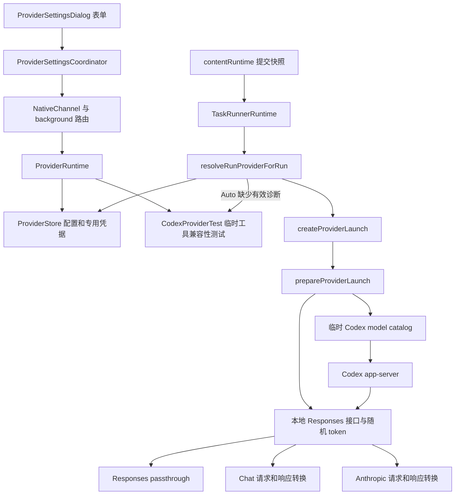

# 模型连接、Provider 配置与协议适配

适用产品版本：`2.5.0`；产品源码基线：`2073ae74747431aab8d529803d4e9f8197262388`。
入口见 [系统总览](system-overview.md) 与 [功能索引](feature-map.md)；运行身份、队列见 [运行状态与恢复](run-state-and-recovery.md)。
进程启动、app-server 生命周期、项目锁和退出屏障由 [Native 执行](native-execution.md) 说明。

## 1. 范围与概念

**Current behavior** 表示能沿本页所列调用方核对的源码行为；**Target contract** 表示维护约束；**Known gap / 未验证** 表示有明确范围的实现差异或待验证条件。
Provider 连接配置包括上游端点、协议、模型清单、能力声明和凭据引用；model ID 标识该服务下的一个模型。
协议适配类似插头转换器：外侧分别连接 Responses、Chat Completions 或 Anthropic Messages，内侧向 Codex 提供 Responses 形状。
字段名称相同只提供定位线索，是否真正生效必须检查最终请求构造与调用方。

| 概念 | 当前含义 | 不应推导的结论 |
|---|---|---|
| Built-in Codex | 沿已有 Codex 认证及模型发现路径执行，`providerLaunch=null` | 任意自定义服务故障都自动改用 Built-in |
| Custom Provider | 本地保存的端点和模型配置，经本地桥接入 Codex | 直接由面板实现独立 agent 引擎 |
| `wireApiPreference` | `auto/responses/chat/anthropic` 的配置偏好 | Auto 表示任意失败都尝试全部协议 |
| `resolvedWireApi` / model diagnostics | 对已测试连接指纹记下的协议结果 | 测试过一个模型即可证明该 Provider 全部模型可用 |
| `upstreamResponseMode` | 模型级上游响应模式设置 | 三种协议均已实现相同 buffered 行为 |
| Provider revision | 单份配置的版本身份 | 等同整个存储目录的版本 |
| `storeRevision` | profiles、secrets 配套提交的存储版本 | 每次变化都会使旧排队任务的 Provider revision 失效 |
| 模型能力声明 | reasoning、上下文、输入模态、并行工具等配置 | 已经向上游逐项实测认证的能力 |

状态入口为 [providerProfiles.js](../../extension/src/shared/providerProfiles.js)、[providerProfile.js](../../native-host/src/providerProfile.js)、[providerStore.js](../../native-host/src/providerStore.js)。
前者服务浏览器表单和目录投影，后两者承担 Native 侧归一化、校验和持久化；新增字段需核对两侧传播。

## 2. 调用关系与所有者

配置链：`ProviderSettingsDialog.handleClick/readContext → ProviderSettingsCoordinator.request → codex.providers.* → ProviderRuntime.handleProviderRequest`。
源码位置：[providerSettingsDialog.js](../../extension/src/content/providerSettingsDialog.js)、[providerSettingsCoordinator.js](../../extension/src/content/providerSettingsCoordinator.js)、[providerRuntime.js](../../native-host/src/providerRuntime.js)。
运行链：`TaskRunnerRuntime.handleCodexRun → resolveRunProviderForRun → createProviderLaunch → CodexSessionRunner → runCodexAppServerSession → prepareProviderLaunch`。
源码位置：[taskRunnerRuntime.js](../../native-host/src/taskRunnerRuntime.js)、[codexSessionRunner.js](../../native-host/src/codexSessionRunner.js)、[codexProviderLaunch.js](../../native-host/src/codexProviderLaunch.js)。
项目锁取得后才进行运行前 Provider 解析；Auto 协商也共享该运行的取消 signal，具体锁释放见 Native 执行专题。

| 数据 | 权威 owner | 浏览器侧持有的内容 |
|---|---|---|
| 配置及 profile revision | ProviderStore | 无专用 API key 的目录投影 |
| 专用 API key | ProviderStore secrets | 输入期间的表单值与短期 request payload |
| 当前项目选择 | ProjectProviderSelection 与项目状态 | providerId/revision、model、reasoning、speed |
| 已提交运行选择 | RunExecutionSnapshot | 固定的执行身份及设置，无 Provider API key |
| 本地桥 token、请求 history | 本次 prepared bridge | 不通过模型目录返回 |
| 连接测试进度 | ProviderRuntime 的 operationId 与 activeTests | 对应弹窗的短期状态 |

## 3. 模型配置、发现与运行身份

### 3.1 两类模型目录

`ModelPicker.loadModelOptions` 发送 `codex.models`，同时捕获 modelLoadGeneration 和 Provider 选择。
返回时校验 generation、Provider ID 和自定义 Provider revision，过期结果不能替换当前选择。
入口为 [modelPicker.js](../../extension/src/content/modelPicker.js) 与 [modelPickerSupport.js](../../extension/src/content/modelPickerSupport.js)。
Native 的 `resolveProviderModels` 对 Built-in 调用 `resolveCodexModels`，依次读取候选 `models_cache.json`，无可用缓存才返回内建 fallback。
缓存位置优先级由 [codexModels.js](../../native-host/src/codexModels.js) 的 `getModelsCacheCandidates` 管理；当前发现链不主动向服务商拉取实时模型列表。
Custom 目录来自已保存 `profile.models`，附 reasoning 控件能力、Provider revision 和 standard speed；未调用上游 `/models` 枚举全部模型。
本地桥的 `/models` 响应也仅描述当前 launch 模型，不能当作服务商的模型发现 API。
自定义目录为空、错误或无法归一化时，面板显示不可用；Built-in fallback 有明确 guard，不能用于掩盖自定义连接失败。

### 3.2 配置版本与执行快照

Provider 执行选择可表示为 \(P=(providerId,providerRevision,modelId,reasoningEffort,speedTier)\)，完整提交快照另含 mode、Track 等字段。
浏览器提交和队列校验之外，`resolveRunProvider` 再次核验配置存在、revision 相等、模型已配置及端点披露仍有效。
若 Native 默认服务为 Custom，却缺少来自页面的明确 providerSelection，会返回 `provider_selection_unavailable`。
端点披露同时比较 hostname 与规范化 baseUrl；只保留相同域名不足以放行改变后的路径。
这些检查核验提交选择与当前保存配置的身份；它们并不保存任意历史版本供旧队列恢复，版本变化后旧任务可被拒绝。
端点披露比较配置字符串，未建立重定向目的地或 DNS 解析地址固定保证，网络边界见第 8 节。
项目切换行为及不可变队列快照见 [运行状态与恢复](run-state-and-recovery.md)。

| 操作 | profile revision | storeRevision | 配置与运行影响 |
|---|---|---|---|
| 新建/保存 `upsertProvider` | 新增或递增 | 递增 | 校验 expectedRevision；重算诊断指纹 |
| Use 已存 Custom `activateProvider` | 递增 | 递增 | 保存披露，更新 Native activeProviderId |
| Use Built-in | Built-in 保持 0 | 递增 | 切换 Native 默认项 |
| Clear API key | 递增 | 递增 | 清除诊断，活动项可退回 Built-in |
| 成功记录匹配模型诊断 | 保持 | 递增 | 更新协议、响应模式与验证时间 |
| 删除 | 记录移除 | 递增 | 删除专用凭据，活动项可退回 Built-in |

`recordProviderDiagnostic` 只在 profile revision、已保存 model ID、connectionFingerprint 均匹配时记录。
未保存的模型可以测试成功，但该诊断不会因此被写入旧 profile；表单随后 Save 可携带匹配诊断。
**维护目标**：两种 revision 的语义保持独立；运行前 Auto 探测不得仅因写入诊断而破坏刚捕获的配置身份。

### 3.3 能力声明的归一化与取值

能力从表单到 Codex 目录要经过归一化及 launch 取值；模型字段省略后可能已被补为具体值，不能统一解释为继承 Provider。
权威入口为 [providerProfile.js](../../native-host/src/providerProfile.js) 的 `normalizeModels/normalizeProviderDraft`、[codexProviderLaunch.js](../../native-host/src/codexProviderLaunch.js) 的 `createProviderLaunch` 和 [providerModelCatalog.js](../../native-host/src/providerModelCatalog.js) 的 `buildModelEntry`。

| 字段 | 模型字段省略后的 Native 值 | 正常 profile → launch/目录的取值 |
|---|---|---|
| contextWindow | 262144 | 模型值先于 Provider 值；归一化后的默认值会遮蔽 Provider 上下文配置 |
| inputModalities | `['text']` | 模型数组先于 Provider 数组；默认文本数组会遮蔽 Provider 的 image 声明 |
| supportsParallelToolCalls | false | 使用模型值 `??` Provider 值；false 已是有效值，会遮蔽 Provider 的 true |
| reasoningAdapter / reasoningCapability | 空字符串 | 模型非空值优先，否则采用 Provider 值；后续 auto 识别见 6.2 节 |
| reasoningEfforts | 空数组 | 控件由 `getReasoningControl` 解析；launch 优先模型显式列表，否则使用本次选定 effort（若有），目录仍须核对 `normalizeEfforts` |
| supportsStreamOptions | 无模型级配置 | launch 读取 Provider 布尔值；Chat 请求据此决定 stream_options |
| maxOutputTokens | null | 模型有效值优先，否则采用 Provider 值；归一化与请求预算例外见 6.3 节 |

例如 Provider 声明 contextWindow=1000000、image 和并行工具，模型仅配置 ID，Native 归一化后该模型仍以 262144、text、false 进入 launch。
这类似先给子配置填满默认值，再向父配置查找空位；默认值的生成位置决定继承是否还会发生。
[providerReliability.test.js](../../test/providerReliability.test.js) 有默认上下文及直接构造模型目录的断言，但这两项不能证明 Provider 与模型配置冲突时的整条传播；测试装配范围见第 9 节。

## 4. Save、Test 与 Use

Save 调用 `codex.providers.upsert`，可在未测试时保存；普通 Save 不等价于把当前项目切换到该服务。
Save & Use 同一次 upsert 请求带 activate，并要求当前项目和端点披露；后续仍需成功投影到项目选择。
Use 针对已保存且可激活的配置；`prepareProviderActivation` 先要求当前项目，必要时确认项目服务切换，再加载模型目录；准备成功后调用 Native activate。
Native 成功后 `notifyChanged/reconcileProviderSelection` 更新项目、会话默认值和模型控件；requireProjection 路径失败时显示失败，不能提前宣布 UI 已切换。
同 ID revision 变化会使当前项目重新绑定，并清除旧 Codex thread 绑定；已有执行快照保留原值。
清除或删除服务时的 Built-in 回退属于配置管理策略，运行中认证失败不触发同类自动改投。

Test 使用当前草稿和 secretMutation，可测尚未保存的连接；专用密钥无需先写入正式 secrets 文件。
测试入口为 [codexProviderTest.js](../../native-host/src/codexProviderTest.js) 的 `runProviderConnectionTest`。
它准备协议桥，在临时 Codex home 与只读 workspace 中启动 `codex exec`，要求先读一个文件取得第二个文件名，再读取随机验证 token。
成功条件含退出码、验证 token 和未泄漏工具控制标记；目标覆盖两轮工具调用及结果衔接。
该测试与正式任务复用 Provider launch/桥，但正式任务使用 app-server 生命周期；测试成功不能证明所有编辑、图像、长流或续传都已兼容。
测试目录清理和终止进程由测试模块处理，完整退出保证仍需进程证据。

Auto 协商由 `ProviderRuntime.testProvider` 实现：Responses → Chat → Anthropic，只有 `provider_protocol_incompatible` 才进入下一协议。
Chat 且响应模式 Auto 时先 streaming；只有工具不兼容或流式工具解析失败允许再试 buffered。
认证、限流、DNS、TLS、模型不存在、普通参数拒绝和超时均有独立错误类别，不能统称协议不支持。
尚未有有效模型诊断的 Auto 正式运行，经 `resolveRunProviderForRun` 做一次兼容性协商，再用原 selection 重新解析。
若并发编辑使 revision 改变，诊断可能不写入，第二次解析仍可拒绝运行；一次测试通过不能绕过后续身份检查。
取消测试按 operationId 查找 activeTests 并 abort 对应 controller；取消发生在子进程 abort listener 注册之后时会进入取消收尾，旧弹窗返回另由当前 operationId guard 丢弃。
**Known gap / 准备阶段窗口**：[codexProviderTest.js](../../native-host/src/codexProviderTest.js) 的 `runProviderConnectionTest` 等待 `prepareProviderLaunch` 后，无条件进入 `runProviderConnectionTestProcess`；后者先 spawn 再注册 abort listener，未先检查 signal.aborted。
若取消发生在桥的 listen 等待期间，三桥 start 函数可发现已取消、关闭桥并返回 prepared 结果，随后测试入口仍可启动 Codex；后来注册的 listener 不会补收已经发生的 abort。
正式 [codexSessionRunner.js](../../native-host/src/codexSessionRunner.js) 的 `runCodexAppServerProcess` 有入口 signal.aborted 检查，不能将该局部守卫推广到连接测试。
上述窗口由静态调用顺序确认；真实取消时序、子进程是否立即因关闭的桥退出及最终退出时间均未验证，operationId 的 UI 防迟到守卫也不提供这些证据。

## 5. 内建与自定义执行的共同边界

两类服务都进入 Codex 的 agent、工具和线程执行路径；Custom 在 `prepareProviderLaunch` 中附加模型目录及本地协议桥。
`providerModelCatalog.prepareProviderModelCatalog` 写临时 `models.json`，定义 shell_command、上下文窗口、reasoning 和输入模态等 Codex 可见能力。
目录文件使用 0600，prepared close 删除临时目录；配置值进入目录不能解释为服务商能力已被检测。
源码见 [providerModelCatalog.js](../../native-host/src/providerModelCatalog.js)。
Custom 的真实 API key 保留在上游 bridge launch 内存；传给 Codex 的 prepared launch 改为本地 URL、Responses wire API 与随机 bridge token。
`buildProviderConfigArgs` 给 Codex 配置 `env_key=CODEX_OVERLEAF_PROVIDER_API_KEY`；正式 prepared 链中该环境值为本地 token。
此函数本身也能接受未 prepared launch，检查凭据边界必须连同调用者，不能单看命令构造器。
本地 HTTP server 绑定 `127.0.0.1`，请求需带随机 bearer token；关闭时 abort 活动上游请求并清除 history。
`applyProviderEnvironment` 对本地地址加入 NO_PROXY，避免 loopback 请求被系统代理改道；它保留其他调用者环境规则。
现有 app-server 会话包装在 finally 调用 prepared.close；连接测试也有对应 finally。

## 6. 三种协议如何转换

共同路由分类由 [providerBridgeRoutes.js](../../native-host/src/providerBridgeRoutes.js) 的 `classifyResponsesRoute` 管理。
三桥均接受 Responses 与 Responses Compact 的 POST 路径；“接受路径”与提供相同原生 compact 语义需要分别核对。
`fullEndpoint` 决定是否继续拼接协议端点；queryParams、authMode 和 customHeaders 由各桥构造上游 URL/header。
认证支持 bearer、x-api-key、api-key、自定义 header 与 none；专用 API key 控件提供具体值。

| 桥 | 请求转换与消费符号 | 输出与限制 |
|---|---|---|
| Responses | `prepareResponsesRequest/buildResponsesUrl` | 普通请求保持 Responses 形状；compact 转发 opaque 响应 |
| Chat | `buildChatRequest`、`appendResponsesInput`、`translateTools` | messages/tool_calls 转 Responses items，保留工具身份和结果 |
| Anthropic | `buildAnthropicRequest/buildToolContext` | system、tool_use/tool_result、thinking 转 Responses items |

实现链接：[responsesPassthroughBridge.js](../../native-host/src/responsesPassthroughBridge.js)、[chatCompletionsBridge.js](../../native-host/src/chatCompletionsBridge.js)、[anthropicMessagesBridge.js](../../native-host/src/anthropicMessagesBridge.js)。
转换规则链接：[chatBridgeRequest.js](../../native-host/src/chatBridgeRequest.js)、[chatBridgeResponse.js](../../native-host/src/chatBridgeResponse.js)、[anthropicBridgeRequest.js](../../native-host/src/anthropicBridgeRequest.js)、[anthropicBridgeResponse.js](../../native-host/src/anthropicBridgeResponse.js)。

### 6.1 Streaming、buffered 与工具调用

Streaming 逐段转发 SSE；buffered 先拿到完整 JSON，再转换成 Codex 期待的 SSE 或 JSON。传输方式不改变工具结果需要回接原 call ID 的要求。
Chat 请求同时检查 Codex `requestBody.stream` 和 launch.upstreamResponseMode；buffered 可规避部分网关流式工具标记解析问题。
Chat 响应根据真实 content-type 选择 SSE parser 或 JSON 转换器；流式终止信号可来自 finish_reason，不必一直等待 socket 关闭。
工具参数 delta 累积后产生完整调用；命名空间和 custom 工具名称通过转换上下文恢复，原始控制标记泄漏会报错。
Anthropic 转换 tool_use/tool_result、文本、带签名 thinking，并处理 cache usage；无工具选择时省略工具声明。
`encrypted_content` 中的 Anthropic thinking 由带前缀 Base64URL JSON 编码，字段名不能证明该内容经过本地加密。

**Current behavior 限定**：Responses passthrough 和 Anthropic request builder 的 stream 跟随 Codex 请求，未使用 launch.upstreamResponseMode 关闭上游流。
因此 UI/profile 能保存 buffered，以及诊断记录该模式，均不足以证明这两条协议的 upstream buffering 已生效。
Chat 和 Anthropic 合并 bodyOverrides 后覆盖受控字段；Responses `prepareResponsesRequest` 当前未合并 launch.bodyOverrides。
Chat/Anthropic 的 compact alias 仍走各自普通请求转换，Responses compact 则转发到上游对应路由；不能承诺三者压缩机制相同。

### 6.2 Reasoning 能力

[providerReasoning.js](../../native-host/src/providerReasoning.js) 的 `getReasoningControl` 决定 effort、toggle 或 none 的呈现。
模型级配置可覆盖 Provider 配置；auto 会参考端点/模型识别适配器，无法识别时按声明或 none 处理。
`resolveRunProvider` 将不支持的请求 effort 归到该模型默认值，实际发出的 effort 需以解析结果和 launch 为准。
Chat `applyReasoningControl` 将选择映射成 reasoning_effort、thinking、enable_thinking、reasoning 或 reasoning_split。
捕获的 launch.reasoningEffort 优先于 Codex 请求中的默认值，显式 none 也具有关闭含义。
Anthropic `applyAnthropicThinking` 支持 adaptive 与预算方式，budget 受 max_tokens 约束，可写为 \(b=\min(b_{effort},\lfloor T/2\rfloor,T-1)\)。
预算不足最低门槛时不启用 thinking；签名/预算导致的 HTTP 400 可能进入一次 `rectifyAnthropicRequestForRetry` 修正。
修正可移除失效 thinking，或提高预算及输出上限；这是特定错误后的兼容策略，需要检查效果和成本，不能视为原配置完全不变。
supportsParallelToolCalls、supportsStreamOptions 等字段也有具体 adapter 消费范围；应逐协议检查，避免仅调整表单即宣布生效。

### 6.3 输出预算的迁移、优先级与抬升

输出预算限制单次模型响应的 token 数量，与第 7 节按毫秒计算的请求时间预算分别处理。
[providerProfile.js](../../native-host/src/providerProfile.js) 的 Provider 级 `normalizeMaxOutputTokens` 在字段省略时默认 65536，并将 8192、32768 迁移为 65536；其余有限值在 256–65536 范围内归一化。
该迁移按数值判断，未按文件版本区分新旧输入；浏览器 [providerProfiles.js](../../extension/src/shared/providerProfiles.js) 也有对应 Provider 级归一化。
模型级 `normalizeModelOutputTokens` 则将空值保留为 null，其他值要求为 256–65536 的整数，8192、32768 可原样保留。

`createProviderLaunch` 优先采用模型有效值，再采用 Provider 值。正常 launch 总有正输出预算；Chat、Anthropic 和普通 Responses 的请求构造均优先采用该值，即使 Codex requestBody 请求了更小预算。
相关消费符号为 [chatBridgeRequest.js](../../native-host/src/chatBridgeRequest.js) 的 `buildChatRequest`、[anthropicBridgeRequest.js](../../native-host/src/anthropicBridgeRequest.js) 的 `buildAnthropicRequest` 及 [responsesPassthroughBridge.js](../../native-host/src/responsesPassthroughBridge.js) 的 `prepareResponsesRequest/resolveMaxOutputTokens`；Responses compact 仍按前述 opaque 路径处理。
Chat 的 [providerReasoning.js](../../native-host/src/providerReasoning.js) `resolveReasoningMaxOutputTokens` 还会对 DeepSeek 的 xhigh/max 抬升预算：\(T_{wire}=\max(T_{launch},65536)\)。
例如模型配置4096并选择 max，发出的 Chat max_tokens 可变为65536；结合前述 Anthropic 400 修正，配置值不能统一解释为三协议均遵守的硬上限。
[providerReliability.test.js](../../test/providerReliability.test.js) 已有 Provider 级8192迁移和 Chat launch 预算覆盖请求值的断言；迁移测试标题仍写32K，实际断言为65536，应以断言和当前源码为准。

## 7. 续传、请求中断与超时

### 7.1 三类续传策略

Responses `rememberResponse/buildReplayInput` 保存有限 response lineage；输出上限或仅 reasoning 输出可标记 continuationRequired。
下一次引用本地已记录且标记 `continuationRequired` 的 response ID 时，本地重建 input、移除 previous_response_id 并附加继续提示；重建祖先链时遇历史缺失、循环、预算超限或重复无进展会拒绝。
直接引用的 ID 未命中本地 history 时，`prepareResponsesRequest` 保留 `previous_response_id` 交给上游原生处理，不在本地统一拒绝；桥重启或记录淘汰后的错误来源需区分这两条分支。
Chat 保存按 response ID 关联的 messages；仅 reasoning 或无工具的部分回答可建立 fallback anchor 并附加继续提示，次数受限。
Anthropic `buildAnthropicHistoryContinuation` 仅对 max_output_tokens 且没有 tool_use 的部分结果创建续传材料。
带签名 thinking 保留结构，未签名片段的有限尾部放入继续提示；其他 incomplete reason 不由该函数自动续传。
这些 history 均随桥存活；关闭桥、进程退出或记录淘汰后，不能依赖其完成跨启动恢复。

### 7.2 中断不等同自动重发

[providerStreamLifecycle.js](../../native-host/src/providerStreamLifecycle.js) 管理 idle/total 计时和 AbortController。
客户端连接关闭触发上游 abort；收到流量 touch 会重置 idle，total 不随流量延长。
Chat/Anthropic 的异常恢复分支要求已有可恢复文本或 reasoning，且尚未出现任何工具调用，才可能生成 incomplete。
该 guard 不覆盖所有提前结束：缺少协议终止标记的正常 EOF 仍可能在 `completeStream` 中把工具项标为 completed；Anthropic 的 `canonicalArguments` 还可能将残缺 JSON 归一为 `{}`。
因此不能宣称整条协议链统一拒绝半段工具调用；最近工具调用测试提供终止原因，正常 EOF 与残缺参数组合仍需专项验证，下游是否实际执行也未确认。
相关 owner 为 [chatBridgeResponse.js](../../native-host/src/chatBridgeResponse.js) 的异常恢复与 `completeStream/completeTool`、[anthropicBridgeResponse.js](../../native-host/src/anthropicBridgeResponse.js) 的 EOF 分支及参数规范化。
Responses SSE 转发没有同样的 partial-output 恢复转换入口，错误可能结束为 response.failed 或请求失败。
Anthropic 对特定 HTTP 400 最多修正一次并重新 fetch；普通错误无通用自动重发保证。
[background.js](../../extension/src/background.js) 的 `getNativeRetryClass` 对 codex.providers.* 和 codex.models 当前落到 no_silent_retry；UI 明确刷新与 Auto 协商属于各自业务流程。

| 预算 | 实际 owner | 当前默认/约束及限定 |
|---|---|---|
| 配置 requestTimeoutMs | `ProviderProfile.normalizeTimeout` | 5–120 秒，默认 30 秒 |
| 单次连接测试子进程 | `runProviderConnectionTestProcess` | 使用上述 5–120 秒预算 |
| 一次 Auto/Test 总预算 | `ProviderRuntime.testProvider` | 15–120 秒；UI 和运行协商请求 120 秒，多个尝试共享 |
| 正式桥 idle | `resolveProviderIdleTimeoutMs` | 下限 120 秒，上限 300 秒；正常归一化配置最高 120 秒，因而该链通常为 120 秒 |
| 正式桥 total | `resolveProviderTotalTimeoutMs` | 默认 30 分钟，上限 60 分钟，至少两倍 idle；totalRequestTimeoutMs 未由当前 profile/launch 正常传播 |
| 本地 HTTP server requestTimeout | 三桥 start 函数 | total 加 5 秒；不同于完整 agent 运行预算 |
| Codex 整轮/无事件超时 | CodexSessionRunner timing | 独立于单个模型 HTTP 请求，详见 Native 执行专题 |

**维护目标**：调整超时前注明它测量的阶段；连接测试 30 秒不能直接解释成正式流 30 秒总超时。

## 8. 凭据、其他敏感输入与存储事务

专用 API key 由 `secretMutation=unchanged/replace/clear` 传递；replace 值允许在表单和 RPC 内存短暂存在。
`sanitizeProfile` 返回 hasSecret 和更新日期，省略专用 API key；运行快照与 `buildProviderSnapshot` 也不包含它。
后台仅为 codex.run 创建 run journal，provider 配置请求不会按该路径将完整 request 持久化；pending request 仍短期持有输入。
这些局部事实需要与 `ProviderSettingsDialog.readContext`、后台 request 路由和 Native 持久化一起检查。

| 本地文件 | 内容与生命周期 |
|---|---|
| providers.json | 公共配置、diagnostics、披露、activeProviderId、storeRevision |
| provider-secrets.json | Provider ID 到专用 API key 的映射，与公共配置同 storeRevision |
| provider-transaction.json | 提交前 public/secrets 副本；可能含旧 API key，成功后删除 |
| provider-store.lock | 跨 Native Host 的写锁；有限等待与陈旧锁恢复 |

路径以 `getProviderStorePaths` 为准，默认位于用户目录 `.codex-overleaf`，可由专用环境变量覆盖。
`commitProviderState` 先写恢复事务，再写 secrets/public，最后清理事务；启动读取时调用 `recoverInterruptedTransaction` 完成判定或恢复旧副本。
这提供配套版本恢复，不能理解为秘密仅会出现在一个文件，也不能直接视为加密存储。
目录请求 0700、原子写入临时文件请求 0600；chmod 失败被容忍，Windows/具体文件系统有效权限仍需验收。

`normalizeBaseUrl` 拒绝 URL 用户名/密码、query、fragment，要求 HTTPS 或允许的 loopback HTTP。
**网络目的地限定**：上述 URL 校验和 `resolveRunProvider` 的披露比较均作用于配置值；三桥没有固定 DNS 解析地址，也没有逐跳重定向目的地校验。
[Responses](../../native-host/src/responsesPassthroughBridge.js) 和 [Chat](../../native-host/src/chatCompletionsBridge.js) 的 `handleRequest`、[Anthropic](../../native-host/src/anthropicMessagesBridge.js) 的 `fetchWithRectification` 调用 fetch 时未显式设置 redirect 策略，也未在返回后检查最终 URL。
例如已披露端点返回指向另一主机的307/308，源码没有将下一跳与已披露 hostname/baseUrl 再次比较；不能据端点披露推定每次网络连接都到同一主机或 IP。
目的地守卫缺失构成当前网络边界的限制；重定向后的正文与不同认证 header 传播、DNS 变化的实际影响仍需受控端点验证，不能仅据守卫缺失判断已发生凭据泄漏。

headers/queryParams 通过 credential-like 键名 guard；bodyOverrides 递归检查敏感键，且禁止替换核心协议字段。
guard 允许 cache key 等例外；`sanitizeProfile` 会复制允许的 headers/query/body 配置，不能将其统称为已脱敏秘密值。
**Known gap / 范围限定**：当前检查主要识别键名，不会全局识别任意名称、路径或普通文字中的敏感值。
例如普通字段内误填 token，不能凭“API key 已隔离”推断一定被剔除；新增字段必须明确 secret-shaped 输入策略。

[providerRedaction.js](../../native-host/src/providerRedaction.js) 的 `sanitizeProviderMessage` 支持精确替换已知 API key，并清洗部分 bearer/key/token 模式。
桥错误和测试错误有传入精确 secret 的调用点，通用错误包装未必持有完整秘密集合，不能推导所有文本均安全。
[debugLog.js](../../native-host/src/debugLog.js) 主要截断字段和摘要 content/files，未提供通用凭据清洗；三桥当前日志选择计数、状态和元数据。
后台 journal 的模式清洗也不等于任意秘密检测；维护目标是从生产者阻止原密钥或任意配置 dump 进入日志、事件和诊断。

## 9. 修改路由与最窄验证

专项测试从仓库根目录运行，按改动选择直接相关的文件；各测试的装配方式和覆盖边界见下表。

| 修改意图 | 主改与联动 | 最窄命令及检查重点 |
|---|---|---|
| Save/Use、项目绑定 | dialog、coordinator、ProjectProviderSelection、store | `node --test test/providerSessionBinding.test.js test/projectProviderRevision.test.js`；同 ID revision、目录预加载、投影失败 |
| secret/profile/schema | providerProfile、providerStore、浏览器 Profiles 和表单 | `node --test test/providerReliability.test.js`；字段校验、专用凭据、revision、披露和存储恢复 |
| 内建/自定义发现 | codexModels、ProviderRuntime、ModelPicker | `node --test test/codexModels.test.js test/modelSelectionRecovery.test.js`；cache 优先级、不可用模型与 fallback |
| Chat 转换/reasoning | chatBridgeRequest/Response、providerReasoning、launch | `node --test test/providerReliability.test.js`；工具命名空间、finish_reason、可选字段和认证路由 |
| Anthropic 转换/续传 | anthropicBridgeRequest/Response、MessagesBridge | `node --test test/anthropicBridge.test.js`；工具往返、签名、限额续传与 cache usage |
| 队列执行配置 | RunExecutionSnapshot、Native resolver、Provider catalog | `node --test test/runExecutionSnapshot.test.js test/providerReliability.test.js`；提交快照固定与消费时 revision 守卫 |

Response passthrough、真实 bridge HTTP 中断及 profile→launch→最终 wire body 的组合行为，应继续核对相应测试覆盖和实际环境。
单个 helper 的测试通过只证明对应输入边界；表单、持久配置、prepared launch、上游请求四段联动需要单独证据。

| 已有测试定义 | 装配方式与证据边界 |
|---|---|
| [providerReliability.test.js](../../test/providerReliability.test.js) | Store 场景使用临时目录；能力、预算、URL/header 场景直接调用 helper；流转换使用构造的上游与 SSE 收集器。默认模型上下文和直接构造 catalog 的断言未覆盖 Provider 能力被模型默认值遮蔽的完整链路。 |
| [anthropicBridge.test.js](../../test/anthropicBridge.test.js) | 直接调用请求/响应及续传 helper，流场景使用 Readable 与响应 sink；URL/header 断言未经历真实 HTTP 重定向、DNS 或认证传播。 |
| [providerSessionBinding.test.js](../../test/providerSessionBinding.test.js)、[projectProviderRevision.test.js](../../test/projectProviderRevision.test.js) | 使用 FakeBroadcastChannel、替换的目录/Native 返回或内存项目状态，验证投影和 revision 分支；不能证明实际浏览器持久化与 Native 事务共同完成。 |
| [modelSelectionRecovery.test.js](../../test/modelSelectionRecovery.test.js) | VM 中的选择控件和替换的 sendBackgroundNative 返回验证模型恢复与迟到结果守卫；未连接真实 Provider。 |

现有测试缺少“准备协议桥期间取消，随后进入测试 spawn”的覆盖，也缺少三桥 HTTP 重定向目的地与 DNS 地址变化的完整调用链用例。
这些场景应采用合成凭据与受控端点验证，分别断言目标地址、正文/header 传播、能力取值、最终 wire 预算及取消后的进程启动/退出。

## 10. 边界场景与验证要点

1. **连接测试成功后的持久化。** 已保存模型且指纹匹配时会写 diagnostics；核对 storeRevision 增加、profile revision 保持，以及未保存模型跳过记录的分支。
2. **不同协议的响应模式与 bodyOverrides。** Chat、Anthropic、Responses 的实际请求构造不同；使用本地模拟端点覆盖 UI→profile→launch→wire body，检查探测诊断与实际 stream 参数是否一致。
3. **专用 API key 之外的敏感配置。** headers/query/body 的键名检查和日志调用者范围有限；使用合成标记检验未识别字段、错误回显、URL 路径及事务恢复文件，验证数据不得使用真实凭据。
4. **流中断后的续传与工具调用。** partial 工具 guard、内存 history、重复预算和 Anthropic incomplete 原因各有限定；模拟 socket reset、idle、client close、history 淘汰及半段工具参数，分别验证失败、继续与不重放边界。
