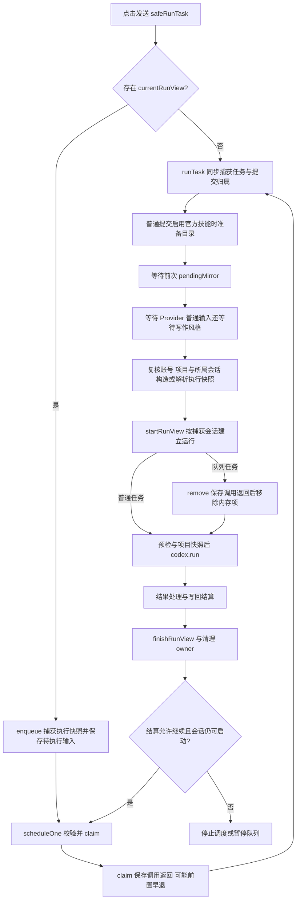

# 运行状态、队列与恢复

初始参考源码基线：`main@2073ae74747431aab8d529803d4e9f8197262388`；初始参考包版本 `2.5.0`。当前行为随本仓库实现维护。
阅读入口：[架构总览](README.md) → [功能定位表](feature-map.md) → 本文。
Auto 写入和 Undo 的页面操作链见 [Auto 编辑与撤销](auto-edit-undo.md)。

## 1. 本页用途

本页回答四类修改问题：任务如何取得执行配置、状态由谁修改、刷新后如何恢复、Undo 能力如何保存和重建。
定位时优先查符号，再扩展到相邻模块；`contentRuntime.js` 仍包含编排和依赖装配，文件体量不能代表全部领域所有权。

## 2. 身份和状态分别表示什么

| 概念 | 含义与保存位置 | 修改时的约束 |
|---|---|---|
| `accountScopeId` | 派生的账号作用域；活动运行句柄捕获为 `runAccountScopeId`，持久会话记录保存 `accountScopeId` | 缺少身份时，涉及账号隔离的持久化拒绝提交 |
| `projectId` / `runProjectId` | 当前页面项目 / `startRunView` 建立记录时捕获的运行项目 | 建立记录后的页面切换不改变后者；此前的等待与复核见 3.1 |
| `sessionId` | 插件对话容器，包含草稿、历史、runs、pendingInputs；`runTask` 在首次等待前捕获提交所属会话 | `startRunView` 按捕获 ID 建立记录，切换可见会话不迁移该运行 |
| `runId` / `recordId` | 一次插件任务的记录身份 | 重试、队列提升和恢复需要明确记录边界 |
| `requestId` / `nativeRequestId` | 一次 Native RPC 请求身份 | 关联消息路由、取消和后台 journal |
| Native `threadId` | Codex 或服务端对话线程 | 可供后续轮次续接，不等同插件 session |
| Native `turnId` | 线程内一次活动模型轮次 | 即时指导须携带预期 turn，避免送入下一轮 |
| view generation | 一次加载或页面路由的代次 | 拒绝旧页面异步结果覆盖新视图 |

持久化视图身份可记为 \(I_v=(accountScopeId,projectId,generation)\)，运行归属可记为 \(I_r=(projectId,sessionId,runId)\)。
generation 类似取号单上的批次：同一个项目重新加载后，旧批次返回的数据仍需重新判定。
实现中有 scoped transaction 的 generation，也有 `spaRouteGeneration`；两者承担相邻守卫职责，不能直接互换。
入口为 [contentRuntime.js](../../extension/src/content/contentRuntime.js) 的 `deriveAccountScopeId`、`startRunView`、`onSpaRouteChange`，及 [scopedPersistenceTransaction.js](../../extension/src/shared/scopedPersistenceTransaction.js) 的 `beginHydration/isCurrent`。

`startRunView` 在新建记录及 `currentRunView` 上捕获 `runAccountScopeId`，供活动运行和导航后结算使用。
该字段未进入 [sessionState.js](../../extension/src/shared/sessionState.js) 的 `normalizeRun/compactRunForStorage`，也未进入 [storageDb.js](../../extension/src/shared/storageDb.js) 的 run 压缩白名单。
持久账号身份位于 `StorageDb.buildSessionRecord` 生成的会话外层；重载后应核对所属会话及提交 scope，不能假定每条 run 都保留账号字段。
[postNavigationSettlementWiring.test.js](../../test/postNavigationSettlementWiring.test.js) 检查 runtime 源码中的捕获和参数传递；[sessionPersistenceAccountIsolation.test.js](../../test/sessionPersistenceAccountIsolation.test.js) 使用模拟存储检查账号过滤，二者各自覆盖不同边界。

| 状态领域 | 权威所有者 | 消费者与限定 |
|---|---|---|
| 会话与运行内存状态 | `contentRuntime`，归一化规则由 `SessionState` 提供 | 会话列表、运行卡片、持久化快照 |
| 当前运行的编排句柄 | `currentRunView` | 包含原身份、DOM 引用及 Native 绑定；DOM 文案只作投影 |
| 排队输入 | `RunInputQueue` 的值与 `RunQueueScheduler` 的调度 | composer 队列卡、claim 元数据、会话记录 |
| 已捕获执行选择 | `RunExecutionSnapshot` | run record、队列 payload、Native providerSelection；白名单固定范围与捕获时机见 3.1 |
| Native 执行与项目锁 | Native task runner；content 保存绑定信息 | Native 完成后，页面写回仍可能继续 |
| 写回证据与后续操作 | `WritebackSettlement`、`SettlementFacts` | 运行报告、Accept/Undo、重试能力 |
| 共享历史的持久副本 | 后台共享库及 scoped persistence 协调 | 活页内存、最近项目与被动刷新均为消费方 |

运行状态回答“该运行执行到哪一步”；Native turn 回答“模型当前接收哪个输入”；写回结算回答“文件发生了什么、证据到哪一步”。
`applied/readBack/saved/mirrored/compiled/settled` 是不同证据维度，不能由 `run.status === completed` 推导全部成立。
结算入口见 [writebackSettlement.js](../../extension/src/shared/writebackSettlement.js) 的 `settle`，历史投影见 [settlementFacts.js](../../extension/src/shared/settlementFacts.js) 的 `projectRunSettlement`。

## 3. 从提交到下一项队列

真实入口位于 [contentRuntime.js](../../extension/src/content/contentRuntime.js)：`safeRunTask → runTask → startRunView → sendTrackedCodexRun → finishRunView`。
`safeRunTask` 遇到活动运行时调用 `queueComposerInput`；活动更新安装期间阻止新提交。
`runInputCoordinator` 是该文件中的变量，创建者为 [runQueueScheduler.js](../../extension/src/content/runQueueScheduler.js) 的 `createCoordinator`，没有独立同名源码文件。

### 3.1 执行快照

`runTask` 在首次 await 前读取面板，捕获任务、所属 sessionId、提示词使用的会话投影、threadId、原草稿与编辑重发来源，同时捕获面板字段、附件、选区、指令和技能加载设置。`RunController.captureSessionContext` 深拷贝 `state.session`；该投影与可见活动会话的后续变化分开。
普通提交启用官方技能时，先与面板预取共享等待 `primeCodexOverleafSkillsCatalog`，用提交时捕获的启用表生成技能 ID；加载失败沿原启动错误流程停止，保留草稿。随后等待前次写回的 `pendingMirror`，让旧镜像收尾事件仍归原运行，再准备 Provider 与写作风格。风格快照仍在准备完成后捕获；队列任务使用原 `queuedInput.text` 并恢复 payload 中的执行快照，白名单字段不重新取当前控件值。
准备完成后复核账号、项目、提交所属会话仍存在且没有另一运行；`startRunView({sessionId,sessionContext,codexThreadId,...})` 按该会话 ID 更新记录，只有该会话仍可见时才把卡片追加到当前日志。`safeRunTask` 用 `runSubmissionPending` 防止准备期重复启动；已有运行时仍交给队列入口。
建立 run 后等待 audit 草稿，继续复核账号/项目才进入草稿清理及后续普通或 skill-installer 分支。`currentRunView` 保存所属会话投影与线程。普通 `buildCodexRunParams` 及 skill-installer 分支均从该投影构造 `params.session`，Native 的 [codexPromptAssembly.buildCodexTurnPrompt](../../native-host/src/codexPromptAssembly.js) 消费对应 id/history。这两条入口共用 `sendTrackedCodexRun`，在兼容性等待前捕获原运行句柄及 AbortSignal，并把 `assertCurrent` 传给 `NativeCompatibilityController.ensureForMethod`。该回调在 `bridge.ping` 返回后、兼容评估及阻止提示前核对取消、owner 和运行账号/项目；sender 得到 gate 后再次核对，才消费成功或拒绝结果。旧运行的迟到成功、迟到不兼容提示均不能进入下一运行；通用非运行 RPC 未自动继承该回调。
清理输入使用带 submission 的 `clearTaskComposer`：原所属会话草稿须仍匹配已提交值；当前仍显示该会话时，还核对文字、附件、技能调用、选区、选区代次与在途附件。输入已变化则保留；已经切到另一会话时仅条件清理原会话的 task，不清新会话 composer。队列提升跳过这次清理。

当前快照的执行字段为 mode、Provider ID/revision、model、reasoning、speed、自动编译、Track、focusFiles、选区和写作风格，另含 schemaVersion、capturedAt、source 等元数据。
schema 与入口见 [runExecutionSnapshot.js](../../extension/src/shared/runExecutionSnapshot.js)，内部归一化见 [runExecutionSnapshotCodec.js](../../extension/src/shared/runExecutionSnapshotCodec.js)。
[RunInputQueue](../../extension/src/shared/runInputQueue.js) 在新任务入队时另存 `payload.submissionContext`：项目指令、技能加载开关、单次技能调用和已启用插件技能 ID。该白名单经 normalize、claim 与持久化压缩保留，文字不按秘密样式替换；既有本地路径显示规则与长度预算分别执行，字段与正文一起计入队列容量预算。项目文件仍在任务执行时读取。
队列提升调用 `runTask({ queuedInput })` 时只消费排队项捕获的额外上下文，附件固定为空；入队入口继续拒绝带附件输入。因此后来 composer 的附件或技能不会被旧任务采用，也不会把原任务转入后来选择的 installer 分支。普通提交在首次 await 前捕获技能启用表，目录准备完成后生成本次 ID，与指令及技能开关一起供首次请求和重试使用；队列提升保持原捕获 ID。
旧队列缺少 `submissionContext` 时在存储中保留缺失形式，避免默认对象增加字节后裁掉接近容量上限的旧项；执行时采用空指令、无单次技能、关闭额外技能加载和空启用列表，不从后来草稿补值。真实装配见 [contentRuntime.js](../../extension/src/content/contentRuntime.js) 的 `initializeRunQueueScheduler/runTask/buildCodexRunParams`。
Provider revision 标识同一个服务配置的版本；排队后配置被修订或删除，执行校验可报冲突或不可用，避免悄悄换用后来的配置。
浏览器执行入口是 `RunExecutionSnapshot.resolveForExecution`；`RunInputQueue.claimNext` 消费校验结果，`RunQueueScheduler.scheduleOne` 在冲突时保留输入并暂停。
Native 还会在 [providerRuntime.js](../../native-host/src/providerRuntime.js) 的 `resolveRunProvider/resolveRunProviderForRun` 重新核验，调用方为 [taskRunnerRuntime.js](../../native-host/src/taskRunnerRuntime.js)。模型目录查询 `resolveProviderModels` 与实际执行校验分别承担职责。
快照固定配置身份和选择，不保存完整旧 Provider 配置或凭据。原 Provider 被修改或删除时，旧任务可能被拒绝；不能承诺它始终可按旧配置启动。
[projectProviderSelection.js](../../extension/src/content/projectProviderSelection.js) 的 `commit` 更新未来默认值与会话线程绑定，保留已有队列及运行历史。
**维护目标**：新增运行选项同时检查 capture、queue payload、clone、持久化压缩和 Native 消费端，避免某一条路径丢失字段。
若扩大“提交后固定”的范围，应将新字段纳入对应快照或 submissionContext，并补齐全链验证。[runExecutionSnapshot.test.js](../../test/runExecutionSnapshot.test.js) 覆盖快照字段；[runInputQueueSnapshotRegression.test.js](../../test/runInputQueueSnapshotRegression.test.js) 覆盖队列压缩，其启动检查采用源码字符串断言，不能证明全部输入已冻结。
[queueSubmissionContext.test.js](../../test/queueSubmissionContext.test.js) 覆盖排队输入、暂停恢复、持久化白名单、旧队列预算与后来草稿隔离；[runSubmissionOwnership.test.js](../../test/runSubmissionOwnership.test.js) 串联实际 runtime 函数、SessionManager、参数构造和 Native prompt，覆盖镜像/Provider/风格/audit 等待中的会话切换、草稿保留及派发身份；I/O 与 DOM 使用替身，真实浏览器交互仍需验收。

### 3.2 队列状态与 claim

[runInputQueue.js](../../extension/src/shared/runInputQueue.js) 定义 `queued/paused/claimed/executing/steering`；schema 能表示某状态，不代表正常流程会长期保存该状态。
队列采用 FIFO，容量和文本预算由同一模块管理；composer 附件在入队入口被拒绝。
`claim` 是执行领取凭据，类似仓库提货单：item ID、writer、claim token 与版本共同限制谁能消费该条任务。
`scheduleOne` 的顺序为 Provider 准备 → `claimNext` → 等待 claim 保存调用 → `startQueuedInput`；保存抛错时不会启动任务。
实际是否发生持久提交还受第 4.3 节入口早退限制，不能只依据 Promise 正常返回证明 claim 已写入。
`runTask` 建立 run 后调用 `markExecuting`，等待 remove 保存调用正常返回后从 pendingInputs 和队列 UI 移除该项；前置早退是否真正提交仍需单独核对。
提升失败时保留恢复机会、暂停队列并尝试 restore；不能只隐藏卡片后假设所有权已经转移。
普通并发保存还需保留等待期间新增的其他输入，相关回归定义位于 [runQueueSchedulerDurability.test.js](../../test/runQueueSchedulerDurability.test.js)。

**队列恢复与显示分开完成。** `init` 加载持久会话、建立调度器并恢复 journal，恢复流程把所属会话队列暂停。`applyStateToPanel` 在同步会话和运行历史后调用 `renderPendingInputs`，让初始化、恢复和会话切换立即显示当前会话的队列；暂停项同时呈现 Resume，空队列清除旧卡并隐藏容器。该重绘只更新界面，不保存队列、不解除暂停、不启动任务。composer 输入和运行状态变化也会触发重绘。视图链路见[队列显示与恢复入口](ui-and-loading.md#pending-queue-render)；[pendingQueuePanelRestore.test.js](../../test/pendingQueuePanelRestore.test.js) 组合真实面板同步、coordinator、队列视图与会话切换，DOM及持久化I/O使用替身。

即时指导由 `createCoordinator.guide` 发送 `codex.steer`，绑定 request、project、thread 与 `expectedTurnId`。
该入口对本次 `item.text` 调用同一 `SensitivePreflight` 的 guidance 分支，按现有项目扫描开关和确认策略决定是否继续；不扫描项目文件、镜像或完整 prompt，也不向原运行追加完成报告。
Native 的 [taskRunnerRuntime.handleCodexSteer](../../native-host/src/taskRunnerRuntime.js) 检查活动绑定、传入的预期 thread/turn、非空文本与长度，再经 [codexSessionRunner.publishActiveTurnControl](../../native-host/src/codexSessionRunner.js) 的 control 发送 `turn/steer`；这两层均未补做敏感扫描。
预检、确认、保存和兼容性查询后的实际派发前均复核取消状态、账号/项目/路由、session/item 与活动 request/thread/turn；等待期间归属改变则停止发送，并沿原队列补偿路径保留仍属于该次尝试的文字。首次任务的扫描结果不能覆盖后来追加的指导。材料与入口范围见[上下文与治理](context-and-governance.md#3-扫描实际覆盖的材料)。
指导成功后移除队列项并写入所属 run 的指导事件；发送结果不明时进入 `steer_delivery_unknown` 暂停状态。
**发送前保存失败。** `createCoordinator.guide` 只接纳 `queued` 项，先标为 `steering` 并保存 transition，再调用 `sendSteer`。这次保存拒绝时，补偿核对捕获的账号、项目、路由代次及 session/item 身份，仅把仍属于本次尝试的 steering 项恢复为 queued，并尝试保存恢复结果；等待期间新增、删除、替换或已暂停的条目保持各自状态。恢复保存再次失败时，当前页面仍保留任务文字和操作入口，原错误继续上抛，不能据此宣称持久恢复成功。发送结果未知的暂停项需经显式 Resume 恢复资格，直接 Guide 不会再次派发。
[guidePersistenceRecovery.test.js](../../test/guidePersistenceRecovery.test.js) 串联 Guide、runtime 保存和作用域事务，覆盖发送前各保存阶段失败、补偿失败、身份变化和恢复后的队列提升；持久 I/O 与 Native 使用替身，真实 Chrome 仍需单独验收。
指导投影入口为 [runGuidanceController.js](../../extension/src/content/runGuidanceController.js)，应同时检查队列卡、活动 transcript 和最终输入摘要的去重。

### 3.3 取消与继续条件

`cancelActiveRun` 同时触发本地 AbortSignal、Native `codex.cancel` 和 Page `cancelActiveWrite`。
三层分别负责终止本地编排、请求停止执行进程、停止页面剩余写入；取消送达与外部进程已经退出应分别判定。
运行 finally 传入 `continueQueue: runCancellationRequested`，因此主动取消后允许调度下一项；普通失败默认暂停。
`afterSettlement` 还会在 completed 时继续；`scheduleOne` 再检查是否已有活动运行、会话是否仍被选中、页面是否仍是项目编辑器。
因此“取消后继续”仅描述当前调度策略，不能解释为任何导航、会话切换或失败环境下均自动启动下一项。
取消生命周期和失败通知是不同语义，已有定义见 [runCancellationLifecycle.test.js](../../test/runCancellationLifecycle.test.js)。

## 4. 会话存储与跨页面并发

### 4.1 两条存储路径

[storageDb.js](../../extension/src/shared/storageDb.js) 返回 `SharedSessionBridge.decorate(...)` 包装后的接口。
[sharedSessionBridge.js](../../extension/src/shared/sharedSessionBridge.js) 的 `enabled` 在受支持 Overleaf HTTPS `/project` 路由启用共享历史。
此时 sessions、会话删除、相关索引查询和 scoped 元数据经扩展消息进入 [backgroundSharedSessions.js](../../extension/src/backgroundSharedSessions.js)。
后台数据库 `codex-overleaf-shared-sessions` 属于扩展源，sessions 主键为 `[accountScopeId,id]`，项目索引为 `[accountScopeId,projectId]`。
`auditLogs/turns/events/artifacts` 仍走原站点数据库；不能把整个 StorageDb 一概描述为全部迁入后台。
非共享路径继续使用旧站点源数据库；共享迁移只导入明确属于当前账号且具有项目身份的记录。
迁移按账号和来源站点记录完成状态，未知账号的旧记录保留；同 ID 冲突可能生成去除危险操作能力的恢复副本。

#### 数据对象、作用域与保留规则

存储版本、迁移完成标记和记录保留上限分别回答“结构如何读取”“哪些来源已导入”“哪些材料仍可恢复”。TTL 指按时间到期清理，条数上限则按容量淘汰；两者也应分别核对。修改这些规则时，应沿对应 writer、reader 和清理入口检查，不能只修改数据库版本号。

| 对象与实际 key | 写入、读取权威 | 保留与清理边界 |
| --- | --- | --- |
| 扩展 IndexedDB `codex-overleaf-shared-sessions` v1：`sessions`、`tombstones`、`migrations` | [backgroundSharedSessions](../../extension/src/backgroundSharedSessions.js) 的 `writeMany/list/erase`；session 和墓碑按账号/会话，迁移按账号/origin | 删除保留墓碑；清空账号还写 `origin:'*'` 的 `clearedAt`，阻止旧导入及旧会话恢复。当前未设置这些记录的自动 TTL |
| 站点 IndexedDB `codex-overleaf` v3：`sessions`、`auditLogs`、`turns/events/artifacts` | [StorageDb.STORES/openDb](../../extension/src/shared/storageDb.js)；共享 decorator 只替换 sessions 路由，站点 sessions 可作为旧备份 | 共享清空删除当前账号的旧 session 备份，并清空当前站点全部辅助 stores；单会话删除未级联清理 audit。turns/events 的历史拆分链尚未使用其 builders/event buffer；artifacts 另保存独立附件草稿及清理 epoch |
| `codexOverleafPrefs` | [StorageMigration](../../extension/src/shared/storageMigration.js) 的 `loadPrefs/savePrefs`；`PROJECT_SCOPED_PREF_MAPS` 列出的五类映射使用 `account:…:project:…`，其余字段仍在全局对象内 | 旧无账号项目偏好由首次访问账号认领；`storageSchemaVersion` 是全局字段。它与共享库 migrations 的完成标记独立 |
| 站点 `artifacts` 的 `composer-attachment-draft:` 前缀记录 | [ComposerAttachmentDraft](../../extension/src/shared/composerAttachmentDraft.js) 使用完整账号/项目元组，记录再次校验身份；revision/epoch 在同一事务比较与写入 | 小附件按既有限额保存；与共享 session 分离，跨源不共享。清理辅助库原子推进 epoch，旧自动保存不能恢复清理前附件，详见[附件恢复](ui-and-loading.md#多附件异步预算与恢复) |
| `codexOverleafGlobalPrefsV1` | [GlobalPreferences.createStore](../../extension/src/shared/globalPreferences.js) 的 schema/revision；初次读取从旧 prefs 复制允许字段 | 后续字段 patch 递增 revision；旧会话 autosave 不拥有这份全局偏好，详见[配置作用域](ui-and-loading.md#3-配置作用域按写入路径判断) |
| `codexOverleafPanelState:project:<id>` 旧 blob；其后加 `:account:<encoded-id>` 的 fallback | [StorageKeys.getProjectStorageKey](../../extension/src/shared/storageKeys.js)、runtime `buildScopedFallbackStorageKey/loadStoredStateForProject` | 旧 blob 仅在对应迁移分支完成后移除；fallback 必须匹配账号，`prepareCompactFallbackState` 清空 task、sessions、runs 和附件，不能恢复完整历史或替代附件草稿 store |
| `codexOverleafLegacyPanelMigration:<encoded-source-key>` | `StorageMigration.runMigrationIfNeeded` | 来源 blob 的账号认领及完成状态；失败可由原账号重试，清理旧 key 失败不能触发再导入；未设置自动 TTL |
| `codex-overleaf-scoped-persistence-v1:<account>:<project>` | [ScopedPersistenceBrowserAdapter](../../extension/src/shared/scopedPersistenceBrowserAdapter.js)、后台 `meta-read/meta-write` | 保存 fence/receipt、queue claims 和墓碑；[QueuePolicy](../../extension/src/shared/scopedPersistenceQueuePolicy.js) 在冲突判断中将超过60秒的 claim 视为过期，移除队列项时保留最多500个 queue 墓碑；事务合并 session 墓碑时保留200个 |
| `codexOverleafSessionTombstones` 与 `codexOverleafSessionTombstone:v2:<project>:<session>` | `StorageMigration.collectSessionTombstones/addSessionTombstones`、[SessionPersistence.writeSessions](../../extension/src/content/sessionPersistence.js) | 兼容墓碑按项目组织，未编码账号；合并读取视图每项目最多100个删除 ID，v2 条目按删除时间裁剪。裁剪未重写旧聚合 key，不能将100视为两种物理副本的总上限；与后台账号墓碑、scoped meta 墓碑分别维护 |
| `chrome.storage.session` 中 `codex-overleaf:run-journal:<requestId>` | [background](../../extension/src/background.js) 的 `queueJournalWrite/listRunJournals/acknowledgeRunJournal` | `trimRunJournal` 按300事件及512 KiB估算预算淘汰事件，读取最近16个可恢复项；ack 删除，内存超过16项时清理已终止或失主记录。该存储区域与持久 local/IndexedDB 寿命不同 |
| `projectNameCacheByAccount`；页面 shared-session baseline | [RecentProjects](../../extension/src/content/recentProjects.js) 的名称映射；`SharedSessionBridge` 的内存 Map | 名称缓存按账号/项目读取，全清时删除整个 key；baseline 仅存于当前页面，用于三路合并，不能充当持久备份 |

`auditLogs` 的写链为 runtime `createAuditDraftForRun/finalizeAuditRecord` → `AuditRecords` → `StorageDb.buildAuditLogRecord`，记录捕获运行的 account/project/session/turn，更新时保留原归属。它们不会随共享 sessions 跨 origin 导入，也没有自动 TTL；历史视图最多投影50条、诊断最多导出12条。这两条路径都先按 projectId 读出全部 audit，再过滤及裁剪，输出限额不能证明数据库读取量有界。诊断只导出捕获账号的记录，旧无账号记录不自动认领；历史视图以可见会话关联兼容旧记录，同时拒绝明确异账号审计。详见[审计和诊断消费](context-and-governance.md#5-审计和诊断消费)。

#### 旧 panel blob 的迁移门控

旧 blob 是保存在单个 key 下的整块面板状态。`loadStoredStateForProject` 调用 `StorageMigration.runMigrationIfNeeded(projectId, legacyKey, accountScopeId)`；迁移在项目偏好锁内读取来源、当前会话和墓碑。全局 `storageSchemaVersion` 只描述 schema，不代表所有项目的旧 blob 已处理；即使版本达标，仍检查当前来源。
`codexOverleafLegacyPanelMigration:<encoded-source-key>` 独立记录 sourceKey、projectId、accountScopeId 和 complete。首次导入前先认领来源；记录写入失败时保留认领和原 blob，由同账号重试，其他账号不能接续认领。来源内已有明确异账号身份或标记身份冲突时，不把数据导入当前账号。
迁移仅补入当前主库尚无且未被墓碑删除的会话，保留已有会话的新内容。主库返回的记录身份确认后保存偏好，再标完成并尝试删除旧 key；删除失败仍保留 complete，避免旧 blob 反复导入。较晚项目的导入保留当前全局偏好，当前有效的活动会话选择优先。已有完成标记不能证明旧 key 已物理移除，来源认领也不能代替主库成功回执。
[storageLifecycleRoundtrip.test.js](../../test/storageLifecycleRoundtrip.test.js) 覆盖先后打开两个旧项目、写入/偏好/清理失败、重试和账号隔离；[storageMigration.test.js](../../test/storageMigration.test.js) 与 [storageMigrationAccountIsolation.test.js](../../test/storageMigrationAccountIsolation.test.js) 检查转换及认领兼容。测试中的浏览器存储 I/O 使用替身；共享库按账号/origin 的 migrations 与该来源标记分别维护。

### 4.2 锁、版本与三路合并

共享写入使用长连接 port 取得后台锁，账号级 state 锁串行化跨项目清理与写入。
port 断连后标记 disconnected，受 `ensureLock` 保护的后续请求拒绝接纳；已接纳的事务仍可能完成，锁等待 `inFlight` 清零后释放。
`meta-write` 使用独立的 token/tabId 判断，当前未复用 disconnected 检查，不能把会话写入守卫推广到全部共享方法。调用方也会拒绝断连后的新锁内请求，锁转交后旧 token 失效；排查须区分请求发送、后台交付及锁仍被 inFlight 保留的时点，不能仅凭服务端分支差异认定新持有者状态已被覆盖。
后台还校验扩展身份、页面来源、顶层 frame 和锁 token；共享入口不可绕过这些检查降级成站点本地写入。
传统 adapter 使用 `navigator.locks`；缺少可用跨上下文锁时拒绝持久提交。
实现入口为 [scopedPersistenceBrowserAdapter.js](../../extension/src/shared/scopedPersistenceBrowserAdapter.js) 的 `createBrowserAdapter`。

锁保护当前临界区；版本比较负责识别先前读取已经过期的快照，两者用途不同。
Scoped transaction 的 `revision` 跟踪总体提交，`queueRevision` 单独处理队列变更，允许明确区分一般重基与队列认领冲突。
比较并交换（CAS）的简化条件为 \(r_{captured}=r_{stored}\) 才可按原队列版本提交；不匹配返回 `queue_revision_conflict`。
`ScopedPersistenceQueuePolicy` 执行 claim/release/remove/restore 等规则，`SessionPersistence.applyQueuePolicy` 保留其他 writer 拥有的队列记录。
入口见 [scopedPersistenceQueuePolicy.js](../../extension/src/shared/scopedPersistenceQueuePolicy.js) 与 [sessionPersistence.js](../../extension/src/content/sessionPersistence.js)。

后台 `mergeValue(base,current,incoming)` 做三路合并：未改字段保留最新远端值，双方同改为相同值可合并，冲突拒绝提交。
`runs/pendingInputs` 根据稳定 ID 合并；时间字段和只追加数组另有规则，不能依赖通用“最后写入覆盖”。
墓碑（tombstone）表示“已删除”，用于阻止迟到快照复活会话或已移除输入；它与简单缺少一条记录的含义不同。
删除会话入口 `SessionManager.deleteSessionWithConfirm` 传入 `deletedSessionIds`，后续删除及持久化必须保持墓碑语义。

### 4.3 提交步骤与降级限定

`saveState` 捕获 state 快照 → `ScopedPersistenceCoordinator.commit` → `ScopedPersistenceTransaction.commit`。
事务顺序为：检查视图和版本 → 写 pending fence → 执行偏好/会话保存 → 写 durable receipt。
fence 像“提交处理中”的凭证，receipt 标记配套数据写入已完成；中途失败通过后续提交识别、恢复或拒绝继续。
该流程协调多个步骤；后台会话批次自身另有 IndexedDB transaction，两个事务层不能混同。
源码见 [scopedPersistenceCoordinator.js](../../extension/src/content/scopedPersistenceCoordinator.js)、[scopedPersistenceTransaction.js](../../extension/src/shared/scopedPersistenceTransaction.js) 和 [scopedPersistenceReceipt.js](../../extension/src/shared/scopedPersistenceReceipt.js)。

`persistPanelState` 使用事务捕获的账号和项目，`SessionPersistence.writeSessions` 再核对所属账号、墓碑和更新版本。
进入事务后的 queueMutation 或 reviewRunIds 保存失败会向调用者抛出；普通保存存在紧凑 fallback，不能据此宣称完整历史一定耐久。
日志恢复使用 `saveState({recoveryRuns})` 的显式成功回执：只有作用域提交成功，且 `ScopedPersistencePanelState.persistPanelState` 核对 `SessionPersistence.writeSessions` 返回记录中目标 run 的身份、事件序号、线程/轮次、中断草稿与应保留事件后，才返回 `true`。入口早退、原恢复账号/项目与提交事务作用域不匹配、主库失败和 fallback 都不会提供此回执；目标比较基于实际构造的持久化投影，仍受既有 StorageDb 保留预算约束。
`saveState` 在项目缺失或运行已导航分离的入口守卫，对 requireDurable 或 reviewRunIds 明确抛错；queueMutation 仍可正常返回而跳过提交。
因此调度器等待保存 Promise 与获得 durable receipt 需要分别判断；入口早退与队列提升的可达时序需要组合验证，尚不能据此断言任务已经丢失或重复执行。
`finishRunView` 尝试在终态展示前刷新排队保存，但调用存在错误捕获；“任何存储失败下均能即时重载同样终态”仍需单独验证。
**维护目标**：新增强持久化操作应选择明确失败可见的保存入口，不应仅调用延迟保存后给出成功保证。

#### 两套压缩预算与实际消费者

`saveState` 同时捕获原始 `stateSnapshot` 和 `SessionState.prepareStateForStorage` 生成的 `compactStateSnapshot`。[ScopedPersistencePanelState.persistPanelState](../../extension/src/content/scopedPersistencePanelState.js) 仅从 compactState 提取轻量偏好；sessions 从原始 `state.sessions` 经 `StorageDb.buildSessionRecord` 构造，再交给 `SessionPersistence.writeSessions`。因此两套压缩常量不构成连续收紧的同一管道。

| 路径 | 当前预算及裁剪依据 | 实际消费范围 |
| --- | --- | --- |
| [SessionState.prepareStateForStorage](../../extension/src/shared/sessionState.js) | `STORAGE_DEFAULT_LIMITS` 默认12会话、每会话10 runs、每 run 120事件；估算结果超过4 MiB时改用 `STORAGE_AGGRESSIVE_LIMITS` 的4会话、3 runs、20事件 | 主提交只提取其轻量偏好；该结果还参与 fallback 构造。4 MiB是切换压缩模式的目标，激进分支不继续循环直到达到某个总字节上限 |
| [StorageDb.buildSessionRecord](../../extension/src/shared/storageDb.js) | `SESSION_STORAGE_LIMITS` 保留最近10条 history、20 runs、每 run 300事件；各文本字段另有长度约束 | 主 sessions 记录的实际裁剪；该 builder 未采用前一行的会话总量或总字节目标 |
| [StorageRunActions.compactRunsForStorage/compactRunActionPayload](../../extension/src/shared/storageRunActions.js) | 启用 `preserveRunActionPayload` 后，在保留的20个 run 内按新到旧分配每会话16 MiB核心动作总预算；完整 record 的传输余量可进一步收紧，可选 captures 在核心材料分配完成后使用余量 | 主 session 中的 Undo/Accept 恢复能力；保留 run 的显示记录不代表其动作材料仍在 |

**当前容量边界。** compactState 的摘要与激进压缩提示仍服务于各自消费者，主 sessions 的较长历史文字不通过它做额外有损裁剪。排查主保存容量应检查真实 `putRecords` 的 record/base 及传输编码；`StorageValuePruning` 只删除摘要空字段，保留 `false/0`，不执行容量回收。

`SessionState` 的活动投影、`StorageDb` 的主会话正文及后台 journal 的恢复文字不再按凭据形状替换用户/模型内容。排查回答或示例在刷新后丢字时，应分别检查这三条链和 Native 子代理的 `subagentTelemetry.publicText`；本地路径投影、字段长度限制、fallback 摘要与显式审计仍有各自范围，不能把保留正文解释为无限保存。已持久化为 `[REDACTED_SECRET]` 的旧文字不具备自动恢复原值的材料。

[SharedSessionTransfer](../../extension/src/shared/sharedSessionTransfer.js) 为 bridge 和后台提供同一份传输预算。UTF-8 字节数描述序列化数据的大小，JavaScript `string.length` 统计 UTF-16 码元；汉字等字符使两者不同。旧规则按 `JSON.stringify(entries).length * 2` 估算24 MiB，其合法输入实际可达36 MiB UTF-8，因此当前同时保留旧窗口。

| 对象 | 当前规则 |
| --- | --- |
| 普通 raw entries、新提交及合并后的单条 record | UTF-8 JSON不超过 `MAX_WIRE_BYTES`（24 MiB），或旧估算不超过24 MiB且实际字节不超过 `MAX_RECORD_BYTES`（36 MiB） |
| 超出 raw 窗口的完整 entries | 尝试 gzip/base64，经独立 `put-compressed` 方法发送；压缩 payload 仍不超过24 MiB |
| 解码后的完整 entries（包括 record/base） | 不超过 `MAX_DECODED_BYTES`（72 MiB加64 KiB封装余量）；流式读取越界即停止，另核对声明的解压字节数 |
| 旧 base | 受完整 entries 解码预算约束，可大于新 record 上限，允许读取较大旧记录后缩减再保存 |
| 新写入返回的完整记录数组 | `MAX_RESPONSE_BYTES`（36 MiB），包含新增 `sharedRevision`；同一事务提交前累计检查 |

这些是业务载荷、解压及新写入回执的预算，外层 scope/clientId/reviewRunIds 等信封未计入24 MiB，不能当作整条 Chrome 消息的平台上限。原 raw 兼容窗口直接使用 `put`，无需压缩 API；其余载荷缺少 API、损坏或压缩后仍超限时明确失败，不有损裁剪后宣称保存成功。
解码后的整批 entries 继续经过账号/项目、锁、墓碑、review 合并及三路冲突检查，在单次事务内写入。后台另检查合并后的最终 record 和累计返回数组，防止两份各自合法的输入合并后超限；任一检查失败均在提交前 abort，旧数据和 bridge 底稿保留。只有成功响应才推进底稿。旧后台不支持 `put-compressed` 时明确拒绝该方法，不能误报空批成功。
list/get 保持普通 JSON 读取；list 按实际 UTF-8 字节分页，单条较大旧记录可独占一页，没有新增36 MiB的旧读取硬上限。上述预算不保证任意旧存量都能继续保存：既有超大 base 加新记录仍可能超过解码预算，此时拒绝本次提交并保留旧材料；浏览器消息承载能力、磁盘配额与主库提交分别判断。

[storageLifecycleRoundtrip.test.js](../../test/storageLifecycleRoundtrip.test.js) 保留两份状态快照、真实 builder、writer、bridge、后台和 reader，检查大历史首次及重复保存时的正文与恢复材料；压缩只改变传输表示，不增加既有 Undo 材料的保留期限或额度。
[sharedSessionTransfer.test.js](../../test/sharedSessionTransfer.test.js) 检查 UTF-8 精确边界、压缩 API 缺失、畸形数据、有界解压、旧接收端拒绝及多记录冲突的原子性；后台在解码前后检查锁。该传输模块由 content entry 纳入 registry，并由 background 独立导入，新增传输格式时必须核对两条加载链。

[sessionState.test.js](../../test/sessionState.test.js)、[storageDb.test.js](../../test/storageDb.test.js) 和 [reviewingUndoPersistence.test.js](../../test/reviewingUndoPersistence.test.js) 分别定义压缩或恢复材料行为；[scopedPersistencePanelState.test.js](../../test/scopedPersistencePanelState.test.js) 使用 builder 和 writer 替身检查提交装配。验证容量路径时须串联两份快照、真实 builder、`writeSessions` 和最终写入参数；局部预算断言不能证明真实浏览器配额耗尽后的恢复能力。

### 4.4 会话创建、切换与删除

面板新建按钮由 [PanelRenderer](../../extension/src/content/panelRenderer.js) 绑定，列表选择、重命名和删除由 [SessionPanel](../../extension/src/content/sessionPanel.js) 绑定；[contentRuntime](../../extension/src/content/contentRuntime.js) 将 callbacks 接到 [SessionManager](../../extension/src/content/sessionManager.js)。后者修改内存状态，再调用 `saveState`；归一化和活动会话投影由 [SessionState](../../extension/src/shared/sessionState.js) 提供。
这里的空会话按 `isDisplayableSession` 判断：任务、运行、历史及真实标题均为空；名称为空并不足以判定整个会话为空。

| 操作与入口 | 当前状态变化与边界 |
| --- | --- |
| 新建：`startNewSession` | 先读取面板草稿；活动会话为空且空闲时复用原会话并聚焦输入框。需要新建时继承模式、Provider、模型、推理、速度和 Track 选择，切为活动会话后同步 Provider 并保存。 |
| 容量：`startNewSession`、`normalizeSessions` | 新建入口在当前数组已有 20 个会话时请求容量确认；确认后追加并取末尾 20 个。归一化也有 `slice(-20)`。这是该入口及内存数组的行为，不能推广为所有创建入口均有确认，也不能替代持久化压缩预算。 |
| 切换：`switchSession` | 保存原会话的面板输入，调用 `setActiveSession`，重绘、同步 Provider 并保存。新建或切换前发现活动会话有 running 记录时先提示；已建立的 run 记录保留显式归属；提示词上下文与准备等待窗口另见 3.1。 |
| 重命名：`commitSessionRename` | 合并空白并去除首尾空格；非空且不同于本地化占位标题及自动推导标题的值标记为 `titleSource: manual`，其余回到 `auto`。手动标题与自动标题的来源需要随保存保留。 |
| 删除空会话：`deleteSessionWithConfirm` | 运行中会话拒绝删除；空会话跳过破坏性确认。唯一空会话直接返回；还有其他会话时删除并携带 `deletedSessionIds` 保存，不请求 Native 线程清理。 |
| 删除有内容会话：`deleteSessionWithConfirm`、`deleteSession` | 确认后删除并携带墓碑保存；删除最后一个会话时使用重置文案并创建新的空会话，否则活动会话被删时选择剩余最近会话。保存调用返回后才请求 `codex.history.clearPlugin` 清理目标线程，Native 失败单独提示，不恢复已删除会话；普通保存的确认强度见 4.3。 |

`titleSource` 表示标题由用户固定还是随内容推导；墓碑表示删除决定，防止旧保存重新创建记录。这两个字段分别约束标题更新和历史恢复。
[sessionManagement.test.js](../../test/sessionManagement.test.js) 包含空会话归一化行为与新建、删除、重命名的源码路由断言；[sessionState.test.js](../../test/sessionState.test.js) 检查状态 helper；[sessionTombstones.test.js](../../test/sessionTombstones.test.js) 检查删除标记。它们不能替代确认弹窗、真实存储失败和跨标签删除的组合验证。dashboard 逐项目清理另由 [ProjectSessionCleanup](../../extension/src/content/projectSessionCleanup.js) 处理，范围见[界面与加载](ui-and-loading.md#历史查看清理与结果动作)。

### 4.5 清空历史后的内存与持久副本

设置入口 [PanelMaintenance.clearAllHistoryWithConfirm](../../extension/src/content/panelMaintenance.js) 检查本页 `currentRunView`、取得确认，再调用 `StorageDb.clearAllStores` 和项目名称缓存清理。共享账号会话、站点辅助库及 Native 历史的范围见[界面与加载](ui-and-loading.md#历史查看清理与结果动作)；这个设置入口未调用 Native 历史清理。

清库成功后，入口显式清除 `state.session` 兼容镜像、sessions/runs、旧活动 ID、task、focus、选区和附件，然后经 `normalizePanelState` 生成空白会话；不会再从旧摘要恢复 `recovered_*` 运行。新会话时间晚于清库完成时点，避免同毫秒创建被共享清理标记拒绝。
组合根的 `clearHistoryComposer` 同时清除控制器里的附件、技能、选区和待编辑重发来源，并更新空附件状态。清库成功后的名称缓存清理或新会话保存失败，不恢复已经删除的旧内存；面板仍重绘为空，并明确提示辅助清理或空白会话保存尚未完成。清库本身失败时保留原状态。
保存使用 `saveState({ requireDurable: true })`：缺项目、归属改变、stale view 或写入失败均拒绝，只有作用域事务提交成功才返回 true；普通 autosave 的紧凑 fallback 不作为该操作的成功证明。确认窗口关闭后还会再次检查当前运行，避免确认期间开始任务后继续清库。
[clearHistoryReset.test.js](../../test/clearHistoryReset.test.js) 串联真实 controller 与会话归一化，覆盖清理、取消、部分失败和同毫秒边界；[saveStateDurability.test.js](../../test/saveStateDurability.test.js) 检查严格提交与普通 autosave 的差异。存储 I/O 与 UI 使用替身，真实跨标签共享数据库及浏览器交互仍需单独验收。

## 5. 刷新恢复、旁观页与导航

### 5.1 共享历史中的运行 owner

`sendTrackedCodexRun` 创建 request 后调用 [activeTurnControl.js](../../extension/src/content/activeTurnControl.js) 的 `bind`，通过 run-owner port 关联原项目、session 和 run。
后台 journal 留存有限事件及 owner 状态；事件序号用于避免恢复时重复追加。
后台 owner 连接与 `ownerLost` 标记入口在 [background.js](../../extension/src/background.js) 的 run-owner port 处理和 `interruptOwnerlessRun`；client 的绑定需要与后台判定一同检查。
后台重建后，`restoreRunJournal` 经 owner 重新绑定或失主处理按需加载持久 journal，并核对 request/project/run/session 及可用的发送者身份；不会恢复 pending Native 请求或重新派发任务。合法活 owner 重绑与异步读取有代次保护，失主后补记 `ownerLost`；读取列表排除仍有匹配活绑定的日志。写入与淘汰统一按 requestId 排序，旧读取及快照不能越过删除重建记录。旧身份字段兼容、读取限额和跨重启残留条件见[后台 journal 生命周期](native-execution.md#journal-lifecycle)。
`normalizeLoadedPanelState` 在共享历史模式关闭通用的 running→interrupted 恢复，避免把其他活页拥有的运行当作中断；传统站点本地路径允许该恢复。
`recoverInterruptedRunJournals → ActiveTurnControl.recoverJournals` 在共享模式设置 `requireOwnerLost: true`。
Native terminal journal 可能早于 owner 页面的写回和存储完成，旁观页不能据此提前替它结算。
owner 丢失后，恢复流程补齐未读取事件、记录 `interruptedDraft`、暂停该会话队列，并返回带 account/project/session/run 身份的 `recoveredRuns`。显式属于另一项目或账号的会话、另一项目的 run 会被跳过；旧 run 缺少 runProjectId 时继承 journal 项目。
调用者等待 `saveState({recoveryRuns}) === true` 才 acknowledge；该回执要求第 4.3 节的主会话投影确认。失败、早退、原恢复账号/项目与提交事务作用域不匹配或仅 fallback 成功时，后台日志保留供后续重放，活页也可保留已回放内容。[background.acknowledgeRunJournal](../../extension/src/background.js) 在成功确认后删除内存及 session storage 的对应 journal；紧凑 fallback 不承担完整恢复材料的保存证明。
恢复保留历史证据；重新执行需经过新的运行入口，不能把 journal 回放当作重新启动原 Native 请求。
后台重建回归见 [backgroundJournalLifecycle.test.js](../../test/backgroundJournalLifecycle.test.js)；主库恢复回执入口见 [runJournalRecoveryDurability.test.js](../../test/runJournalRecoveryDurability.test.js)、[crossTabRuntimeRegression.test.js](../../test/crossTabRuntimeRegression.test.js) 和 [activeTurnControl.test.js](../../test/activeTurnControl.test.js)。durability 用例串联回放、runtime 保存、作用域事务、会话投影及后台 ack，覆盖主存储/fallback 故障和身份；存储、端口及 lease I/O 使用替身，真实 Chrome 和 IndexedDB 重载仍需验收。

共享加载另有两类依据已持久证据修复旧状态的路径，无需 `ownerLost`：

- [sessionState.js](../../extension/src/shared/sessionState.js) 的 `recoverSettledRunningRun` 要求有效 `finishedAt` 和末尾可见 completed/failed report；若 report 的解析时间晚于结束时刻则拒绝修复。该比较未单独拒绝无效 report 时间，不能概括为两端时间均已严格校验。`normalizeLoadedPanelState` 通过 `recoverSettledRuns: true` 启用它。
- `recoverRecordedRunFailure` 由 `normalizeRun` 调用，依据严格匹配的父运行后处理失败事件修复 failed 状态；事件类型、活动元数据、作用域及时间均参与检查，普通工具失败或子代理错误不足以触发修复。

这两条路径修正“证据已终结、标签仍为 running”的记录；journal 恢复负责 owner 丢失后的中断草稿。不能把两者统一解释为必须 ownerLost 才能改变运行状态。
恢复后的 `run.status`、报告内容和写回 settlement 仍须分别核对；缺项回执与失败分类的投影差异见[失败、结算与动作](ui-and-loading.md#failure-settlement-actions)。
相关测试为 [settledRunRecovery.test.js](../../test/settledRunRecovery.test.js) 和 [recordedRunFailureRecovery.test.js](../../test/recordedRunFailureRecovery.test.js)：前者结合归一化行为与源码装配断言，后者检查事件识别及 StorageDb 投影往返，均不覆盖真实跨页恢复。

[sharedSessionViewSync.js](../../extension/src/content/sharedSessionViewSync.js) 订阅跨页面变化，只在无活动运行、无保存、无本地草稿或未持久修改时刷新。
刷新前后核对 scope、generation、本地版本与签名。`SharedSessionViewSync.applySnapshot` 通过 runtime 注入的 `getState/setState/normalize/render` 应用快照；只有完整应用成功且 scope/保存代次仍有效，才调用 `adoptSharedSessionBaseline(records)`。单独读取 snapshot 不更新 baseline。
baseline 是下次三路合并的共同底稿。归一化与渲染失败时保留旧底稿；若渲染已经采用新 state 后失败，仅在该对象仍属于原 scope、内容未被后来编辑时回滚旧 state，并尽力恢复控件。回滚不能覆盖同步回调引起的新编辑或导航。这样，陈旧输入框被无关控件保存读回时，未改变的本地草稿仍可按旧底稿与远端变更合并；双方真正修改同一字段时仍遵守冲突规则。
同一通知下的失败最多自动重试一次；新通知可重新触发尝试，本地草稿、保存和导航守卫继续生效。持续 DOM 故障会保留错误提示，不提供无限重试或持久保存成功保证。
[sharedSessionRefreshRecovery.test.js](../../test/sharedSessionRefreshRecovery.test.js) 串联真实快照应用、输入回读、作用域事务和后台合并，覆盖早期/部分渲染失败、无关设置保存、失败重试及并发编辑。DOM、通知与存储 I/O 使用替身；真实 Chrome 中渲染故障的自然触发路径仍需单独证据。

### 5.2 离开项目后的 detached settlement

`onSpaRouteChange/leaveActiveProject` 更新可见项目、取消原项目活动写入并重绑观察器；旧运行仍携带捕获的身份。
普通 `saveState` 发现运行项目与当前 URL 不一致时跳过，防止旧会话写入新项目键。
`persistPostNavigationRunStatus` 在原项目仍活动时走普通保存；导航已分离时调用 `PostNavigationSettlementPersistence.persistRequired`。
该模块通过 `commitDetached(projectId,accountScopeId,...)` 建立独立提交视图，再按原 session/run 定位记录并检查账号、项目。
`detached` 允许原项目结算独立于当前视图，并不取消身份、锁或版本校验；账号已变化仍可能拒绝提交。
文件入口：[postNavigationSettlementPersistence.js](../../extension/src/content/postNavigationSettlementPersistence.js)、[scopedPersistenceDetachedCommit.js](../../extension/src/content/scopedPersistenceDetachedCommit.js)。
失败保留 `post_navigation_settlement_persistence_failed` 及恢复提示；不能把调用返回理解为原项目已经成功存储。

## 6. Undo 的持久化与重载投影

Undo 能力来自可用恢复材料和结算结果，不能只看 completed 或显示过某个按钮。runtime 的 `undoRun/undoRunTrackedChanges/acceptRun` 为薄入口，实际编排由 [RunReviewController](../../extension/src/content/runReviewController.js) 拥有。
关键字段包括 appliedOperations、undoOperations、undoBaseFiles、undoTrackedChanges、undoExpectedFiles；字段应按具体操作路径解释。
[storageRunActions.js](../../extension/src/shared/storageRunActions.js) 的 `hasReloadableRunActionPayload/compactRunActionPayload` 判定并保留这些材料。
当前 `preserveRunActionPayload` 在主记录保留的最近20个 run 中，由新到旧选择完整核心材料，每会话总量由 `MAX_PERSISTED_ACTION_BYTES_PER_SESSION` 限为16 MiB。超过预算的候选被跳过，较旧的小候选仍可保留；已接受或已撤销的写操作材料、分叉快照和无动作 Ask 不消耗核心恢复预算。所有核心候选选择后才考虑原有可选 `trackedChangeCaptures`；历史目录观测最后只使用剩余空间，不挤掉原恢复材料或 captures，且可独立于审阅终态保留。

`StorageDb.buildSessionRecord` 先计算实际显示记录开销，再检查动作材料加入后的 UTF-8 与旧 UTF-16 两条准入规则；中文长历史仍保留已有兼容窗口。`compactSessionBatchActions` 还按整批响应上限预留64 KiB，必要时优先活动会话、再按更新时间给其他会话分配恢复空间。跨会话也先分配各会话核心及既有 captures，再按剩余空间加入目录观测；总限额不变。它保留显示历史，省略的材料写入 `recoveryRetention: {state: omitted, reason, bytes}`，不会凭省略标记补造操作权限。已有超大历史或旧底稿仍可能使整批提交被拒绝；失败时沿原存储错误流程处理。

保存成功后，`StorageDb.projectRetentionUpdates` 仅向同账号/项目/路由代次且动作指纹未变的运行投影实际保留结果，必要时清除旧省略标记；不改内存检查点。卡片根据 `recoveryRetention` 提示持久恢复材料未保留，当前页面仍持有的有效材料可继续使用，刷新后的权限由实际恢复字段决定。`directoryCleanup:true` 表示目录观测材料被省略；同时有 `coreRetained:true` 时仅省略目录，不能宣称 Undo 核心材料丢失或把它当作核心缺失而恢复旧内存。真正降级丢弃核心时清除该标记。已接受或已撤销的文本终态仍可在已有详情内显示目录材料保留提示。旧版本已经丢弃的原文无法由新预算重建。
`SessionState.applyTrackedChangeStatus` 移去既无 refs、也无剩余文件结构 Undo 检查点的 pending；主 writer 和 reader 使用同一父作用域清理规则。旧 `manualReviewProof/writebackCheck` 字段在归一化时丢弃，不再单独保留 pending 或赋予恢复动作；真正的正文、refs、文件逆操作及终态按原规则处理。按钮还要检查实际材料，缺少材料的 Undo/Accept 入口会早退；不能仅凭存储中的 pending 或历史记录仍在推定操作可用。该裁剪影响插件恢复能力，不会直接撤销文稿内容，也不描述 Overleaf 自身的历史恢复范围。

`contentRuntime.undoRun` 先经 `UndoOperations.prepareRunUndo` 补齐有原文及已应用删除证据的旧文件恢复操作，再等待旧 mirror 刷新并选择恢复路径；页面调用始终携带原 runProjectId。文件结构恢复的已验证成功项经 `advanceUndoCheckpoint` 从逆操作和待恢复前像中移除，进度成功持久化后重载只保留未完成项；已被存储预算裁掉的原文不因此恢复。详细链路见[文件创建、删除与混合 Undo](auto-edit-undo.md#62-文件创建删除与混合-undo)及 [deletedFileUndo.test.js](../../test/deletedFileUndo.test.js)。
tracked Undo/Accept 经过 `applyTrackedChangeSettlement → ScopedPersistenceCoordinator.applyReviewTransition`。
[scopedPersistencePanelState.js](../../extension/src/content/scopedPersistencePanelState.js) 强制 preserveRunActionPayload 和 reviewRunIds，并验证持久记录中的结果。
保存失败时恢复先前材料、标记 needs_review 并继续抛错，因为页面操作可能已经发生。部分验证失败生成 `review_state_not_persisted`，底层保存异常也可能原样传播，不能只匹配单一错误码。
普通 Undo 的 `RunReviewController.applyLegacyUndoSettlement` 也等待明确的持久提交，通过 `reviewRunIds` 验证 `undoStatus`；partial 还核对剩余检查点。存储返回前保持操作锁和“正在撤销”，不提前显示 Undone。共享合并保护已持久的 applied，旧页自动保存不能复活已消耗的恢复状态。保存失败时仅补偿仍属同一 state、原记录且未并发变化的暂存字段，保留恢复材料与未完成状态；页面实际已发生的修改不会被该内存补偿自动逆转。

**执行中刷新。** `running` 可能经正常 debounce 保存，因此重载不能仅凭空的页内锁认定旧操作已结束。[RunReviewController.recoverInterruptedUndoStatuses](../../extension/src/content/runReviewController.js) 向共享后台查询原账号/项目/run 的 review owner。有活跃 port 或未到期派发租约时保持 busy，并按期限定时只读重查；新协议且确认无 owner 后只恢复显式重试入口，不自动执行 Undo。查询失败逐记录保留 busy 和检查点，不阻断面板初始化；每个视图最多三次自动失败查询，并提示连接恢复后重新加载。等待返回时核对原账号、项目、路由代次及捕获的 state/活动会话，旧结果不写入替换后的视图。同账号/项目/路由内发生 state replacement 或会话切换时，计时器重新捕获当前视图，旧等待只安排去重的只读重查；恢复 generation 防止旧调用覆盖新计时器，跨账号/项目/路由则丢弃。

新协议在派发前耐久保存 `undoOwnerProtocol:1` 并读回确认，字段经过主存储、摘要及 review merge 保留。旧版 `running` 没有该标记时，缺少新版租约不能证明另一个旧页面已停止；保留原 Undo 入口，并仅在该次原有 Undo 确认中说明旧页关闭/重载和文件检查要求。用户确认后才继续原基线守卫；取消不提前迁移为 partial，也不派发。共享最新的 partial/terminal 进度始终优先；只有首个检查点因预算被省略、尚无 review 进度且原 run、项目、Native序号、线程/turn、启动时间和提交快照一致时，才保留当前页仍完整的内存检查点。owner标记保存失败则停止派发并保留材料。

后台 review owner 独立于短时持久化锁；派发后的不可变 token 租约跨 worker 重启保留，详见[共享审阅归属](protocols-and-trust.md#shared-review-owner)。[undoReloadOwnership.test.js](../../test/undoReloadOwnership.test.js) 串联 controller、真实保存/加载与按钮、共享 bridge/backend，覆盖活跃他页、worker更替、定向取消、legacy迁移及查询失败；端口、数据库及 Page I/O 使用替身。

恢复按钮可用之后，旧检查点仍可能包含已经撤销、但回执未保存的文件。显式普通文本 Undo 重试由 Page 核验完整前像，将已恢复项作为只读确认结果交给原结算和持久化链，只写尚未恢复的项；不会仅凭失去 owner 或内容相等补造其他操作权限。具体身份、留痕及再次核验条件见[文本恢复路线](auto-edit-undo.md#61-普通文本与-track-文本共用部分运输路线)。[partialUndoReceiptRecovery.test.js](../../test/partialUndoReceiptRecovery.test.js) 串联 Controller、实际 Page RPC/Router 和主存储，覆盖首文件恢复后丢失回执、重载及显式续接；页面文件与保存 I/O 使用替身，后台租约沿独立专项验证。

`pendingDirectoryCleanup` 保存带账号/项目/会话/运行身份的目录观测，不声明创建所有权；文本已接受或已撤销后仍可保留历史事实，现况不能由旧观测推断。分叉记录不继承这些原运行材料，插件不提供新的目录核查或删除入口。

重载后，SessionState/StorageDb 归一化记录；`SettlementFacts.projectRunSettlement` 提供基础能力，`RunResultActions.projectUndoAvailability` 进一步检查实际材料。
[runTimelineView.js](../../extension/src/content/runTimelineView.js) 的 `configureUndoButton/configureAcceptButton` 仅消费投影，不应补造恢复身份或修改持久证据。
纯资源写入、缺少创建检查点、forkSnapshot 和已接受/撤销记录都有不同展示规则，见 [runResultActions.js](../../extension/src/content/runResultActions.js)；分叉标记的持久化与来源保留见下节。
容量与跨共享存储往返见 [actionPayloadRetention.test.js](../../test/actionPayloadRetention.test.js)；普通 Undo 的耐久及期限消费见 [ordinaryUndoDurability.test.js](../../test/ordinaryUndoDurability.test.js)、[ordinaryUndoDeadlineConsumer.test.js](../../test/ordinaryUndoDeadlineConsumer.test.js)。相关已有定义为 [reviewingUndoPersistence.test.js](../../test/reviewingUndoPersistence.test.js)、[runTimelineUndoAvailability.test.js](../../test/runTimelineUndoAvailability.test.js) 和 [undoNoticeRecovery.test.js](../../test/undoNoticeRecovery.test.js)。

### 6.1 会话分叉与恢复材料隔离

分叉入口由 `contentRuntime` 装配到 `RunResultActions.configureForkButton`，调用 [sessionForkController.js](../../extension/src/content/sessionForkController.js) 的 `forkRunFromNode`。
它要求源运行已离开 running 且具有 turn ID；线程来源依次为运行自身 `codexThreadId`、与该 turn 匹配的 interruptedDraft 线程、旧记录的 session 线程回退。Provider 切换后的 session 线程不应覆盖已有的运行来源。
调用 `codex.thread.fork` 成功后，复制到选定 run 为止的历史，生成新的 run ID 和 session，绑定返回的新线程并清空队列。
`copyRunSnapshot` 标记 `forkSnapshot`、记录来源并剥离附件、应用及 Undo 材料、Native 请求和队列绑定；后续 SessionState 归一化还排除该快照的重试恢复材料。
控制器将分叉合入当前会话集合，立即同步面板并等待普通 `saveState`；失败补偿只处理本次分叉，具体并发规则见下节。普通保存仍受第 4.3 节 fallback 和错误处理限定，不能据 Promise 返回推定分叉记录已完整持久化。

#### 分叉等待与视图切换

`forkRunFromNode` 捕获来源历史、请求参数和 scope，Native 返回后复核来源 session/turn 仍在，且账号、项目、路由代次未改变；scope 来自 [contentRuntime](../../extension/src/content/contentRuntime.js) 注入的实时 getter。失效返回不覆盖新视图，尚未附着的新线程会被尽力清理；清理失败也不恢复旧状态。
有效返回基于当前 state 合并分叉，保留等待期间的草稿、新会话和其他运行状态。只有仍停留在原活动会话时才自动激活分叉，用户后来选择的会话优先保留。来源历史与配置仍来自请求时捕获的快照，避免与 Native 已分出的线程错配。
乐观渲染和保存处于同一恢复边界。若分叉尚未被修改，失败时只移除该分叉并保留其他变化；只有整个安装后的状态确实未改变时才恢复合并前对象。用户已经编辑的新分叉及其线程会保留，错误继续提示。补偿重绘失败不能跳过线程清理或替换原错误。
已经开始保存后 scope 改变时，迟到结果不重绘新视图，也不盲删可能已写入旧作用域的线程。持久化的捕获范围、fallback 和容量仍由其 owner 决定。[sessionForkConcurrency.test.js](../../test/sessionForkConcurrency.test.js) 与 [sessionForkController.test.js](../../test/sessionForkController.test.js) 使用真实状态及会话管理模块、受控 Native/存储和渲染替身，覆盖这些时序；真实浏览器和数据库仍需相应验收。该生命周期与下述持久化字段分别维护。

**持久化字段。** `SessionState.compactRunForStorage` 与主保存的 `StorageDb.buildSessionRecord` 均保留 `forkSnapshot/forkSourceRunId`；会话记录还保留 `forkedFromSessionId/forkedFromRunId`，runtime 的 `loadStoredStateForProject` 将会话来源传回归一化链。分叉快照重载后继续受 `RunResultActions` 与 Timeline 的动作资格检查约束，复制时已剥离的 Undo/Accept 材料不会被补造。
[storageLifecycleRoundtrip.test.js](../../test/storageLifecycleRoundtrip.test.js) 串联真实分叉、主存储和读取路径，检查来源、再次分叉资格及 Undo/Accept 无副作用；[sessionForkController.test.js](../../test/sessionForkController.test.js) 另覆盖复制剥离和线程来源。存储、Native 与 DOM 使用替身，真实数据库和按钮交互仍需验收；旧记录中已经丢失的来源不能仅凭新 schema 自动重建。

## 7. 修改路由与最窄验证

命令在仓库根目录执行；下表列出各层行为对应的测试入口。仅选择与改动对应的一行，再按实际失败扩展范围。

| 改动 | 主改入口与联动消费者 | 最窄命令 | 检查条件 |
|---|---|---|---|
| 提交配置 | RunExecutionSnapshot、runtime capture、queue codec、Provider 默认值 | `node --test test/runSubmissionOwnership.test.js test/runExecutionSnapshot.test.js test/projectProviderSelection.test.js test/runQueueSchedulerArchitecture.test.js` | 提交归属、提示词会话和新草稿保持；已捕获快照白名单 tuple 不随设置漂移，revision 冲突保留输入并暂停；Native 二次校验另见 providerSessionBinding/providerReliability 测试 |
| 队列提升 | RunInputQueue、RunQueueScheduler、scoped queue policy | `node --test test/runQueueSchedulerArchitecture.test.js test/runQueueSchedulerDurability.test.js` | 检查 claim 保存调用顺序与拒绝分支；事务前早退例外另见 4.3，不能推定全部失败均保留队列 |
| 即时指导的输入边界 | Coordinator.guide、NativeCompatibilityController、Native handleCodexSteer/control、SensitivePreflight | `node --test test/guideSensitivePreflight.test.js test/guidePersistenceRecovery.test.js` | 合成敏感文本的阻止/确认/关闭、等待期间的取消与归属变化、发送前保存补偿；真实模型接收另行验收 |
| 作用域提交 | coordinator、transaction、browser adapter、SessionPersistence | `node --test test/scopedPersistenceTransaction.test.js test/sessionPersistenceAccountIsolation.test.js` | stale view、CAS、fence/receipt、账号隔离与恢复 |
| journal 恢复 | normalizeLoadedPanelState、ActiveTurnControl、shared history | `node --test test/runJournalRecoveryDurability.test.js test/crossTabRuntimeRegression.test.js test/activeTurnControl.test.js` | 共享 journal 回放要求 ownerLost 并暂停队列；目标主会话投影确认后才 ack；已有终态修复另走下行 |
| 旧终态修复 | SessionState 两类恢复 helper、runtime hydration、StorageDb | `node --test test/settledRunRecovery.test.js test/recordedRunFailureRecovery.test.js` | 识别已持久终态证据，同时保留真正活跃运行；不依赖 ownerLost |
| 导航后结算 | detached coordinator、PostNavigationSettlementPersistence | `node --test test/postNavigationSettlementPersistence.test.js test/postNavigationSettlementWiring.test.js` | 只写原账号/项目/session/run，内层失败向外传播 |
| Undo 重载能力 | StorageRunActions、SettlementFacts、RunResultActions、timeline | `node --test test/reviewingUndoPersistence.test.js test/runTimelineUndoAvailability.test.js` | 材料可保存，重载按钮只展示实际可执行能力 |
| 会话分叉 | SessionForkController、SessionState/StorageDb schema、结果按钮 | `node --test test/sessionForkController.test.js test/sessionForkConcurrency.test.js` | 来源线程、材料剥离、等待期间并发编辑/切换、选择性补偿及渲染异常；分叉标记经过主存储后的保留缺口和真实浏览器数据库行为仍需单独验证 |

上述队列测试替换保存和启动依赖；scoped transaction 测试使用内存 adapter；导航后结算行为测试替换 coordinator/StorageDb，wiring 测试检查源码；Undo 材料测试直接调用压缩 helper，Timeline 测试使用模拟按钮。它们适合定位各层契约，不能替代真实端口、IndexedDB、DOM 及跨页时序的组合验证。

**验证边界**：真实浏览器关页与 worker 重启的时序、跨域同账号迁移、存储配额耗尽后的完整恢复、外部进程取消速度、Overleaf 实际 Undo 的效果，均需要独立的端到端验证。
这些场景需按 [Auto 编辑与撤销](auto-edit-undo.md) 的端到端链准备证据；静态源码和测试定义不能替代实际验收。
维护者修改身份、队列、存储 schema 或动作投影后，应同时更新本页对应链路、功能定位表和相关测试。
