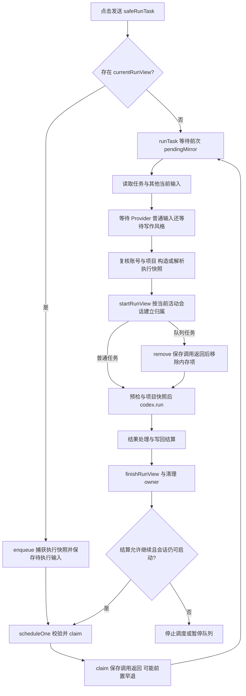

# 运行状态、队列与恢复

源码基线：`main@2073ae74747431aab8d529803d4e9f8197262388`；包版本 `2.5.0`。
阅读入口：[架构总览](README.md) → [功能定位表](feature-map.md) → 本文。
Auto 写入和 Undo 的页面操作链见 [Auto 编辑与撤销](auto-edit-undo.md)。

## 1. 本页用途

本页回答四类修改问题：任务如何取得执行配置、状态由谁修改、刷新后如何恢复、Undo 能力如何保存和重建。
定位时优先查符号，再扩展到相邻模块；`contentRuntime.js` 仍包含编排和依赖装配，文件体量不能代表全部领域所有权。

## 2. 身份和状态分别表示什么

| 概念 | 含义与保存位置 | 修改时的约束 |
|---|---|---|
| `accountScopeId` | 派生的账号作用域；活动运行句柄捕获为 `runAccountScopeId`，持久会话记录保存 `accountScopeId` | 缺少身份时，涉及账号隔离的持久化拒绝提交 |
| `projectId` / `runProjectId` | 当前页面项目 / `startRunView` 建立记录时捕获的运行项目 | 建立记录后的页面切换不改变后者；此前的等待与复核见 3.1 |
| `sessionId` | 插件对话容器，包含草稿、历史、runs、pendingInputs；`startRunView` 使用届时的活动会话 | 切换可见会话不改变已有 run 的归属；建立记录前未按提交时会话锁定 |
| `runId` / `recordId` | 一次插件任务的记录身份 | 重试、队列提升和恢复需要明确记录边界 |
| `requestId` / `nativeRequestId` | 一次 Native RPC 请求身份 | 关联消息路由、取消和后台 journal |
| Native `threadId` | Codex 或服务端对话线程 | 可供后续轮次续接，不等同插件 session |
| Native `turnId` | 线程内一次活动模型轮次 | 即时指导须携带预期 turn，避免送入下一轮 |
| view generation | 一次加载或页面路由的代次 | 拒绝旧页面异步结果覆盖新视图 |

持久化视图身份可记为 \(I_v=(accountScopeId,projectId,generation)\)，运行归属可记为 \(I_r=(projectId,sessionId,runId)\)。
generation 类似取号单上的批次：同一个项目重新加载后，旧批次返回的数据仍需重新判定。
实现中有 scoped transaction 的 generation，也有 `spaRouteGeneration`；两者承担相邻守卫职责，不能直接互换。
入口为 [contentRuntime.js](../../extension/src/content/contentRuntime.js) 的 `deriveAccountScopeId`、`startRunView`、`onSpaRouteChange`，及 [scopedPersistenceTransaction.js](../../extension/src/shared/scopedPersistenceTransaction.js) 的 `beginHydration/isCurrent`。

`startRunView` 在新建记录及 `currentRunView` 上捕获 `runAccountScopeId`，供活动运行和导航后结算使用。
该字段未进入 [sessionState.js](../../extension/src/shared/sessionState.js) 的 `normalizeRun/compactRunForStorage`，也未进入 [storageDb.js](../../extension/src/shared/storageDb.js) 的 run 压缩白名单。
持久账号身份位于 `StorageDb.buildSessionRecord` 生成的会话外层；重载后应核对所属会话及提交 scope，不能假定每条 run 都保留账号字段。
[postNavigationSettlementWiring.test.js](../../test/postNavigationSettlementWiring.test.js) 检查 runtime 源码中的捕获和参数传递；[sessionPersistenceAccountIsolation.test.js](../../test/sessionPersistenceAccountIsolation.test.js) 使用模拟存储检查账号过滤，二者各自覆盖不同边界。

| 状态领域 | 权威所有者 | 消费者与限定 |
|---|---|---|
| 会话与运行内存状态 | `contentRuntime`，归一化规则由 `SessionState` 提供 | 会话列表、运行卡片、持久化快照 |
| 当前运行的编排句柄 | `currentRunView` | 包含原身份、DOM 引用及 Native 绑定；DOM 文案只作投影 |
| 排队输入 | `RunInputQueue` 的值与 `RunQueueScheduler` 的调度 | composer 队列卡、claim 元数据、会话记录 |
| 已捕获执行选择 | `RunExecutionSnapshot` | run record、队列 payload、Native providerSelection；白名单固定范围与捕获时机见 3.1 |
| Native 执行与项目锁 | Native task runner；content 保存绑定信息 | Native 完成后，页面写回仍可能继续 |
| 写回证据与后续操作 | `WritebackSettlement`、`SettlementFacts` | 运行报告、Accept/Undo、重试能力 |
| 共享历史的持久副本 | 后台共享库及 scoped persistence 协调 | 活页内存、最近项目与被动刷新均为消费方 |

运行状态回答“该运行执行到哪一步”；Native turn 回答“模型当前接收哪个输入”；写回结算回答“文件发生了什么、证据到哪一步”。
`applied/readBack/saved/mirrored/compiled/settled` 是不同证据维度，不能由 `run.status === completed` 推导全部成立。
结算入口见 [writebackSettlement.js](../../extension/src/shared/writebackSettlement.js) 的 `settle`，历史投影见 [settlementFacts.js](../../extension/src/shared/settlementFacts.js) 的 `projectRunSettlement`。

## 3. 从提交到下一项队列

真实入口位于 [contentRuntime.js](../../extension/src/content/contentRuntime.js)：`safeRunTask → runTask → startRunView → sendTrackedCodexRun → finishRunView`。
`safeRunTask` 遇到活动运行时调用 `queueComposerInput`；活动更新安装期间阻止新提交。
`runInputCoordinator` 是该文件中的变量，创建者为 [runQueueScheduler.js](../../extension/src/content/runQueueScheduler.js) 的 `createCoordinator`，没有独立同名源码文件。

### 3.1 执行快照

`runTask` 首先等待前次写回尚未结束的 `pendingMirror`；这段等待发生在读取任务、面板字段及捕获账号/项目之前。
等待结束后，普通任务读取届时的 composer 文本，并捕获面板字段、附件、选区、指令和技能加载设置，再等待 Provider 与写作风格准备。风格快照在准备完成后捕获。
队列任务使用原 `queuedInput.text`，并从原 payload 恢复执行快照，快照白名单内的字段不重新取当前控件值。
准备完成后的 scope 守卫只复核账号和项目，未捕获或比较提交时的 `activeSessionId`；随后 `startRunView` 通过 `updateActiveSession` 将记录写入届时的活动会话。
因此镜像等待期间修改草稿或切换会话会影响普通任务随后读取的输入；Provider/风格等待期间切换会话，则可使先前捕获的任务归入后来活动的会话。
[SessionManager.switchSession](../../extension/src/content/sessionManager.js) 依据已有 running 记录判断是否提示，这段准备期间尚未建立 run，不能依赖该提示固定归属。
一旦 `startRunView` 建立记录并捕获运行归属，后续切换可见会话不迁移该运行；这一保证与建立记录前的窗口应分别维护。
普通运行随后还会检查写入能力、准备完整或受限项目快照，再通过 `buildCodexRunParams` 形成 Native 参数。

当前快照的执行字段为 mode、Provider ID/revision、model、reasoning、speed、自动编译、Track、focusFiles、选区和写作风格，另含 schemaVersion、capturedAt、source 等元数据。
schema 与入口见 [runExecutionSnapshot.js](../../extension/src/shared/runExecutionSnapshot.js)，内部归一化见 [runExecutionSnapshotCodec.js](../../extension/src/shared/runExecutionSnapshotCodec.js)。
队列提升调用 `runTask({ queuedInput })` 时，仍会读取当时的 custom instructions、技能加载设置、composer 附件及技能调用，并传给运行参数；`buildCodexRunParams` 还读取当时启用的插件技能 ID。
这些输入未包含在队列执行快照中。入队入口拒绝附件，也不能据此推定提升时不会读取后来留在 composer 中的附件。
真实装配见 [contentRuntime.js](../../extension/src/content/contentRuntime.js) 的 `initializeRunQueueScheduler/runTask/buildCodexRunParams`；这是当前字段来源的静态结论，尚未据此复现真实队列误用输入的场景。
Provider revision 标识同一个服务配置的版本；排队后配置被修订或删除，执行校验可报冲突或不可用，避免悄悄换用后来的配置。
浏览器执行入口是 `RunExecutionSnapshot.resolveForExecution`；`RunInputQueue.claimNext` 消费校验结果，`RunQueueScheduler.scheduleOne` 在冲突时保留输入并暂停。
Native 还会在 [providerRuntime.js](../../native-host/src/providerRuntime.js) 的 `resolveRunProvider/resolveRunProviderForRun` 重新核验，调用方为 [taskRunnerRuntime.js](../../native-host/src/taskRunnerRuntime.js)。模型目录查询 `resolveProviderModels` 与实际执行校验分别承担职责。
快照固定配置身份和选择，不保存完整旧 Provider 配置或凭据。原 Provider 被修改或删除时，旧任务可能被拒绝；不能承诺它始终可按旧配置启动。
[projectProviderSelection.js](../../extension/src/content/projectProviderSelection.js) 的 `commit` 更新未来默认值与会话线程绑定，保留已有队列及运行历史。
**维护目标**：新增运行选项同时检查 capture、queue payload、clone、持久化压缩和 Native 消费端，避免某一条路径丢失字段。
若扩大“提交后固定”的范围，应将上述额外输入纳入同一链路并补验证。[runExecutionSnapshot.test.js](../../test/runExecutionSnapshot.test.js) 覆盖快照字段；[runInputQueueSnapshotRegression.test.js](../../test/runInputQueueSnapshotRegression.test.js) 覆盖队列压缩，其启动检查采用源码字符串断言，不能证明全部输入已冻结。
提交生命周期验证还需串联 `safeRunTask/runTask/startRunView` 与 `SessionManager.switchSession`，分别覆盖镜像等待期间改变草稿、Provider/风格等待期间切换会话，以及运行建立后切换会话仍保留原归属。

### 3.2 队列状态与 claim

[runInputQueue.js](../../extension/src/shared/runInputQueue.js) 定义 `queued/paused/claimed/executing/steering`；schema 能表示某状态，不代表正常流程会长期保存该状态。
队列采用 FIFO，容量和文本预算由同一模块管理；composer 附件在入队入口被拒绝。
`claim` 是执行领取凭据，类似仓库提货单：item ID、writer、claim token 与版本共同限制谁能消费该条任务。
`scheduleOne` 的顺序为 Provider 准备 → `claimNext` → 等待 claim 保存调用 → `startQueuedInput`；保存抛错时不会启动任务。
实际是否发生持久提交还受第 4.3 节入口早退限制，不能只依据 Promise 正常返回证明 claim 已写入。
`runTask` 建立 run 后调用 `markExecuting`，等待 remove 保存调用正常返回后从 pendingInputs 和队列 UI 移除该项；前置早退是否真正提交仍需单独核对。
提升失败时保留恢复机会、暂停队列并尝试 restore；不能只隐藏卡片后假设所有权已经转移。
普通并发保存还需保留等待期间新增的其他输入，相关回归定义位于 [runQueueSchedulerDurability.test.js](../../test/runQueueSchedulerDurability.test.js)。

即时指导由 `createCoordinator.guide` 发送 `codex.steer`，绑定 request、project、thread 与 `expectedTurnId`。
该入口把队列 `item.text` 直接发送，未调用普通 `runTask` 的 `runSensitivePreflight`。
Native 的 [taskRunnerRuntime.handleCodexSteer](../../native-host/src/taskRunnerRuntime.js) 检查活动绑定、传入的预期 thread/turn、非空文本与长度，再经 [codexSessionRunner.publishActiveTurnControl](../../native-host/src/codexSessionRunner.js) 的 control 发送 `turn/steer`；这两层均未补做敏感扫描。
同一条排队文字作为下一项普通任务执行、或用作当前轮次的即时指导，经过的预检入口不同；首次任务的扫描结果不能覆盖后来追加的指导。材料与入口范围见[上下文与治理](context-and-governance.md#3-扫描实际覆盖的材料)。
指导成功后移除队列项并写入所属 run 的指导事件；发送结果不明时进入 `steer_delivery_unknown` 暂停状态。
指导投影入口为 [runGuidanceController.js](../../extension/src/content/runGuidanceController.js)，应同时检查队列卡、活动 transcript 和最终输入摘要的去重。

### 3.3 取消与继续条件

`cancelActiveRun` 同时触发本地 AbortSignal、Native `codex.cancel` 和 Page `cancelActiveWrite`。
三层分别负责终止本地编排、请求停止执行进程、停止页面剩余写入；取消送达与外部进程已经退出应分别判定。
运行 finally 传入 `continueQueue: runCancellationRequested`，因此主动取消后允许调度下一项；普通失败默认暂停。
`afterSettlement` 还会在 completed 时继续；`scheduleOne` 再检查是否已有活动运行、会话是否仍被选中、页面是否仍是项目编辑器。
因此“取消后继续”仅描述当前调度策略，不能解释为任何导航、会话切换或失败环境下均自动启动下一项。
取消生命周期和失败通知是不同语义，已有定义见 [runCancellationLifecycle.test.js](../../test/runCancellationLifecycle.test.js)。

## 4. 会话存储与跨页面并发

### 4.1 两条存储路径

[storageDb.js](../../extension/src/shared/storageDb.js) 返回 `SharedSessionBridge.decorate(...)` 包装后的接口。
[sharedSessionBridge.js](../../extension/src/shared/sharedSessionBridge.js) 的 `enabled` 在受支持 Overleaf HTTPS `/project` 路由启用共享历史。
此时 sessions、会话删除、相关索引查询和 scoped 元数据经扩展消息进入 [backgroundSharedSessions.js](../../extension/src/backgroundSharedSessions.js)。
后台数据库 `codex-overleaf-shared-sessions` 属于扩展源，sessions 主键为 `[accountScopeId,id]`，项目索引为 `[accountScopeId,projectId]`。
辅助 store 仍可能保留原站点存储行为；不能把整个 StorageDb 一概描述为全部迁入后台。
非共享路径继续使用旧站点源数据库；共享迁移只导入明确属于当前账号且具有项目身份的记录。
迁移按账号和来源站点记录完成状态，未知账号的旧记录保留；同 ID 冲突可能生成去除危险操作能力的恢复副本。

### 4.2 锁、版本与三路合并

共享写入使用长连接 port 取得后台锁，账号级 state 锁串行化跨项目清理与写入。
port 断连后标记 disconnected，受 `ensureLock` 保护的后续请求拒绝接纳；已接纳的事务仍可能完成，锁等待 `inFlight` 清零后释放。
`meta-write` 使用独立的 token/tabId 判断，当前未复用 disconnected 检查，不能把会话写入守卫推广到全部共享方法；迟到请求的真实可达性与影响仍待验证。
后台还校验扩展身份、页面来源、顶层 frame 和锁 token；共享入口不可绕过这些检查降级成站点本地写入。
传统 adapter 使用 `navigator.locks`；缺少可用跨上下文锁时拒绝持久提交。
实现入口为 [scopedPersistenceBrowserAdapter.js](../../extension/src/shared/scopedPersistenceBrowserAdapter.js) 的 `createBrowserAdapter`。

锁保护当前临界区；版本比较负责识别先前读取已经过期的快照，两者用途不同。
Scoped transaction 的 `revision` 跟踪总体提交，`queueRevision` 单独处理队列变更，允许明确区分一般重基与队列认领冲突。
比较并交换（CAS）的简化条件为 \(r_{captured}=r_{stored}\) 才可按原队列版本提交；不匹配返回 `queue_revision_conflict`。
`ScopedPersistenceQueuePolicy` 执行 claim/release/remove/restore 等规则，`SessionPersistence.applyQueuePolicy` 保留其他 writer 拥有的队列记录。
入口见 [scopedPersistenceQueuePolicy.js](../../extension/src/shared/scopedPersistenceQueuePolicy.js) 与 [sessionPersistence.js](../../extension/src/content/sessionPersistence.js)。

后台 `mergeValue(base,current,incoming)` 做三路合并：未改字段保留最新远端值，双方同改为相同值可合并，冲突拒绝提交。
`runs/pendingInputs` 根据稳定 ID 合并；时间字段和只追加数组另有规则，不能依赖通用“最后写入覆盖”。
墓碑（tombstone）表示“已删除”，用于阻止迟到快照复活会话或已移除输入；它与简单缺少一条记录的含义不同。
删除会话入口 `SessionManager.deleteSessionWithConfirm` 传入 `deletedSessionIds`，后续删除及持久化必须保持墓碑语义。

### 4.3 提交步骤与降级限定

`saveState` 捕获 state 快照 → `ScopedPersistenceCoordinator.commit` → `ScopedPersistenceTransaction.commit`。
事务顺序为：检查视图和版本 → 写 pending fence → 执行偏好/会话保存 → 写 durable receipt。
fence 像“提交处理中”的凭证，receipt 标记配套数据写入已完成；中途失败通过后续提交识别、恢复或拒绝继续。
该流程协调多个步骤；后台会话批次自身另有 IndexedDB transaction，两个事务层不能混同。
源码见 [scopedPersistenceCoordinator.js](../../extension/src/content/scopedPersistenceCoordinator.js)、[scopedPersistenceTransaction.js](../../extension/src/shared/scopedPersistenceTransaction.js) 和 [scopedPersistenceReceipt.js](../../extension/src/shared/scopedPersistenceReceipt.js)。

`persistPanelState` 使用事务捕获的账号和项目，`SessionPersistence.writeSessions` 再核对所属账号、墓碑和更新版本。
进入事务后的 queueMutation 或 reviewRunIds 保存失败会向调用者抛出；普通保存存在紧凑 fallback，不能据此宣称完整历史一定耐久。
`saveState` 在项目缺失或运行已导航分离的入口守卫，仅对 reviewRunIds 抛错；queueMutation 仍可正常返回而跳过提交。
因此调度器等待保存 Promise 与获得 durable receipt 需要分别判断；入口早退与队列提升的可达时序需要组合验证，尚不能据此断言任务已经丢失或重复执行。
`finishRunView` 尝试在终态展示前刷新排队保存，但调用存在错误捕获；“任何存储失败下均能即时重载同样终态”仍需单独验证。
**维护目标**：新增强持久化操作应选择明确失败可见的保存入口，不应仅调用延迟保存后给出成功保证。

## 5. 刷新恢复、旁观页与导航

### 5.1 共享历史中的运行 owner

`sendTrackedCodexRun` 创建 request 后调用 [activeTurnControl.js](../../extension/src/content/activeTurnControl.js) 的 `bind`，通过 run-owner port 关联原项目、session 和 run。
后台 journal 留存有限事件及 owner 状态；事件序号用于避免恢复时重复追加。
后台 owner 连接与 `ownerLost` 标记入口在 [background.js](../../extension/src/background.js) 的 run-owner port 处理和 `interruptOwnerlessRun`；client 的绑定需要与后台判定一同检查。
`normalizeLoadedPanelState` 在共享历史模式关闭通用的 running→interrupted 恢复，避免把其他活页拥有的运行当作中断；传统站点本地路径允许该恢复。
`recoverInterruptedRunJournals → ActiveTurnControl.recoverJournals` 在共享模式设置 `requireOwnerLost: true`。
Native terminal journal 可能早于 owner 页面的写回和存储完成，旁观页不能据此提前替它结算。
owner 丢失后，恢复流程补齐未读取事件、记录 `interruptedDraft`、暂停该会话队列，等待 `saveState()` 返回后才 acknowledge journal。
这里保证调用顺序；普通保存仍存在第 4.3 节所述错误捕获和紧凑 fallback，不能据此推定完整历史已获得耐久确认。
恢复保留历史证据；重新执行需经过新的运行入口，不能把 journal 回放当作重新启动原 Native 请求。
回归入口见 [crossTabRuntimeRegression.test.js](../../test/crossTabRuntimeRegression.test.js) 和 [activeTurnControl.test.js](../../test/activeTurnControl.test.js)。前者提取 hydration 函数、调用真实合并 helper 并模拟 journal 返回，未装配真实后台端口及共享 IndexedDB 服务。

共享加载另有两类依据已持久证据修复旧状态的路径，无需 `ownerLost`：

- [sessionState.js](../../extension/src/shared/sessionState.js) 的 `recoverSettledRunningRun` 要求有效 `finishedAt` 和末尾可见 completed/failed report；若 report 的解析时间晚于结束时刻则拒绝修复。该比较未单独拒绝无效 report 时间，不能概括为两端时间均已严格校验。`normalizeLoadedPanelState` 通过 `recoverSettledRuns: true` 启用它。
- `recoverRecordedRunFailure` 由 `normalizeRun` 调用，依据严格匹配的父运行后处理失败事件修复 failed 状态；事件类型、活动元数据、作用域及时间均参与检查，普通工具失败或子代理错误不足以触发修复。

这两条路径修正“证据已终结、标签仍为 running”的记录；journal 恢复负责 owner 丢失后的中断草稿。不能把两者统一解释为必须 ownerLost 才能改变运行状态。
相关测试为 [settledRunRecovery.test.js](../../test/settledRunRecovery.test.js) 和 [recordedRunFailureRecovery.test.js](../../test/recordedRunFailureRecovery.test.js)：前者结合归一化行为与源码装配断言，后者检查事件识别及 StorageDb 投影往返，均不覆盖真实跨页恢复。

[sharedSessionViewSync.js](../../extension/src/content/sharedSessionViewSync.js) 订阅跨页面变化，只在无活动运行、无保存、无本地草稿或未持久修改时刷新。
刷新前后核对 scope、generation、本地版本与签名。守卫通过后先调用 `adoptSharedSessionBaseline(records)`，再调用 `apply` 归一化 state 并渲染；单独读取 snapshot 不更新 baseline。
baseline 是下次三路合并的共同底稿。当前 `apply` 抛错后仅通知错误，未回滚已推进的 baseline，因而这两个步骤没有异常原子性保证；真实视图失败后的影响仍待验证。
这一区分影响“另一个标签页的历史刷新覆盖了输入”的定位：先查被动刷新守卫，再查保存与三路合并。

### 5.2 离开项目后的 detached settlement

`onSpaRouteChange/leaveActiveProject` 更新可见项目、取消原项目活动写入并重绑观察器；旧运行仍携带捕获的身份。
普通 `saveState` 发现运行项目与当前 URL 不一致时跳过，防止旧会话写入新项目键。
`persistPostNavigationRunStatus` 在原项目仍活动时走普通保存；导航已分离时调用 `PostNavigationSettlementPersistence.persistRequired`。
该模块通过 `commitDetached(projectId,accountScopeId,...)` 建立独立提交视图，再按原 session/run 定位记录并检查账号、项目。
`detached` 允许原项目结算独立于当前视图，并不取消身份、锁或版本校验；账号已变化仍可能拒绝提交。
文件入口：[postNavigationSettlementPersistence.js](../../extension/src/content/postNavigationSettlementPersistence.js)、[scopedPersistenceDetachedCommit.js](../../extension/src/content/scopedPersistenceDetachedCommit.js)。
失败保留 `post_navigation_settlement_persistence_failed` 及恢复提示；不能把调用返回理解为原项目已经成功存储。

## 6. Undo 的持久化与重载投影

Undo 能力来自可用恢复材料和结算结果，不能只看 completed 或显示过某个按钮。
关键字段包括 appliedOperations、undoOperations、undoBaseFiles、undoTrackedChanges、undoExpectedFiles；字段应按具体操作路径解释。
[storageRunActions.js](../../extension/src/shared/storageRunActions.js) 的 `hasReloadableRunActionPayload/compactRunActionPayload` 判定并保留这些材料。
当前 preserveRunActionPayload 路径最多保留每会话最近两个合格运行，每运行材料上限 2 MiB；超限可丢弃动作 payload。
可选 trackedChangeCaptures 不能挤掉已满足预算的核心撤销材料；历史文本仍存在不能证明 Undo 材料仍完整。

`contentRuntime.undoRun` 等待旧 mirror 刷新，再选择 tracked/editor Undo 或无留痕操作路径，页面调用始终携带原 runProjectId。
tracked Undo/Accept 经过 `applyTrackedChangeSettlement → ScopedPersistenceCoordinator.applyReviewTransition`。
[scopedPersistencePanelState.js](../../extension/src/content/scopedPersistencePanelState.js) 强制 preserveRunActionPayload 和 reviewRunIds，并验证持久记录中的结果。
保存失败时恢复先前材料、标记 needs_review 并继续抛错，因为页面操作可能已经发生。部分验证失败生成 `review_state_not_persisted`，底层保存异常也可能原样传播，不能只匹配单一错误码。
legacy/no-trace Undo 的 `applyLegacyUndoSettlement` 使用 `saveStateSoon`；后续修改不能假定它与 tracked review 路径有相同的确认屏障。

重载后，SessionState/StorageDb 归一化记录；`SettlementFacts.projectRunSettlement` 提供基础能力，`RunResultActions.projectUndoAvailability` 进一步检查实际材料。
[runTimelineView.js](../../extension/src/content/runTimelineView.js) 的 `configureUndoButton/configureAcceptButton` 仅消费投影，不应补造恢复身份或修改持久证据。
纯资源写入、缺少创建检查点、forkSnapshot 和已接受/撤销记录都有不同展示规则，见 [runResultActions.js](../../extension/src/content/runResultActions.js)；分叉标记经过主存储路径的保留差异见下节。
相关已有定义为 [reviewingUndoPersistence.test.js](../../test/reviewingUndoPersistence.test.js)、[runTimelineUndoAvailability.test.js](../../test/runTimelineUndoAvailability.test.js) 和 [undoNoticeRecovery.test.js](../../test/undoNoticeRecovery.test.js)。

### 6.1 会话分叉与恢复材料隔离

分叉入口由 `contentRuntime` 装配到 `RunResultActions.configureForkButton`，调用 [sessionForkController.js](../../extension/src/content/sessionForkController.js) 的 `forkRunFromNode`。
它要求源运行已离开 running 且具有 turn ID；线程来源依次为运行自身 `codexThreadId`、与该 turn 匹配的 interruptedDraft 线程、旧记录的 session 线程回退。Provider 切换后的 session 线程不应覆盖已有的运行来源。
调用 `codex.thread.fork` 成功后，复制到选定 run 为止的历史，生成新的 run ID 和 session，绑定返回的新线程并清空队列。
`copyRunSnapshot` 标记 `forkSnapshot`、记录来源并剥离附件、应用及 Undo 材料、Native 请求和队列绑定；后续 SessionState 归一化还排除该快照的重试恢复材料。
控制器随后等待普通 `saveState`；若调用抛错，则恢复先前 state，并尝试 `codex.history.clearPlugin` 清理新线程。普通保存仍受第 4.3 节 fallback 和错误处理限定，不能据 Promise 返回推定分叉记录已完整持久化。

**已知 schema 差异**：`SessionState.compactRunForStorage` 保留 `forkSnapshot/forkSourceRunId`，但主保存经过 `ScopedPersistencePanelState.persistPanelState → StorageDb.buildSessionRecord`，其 run 压缩白名单未保留这两个字段，会话白名单也未保留 `forkedFromSessionId/forkedFromRunId`。
`RunResultActions.configureForkButton` 与 Timeline 的 Undo/Accept 展示依赖 `forkSnapshot`。因此内存中的分叉限制不能直接推广为共享库重载后的相同投影；当前只确认字段裁剪及消费者依赖，未复现真实按钮行为或证明动作材料被恢复。
[sessionForkController.test.js](../../test/sessionForkController.test.js) 覆盖复制剥离、线程来源优先级及来源线程经两类投影后的保留；它使用模拟 Native 与保存函数，现有往返断言未检查上述分叉标记。后续修改应分别核对控制器、两套 schema、历史来源及按钮消费者。

## 7. 修改路由与最窄验证

命令在仓库根目录执行；下表列出各层行为对应的测试入口。仅选择与改动对应的一行，再按实际失败扩展范围。

| 改动 | 主改入口与联动消费者 | 最窄命令 | 检查条件 |
|---|---|---|---|
| 提交配置 | RunExecutionSnapshot、runtime capture、queue codec、Provider 默认值 | `node --test test/runExecutionSnapshot.test.js test/projectProviderSelection.test.js test/runQueueSchedulerArchitecture.test.js` | 已捕获快照白名单 tuple 不随设置漂移，revision 冲突保留输入并暂停；3.1 的提交等待与会话切换需补组合验证；Native 二次校验另见 providerSessionBinding/providerReliability 测试 |
| 队列提升 | RunInputQueue、RunQueueScheduler、scoped queue policy | `node --test test/runQueueSchedulerArchitecture.test.js test/runQueueSchedulerDurability.test.js` | 检查 claim 保存调用顺序与拒绝分支；事务前早退例外另见 4.3，不能推定全部失败均保留队列 |
| 即时指导的输入边界 | Coordinator.guide、Native handleCodexSteer/control、SensitiveScan | `node --test test/sensitiveScan.test.js test/runQueueSchedulerDurability.test.js` | 分别定位检测器与队列保存行为；指导链需另行覆盖可检出文字、身份失配和发送结果不明，现有局部测试不能证明指导经过扫描 |
| 作用域提交 | coordinator、transaction、browser adapter、SessionPersistence | `node --test test/scopedPersistenceTransaction.test.js test/sessionPersistenceAccountIsolation.test.js` | stale view、CAS、fence/receipt、账号隔离与恢复 |
| journal 恢复 | normalizeLoadedPanelState、ActiveTurnControl、shared history | `node --test test/crossTabRuntimeRegression.test.js test/activeTurnControl.test.js` | 共享 journal 回放要求 ownerLost 并暂停队列；已有终态修复另走下行 |
| 旧终态修复 | SessionState 两类恢复 helper、runtime hydration、StorageDb | `node --test test/settledRunRecovery.test.js test/recordedRunFailureRecovery.test.js` | 识别已持久终态证据，同时保留真正活跃运行；不依赖 ownerLost |
| 导航后结算 | detached coordinator、PostNavigationSettlementPersistence | `node --test test/postNavigationSettlementPersistence.test.js test/postNavigationSettlementWiring.test.js` | 只写原账号/项目/session/run，内层失败向外传播 |
| Undo 重载能力 | StorageRunActions、SettlementFacts、RunResultActions、timeline | `node --test test/reviewingUndoPersistence.test.js test/runTimelineUndoAvailability.test.js` | 材料可保存，重载按钮只展示实际可执行能力 |
| 会话分叉 | SessionForkController、SessionState/StorageDb schema、结果按钮 | `node --test test/sessionForkController.test.js` | 来源线程及材料剥离有定义；分叉标记经过主存储后的保留缺口需另补用例 |

上述队列测试替换保存和启动依赖；scoped transaction 测试使用内存 adapter；导航后结算行为测试替换 coordinator/StorageDb，wiring 测试检查源码；Undo 材料测试直接调用压缩 helper，Timeline 测试使用模拟按钮。它们适合定位各层契约，不能替代真实端口、IndexedDB、DOM 及跨页时序的组合验证。

**验证边界**：真实浏览器关页与 worker 重启的时序、跨域同账号迁移、存储配额耗尽后的完整恢复、外部进程取消速度、Overleaf 实际 Undo 的效果，均需要独立的端到端验证。
这些场景需按 [Auto 编辑与撤销](auto-edit-undo.md) 的端到端链准备证据；静态源码和测试定义不能替代实际验收。
维护者修改身份、队列、存储 schema 或动作投影后，应同时更新本页对应链路、功能定位表和相关测试。
