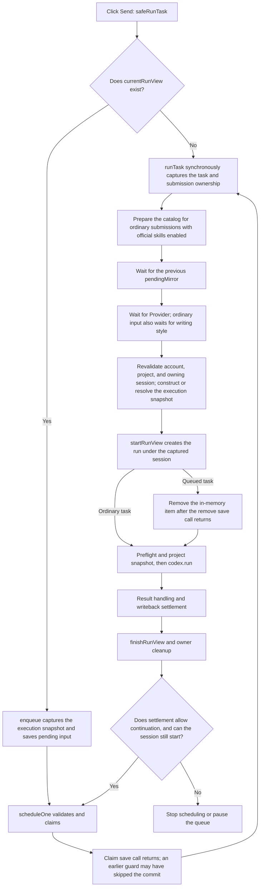

# Run State, Queues, and Recovery

Initial source reference: `main@2073ae74747431aab8d529803d4e9f8197262388`; initial package reference: `2.5.0`. Current behavior is maintained against this repository's implementation.
Reading path: [Architecture guide](README.md) → [Feature map](feature-map.md) → this page.
For the page-operation chain used by Auto writes and Undo, see [Auto Editing and Undo](auto-edit-undo.md).

## 1. Purpose of This Page

This page addresses four kinds of maintenance questions: how a task obtains its execution configuration, which component changes state, how recovery works after a refresh, and how Undo capability is stored and reconstructed.
Start with symbols, then inspect adjacent modules. `contentRuntime.js` still contains orchestration and dependency composition; its size does not imply ownership of every domain.

## 2. Identity and State: What Each Represents

| Concept | Meaning and storage location | Constraints when changing it |
|---|---|---|
| `accountScopeId` | Derived account scope; the active run handle captures it as `runAccountScopeId`, and persisted session records store `accountScopeId` | Persistence involving account isolation rejects commits when this identity is missing |
| `projectId` / `runProjectId` | The current page's project / the run project captured when `startRunView` creates a record | Page navigation after record creation does not change the latter; see 3.1 for earlier waits and revalidation |
| `sessionId` | The extension's conversation container, holding drafts, history, runs, and pendingInputs; `runTask` captures the submitting session before its first wait | `startRunView` creates the record under the captured ID; switching the visible session does not move the run |
| `runId` / `recordId` | The record identity of one extension task | Retries, queue promotion, and recovery require an explicit record boundary |
| `requestId` / `nativeRequestId` | The identity of one Native RPC request | Connects message routing, cancellation, and the background journal |
| Native `threadId` | A Codex or server-side conversation thread | Can be resumed in later turns; distinct from an extension session |
| Native `turnId` | One active model turn within a thread | In-flight guidance must include the expected turn to avoid delivery to the next turn |
| view generation | The generation of a load or page route | Prevents asynchronous results from an old page from overwriting the new view |

The persistence view identity can be written as \(I_v=(accountScopeId,projectId,generation)\), and run ownership as \(I_r=(projectId,sessionId,runId)\).
A generation is like the batch number on a queue ticket: after the same project is reloaded, results returning from the old batch still require revalidation.
The implementation has both a scoped-transaction generation and `spaRouteGeneration`; they provide adjacent guards and are not interchangeable.
Entry points are `deriveAccountScopeId`, `startRunView`, and `onSpaRouteChange` in [contentRuntime.js](../../extension/src/content/contentRuntime.js), plus `beginHydration/isCurrent` in [scopedPersistenceTransaction.js](../../extension/src/shared/scopedPersistenceTransaction.js).

`startRunView` captures `runAccountScopeId` on the new record and `currentRunView` for the active run and post-navigation settlement.
This field is absent from `normalizeRun/compactRunForStorage` in [sessionState.js](../../extension/src/shared/sessionState.js) and from the run-compaction allowlist in [storageDb.js](../../extension/src/shared/storageDb.js).
The durable account identity belongs to the outer session record produced by `StorageDb.buildSessionRecord`. After reload, check the owning session and commit scope; do not assume that each run retains an account field.
[postNavigationSettlementWiring.test.js](../../test/postNavigationSettlementWiring.test.js) checks capture and parameter propagation in runtime source; [sessionPersistenceAccountIsolation.test.js](../../test/sessionPersistenceAccountIsolation.test.js) checks account filtering with simulated storage. They cover different boundaries.

| State domain | Authoritative owner | Consumers and limitations |
|---|---|---|
| In-memory session and run state | `contentRuntime`, with normalization rules supplied by `SessionState` | Session list, run cards, and persistence snapshots |
| Current run orchestration handle | `currentRunView` | Holds the original identity, DOM references, and Native binding; DOM text is only a projection |
| Queued input | Values owned by `RunInputQueue` and scheduling by `RunQueueScheduler` | Composer queue cards, claim metadata, and session records |
| Captured execution choices | `RunExecutionSnapshot` | Run record, queue payload, and Native providerSelection; see 3.1 for the allowlist's scope and capture timing |
| Native execution and project lock | Native task runner; content stores binding information | Page writeback may continue after Native finishes |
| Writeback evidence and subsequent actions | `WritebackSettlement`, `SettlementFacts` | Run reports, Accept/Undo, and retry capability |
| Persistent shared-history copy | Background shared database and scoped-persistence coordination | Live-page memory, recent projects, and passive refresh are consumers |

Run state answers “how far has this run progressed”; the Native turn answers “which input is the model currently receiving”; writeback settlement answers “what happened to the files, and how far does the evidence extend.”
`applied/readBack/saved/mirrored/compiled/settled` are separate evidence dimensions. `run.status === completed` does not establish all of them.
The settlement entry point is `settle` in [writebackSettlement.js](../../extension/src/shared/writebackSettlement.js); the history projection is `projectRunSettlement` in [settlementFacts.js](../../extension/src/shared/settlementFacts.js).

## 3. From Submission to the Next Queued Item

The production entry chain in [contentRuntime.js](../../extension/src/content/contentRuntime.js) is `safeRunTask → runTask → startRunView → sendTrackedCodexRun → finishRunView`.
`safeRunTask` calls `queueComposerInput` when a run is active; an active update installation blocks new submissions.
`runInputCoordinator` is a variable in that file, created by `createCoordinator` in [runQueueScheduler.js](../../extension/src/content/runQueueScheduler.js). There is no separate source file with that name.

### 3.1 Execution Snapshots

Before the first await, `runTask` reads the panel and captures the task, owning sessionId, session projection used for the prompt, threadId, original draft, and edit-and-resubmit source. It also captures panel fields, attachments, selection, instructions, and skill-loading settings. `RunController.captureSessionContext` deep-copies `state.session`; this projection is separate from later changes to the visible active session.
For ordinary submissions, the two master switches control waits for `primeCodexOverleafSkillsCatalog` and `primeCodexLocalSkillsCatalog`; per-item preferences captured at submission generate the skill IDs. Local items without an explicit preference inherit the catalog's `enabled` value, and a valid empty local catalog produces an empty list. An explicit `codex-local` invocation forces a catalog refresh and stops if the selected item has been disabled or disappeared. Catalog failure follows the existing startup-error flow and preserves the draft. The task then waits for the previous writeback's `pendingMirror`, keeping old mirror-finalization events attached to the original run, before preparing the Provider and writing style. The style snapshot is still captured after preparation completes. Queued tasks use the original `queuedInput.text` and restore the execution snapshot from the payload; allowlisted fields are not reread from current controls.
After preparation, the task revalidates the account and project, confirms that the submitting session still exists, and checks that no other run is active. `startRunView({sessionId,sessionContext,codexThreadId,...})` updates the record under that session ID and appends the card to the current log only if that session is still visible. `safeRunTask` uses `runSubmissionPending` to prevent duplicate starts during preparation; an existing run still routes input to the queue entry point.
After creating the run, the task waits for the audit draft and revalidates account/project before clearing the draft and entering the ordinary or skill-installer branch. `currentRunView` holds the owning session projection and thread. Both ordinary `buildCodexRunParams` and the skill-installer branch build `params.session` from that projection; Native's [codexPromptAssembly.buildCodexTurnPrompt](../../native-host/src/codexPromptAssembly.js) consumes the corresponding id/history. Both entry points use `sendTrackedCodexRun`, which captures the original run handle and AbortSignal before waiting for compatibility, and passes `assertCurrent` to `NativeCompatibilityController.ensureForMethod`. After `bridge.ping` returns, and before compatibility evaluation or a blocking notice, this callback checks cancellation, owner, and the run's account/project. Once the sender receives the gate, it checks again before consuming either success or rejection. Late success and late incompatibility notices from an old run cannot enter the next run; generic RPCs outside a run do not automatically inherit this callback.
Input clearing uses `clearTaskComposer` with a submission: the original owning session's draft must still match the submitted value. If that session is still displayed, it also checks text, attachments, skill invocation, selection, selection generation, and attachments in flight. Changed input is preserved. If another session is now visible, only the original session's task is conditionally cleared; the new session's composer is retained. Queue promotion skips this clearing step.
If an explicit local skill becomes unavailable during Native rediscovery, Native returns `codex_local_skill_unavailable`. Runtime creates a restoration checkpoint only when `clearTaskComposer` confirms that this submission actually cleared the current composer. `restoreRejectedLocalSkillSubmission` then checks the original account, project, session, and draft/selection/attachment generations, and restores the submitted material only if the current input is still empty. Later edits, intentional clearing, or ownership changes are not overwritten by the original request. Attachments are restored under the ordinary in-memory submission limit; the refresh-draft limit remains separate. See [localCodexSkillsUi.test.js](../../test/localCodexSkillsUi.test.js) for the related call chain.

The current snapshot's execution fields are mode, Provider ID/revision, model, reasoning, speed, automatic compilation, Track, focusFiles, selection, and writing style, plus metadata such as schemaVersion, capturedAt, and source.
See [runExecutionSnapshot.js](../../extension/src/shared/runExecutionSnapshot.js) for the schema and entry points, and [runExecutionSnapshotCodec.js](../../extension/src/shared/runExecutionSnapshotCodec.js) for internal normalization.
When a new task is queued, [RunInputQueue](../../extension/src/shared/runInputQueue.js) separately stores `payload.submissionContext`: project instructions, skill-loading switches, a scoped per-turn skill invocation, `enabledCodexOverleafSkillIds`, and `enabledCodexLocalSkillIds`. Skill lists belong to submission context and are outside the execution snapshot's configuration allowlist. Normalization, claiming, and persistence compaction retain this context; text is not replaced based on secret-like patterns. Existing local-path display rules and length budgets apply separately, and these fields count toward the queue's capacity budget alongside the text. Lists are not silently truncated by catalog entry count; exceeding total capacity rejects the new enqueue and preserves the original queue. Project files are still read when the task executes.
When queue promotion calls `runTask({ queuedInput })`, it consumes only the queued item's captured additional context, with attachments fixed to empty; enqueue continues to reject input carrying attachments. Later composer attachments or skills therefore cannot be adopted by an old task or move it into a subsequently selected installer branch. Ordinary submissions capture the skill preference map before the first await, generate this run's IDs after catalog preparation, and use them with instructions and skill switches for the first request and retries; queue promotion keeps the original captured IDs.
When local skills are enabled but the catalog is not ready, `queueComposerInput` first triggers catalog preparation, retains the draft, and asks for resubmission after loading; an unknown catalog is not captured as an empty selection during an active run. Old queue entries missing the entire `submissionContext` keep that absence in storage, avoiding extra bytes from a default object that could trim legacy entries near the capacity limit. Execution uses empty instructions, no per-turn skill, and disabled additional skill loading, without filling values from a later draft. Existing contexts missing only `enabledCodexLocalSkillIds` also retain that absence; Native inherits through the existing master switch and source configuration. An explicit `[]` disables all local items for this run. See `initializeRunQueueScheduler/runTask/buildCodexRunParams` in [contentRuntime.js](../../extension/src/content/contentRuntime.js) for production composition.
Provider revision identifies a version of a service configuration. If that configuration is edited or deleted after enqueue, execution validation can report a conflict or unavailability, preventing silent use of a later configuration.
The browser execution entry is `RunExecutionSnapshot.resolveForExecution`; `RunInputQueue.claimNext` consumes the validation result, and `RunQueueScheduler.scheduleOne` preserves the input and pauses on conflict.
Native revalidates in `resolveRunProvider/resolveRunProviderForRun` in [providerRuntime.js](../../native-host/src/providerRuntime.js), called by [taskRunnerRuntime.js](../../native-host/src/taskRunnerRuntime.js). The model-catalog query `resolveProviderModels` and actual execution validation have separate responsibilities.
The snapshot captures configuration identity and choices, without storing the full previous Provider configuration or credentials. If the original Provider is changed or deleted, the old task may be rejected; it is not guaranteed to remain runnable with the old configuration.
`commit` in [projectProviderSelection.js](../../extension/src/content/projectProviderSelection.js) updates future defaults and session-thread bindings while preserving existing queues and run history.
**Maintenance target:** for every new run option, check capture, queue payload, cloning, persistence compaction, and the Native consumer so that no path loses the field.
To expand what is fixed after submission, add the new fields to the appropriate snapshot or submissionContext and verify the full chain. [runExecutionSnapshot.test.js](../../test/runExecutionSnapshot.test.js) covers snapshot fields; [runInputQueueSnapshotRegression.test.js](../../test/runInputQueueSnapshotRegression.test.js) covers queue compaction, but its startup checks use source-string assertions and do not prove that every input has been frozen.
[queueSubmissionContext.test.js](../../test/queueSubmissionContext.test.js) covers queued input, pause/resume, the persistence allowlist, legacy queue budgets, and isolation from later drafts. [runSubmissionOwnership.test.js](../../test/runSubmissionOwnership.test.js) connects actual runtime functions, SessionManager, parameter construction, and the Native prompt to cover session changes during mirror/Provider/style/audit waits, draft preservation, and dispatch identity. I/O and DOM are test doubles; real browser interaction still requires acceptance testing.
[localCodexSkillsPersistence.test.js](../../test/localCodexSkillsPersistence.test.js) tracks the distinction between missing and empty local lists from enqueue through storage recovery to Native parameters, plus `codex-local` invocation identity. For consumption boundaries in Native parent tasks, workers, and thread forks, see [Skill Inheritance and Scope](writing-style-and-skills.md#ordinary-skill-installation-inheritance-and-scope).

### 3.2 Queue States and Claims

[runInputQueue.js](../../extension/src/shared/runInputQueue.js) defines `queued/paused/claimed/executing/steering`. A state being representable in the schema does not mean that the normal flow stores it for a long time.
The queue is FIFO; the same module manages capacity and text budgets. The enqueue entry point rejects composer attachments.
A `claim` is a credential for taking an item for execution, like a warehouse pickup slip: item ID, writer, claim token, and version jointly restrict who may consume the task.
`scheduleOne` proceeds through Provider preparation → `claimNext` → wait for the claim save call → `startQueuedInput`; a thrown save error prevents task startup.
Whether a durable commit actually occurs is also subject to the entry-point early returns in section 4.3. A normally resolved Promise alone does not prove that the claim was written.
After creating the run, `runTask` calls `markExecuting`, waits for the remove save call to return normally, and removes the item from pendingInputs and the queue UI. Whether an earlier guard skipped the actual commit must still be checked separately.
Promotion failure preserves a recovery opportunity, pauses the queue, and attempts restore. Hiding a card alone does not establish that ownership transferred.
Ordinary concurrent saves must also preserve other inputs added during the wait; the related regression definitions are in [runQueueSchedulerDurability.test.js](../../test/runQueueSchedulerDurability.test.js).

**Queue recovery and display are separate steps.** `init` loads persisted sessions, creates the scheduler, and recovers the journal; recovery pauses the owning session's queue. After synchronizing sessions and run history, `applyStateToPanel` calls `renderPendingInputs`, immediately showing the current session's queue during initialization, recovery, and session switching. Paused items also show Resume; an empty queue clears old cards and hides the container. This repaint only updates the UI: it does not save the queue, unpause it, or start a task. Composer input and run-state changes also trigger repainting. See [Queue Display and Recovery Entry Points](ui-and-loading.md#pending-queue-render) for the view chain. [pendingQueuePanelRestore.test.js](../../test/pendingQueuePanelRestore.test.js) combines production panel synchronization, coordinator, queue view, and session switching, with DOM and persistence I/O supplied by test doubles.

In-flight guidance is sent as `codex.steer` by `createCoordinator.guide`, bound to request, project, thread, and `expectedTurnId`.
This entry invokes the guidance branch of the same `SensitivePreflight` on this attempt's `item.text`, using the existing project scanning switch and confirmation policy to decide whether to continue. It does not scan project files, the mirror, or the full prompt, and does not append a completion report to the original run.
Native's [taskRunnerRuntime.handleCodexSteer](../../native-host/src/taskRunnerRuntime.js) checks the active binding, expected thread/turn, nonempty text, and length, then sends `turn/steer` through the control published by [codexSessionRunner.publishActiveTurnControl](../../native-host/src/codexSessionRunner.js). Neither layer adds a sensitive-content scan.
After preflight, confirmation, saving, and compatibility queries, and before actual dispatch, the flow rechecks cancellation, account/project/route, session/item, and active request/thread/turn. Ownership changes during a wait stop sending, and the original queue-compensation path preserves text that still belongs to the attempt. Scanning the initial task does not cover guidance added later. See [Context and Governance](context-and-governance.md#3-materials-actually-covered-by-scanning) for the materials and entry-point scope.
After Guide is clicked, the coordinator first marks the queue item `steering`, then asks [RunGuidanceController](../../extension/src/content/runGuidanceController.js) to create a sending projection in the owning run's user-input area. This projection exists only in memory; the queue retains the original item as evidence of send ownership and for recovery. Ordinary queued items do not move into the run's input area. Reading the projection revalidates account, project, and route generation, and cleanup from an old scope does not repaint a new scope. While awaiting a receipt, the owning queue item with a valid projection is not shown twice; a pause caused by run settlement does not change this display rule. Successful guidance removes the queue item and writes a guidance event to the owning run; the temporary projection becomes a confirmed bubble with the same ID. “Delivered” only means the current model turn received the input; it does not mean the instructions have been executed. An unknown send outcome removes the temporary projection and enters the paused `steer_delivery_unknown` state; definite non-delivery or failure restores the queue through the existing compensation path.
**Save failure before sending.** `createCoordinator.guide` accepts only `queued` items, marks one `steering`, saves the transition, then calls `sendSteer`. If that save rejects, compensation checks the captured account, project, route generation, and session/item identity, restores only the steering item still owned by this attempt to queued, and attempts to save the restoration. Items added, removed, replaced, or already paused during the wait keep their own states. If the restoration save also fails, the current page still retains the task text and action entry points, and the original error propagates; this does not establish durable recovery. A paused item with unknown delivery requires an explicit Resume before becoming eligible again; Guide alone does not redispatch it.
[guidePersistenceRecovery.test.js](../../test/guidePersistenceRecovery.test.js) connects Guide, runtime saving, and scoped transactions, covering failures at each pre-send save stage, compensation failure, identity changes, and queue promotion after recovery. Persistence I/O and Native are test doubles; real Chrome still requires separate acceptance testing.
Post-dispatch receipts are handled separately from pre-send eligibility checks. The coordinator captures the original request/project/thread/turn, session creation time, and item content and identity, and uses the send attempt to distinguish later operations with the same ID. A late receipt does not modify a new queue owner. A successful receipt arriving after the original run ends still confirms guidance on that original run and removes its paused queue copy if the copy still belongs to this send, preventing Resume from resending confirmed input. Local save failure after Native confirmation remains a persistence error and does not become an unknown-delivery result. Regressions are in [guideImmediateProjection.test.js](../../test/guideImmediateProjection.test.js).
Guidance projections reach [RunTimelineView](../../extension/src/content/runTimelineView.js) and [RunActivitySummary](../../extension/src/content/runActivitySummary.js) through `getPendingGuidance`; [RunGuidanceView.reconcileGuidance](../../extension/src/content/runGuidanceView.js) combines history events and in-flight input. `RunGuidanceController.preview` generates monotonic send times. `upsert` writes confirmation directly to the captured session/run, then notifies runtime to update the session projection; it must not be replaced with `appendRunEvent`, which depends on the currently active run. Each message is identified by `guidanceId` and ordered by send time. Distinct messages with identical text remain distinct, and confirmation updates do not reorder bubbles by receipt arrival. [steerGuidanceController.test.js](../../test/steerGuidanceController.test.js) checks separation of memory and records, sends within the same millisecond, late-receipt ownership, and isolation between old cleanup and a new projection. Primary storage's [StorageDb.compactRunEventsForStorage](../../extension/src/shared/storageDb.js) and fallback `SessionState.compactRunEvents` both retain bounded `guidanceId` and event timestamps, enabling identity-based deduplication after refresh. IDs already lost from old records cannot be reconstructed from text; those records continue to use the compatibility display rules for events without IDs.

Refresh discards in-flight memory projections and restores paused items through the queue's existing `recoverActive` rules; it neither claims delivery nor automatically resends. Persisted confirmation events remain above runtime after completion, cancellation, session switching, and refresh. See [Queue Display and Follow-up Guidance](ui-and-loading.md#pending-queue-render) for the UI path. [runGuidanceStorage.test.js](../../test/runGuidanceStorage.test.js) combines primary-storage construction, a JSON round trip, and SessionState recovery, covering repeated saves, fallback-to-primary migration, merging older states with the same ID, and retaining identical text with different IDs. The actual database and Chrome reload require separate acceptance testing.

### 3.3 Cancellation and Continuation Conditions

`cancelActiveRun` triggers the local AbortSignal, Native `codex.cancel`, and Page `cancelActiveWrite` together.
The three layers respectively stop local orchestration, request execution-process termination, and stop remaining page writes; cancellation delivery and actual external-process exit must be assessed separately.
The run's finally block passes `continueQueue: runCancellationRequested`, so explicit cancellation allows scheduling the next item; ordinary failure pauses by default.
`afterSettlement` also continues after completed; `scheduleOne` then checks for another active run, whether the session remains selected, and whether the page is still a project editor.
Thus “continue after cancellation” describes the current scheduling policy, without promising that the next item starts automatically under every navigation, session switch, or failure condition.
Cancellation lifecycle and failure notification have different semantics; see the existing definitions in [runCancellationLifecycle.test.js](../../test/runCancellationLifecycle.test.js).

## 4. Session Storage and Cross-Page Concurrency

### 4.1 Two Storage Paths

[storageDb.js](../../extension/src/shared/storageDb.js) returns an interface wrapped by `SharedSessionBridge.decorate(...)`.
`enabled` in [sharedSessionBridge.js](../../extension/src/shared/sharedSessionBridge.js) enables shared history on supported Overleaf HTTPS `/project` routes.
On this path, sessions, session deletion, related index queries, and scoped metadata travel through extension messages to [backgroundSharedSessions.js](../../extension/src/backgroundSharedSessions.js).
The background database `codex-overleaf-shared-sessions` belongs to the extension origin. Its sessions primary key is `[accountScopeId,id]`, and its project index is `[accountScopeId,projectId]`.
`auditLogs/turns/events/artifacts` still use the original site database; StorageDb as a whole has not moved to the background.
The nonshared path continues using the legacy site-origin database. Shared migration imports only records explicitly belonging to the current account and carrying a project identity.
Migration records completion per account and source site; legacy records with unknown accounts remain. An ID conflict may produce a recovered copy with dangerous action capabilities removed.

#### Data Objects, Scopes, and Retention Rules

Storage versions, migration-completion markers, and record-retention limits respectively answer “how is the structure read,” “which sources have been imported,” and “which materials remain recoverable.” TTL means expiration-based cleanup, while a count limit evicts by capacity; these also require separate checks. Changes to these rules must follow the relevant writer, reader, and cleanup entry points; changing the database version alone is insufficient.

| Object and actual key | Authoritative writers and readers | Retention and cleanup boundaries |
| --- | --- | --- |
| Extension IndexedDB `codex-overleaf-shared-sessions` v1: `sessions`, `tombstones`, `migrations` | `writeMany/list/erase` in [backgroundSharedSessions](../../extension/src/backgroundSharedSessions.js); sessions and tombstones are keyed by account/session, migrations by account/origin | Deletion retains tombstones. Clearing an account also writes `clearedAt` with `origin:'*'`, blocking old imports and old-session restoration. These records currently have no automatic TTL |
| Site IndexedDB `codex-overleaf` v3: `sessions`, `auditLogs`, `turns/events/artifacts` | [StorageDb.STORES/openDb](../../extension/src/shared/storageDb.js); the shared decorator replaces only sessions routing, and site sessions can remain as legacy backups | Shared clearing deletes the current account's legacy session backups and clears all auxiliary stores on the current site. Deleting one session does not cascade to audit cleanup. The history-splitting chain for turns/events does not yet use its builders/event buffer; artifacts separately stores attachment drafts and the cleanup epoch |
| `codexOverleafPrefs` | `loadPrefs/savePrefs` in [StorageMigration](../../extension/src/shared/storageMigration.js); the five map types listed in `PROJECT_SCOPED_PREF_MAPS` use `account:…:project:…`, while other fields remain in the global object | The first visiting account claims legacy project preferences without an account. `storageSchemaVersion` is global and independent of completion markers in the shared database's migrations |
| Records in site `artifacts` with prefix `composer-attachment-draft:` | [ComposerAttachmentDraft](../../extension/src/shared/composerAttachmentDraft.js) uses the full account/project tuple and revalidates record identity; revision/epoch are compared and written in one transaction | Small attachments are saved under existing limits, separately from shared sessions and without cross-origin sharing. Auxiliary-store cleanup advances the epoch atomically, preventing old autosaves from restoring pre-cleanup attachments. See [Attachment Recovery](ui-and-loading.md#multiple-attachments-asynchrony-budgets-and-recovery) |
| `codexOverleafGlobalPrefsV1` | Schema/revision in [GlobalPreferences.createStore](../../extension/src/shared/globalPreferences.js); the initial read copies allowlisted fields from legacy prefs. `codexLocalSkillEnabled` and the extension-skill map store separate explicit overrides | Later field patches increment revision. Old v1 snapshots missing the local map read it as `{}` and inherit source defaults without forcing a snapshot rewrite. Legacy session autosave does not own these global preferences. See [Configuration Scopes](ui-and-loading.md#3-configuration-scope-follow-the-write-path) |
| Legacy blob `codexOverleafPanelState:project:<id>`; fallback with suffix `:account:<encoded-id>` | [StorageKeys.getProjectStorageKey](../../extension/src/shared/storageKeys.js), runtime `buildScopedFallbackStorageKey/loadStoredStateForProject` | The legacy blob is removed only after its migration branch completes. Fallback must match the account; `prepareCompactFallbackState` clears task, sessions, runs, and attachments, so it cannot restore complete history or replace the attachment-draft store |
| `codexOverleafLegacyPanelMigration:<encoded-source-key>` | `StorageMigration.runMigrationIfNeeded` | Tracks account claim and completion for the source blob. The original account may retry failures; failure to remove the old key must not trigger reimport. No automatic TTL is configured |
| `codex-overleaf-scoped-persistence-v1:<account>:<project>` | [ScopedPersistenceBrowserAdapter](../../extension/src/shared/scopedPersistenceBrowserAdapter.js), background `meta-read/meta-write` | Stores fence/receipt, queue claims, and tombstones. [QueuePolicy](../../extension/src/shared/scopedPersistenceQueuePolicy.js) treats claims older than 60 seconds as expired when detecting conflicts; removing queue items retains at most 500 queue tombstones, and transaction merging retains 200 session tombstones |
| `codexOverleafSessionTombstones` and `codexOverleafSessionTombstone:v2:<project>:<session>` | `StorageMigration.collectSessionTombstones/addSessionTombstones`, [SessionPersistence.writeSessions](../../extension/src/content/sessionPersistence.js) | Compatibility tombstones are organized by project without encoding the account. The merged read view keeps at most 100 deleted IDs per project, trimming v2 entries by deletion time. Trimming does not rewrite the legacy aggregate key, so 100 is not a total limit across both physical copies. These are maintained separately from background account tombstones and scoped-meta tombstones |
| `codex-overleaf:run-journal:<requestId>` in `chrome.storage.session` | `queueJournalWrite/listRunJournals/knownRunJournals/acknowledgeRunJournal` in [background](../../extension/src/background.js) | `trimRunJournal` evicts events under estimated budgets of 300 events and 512 KiB; reads return the latest 16 recoverable items. Ack deletes an item; when memory exceeds 16 items, terminal or ownerless records are cleaned up. This storage area has a different lifetime from persistent local storage/IndexedDB |
| `projectNameCacheByAccount`; page shared-session baseline | Name map in [RecentProjects](../../extension/src/content/recentProjects.js); in-memory Map in `SharedSessionBridge` | Name-cache reads use account/project, and clear-all deletes the whole key. The baseline exists only in the current page for three-way merging and cannot serve as a durable backup |

The `auditLogs` write chain is runtime `createAuditDraftForRun/finalizeAuditRecord` → `AuditRecords` → `StorageDb.buildAuditLogRecord`. Records capture the run's account/project/session/turn and retain that ownership on updates. They are not imported across origins with shared sessions and have no automatic TTL. History views project at most 50 records, and diagnostics export at most 12. Both paths first read all audit records by projectId, then filter and trim; output limits do not establish bounded database reads. Diagnostics export only records for the captured account, without automatically claiming legacy records lacking an account. History views associate legacy records with the visible session for compatibility while rejecting audits explicitly belonging to another account. See [Audit and Diagnostic Consumers](context-and-governance.md#5-audit-and-diagnostics-consumers).

#### Migration Gating for Legacy Panel Blobs

A legacy blob is the entire panel state stored under one key. `loadStoredStateForProject` calls `StorageMigration.runMigrationIfNeeded(projectId, legacyKey, accountScopeId)`; migration reads the source, current sessions, and tombstones under the project-preference lock. Global `storageSchemaVersion` describes only the schema, without establishing that every project's legacy blob has been handled; the current source is still checked even when the version is up to date.
`codexOverleafLegacyPanelMigration:<encoded-source-key>` independently records sourceKey, projectId, accountScopeId, and complete. The source is claimed before the first import. If record writing fails, the claim and original blob remain for the same account to retry; another account cannot continue that claim. Data is not imported into the current account when the source already carries an explicit different-account identity or its marker has an identity conflict.
Migration adds only sessions absent from the current primary database and not deleted by tombstones, preserving newer content in existing sessions. After confirming the identities of records returned by the primary database, it saves preferences, marks completion, and attempts to delete the old key. Deletion failure retains complete to prevent repeated imports of the blob. Importing a later project preserves current global preferences and gives priority to the current valid active-session selection. A completion marker does not prove physical removal of the old key, and a source claim does not replace a successful primary-database receipt.
[storageLifecycleRoundtrip.test.js](../../test/storageLifecycleRoundtrip.test.js) covers opening two legacy projects in sequence, write/preference/cleanup failures, retries, and account isolation. [storageMigration.test.js](../../test/storageMigration.test.js) and [storageMigrationAccountIsolation.test.js](../../test/storageMigrationAccountIsolation.test.js) check transformation and claim compatibility. Browser-storage I/O uses test doubles; shared-database migrations keyed by account/origin are maintained separately from this source marker.

### 4.2 Locks, Versions, and Three-Way Merging

Shared writes acquire a background lock through a long-lived port; an account-level state lock serializes cross-project clearing and writes.
Port disconnection marks the connection disconnected, and subsequent requests protected by `ensureLock` are rejected. Already accepted transactions may still finish; the lock is released once `inFlight` reaches zero.
`meta-write` uses an independent token/tabId check and does not currently reuse the disconnected check, so session-write guards cannot be generalized to every shared method. The caller also rejects new requests inside the lock after disconnection, and the old token becomes invalid after lock transfer. Diagnosis must distinguish request sending, background delivery, and the period when inFlight still retains the lock; a difference in server branches alone does not establish that a new holder's state was overwritten.
The background also validates extension identity, page origin, top-level frame, and lock token. Shared entry points cannot bypass these checks by falling back to site-local writes.
The legacy adapter uses `navigator.locks`; durable commits are rejected when no usable cross-context lock is available.
The implementation entry point is `createBrowserAdapter` in [scopedPersistenceBrowserAdapter.js](../../extension/src/shared/scopedPersistenceBrowserAdapter.js).

Locks protect the current critical section; version comparison detects a snapshot whose earlier read has become stale. Their purposes differ.
A scoped transaction's `revision` tracks the overall commit, while `queueRevision` separately handles queue changes, distinguishing general rebasing from queue-claim conflicts.
A simplified compare-and-swap (CAS) condition is \(r_{captured}=r_{stored}\) before committing against the original queue version; a mismatch returns `queue_revision_conflict`.
`ScopedPersistenceQueuePolicy` enforces claim/release/remove/restore rules, and `SessionPersistence.applyQueuePolicy` retains queue records owned by other writers.
See [scopedPersistenceQueuePolicy.js](../../extension/src/shared/scopedPersistenceQueuePolicy.js) and [sessionPersistence.js](../../extension/src/content/sessionPersistence.js).

The background's `mergeValue(base,current,incoming)` performs a three-way merge: unchanged fields keep the latest remote value, identical changes on both sides can merge, and conflicting changes reject the commit.
`runs/pendingInputs` merge by stable ID; time fields and append-only arrays have separate rules. A general “last write wins” assumption does not apply.
A tombstone means “deleted” and prevents late snapshots from resurrecting sessions or removed inputs; it carries different meaning from a record simply being absent.
The session-deletion entry `SessionManager.deleteSessionWithConfirm` passes `deletedSessionIds`; subsequent deletion and persistence must preserve tombstone semantics.

### 4.3 Commit Steps and Fallback Limitations

`saveState` captures a state snapshot → `ScopedPersistenceCoordinator.commit` → `ScopedPersistenceTransaction.commit`.
The transaction proceeds through view/version checks → writing a pending fence → saving preferences/sessions → writing a durable receipt.
A fence is evidence that a commit is in progress; a receipt marks completion of the associated data writes. Later commits detect an interrupted sequence and recover or reject further progress.
This flow coordinates multiple steps. The background session batch has its own IndexedDB transaction; the two transaction layers must remain distinct.
See [scopedPersistenceCoordinator.js](../../extension/src/content/scopedPersistenceCoordinator.js), [scopedPersistenceTransaction.js](../../extension/src/shared/scopedPersistenceTransaction.js), and [scopedPersistenceReceipt.js](../../extension/src/shared/scopedPersistenceReceipt.js).

`persistPanelState` uses the account and project captured by the transaction; `SessionPersistence.writeSessions` rechecks the owning account, tombstones, and update versions.
After entering the transaction, failures to save queueMutation or reviewRunIds propagate to callers. Ordinary saving has a compact fallback, so it does not guarantee durable complete history.
Journal recovery uses an explicit success receipt from `saveState({recoveryRuns})`: it returns `true` only after the scoped commit succeeds and `ScopedPersistencePanelState.persistPanelState` checks the target run's identity, event sequence, thread/turn, interrupted draft, and required retained events in records returned by `SessionPersistence.writeSessions`. Entry-point early returns, mismatch between the original recovery account/project and the commit transaction's scope, primary-database failure, and fallback do not provide this receipt. Target comparison uses the persistence projection actually constructed and remains subject to existing StorageDb retention budgets.
At the entry guards for a missing project or a run detached by navigation, `saveState` explicitly throws for requireDurable or reviewRunIds; queueMutation can still return normally while skipping the commit.
Waiting for a save Promise and obtaining a durable receipt must therefore be evaluated separately. Reachable timings involving entry-point early returns and queue promotion require combined verification; this alone does not establish task loss or duplicate execution.
`finishRunView` attempts to flush queued saves before showing a terminal state, but catches errors around that call. Immediate reload of the same terminal state under every storage failure still requires separate verification.
**Maintenance target:** a new operation requiring durable persistence should choose a save entry point with explicitly observable failure. Merely scheduling a delayed save is insufficient grounds for a success guarantee.

#### Two Compaction Budgets and Their Actual Consumers

`saveState` captures both the original `stateSnapshot` and `compactStateSnapshot` generated by `SessionState.prepareStateForStorage`. [ScopedPersistencePanelState.persistPanelState](../../extension/src/content/scopedPersistencePanelState.js) extracts only lightweight preferences from compactState; sessions are built from the original `state.sessions` through `StorageDb.buildSessionRecord` and passed to `SessionPersistence.writeSessions`. The two sets of compaction constants therefore do not form one successively tighter pipeline.

| Path | Current budget and trimming basis | Actual consumption scope |
| --- | --- | --- |
| [SessionState.prepareStateForStorage](../../extension/src/shared/sessionState.js) | `STORAGE_DEFAULT_LIMITS` defaults to 12 sessions, 10 runs per session, and 120 events per run. An estimate above 4 MiB switches to `STORAGE_AGGRESSIVE_LIMITS`: 4 sessions, 3 runs, and 20 events | The primary commit extracts only lightweight preferences; this result also participates in fallback construction. 4 MiB is the threshold for switching compaction modes; the aggressive branch does not loop until a total byte limit is met |
| [StorageDb.buildSessionRecord](../../extension/src/shared/storageDb.js) | `SESSION_STORAGE_LIMITS` retains the latest 10 history entries, 20 runs, and 300 events per run; individual text fields also have length constraints | Actual trimming of primary session records. This builder does not use the preceding row's total-session or total-byte target |
| [StorageRunActions.compactRunsForStorage/compactRunActionPayload](../../extension/src/shared/storageRunActions.js) | With `preserveRunActionPayload` enabled, a 16 MiB per-session core-action budget is allocated newest-first across the retained 20 runs. Transfer headroom for the complete record can tighten it further; optional captures use space left after all core material has been allocated | Undo/Accept recovery capability in primary sessions. Retaining a run's display record does not imply that its action material survives |

**Current capacity boundary.** The compactState summary and aggressive-compaction notice still serve their respective consumers; longer history text in primary sessions does not undergo extra lossy trimming through this path. When diagnosing primary-save capacity, inspect the actual record/base passed to `putRecords` and their transfer encoding. `StorageValuePruning` only removes empty summary fields, preserving `false/0`; it does not reclaim capacity.

The active projection in `SessionState`, primary session text in `StorageDb`, and recovery text in the background journal no longer replace user/model content based on credential-like patterns. When investigating text lost from answers or examples after refresh, check these three chains and Native subagents' `subagentTelemetry.publicText` separately. Local-path projection, field-length limits, fallback summaries, and explicit auditing retain their own scopes; preserving text does not imply unlimited storage. Old text already persisted as `[REDACTED_SECRET]` has no material from which to restore its original value automatically.

[SharedSessionTransfer](../../extension/src/shared/sharedSessionTransfer.js) gives the bridge and background the same transfer budget. UTF-8 bytes measure serialized data size, while JavaScript `string.length` counts UTF-16 code units; characters such as Chinese characters make these quantities differ. The legacy rule estimated 24 MiB using `JSON.stringify(entries).length * 2`, and legal inputs under that rule could reach 36 MiB in UTF-8, so the current implementation also preserves the legacy window.

| Object | Current rule |
| --- | --- |
| Ordinary raw entries, new submissions, and each merged record | UTF-8 JSON stays within `MAX_WIRE_BYTES` (24 MiB), or the legacy estimate stays within 24 MiB and actual bytes stay within `MAX_RECORD_BYTES` (36 MiB) |
| Complete entries exceeding the raw window | Try gzip/base64 and send through the separate `put-compressed` method; compressed payloads still must fit within 24 MiB |
| Complete decoded entries, including record/base | At most `MAX_DECODED_BYTES` (72 MiB plus 64 KiB framing headroom). Streaming reads stop on overflow; the declared decompressed byte count is also checked |
| Legacy base | Subject to the complete-entries decoding budget; it may exceed the new-record limit, allowing a larger old record to be read, reduced, and saved |
| Complete record array returned by a new write | `MAX_RESPONSE_BYTES` (36 MiB), including the added `sharedRevision`; checked cumulatively before the transaction commits |

These budgets cover application payloads, decompression, and receipts for new writes. Outer envelopes such as scope/clientId/reviewRunIds are outside the 24 MiB budget, so it is not a platform limit for an entire Chrome message. The original raw compatibility window uses `put` directly and requires no compression API. Other payloads fail explicitly when the API is unavailable, data is damaged, or compression still exceeds the limit; they are not lossily trimmed and reported as saved.
The complete decoded entry batch still passes account/project, lock, tombstone, review-merge, and three-way-conflict checks before writing in one transaction. The background additionally checks the final merged record and cumulative return array, preventing two individually valid inputs from merging beyond the limit. Any failed check aborts before commit, preserving old data and the bridge baseline. Only a successful response advances the baseline. An old background without `put-compressed` support explicitly rejects that method rather than falsely reporting an empty-batch success.
list/get continue to use ordinary JSON reads. list paginates by actual UTF-8 bytes, and one large legacy record may occupy a page by itself; there is no new 36 MiB hard limit for reading old records. These budgets do not guarantee that every legacy dataset remains writable: an existing oversized base plus a new record may still exceed the decoding budget, rejecting this commit while preserving the old material. Browser message capacity, disk quota, and the primary-database commit must be assessed separately.

[storageLifecycleRoundtrip.test.js](../../test/storageLifecycleRoundtrip.test.js) keeps both state snapshots and the real builder, writer, bridge, background, and reader, checking text and recovery material during initial and repeated saves of large histories. Compression changes only the transfer representation; it does not extend retention duration or quotas for existing Undo material.
[sharedSessionTransfer.test.js](../../test/sharedSessionTransfer.test.js) checks exact UTF-8 boundaries, unavailable compression APIs, malformed data, bounded decompression, rejection by old receivers, and atomicity under multi-record conflicts. The background checks the lock before and after decoding. Content entry includes this transfer module in the registry, and background imports it independently; changes to transfer formats must check both loading chains.

[sessionState.test.js](../../test/sessionState.test.js), [storageDb.test.js](../../test/storageDb.test.js), and [reviewingUndoPersistence.test.js](../../test/reviewingUndoPersistence.test.js) define compaction or recovery-material behavior. [scopedPersistencePanelState.test.js](../../test/scopedPersistencePanelState.test.js) checks commit composition with builder and writer doubles. Capacity-path verification must connect both snapshots, the real builder, `writeSessions`, and the final write parameters; local budget assertions cannot establish recovery capability after actual browser quota exhaustion.

### 4.4 Session Creation, Switching, and Deletion

[PanelRenderer](../../extension/src/content/panelRenderer.js) binds the panel's new-session button; [SessionPanel](../../extension/src/content/sessionPanel.js) binds list selection, rename, and deletion. [contentRuntime](../../extension/src/content/contentRuntime.js) connects these callbacks to [SessionManager](../../extension/src/content/sessionManager.js), which mutates in-memory state and then calls `saveState`. [SessionState](../../extension/src/shared/sessionState.js) supplies normalization and the active-session projection.
An empty session here is determined by `isDisplayableSession`: task, runs, history, and actual title are all empty. An empty name alone does not make the entire session empty.

| Operation and entry point | Current state change and boundary |
| --- | --- |
| Create: `startNewSession` | First reads the panel draft. If the active session is empty and idle, it reuses that session and focuses the input. When a new session is needed, it inherits mode, Provider, model, reasoning, speed, and Track choices, makes the new session active, synchronizes Provider, and saves. |
| Capacity: `startNewSession`, `normalizeSessions` | When the current array already contains 20 sessions, the creation entry requests capacity confirmation; after confirmation, it appends and keeps the last 20. Normalization also uses `slice(-20)`. This describes that entry point and the in-memory array; it does not imply that every creation entry requests confirmation or replace persistence-compaction budgets. |
| Switch: `switchSession` | Saves the original session's panel input, calls `setActiveSession`, repaints, synchronizes Provider, and saves. Creation or switching first prompts if the active session contains a running record. Existing run records keep explicit ownership; see 3.1 for prompt context and preparation-wait windows. |
| Rename: `commitSessionRename` | Collapses whitespace and trims the ends. A nonempty value different from the localized placeholder and automatically derived title gets `titleSource: manual`; other values return to `auto`. Saving must retain the source distinction between manual and automatic titles. |
| Delete an empty session: `deleteSessionWithConfirm` | Rejects deletion of a running session. Empty sessions skip destructive confirmation. The sole empty session returns immediately; if other sessions exist, it deletes and saves with `deletedSessionIds`, without requesting Native thread cleanup. |
| Delete a session with content: `deleteSessionWithConfirm`, `deleteSession` | After confirmation, deletes and saves with a tombstone. Deleting the last session uses reset wording and creates a new empty session; otherwise, deleting the active session selects the most recent remaining session. Only after the save call returns does it request `codex.history.clearPlugin` for the target thread. Native failure is reported separately without restoring the deleted session; see 4.3 for the strength of ordinary-save confirmation. |

`titleSource` indicates whether a title is fixed by the user or derived from content; a tombstone records the deletion decision and prevents an old save from recreating the record. These fields separately constrain title updates and history recovery.
[sessionManagement.test.js](../../test/sessionManagement.test.js) includes empty-session normalization behavior and source-routing assertions for creation, deletion, and rename. [sessionState.test.js](../../test/sessionState.test.js) checks state helpers; [sessionTombstones.test.js](../../test/sessionTombstones.test.js) checks deletion markers. They do not replace combined verification of confirmation dialogs, actual storage failures, and cross-tab deletion. Dashboard cleanup per project is separately owned by [ProjectSessionCleanup](../../extension/src/content/projectSessionCleanup.js); see [UI and Loading](ui-and-loading.md#history-viewing-cleanup-and-result-actions) for scope.

### 4.5 In-Memory and Durable Copies After Clearing History

The settings entry [PanelMaintenance.clearAllHistoryWithConfirm](../../extension/src/content/panelMaintenance.js) checks this page's `currentRunView`, obtains confirmation, then calls `StorageDb.clearAllStores` and clears the project-name cache. See [UI and Loading](ui-and-loading.md#history-viewing-cleanup-and-result-actions) for the scope of shared account sessions, site auxiliary stores, and Native history; this settings entry does not invoke Native history cleanup.

After successful database clearing, the entry explicitly clears the compatibility mirror `state.session`, sessions/runs, old active ID, task, focus, selection, and attachments, then generates an empty session through `normalizePanelState`. It no longer restores `recovered_*` runs from an old summary. The new session's timestamp is later than cleanup completion, preventing same-millisecond creation from being rejected by the shared-clear marker.
The composition root's `clearHistoryComposer` also clears controller-owned attachments, skills, selection, and pending edit-and-resubmit source, then updates the empty-attachment state. Failure to clear the name cache or save the new session after successful database clearing does not restore deleted old memory. The panel still repaints as empty and explicitly reports unfinished auxiliary cleanup or empty-session saving. Failure of database clearing itself preserves the original state.
Saving uses `saveState({ requireDurable: true })`: a missing project, ownership change, stale view, or write failure rejects, and only a successful scoped transaction returns true. Ordinary autosave's compact fallback does not prove success for this operation. The current run is checked again after the confirmation dialog closes, preventing cleanup from continuing if a task began while confirmation was pending.
[clearHistoryReset.test.js](../../test/clearHistoryReset.test.js) connects the real controller and session normalization, covering cleanup, cancellation, partial failure, and same-millisecond boundaries. [saveStateDurability.test.js](../../test/saveStateDurability.test.js) checks the difference between strict commits and ordinary autosave. Storage I/O and UI are test doubles; actual cross-tab shared databases and browser interaction still require separate acceptance testing.

## 5. Refresh Recovery, Observing Pages, and Navigation

### 5.1 Run Ownership in Shared History

After `sendTrackedCodexRun` creates a request, it calls `bind` in [activeTurnControl.js](../../extension/src/content/activeTurnControl.js), associating the original project, session, and run through a run-owner port.
`retryRunWriteback` also uses that port through `bindBrowserRun`, with `browserOnly:true` and an attempt-specific `ownerToken`. It reserves the current run while waiting and publishes `running` only after the background acknowledges the captured request/project/session/run. This protects Retry sync and save checking on another page after the original Native journal has been acknowledged. Browser-only binding does not restore a journal or cancel an old Native request on disconnect. It rebinds after worker replacement, and attempt-specific release prevents an earlier cleanup from removing a later binding. Retry cleanup restores or settles the record and flushes its save before releasing ownership; a failed save still retains the existing recovery material.
The background journal retains bounded events and owner state; event sequence numbers prevent duplicate appends during recovery.
The background owner connection and `ownerLost` marker are handled by the run-owner port logic and `interruptOwnerlessRun` in [background.js](../../extension/src/background.js). Client binding must be checked together with the background's ownership decision.
After background reconstruction, `restoreRunJournal` loads the durable journal as needed through owner rebinding or ownerless handling, validating request/project/run/session and available sender identity. It does not restore pending Native requests or redispatch tasks. Generation guards protect valid live-owner rebinding and asynchronous reads; ownership loss adds `ownerLost`, and list reads exclude journals that still have a matching live binding. Writes and eviction are serialized by requestId, so old reads and snapshots cannot recreate a record across deletion. For legacy identity-field compatibility, read limits, and residue across restarts, see [Background Journal Lifecycle](native-execution.md#journal-lifecycle).
In shared-history mode, `normalizeLoadedPanelState` disables generic running→interrupted recovery to avoid treating a run owned by another live page as interrupted. The legacy site-local path allows that recovery.
`recoverInterruptedRunJournals → ActiveTurnControl.recoverJournals` sets `requireOwnerLost: true` in shared mode.
A Native terminal journal may precede completion of writeback and storage on the owner page; an observing page cannot use it to settle the owner's run early.
After owner loss, recovery fills in unread events, records `interruptedDraft`, pauses the session queue, and returns `recoveredRuns` carrying account/project/session/run identity. It skips sessions explicitly belonging to another project or account and runs belonging to another project; legacy runs missing runProjectId inherit the journal's project.
The caller waits for `saveState({recoveryRuns}) === true` before acknowledging; this receipt requires the primary-session projection confirmation in section 4.3. Failure, early return, mismatch between the original recovery account/project and the commit transaction's scope, or fallback-only success keeps the background journal available for later replay, while the live page may also retain replayed content. After successful confirmation, [background.acknowledgeRunJournal](../../extension/src/background.js) deletes the matching journal from memory and session storage. Compact fallback does not prove that complete recovery material was saved.
Recovery preserves historical evidence. Re-execution must use a new run entry point; replaying a journal does not restart the original Native request.
See [backgroundJournalLifecycle.test.js](../../test/backgroundJournalLifecycle.test.js) for background reconstruction regressions, and [runJournalRecoveryDurability.test.js](../../test/runJournalRecoveryDurability.test.js), [crossTabRuntimeRegression.test.js](../../test/crossTabRuntimeRegression.test.js), and [activeTurnControl.test.js](../../test/activeTurnControl.test.js) for primary-database recovery receipts; the last also covers grace deadlines, inventory batching, unavailable or older inventory, stale views, and runs orphaned by an extension reload. The background lifecycle test connects the actual Retry sync entry, background, and two controllers to verify ACK ordering, cross-page protection, worker rebinding, page-owner evidence before the reconnect timer, unavailable probes, and ownership release. Durability cases connect replay, runtime saving, scoped transactions, session projection, and background ack, covering primary-storage/fallback failures and identity. Storage, ports, and lease I/O use test doubles; actual Chrome and IndexedDB reload still require acceptance testing.

Shared loading has additional paths that repair old state from persisted evidence without requiring `ownerLost`:

- `recoverSettledRunningRun` in [sessionState.js](../../extension/src/shared/sessionState.js) requires a valid `finishedAt` and a final visible completed/failed report. It rejects repair if the parsed report time is later than the finish time. This comparison does not separately reject an invalid report time, so it does not establish strict validation of both timestamps. `normalizeLoadedPanelState` enables it with `recoverSettledRuns: true`.
- `normalizeRun` calls `recoverRecordedRunFailure`, which restores failed status based on a strictly matched parent-run post-processing failure event. Checks include event type, active metadata, scope, and time; an ordinary tool failure or subagent error is insufficient to trigger repair.

- `recoverOrphanedRuns` in [activeTurnControl.js](../../extension/src/content/activeTurnControl.js) checks running records with a `nativeRequestId`, a valid start time, matching project/account scope, and no matching local `currentRunView`. `codex-overleaf/run-journal/known` batches at most 64 request IDs and their project/session/run identities; [background.knownRunJournals](../../extension/src/background.js) checks both Native journals and matching live owner ports. A journal-free browser Retry sync remains running while its owner is connected. Only confirmed absence of both forms of ownership after the one-minute startup grace allows `interruptedDraft.reason: extension_reloaded`, normal interruption projection, queue pause, and the existing `recoveryRuns` save receipt. For candidates missing both a journal and a port, the background queries matching open editor tabs through the existing `runtime-health-probe`. The response carries the page controller's binding even before worker-reconnect timers run, so a restarted worker cannot infer owner loss merely from its empty port map. Failed tab inventory, unreadable or older page probes, or an older background lacking `ownersChecked` leave records unchanged.
- Runs inside the startup grace schedule one deduplicated deadline recheck through `recoverJournals.onRecheck`; the deadline is based on the nearest eligible start time. The initial 900 ms retry does not replace this deadline, and settled records do not cause continuing polling. An unavailable page-owner inventory requests a one-second retry with at most three delayed retries per account/project until a successful inventory resets that budget; continued unavailability leaves status unchanged until a later initialization or explicit recovery. `cancelRecovery` invalidates pending callbacks on route changes; `destroy` clears the timer. The runtime captures account/project/route generation, and results also recheck current run identity, status, local ownership, and object replacement after inventory waits. Late results cannot interrupt a newly active or replaced record. A live owner or known journal ends this orphan-check pass; there is no continuous liveness poll.

These paths repair records whose evidence is terminal while their label remains running; journal recovery handles interrupted drafts after owner loss. Changing run state does not universally require ownerLost.
The recovered `run.status`, report content, and writeback settlement still require separate checks. For projection differences between missing receipts and failure classification, see [Failure, Settlement, and Actions](ui-and-loading.md#failure-settlement-actions).
Relevant tests are [settledRunRecovery.test.js](../../test/settledRunRecovery.test.js) and [recordedRunFailureRecovery.test.js](../../test/recordedRunFailureRecovery.test.js). The former combines normalization behavior with source-composition assertions; the latter checks event recognition and StorageDb projection round trips. Neither covers actual cross-page recovery.

[sharedSessionViewSync.js](../../extension/src/content/sharedSessionViewSync.js) subscribes to cross-page changes and refreshes only when there is no active run, save, local draft, or unpersisted edit.
It checks scope, generation, local version, and signatures before and after refresh. `SharedSessionViewSync.applySnapshot` applies snapshots through runtime-injected `getState/setState/normalize/render`; it calls `adoptSharedSessionBaseline(records)` only after complete application succeeds and the scope/save generation remain valid. Reading a snapshot alone does not update the baseline.
The baseline is the common ancestor for the next three-way merge. Normalization or rendering failure preserves the old baseline. If rendering fails after adopting new state, the old state is restored only while that object still belongs to the original scope and no later edits changed it, with a best-effort restoration of controls. Rollback cannot overwrite new edits or navigation caused by synchronous callbacks. Consequently, when an unrelated control save reads back a stale input box, an unchanged local draft can still merge with remote changes against the old baseline; genuine concurrent edits to the same field remain subject to conflict rules.
A failure under the same notification is retried automatically at most once. A new notification can trigger another attempt, and local-draft, save, and navigation guards remain active. Persistent DOM failures retain the error notice, without unlimited retries or a guarantee of durable save success.
[sharedSessionRefreshRecovery.test.js](../../test/sharedSessionRefreshRecovery.test.js) connects actual snapshot application, input readback, scoped transactions, and background merging. It covers early/partial rendering failures, unrelated settings saves, failure retries, and concurrent edits. DOM, notifications, and storage I/O use test doubles; naturally occurring rendering-failure paths in real Chrome still require separate evidence.

### 5.2 Detached Settlement After Leaving a Project

`onSpaRouteChange/leaveActiveProject` updates the visible project, cancels active writes for the original project, and rebinds observers; the old run retains its captured identity.
Ordinary `saveState` skips saving when the run's project differs from the current URL, preventing an old session from being written under the new project's key.
`persistPostNavigationRunStatus` uses ordinary saving while the original project remains active; after navigation detaches it, it calls `PostNavigationSettlementPersistence.persistRequired`.
That module creates an independent commit view through `commitDetached(projectId,accountScopeId,...)`, locates the record by its original session/run, and checks account and project.
`detached` allows settlement for the original project independently of the current view while retaining identity, lock, and version checks. A changed account can still cause commit rejection.
File entry points: [postNavigationSettlementPersistence.js](../../extension/src/content/postNavigationSettlementPersistence.js) and [scopedPersistenceDetachedCommit.js](../../extension/src/content/scopedPersistenceDetachedCommit.js).
Failure retains `post_navigation_settlement_persistence_failed` and recovery guidance. A call returning does not establish successful storage for the original project.

## 6. Undo Persistence and Reload Projection

Undo capability depends on available recovery material and settlement results. A completed status or a previously displayed button alone is insufficient. Runtime's `undoRun/undoRunTrackedChanges/acceptRun` are thin entry points; [RunReviewController](../../extension/src/content/runReviewController.js) owns the orchestration.
Key fields include appliedOperations, undoOperations, undoBaseFiles, undoTrackedChanges, and undoExpectedFiles; interpret each field according to its operation path.
`hasReloadableRunActionPayload/compactRunActionPayload` in [storageRunActions.js](../../extension/src/shared/storageRunActions.js) determines and retains this material.
Currently, `preserveRunActionPayload` selects complete core material newest-first among the latest 20 runs retained by the primary record, with the per-session total limited to 16 MiB by `MAX_PERSISTED_ACTION_BYTES_PER_SESSION`. Candidates exceeding the budget are skipped, allowing smaller older candidates to survive. Material for accepted or undone writes, fork snapshots, and Ask runs without actions does not consume the core recovery budget. Existing optional `trackedChangeCaptures` are considered only after all core candidates. Historical directory observations use only the final remaining space, do not displace existing recovery material or captures, and may be retained independently of terminal review state.

`StorageDb.buildSessionRecord` first computes the actual display-record overhead, then checks both UTF-8 and legacy UTF-16 admission rules with action material added; the existing compatibility window remains for long Chinese histories. `compactSessionBatchActions` also reserves 64 KiB under the full-batch response limit and, when necessary, prioritizes the active session before allocating recovery space to other sessions by update time. Across sessions, core material and existing captures are also allocated first, with directory observations added from the remainder; total limits stay unchanged. Display history is retained, and omitted material is recorded as `recoveryRetention: {state: omitted, reason, bytes}`. An omission marker does not create action authority. Existing oversized history or old baselines can still cause rejection of the whole batch; failures follow the original storage-error flow.

After successful saving, `StorageDb.projectRetentionUpdates` projects actual retention results only onto runs with the same account/project/route generation and unchanged action fingerprints, clearing old omission markers when needed without changing in-memory checkpoints. Cards use `recoveryRetention` to report omitted durable recovery material. Valid material still held by the current page remains usable; after refresh, capability depends on actual restored fields. `directoryCleanup:true` means directory-observation material was omitted. When `coreRetained:true` is also present, only directory material was omitted: this does not establish loss of core Undo material or justify restoring old memory as though the core were missing. A true fallback that discards the core clears that marker. Accepted or undone text states may still show directory-material retention notices in existing details. The new budget cannot reconstruct original text discarded by older versions.
`SessionState.applyTrackedChangeStatus` removes pending state that has neither refs nor remaining file-structure Undo checkpoints. The primary writer and reader use the same parent-scope cleanup rule. Legacy `manualReviewProof/writebackCheck` fields are discarded during normalization; they no longer independently retain pending state or grant recovery actions. Actual text, refs, inverse file operations, and terminal states follow the original rules. Buttons must also check actual material; Undo/Accept entry points return early when it is missing. Stored pending state or surviving history alone does not establish action availability. This trimming affects extension recovery capability without directly undoing document content or describing Overleaf's own history-recovery scope.

`contentRuntime.undoRun` first calls `UndoOperations.prepareRunUndo` to complete legacy file-restoration operations that have original text and evidence of an applied deletion, then waits for the old mirror refresh and chooses a recovery path. Page calls always carry the original runProjectId. Verified successful file-structure restorations are removed from inverse operations and pending preimages by `advanceUndoCheckpoint`; once progress is durably saved, reload retains only unfinished items. This does not restore original text already trimmed by storage budgets. See [File Creation, Deletion, and Mixed Undo](auto-edit-undo.md#62-file-creation-deletion-and-mixed-undo) and [deletedFileUndo.test.js](../../test/deletedFileUndo.test.js) for the detailed chain.
Tracked Undo/Accept passes through `applyTrackedChangeSettlement → ScopedPersistenceCoordinator.applyReviewTransition`.
[scopedPersistencePanelState.js](../../extension/src/content/scopedPersistencePanelState.js) enforces preserveRunActionPayload and reviewRunIds and verifies the result in persisted records.
Save failure restores the previous material, marks needs_review, and continues throwing because the page operation may already have occurred. Some verification failures produce `review_state_not_persisted`; underlying save exceptions may also propagate unchanged, so handling cannot match only one error code.
Ordinary Undo's `RunReviewController.applyLegacyUndoSettlement` also waits for an explicit durable commit and validates `undoStatus` through `reviewRunIds`; partial also checks remaining checkpoints. The action lock and “Undoing” state remain until storage returns, without showing Undone early. Shared merging protects durable applied status, preventing an old page's autosave from resurrecting consumed recovery state. On save failure, compensation targets only the current records with the original in-memory run identity and unchanged review fields and settlement evidence in the normalized staged outcome, retaining recovery material and incomplete status. A current copy produced by ordinary session normalization is eligible; a replacement run or a conflicting later outcome is not. This in-memory compensation does not automatically reverse changes already made on the page.

**Same-page state updates during review.** `ContextTray` and other draft setters call `SessionState.updateActiveSession`, which can replace the state, session, and run objects. `SessionState.sameRunIdentity` retains only a page-local identity across those normalization copies. `RunReviewController` revalidates scope and action checkpoints, resolves the current run after waits, and passes `SessionState` to `applyReviewTransition`. That coordinator compares the normalized review outcome and recovery material against the current identity-matched records after strict persistence; it does not require the root state object to be unchanged. Concurrent log events and mirror/compilation evidence have separate writers and do not invalidate the review result. Applied, readback, saved, and settled evidence remain part of the review-outcome guard. A save failure compensates only review-owned fields on those current copies to `partial` for ordinary Undo or `needs_review` for tracked review, preserving late events and independent settlement facts. Distinct run replacements, changed sessions/accounts/projects/routes, and conflicting outcomes remain protected. This identity is absent from storage, forks, and fresh JSON objects, and grants no cross-page or Page-world write authority.

**Refresh during execution.** `running` may be saved through normal debouncing, so an empty page-local lock after reload cannot establish that the old operation ended. [RunReviewController.recoverInterruptedUndoStatuses](../../extension/src/content/runReviewController.js) queries the shared background for the review owner of the original account/project/run. An active port or unexpired dispatch lease keeps the record busy and schedules deadline-based, read-only rechecks. With the new protocol, confirmed absence of an owner restores only an explicit retry entry; it does not execute Undo automatically. Query failure preserves busy state and checkpoints per record without blocking panel initialization. Each view permits at most three failed automatic queries and prompts for reload after connectivity recovers. Pending results are checked against the original account, project, route generation, and captured state/active session; old results do not write into a replaced view. If state replacement or session switching occurs within the same account/project/route, the timer recaptures the current view and the old wait only schedules a deduplicated read-only recheck. Recovery generation prevents an old call from overwriting a new timer; results crossing account/project/route boundaries are discarded.

Before dispatch, the new protocol durably saves `undoOwnerProtocol:1` and confirms it by readback; primary storage, summaries, and review merging retain the field. For legacy `running` records without the marker, absence of a new-protocol lease does not prove that another legacy page stopped. The original Undo entry remains, and only its existing confirmation explains the requirement to close/reload old pages and inspect files. The original baseline guards continue only after user confirmation; cancellation neither preemptively changes the state to partial nor dispatches. The latest shared partial/terminal progress always takes priority. A complete in-memory checkpoint is retained only if the first checkpoint was omitted by budget, no review progress exists, and the original run, project, Native sequence, thread/turn, start time, and submission snapshot match. Failure to save the owner marker stops dispatch and retains the material.

The background review owner is independent of the short-lived persistence lock. After dispatch, immutable-token leases survive worker restart; see [Shared Review Ownership](protocols-and-trust.md#shared-review-owner). [undoReloadOwnership.test.js](../../test/undoReloadOwnership.test.js) connects the controller, actual save/load and buttons, and shared bridge/backend, covering an active owner on another page, worker replacement, targeted cancellation, legacy migration, and query failures. It also composes the real ContextTray and SessionState paths with ordinary Undo/Accept to cover updates during owner-marker saving, dispatch reservation, Page waiting, and terminal saving, plus changed scope/checkpoints and durable-save failure. Ports, database, and Page I/O use test doubles.

Even after the recovery button becomes available, an old checkpoint may include a file whose Undo completed but whose receipt was not saved. On an explicit ordinary-text Undo retry, Page verifies the complete preimage and passes already-restored items to the existing settlement and persistence chain as read-only confirmations, writing only items still unrestored. Owner loss or equal content alone does not create authority for other operations. For identity, tracked-change, and revalidation conditions, see [Text Recovery Paths](auto-edit-undo.md#61-ordinary-text-and-track-text-share-part-of-the-transport-path). [partialUndoReceiptRecovery.test.js](../../test/partialUndoReceiptRecovery.test.js) connects the Controller, actual Page RPC/Router, and primary storage, covering receipt loss after restoring the first file, reload, and explicit continuation. Page file and save I/O use test doubles; background leases are verified through separate focused tests.

`pendingDirectoryCleanup` stores directory observations carrying account/project/session/run identity without claiming creation ownership. Historical facts can remain after text has been accepted or undone; old observations do not establish current conditions. Forked records do not inherit this original-run material, and the extension provides no new directory-checking or deletion entry point.

After reload, SessionState/StorageDb normalizes records; `SettlementFacts.projectRunSettlement` supplies base capabilities, and `RunResultActions.projectUndoAvailability` further checks actual material.
`configureUndoButton/configureAcceptButton` in [runTimelineView.js](../../extension/src/content/runTimelineView.js) only consume projections and must not invent recovery identity or alter durable evidence.
Resource-only writes, missing creation checkpoints, forkSnapshot, and accepted/undone records have different display rules; see [runResultActions.js](../../extension/src/content/runResultActions.js). The next subsection covers persistence of fork markers and source identity.
For capacity and shared-storage round trips, see [actionPayloadRetention.test.js](../../test/actionPayloadRetention.test.js). For ordinary Undo durability and deadline consumption, see [ordinaryUndoDurability.test.js](../../test/ordinaryUndoDurability.test.js) and [ordinaryUndoDeadlineConsumer.test.js](../../test/ordinaryUndoDeadlineConsumer.test.js). Related existing definitions are [reviewingUndoPersistence.test.js](../../test/reviewingUndoPersistence.test.js), [runTimelineUndoAvailability.test.js](../../test/runTimelineUndoAvailability.test.js), and [undoNoticeRecovery.test.js](../../test/undoNoticeRecovery.test.js).

### 6.1 Session Forks and Recovery-Material Isolation

`contentRuntime` wires the fork entry into `RunResultActions.configureForkButton`, which calls `forkRunFromNode` in [sessionForkController.js](../../extension/src/content/sessionForkController.js).
The source run must have left running and have a turn ID. Thread sources are tried in this order: the run's own `codexThreadId`, the interruptedDraft thread matching that turn, then a session-thread fallback for old records. A session thread changed by a Provider switch must not overwrite an existing run source.
After `codex.thread.fork` succeeds, the controller copies history through the selected run, generates new run IDs and a session, binds the returned new thread, and clears the queue.
`copyRunSnapshot` marks `forkSnapshot`, records its source, and strips attachments, applied and Undo material, Native requests, and queue bindings. Later SessionState normalization also excludes retry-recovery material from the snapshot.
The controller merges the fork into the current session collection, synchronizes the panel immediately, and waits for ordinary `saveState`. Failure compensation affects only this fork; the next subsection explains concurrency rules. Ordinary saving remains subject to the fallback and error-handling limits in section 4.3; a resolved Promise does not establish complete durable storage of the fork record.

#### Fork Waits and View Switching

`forkRunFromNode` captures source history, request parameters, and scope. After Native returns, it rechecks that the source session/turn still exists and that account, project, and route generation are unchanged; scope comes from a live getter injected by [contentRuntime](../../extension/src/content/contentRuntime.js). An invalidated return does not overwrite the new view, and cleanup of the unattached new thread is attempted on a best-effort basis. Cleanup failure does not restore the old state.
A valid return merges the fork into current state, preserving drafts, new sessions, and other run state changed during the wait. The fork activates automatically only if the original session remains active; a session selected later by the user stays selected. Source history and configuration still come from the snapshot captured at request time, preventing mismatch with the thread Native already forked.
Optimistic rendering and saving share one recovery boundary. If the fork remains unmodified, failure removes only that fork and preserves other changes. The pre-merge object is restored only when the entire state produced by the merge is unchanged. A new fork already edited by the user and its thread are retained, and the error remains visible. Failure of a compensating repaint must not skip thread cleanup or replace the original error.
If scope changes after saving has begun, a late result neither repaints the new view nor blindly deletes a thread that may have been stored in the old scope. Persistence's capture scope, fallback, and capacity remain controlled by its owner. [sessionForkConcurrency.test.js](../../test/sessionForkConcurrency.test.js) and [sessionForkController.test.js](../../test/sessionForkController.test.js) cover these timings using real state and session-management modules, controlled Native/storage, and rendering doubles. Actual browsers and databases still require corresponding acceptance testing. This lifecycle is maintained separately from the persistence fields below.

**Persistence fields.** Both `SessionState.compactRunForStorage` and primary saving's `StorageDb.buildSessionRecord` retain `forkSnapshot/forkSourceRunId`. Session records also retain `forkedFromSessionId/forkedFromRunId`, and runtime's `loadStoredStateForProject` passes session source identity back into the normalization chain. After reload, fork snapshots remain subject to action-eligibility checks in `RunResultActions` and Timeline; Undo/Accept material stripped during copying is not recreated.
[storageLifecycleRoundtrip.test.js](../../test/storageLifecycleRoundtrip.test.js) connects actual forking, primary storage, and the read path, checking source identity, eligibility to fork again, and absence of Undo/Accept side effects. [sessionForkController.test.js](../../test/sessionForkController.test.js) additionally covers stripping during copying and thread sources. Storage, Native, and DOM use test doubles; actual databases and button interaction still require acceptance testing. A new schema alone cannot automatically reconstruct source identity already lost from legacy records.

## 7. Change Routes and Narrowest Verification

Run commands from the repository root. The table lists test entry points for each layer's behavior. Select the row relevant to the change, then expand scope based on actual failures.

| Change | Primary entry points and related consumers | Narrowest command | Checks and conditions |
|---|---|---|---|
| Submission configuration | RunExecutionSnapshot, runtime capture, queue codec, Provider defaults | `node --test test/runSubmissionOwnership.test.js test/runExecutionSnapshot.test.js test/projectProviderSelection.test.js test/runQueueSchedulerArchitecture.test.js` | Submission ownership, prompt session, and new-draft preservation; the captured allowlisted snapshot tuple does not drift with settings, and revision conflicts preserve input and pause. For Native revalidation, also see providerSessionBinding/providerReliability tests |
| Queue promotion | RunInputQueue, RunQueueScheduler, scoped queue policy | `node --test test/runQueueSchedulerArchitecture.test.js test/runQueueSchedulerDurability.test.js` | Claim-save call ordering and rejection branches. See 4.3 for early returns before the transaction; not every failure is established to preserve the queue |
| In-flight guidance input boundary | Coordinator.guide, NativeCompatibilityController, Native handleCodexSteer/control, SensitivePreflight | `node --test test/guideSensitivePreflight.test.js test/guidePersistenceRecovery.test.js` | Blocking/confirmation/dismissal for synthetic sensitive text, cancellation and ownership changes during waits, and compensation for pre-send save failure. Actual model receipt requires separate acceptance testing |
| In-flight guidance projection and historical identity | RunQueueScheduler, RunGuidanceController, RunGuidanceView, RunActivitySummary, StorageDb/SessionState | `node --test test/guideImmediateProjection.test.js test/steerGuidanceController.test.js test/runGuidancePresentation.test.js test/runGuidanceStorage.test.js` | Display before the first await; return to queue on failure/unknown delivery; in-place confirmation; isolation of late receipts from new owners; deduplication by ID while retaining repeated text. Actual browser scrolling and Native receipt require separate acceptance testing |
| Scoped commits | coordinator, transaction, browser adapter, SessionPersistence | `node --test test/scopedPersistenceTransaction.test.js test/sessionPersistenceAccountIsolation.test.js` | Stale views, CAS, fence/receipt, account isolation, and recovery |
| Journal recovery | normalizeLoadedPanelState, ActiveTurnControl, shared history | `node --test test/runJournalRecoveryDurability.test.js test/crossTabRuntimeRegression.test.js test/activeTurnControl.test.js` | Shared-journal replay requires ownerLost and pauses the queue; ack follows confirmation of the target primary-session projection. Existing terminal-state repair uses the separate row below |
| Legacy terminal-state repair | Both SessionState recovery helpers, runtime hydration, StorageDb | `node --test test/settledRunRecovery.test.js test/recordedRunFailureRecovery.test.js` | Recognizes persisted terminal evidence while preserving genuinely active runs; independent of ownerLost |
| Post-navigation settlement | detached coordinator, PostNavigationSettlementPersistence | `node --test test/postNavigationSettlementPersistence.test.js test/postNavigationSettlementWiring.test.js` | Writes only to the original account/project/session/run and propagates inner failures outward |
| Undo capability after reload | StorageRunActions, SettlementFacts, RunResultActions, timeline | `node --test test/reviewingUndoPersistence.test.js test/runTimelineUndoAvailability.test.js` | Material can be saved, and reloaded buttons expose only actually executable capabilities |
| Session forking | SessionForkController, SessionState/StorageDb schema, result buttons | `node --test test/sessionForkController.test.js test/sessionForkConcurrency.test.js` | Source threads, material stripping, concurrent edits/switches during waits, selective compensation, and rendering errors; fork-marker retention through primary storage is covered by the round-trip tests in 6.1, while actual browser/database behavior still requires separate verification |

The queue tests above replace save and startup dependencies; scoped-transaction tests use an in-memory adapter. Post-navigation settlement behavior tests replace coordinator/StorageDb, while wiring tests inspect source. Undo-material tests call compaction helpers directly, and Timeline tests use simulated buttons. They help locate layer contracts but do not replace combined verification of actual ports, IndexedDB, DOM, and cross-page timing.

**Verification boundary:** actual browser page closure and worker-restart timing, cross-origin migration for the same account, complete recovery after storage-quota exhaustion, external-process cancellation speed, and the effect of actual Overleaf Undo all require separate end-to-end verification.
Prepare evidence for these scenarios along the end-to-end chain in [Auto Editing and Undo](auto-edit-undo.md); static source and test definitions do not replace actual acceptance testing.
After changes to identity, queues, storage schema, or action projections, maintainers should update the corresponding chains on this page, the feature map, and related tests together.
