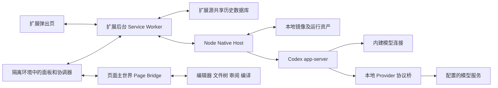
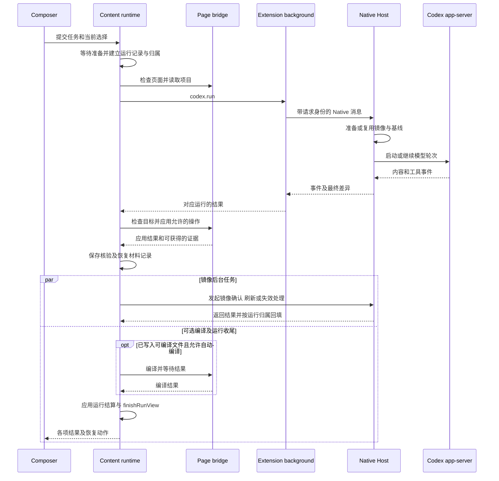

# 系统结构与状态归属

本页说明 Codex Overleaf Link 的执行环境、代码加载、主调用链和领域术语。初始参考产品版本为 `2.5.0`，初始参考源码基线为 `2073ae74747431aab8d529803d4e9f8197262388`；正文随当前仓库维护。

## 执行环境

产品把 Overleaf 项目内容交给本地 Codex 工作，再将允许的改动应用回所属项目。代码跨越浏览器隔离环境、Overleaf 页面环境和本机进程，各自的寿命与访问能力不同。



| 环境 | 主要责任与入口 | 需要注意的寿命 |
| --- | --- | --- |
| Popup | [popup.js](../../extension/src/popup.js) 显示连接、版本和侧边入口开关 | 弹出窗口关闭后视图消失 |
| Isolated content world | [contentRuntime.js](../../extension/src/content/contentRuntime.js) 组装界面、提交运行、处理结果与生命周期 | 绑定页面文档；SPA 导航还会改变项目作用域 |
| MAIN page world | [pageBridge.js](../../extension/src/pageBridge.js) 的 `dispatch` 连接编辑器及页面能力 | 绑定 Overleaf 页面；DOM 与编辑器能力由外部产品决定 |
| Extension service worker | [background.js](../../extension/src/background.js) 路由 Native 消息、运行 journal、共享存储和更新 | 浏览器可挂起或重启；内存不能充当唯一恢复证据 |
| Native Host | [index.js](../../native-host/src/index.js) 的 `handleDecodedMessage` 分派请求；[taskRunnerRuntime.js](../../native-host/src/taskRunnerRuntime.js) 管理执行 | 本地进程可因浏览器断连退出；部分恢复记录落盘 |

Native Messaging 是浏览器扩展与本地程序之间的消息通道。Page RPC 是隔离环境请求页面主世界执行能力的调用协议。两种通道拥有不同的请求标识、限制与重试规则。

同源检查、扩展来源、项目身份与版本能力分别回答不同问题。各消息族的准入条件以及 Page token 的同文档信任前提见[协议与信任边界](protocols-and-trust.md)，不能由一次握手推定所有方法具有相同权限检查。

自定义 Provider 仍通过 Codex app-server 管理 agent 的工具与线程。[codexProviderLaunch.prepareProviderLaunch](../../native-host/src/codexProviderLaunch.js) 将 Responses、Chat Completions 或 Anthropic 上游连接接到本地桥，再向 Codex 提供统一入口。更换模型服务与更换 agent 执行引擎需要分别理解。

## 代码如何真正加载

```text
extension/entries/content-entry.mjs
  → 纳入源码模块及 registry
  → legacyGlobalRegistry.create(globalThis)
  → ContentRuntime.init(dependencies)

build-content-bundle.mjs
  → generated/content.bundle.js + metadata
  → Direct manifest 或 Managed runtime manifest 注入同一 bundle
```

[content-entry.mjs](../../extension/entries/content-entry.mjs) 是 content 源码纳入入口。[moduleRegistryKernel.js](../../extension/src/content/moduleRegistryKernel.js) 解析声明的依赖；[legacyGlobalRegistry.js](../../extension/src/content/legacyGlobalRegistry.js) 适配仍发布旧全局接口的模块。新增模块应通过显式依赖或组合根连接消费者。

直接加载由 [extension/manifest.json](../../extension/manifest.json) 的 content scripts 描述；托管加载由 [bootstrap/background.js](../../extension/bootstrap/background.js) 的 `registerManagedRuntime` 读取 [runtime-manifest.json](../../extension/runtime-manifest.json)。两份 manifest 负责注入面，源码模块的纳入由构建入口决定。

页面主世界还有一条独立加载链：[pageBridgeClient.js](../../extension/src/content/pageBridgeClient.js) 的 `PAGE_WORLD_SCRIPTS` 和 `injectPageBridge`。增加页面能力时还需检查资源公开清单、托管 allowlist、dispatcher 及 [pageRpcContract.js](../../extension/src/shared/pageRpcContract.js)，具体步骤见[功能索引](feature-map.md)。

生成目录中的 bundle、旧入口文件或未被 HTML 引用的脚本，不能只凭文件名判断为当前 owner。是否执行必须回溯有效 manifest、源码 import、注入表或调用方。

## 一次运行的主链



图中省略了重试和队列分支。准确顺序与失败分支见[Auto 修改与撤销](auto-edit-undo.md)。`pendingMirrorRefresh` 发起后不阻塞运行报告，其结果经 [RunSettlementPersistence.settleMirrorRefresh](../../extension/src/content/runSettlementPersistence.js) 按目标记录及项目条件回填，可能早于或晚于运行收尾。
`runTask` 在首次异步等待前捕获提交会话、线程与提示词会话投影，准备完成后由 `startRunView` 按该归属建立运行；草稿清理另行检查输入是否仍匹配，详见[运行状态与恢复](run-state-and-recovery.md)。Native 返回结果后，浏览器仍可能处理保存、镜像和生命周期；一个层次的结束不能直接决定其他层的结果。

Ask 和 Auto 是当前 UI 模式，默认 Ask。Ask 路径抑制向 Overleaf 写回；Auto 仍经过身份、路径、基线及必要确认。Track 决定修订相关路径，Auto compile 决定写后编译，两者与模式分别捕获。定义入口为 [sessionState.js](../../extension/src/shared/sessionState.js)、[composerPanel.js](../../extension/src/content/composerPanel.js) 和 [runExecutionSnapshot.js](../../extension/src/shared/runExecutionSnapshot.js)。

## 领域概念

| 概念 | 含义及对照 |
| --- | --- |
| Session 与 Run | Session 保存长期对话；Run 保存一次插件任务及其结果。Native `threadId`、`turnId`、桥接 `requestId` 又分别标识模型会话、模型轮次及请求。 |
| 执行快照 | 提交时捕获白名单中的模式、模型、Provider 修订、选区及风格版本等；指令、技能、附件等额外输入另有捕获时机。快照不覆盖所有上下文或全部恢复分支。 |
| 项目快照与镜像 | 快照是一次读取结果；镜像是 Native 维护的本地工作副本。完整与部分快照对缺失文件的含义不同。 |
| 基线与当前内容 | 基线记录编辑起点；当前内容用于检查是否已经被其他操作改变。Undo 还需要修改后的预期内容来避免覆盖后来编辑。 |
| 回执与保存证据 | 执行回执帮助查询一次操作的结果；保存证据证明特定内容已被观察到保存。各自的寿命与强度不同。 |
| Settlement | 将操作及后处理证据归类为明确结果，允许部分失败、待检查和恢复动作。结算结束与全部成功分别描述。 |
| Hydration 与持久化 | Hydration 将存储状态恢复到视图；持久化把本次变化写回。generation 是阻止旧视图迟到结果写入新视图的代次标识。 |
| Tombstone | 删除后的墓碑记录，阻止旧异步保存重新创建已删除会话。 |

运行身份的主要关联为：

\[
I_{run}=(projectId,sessionId,runId),\qquad
I_{view}=(accountScopeId,projectId,generation).
\]

身份像收件标签，决定异步结果应交给哪个项目和运行；实际运行还捕获账号字段。不同层应传递各自所需身份，缺失或不匹配时停止相关写入属于 `Target contract`。各 RPC 的 identity 策略定义在 [pageRpcContract](../../extension/src/shared/pageRpcContract.js)，现有例外见[写回章节](auto-edit-undo.md)；公式不能证明所有分支已经满足契约。

## 谁决定哪种状态

| 状态或事实 | 权威责任 | 视图或其他副本 |
| --- | --- | --- |
| 提交配置 | [RunExecutionSnapshot](../../extension/src/shared/runExecutionSnapshot.js) 的公开构造与解析接口 | 队列兼容字段、运行显示 |
| Run 模型与活动协调 | [contentRuntime](../../extension/src/content/contentRuntime.js)、[sessionState](../../extension/src/shared/sessionState.js)；运行模型保存状态 | DOM 卡片、摘要、历史投影 |
| 写回及生命周期解释 | [WritebackSettlement](../../extension/src/shared/writebackSettlement.js) 归一证据及状态补丁 | [writebackEvidenceProjection](../../extension/src/shared/writebackEvidenceProjection.js)、操作按钮 |
| 会话持久化 | [scopedPersistenceTransaction](../../extension/src/shared/scopedPersistenceTransaction.js) 协调作用域；[SharedSessionBridge](../../extension/src/shared/sharedSessionBridge.js) 和 [backgroundSharedSessions](../../extension/src/backgroundSharedSessions.js) 承担共享路径 | 页面状态、最近项目列表、旧站点数据库迁移来源 |
| Overleaf 文档内容 | 页面桥读取编辑器或服务器内容；保存强度由具体证据决定 | 本地快照、镜像、UI 提示 |
| 镜像及差异基线 | [mirrorWorkspace](../../native-host/src/mirrorWorkspace.js) | 浏览器写回计划与镜像健康提示 |
| Native 进程及项目锁 | [taskRunnerRuntime](../../native-host/src/taskRunnerRuntime.js)、[nativeRunLifecycle](../../native-host/src/nativeRunLifecycle.js)、[codexSessionTiming](../../native-host/src/codexSessionTiming.js) | 运行卡片、后台运行 journal；transport 断连登记独立于 RPC ID |
| Custom Provider 配置及凭据 | [providerStore](../../native-host/src/providerStore.js)、[providerRuntime](../../native-host/src/providerRuntime.js) | 浏览器脱敏目录、执行快照中的身份引用 |
| Built-in 的 Codex 配置 | 由运行所用 Codex home 配置及 Codex 解释；[codexProviderLaunch](../../native-host/src/codexProviderLaunch.js) 不创建 Custom Provider override | Provider 身份与选择投影使用 Built-in / revision 0，执行快照的 `providerRevision` 归一为空字符串；这些身份不覆盖继承的 `model_provider/model_providers` 配置或其真实出站目标，见[Provider 与协议](providers-and-protocols.md) |
| 风格资产及版本 | [writingStyleRuntime](../../native-host/src/writingStyleRuntime.js) | 参考草稿、运行捕获的版本与哈希 |
| 更新事务 | [updateManager](../../native-host/src/updateManager.js)、Bootstrap 与后台协调；[managedUpdateProjection](../../extension/src/shared/managedUpdateProjection.js) 归一阶段语义 | 更新 UI、浏览器存储、Native 恢复记录 |

“权威责任”需要按事实划分。一个 `state` 对象或一个数据库不能代表整个系统的唯一真相。共享会话的主路径、兼容回退和恢复限制见[运行状态与恢复](run-state-and-recovery.md)。

失败目录、操作回执、运行报告、settlement、恢复按钮和卡片头部活动摘要还存在独立投影。修改“完成”或“可重试”的展示时，应逐一核对实际消费者，具体差异见[失败、结算与动作](ui-and-loading.md#failure-settlement-actions)。

## 生命周期和数据边界

取消横跨页面写入、Native 执行和本地异步工作。停止请求已收到、进程退出已确认分别取证。[processStopBarrier.js](../../native-host/src/processStopBarrier.js) 对退出未确认的项目保留屏障；其持久恢复与平台条件不能推广成所有独立执行入口或取消回执的统一保证。

子代理 broker 使用共享镜像，通过文件所有权调度与哈希证据约束输出；未完成输出还涉及隔离与采纳，见[并行子代理](parallel-subagents.md)。风格生成创建按账号和项目隔离的版本资产，后续任务捕获具体版本，见[写作风格与技能](writing-style-and-skills.md)。

Provider 凭据不能进入浏览器持久状态、运行 journal 或诊断。本地专用凭据存储及其事务恢复文件具有独立权限与清理规则，不能根据“日志”一词笼统推断内容。参考项目、PDF 提取语料、附件及编译日志也具有不同的数据路径，当前敏感扫描不能视为所有通道的统一保证。首次预检、镜像扫描、重试输入及写回路径规则见[上下文与治理](context-and-governance.md)。

## 开发到运行的五层身份

| 层 | 主要证据 |
| --- | --- |
| 开发源码 | Git 提交及工作树差异 |
| 生成产物 | [build-content-bundle.mjs](../../scripts/build-content-bundle.mjs) 生成的输入与输出摘要；页面主世界资源另行检查 |
| 磁盘安装 | [managedInstall.js](../../native-host/src/managedInstall.js) 的扩展 runtime 和 Native 版本目录 |
| 浏览器与 Native 已加载代码 | Bootstrap 注册、页面加载、Native 握手及 [updateRuntimeIdentity.js](../../extension/src/shared/updateRuntimeIdentity.js) 的组合判断 |
| 分发产物 | [build-release.mjs](../../scripts/build-release.mjs)、签名和产物验证 |

Content bundle 的摘要只能说明它覆盖的输入，不能独自证明页面脚本、Native 和浏览器加载状态一致。安装、原位更新和发布的流程见[安装与更新](installation-and-updates.md)；本页提供定位框架。
