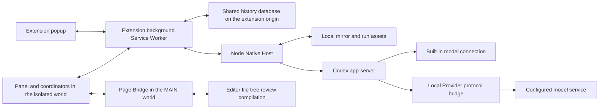
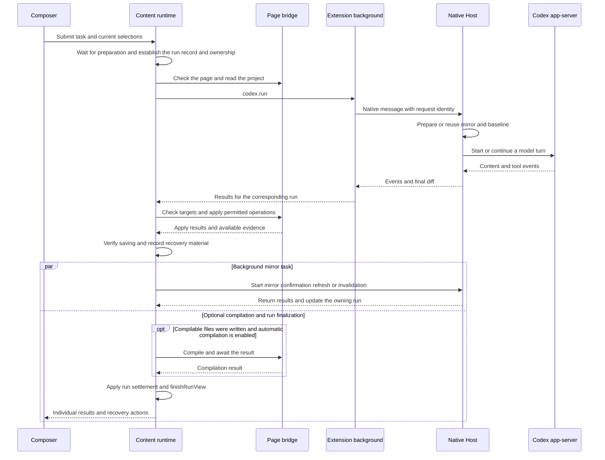

# System Structure and State Ownership

This page describes the execution contexts, code loading, main call chain, and domain terminology of Codex Overleaf Link. The initial reference product version is `2.5.0`, and the initial reference source baseline is `2073ae74747431aab8d529803d4e9f8197262388`; the body is maintained alongside the current repository.

## Execution contexts

The product gives local Codex access to Overleaf project content, then applies permitted changes back to the owning project. Its code spans the browser's isolated world, the Overleaf page world, and local processes, each with a different lifetime and access capabilities.



| Context | Main responsibilities and entry points | Lifetime considerations |
| --- | --- | --- |
| Popup | [popup.js](../../extension/src/popup.js) displays connection status, versions, and the side-entry toggle | The view disappears when the popup closes |
| Isolated content world | [contentRuntime.js](../../extension/src/content/contentRuntime.js) composes the UI, submits runs, and handles results and lifecycle | Bound to the page document; SPA navigation also changes project scope |
| MAIN page world | The `dispatch` function in [pageBridge.js](../../extension/src/pageBridge.js) connects editor and page capabilities | Bound to the Overleaf page; the external product determines DOM and editor capabilities |
| Extension service worker | [background.js](../../extension/src/background.js) routes Native messages, the run journal, shared storage, and updates | The browser can suspend or restart it; memory cannot be the sole recovery evidence |
| Native Host | `handleDecodedMessage` in [index.js](../../native-host/src/index.js) dispatches requests; [taskRunnerRuntime.js](../../native-host/src/taskRunnerRuntime.js) manages execution | The local process may exit when the browser disconnects; some recovery records are persisted to disk |

Native Messaging is the message channel between a browser extension and a local program. Page RPC is the protocol through which the isolated world asks the page's MAIN world to execute capabilities. The two channels have distinct request identifiers, limits, and retry rules.

Run maintenance within Content has further responsibility boundaries: [RunReviewController](../../extension/src/content/runReviewController.js) manages Undo/Accept and their persistent terminal states, while [DirectoryCleanupRecovery](../../extension/src/content/directoryCleanupRecovery.js) stores directory observations. The existing creation-retry and save-confirmation flows are orchestrated by the runtime's `stageWritebackRecovery/settleWritebackRecovery`. Cards display these facts; execution entry points continue to recheck the original account, project, run, and recovery evidence.

Same-origin checks, extension origin, project identity, and version capabilities answer different questions. The admission conditions for each message family and the Page token's same-document trust assumptions are described in [Protocols and trust boundaries](protocols-and-trust.md). One handshake does not establish that all methods perform the same permission checks.

Custom Providers still use Codex app-server to manage the agent's tools and threads. [codexProviderLaunch.prepareProviderLaunch](../../native-host/src/codexProviderLaunch.js) connects a Responses, Chat Completions, or Anthropic upstream to a local bridge, then provides Codex with a uniform entry point. Changing the model service and changing the agent execution engine are separate concepts.

## How code actually loads

```text
extension/entries/content-entry.mjs
  → include source modules and the registry
  → legacyGlobalRegistry.create(globalThis)
  → ContentRuntime.init(dependencies)

build-content-bundle.mjs
  → generated/content.bundle.js + metadata
  → Direct manifest or Managed runtime manifest injects the same bundle
```

[content-entry.mjs](../../extension/entries/content-entry.mjs) is the inclusion entry point for content source code. [moduleRegistryKernel.js](../../extension/src/content/moduleRegistryKernel.js) resolves declared dependencies; [legacyGlobalRegistry.js](../../extension/src/content/legacyGlobalRegistry.js) adapts modules that still expose legacy global interfaces. New modules should connect to consumers through explicit dependencies or the composition root.

Direct loading is described by the content scripts in [extension/manifest.json](../../extension/manifest.json); Managed loading uses `registerManagedRuntime` in [bootstrap/background.js](../../extension/bootstrap/background.js) to read [runtime-manifest.json](../../extension/runtime-manifest.json). The two manifests define the injection surface, while the build entry determines which source modules are included.

The page MAIN world has a separate loading chain: `PAGE_WORLD_SCRIPTS` and `injectPageBridge` in [pageBridgeClient.js](../../extension/src/content/pageBridgeClient.js). Adding a page capability also requires checking the web-accessible resource list, Managed allowlist, dispatcher, and [pageRpcContract.js](../../extension/src/shared/pageRpcContract.js). See the [Feature map](feature-map.md) for the steps.

A generated bundle, a legacy entry file, or a script unreferenced by HTML cannot be identified as the current owner from its filename alone. Actual execution must be traced through the effective manifest, source imports, injection list, or caller.

## The main chain of a run



The diagram omits retry and queue branches. Exact ordering and failure branches are described in [Auto editing and Undo](auto-edit-undo.md). Starting `pendingMirrorRefresh` does not block the run report. [RunSettlementPersistence.settleMirrorRefresh](../../extension/src/content/runSettlementPersistence.js) writes its result back under the target-record and project conditions, which may occur before or after run finalization.
`runTask` captures the submission session, thread, and prompt-session projection before the first asynchronous wait. After preparation, `startRunView` creates the run under that ownership. Draft clearing separately checks whether the input still matches; see [Run state and recovery](run-state-and-recovery.md). After Native returns a result, the browser may still be handling saving, the mirror, and lifecycle work. Completion at one layer cannot directly determine the results at other layers.

Ask and Auto are the current UI modes, with Ask as the default. The Ask path suppresses writeback to Overleaf; Auto still performs identity, path, baseline, and required confirmation checks. Track captures `requireReviewing`, which selects Reviewing/Track Changes or Editing mode before writeback; Auto compile controls compilation after writing. Both are captured separately from the mode. Their definitions are in [sessionState.js](../../extension/src/shared/sessionState.js), [composerPanel.js](../../extension/src/content/composerPanel.js), and [runExecutionSnapshot.js](../../extension/src/shared/runExecutionSnapshot.js); [contentRuntime.ensureReviewingBeforeWrite](../../extension/src/content/contentRuntime.js) applies the captured Track setting. Focus-file write restrictions are separate: [runController.shouldRestrictWritebackToFocus](../../extension/src/content/runController.js) requires selected focus files and either a focused partial snapshot or an OT warm start.

## Domain concepts

| Concept | Meaning and distinctions |
| --- | --- |
| Session and Run | A Session stores a long-lived conversation; a Run stores one plugin task and its results. Native `threadId`, `turnId`, and bridge `requestId` identify the model conversation, model turn, and request, respectively. |
| Execution snapshot | The execution snapshot captures the mode, model, Provider revision, selection, and style version. New queue items additionally use submissionContext to capture instruction and skill inputs; the queue does not carry attachments. Project files and other context still follow their respective read entry points. |
| Project snapshot and mirror | A snapshot is the result of one read; a mirror is the local working copy maintained by Native. Missing files have different meanings in full and partial snapshots. |
| Baseline and current content | The baseline records the starting point of an edit; current content is checked for changes made by other operations. Undo also needs the expected post-edit content to avoid overwriting later edits. |
| Receipt and save evidence | An execution receipt helps retrieve the result of an operation; save evidence establishes that specific content was observed as saved. Their lifetimes and evidentiary strength differ. |
| Settlement | Classifies operation and post-processing evidence into explicit outcomes, allowing partial failure, pending checks, and recovery actions. Completed settlement and complete success are separate descriptions. |
| Hydration and persistence | Hydration restores stored state into a view; persistence writes the current changes back. A generation is an identifier that prevents late results for an old view from being written into a new view. |
| Tombstone | A record left after deletion that prevents an old asynchronous save from recreating a deleted session. |

The main relationships between run identities are:

\[
I_{run}=(projectId,sessionId,runId),\qquad
I_{view}=(accountScopeId,projectId,generation).
\]

Identity acts like an address label, determining which project and run should receive an asynchronous result; actual runs also capture account fields. Each layer should pass the identity it needs. Stopping the relevant writes when identity is missing or mismatched is a `Target contract`. Each RPC's identity policy is defined in [pageRpcContract](../../extension/src/shared/pageRpcContract.js), with existing exceptions described in the [Writeback chapter](auto-edit-undo.md); the formulas do not prove that every branch already satisfies the contract.

## Which component decides each state

| State or fact | Authoritative responsibility | Views or other copies |
| --- | --- | --- |
| Submission configuration | Public construction and parsing interfaces of [RunExecutionSnapshot](../../extension/src/shared/runExecutionSnapshot.js) | Queue compatibility fields and run display |
| Run model and activity coordination | [contentRuntime](../../extension/src/content/contentRuntime.js), [sessionState](../../extension/src/shared/sessionState.js); the run model stores the state | DOM cards, summaries, and history projections |
| Interpretation of writeback and lifecycle | [WritebackSettlement](../../extension/src/shared/writebackSettlement.js) normalizes evidence and state patches | [writebackEvidenceProjection](../../extension/src/shared/writebackEvidenceProjection.js) and action buttons |
| Session persistence | [scopedPersistenceTransaction](../../extension/src/shared/scopedPersistenceTransaction.js) coordinates scope; [SharedSessionBridge](../../extension/src/shared/sharedSessionBridge.js) and [backgroundSharedSessions](../../extension/src/backgroundSharedSessions.js) handle the shared path | Page state, the recent-project list, and legacy site databases used as migration sources |
| Overleaf document content | The page bridge reads editor or server content; the strength of a save claim depends on the specific evidence | Local snapshots, mirrors, and UI notices |
| Mirror and diff baseline | [mirrorWorkspace](../../native-host/src/mirrorWorkspace.js) | Browser writeback plans and mirror-health notices |
| Native processes and project locks | [taskRunnerRuntime](../../native-host/src/taskRunnerRuntime.js), [nativeRunLifecycle](../../native-host/src/nativeRunLifecycle.js), [codexSessionTiming](../../native-host/src/codexSessionTiming.js) | Run cards and the background run journal; transport-disconnection registration is independent of RPC IDs |
| Custom Provider configuration and credentials | [providerStore](../../native-host/src/providerStore.js), [providerRuntime](../../native-host/src/providerRuntime.js) | The browser's redacted catalog and identity references in execution snapshots |
| Built-in Codex configuration | Interpreted by Codex and the Codex home configuration used for the run; [codexProviderLaunch](../../native-host/src/codexProviderLaunch.js) does not create a Custom Provider override | Provider identity and selection projections use Built-in / revision 0, while the execution snapshot normalizes `providerRevision` to an empty string. These identities do not override inherited `model_provider/model_providers` configuration or its actual outbound destination; see [Providers and protocols](providers-and-protocols.md) |
| Style assets and versions | [writingStyleRuntime](../../native-host/src/writingStyleRuntime.js) | Reference drafts, and the versions and hashes captured by runs |
| Update transaction | [updateManager](../../native-host/src/updateManager.js), Bootstrap, and background coordination; [managedUpdateProjection](../../extension/src/shared/managedUpdateProjection.js) normalizes phase semantics | Update UI, browser storage, and Native recovery records |

Authoritative responsibility must be divided by fact. One `state` object or database cannot represent a single source of truth for the entire system. The main shared-session path, compatibility fallback, and recovery limits are described in [Run state and recovery](run-state-and-recovery.md).

The failure catalog, operation receipts, run reports, settlement, recovery buttons, and activity summaries in card headers also have independent projections. Changes to the display of completion or retryability require checking each actual consumer; see [Failures, settlement, and actions](ui-and-loading.md#failure-settlement-actions) for the differences.

## Lifecycle and data boundaries

Cancellation spans page writes, Native execution, and local asynchronous work. Receipt of a stop request and confirmation of process exit require separate evidence. [processStopBarrier.js](../../native-host/src/processStopBarrier.js) retains a barrier for projects whose process exit is unconfirmed. Its persistent recovery and platform conditions cannot be generalized into a uniform guarantee for every independent execution entry point or cancellation receipt.

The subagent broker uses a shared mirror and constrains output through file-ownership scheduling and hash evidence. Unfinished output also involves quarantine and adoption; see [Parallel subagents](parallel-subagents.md). Style generation creates versioned assets isolated by account and project, and later tasks capture a specific version; see [Writing styles and skills](writing-style-and-skills.md).

Provider credentials must not enter persistent browser state, the run journal, or diagnostics. Dedicated local credential storage and its transaction-recovery files have their own permission and cleanup rules; the word "log" alone does not establish what a file contains. Reference projects, PDF-extracted corpus material, attachments, and compilation logs also have different data paths. Current sensitive-data scanning cannot be treated as a uniform guarantee across all channels. Initial preflight, mirror scanning, retry inputs, and writeback path rules are described in [Context and governance](context-and-governance.md).

## Five layers of identity from development to execution

| Layer | Main evidence |
| --- | --- |
| Development source | Git commit and working-tree diff |
| Generated artifacts | Input and output digests produced by [build-content-bundle.mjs](../../scripts/build-content-bundle.mjs); page MAIN-world resources require separate checks |
| On-disk installation | Extension runtime and Native version directories managed by [managedInstall.js](../../native-host/src/managedInstall.js) |
| Code loaded by the browser and Native | Combined assessment of Bootstrap registration, page loading, the Native handshake, and [updateRuntimeIdentity.js](../../extension/src/shared/updateRuntimeIdentity.js) |
| Distribution artifacts | [build-release.mjs](../../scripts/build-release.mjs), signatures, and artifact verification |

The content bundle digest establishes only the inputs it covers; it cannot alone prove that page scripts, Native, and the browser's loaded state are aligned. Installation, in-place updates, and release procedures are described in [Installation and updates](installation-and-updates.md); this page provides the navigation framework.
