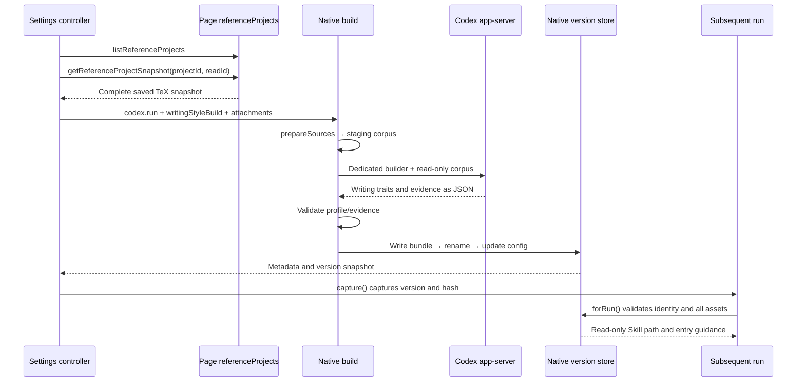

# Writing-Style Assets and Skills

Initial reference source baseline: `2073ae74747431aab8d529803d4e9f8197262388`. Current behavior is maintained against this repository's implementation.
This page explains style-asset generation, publication, and consumption, and the installation boundaries of ordinary skills. Source-derived conclusions, local test coverage, and full generation acceptance are described separately.
Entry points: [Architecture Guide](README.md) · [Feature Change Map](feature-map.md) · [Run State and Recovery](run-state-and-recovery.md).

## Feature Boundaries and Terminology

Write in My Style extracts writing habits supported by identifiable sources and generates reusable, read-only assets for the target project.
Generation uses the current model and Provider. Subsequent tasks capture a specific version and apply those writing habits to academic writing as needed.
Ordinary Skills have separate installation, discovery, and invocation flows; these two lifecycles must be traced independently.

| Object | Authoritative location and purpose | Guarantee that must not be inferred |
| --- | --- | --- |
| Local Codex skills | Discovered by app-server `skills/list` after inheriting the local Codex configuration; `loadCodexLocalSkills` and per-item selection control use in this plugin's runs | The catalog does not enumerate all plugin caches; enabling a skill does not prove that the model will use it in a particular task |
| Codex Overleaf skills | `<id>/SKILL.md` under `getCodexOverleafSkillsRoot()` | File existence does not prove trustworthy content or successful task execution |
| Project-local skills | `.codex-overleaf/skills/<id>.md` under the mirrored project root; compatibility API and selected-content injection | The current Settings list has not switched to listing project skills |
| Reference draft | Project selection, PDF File, and dirty flag held in `WritingStyleSettings` memory | Editing the draft does not immediately replace an existing style |
| Corpus and evidence | Extracted body text, source mappings, exact quotations, and writing patterns | Conclusions, methods, and section structure from reference papers do not become requirements for the target paper |
| Style version bundle | Skill, references, corpus, and manifest in `versions/<uuid>/` | Local permissions and hash verification do not constitute a complete security sandbox |
| Run style snapshot | Account, target project, version, and manifest hash | Current Settings toggles do not retroactively rewrite submitted snapshots |

For path and skill-scope definitions, see `SKILLS_DIR`, `CODEX_OVERLEAF_SKILL_SCOPE`, and `getCodexOverleafSkillsRoot()` in [localSkills](../../native-host/src/localSkills.js).
The generated profile's `traits` describe writing characteristics, such as sentence rhythm or transition habits; `sections` only index evidence locations.
Section labels act like bookmarks for locating example sentences. The generator explicitly prohibits treating them as a structural template for the target paper.

## Primary Owners, Protocols, and Consumers

| Decision or data | Primary owner and actual symbols | Caller or consumer |
| --- | --- | --- |
| Selection, toggles, preview, and generation UI | [writingStyleSettings](../../extension/src/content/writingStyleSettings.js) `create/ensureLoaded/capture/generate` | The `writingStyleSettings` composition site in [contentRuntime](../../extension/src/content/contentRuntime.js) |
| Reference-project catalog for the signed-in account and read cancellation | [referenceProjects](../../extension/src/page/referenceProjects.js) `create/listProjects/readProject/cancelRead` | [pageBridge](../../extension/src/pageBridge.js) dispatcher; content-injected dependencies |
| Reference snapshots and resource limits | [shared/writingStyle](../../extension/src/shared/writingStyle.js) `normalizeSnapshot/REFERENCE_LIMITS` | Settings, Native, execution snapshot codec, storage compaction |
| Native configuration, versions, and generation | [writingStyleRuntime](../../native-host/src/writingStyleRuntime.js) `get/set/build/forRun` | [taskRunnerRuntime](../../native-host/src/taskRunnerRuntime.js), [codexSessionRunner](../../native-host/src/codexSessionRunner.js) |
| Generated-result structure and evidence | [writingStyleProfile](../../native-host/src/writingStyleProfile.js) `validate/renderGuide/renderSection`; [writingStyleEvidence](../../native-host/src/writingStyleEvidence.js) `resolveExample/renderExample` | `parseResult()` in `build()` and asset rendering |
| Ordinary skill CRUD | [localSkills](../../native-host/src/localSkills.js) `installProjectSkill/installCodexOverleafSkill/removeCodexOverleafSkill` | `handleSkillsList/handleSkillsInstall/handleSkillsRemove` |
| Local Codex skill catalog, identity, and explicit reading | [codexLocalSkills](../../native-host/src/codexLocalSkills.js) `listCodexLocalSkills/createCodexLocalSkillIdentity/loadSelectedCodexLocalSkill` | The `codex-local` scope of `skills.list`; `codexSessionRunner.loadCodexSkillInvocationContext` |
| Skill discovery environment | [codexHome](../../native-host/src/codexHome.js) `preparePluginCodexHome/composePluginSkillsDirectory` | Codex app-server startup; ordinary and installer turns |

The Page RPC names are `listReferenceProjects`, `getReferenceProjectSnapshot`, and `cancelReferenceRead`.
[pageRpcContract](../../extension/src/shared/pageRpcContract.js) classifies the first two as safely retryable reads and cancellation as idempotent control.
Catalog and reference reads do not require the current editor's project identity; `readProject(params.projectId)` validates the actual reference target.
Reference reads are cancelled through a separate `requestId`; their cancellation path cannot be inferred from the generic `content_abort` flag.
Native configuration requests are `writing-style.get/set`; generation reuses `codex.run`, routing through `params.writingStyleBuild`.

## From Reference Draft to Subsequent Run

### Reading and Packaging References

`generate()` copies the current selection and captures the current model, reasoning effort, speed tier, Provider selection, and locale before reading.
The project catalog is fetched through an authenticated same-origin `/project` request, excluding trashed projects and retaining archived projects.
`parseCatalog()` detects incomplete catalogs; failure does not fall back to a list of recent records.
`readProject()` obtains the specified reference project's saved content through `snapshotRouter.fetchProjectZipSnapshot()` without switching the editor.
The read retains only TeX files returned by the extractor. Missing content, an exceeded count or byte limit, or an explicit `skipped` report of omitted TeX causes the reference read to fail.
`referenceTextComplete: true` also depends on the snapshot's path-identity result. When `pathIdentityComplete:false`, `readProject()` returns `reference_project_incomplete` and does not claim complete reference text. [Literal ZIP Filenames and Path Identity](auto-edit-undo.md#zip-path-identity) preserves literal names such as `100%.tex` and propagates ambiguous and invalid entries upstream. This check runs separately from TeX content, count, and byte completeness checks.

PDF File objects are encoded as Base64 in content memory; project snapshots are encoded as JSON attachments and then associated with source descriptions.
Source descriptions reference attachments only by `attachmentId`; Native rechecks the project ID, timestamp, file paths, and completeness flags.
On regeneration, project sources are reread. Saved PDF sources can reuse extracted corpora through `reuseSnapshot` and `sourceId`.
Reuse first checks the old snapshot's account, project, and manifest hash; original bytes of an old PDF are not required version-bundle assets.
For the reference-attachment path, see `readReferenceProjectAttachment()` and `prepareSources()`; ordinary chat-attachment materialization rules cannot be applied directly.

### Dedicated Generation and Evidence Validation

`handleCodexRun()` forces build requests to Ask, disables `useExistingMirror`, and clears `fileOverlays` and `writingStyle`.
Generation still uses Native requests, project locks, Provider resolution, and cancellation control; after entering `runCodexSession()`, it branches into `build()` first.
This branch does not require the mirror-snapshot evidence of ordinary editing tasks and does not enter ordinary attachment materialization or diff writeback.

`projectDocument()` selects the main TeX file, recursively expands `input/include`, filters the preamble, comments, and bibliography, and records source paths and line numbers.
This is heuristic extraction without full TeX compilation; missing includes and out-of-bounds paths cause failure.
Currently, referenced paths are joined relative to the referencing file's directory: `path.posix.join(path.posix.dirname(name), match[1].trim())`. After normalization, the original path is tried first, followed by a `.tex` suffix.
For example, if `main.tex` references `sections/methods.tex` and that file contains `\input{common}`, the extractor looks for `sections/common.tex`. It does not fall back to `common.tex` even if that file exists at the project root.
This limits compatibility between the extraction algorithm and project directory layouts. A complete snapshot does not guarantee successful extraction, and the algorithm does not establish the path rules used by packages or the actual compilation entry point.
The PDF.js worker in [writingStylePdfWorker](../../native-host/src/writingStylePdfWorker.js) extracts PDF text and records page numbers; there is no OCR.
`prepareSources()` filters some headers and footers, checks readability, deduplicates by body-text hash, and writes numbered corpora into staging.

`build()` uses [writing-style-builder/SKILL.md](../../native-host/src/skills/writing-style-builder/SKILL.md) as its dedicated task.
Execution uses a new session, `read-only`, and `approvalPolicy: never`, disables local and Overleaf skills, and strips known built-in skills.
`createRecoveringStyleRunner()` can reselect a local CLI to meet model compatibility requirements. Its one recovery retry is counted separately from the repair retry after JSON validation.
For the recovery entry, see [codexModelRecovery](../../native-host/src/codexModelRecovery.js); the model, Provider, and input retain the selection captured for this generation.

`parseResult()` parses the returned JSON; `validate()` requires 3–8 traits, at least three dimensions, and traceable example sentences.
Each example must support its trait. A profile with multiple sources must cite at least two sources; section groups reject a `guidance` field.
`resolveExample()` validates exact contiguous quotations, corpus line ranges, complete sentence endings, and balanced TeX braces and environments.
A structure or evidence validation failure can receive one repair attempt. Errors such as insufficient evidence and extraction failure are not all classified as repairable JSON errors.
These checks enforce structure and citation constraints; the accuracy of stylistic observations and the quality of transfer still require human or targeted evaluation.

## Identity, Asset Publication, and Application

Style identity has three layers: resource scope, view epoch, and immutable reference:

\[
I_{scope}=(accountScopeId,projectId),\quad
I_{view}=(I_{scope},epoch),\quad
I_{style}=(I_{scope},version,bundleHash).
\]

| Field or record | Owner | Meaning and checks |
| --- | --- | --- |
| `accountScopeId/projectId` | Captured by content, validated by Native `scopeOf()` | Target-style ownership; reference-project IDs are stored separately in source descriptions |
| `epoch` | Settings controller | Increments after a scope change; late reads and UI responses do not enter the new view |
| `revision` | Native `config.json` | Increments with each configuration save; the revision read at generation completion determines whether a newer enablement preference is retained |
| `building.id/requestId/pid` | Native build/config | Build ownership, cancellation routing, and interruption detection |
| `version` | Native UUID | Points to the published version directory; subsequent configuration can switch the current version |
| `bundleHash/files` | Manifest and `safeBundleText()` | Manifest SHA-256 plus each asset's hash, checked before a run |

By default, `scopeOf()` uses `writing-styles/<account-hash>/<project>/` beneath the plugin's private root; `CODEX_OVERLEAF_WRITING_STYLE_ROOT` can override the root path.
[writingStyleStore.writeJson/withConfigLock](../../native-host/src/writingStyleStore.js) manages configuration saving: it exclusively creates a temporary JSON file and then renames it; same-scope configuration read-modify-write operations use short `.config-lock` transactions. A version is fully written in `.build-<uuid>/bundle`, passes consumer validation, and is then renamed to `versions/<uuid>`.
The manifest records the account hash, target project, model, source metadata, trait index, sections, and file hashes.
Asset files are created with `0400` permissions and directories with `0700`. `versionRoot()` and `safeBundleText()` reject a version directory or target file that is itself a symbolic link and check hashes; permission effects still differ by platform.

Build initialization, `set()`, interruption repair in `get()`, publication, and ownership cleanup after failure all reread configuration under the same scope lock. Publication combines the `latest.building.id` check, version rename, and configuration update in one short transaction, stopping if ownership has changed.
`enableAfterBuild` applies only when the revision read under the lock equals the expected value after build startup; otherwise the newer enablement preference is retained. Reference extraction and model generation do not hold this lock, allowing other processes to save preferences during generation.
The lock uses a PID and unique token, preparing its owner before atomically publishing the lock directory. It reclaims only the exact owner of a process confirmed to have exited, conservatively retaining owners with unknown status or insufficient permissions. Waiting is bounded; conflicts and filesystem failures follow the existing error flow. The in-process project lock in [taskRunnerRuntime](../../native-host/src/taskRunnerRuntime.js) still controls run admission and cannot replace this cross-process configuration lock.
The lock protects only same-scope configuration transactions on one machine. Version-directory rename and config update remain two filesystem steps; a crash can leave an unreferenced new version. Successful directory publication alone does not prove that current configuration has switched.
Existing versions are not deleted after a successful update; this module currently provides neither version garbage collection nor a dedicated deletion API.

`capture()` requires current settings to be loaded; it rejects submission when enabled but not ready and returns null when disabled.
`contentRuntime.runTask()` rechecks the account and project after waiting for settings; queued tasks restore style from their original execution snapshot.
`normalizeSnapshot()` in [runExecutionSnapshotCodec](../../extension/src/shared/runExecutionSnapshotCodec.js) normalizes the style fields; [storageRunActions](../../extension/src/shared/storageRunActions.js) preserves the normalized reference.
`forRun()` reads the version specified by the snapshot, validates the target scope, manifest, and all declared assets, then returns the Skill path and entry text.
An ordinary `get()` can return `ready: true` after reading the manifest through `readBundle()`, without individually validating every declared asset. `includePreview` also checks only files read for the preview.
Readable current metadata and continued consumability of all assets therefore require separate evidence. Full-asset validation at publication cannot guarantee that files remain unchanged before subsequent use; see “Limits and Data Flow” below.
Ordinary parent tasks and broker worker prompts use the same style context; installer turns skip it.
A null snapshot explicitly instructs the current run not to reuse earlier style, preventing lingering historical instructions in the same model session.
The agent reads subsequent assets as needed. A referenced version does not expand the current run's editing scope or change Track/Undo rules.

## Cancellation, Navigation, and Failure Recovery

| Situation | Current handling | Boundary to preserve |
| --- | --- | --- |
| Cancellation during reference reading | `cancel()` calls `cancelReferenceRead(readId)`; the page AbortController aborts the download | PDF File encoding relies on cancellation checks before and after completion; this does not imply immediate interruption of encoding |
| Cancellation during generation | Sends `codex.cancel` when requestId is known; rechecks cancelled when requestId arrives late | A sent request and confirmed process termination require separate evidence |
| Account/project switch | `alignScope()` clears UI state, increments epoch, and cancels references still being read | This does not automatically send cancellation for generation already running in Native |
| Generation failure or cancellation | Initialization sits inside `try/finally`; only after successful registration does cleanup, under the lock, clear building still owned by this build and write the error, retaining the existing version | If configuration is unavailable, the original error is retained; a first generation that never became ready still has no applicable version |
| Corrupt current-version directory or manifest | Disabled-state `get()` returns `enabled:false/ready:false/snapshot:null` with error metadata, allowing ordinary submissions without style to continue | Enabled-state access and explicit `includePreview` still reject strictly; corruption of the configuration file itself is outside this fallback |
| Interrupted Native task | `get()` corrects building by checking PID liveness and active requests in the same process | PID checking does not prove complete transaction recovery across restarts |
| Unconfirmed process termination | `keepStaging` retains the temporary directory and notifies the stop-barrier owner | Temporary corpus deletion after cancellation cannot be claimed unconditionally |

Staging creation, configuration reading, and initial registration all fall within `build()` cleanup. Without `keepStaging`, this build's staging is deleted; published versions are retained separately.
During failure cleanup, `writingStyleStore.writeJson()` removes only the temporary file exclusively created by that call, preserving preexisting colliding files and other builds' resources. Unconfirmed termination continues to preserve the relevant corpus directory.

When style is disabled, [writingStyleRuntime.set()](../../native-host/src/writingStyleRuntime.js) saves settings under the lock, then returns metadata through `get()`. Failure to read an old bundle does not turn the already-saved disabled state into an RPC failure. [writingStyleSettings](../../extension/src/content/writingStyleSettings.js) uses its existing message area and language mappings for asset-unavailable and configuration-busy notices.
`ensureLoaded(true)` in [contentRuntime.runTask()](../../extension/src/content/contentRuntime.js) can obtain disabled-state metadata, after which `capture()` returns null. Enabling style, explicitly previewing it, and `forRun()` for captured snapshots continue their respective integrity checks; existing assets are not automatically deleted or rebuilt.
Cross-view refresh writes the account, project, time, and nonce through `CHANGE_KEY`; other controllers then reread configuration from Native.
This browser notification only signals invalidation; Native `config.json` determines the authoritative enablement state.

## Limits and Data Flow

The authoritative limit source is [writingStyle.REFERENCE_LIMITS](../../extension/src/shared/writingStyle.js); the Native receiving side uses `WRITING_STYLE_ATTACHMENT_QUOTAS` in [nativeQuotas](../../native-host/src/nativeQuotas.js).
Current limits are at most three sources, 20 MiB per PDF, 40 MiB total PDF data, 4 MiB per project JSON attachment, and 44 MiB total raw attachment size.
The PDF worker has a 90-second timeout and reads at most 80 pages. Extracted body text is sampled to approximately 60,000 characters; adding one line can cross the character threshold.
TeX reference text also has an approximately 60,000-character limit and an 80-file traversal limit. Reading the complete project file tree and file contents does not mean that all content ultimately enters the model corpus.

Output assets additionally face the per-file `text.length <= 800000` limit in [writingStyleRuntime.safeBundleText()](../../native-host/src/writingStyleRuntime.js). This counts JavaScript string length, unlike the UTF-8 byte quotas for input.
`build()` serializes all documents, including body text and per-line origins, into `references/source-index.json`.
Repeating a source path for each line can enlarge the index. For example, three TeX sources of approximately 3,000 lines each, with 20 characters per line and source paths of approximately 100 characters, already require approximately \(3\times3000\times(20+100)=1{,}080{,}000\) characters for text and repeated paths alone, before JSON fields.
Short lines with repeated long source paths can produce an oversized index from references that satisfy input quotas. Before publication, `readBundleAtRoot()` and the same `safeBundleText()` check the staging manifest and all declared assets. An exceeded limit or integrity failure retains the old version and prevents publication of an unusable new one. Input byte budgets, body-text sampling, and consumer character limits still apply independently; the current fix does not raise these limits.

The Base64 byte budget is \(E=4\lceil B/3\rceil\), with additional room needed for JSON and request metadata.
The 44 MiB attachment budget keeps encoded output plus reserved overhead below the browser's 64 MiB message limit; ordinary chat-attachment quotas remain independent.
Changing thresholds requires checking the UI, shared constants, Native validation, PDF worker, and message packaging together; changing an error message alone cannot increase capacity.

| Data | Persistence and outbound-flow facts |
| --- | --- |
| Project catalog and unsubmitted PDFs | Held in controller memory; this controller does not save catalog or PDF bytes into persistent browser state |
| Reference TeX/PDF attachments | Sent through the browser background to Native; build extracts them independently, outside ordinary turn-attachment materialization |
| Extracted corpus, source origins, and generated guidance | Written to staging and successful version bundles; Codex can read them and send them to the selected model for processing |
| Original PDF bytes | Used for worker extraction and file hashing; build does not write the original PDF into the version bundle |
| Version snapshot | Can be saved with queue and run records; contains only identity, version, hash, and labels, without corpus text |
| Provider secret | Managed through the separate Provider workflow; style assets do not store API keys |

After reading selected project snapshots and before `startBuild()`, `generate()` aggregates project text and invokes existing `SensitivePreflight` through composition-root-injected `preflightProjectReferences`. Checking uses the target project's governance rules and existing confirmation policy. Cancellation and account/project changes are rechecked after asynchronous waits; preflight results appear in the existing Settings message area.
This check covers only the project text selected for that generation. PDFs, saved corpora, and the complete generation prompt do not gain equivalent scanning coverage. Readability, size, and evidence checks in `writingStyleRuntime` remain independent.
Generator prompts treat instructions inside references as data, and asset entry guidance requires compliance with the current task and project rules. These prompts must be evaluated separately from actual permission boundaries.

## Ordinary Skill Installation, Inheritance, and Scope

### Catalogs, Per-Item Selection, and `/` Invocation

The Skills page in Settings presents separate Local Codex and Codex Overleaf catalogs. [LocalSkillsPanel.refreshLocalSkills](../../extension/src/content/localSkillsPanel.js) reads the plugin catalog and calls runtime `primeCodexLocalSkillsCatalog` to fetch `skills.list {scope:'codex-local'}`. Local items display a name, description, source, and enablement toggle; they cannot be deleted from this panel. Plugin items continue to use installation and removal interfaces under `scope:'codex-overleaf'`; the legacy project scope still requires a project ID.

[codexLocalSkills.listCodexLocalSkills](../../native-host/src/codexLocalSkills.js) starts a short-lived Codex app-server in an isolated runtime home that inherits the local configuration. It performs only initialization and `skills/list`, creating no model turn. The catalog uses Codex's current discovery results, includes each source's `enabled` state, and excludes the persistent Codex Overleaf skill root. An ordinary filesystem-cache scan does not serve as the enabled catalog. Metadata returned to Content contains neither skill-file path fields nor skill bodies; names and descriptions still come from the actual catalog. [nativeHelperLifecycle.runOwnedNativeHelper](../../native-host/src/nativeHelperLifecycle.js) registers the helper's lifetime with the Host and forwards cancellation. `runSkillsMetadataProcess` in [codexLocalSkills.js](../../native-host/src/codexLocalSkills.js) enforces `DISCOVERY_TIMEOUT_MS/MAX_DISCOVERY_BYTES` and waits for process shutdown through `stopCodexAppServer` before settling.

A local item's ID is `local-` plus a source-identity digest: ordinary skills use the actual `SKILL.md` realpath; system skills use the system name, avoiding identity changes when each runtime home regenerates its system directory. Aliases of the same physical source merge; same-named skills from independent sources retain distinct IDs. For such duplicate names, catalog source labels and `/` subtitles append the catalog's `sourceHint`, which names the source directory, and fall back to the last eight ID characters when no hint exists. `scope:'codex-local'` and plugin `scope:'codex-overleaf'` jointly constrain explicit invocation; equal names do not merge into one skill.

The global preference `codexLocalSkillEnabled` stores only boolean overrides explicitly set by the user; a missing ID inherits the catalog's `enabled` value. The catalog itself lives only in Content memory, with response ownership bounded by account, project, and SPA route epoch. Reopening Skills forces a refresh; ordinary prefetch and submission can reuse the current catalog and in-flight Promise. An empty catalog is valid. Codex discovery errors for individual items return a fixed code and count through `discoveryWarnings:[{code:'codex_local_skills_skipped',count}]`. Valid items remain visible and participate in ordinary tasks; the existing page explains in the current language that some skills were not loaded, without returning the original errors' paths or content to the UI. A whole-CLI failure or malformed catalog still raises an error, preserves the draft, and allows retry; a missing explicitly selected item still prevents startup. The catalog snapshot is not persisted as session configuration, and source-skill updates or deletions can still change the next discovery result.

Runtime `getSlashCommands/activateCodexOverleafSkillComposerContext` adds enabled local items to the `/` menu and selects their invocation tag. Commands and tags preserve scope and stable ID; disabling the main switch or an individual item removes that item from the available menu. Ordinary submission captures both sets of switches and the explicit invocation before the first asynchronous wait. With local skills enabled, it waits for the catalog and then generates `enabledCodexLocalSkillIds`. Explicit local invocation forces catalog refresh; a selected item that is disabled or missing is rejected before dispatch. The queue separately saves the captured list and invocation; see [Execution Snapshots](run-state-and-recovery.md#31-execution-snapshots).

Native `loadSelectedCodexLocalSkill` resolves incoming IDs against the authoritative catalog again, rechecks the main switch, the run's allowlist, and source-file identity, and reads only a valid UTF-8 `SKILL.md` within limits. If an explicitly invoked local skill is missing or disabled, the session runner stops startup with `codex_local_skill_unavailable`. `codexPromptAssembly.formatSkillInvocationContext` gives the model the selected body and actual source path; the source path lets relative references resolve to the skill directory. Discovery, permission to participate in a run, explicit injection, and actual model execution are four separate stages. This entry point does not guarantee that the model follows the skill or provide arbitrary-file-read isolation.
`localCodexSkills`, reported by `bridge.ping`, belongs to global `REQUIRED_CAPABILITIES`, preventing an older Native with the same product version from ignoring newly added selection fields. A missing capability follows existing compatibility gating and update notices; for classification and allowed methods, see [The Two Native Compatibility Gates](protocols-and-trust.md#4-the-two-native-compatibility-gates).
If a source skill becomes unavailable after the pre-submission check, the error uses the existing run-failure presentation. `contentRuntime.restoreRejectedLocalSkillSubmission` restores the original draft, selection, skill tag, and in-memory attachments only if this submission actually cleared the input and its original account, project, session, and composer epoch still match. Later input, explicit clearing, attachment changes, or ownership switches prevent restoration. The queue continues to use its existing failure-retention flow. This recovery does not expand attachment persistence across refresh; see [Submitted Input and Drafts](ui-and-loading.md#submitted-input-drafts-during-a-run-and-edit--resend).

### Plugin Installation and Codex Home Inheritance

`installCodexOverleafSkill()` and `installProjectSkill()` validate safe IDs, text type, NUL, the 64 KiB limit, and symbolic-link paths.
Plugin skills default to `.codex-overleaf/skills` under the user's home directory; a custom root must also remain within that default root.
Plugin skill scope has no further isolation by Overleaf account or project; project skills are attached to a specific mirror root.

`ensureDefaultCodexOverleafSkills()` installs the official `annotated-rewrite` and `parallel-subagents` skills when missing; the removal API prohibits deleting official items.
Panel prefetch and ordinary submission share the in-flight Promise in [contentRuntime.primeCodexOverleafSkillsCatalog](../../extension/src/content/contentRuntime.js). When an ordinary submission enables plugin skills and the catalog has not been read, submission waits for the required catalog, then filters enabled IDs using per-item switches captured at the click. Read failure or an empty catalog uses the existing task-start failure notice, retains input, and stops Native task dispatch. Submissions with plugin skills disabled do not force a read; the queue continues to use its saved enqueue-time context. An existing nonempty cache keeps its prior reuse boundary; no per-run catalog snapshot has been introduced. When changing this path, check a first submission before catalog loading completes and the affected read-failure behavior; the retained core has no catalog-submission test.
An existing valid `SKILL.md` is preserved; updating a bundled source file does not automatically overwrite that installed file. Installation overwrite behavior and missing-skill installation must be checked separately.
Installation-time text and path validation does not review skill semantics, and it has neither the evidence validation nor immutable version publication used for style profiles.

`preparePluginCodexHome()` handles base preparation of configuration, authentication, and skills, and removes inherited global AGENTS, rules, and memories. Actual runners and thread forks obtain a stable execution scope through `buildCodexHomeEnv({…}, { isolateRuntimeHome: true, … })`. `getPluginCodexHome()` determines the persistent data root, called the canonical home below. Legacy calls explicitly configured to use the same path as the user's home retain their early return. Catalog discovery's `forceIsolatedSkillSettings`, or an explicit local allowlist, first selects an isolated canonical home and then creates a scope, preventing per-item `skills/config/write` from modifying the user's source configuration.
Switches determine inheritance of user skills, plugins, superpowers, and related content. `vendor_imports` has separate rules, so disabling local skills cannot be described as leaving the directory completely empty.

**TOML filtering and configuration paths.** [codexHome.sanitizeCopiedCodexConfig](../../native-host/src/codexHome.js) applies personality filtering, followed by local-skill filtering according to the switch. `splitTomlStatements` in [tomlStatements](../../native-host/src/tomlStatements.js) preserves complete value boundaries; `readTomlStatementPath/filterTomlRootKeys` decode each key segment before determining the target root. Top-level `personality` is always removed. Disabling local skills also removes `notify/skills/plugins/mcp_servers/marketplaces`. Quoted, Unicode-escaped, dotted, inline, and array-of-tables forms follow the same root rule.
For example, `["mcp_servers".example]` belongs to the selected root, while `["mcp_servers.example"]` is a single key containing a dot and must remain. Same-named fields in other tables also retain their original meaning. Apparent assignments/headers inside strings do not start new statements. Unselected body text and whitespace are preserved; CRLF is normalized to LF. Unclosed structures, mismatched brackets, or invalid key escapes abort preparation. This processing does not replace full TOML or Codex schema validation.
A scope's configuration key and published content use the same captured source bytes. Staging preparation skips live configuration copying and then filters the captured content, preventing a changed source from publishing different configuration under an old key. [codexConfigPaths.rebaseCodexConfigPaths](../../native-host/src/codexConfigPaths.js) then anchors known configuration-level paths to the original canonical directory, including SQLite, model catalogs, instruction files, and other fields listed by `isConfigPath`. `~/` is left for CLI expansion; legacy MCP `cwd` retains its original meaning. Literal dotted keys are not rewritten as multi-segment paths. Codex version maintenance must check newly added path fields and their resolution sites.
When changing filtering or path rebasing, use a small temporary configuration with the affected syntax and inspect what the real CLI consumes. Preserve unselected values and original path anchors; the retained release core does not establish configuration-inheritance coverage.

**Stable execution directories and shared history.** [codexHomeScope.prepareScopedPluginCodexHome](../../native-host/src/codexHomeScope.js) derives `canonical/runtime-homes/<hash>` from discovery configuration. The key includes main switches, sorted and deduplicated enabled/disabled IDs, the installer role, a digest of source-configuration bytes, and effective skill-source-directory identities. Identical configuration reuses a published directory; changes create another directory. Initial preparation completes in separate staging and then publishes atomically; competing preparation does not delete the winning directory.
`composePluginSkillsDirectory()` composes skills only in a new scope's staging, local first and then plugin. A same-named plugin keeps its original name; `preserveLocalSkillAlias` retains another link to the local source, followed by selection by actual source identity. Published scopes' skills are no longer rebuilt, so subsequent preparation by parents, workers, style generation, and installers does not change paths already discovered by one another. Skill bodies continue to be read through source links; source-content updates and users explicitly deleting source files still affect reads.
Scopes persist, with `sessions/archived_sessions/history` linked to the canonical plugin history. `CODEX_OVERLEAF_CODEX_HOME` stays canonical so that workers, forks, and history clearing do not mistakenly enter nested scopes. Explicit `sqlite_home` retains its original selection and path semantics; an existing `CODEX_SQLITE_HOME` is still forwarded, and only its absence uses the canonical environment default. `clearPluginCodexHistory` clears the same physical plugin history, preserving global sessions in the user's source home.
This design does not hold a whole-turn home lock, so a parent waiting for a worker cannot deadlock against it. Project write exclusion remains managed by [taskRunnerRuntime.acquireProjectLock](../../native-host/src/taskRunnerRuntime.js). Persistent scopes have no automatic GC; old rollout absolute paths may still depend on them.
The ordinary runner passes selected project skills as prompt content and passes `projectLocalSkills: null` to the underlying executor; home-level project-skill materialization has separate invocation conditions.
[projectSettingsCoordinator](../../extension/src/content/projectSettingsCoordinator.js) and [globalPreferences](../../extension/src/shared/globalPreferences.js) jointly persist main switches and per-skill enablement maps.
`loadSelectedCodexOverleafSkill()` checks explicit invocations against the main switch and enabled IDs; compatibility requests without enabled IDs allow all items by default.

**Per-skill switches and discovery.** `runCodexSession` passes `enabledCodexOverleafSkillIds` and `enabledCodexLocalSkillIds` to the parent executor, workers, and home preparation. An absent list preserves legacy inheritance semantics; an explicit empty list disables every item from the corresponding source. The local list contains selected stable IDs, and explicit selection can enable an item disabled at its source. Thread forks select a home using the same lists; workers' `disableCodexOverleafSkillIds` additionally excludes recursive-dispatch skills.
The composed directory filters plugin items by the list. After the actual run's `skills/list`, [codexSkillIsolation.applyCodexSkillIsolation](../../native-host/src/codexSkillIsolation.js) checks source paths and realpaths and uses `skills/config/write` in the current isolated home to disable excluded items or enable listed local items originally disabled. Plugin and local skills are evaluated separately; independent same-named sources do not borrow each other's switch. The installer's system `skill-installer` retains its existing exception. List constraints participate in scope identity, so changing selection produces another runtime directory; this configuration does not retroactively revoke active turns or existing thread context.
When changing skill inheritance or invocation, inspect the affected explicit loader or real CLI discovery list and verify the selected skill in a Luna invocation. A discovered item alone does not establish natural model triggering. These switches do not provide arbitrary-file-read isolation, mid-run revocation, or historical-context clearing.

Skill deletion has two parts: updating the persistent directory and list, and clearing the Composer invocation. After `skills.remove` succeeds, [LocalSkillsPanel.removeCodexOverleafSkill()](../../extension/src/content/localSkillsPanel.js) checks the current invocation in the production normalizer's `{ id, title, scope }` shape. Only a `codex-overleaf` scope with the same ID as the deletion target triggers `clearComposerSkillInvocation()` and an immediate tag rerender. Deletion failure retains the selection; selecting another skill during the wait preserves the new selection. The skill list then refreshes and state is saved.
Native `loadSelectedCodexOverleafSkill()` still filters explicit invocations by main switch, enabled IDs, and actual file existence. Clearing the tag does not cancel a skill already executing or prove that the entire discovery catalog or other processes have synchronized cleanup. The Composer tag's `×` retains its existing manual-clear entry point.

`id:'skill-installer'` with a missing or `builtin` scope is a special invocation: its working directory becomes the plugin skill root, its sandbox is workspace-write, `approvalPolicy: never` applies, attachments and selections are rejected, and it returns empty project sync changes. A same-named item with `codex-local/codex-overleaf` scope executes as an ordinary skill, without the installer's directory or permissions.
The installer uses a stable scope with a separate role; `$CODEX_HOME/skills` stays mapped to the persistent plugin skill directory. Ordinary, worker, and style scopes do not replace that mapping. New installations completed through that path remain in the persistent root and can be discovered during later catalog preparation; style generation still uses its own reference staging.
The installer's working directory, actual skills-resolution target, and subsequent discovery must be verified separately. Path stability cannot replace installation-artifact acceptance.
On an app-server `commandExecution/requestApproval`, `decideSkillInstallerCommandApproval()` delegates judgment to [commandApproval.evaluateSkillCommand](../../native-host/src/commandApproval.js).
These approval rules allow read-only inspection within constrained roots and compliant HTTPS git clone, while rejecting dangerous arguments, additional shell operations, and nested symbolic-link escapes. They do not prove that every installation command undergoes approval or make all HTTPS content trustworthy.
App-server file-change approval requests are rejected during installer turns; this branch and underlying workspace-write permissions must be understood separately.
Installer completion is summarized from the model run result. The current path does not uniformly verify that it produced the expected `SKILL.md`, a complete directory, a version, or subsequent discoverability; success text must be assessed together with actual files and loading evidence.

## Change Routes and Verification Definitions

| Change intent | Primary changes and required coordination | Focused verification when this path changes |
| --- | --- | --- |
| Reference selection, state, and preview | `writingStyleSettings`; content composition, Settings mounting, and epoch | Open the affected settings flow, select a disposable reference and inspect its preview; check a late response after changing project when relevant. |
| Project reading and cancellation | `referenceProjects`; snapshot router, page dispatcher, RPC, and loading manifests | Read a disposable reference project through the actual Page path; cancel while reading and confirm the original task stops. |
| TeX reference paths and body-text extraction | `writingStyleRuntime.projectDocument/prepareSources/build` | Use a small reference tree containing the affected include-path form; compare extracted source identity and text with the intended document. |
| PDF/attachment limits | `REFERENCE_LIMITS`; `nativeQuotas`, worker, source preparation | Use one accepted input and one rejected input at the changed boundary; inspect encoded request size and the resulting error. |
| Writing profile and evidence requirements | Builder Skill; `writingStyleProfile`, `writingStyleEvidence`, bundle renderer | Build from synthetic references and inspect the affected citation/JSON-repair or publication-failure outcome. Confirm that failed generation retains the prior version. |
| Version capture and queue recovery | `capture/forRun`; execution snapshot codec, storage compaction, runner | Queue a task, replace the current style version, then verify that the queued task still resolves its captured version. |
| Configuration saving and recovery from invalid assets | `get/set/build/saveConfig/safeBundleText` in [writingStyleRuntime](../../native-host/src/writingStyleRuntime.js), `writeJson/withConfigLock` in [writingStyleStore](../../native-host/src/writingStyleStore.js); Settings `toggle/ensureLoaded` and runtime `runTask` | Use an isolated style root; exercise the affected concurrent save, corrupt-asset disable, or failed publication and read the final configuration/assets. |
| Sensitive preflight of project references | `WritingStyleSettings.generate`, composition-root `preflightProjectReferences`, `SensitivePreflight`, and Native build | Use synthetic reference text to trigger the changed allow/confirm/block branch and inspect whether Native build starts with the intended scope. |
| Ordinary skill installation and switches | `localSkills`, `codexHome/Scope`, `codexSkillIsolation`; panel, preferences, runner, command approval | Install a disposable skill into the permitted plugin root, inspect effective discovery, and exercise the affected switch without modifying the source user catalog. |
| Local Codex catalog and per-item invocation | `codexLocalSkills`, `LocalSkillsPanel`, `contentRuntime.primeCodexLocalSkillsCatalog/getSlashCommands`, `codexSkillIsolation`; global preferences, submission, queue, and fork | Read the real catalog, toggle one item, select it through `/`, and verify a Luna invocation. Inspect the affected queued/worker/fork consumer only when that path changes. |
| Codex configuration inheritance and filtering | `codexHome.sanitizeCopiedCodexConfig`, statements and key paths in [tomlStatements](../../native-host/src/tomlStatements.js), configuration-level anchors in [codexConfigPaths](../../native-host/src/codexConfigPaths.js) | Use temporary configuration with the affected key spelling/value form and path; inspect unselected fields and real CLI consumption. |
| Authentication inheritance and history directories | `codexInheritedAuth`, `codexHomeScope`, canonical environment identity | Use isolated test roots and the intended CLI version; verify the affected authentication/history path without exposing credentials or changing unrelated user homes. |
| Deleting the currently selected skill | `LocalSkillsPanel.removeCodexOverleafSkill`, `contentRuntime.normalizeComposerSkillInvocation/clearComposerSkillInvocation/getEnabledCodexOverleafSkillIds`, Native explicit-invocation filtering | Use a disposable plugin skill; verify that deletion clears only its current composer invocation and that failure preserves the selection. |

The retained automated release core has no dedicated style-generation, skill-catalog or configuration-inheritance suite. The table supplies change-driven checks, not a mandatory release matrix. Choose the affected route and the smallest representative success/failure input. Complete generation claims require observing Settings, Native build, publication and subsequent consumption; a metadata read or a discovered skill is narrower evidence.

## Boundary Scenarios and Verification Points

- Running queued tasks after replacing a reference PDF: the `dirty` draft and published version have separate lifecycles; verify that the queued task still uses its submitted reference.
- Closing Settings or switching projects during generation: epoch only prevents old UI responses; a task already started in Native requires explicit cancellation and termination evidence.
- Obtaining a complete snapshot of the selected project's TeX files: extraction remains bounded by the main file, include-path resolution, sampling, and readability; check the actual reference target and source metadata's truncated field.
- Generating section examples: the validator rejects section guidance, and evidence supports writing traits only; verification must confirm that target facts and structure remain constrained by the current request.
- Updating an official Skill in source: `ensureCodexOverleafSkillInstalled()` preserves an existing valid file; check initial missing-skill installation and the contents of existing installations separately.
- Interleaved skill-environment preparation by different tasks: check that paths already discovered by active tasks remain readable, the installer mapping still targets the persistent root, and newly installed skills are discoverable after preparation runs again.

`Target contract`: preserve resolvable references from old runs to old versions. Any cleanup policy must first define reference lifetimes for queues, history, and active runs.
`Target contract`: each new reference type must declare read identity, byte/encoding budgets, extraction method, outbound flow, persistence, cancellation, and cleanup conditions.
When changing generation or recovery, verify the affected chain from Settings through Native publication and subsequent consumption. Static derivation and the retained core do not establish full style-generation behavior.
