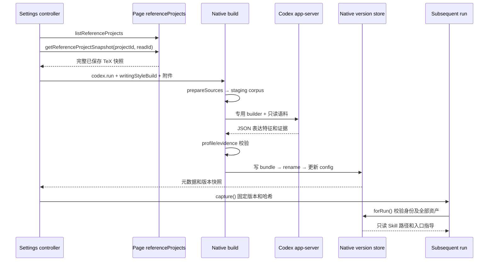

# 写作风格资产与技能

源码基线：`2073ae74747431aab8d529803d4e9f8197262388`。
本页说明风格资产的生成、发布、消费与普通技能的安装边界；源码推导、局部测试覆盖和完整生成验收分别说明。
入口：[架构指南](README.md) · [功能修改索引](feature-map.md) · [运行状态与恢复](run-state-and-recovery.md)。

## 功能边界与术语

Write in My Style 从参考资料提取有出处的表达习惯，为目标项目生成可复用的只读资产。
生成使用当前模型和 Provider；后续任务捕获具体版本，按需将表达习惯应用于学术写作。
普通 Skills 另有安装、发现与调用流程，两套生命周期须分别定位。

| 对象 | 权威位置与作用 | 不应推导的保证 |
| --- | --- | --- |
| 本地 Codex skills | 用户 Codex home；由 `loadCodexLocalSkills` 控制继承 | 启用开关不证明任意技能在当前运行中一定被调用 |
| Codex Overleaf skills | `getCodexOverleafSkillsRoot()` 下的 `<id>/SKILL.md` | 文件存在不证明内容可信或任务执行成功 |
| 项目本地 skills | 镜像项目根的 `.codex-overleaf/skills/<id>.md`；兼容 API 及选定内容注入 | 当前 Settings 列表并未切换为项目 skills 列表 |
| 参考草稿 | `WritingStyleSettings` 内存中的项目选择、PDF File、dirty 标记 | 修改草稿不会立即替换已有风格 |
| 语料与证据 | 抽取正文、出处映射、精确引用及表达模式 | 参考论文的结论、方法和章节结构不成为目标论文要求 |
| 风格版本包 | `versions/<uuid>/` 中的 Skill、references、corpus、manifest | 本地权限与哈希校验不等于完整安全沙箱 |
| 运行风格快照 | 账号、目标项目、版本、manifest 哈希 | 当前 Settings 开关不追溯改写已提交快照 |

路径及技能 scope 的定义见 [localSkills](../../native-host/src/localSkills.js) 的 `SKILLS_DIR`、`CODEX_OVERLEAF_SKILL_SCOPE` 与 `getCodexOverleafSkillsRoot()`。
生成画像的 `traits` 表示表达特征，例如句子节奏或转折习惯；`sections` 仅用于索引证据位置。
章节标签像书签，帮助定位例句；生成器明确禁止把它升级成目标论文的结构模板。

## 主 owner、协议与消费者

| 决策或数据 | 主 owner 与实际符号 | 调用方或消费者 |
| --- | --- | --- |
| 选择、开关、预览、生成 UI | [writingStyleSettings](../../extension/src/content/writingStyleSettings.js) `create/ensureLoaded/capture/generate` | [contentRuntime](../../extension/src/content/contentRuntime.js) 的 `writingStyleSettings` 组合位置 |
| 已登录账号的参考项目目录与读取取消 | [referenceProjects](../../extension/src/page/referenceProjects.js) `create/listProjects/readProject/cancelRead` | [pageBridge](../../extension/src/pageBridge.js) dispatcher；content 注入的依赖 |
| 引用快照及资源上限 | [shared/writingStyle](../../extension/src/shared/writingStyle.js) `normalizeSnapshot/REFERENCE_LIMITS` | Settings、Native、执行快照 codec、存储压缩 |
| Native 配置、版本及生成 | [writingStyleRuntime](../../native-host/src/writingStyleRuntime.js) `get/set/build/forRun` | [taskRunnerRuntime](../../native-host/src/taskRunnerRuntime.js)、[codexSessionRunner](../../native-host/src/codexSessionRunner.js) |
| 生成结果的结构与证据 | [writingStyleProfile](../../native-host/src/writingStyleProfile.js) `validate/renderGuide/renderSection`；[writingStyleEvidence](../../native-host/src/writingStyleEvidence.js) `resolveExample/renderExample` | `build()` 的 `parseResult()` 和资产渲染 |
| 普通技能 CRUD | [localSkills](../../native-host/src/localSkills.js) `installProjectSkill/installCodexOverleafSkill/removeCodexOverleafSkill` | `handleSkillsList/handleSkillsInstall/handleSkillsRemove` |
| 技能发现环境 | [codexHome](../../native-host/src/codexHome.js) `preparePluginCodexHome/composePluginSkillsDirectory` | Codex app-server 启动；普通及 installer 轮次 |

Page RPC 名称为 `listReferenceProjects`、`getReferenceProjectSnapshot` 和 `cancelReferenceRead`。
[pageRpcContract](../../extension/src/shared/pageRpcContract.js) 将前两者归为可安全重试的读取，取消归为幂等控制。
目录与参考读取不要求当前编辑器项目身份；实际参考目标由 `readProject(params.projectId)` 校验。
参考读取通过独立 `requestId` 取消，不能从通用 `content_abort` 标记推断其取消路径。
Native 配置请求是 `writing-style.get/set`；生成复用 `codex.run`，以 `params.writingStyleBuild` 分流。

## 从参考草稿到后续运行

### 参考读取与封装

`generate()` 复制本次选择，并在读取前捕获当前 model、reasoning effort、speed tier、Provider selection 和 locale。
项目目录通过同域 `/project` 的已登录请求获取，排除回收站，保留归档项目。
`parseCatalog()` 检测不完整目录；失败不回退为近期记录列表。
`readProject()` 经 `snapshotRouter.fetchProjectZipSnapshot()` 获取指定参考项目的已保存内容，不切换编辑器。
读取只保留提取器返回的 TeX 文件；其中缺内容、数量超限、字节超限，或 `skipped` 明确报告 TeX 被跳过时，参考读取失败。
`referenceTextComplete: true` 还依赖快照的路径身份结果；`pathIdentityComplete:false` 时，`readProject()` 返回 `reference_project_incomplete`，不会宣称参考文本完整。[ZIP 字面文件名与路径身份](auto-edit-undo.md#zip-path-identity)保留 `100%.tex` 等字面名字，并将歧义及非法条目向上传播。该检查与 TeX 内容、数量和字节完整性分别执行。

PDF File 在 content 内存编码为 Base64；项目快照编码为 JSON 附件，随后与来源描述关联。
来源描述仅用 `attachmentId` 引用附件；Native 再检查项目 ID、时间戳、文件路径和完整性标记。
再次生成时，项目来源重新读取；已保存 PDF 来源可通过 `reuseSnapshot` 和 `sourceId` 复用抽取语料。
复用先检查旧快照账号、项目与 manifest 哈希；旧 PDF 原始字节不属于版本包的必需资产。
参考附件路径见 `readReferenceProjectAttachment()` 和 `prepareSources()`，不能直接套用普通聊天附件的物化规则。

### 专用生成与证据验证

`handleCodexRun()` 将 build 请求固定为 Ask，关闭 `useExistingMirror`，清空 `fileOverlays` 和 `writingStyle`。
生成仍使用 Native 请求、项目锁、Provider 解析及取消控制；进入 `runCodexSession()` 后先分流到 `build()`。
这条分支不要求普通编辑任务的镜像快照证据，也不进入普通附件物化及差异写回链。

`projectDocument()` 选择主 TeX，递归展开 `input/include`，过滤导言、注释和参考文献，并记录源路径及行号。
该过程采用启发式抽取，不执行完整 TeX 编译；缺失 include 和越界路径会失败。
当前引用路径按引用文件所在目录拼接：`path.posix.join(path.posix.dirname(name), match[1].trim())`，规范化后先查原路径，再补 `.tex`。
例如 `main.tex` 引用 `sections/methods.tex`，后者含 `\input{common}`，提取器会查找 `sections/common.tex`；即使项目根已有 `common.tex`，也不会回退到该文件。
这限定了提取算法与项目目录布局的兼容范围；完整快照不保证提取成功，宏包或实际编译入口采用的路径规则也不能由该算法推定。
PDF 经 [writingStylePdfWorker](../../native-host/src/writingStylePdfWorker.js) 的 PDF.js worker 提取文字、记录页码；没有 OCR。
`prepareSources()` 过滤部分页眉页脚，检查可读性并按正文哈希去重，再把带编号语料写入 staging。

`build()` 使用 [writing-style-builder/SKILL.md](../../native-host/src/skills/writing-style-builder/SKILL.md) 作为专用任务。
执行参数为新会话、`read-only`、`approvalPolicy: never`，关闭本地和 Overleaf skills，并剥离已知内建技能。
`createRecoveringStyleRunner()` 可为兼容模型要求重选本地 CLI；其一次恢复重试与 JSON 校验后的修复重试分别计数。
恢复入口见 [codexModelRecovery](../../native-host/src/codexModelRecovery.js)，模型、Provider 和输入保持本次选择。

`parseResult()` 解析返回 JSON；`validate()` 要求 3–8 个特征、至少三个维度及可追溯例句。
每个例句必须支撑特征，多来源画像需引用至少两个来源；章节组拒绝 `guidance` 字段。
`resolveExample()` 验证精确连续引用、语料行范围、完整句尾以及 TeX 括号和环境平衡。
结构或证据验证失败可修复一次；证据不足、提取失败等错误不统一归为可修复 JSON 错误。
这些校验保证结构及引用约束；表达观察的真实性和迁移质量仍需人工或专项评估。

## 身份、资产发布与应用

风格身份分为资源作用域、视图代次和不可变引用：

\[
I_{scope}=(accountScopeId,projectId),\quad
I_{view}=(I_{scope},epoch),\quad
I_{style}=(I_{scope},version,bundleHash).
\]

| 字段或记录 | owner | 含义与检查 |
| --- | --- | --- |
| `accountScopeId/projectId` | content 捕获，Native `scopeOf()` 验证 | 目标风格归属；参考项目 ID 另存于来源描述 |
| `epoch` | Settings controller | 作用域切换后递增；迟到读取和 UI 响应不进入新视图 |
| `revision` | Native `config.json` | 每次配置保存递增；生成结束时比较已读取的修订，决定是否沿用较新的启用偏好 |
| `building.id/requestId/pid` | Native build/config | 构建所有权、取消路由及中断检测 |
| `version` | Native UUID | 指向发布的版本目录；后续配置可切换当前版本 |
| `bundleHash/files` | manifest 与 `safeBundleText()` | manifest SHA-256 加每个资产哈希，运行前验证 |

`scopeOf()` 默认使用插件私有根下 `writing-styles/<account-hash>/<project>/`；可由 `CODEX_OVERLEAF_WRITING_STYLE_ROOT` 覆盖根路径。
配置保存由 [writingStyleStore.writeJson/withConfigLock](../../native-host/src/writingStyleStore.js) 管理：独占创建临时 JSON 文件后 rename，同一 scope 的配置读改写使用 `.config-lock` 短事务；版本在 `.build-<uuid>/bundle` 完整写好并通过消费校验后 rename 到 `versions/<uuid>`。
manifest 记录账号哈希、目标项目、模型、来源元数据、特征索引、章节及文件哈希。
资产文件创建权限为 `0400`，目录使用 `0700`；`versionRoot()` 和 `safeBundleText()` 拒绝版本目录或目标文件本身为符号链接，并检查哈希；平台权限效果仍有差异。

构建初始化、`set()`、`get()` 的中断修复、发布及失败归属清理均在同 scope 锁内重读配置。发布将 `latest.building.id` 核对、版本 rename 和配置更新放在同一短事务中，归属已变化时停止发布。
仅当锁内读取的 revision 等于构建开始后的预期值，才采用 `enableAfterBuild`；否则保留较新的启用偏好。资料提取和模型生成不持有该锁，其他进程可在生成期间保存偏好。
锁使用 PID 与唯一 token，先准备 owner 再原子发布锁目录；只回收已明确退出进程的精确 owner，未知状态及权限不足保守保留。等待有界，冲突或文件系统失败沿既有错误流返回。[taskRunnerRuntime](../../native-host/src/taskRunnerRuntime.js) 的进程内项目锁仍承担运行准入，不能代替这一跨进程配置锁。
该锁只保护单机同 scope 配置事务。版本目录 rename 与 config 更新仍是两个文件系统步骤，崩溃可能留下未被引用的新版本；目录发布成功不单独证明当前配置已切换。
既有版本不会在成功更新时删除；当前模块没有版本垃圾回收或专用删除 API。

`capture()` 要求当前设置已加载；启用但未 ready 时拒绝提交，关闭时返回 null。
`contentRuntime.runTask()` 在等待设置后复核账号及项目；排队任务通过原执行快照恢复风格。
[runExecutionSnapshotCodec](../../extension/src/shared/runExecutionSnapshotCodec.js) 的 `normalizeSnapshot()` 固定风格字段；[storageRunActions](../../extension/src/shared/storageRunActions.js) 保留规范化引用。
`forRun()` 根据快照读取指定版本，验证目标作用域、manifest 和全部声明资产，随后返回 Skill 路径及入口文本。
普通 `get()` 通过 `readBundle()` 读取 manifest 后即可返回 `ready: true`，未逐一验证全部声明资产；`includePreview` 也只检查预览所读取的文件。
因此当前元数据可读及全部资产仍可消费需要分别取证；发布时的全资产校验不保证文件在后续使用前未变化，见下文“限额与资料流向”。
普通父任务与 broker worker prompt 使用同一风格上下文；installer 轮次跳过该上下文。
快照为 null 时明确要求当前运行不沿用早前风格，避免同一模型会话中的历史指令残留。
后续资产读取由 agent 按需求完成；引用版本不会扩大当前运行的编辑范围或改变 Track/Undo 规则。

## 取消、导航与失败恢复

| 情况 | 当前处理 | 需要保留的边界 |
| --- | --- | --- |
| 读取阶段取消 | `cancel()` 调用 `cancelReferenceRead(readId)`；page AbortController 中止下载 | PDF 的 File 编码完成前后依赖取消检查，不代表编码瞬时中断 |
| 生成阶段取消 | 已知 requestId 时发送 `codex.cancel`；requestId 迟到后再次检查 cancelled | 请求已发出与进程停止已确认分开取证 |
| 切换账号/项目 | `alignScope()` 清空 UI 状态、增加 epoch，并取消仍在读取的引用 | 已进入 Native 的生成没有由此自动发送取消 |
| 生成失败或取消 | 初始化在 `try/finally` 内；登记成功后才在锁内清除仍属于该 build 的 building 并写错误，保留已有 version | 配置不可用时保留原错误；未 ready 的首次生成仍无可应用版本 |
| 当前版本目录或 manifest 损坏 | 关闭态 `get()` 返回 `enabled:false/ready:false/snapshot:null` 与错误 metadata，普通无风格提交可继续 | 启用态及显式 `includePreview` 仍严格拒绝；配置文件自身损坏不在此降级范围 |
| Native 任务中断 | `get()` 根据 PID 存活及同进程 active request 检查纠正 building | PID 检查不构成跨重启的完整事务恢复证明 |
| 进程停止未确认 | `keepStaging` 保留临时目录，并通知停止屏障 owner | 不能无条件宣称取消后临时语料已经删除 |

创建 staging、读取配置及首次登记均纳入 `build()` 的清理范围；未设置 `keepStaging` 时删除本次 staging，已发布版本另行保留。
`writingStyleStore.writeJson()` 在失败收尾中只清理本次独占创建的临时文件，保留预存碰撞文件和其他构建资源；停止未确认时继续保留对应语料目录。

关闭风格时，[writingStyleRuntime.set()](../../native-host/src/writingStyleRuntime.js) 在锁内保存设置，再由 `get()` 返回 metadata。旧 bundle 读取失败不会使已保存的关闭状态变成 RPC 失败；[writingStyleSettings](../../extension/src/content/writingStyleSettings.js) 使用原消息区及语言映射显示资产不可用和配置忙提示。
[contentRuntime.runTask()](../../extension/src/content/contentRuntime.js) 的 `ensureLoaded(true)` 可取得关闭态 metadata，随后 `capture()` 返回 null。启用风格、主动预览及已捕获快照的 `forRun()` 继续执行各自完整性检查，既有资产不被自动删除或重建。
跨视图刷新用 `CHANGE_KEY` 写入账号、项目、时间和 nonce，然后其他 controller 重新向 Native 读取配置。
该浏览器通知只负责失效提醒；Native `config.json` 才决定权威启用状态。

## 限额与资料流向

限额权威来源为 [writingStyle.REFERENCE_LIMITS](../../extension/src/shared/writingStyle.js)；Native 接收侧使用 [nativeQuotas](../../native-host/src/nativeQuotas.js) 的 `WRITING_STYLE_ATTACHMENT_QUOTAS`。
当前为最多三份资料，PDF 单份 20 MiB、合计 40 MiB，项目 JSON 附件最多 4 MiB，总附件原始体积最多 44 MiB。
PDF worker 超时为 90 秒、最多读 80 页；抽取后的正文按约 60,000 字符采样，单行加入时可能越过字符阈值。
TeX 引用正文也有约 60,000 字符及 80 个文件遍历界限；目录与文件完整读取不表示全部内容最终进入模型语料。

输出资产另受 [writingStyleRuntime.safeBundleText()](../../native-host/src/writingStyleRuntime.js) 的单文件 `text.length <= 800000` 限制；这里按 JavaScript 字符串长度计数，与输入的 UTF-8 字节配额不同。
`build()` 将全部 documents（包括正文及逐行 origins）序列化到 `references/source-index.json`。
出处路径逐行重复会放大索引：例如三份各约 3,000 行、每行 20 字符、出处路径约 100 字符的 TeX，仅正文加重复路径就约为 \(3\times3000\times(20+100)=1{,}080{,}000\) 字符，尚未计 JSON 字段。
短行与重复长出处路径可使符合输入配额的参考资料生成超限索引。发布前，`readBundleAtRoot()` 和同一个 `safeBundleText()` 会检查 staging 中的 manifest 及全部声明资产；超限或完整性失败时保留旧版本，不发布无法消费的新版本。输入字节预算、正文采样和消费字符限额仍分别生效，当前修复不提高限额。

Base64 字节预算为 \(E=4\lceil B/3\rceil\)，还需预留 JSON 和请求元数据。
44 MiB 附件预算使编码结果加预留低于浏览器 64 MiB 消息上限；普通聊天附件配额保持独立。
变更阈值须同时核对 UI、共享常量、Native 校验、PDF worker 和消息封装；只改错误提示无法扩容。

| 数据 | 持久化与出站事实 |
| --- | --- |
| 项目目录与未提交 PDF | controller 内存持有；该 controller 不把列表或 PDF 字节存入浏览器持久状态 |
| 参考 TeX/PDF 附件 | 经浏览器后台送 Native；build 独立抽取，不进入普通 turn attachments 物化 |
| 抽取语料、出处、生成指导 | staging 及成功版本包落盘；Codex 可读取并交给所选模型处理 |
| 原 PDF 字节 | 用于 worker 提取及文件哈希；build 未将原 PDF 写入版本包 |
| 版本快照 | 可随队列及运行记录保存；仅包含身份、版本、哈希与标签，不含语料正文 |
| Provider secret | 由独立 Provider 管理流程处理；风格资产不保存 API key |

`generate()` 在读取选定项目快照后、`startBuild()` 前聚合项目文本，经组合根注入的 `preflightProjectReferences` 调用现有 `SensitivePreflight`。检查使用目标项目的治理规则及原确认政策，取消或账号/项目变化在异步等待后再次核验；预检结果沿 Settings 原消息区呈现。
该检查只覆盖本次选定的项目文本，PDF、saved 语料及完整生成提示词没有因此获得同等扫描保证。`writingStyleRuntime` 的可读性、大小和证据校验继续独立执行。
生成器提示将参考材料内的指令视为数据，资产入口要求服从当前任务与项目规则；这些提示需与实际权限边界分别评估。

## 普通技能安装、继承与作用域

`LocalSkillsPanel.refreshLocalSkills()` 请求 `skills.list`，当前 UI 使用 `scope: codex-overleaf`。
`handleSkillsList/Install/Remove` 对该 scope 调用插件技能库，其余请求进入项目技能接口并要求项目 ID。
`installCodexOverleafSkill()` 与 `installProjectSkill()` 校验安全 ID、文本类型、NUL、64 KiB 限额及符号链接路径。
插件技能默认位于用户主目录 `.codex-overleaf/skills`；自定义根也必须留在该默认根内部。
插件技能 scope 没有按 Overleaf 账号或项目进一步隔离；项目技能则依附具体镜像根。

官方 `annotated-rewrite` 和 `parallel-subagents` 由 `ensureDefaultCodexOverleafSkills()` 补装，删除接口禁止移除官方项。
面板预取和普通提交共用 [contentRuntime.primeCodexOverleafSkillsCatalog](../../extension/src/content/contentRuntime.js) 的在途 Promise。普通提交启用插件技能且目录尚未读到时，等待所需目录，随后按点击时捕获的逐项开关筛选启用 ID；读取失败或空目录走已有任务启动失败提示，保留输入并停止 Native 任务派发。关闭插件技能的提交不强制读取；队列继续采用入队保存的上下文。已有非空缓存维持原复用边界，未建立运行中的目录快照。[skillsCatalogSubmission](../../test/skillsCatalogSubmission.test.js) 验证首次提交等待、失败、开关与提交归属。
现有正常 `SKILL.md` 会保留；升级 bundled 文件不自动覆盖该已安装文件。安装接口的覆盖行为与补装行为分别核对。
安装时的文本和路径校验不审查技能语义，也没有风格画像所用的证据验证和不可变版本发布。

`preparePluginCodexHome()` 负责配置、认证及技能的基础准备，并移除继承的全局 AGENTS、rules、memories。实际 runner 和线程分叉通过 `buildCodexHomeEnv({…}, { isolateRuntimeHome: true, … })` 取得稳定的执行 scope；持久数据根由 `getPluginCodexHome()` 确定，下文称 canonical home。显式配置与用户 home 同路径时保留提前返回，不创建 scope 或重写该 home。
开关决定用户 skills、plugins、superpowers 等继承；`vendor_imports` 有单独规则，不能将关闭本地技能描述为目录完全空白。

**TOML 过滤与配置路径。** [codexHome.sanitizeCopiedCodexConfig](../../native-host/src/codexHome.js) 依次执行 personality 过滤及按开关执行本地技能过滤。[tomlStatements](../../native-host/src/tomlStatements.js) 的 `splitTomlStatements` 保留完整值边界，`readTomlStatementPath/filterTomlRootKeys` 解码键的各段后判断目标 root。顶层 `personality` 始终移除；关闭本地技能时同时移除 `notify/skills/plugins/mcp_servers/marketplaces`。quoted、Unicode 转义、dotted、inline 和数组表形式遵循相同 root 规则。
例如 `["mcp_servers".example]` 属于选定 root，`["mcp_servers.example"]` 是包含点的单一键，应保留；其他表中的同名字段也维持原义。字符串里的伪赋值/header 不成为新语句，未选正文与空白保持，CRLF 规范化为 LF。结构未闭合、括号错配或无效键转义会中止准备；这套处理不替代完整 TOML 或 Codex schema 校验。
scope 的配置键和发布内容使用同一次捕获的来源字节；准备 staging 时跳过实时配置复制，再过滤捕获内容，避免来源变化把另一份配置发布到旧键。随后 [codexConfigPaths.rebaseCodexConfigPaths](../../native-host/src/codexConfigPaths.js) 将已知配置层路径锚定到原 canonical 目录，包括 SQLite、模型目录、指令文件等 `isConfigPath` 所列字段。`~/` 留给 CLI 展开，MCP 旧 `cwd` 保留原语义；字面含点的键不会被当成多段路径重写。维护 Codex 版本时须核对新增 path 字段及其解析位置。
[codexConfigIsolation](../../test/codexConfigIsolation.test.js) 检查等价写法、完整值、未选字段和错误保护；[codexConfigPaths](../../test/codexConfigPaths.test.js) 检查路径锚与非目标值保持。实际 CLI 的配置接受和消费者行为仍需对应版本验证。

**稳定执行目录与共享历史。** [codexHomeScope.prepareScopedPluginCodexHome](../../native-host/src/codexHomeScope.js) 按发现配置派生 `canonical/runtime-homes/<hash>`：键包含主开关、排序去重的启用/禁用 IDs、installer 角色、来源配置字节摘要和有效技能源目录身份。相同配置复用已发布目录，变化创建另一目录；首次准备在独立 staging 中完成后原子发布，竞争准备不会删除胜出目录。
`composePluginSkillsDirectory()` 仅在新 scope 的 staging 组合技能，先本地后插件；已启用的同名插件覆盖本地入口。已发布 scope 的 skills 不再重建，父运行、worker、风格生成和 installer 的后续准备不会改掉彼此已发现的路径。技能正文继续通过来源链接读取，来源内容更新及使用者主动删除源文件仍会影响读取。
scope 持久保留，`sessions/archived_sessions/history` 链接 canonical 的插件历史；`CODEX_OVERLEAF_CODEX_HOME` 保持 canonical，使 worker、分叉和清历史不会误入嵌套 scope。显式 `sqlite_home` 保留原选择及路径语义，已有 `CODEX_SQLITE_HOME` 继续传递，缺省才使用 canonical 环境默认值。`clearPluginCodexHistory` 清理同一物理插件历史，用户来源 home 的全局会话保持。
该方案不持有整轮 home 锁，父任务等待 worker 时不会因该锁互相等待；项目写入互斥仍由 [taskRunnerRuntime.acquireProjectLock](../../native-host/src/taskRunnerRuntime.js) 管理。持久 scope 没有自动 GC；旧 rollout 的绝对路径仍可依赖它。
普通 runner 将选定项目技能作为 prompt 内容传递，并向底层执行器传 `projectLocalSkills: null`；home 的项目技能物化能力另有调用条件。
主开关及单技能启用 map 由 [projectSettingsCoordinator](../../extension/src/content/projectSettingsCoordinator.js) 与 [globalPreferences](../../extension/src/shared/globalPreferences.js) 协作保存。
`loadSelectedCodexOverleafSkill()` 按主开关及 enabled IDs 检查显式调用；未提供 enabled IDs 的兼容请求默认允许所有项。

**单技能开关与发现。** `runCodexSession` 把 `enabledCodexOverleafSkillIds` 传入父执行器、worker 和 home 准备；列表缺失保持兼容，显式空列表关闭全部插件项，worker 的 `disableCodexOverleafSkillIds` 再排除递归派发技能。
组合目录按列表筛选插件项；[codexSkillIsolation.applyCodexSkillIsolation](../../native-host/src/codexSkillIsolation.js) 在真实 `skills/list` 后按来源路径及 realpath 检查，并通过 `skills/config/write` 禁用额外发现根或别名提供的关闭插件项。本地技能开启时仍执行插件单项检查；相同名称但属于独立用户来源的本地技能保持，system `skill-installer` 沿原例外处理。
验收需分别核对显式 loader、实际发现列表和模型调用；[codexSkillDiscovery](../../test/codexSkillDiscovery.test.js) 的合成 RPC 覆盖来源判断，真实 CLI 列表可验证生效配置，模型自然触发及 Chrome 端到端另行验收。任意文件读取隔离、运行中撤销和历史上下文清除不由该开关提供。

删除技能涉及持久目录与列表更新、Composer 调用清理两部分。[LocalSkillsPanel.removeCodexOverleafSkill()](../../extension/src/content/localSkillsPanel.js) 在 `skills.remove` 成功后，以生产 normalizer 的 `{ id, title, scope }` 形状核对当前调用；只有 scope 为 `codex-overleaf` 且 id 与删除目标相同，才执行 `clearComposerSkillInvocation()` 并立即重绘标签。删除失败保留选择；等待期间改选其他技能时，新的选择保持。随后刷新技能列表并保存状态。
原生 `loadSelectedCodexOverleafSkill()` 仍按主开关、启用 ID 和实际文件存在性过滤显式调用。标签清除不取消已在执行的技能，也不证明整个发现目录或其他进程已经同步清理。Composer 标签旁的 `×` 继续提供原有手动清除入口。

`skill-installer` 是特殊调用：工作目录改为插件技能根、沙箱为 workspace-write、`approvalPolicy: never`，拒绝附件和选区，并返回空项目 sync changes。
installer 使用独立角色的稳定 scope，`$CODEX_HOME/skills` 固定映射到持久插件技能目录；普通、worker 和风格 scope 不替换该映射。按该路径完成的新安装留在持久根，后续目录准备可发现它；风格生成仍使用自己的资料 staging。
installer 的工作目录、skills 实际解析目标和后续发现分别验证；路径保持不能替代安装产物验收。
收到 app-server `commandExecution/requestApproval` 时，`decideSkillInstallerCommandApproval()` 委托 [commandApproval.evaluateSkillCommand](../../native-host/src/commandApproval.js) 判断。
该审批规则认可限定根内的只读检查及合规 HTTPS git clone，拒绝危险参数、额外 shell 操作和嵌套符号链接逃逸；不能据此声称所有安装命令均经过审批，也不因此信任所有 HTTPS 内容。
app-server 的 file-change approval 请求在 installer 轮次拒绝；该分支和底层 workspace-write 权限须分别理解。
installer 完成由模型运行结果汇总，当前路径未统一核验是否产生预期 `SKILL.md`、完整目录、版本及后续可发现性；成功文案需结合实际文件与加载证据判断。

## 修改路由与验证定义

| 修改意图 | 主改与必要联动 | 相关测试与验证范围 |
| --- | --- | --- |
| 参考选择、状态和预览 | `writingStyleSettings`；content 组合、Settings 挂载和 epoch | [p2UiRegression](../../test/p2UiRegression.test.js)，仅相关 UI 协调覆盖 |
| 项目读取与取消 | `referenceProjects`；snapshot router、page dispatcher、RPC 及加载清单 | [pageRpcContract](../../test/pageRpcContract.test.js)、[pageBridgeSnapshotCache](../../test/pageBridgeSnapshotCache.test.js) |
| TeX 引用路径与正文提取 | `writingStyleRuntime.projectDocument/prepareSources/build` | 需增加嵌套引用、根目录与子目录同名文件、扩展名补全及越界路径的合成验证；实际编译路径语义另行验证 |
| PDF/附件限额 | `REFERENCE_LIMITS`；`nativeQuotas`、worker、source preparation | [writingStyleLimits](../../test/writingStyleLimits.test.js)、[nativeQuotas](../../test/nativeQuotas.test.js) |
| 表达画像和证据要求 | builder Skill；`writingStyleProfile`、`writingStyleEvidence`、bundle renderer | 需增加针对 JSON 修复、证据匹配和发布失败的行为验证 |
| 版本捕获和队列恢复 | `capture/forRun`；execution snapshot codec、storage compaction、runner | [runExecutionSnapshot](../../test/runExecutionSnapshot.test.js)、[releaseBoundaryHelpers](../../test/releaseBoundaryHelpers.test.js) |
| 配置保存与异常资产恢复 | [writingStyleRuntime](../../native-host/src/writingStyleRuntime.js) 的 `get/set/build/saveConfig/safeBundleText`、[writingStyleStore](../../native-host/src/writingStyleStore.js) 的 `writeJson/withConfigLock`；Settings 的 `toggle/ensureLoaded` 与 runtime `runTask` | [writingStyleRecovery](../../test/writingStyleRecovery.test.js) 覆盖初始化清理、配置竞争、关闭坏资产、发布消费一致性；[writingStyleLimits](../../test/writingStyleLimits.test.js) 覆盖输入配额与编码预算 |
| 项目参考敏感预检 | `WritingStyleSettings.generate`、组合根 `preflightProjectReferences`、`SensitivePreflight` 与 Native build | [writingStylePreflight](../../test/writingStylePreflight.test.js) 覆盖阻断/确认/关闭扫描和等待期间作用域变化；实际模型及浏览器呈现另行验收 |
| 普通技能安装和开关 | `localSkills`、`codexHome/Scope`、`codexSkillIsolation`；panel、偏好、runner、command approval | [localSkills](../../test/localSkills.test.js)、[codexHomeScope](../../test/codexHomeScope.test.js)、[codexSkillDiscovery](../../test/codexSkillDiscovery.test.js)、[codexSessionRunner](../../test/codexSessionRunner.test.js)；显式 loader、发现配置、父/worker 参数、活跃路径与 installer 持久性，实际模型和浏览器另验 |
| Codex 配置继承与过滤 | `codexHome.sanitizeCopiedCodexConfig`、[tomlStatements](../../native-host/src/tomlStatements.js) 的语句与 key path、[codexConfigPaths](../../native-host/src/codexConfigPaths.js) 的配置层锚点 | [codexConfigIsolation](../../test/codexConfigIsolation.test.js)、[codexConfigPaths](../../test/codexConfigPaths.test.js)、[codexHome](../../test/codexHome.test.js)；等价写法、未选字段、结构错误、samehome 与来源变化 |
| 认证继承与历史目录 | `codexInheritedAuth`、`codexHomeScope`、canonical 环境身份 | [codexInheritedAuth](../../test/codexInheritedAuth.test.js)、[codexHomeScope](../../test/codexHomeScope.test.js)；已知副本、独立/旧认证、交错发布和共享历史；真实 CLI 的认证、路径与 read/resume/fork 消费另验 |
| 删除当前选中的技能 | `LocalSkillsPanel.removeCodexOverleafSkill`、`contentRuntime.normalizeComposerSkillInvocation/clearComposerSkillInvocation/getEnabledCodexOverleafSkillIds`、Native 显式调用过滤 | [removedComposerSkill](../../test/removedComposerSkill.test.js) 串联真实 controller、生产 normalizer/标签重绘及临时技能库，覆盖匹配删除、失败、其他技能、installer、等待期间改选及原文件缺失检查；[contentPanelModules](../../test/contentPanelModules.test.js) 保留原删除按钮确认行为。浏览器呈现与实际点击另行验收 |

现有定义覆盖配额、RPC、快照、技能库与安装命令等契约；部分集成 harness 也加载参考模块。
profile/evidence/build 的专项验证需覆盖 JSON 修复、引用匹配、资产发布及失败恢复，不能仅由配额或 UI 协调用例推导完整生成行为。
完整链路验证应使用合成参考资料，分别证明取消、旧版本保留、跨项目迟到响应及资产损坏拒绝。

## 边界场景与验证要点

- 调换参考 PDF 后执行排队任务：`dirty` 草稿与已发布版本各有生命周期，应验证排队任务仍沿用提交引用。
- 生成中关闭 Settings 或切换项目：epoch 只阻止旧 UI 响应；Native 已开始的任务需要明确取消及停止证据。
- 完整读取选定项目目录：提取仍受主文件、include 路径解析、采样和可读性边界约束，需检查实际引用目标及来源 metadata 的 truncated。
- 生成章节例句：validator 拒绝章节 guidance，证据只支持表达特征；验证需确认目标事实和结构继续受当前请求约束。
- 更新源码内官方 Skill：`ensureCodexOverleafSkillInstalled()` 保留已存在的正常文件，需分别检查首次补装与既有安装的内容。
- 不同任务交错准备技能环境：核对活跃任务已发现路径是否仍可读取、installer 映射是否仍指向持久根，以及再次准备后新技能是否可发现。

`Target contract`：保留旧运行对旧版本的可解析引用；任何清理策略都需先定义队列、历史和活动运行的引用寿命。
`Target contract`：新增资料类型须声明读取身份、字节/编码预算、抽取方式、出站、持久化、取消和清理条件。
完整生成与恢复验收需要串联 Settings、Native build、版本发布、后续运行消费和异常恢复；局部测试及静态推导各自保留其适用范围。
