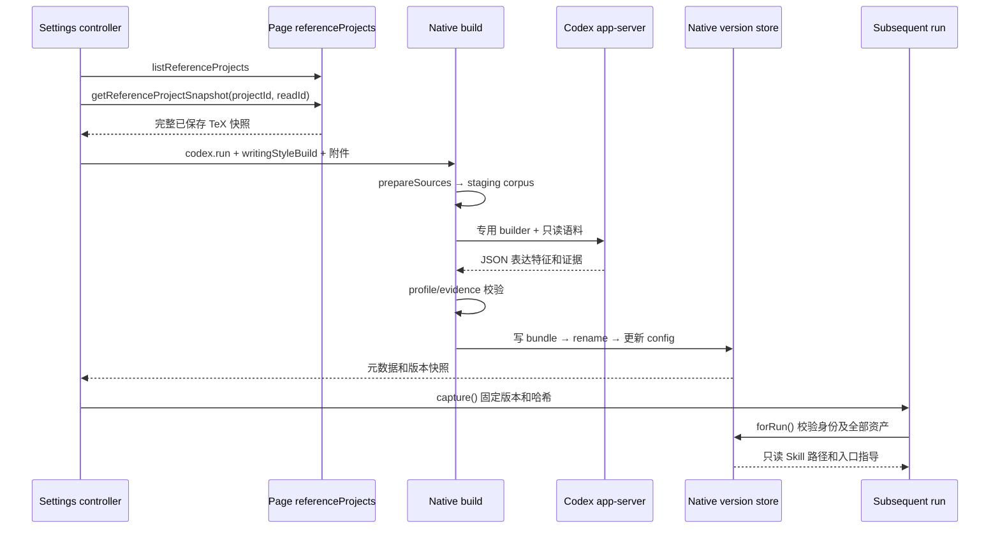

# 写作风格资产与技能

源码基线：`2073ae74747431aab8d529803d4e9f8197262388`。
本页说明风格资产的生成、发布、消费与普通技能的安装边界；源码推导、局部测试覆盖和完整生成验收分别说明。
入口：[架构指南](README.md) · [功能修改索引](feature-map.md) · [运行状态与恢复](run-state-and-recovery.md)。

## 功能边界与术语

Write in My Style 从参考资料提取有出处的表达习惯，为目标项目生成可复用的只读资产。
生成使用当前模型和 Provider；后续任务捕获具体版本，按需将表达习惯应用于学术写作。
普通 Skills 另有安装、发现与调用流程，两套生命周期须分别定位。

| 对象 | 权威位置与作用 | 不应推导的保证 |
| --- | --- | --- |
| 本地 Codex skills | 用户 Codex home；由 `loadCodexLocalSkills` 控制继承 | 启用开关不证明任意技能在当前运行中一定被调用 |
| Codex Overleaf skills | `getCodexOverleafSkillsRoot()` 下的 `<id>/SKILL.md` | 文件存在不证明内容可信或任务执行成功 |
| 项目本地 skills | 镜像项目根的 `.codex-overleaf/skills/<id>.md`；兼容 API 及选定内容注入 | 当前 Settings 列表并未切换为项目 skills 列表 |
| 参考草稿 | `WritingStyleSettings` 内存中的项目选择、PDF File、dirty 标记 | 修改草稿不会立即替换已有风格 |
| 语料与证据 | 抽取正文、出处映射、精确引用及表达模式 | 参考论文的结论、方法和章节结构不成为目标论文要求 |
| 风格版本包 | `versions/<uuid>/` 中的 Skill、references、corpus、manifest | 本地权限与哈希校验不等于完整安全沙箱 |
| 运行风格快照 | 账号、目标项目、版本、manifest 哈希 | 当前 Settings 开关不追溯改写已提交快照 |

路径及技能 scope 的定义见 [localSkills](../../native-host/src/localSkills.js) 的 `SKILLS_DIR`、`CODEX_OVERLEAF_SKILL_SCOPE` 与 `getCodexOverleafSkillsRoot()`。
生成画像的 `traits` 表示表达特征，例如句子节奏或转折习惯；`sections` 仅用于索引证据位置。
章节标签像书签，帮助定位例句；生成器明确禁止把它升级成目标论文的结构模板。

## 主 owner、协议与消费者

| 决策或数据 | 主 owner 与实际符号 | 调用方或消费者 |
| --- | --- | --- |
| 选择、开关、预览、生成 UI | [writingStyleSettings](../../extension/src/content/writingStyleSettings.js) `create/ensureLoaded/capture/generate` | [contentRuntime](../../extension/src/content/contentRuntime.js) 的 `writingStyleSettings` 组合位置 |
| 已登录账号的参考项目目录与读取取消 | [referenceProjects](../../extension/src/page/referenceProjects.js) `create/listProjects/readProject/cancelRead` | [pageBridge](../../extension/src/pageBridge.js) dispatcher；content 注入的依赖 |
| 引用快照及资源上限 | [shared/writingStyle](../../extension/src/shared/writingStyle.js) `normalizeSnapshot/REFERENCE_LIMITS` | Settings、Native、执行快照 codec、存储压缩 |
| Native 配置、版本及生成 | [writingStyleRuntime](../../native-host/src/writingStyleRuntime.js) `get/set/build/forRun` | [taskRunnerRuntime](../../native-host/src/taskRunnerRuntime.js)、[codexSessionRunner](../../native-host/src/codexSessionRunner.js) |
| 生成结果的结构与证据 | [writingStyleProfile](../../native-host/src/writingStyleProfile.js) `validate/renderGuide/renderSection`；[writingStyleEvidence](../../native-host/src/writingStyleEvidence.js) `resolveExample/renderExample` | `build()` 的 `parseResult()` 和资产渲染 |
| 普通技能 CRUD | [localSkills](../../native-host/src/localSkills.js) `installProjectSkill/installCodexOverleafSkill/removeCodexOverleafSkill` | `handleSkillsList/handleSkillsInstall/handleSkillsRemove` |
| 技能发现环境 | [codexHome](../../native-host/src/codexHome.js) `preparePluginCodexHome/composePluginSkillsDirectory` | Codex app-server 启动；普通及 installer 轮次 |

Page RPC 名称为 `listReferenceProjects`、`getReferenceProjectSnapshot` 和 `cancelReferenceRead`。
[pageRpcContract](../../extension/src/shared/pageRpcContract.js) 将前两者归为可安全重试的读取，取消归为幂等控制。
目录与参考读取不要求当前编辑器项目身份；实际参考目标由 `readProject(params.projectId)` 校验。
参考读取通过独立 `requestId` 取消，不能从通用 `content_abort` 标记推断其取消路径。
Native 配置请求是 `writing-style.get/set`；生成复用 `codex.run`，以 `params.writingStyleBuild` 分流。

## 从参考草稿到后续运行

### 参考读取与封装

`generate()` 复制本次选择，并在读取前捕获当前 model、reasoning effort、speed tier、Provider selection 和 locale。
项目目录通过同域 `/project` 的已登录请求获取，排除回收站，保留归档项目。
`parseCatalog()` 检测不完整目录；失败不回退为近期记录列表。
`readProject()` 经 `snapshotRouter.fetchProjectZipSnapshot()` 获取指定参考项目的已保存内容，不切换编辑器。
读取只保留 TeX 文件；跳过 TeX、缺内容、数量超限或字节超限均导致失败。
`referenceTextComplete: true` 表示这条参考通道的 TeX 完整性声明，与普通项目快照能力须分别理解。

PDF File 在 content 内存编码为 Base64；项目快照编码为 JSON 附件，随后与来源描述关联。
来源描述仅用 `attachmentId` 引用附件；Native 再检查项目 ID、时间戳、文件路径和完整性标记。
再次生成时，项目来源重新读取；已保存 PDF 来源可通过 `reuseSnapshot` 和 `sourceId` 复用抽取语料。
复用先检查旧快照账号、项目与 manifest 哈希；旧 PDF 原始字节不属于版本包的必需资产。
参考附件路径见 `readReferenceProjectAttachment()` 和 `prepareSources()`，不能直接套用普通聊天附件的物化规则。

### 专用生成与证据验证

`handleCodexRun()` 将 build 请求固定为 Ask，关闭 `useExistingMirror`，清空 `fileOverlays` 和 `writingStyle`。
生成仍使用 Native 请求、项目锁、Provider 解析及取消控制；进入 `runCodexSession()` 后先分流到 `build()`。
这条分支不要求普通编辑任务的镜像快照证据，也不进入普通附件物化及差异写回链。

`projectDocument()` 选择主 TeX，递归展开 `input/include`，过滤导言、注释和参考文献，并记录源路径及行号。
该过程采用启发式抽取，不执行完整 TeX 编译；缺失 include 和越界路径会失败。
当前引用路径按引用文件所在目录拼接：`path.posix.join(path.posix.dirname(name), match[1].trim())`，规范化后先查原路径，再补 `.tex`。
例如 `main.tex` 引用 `sections/methods.tex`，后者含 `\input{common}`，提取器会查找 `sections/common.tex`；即使项目根已有 `common.tex`，也不会回退到该文件。
这限定了提取算法与项目目录布局的兼容范围；完整快照不保证提取成功，宏包或实际编译入口采用的路径规则也不能由该算法推定。
PDF 经 [writingStylePdfWorker](../../native-host/src/writingStylePdfWorker.js) 的 PDF.js worker 提取文字、记录页码；没有 OCR。
`prepareSources()` 过滤部分页眉页脚，检查可读性并按正文哈希去重，再把带编号语料写入 staging。

`build()` 使用 [writing-style-builder/SKILL.md](../../native-host/src/skills/writing-style-builder/SKILL.md) 作为专用任务。
执行参数为新会话、`read-only`、`approvalPolicy: never`，关闭本地和 Overleaf skills，并剥离已知内建技能。
`createRecoveringStyleRunner()` 可为兼容模型要求重选本地 CLI；其一次恢复重试与 JSON 校验后的修复重试分别计数。
恢复入口见 [codexModelRecovery](../../native-host/src/codexModelRecovery.js)，模型、Provider 和输入保持本次选择。

`parseResult()` 解析返回 JSON；`validate()` 要求 3–8 个特征、至少三个维度及可追溯例句。
每个例句必须支撑特征，多来源画像需引用至少两个来源；章节组拒绝 `guidance` 字段。
`resolveExample()` 验证精确连续引用、语料行范围、完整句尾以及 TeX 括号和环境平衡。
结构或证据验证失败可修复一次；证据不足、提取失败等错误不统一归为可修复 JSON 错误。
这些校验保证结构及引用约束；表达观察的真实性和迁移质量仍需人工或专项评估。

## 身份、资产发布与应用

风格身份分为资源作用域、视图代次和不可变引用：

\[
I_{scope}=(accountScopeId,projectId),\quad
I_{view}=(I_{scope},epoch),\quad
I_{style}=(I_{scope},version,bundleHash).
\]

| 字段或记录 | owner | 含义与检查 |
| --- | --- | --- |
| `accountScopeId/projectId` | content 捕获，Native `scopeOf()` 验证 | 目标风格归属；参考项目 ID 另存于来源描述 |
| `epoch` | Settings controller | 作用域切换后递增；迟到读取和 UI 响应不进入新视图 |
| `revision` | Native `config.json` | 每次配置保存递增；生成结束时比较已读取的修订，决定是否沿用较新的启用偏好 |
| `building.id/requestId/pid` | Native build/config | 构建所有权、取消路由及中断检测 |
| `version` | Native UUID | 指向发布的版本目录；后续配置可切换当前版本 |
| `bundleHash/files` | manifest 与 `safeBundleText()` | manifest SHA-256 加每个资产哈希，运行前验证 |

`scopeOf()` 默认使用插件私有根下 `writing-styles/<account-hash>/<project>/`；可由 `CODEX_OVERLEAF_WRITING_STYLE_ROOT` 覆盖根路径。
配置保存采用临时 JSON 文件 rename；版本在 `.build-<uuid>/bundle` 完整写好后 rename 到 `versions/<uuid>`。
manifest 记录账号哈希、目标项目、模型、来源元数据、特征索引、章节及文件哈希。
资产文件创建权限为 `0400`，目录使用 `0700`；`versionRoot()` 和 `safeBundleText()` 拒绝版本目录或目标文件本身为符号链接，并检查哈希；平台权限效果仍有差异。

`build()` 发布前核对已读取的 `latest.building.id`，发现构建归属已变化时停止发布。
仅当该次读取的 revision 等于构建开始后的预期值，才采用 `enableAfterBuild`；否则保留该次读取的开关状态。
从读取 `latest` 到保存配置的这段实现为同步调用，但保护范围不能推广到多个 Native 进程。
[taskRunnerRuntime](../../native-host/src/taskRunnerRuntime.js) 的 `acquireProjectLock()` 使用进程内 Map；[writingStyleRuntime](../../native-host/src/writingStyleRuntime.js) 的 `saveConfig()` 根据传入对象递增 revision，没有在提交时比较磁盘当前修订。
原子 rename 保证配置文件完整替换；这里没有跨进程的 compare-and-swap（先核对当前修订仍等于预期，再提交）契约。其他进程在 `latest` 检查后保存的开关或构建归属，仍可能被后续旧对象覆盖。
版本目录 rename 与 config 更新是两个步骤：目录发布成功不单独证明当前配置已切换。
既有版本不会在成功更新时删除；当前模块没有版本垃圾回收或专用删除 API。

`capture()` 要求当前设置已加载；启用但未 ready 时拒绝提交，关闭时返回 null。
`contentRuntime.runTask()` 在等待设置后复核账号及项目；排队任务通过原执行快照恢复风格。
[runExecutionSnapshotCodec](../../extension/src/shared/runExecutionSnapshotCodec.js) 的 `normalizeSnapshot()` 固定风格字段；[storageRunActions](../../extension/src/shared/storageRunActions.js) 保留规范化引用。
`forRun()` 根据快照读取指定版本，验证目标作用域、manifest 和全部声明资产，随后返回 Skill 路径及入口文本。
普通 `get()` 通过 `readBundle()` 读取 manifest 后即可返回 `ready: true`，未逐一验证全部声明资产；`includePreview` 也只检查预览所读取的文件。
因此已发布、元数据可读及全部资产可消费需要分别取证；消费限额与发布前验证的缺口见下文“限额与资料流向”。
普通父任务与 broker worker prompt 使用同一风格上下文；installer 轮次跳过该上下文。
快照为 null 时明确要求当前运行不沿用早前风格，避免同一模型会话中的历史指令残留。
后续资产读取由 agent 按需求完成；引用版本不会扩大当前运行的编辑范围或改变 Track/Undo 规则。

## 取消、导航与失败恢复

| 情况 | 当前处理 | 需要保留的边界 |
| --- | --- | --- |
| 读取阶段取消 | `cancel()` 调用 `cancelReferenceRead(readId)`；page AbortController 中止下载 | PDF 的 File 编码完成前后依赖取消检查，不代表编码瞬时中断 |
| 生成阶段取消 | 已知 requestId 时发送 `codex.cancel`；requestId 迟到后再次检查 cancelled | 请求已发出与进程停止已确认分开取证 |
| 切换账号/项目 | `alignScope()` 清空 UI 状态、增加 epoch，并取消仍在读取的引用 | 已进入 Native 的生成没有由此自动发送取消 |
| 生成失败或取消 | 进入 `try` 后，`catch` 在配置仍可读写时清除属于该 build 的 building 状态并写错误；保留已有 version | 初始化及配置读写失败另有边界；未 ready 的首次生成仍无可应用版本 |
| 当前版本目录或 manifest 损坏 | `get()` 读取当前版本时报错，即使 enabled 已关闭；`set(false)` 可能先保存成功，再因返回 `get()` 结果失败而报错 | 关闭状态落盘、RPC 成功及 UI 显示分别取证；该故障还可能阻塞新的普通提交 |
| Native 任务中断 | `get()` 根据 PID 存活及同进程 active request 检查纠正 building | PID 检查不构成跨重启的完整事务恢复证明 |
| 进程停止未确认 | `keepStaging` 保留临时目录，并通知停止屏障 owner | 不能无条件宣称取消后临时语料已经删除 |

进入 `try` 后，正常成功或确认失败均会经过 `finally`，在未设置 `keepStaging` 时调用 staging 删除；已发布版本另行保留。
`build()` 在进入 `try` 前已创建 staging、调用 `config()` 并保存 building。配置 JSON 损坏或初始保存失败会跳过这段 `finally`，可能留下空 staging；此时尚未执行资料抽取。
`writeJson()` 的临时配置文件也没有失败清理分支，写入或 rename 失败时不能保证该临时文件已清除。

关闭风格时，[writingStyleRuntime.set()](../../native-host/src/writingStyleRuntime.js) 先调用 `saveConfig()`，随后调用 `get()`；后者只要存在 `state.version` 就读取 manifest。
若此读取失败，[taskRunnerRuntime](../../native-host/src/taskRunnerRuntime.js) 的 `writing-style.set` 分支返回错误，[writingStyleSettings.toggle()](../../extension/src/content/writingStyleSettings.js) 则按旧 meta 恢复开关显示。
[contentRuntime.runTask()](../../extension/src/content/contentRuntime.js) 对非队列提交先执行 `ensureLoaded(true)`，因此即使风格已在磁盘上关闭，版本目录或 manifest 损坏仍可能阻塞新任务；直接携带 null 风格快照进入 `forRun()` 的行为应另行理解。
这些静态错误路线未提供损坏资产后的自动降级或修复保证；故障验证需区分普通资产内容损坏与 manifest 读取失败。
跨视图刷新用 `CHANGE_KEY` 写入账号、项目、时间和 nonce，然后其他 controller 重新向 Native 读取配置。
该浏览器通知只负责失效提醒；Native `config.json` 才决定权威启用状态。

## 限额与资料流向

限额权威来源为 [writingStyle.REFERENCE_LIMITS](../../extension/src/shared/writingStyle.js)；Native 接收侧使用 [nativeQuotas](../../native-host/src/nativeQuotas.js) 的 `WRITING_STYLE_ATTACHMENT_QUOTAS`。
当前为最多三份资料，PDF 单份 20 MiB、合计 40 MiB，项目 JSON 附件最多 4 MiB，总附件原始体积最多 44 MiB。
PDF worker 超时为 90 秒、最多读 80 页；抽取后的正文按约 60,000 字符采样，单行加入时可能越过字符阈值。
TeX 引用正文也有约 60,000 字符及 80 个文件遍历界限；目录与文件完整读取不表示全部内容最终进入模型语料。

输出资产另受 [writingStyleRuntime.safeBundleText()](../../native-host/src/writingStyleRuntime.js) 的单文件 `text.length <= 800000` 限制；这里按 JavaScript 字符串长度计数，与输入的 UTF-8 字节配额不同。
`build()` 将全部 documents（包括正文及逐行 origins）序列化到 `references/source-index.json`，发布前未调用同一消费校验。
出处路径逐行重复会放大索引：例如三份各约 3,000 行、每行 20 字符、出处路径约 100 字符的 TeX，仅正文加重复路径就约为 \(3\times3000\times(20+100)=1{,}080{,}000\) 字符，尚未计 JSON 字段。
该估算说明合规输入可能生成超限资产，实际输出大小需用合成资料验证。普通 `get()` 仍可能返回 ready，而 `forRun()` 的全资产检查及 `prepareSources()` 的 saved 来源复用会在读取该索引时拒绝。
`Known gap`：发布前缺少与消费层一致的全资产可读性及大小检查；正文采样上限不能单独证明版本包可消费。

Base64 字节预算为 \(E=4\lceil B/3\rceil\)，还需预留 JSON 和请求元数据。
44 MiB 附件预算使编码结果加预留低于浏览器 64 MiB 消息上限；普通聊天附件配额保持独立。
变更阈值须同时核对 UI、共享常量、Native 校验、PDF worker 和消息封装；只改错误提示无法扩容。

| 数据 | 持久化与出站事实 |
| --- | --- |
| 项目目录与未提交 PDF | controller 内存持有；该 controller 不把列表或 PDF 字节存入浏览器持久状态 |
| 参考 TeX/PDF 附件 | 经浏览器后台送 Native；build 独立抽取，不进入普通 turn attachments 物化 |
| 抽取语料、出处、生成指导 | staging 及成功版本包落盘；Codex 可读取并交给所选模型处理 |
| 原 PDF 字节 | 用于 worker 提取及文件哈希；build 未将原 PDF 写入版本包 |
| 版本快照 | 可随队列及运行记录保存；仅包含身份、版本、哈希与标签，不含语料正文 |
| Provider secret | 由独立 Provider 管理流程处理；风格资产不保存 API key |

`generate()` 直接进入 `startBuild()`，当前调用链未经过普通 `contentRuntime` 的项目敏感文本扫描。
`writingStyleRuntime` 的可读性、大小和证据校验也未替代敏感信息扫描；维护数据出口时须单列此通道。
生成器提示将参考材料内的指令视为数据，资产入口要求服从当前任务与项目规则；这些提示需与实际权限边界分别评估。

## 普通技能安装、继承与作用域

`LocalSkillsPanel.refreshLocalSkills()` 请求 `skills.list`，当前 UI 使用 `scope: codex-overleaf`。
`handleSkillsList/Install/Remove` 对该 scope 调用插件技能库，其余请求进入项目技能接口并要求项目 ID。
`installCodexOverleafSkill()` 与 `installProjectSkill()` 校验安全 ID、文本类型、NUL、64 KiB 限额及符号链接路径。
插件技能默认位于用户主目录 `.codex-overleaf/skills`；自定义根也必须留在该默认根内部。
插件技能 scope 没有按 Overleaf 账号或项目进一步隔离；项目技能则依附具体镜像根。

官方 `annotated-rewrite` 和 `parallel-subagents` 由 `ensureDefaultCodexOverleafSkills()` 补装，删除接口禁止移除官方项。
现有正常 `SKILL.md` 会保留；升级 bundled 文件不自动覆盖该已安装文件。安装接口的覆盖行为与补装行为分别核对。
安装时的文本和路径校验不审查技能语义，也没有风格画像所用的证据验证和不可变版本发布。

`preparePluginCodexHome()` 默认维护插件专用 home，复制部分认证/配置，并移除继承的全局 AGENTS、rules、memories 及顶层 personality 配置；显式配置与用户 home 同路径时会提前返回，不能推广默认隔离结论。
开关决定用户 skills、plugins、superpowers 等继承；`vendor_imports` 有单独规则，不能将关闭本地技能描述为目录完全空白。
`composePluginSkillsDirectory()` 先组合本地技能，再组合插件技能；同名插件技能覆盖组合目录中的本地入口。
默认插件 home 由 `getPluginCodexHome()` 选定，各项目和 runner 共用同一目录。`runCodexAppServerProcess()` 每次启动均调用 `buildCodexHomeEnv()`；正常组合路径先删除 `$CODEX_HOME/skills`，再按本次开关重建。
因此技能目录并非运行快照：另一个项目、worker 或风格生成准备环境时，可能影响活跃任务已发现的技能路径。风格生成的两个技能开关均关闭，重建后先前组合目录中的路径可消失；原技能源文件仍可能保留。
[taskRunnerRuntime.acquireProjectLock()](../../native-host/src/taskRunnerRuntime.js) 仅按项目加进程内锁，没有为共享 home 提供跨项目互斥。worker 继承技能开关也不意味着拥有独立技能目录；app-server 缓存如何影响后续发现和读取仍需集成验证。
普通 runner 将选定项目技能作为 prompt 内容传递，并向底层执行器传 `projectLocalSkills: null`；home 的项目技能物化能力另有调用条件。
主开关及单技能启用 map 由 [projectSettingsCoordinator](../../extension/src/content/projectSettingsCoordinator.js) 与 [globalPreferences](../../extension/src/shared/globalPreferences.js) 协作保存。
`loadSelectedCodexOverleafSkill()` 按主开关及 enabled IDs 检查显式调用；未提供 enabled IDs 的兼容请求默认允许所有项。
`composePluginSkillsDirectory()` 不按该 ID 列表筛选整个注册目录；单技能开关的效力不能直接推广为全目录不可发现。

`skill-installer` 是特殊调用：工作目录改为插件技能根、沙箱为 workspace-write、`approvalPolicy: never`，拒绝附件和选区，并返回空项目 sync changes。
准备 installer 时，`$CODEX_HOME/skills` 映射至持久插件技能目录；风格生成使用独立 staging，不走这条安装路径。
该映射仍受共享 home 重建影响：另一个普通运行可以删除符号链接并重建组合目录。若尚在运行的 installer 随后按 `$CODEX_HOME/skills/<id>` 写入新技能，内容可能只落在组合目录，未进入持久插件技能根，并在下次组合时被删除。
installer 的工作目录与 `$CODEX_HOME/skills` 的实际解析目标须分别核对；应验证交错启动后的安装落点、后续列举和再次准备后的保留情况。
收到 app-server `commandExecution/requestApproval` 时，`decideSkillInstallerCommandApproval()` 委托 [commandApproval.evaluateSkillCommand](../../native-host/src/commandApproval.js) 判断。
该审批规则认可限定根内的只读检查及合规 HTTPS git clone，拒绝危险参数、额外 shell 操作和嵌套符号链接逃逸；不能据此声称所有安装命令均经过审批，也不因此信任所有 HTTPS 内容。
app-server 的 file-change approval 请求在 installer 轮次拒绝；该分支和底层 workspace-write 权限须分别理解。
installer 完成由模型运行结果汇总，当前路径未统一核验是否产生预期 `SKILL.md`、完整目录、版本及后续可发现性；成功文案需结合实际文件与加载证据判断。

## 修改路由与验证定义

| 修改意图 | 主改与必要联动 | 相关测试与验证范围 |
| --- | --- | --- |
| 参考选择、状态和预览 | `writingStyleSettings`；content 组合、Settings 挂载和 epoch | [p2UiRegression](../../test/p2UiRegression.test.js)，仅相关 UI 协调覆盖 |
| 项目读取与取消 | `referenceProjects`；snapshot router、page dispatcher、RPC 及加载清单 | [pageRpcContract](../../test/pageRpcContract.test.js)、[pageBridgeSnapshotCache](../../test/pageBridgeSnapshotCache.test.js) |
| TeX 引用路径与正文提取 | `writingStyleRuntime.projectDocument/prepareSources/build` | 需增加嵌套引用、根目录与子目录同名文件、扩展名补全及越界路径的合成验证；实际编译路径语义另行验证 |
| PDF/附件限额 | `REFERENCE_LIMITS`；`nativeQuotas`、worker、source preparation | [writingStyleLimits](../../test/writingStyleLimits.test.js)、[nativeQuotas](../../test/nativeQuotas.test.js) |
| 表达画像和证据要求 | builder Skill；`writingStyleProfile`、`writingStyleEvidence`、bundle renderer | 需增加针对 JSON 修复、证据匹配和发布失败的行为验证 |
| 版本捕获和队列恢复 | `capture/forRun`；execution snapshot codec、storage compaction、runner | [runExecutionSnapshot](../../test/runExecutionSnapshot.test.js)、[releaseBoundaryHelpers](../../test/releaseBoundaryHelpers.test.js) |
| 配置保存与异常资产恢复 | [writingStyleRuntime](../../native-host/src/writingStyleRuntime.js) 的 `get/set/build/saveConfig/writeJson/safeBundleText`；[writingStyleSettings](../../extension/src/content/writingStyleSettings.js) 的 `toggle/ensureLoaded`、[contentRuntime](../../extension/src/content/contentRuntime.js) 的 `runTask` | [writingStyleLimits](../../test/writingStyleLimits.test.js) 仅覆盖输入配额与编码预算；[p2UiRegression](../../test/p2UiRegression.test.js) 的风格依赖为同步刷新 stub。需增加关闭保存后读取失败、索引超限、初始化清理及跨进程竞争的合成故障验证 |
| 普通技能安装和开关 | `localSkills`、`codexHome`；panel、偏好、runner、command approval | [localSkills](../../test/localSkills.test.js)、[codexHome](../../test/codexHome.test.js)、[contentPanelModules](../../test/contentPanelModules.test.js)、[codexSessionRunner](../../test/codexSessionRunner.test.js)；共享 home 还需覆盖不同项目、worker、风格生成和 installer 交错准备后的路径稳定性与安装持久性 |

现有定义覆盖配额、RPC、快照、技能库与安装命令等契约；部分集成 harness 也加载参考模块。
profile/evidence/build 的专项验证需覆盖 JSON 修复、引用匹配、资产发布及失败恢复，不能仅由配额或 UI 协调用例推导完整生成行为。
完整链路验证应使用合成参考资料，分别证明取消、旧版本保留、跨项目迟到响应及资产损坏拒绝。

## 边界场景与验证要点

- 调换参考 PDF 后执行排队任务：`dirty` 草稿与已发布版本各有生命周期，应验证排队任务仍沿用提交引用。
- 生成中关闭 Settings 或切换项目：epoch 只阻止旧 UI 响应；Native 已开始的任务需要明确取消及停止证据。
- 完整读取选定项目目录：提取仍受主文件、include 路径解析、采样和可读性边界约束，需检查实际引用目标及来源 metadata 的 truncated。
- 生成章节例句：validator 拒绝章节 guidance，证据只支持表达特征；验证需确认目标事实和结构继续受当前请求约束。
- 更新源码内官方 Skill：`ensureCodexOverleafSkillInstalled()` 保留已存在的正常文件，需分别检查首次补装与既有安装的内容。
- 不同任务交错准备技能环境：核对活跃任务已发现路径是否仍可读取、installer 映射是否仍指向持久根，以及再次准备后新技能是否可发现。

`Target contract`：保留旧运行对旧版本的可解析引用；任何清理策略都需先定义队列、历史和活动运行的引用寿命。
`Target contract`：新增资料类型须声明读取身份、字节/编码预算、抽取方式、出站、持久化、取消和清理条件。
完整生成与恢复验收需要串联 Settings、Native build、版本发布、后续运行消费和异常恢复；局部测试及静态推导各自保留其适用范围。
